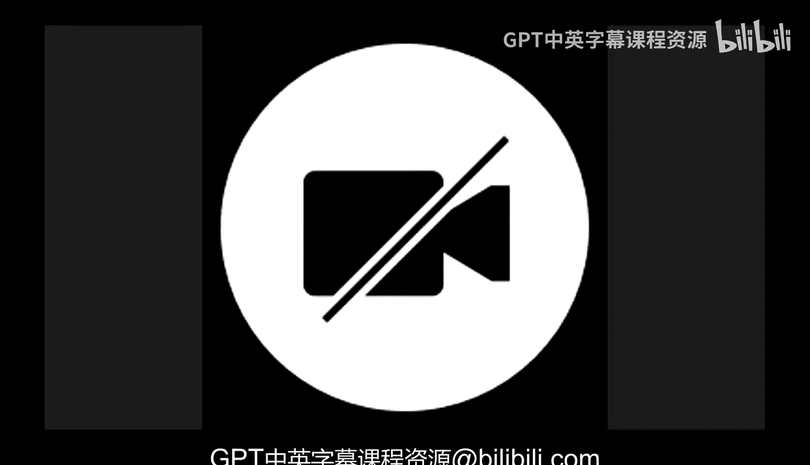
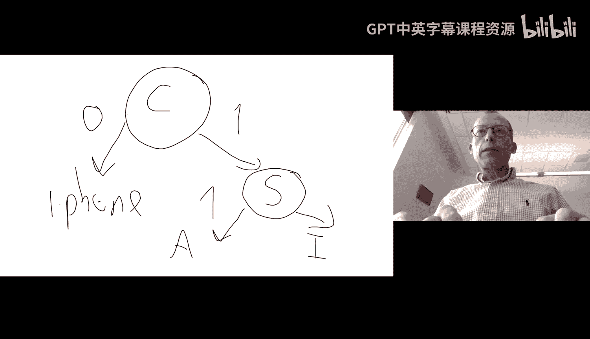
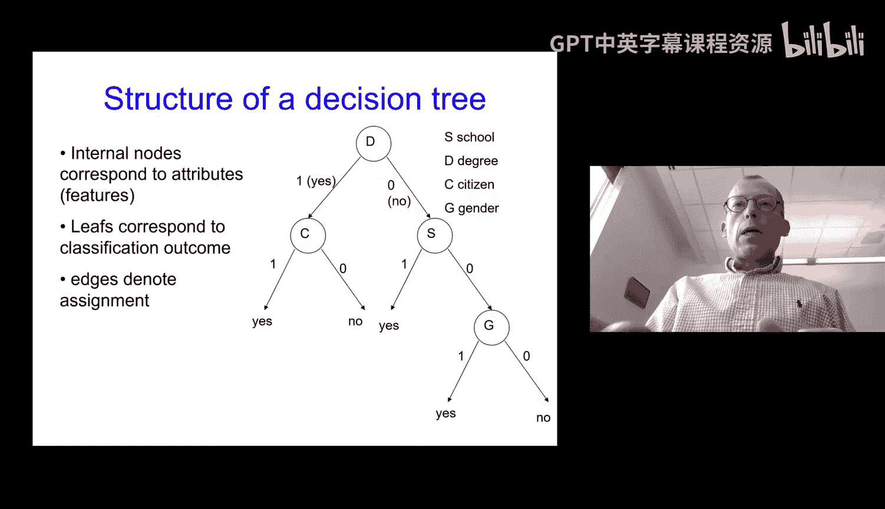
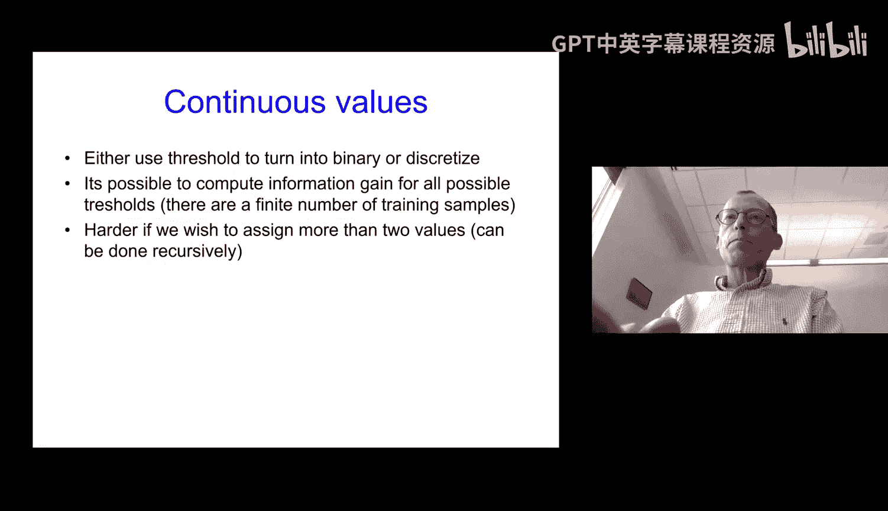
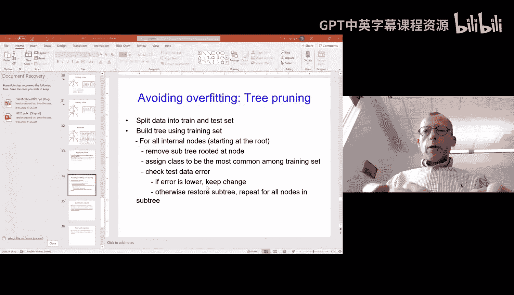
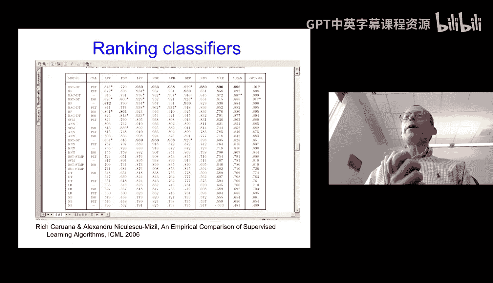

# CMU《机器学习导论（研究生）｜10-701 Introduction to Machine Learning 2020》中英字幕 p05 [05]10-701 Lecture 5  Decision Trees.zh_en [BV144SuB8ETp_p5]

Okay， welcome back everybody， so today we continue。😊。

Discussing supervised learning so the first part as I said is going to be on supervised learning。

 we discussed a few supervised learning methods including Can nearest neighbors nab today we are going to discuss another supervised learning method called decision we as always。

 if you have any question either raise your hand or post to the chat and Daniel will alert me and if he doesn't I。

Some of your questions will be answered， but if not， he will stop me and I'll answer the question。

Okay， so let's move to today's topic， which is， as I said。

 decision trees and maybe some extensions of decision trees。😊。

So again just to orient us we are talking about supervised learning within supervised learning we are still discussing classifiers。

 we said that's not the only supervised learning approach。

 there is also something called regression and we'll get to that actually next week but today we are still discussing classifiers and within classifiers we divided the set of classifiers into three large families so these are not individual classifiers each family or each family has a lot of or can have multiple classifiers。

But we generally divided them into instance based classifiers。

 we showed an example K nearest neighbors， we had a generative classifier which is na based。

 which you can generate new instances once you learn a classifier and also classifiers that usually rely on the base decision rule。

And now we are moving to something called discriminative classifiers and in fact most of the I would say all of the classifiers we are going to talk on from now on we are going to talk on later in the class including logistic aggressions support vector machines and of course neural networks are discriminative classifiers these classifiers unlike generative classifiers do not necessarily assume a probabilistic model。

 sometimes they do but they don't necessarily but they don't assume a generative model。

 so generative means that once you know the model you can generate new instances。

Discriminative classifiers either do not assume any probability like decision trees that we'll talk about today。

 or if they do use probabilities like logistic aggression。

 they use it directly so they try to directly predict P of y given x without using base to predict P of x given y so they don't have a way of learning the distribution of P of x given y this is why they'll call discriminative they are trying to find just the value of y without any attempt to model how the data was generated。

😡，And these actually are the more successful or more a well at least the current most successful algorithms are discriminative classifier。

 so obviously you've whole held about neural networks and they are obviously very。

 very successful and powerful， but decision trees and more importantly extensions of decision trees are also very very useful and in some domains they're even better than neural networks so discriminative classifier。

actually， I would say the most successful， at least nowadays。

In terms of the and the most used classifiers as well。Okay， so what is a decision three？😡。

So a decision three is a very intuitive classifier。

 if I had to guess I would say this is the classifier people have used the first classifier people you' used even before machine learning or AI。

 I guess a century or two centuries ago。😊，You could easily construct the decision tree maybe it wouldn't have been as as good as what we can do today。

 but it's very intuitive Okay so before we so I'm going to do slightly something slightly different before we go into the theory and algorithms and explanations of how we we design a decision tree let's do a decision tree a crude one so it's not going to be the optimal decision tree but it will provide information on how decision trees look and what they do so for that I'm going to do a poll So this is not a quiz now it's going to be a poll so I'm going to open the piazza before I do that in this case we need a training set and a test set so I'm going to ask everybody。

Okay， so everybody whose last name。😡，Okay last name starts with RSOT okay RSOT I just looked at the roster and it seems like this is like 10% of the students so anybody whose last name starts with RSOT don't feel up the poll you will be out testedested and you will do another thing at the end okay but for now you sit out and everybody else I'm going to open four questions please answer them as always these are completely anonymous no great I mean this is just some questions about you but they are anonymous I have no idea who is who so feel free to answer and you will say it's not related to any issues so right so I'm going to open open piazza I'm going to release four questions there about your phone your cell phone。

And we'll try to build a classifier based on that。Okay， so I'm releasing the。嗯嗯。

The questions and again， if your last name starts with RSOT， please do not。😡。

Complete these or don't fill up these quizzes， these polls。So right， so Apple。

Is going to be pretty happy with the viance of this poem， it seems。嗯。But hopefully we can do some up。

 now there is some cases where it's not doating good， so it seems like。A PhD students， no。

 that's actually not working well for us。Yeah， this is the best one I would say。嗯。

So male are more evenly divided up good。Okay， so we are looking for something that will distinguish a iPhone from non iPhone。

Users and。嗯。It seems like citizens。Have more on average， have more phones， have more Android。

 at least slightly more and people who are not citizens have more。Oh that's also true for STS， good。

 okay， so let's build a decision tree as follows。😊，So we have citizen， we said SCS and then I think。

Which one is？So we are going to use， we don't have to use all of the questions。😡。

But let's build a decision tree and see and of course this is not going to be optimal because I didn't ask for the relationship we'll get to that。

 but let's start by building a decision so a decision tree is basically instead of questions。

 each one has either two or more answers for now we will assume it has two answers and each one sends you either to another question or to a decision。

😡，So let's say that we are asking whether the first question is our US citizen。😡。

If you are a citizen then。Then I can I can say， so this is let's say one， this is yes and zero。

 it's no okay。So this is the first question， so I'm asking whether we were a citizen and now I can ask another question。

😡，Whether you are an STS student。😡，Okay， so let's say if you're not a citizen I'm going to predict this。

 so this is something called an internal node， it has a question and then there is terminal nodes。

 terminal nodes are are the basically。😡，The decisions so I'm going to say iPhone here okay。

 so if you are not a citizen， I'm going to predict that we will predict that you are going to have an iPhone。

😡，If you're a citizen， I can ask another question or I can make a decision in this case I want to ask another question whether you are an STS student。

😡，If you are an SDS student， I would say you have an Android phone。😡，And if you are not。😮，This is。

 if you are a citizen， I would say you have an knife。😡。

Okay so this is a full decision tree now again， this is not the best way to learn it because we don't really know what's the relationship between citizens and students and STS students the from the questionnaire but definitely this is a reasonable decision tree and what the tree again what the three says is that now you're on a new sample you're on a new test case maybe one of the RS and T students in the class you look at the tree and you start going according to the question so the first thing you ask yourself is MI a citizen if yes you're going to the right if not you're going to the left if you're not a citizen then the prediction of the tree is that you have an iPhone。

😡，If you are a citizen， then you have another question to ask yourself or you STS student if yes going to the left。

 then the prediction would be Android if no they're going to the right and the prediction would be the join iPhone okay so this is the prediction that we are making and now I want our test set。

😡，To do the poll that I'm releasing only the RS&T that didn't do the actual iPhone and let's see if we got them correct。

 please fill in the poll that I opened up， which is called a DT test。

If you're only if you're R S and T and so check if the basically。You should see。

 I think my screen so you should see our three and if our three got you correct just。

So know， if you are RS&T， just use the three and let us know if we got you correct or not。

Let's see that。Msod worked。Not good that's it only four people are there should be more now if we have AI would imagine at least eight good we're doing better。

啊。Okay， good， so8 is more or less what I expect， maybe we have or even better。啊。Okay， so yeah。

 So let's see the results。😊，So decision tree wasn't a good last minute change or decision3 walked and it got more correct than it correct it's not of course optimal but at least it's very simple to write a decision tree and hopefully very clear what the decision tree doing。

 the big question for us or the big challenge is what are the questions that we should ask and how we should assign the labels but other than that when you see a decision tree right if I show your a decision tree it's very clear what the decision tree is using and how it's using it right unlike for example。

 if you look at the support vector machine result on neural networks it's very hard to understand what each of the internal node is doing but in the decision tree it's much easier to understand that's why it's very popular especially in domains like sciences where you can not just about the accuracy which is something we care a lot about but also about explainability which is very how to do in some of the other machine learning。

So decision is very good again this was very informal so the rest of the lecture the lecture is going to be about how to do this formally and accurately but。

😊，I mean， unlike other methods which I mean， let's say suppose vector machine。

 there's no way for me to show you this informally。

 only through formal decision three is actually something I can show you informally。

 which is I think nice and also makes it very important okay。😡，So this was just an example。

 and let's go a bit more formally， as I said， about what is the decision tree and how we construct the decision tree。

 which questions are we going to ask and how we are going to use it？😡，Okay， so this is the extreme。

Okay， so decision2s a。As I said easy need to understand the nice thing about decision treess is that in addition to being very intuitive。

 they also walk well， decision trees themselves actually do not work amazingly well。

 they're not bad but not they don't work very well。

 but pretty simple extensions of decision treess work very well and we'll get to that later in this lecture or maybe next time we'll see。

😡，Okay， so we built a decision tree， but now let's discuss this a bit more formally right so this is the structure or the graph of a decision tree。

😊，ADeci tree has a set of nodes internal node that these corresponds to questions on the attributes。

 So basically these are the features that we have， for example。

 which school you are going to what is your degree。

 whether you're a citizen or not what is your gender and we can have。

 of course other features these are the inputs for our samples and these can occupy internal nodes and there is answers。

 yes or no depending or there could be I mean this is for binary。

 but there could be right there could be multiple questions， for example。

 whether we are in the School of computer Science School of Engine or School of Sciences。

 So this would be three different answers， it doesn't have to be it doesn't have to be a binary question necessarily it could be for multiple answers we will get I'm not going to talk about continuous value we'll get to them later For now we assume that every all the features are okay binary or disagree。

So this is the questions that we have and these correspond to internal nodes to questions and then the leaves。

 basically the terminal nodes correspond to the prediction of the decision thing so this is the classification。

Do you have an iPhone or you don't have an iPhone， Okay， yes or no。😡。

And edges are the basically that the answers to the questions which feature we are going to use okay。

 so this is how a decision really looks like and you can have you know one layer。

 you can have two layers， you can have 10 layers， you can have。😡。

A lot of layers and we'll get to how many layers later。

You can have a lot of layers in the decision tree， so you can ask a lot of questions one after the other and then make a decision。

Okay， so how do we build a decision to， I'm going to use an example based on the Netflix challenge。

 so a long time ago Netflix。😡，And。I mean they're still very interested so Netflix of course the goal is that you remain signed in。

 they don't want you to live so they want to be able to recommend good movies for you and for that they have an extensive an extensive database of things that you liked and they want to use it to predict what is the next or what is the next series or movie or whatever that you like and the goal is to predict your interest in a specific movie or series based on your previous history of watching series and for that they have a big I mean they have a lot of they have a lot of data and our goal would be to build a decision to to predict whether people would like a specific movie or not okay and this seems like you know it's not a theoretical thing people are using it。

 Netflix actually had this big competition。A few years ago to try to improve the algorithm。😡。

And and they gave， I think， a few hundred thousand0 maybe a million dollars to those that succeeded。

 and anybody knows， by the way of another company that did the。

Such competition that basically gave out a database and asked people to improve their algorithm that actually ended the year ago。

And to make predictions， but you heard about these type of competitions。

 but this one actually was a million dollar competition you could have won。Not Facebook。

 not Kagel has a lot of competition， no， no， keep posting know。

I don't know about Hulu as far as I know Hulu didn't do it great Jason Suu I don't know who it is。

 but Jason Xu is correct， Zeillo is a real estate company。

That if you go online gives you a prediction， they call it。The estimate。

 I think it's their predictions about how much house should cost basically your house or if you want to buy another house。

 how much it would cost and they have a big interest in getting it right because if they don't get it right。

 let's say。You know， they tell you that your house is worth more than it is。

 then it will just sit on the market for a long time and if they tell you。😡。

That it's less than you might lose money so they are trying to improve their algorithm and they released so they have already very good predictions and they asked other people to and that actually that data I think is available on Kaggle and this was a competition that people have participating in and with very big prize the improvement was actually pretty small they already had a very good algorithm but people were able to improve it and someone did win some group won the prize it turns out by the way that the winning strategies not really those that came up with this amazing new classification algorithm that doesn't work in real life but does work is a very manual engineering of how different things are put together so a lot of different types of classifiers put together and will get later in the class about one idea of how to do okay but generally these type of competitions happened from time to time。

Interesting to follow。But we are going to focus on the next week's competition。

 which was a few years ago， so let's say this is the database that you have。😡。

And so these are this is the data so this is the features。

 the type of the movie and you can see we have more than two length director。

 whether it had famous factorss and this is the label。

 whether I liked it or not and our goal is to build using this data set to build the decision tree to predict this label okay not so that's the goal how do we do it。

😊，So these are called attributes or the features and this is obviously the label。

 the prediction of cluster。So this is the algorithm for building a decision three that's it it's a reassive algorithm but it's very compact right I mean you will see for other algorithms we will have to work a bit harder than just writing it in a pseudo code but this is basically the algorithm for decision the algorithm gets us input。

😊，Two values， one is the number of samples n。And a is basically the samples that we have。

 and a is the set of attributes。😡，Okay， attributes， we said are the features that we have you know。

 date off。😡，Now， the first thing is whether we want to create a terminal node。😡，So if empty。

 if we don't have any more attributes and we'll get in a second to how come we won't have any more attributes。

 but if we don't have any more attributes， if the attributes enter is empty or all the samples have the same label。

😡，So we got to a point where all the samples are yes， all the samples are no， then that's it。

 we don't need to ask any more questions because we know that for all of these samples that we have now。

😡，The answer is yes， so the answer is no， so that becomes a leaf。😡。

And the class is going to be either the class that is the class of all of the samples。

 or if we have an empty set， then the majority class， okay？😡。

So this is called a leaf node otherwise basically otherwise means that we still have questions we can ask because we didn't use all the attributes and also not all the samples have the same label otherwise we want to ask another question。

😡，We want to ask another question to split the samples such that some samples or the yes samples will go to one side and the no samples will go to the other side and they we get a perfect decision。

😡，Okay， so how do we do that， we do that by finding the best question to ask next。

 so this is again a recursive algorithm， recursive means that we build the first question and then we ask the second and the third end of question and the question is what is the next question you want to ask？

😡，And we find the best attribute， how do we do it， that will be the rest of the lecture。

 but basically that's the goal of the decision free learning algorithm and to find the next best question and once we do that we split the samples based on that question。

😡，So one second I will answer Eho， I will call on you in a second。

 so once we do that we split the sample into two sets。

One is the set where the answer to the question that we selected， which is the small A is yes。

 This goes to one side。And the other is a set well， the answer to this question is no。

 and we do something else。 we remove， this is the recurive call。

 we remove from the set of attributes， the attributes that we ask the question about。😡。

So for example， if I ask the question about whether you are a US citizen or not。

 I'm not going to ask this question again why because everybody on one side already has the same value for this and everybody on the other side also has the same value so asking this question we not separate the samples anymore so this reduces the size of the attribute set of the official set for the next call and as you can see it could be that at some stage a will be empty even if we stop with yes yo please question you can I have a question about selecting the best attribute so it's not about how we select Amazon that we'll cover it later but if we select it in this way like recursly a step on step sorry iteratively a step on step do we have any kind of formal theoretical guarantee that。

Theres like a sequence of selected。AtAttributes would be best in terms of separating our space what I'm mean is maybe the attributes no no understand your question it's a great question the answer is not only do we not have a formal guarantee that this will happen in fact I can show you an example well this doesn't hold。

So this is a greedy algorithm yeah that's what mean yeah and it's a greedy algorithm it means that it will not it is not guaranteed to result in the optimal solution you're absolutely correct and the best example is something like saw or something like that where you can actually show that this wouldn't fall but so let me just repeat a question and the answer so basically the question is if we go along this line of selecting an attribute splitting is that guaranteed to give us the optimal three the answer is no in fact you can show you can give an example where this would not give you the optimal tree。

😡，And。😊，The other answer is that selecting the optimal three is very hard。

 in fact the number of combinations is exponential and so this is a very hard NP even a problem to actually find the optimal three for all cases so this is a greedy algorithm there is no guarantee that it will find the best way in fact you can show that it's not going to find the optimal three for many cases but in practice it works well and still even if it's a greedy algorithm we want to find the best attribute that greed does give us okay but that's a good question and at the answer。

Okay， so again， this is about the algorithm as we said。

 NL is the labels and the best attribute is the the we had a quick question in the chat and what is L is at the leaves？

😊，L use the labels。Okay L is the yes or no labels and basically that's what we are trying to get right so if all the labels。

 if all the end are yes or not end if all the classes if all samples are from one class or all classes all samples are from the other class。

 then you don't have to ask any more questions you just say class one or class two that's what。😡。

So L in this case is labels。Okay great thank you so let's move on Okay so as I said the question is even though we are dealing with a greedy algorithm and because it's a greedy algorithm by the way。

 there's lots of answers to best attribute because there's no。😊。

As I said there's no way to prove that this is going to be the best because there are cases where this will not work。

 so the question is is what are good ways to find best attribute？😡。

Before we go into some formal ideas that people are using or some successful ideas that people are using。

😡，Let me just motivate this a bit more informally by saying that a good attribute。😡。

Is an attribute a good question is an attribute where it separates the samples based on the labels right so most of the samples from class one will say yes。

 they will go to one side and most of the sample sorry will say yeah yes to this question and most of the sample of class two will say no and go to the other side。

😡，The problem is， you know if we have more than so if we have two， maybe that's not so hard。

 we can just see how much like if it's5，7， we will say but what if we have three four。

 how do we decide what is most right because maybe three of these four but and three I mean we need some computational mathematical notion of what it means that this a question divides the sample best according to the language okay this will be the。

😡，Think we will try to find one idea or what I'm going to show is one way to do that。 As I said。

 there are other ways of doing it and。😡，Depending on the data， they can work differently。

 what I'm going to show is one of the more popular ways for decision。😡。

And so this is what we're going to talk about or the method that I'm going to show for selecting the best attribute is based on something called information theory。

 information theory means。😡，How much information？Is encoded or given by specific data。 And again。

 we'll get later to that， But you can also take it to conditional information and so forth。

 But before， let's just introduce a notion of information theory。

 which is called entropy entropy is a notion that was borrowed from physics that was applied to information theory。

 and entropy basically a covers or tries to determine how much information do I need to tell。

 do I need to send you in order for you to know an outcome， okay so just as an example。

 if I flip a coin that always falls on heads。 Okay and I want to transmit to you what is the outcome of my coin flip。

 then I don't need to send you anything because you know， I flip the coin。

 you know it's going to be heads。Then the answer is zero， I don't need to send you any bit， however。

 if I flip a fair coin。😡，which can be basically zero or1 heads or tails with equal probability。

 then if I need to tell you what is the outcome I need to send you the bit right one let's say for heads and zero for tails otherwise you wouldn't know what I had so this is entropy enthtropy tries to quantify the amount of information I need to send you I need to send to you in order to communicate。

😡，Something that you might know something about Okay。

 so maybe you know that this coin is 70% heads and 30% tenants。

 much how many bits do I need to send you？😡，Okay， and enthtropy defined as this function here minus so x is the random variable。

 let's say a coin or guy or whatever and p is the probability and C is the set of。😡。

Values that random variable can take so could be heads on tails so C will be heads and tails。

 or if it's a die， it could be one to six or if it's I don't know a director。

 it could be four values。We have a probability and then it's just the product of the probability timess the low problem。

So let's see how this looks like for a binary variable。

 so for a binary variable if the probability of x equals， let's say。😡，In this case。

 this is the probability of。So this is the entropy， and this is the probability that x equals one。😡。

So if the probability that x equals 1 is0， right it means that x will always be0。

 this is a a binary random variable， if the probability that x equals1 is0， then x will always be0。😡。

If x is always zero， then I don't need to send you any information for you to know what x is again。

 let's say zero is heads zero is tails and one is heads。😡，Similarly， if the probability of x is one。

 then I don't need to send you any information because because the。The outcome is known。

 you know already that it will always be。😡，On the other hand， if the probability of heads is half。

 then when I flick a coin you have no idea if it heads or tails。

 I need to send you one bit to tell you that this is basically。😡。

So this is basically the outcome that I get right so h of 0。5 in this case is one。

 if the probability is half， it's one， if the probability is 0。

 it's zero and if the probability is one。😡，Okay， so this and this， if you just plug in the numbers。

 you will see that this comes out right if the probability is 0。5。

 then write minus p of x times log p of x。And it's going to be one and by the way。

 anything again for those who are keeping track of math， anything multiplied by zero。

 we denote a zero， so even if there is a log of zero0 which is undefined。

 this will still be zero okay， so so we are treating it as zero。Okay， but anyway。

 this is the entropy。😡，And you know， one interesting thing about entropy for those who haven't seen it I most of you have seen it。

 but one interesting thing about entropy for those who haven't seen it。😡，嗯。

I what happens when the entropy is not zero and not one so for example right so we know that if the entropy if P of x equal one is1。

 then the entropy is 0， if P of x is 05， then entropy is 1。😡。

But the interesting thing may be what happens when the entropy is。😡，not the entropy。

 the probability is either between 0 and 。5 or above 0。5 in that case what this tells you。😡。

Is that the entropy is between basically zero and one。

 it means that for any coin flip I have to send。😡，More than zero bits。

 but less than one bit in order for you to know what the outcome of my coin flip was。

 but how do I send 0。7 bits or how do I send 0。3 bits okay so the answer is that you don't send one bit you send multiple bits heres an example。

😡，And again， this is just to understand what entropy means， we won't really use it。

 but it's good to know because use we will use the entropy so it's important to understand how this relates to the information so let's say that P of x equal 1 is 0。

8 okay so it's not0 and it's not one。If that's the case， then rather than encoding one， of course。

 if I need to send you every coin flip I did， you do not know if it's  one or zero right it's not going to be completely always one or completely always zero。

😡，But so if I send you every coin flip I will have to send you one bit for coin flip and then the entropy will be one。

 but we know actually that for point A the entropy is not one。

 so how do we reduce the number of the bits that I have to send。

 the answer is that we don't encode every bit on its own every coin flip we encode every pair of coin flips。

😡，So specifically if I have a。😡，If I have a heads and heads， okay。

 so the probability of heads is pointing if I get heads and heads， I send you a zero。😡。

So I flip the coin twice， and then I send you the outcome。😡，Okay， if I get heads and then tails。

 I send you 10 tails and then head。 I send you 1，1，0 and two tails。 I'll send you 1，1，1，0。 Okay。

 so this is the code I'm going to use， you will know when you get a0 that I sent you to outcomes。

 right， Because if you get just 0， you know that I had two heads。 If you get 1，0。

 whenever you see a 0， you know that that's the end of my two flick。

 So it's not hard for you to pulse this message。 Okay， but the question is。

 how many bits do I need in order to send this to you。

It seems like right rather than sending two sometimes we send three or four right if we just send one for each one we'll send two。

 but now we may send three or may send four， what did we gain here？😡。

The answer is that even though we can send three or four sometimes， this is very unlikely。😡。

Because this requires that we will get either one or two thingss， but this doesn't happen a lot。

 So let's see what's the expected number of bids I'm going to send in this case。

Right so let's say that I got this outcome， so I have tail head。Tale tail headhead。

 tail head and then so forth so i'm breaking it into two and this is what I'm sending Okay。

 so this is just an example， but what's the expected number。

 the expected number is going to be the expectation for 11 which is 0。

64 times times the number of bits that I'm sending one。Plus， the expectation of two sorry of0 of 10。

 expectation of 01 and the expectation of0。😡，So overall。

 even though I may send sometimes four bits and sometimes three bits。

 the expected number of bits I'm going to send is actually lower than one right one is the default if I send for every coin flip and in this case the expected number of bits is less than one by the way I'm dividing it by two because this is the expected bits per flip and I'm sending this for every two flip so I'm dividing this by two。

😡，Okay， and this is what I'm sending for each pair right so for if the pair that I got was one one I'm sending one bit。

 if the pair that I got was  one0 I'm sending two and so forth。😡，So what I'm getting is 0。

8 bits on average。😡，Per coin flip so this is less than less than one right so if the probability of  point8 is is or if the probability of a coin flip is 0。

8， then the expect the number of bits is in this method is 08 The entropy by the way of 0。8 is 0。72。

So this is slightly higher than the entropy。😡，Anybody can tell me how we get closer to the entropy？😮。

So I gave you an idea that sendsss the outcome of pairs and this got us 2。8， how do we get down to 0。

72？😡，呢嗰啲。Raise your hand you want to write it。Yeah， so yeah， so I guess the， the answer。So。

 increase the number of。Well， the more efficient encod for two is very hard to do。

There's no other way to encode two because you need to send the zero。

 you have to have the zero ID and otherwise the receiver because you send the you don't send just two if you just send two that's easy。

 but you send basically a stream of two so you have to have something that the receiver will know that's it for these two。

So the answer and a lot of you answered this or at least some of you actually said it's， I guess。

 is that， yeah， we can extend this to rather than sending every two bits， every two flips。

 we can do it for three flips。😊，And for four flips or for five， in fact。

 at the limit will get to 72 but 4 or5 will already get us very， very close to 。72。

 So rather than sending every pair of flips， we can send up three flips， every four flips again。

 some of these will be very long but the probability of think 000 is very， very low。

 So even if we send a lot of bits for that the expectation will be low。

 So yeah in order to basically。In order to basically reduce farther than the expected number of ratess we can go to longer and longer however the entropy is the lower bound。

 even if we go to 1 million we will not go below 0。72 so we will always need at least 0。

72 whatever the entropy so that's a lower bound on them。😡，Okay， so this was a。

This was the idea of enthtropy。And it's related to how much information。😡。

Is already provided by knowing the distribution， right， I mean。

 the advantage here is that we know the distribution。 So this is the。

Or we gain advantage by knowing the distribution。😡。

Now we are going to introduce another concept which is called conditional entropy。

 now conditional enthtropy。😡，You， iss a fancy war to say entropy restricted to a subset。😡。

Of the information。Okay， so if we look at this outcome here。

 this is the label right that we are trying to predict if you look at this label。😡，It's 60%。😡，No。

 it's two third， yes。Right so we have six yess and three nodes so two third third so you can ask what's the entropy of the label right we can just compute the entropy it's like two third and third and we can go to the third we can go to this place seal so basically it's one third。

😡，Roughly maybe maybe here and the entropy is something like this here Okay。

 so maybe 09 or something that's the entropy of the label so we can just go to the label and determine the entropy however we can also do something called conditional entropy and that is compute the entropy。

For the label。😮，But restricted to samples that have a specific and for example。

 I just want to compute the entropy of the labels if the movie is long。😡，即 in this case。Yeah。

 let's say let's say short okay， so if we just look at the entries in the table or the movie is short。

 this is short， short。😡，In short， then it's still 2 third and3。

 but I guess some others wouldn't be that right？嗯这闭。Maybe in this case it doesn't change。

 but anyway we can actually compute the entropy for the subset of the samples that have this value。

 this is conditional entropy that's it it's not there's nothing fancy here。

 we just compute the entropy of the in this of the random variable which we oh the variable that we treat as the label。

😡，Conditioned or restricted to the set of entries in the table that have a specific value for for。

 for， for this feature， for this question。Okay， I will show you an example， so for example。

 if I want to do the conditional enthtropy of flight condition on short。😡。

Then I'm just selecting the rows for short， these have three values。

 so once I select short of course everything is short。

 these have three values and then it's two third and third right so the entropy is going to be 0。92。

😡，And I can do it for them right for medium for example。

 I liked all the medium movies so the entropy for medium is zero and the entropy for long is also okay so now I can compute the information that I have for the label itself which is 20 and3 but I also can compute the information that is provided to me or the amount of information that I had from a subset of the samples that are identified by a specific for example how long is the movie so if it's short it has this entropy if it's medium it has this entropy okay this already gives us some clue about what type of questions we should ask right because the lower the entropy。

And the conditional entropy， the more informative the question is。😡。

Because if the question leads to a very low entropy。

 all the labels are going to be the same right that's the idea of the。😡，Of the enthroppy。

Okay but unfortunately or not unfortunately， this is good for conditional entropy。

 but the question is how do we get the entropy of we don't want to ask what's what's the probability or what's the entropy given show we want to ask what's the what's the entropy given this question so the question is on the movie left so we need to somehow sum up all of these individual conditional entroies and get one value which will be the value for this question and then well get one value for another question and for another question and we'll choose the best question so how do we do it we can actually combine the conditional entropy now not on a specific not on a specific subset but on a specific questions by writing。

😡，The entropy of y， which is the label given x， which is the specific question as sum over summing over all the possible answers to the question。

 the probability of that answer and the conditional entropy of the label if this is the answer okay so this is a way to combine。

 this is called conditional entropy and this is a way to combine all the possible answers to a specific question。

😡，Right so we have all of these labels basically we have all the all the possible questions for the all the possible questions for our。

😡，Sorry， all the possible answers for movie land and we want to basically combine them into one value。

😡，Which tells us how good is this question as this is done by basically waiting how many samples have this answer and for each of these answers multiplying that by the conditional on computer Okay。

 so this is just the way to sum。😡，The conditional anthtropy for a specific question。Okay。

 and we can do it for any question right so once we know how to do a conditional anthropy and some over all the possible answers。

 we can do for any of the questions。😡，So this is so right how to compute H of y given a specific answer we know how to do we just select short short and short and compute the entropy and the probability of x is just again using maximum likelihood we can just see how many times we see short divided by the total number of time and this is the problem so if we are doing it for this one we can compute the conditional probability of the label okay so conditional sorry conditional entropy of the label which is the。

the value we want to transmit or the thing we care about condition on length and here I'm not using any specific cancer。

 but on the question of length okay which is what we want right we want to find the conditional entropy on the question that we can ask so the conditional entropy of the label on the length is。

😡，Just estimation over the conditional entropy of each of the n times the probability of that answer。

 and if we do it， we get 0。61。Okay， so this is just now of course we can do this for any of the questions right so this is one question。

 but we also have a director and we have。😡，A famousous as and we have other things we can do it for all of points。

😊，Once we have that， we can compute the final quantity that we will need for this class or for determining the best attribute and this is called information gain。

 information gain is the difference。Between the entropy and the conditional entropy。

 so the entropy is what is the entropy or how much information do I have if I just know the label so I know the distribution of the label。

😡，How many bits do I need to send you about whether I like the movie or not。

 if you just know that I like two thirds of the movie and then it's like a film。 Okay。

 this is the entropy of of my like of my wide value。 Okay。

 so this is how many bits do I need to send you to tell you whether I like this movie or not。

 given that， you know that I like two thirds of the movie and didn't like a film。😡。

Conditional entropy is， as we said， if you knew not just the distribution。

 but you also knew the distribution for a specific question。 So basically， you know。

 in addition to the labels， you also know whether I like this movie or not。

 So you know the distribution for each of these。 And。

 and you know the value for the specific movie that I'm looking that you， I want to thank。

So this is called information again the difference between the entropy and the conditional entropy。

 we denote it as IG of Y and x and it's always positive， oh， not positive。

 but it's always a no negative and this is something that you will prove in the problem set。😡。

But for now。for this class， we will assume that this value is always non negative。 Okay。

 so it could be 0， but it could also be a positive。Okay， and again， this is something okay。

 so this is called information gain and information gain basically is what we are looking for so remember we are looking for a criteria for the best attribute。

😡，We define entropy conditional entropy， and now we came to this notion of information information gain basically quantifies how much each of we basically do it for each of the questions。

 but it tells us how much each of the questions improves on what we know now。😡。

So we are at a specific stage in the tree， we have these samples。😡。

And now we want to know from the set of questions that we some questions we already asked so we cannot use them anymore。

 but so questions which we do not ask， we want to know which of the questions provide the most information on the label given the set of samples that we have。

😡，And that answer is the one that maximizes the information game。

 because this is the entropy of the current set of samples we have。 This is the entropy after。

And after we know the answer to a specific question and the difference is the gain。

 how much information do we get from asking this question or from knowing the answer to this question with respect。

 of course to the。So this is called information gain。

 and this is what we will use to find the best attribute。

 or we will look for attributes that maximize the information。😡，Okay， so let's do an example。

 or let's say。Oh so as I said， so one， I mean that's not the only way。

 as I said there's lots because this is a greedity algorithm and there's lots of ways。

 but one way to find the best attribute is to use the function。

So let's do an example right remember we want to classify this data set so we have a set of movies。

 we have the type of the movie， the lens of the movie director famous actors and finally we have the labels for each of the movies okay now we can compute the we can compute as I said the entropy of the label and the entropy of the label the label is two thirds and third so the entropy is more or less 0。

91。😡，And we can also compute the conditional enthtropy for each of these questions。

 and if we do that。You see that for type and for length， we have 0。61 for famous sectors。 it's 。

85 and for a director， it's 0。36。 So now we compute。

 So this is the conditional copy and now we can compute the information gain。

 And we see that the information， the biggest gain we get。

Is when we ask a question about the director？😡，This is of course applied to all of the samples but and when we ask using the director we get a very low enthtropy conditioning entropy and a very large information gain。

 so this is going to be the first question that we will ask。😡，Okay once we identified the question。

 we just build the tree right we go to the rei function we say all samples that have this director go one way。

 all samples that have the other directoral go this way and all samples that have in this case we have three directors they go to the third way okay so this is。

😡，The this is the first question we ask and how we divide the sample so old samples with S will go to this side all samples will last will go here and old samples and above sample。

And now we go basically take all these samples and run again the algorithm and we see that all of the Adams on samples I like the movies。

 all of the single ones I also like them so we are stopping right we said if all the labels are the same in this case yes。

 we stop。😡，For last， I have some that I liked and some that I didn't like so I have to continue with the algorithm and identify another attribute。

😡，And again， do the same recursive so here we don't know and we need to find a new question。

 how do we find a new question before we ask a new question we do two things。😡，First of all。

We just take the samples that are assigned to Laiter right we don't care about the ones that have Zynia and Adamson anymore because they go others。

 we just care about some of the samples that have this answer to this attribute right this is the set of the other thing is that we are going to remove from the attribute list the director because we know that all the samples here we have the same director so it's not going to help us so the input to this recursive call is going to be。

😡，This part， okay， so this is the new input that we are going to use。😡。

We removed all of the samples that have a different director and we removed the column on the director because we know that all the samples here have the same director that's not going to be a useful question for us and now we have still three other questions that we can ask tie plans and thermos and we again compute。

😡，The same thing， so we compute we compute the。The enthtropy， we compute the conditional entropy。

 compute the information gain， and in this case we have two possible questions that lead to maximum information gain we take one of them。

 let's say we use the。The type of the movie， we asked this question about the type and because we know that this will lead to zero。

 then this will be a perfect assumption。Okay， and this is the final tweak in this case。

 once we have all so we don't have any more internal nodes。

 everything is assigned to a lift or everything is the final a terminal load we are done and now if a new。

😡，If a new movie comes in or if a new sample comes in。

 we ask which director and then we ask which type and then we make a decision or maybe just。😡，Okay。

 so this is the final tree that we obtain， and this is the end of the algorithm for this。ok 诶。But。

So any questions on this？😮，On decision please， I don't know if anybody has some general questions before we move on。

I mean， we still， we didn't finish the series， but we did finish the basic learning algorithm。Okay。

 nobody has more questions， I guess Daniel answered some of your questions。

So one just popped up now like what about pruning？Yeah。

 so we'll get to pruning in a second and explain what pruning means and why we need it。Okay， yeah。

 so this is but this is the basic algorithm。😊，Right， and this is the final three。

This is the final three and if you look at the samples。

 you will see that this tree gets everything correct， which is not a big deal。

 but it's nice to see that it will always for all of the questions all of the samples will be correctly classified。

Now let's get to something called pruning or something called overfitting。😡。

So if we have a big enough data set， so if we have a lot of questions to ask。😡。

Then even if some questions are not really relevant， they' are just noise。

 we may eventually use them because they are useful for us to separate yes and no things right for example。

 let's say we want to predict whether someone or we want to predict。😡。

Whether someone is a male or female and we are using and we are using。

Heightened weight right so heightened weight are definitely not enough to classify male and females so let's say in addition to heightened weight I also give you information on things that are completely unrelated to gender I don't know。

😡，Maybe which book you have now on your shelf or I don't know things that are。what color？YeahI mean。

 anyway， let's say that we have questions that are completely， you know。

 what time did you enter the building today？What time did you you open your computer today or things that are really un independentent？

Of anything related to gender。😡，Because if we have enough samples。

 then it will be the case that some of these questions， even if they're not related。

 will lead to slightly better separation of the labels。😡。

Based on just not using these questions right and what we said is if anything leads to information gain we are going to use it so this will mean that in the tweet that we are going to generate we will have a lot of questions that are completely irrelevant to the classification but we are using just because we don't have any good questions anymore and we are trying to and we are trying and we are splitting based on some basically noise in the data this is dangerous because this can lead to something called overfitting overfitting means that the algorithm will work very。

 very well on the training set。😡，But it will not work very well on a real set right our goal of machine learning is not so much to have a perfect solution for the training set it's really to generalize to an unseen set of data right if Netflix is going to use your al attempt。

 they really want to ask the questions that are relevant to the solution they don't want to ask questions that are just completely independent of any result So this is called overfitting and we will talk actually a lot about overfitting in a lot of classes。

 for example， when we talk next time about linear regression when we talk about logistic regressiong there's something called globalization。

There are other ways to do it in decision2 usually overfitting is dealt with by something called pruning pruning means that。

😡，We build the tree。Okay and the we we think contains some relevant questions， for example。

 height and weight， but it also contains non relevant questions。

 so after we build the we we remove some of the questions， how do we know how to remove questions？😡。

One way to do it is using a test set， okay， like we did when we started the tree so basically we start with a tree。

😡，Well， sorry not start with the we start with a training set。

 we take let's say 75% of the data of the samples， let's say we have。😡，Information on 1000 movies。

Okay， so we use 800 of them to learn the tree。😡，We know and we learned that we。

 like we said before So basically we ask all the questions we can ask。

 we don't know if this question is noise or not those noise。

 So we just take the ones that lead to best information again and we go all the way down until we can't ask any more questions or until as the algorithm says everything has the state light So now we know we have a tree and we think that this tree contains some overfitting some questions that we shouldn't ask what we don't。

 of course don't know which ones if we knew we would remove it So now we take the test set。😡。

And use that to prune that we basically prune means removing questions from the tree。

 how do we do it？😮，We take the test set and we compute the accuracy of the test set based on。😡。

From the top to the right so we see if the prediction using the first question improves on the values for the test。

 let's say the test that has 50% like and 50% didn't like so we asked the first question and we see that the first question identify 60% like 40% not like and the other part 40% not like and so this is better than what we had in the in the original test so we continue right and we go on and on and on until we get to a question where actually asking this question makes a prediction on the test that was than without this question。

RightBecause at any any any node we can stop and say。

 okay take the majority and this will be your result and let's say the majority is 70。

 30 so we will get 30 wrong but 70 correct if I ask this next question。😡，I actually may change that。

 I may actually get to to 80 wrong and 20 correct。Okay， so that's when I stop。😡。

So then when you see that the next question is going to deteriorate your result on the test set。

 you stop， you remove this question and all the questions below that。😡。

So all the subed at that location so， but that's very important to start with the top。

 the most important question， the most。😡，A relevant question go down down down each time of course we are just using the samples that are associated with this question because some samples go this path going and then at some stage we say okay this question is actually going to make going to walk worth on the test data compared to not asking this so I'm removing this subject so this is called pruning removing subset of the trees。

😡，And it's very useful thing to do there are other ways， more crude ways to do it， for example。

 you can say I only one trees of length three of length four I'm not going to ask more than four questions。

😡，Okay， that's another way to do it。Usually not something we do in decision trees themselves。

 but it is something we do when we combine decision trees with other methods。

 so we will talk later in the class about maybe about。😡，Something called boosting and boosting again。

 we didn't talk about it。 so you don't need to know what it is。

 but boosting sometimes uses a lot of decision trees。

 but each of the decision trees it uses is very short。 maybe two or three nodes。 that's it。

 So that's another way to limit overfitting。 the problem is that of course。

 this requires you to combine a lot of three。 If you just want to use one three。😡，Okay。

 so this is the idea of praruning and avoiding overfitting very important point。

 another point that we didn't cover。😡，Is continuous values。😡。

So let's talk a little bit about continuous values。😡。

Let's say that we want to predict male or female。😡，In this class form a height Okay。

 and let's say we have a very。Let's say we have a very。😊，And precise measure of the height。

 so it's not just you know， you know， I don't know five8 but it will be 587 so we get really 10 values after the decimal point or really。

 really continuous values okay？😡，So now， and our goal is to build the decision to with disinformation for male and female。

😡，Can we use information gain for this， anybody can tell me if we can use information gain to determine。

What value we should use to ask the question。So I want to find the question。

 so basically the question will be a binary question， whether you're more than 5。8。

 I will say this and less than 5。812， I will go to the other side。😡，Is there a way to us。

 is there a way for us？😡，To actually use information again in this case。

Or is there a problem with using information again in this case？So again， right。

 we have we have let's say now we have。😡，92 students。

Listed I get the hyp from each of you and I want to find the question that will lead to the maximum information gain where the label is made of female。

😡，So integration may work or may not， I don't know exactly how integration would help here。😮，Good。

 so now Jacob is getting to the right solution， so the answer is surprisingly or maybe not surprisingly that you can use information gain here。

Because the number of samples is discrete what we can do is we can order the sample based on height the number of questions we can ask。

 of course， is infinite right because we can ask one 5。8275 point。

 but most of these questions will lead to the same information。😡。

Because if the question is not between two individuals。

 right any value between two individuals will little exactly the same division if I'm ordering the samples。

😡，So what we can do is order the samples we have 92 here and consider 91 questions each question will just divide the class into two groups right maybe one and 91 to and 90 and so forth each one will lead to a different information gain and i'm choosing one of them so the answer is you can actually do。

😡，Or you can compute information gain even from continuous values。😡。

At least for the training data it's going to be， I mean， of course。

 I mean there's infinite many but effectively they will lead to the same information a lot of them will lead to the same information because if the value is between two individuals it doesn't matter which question you ask you will get the same separation so what we usually do for continuous values is we can order them and then just look at the midpoint between any two order points and compute information so this will work so basically you can use information gain for of course it will take more time because unlike before we have maybe 90 questions that we may want to ask but still this is doable and and you will will actually and will actually walk。

😡，Reasonably well also under the tested because usually there's not a lot of differences between individuals so that's good and so basically whatever we talked about now can be used for continuous values as well usually and of course you can do it for more than two questions if you do more than two that becomes exponentially the number of the number of a of things you need to measure let's say you want to ask three questions so whether you are more than。

And 5。8 between 558 and 5 and less than five right you can ask three questions right we said that of course is exponential in the number of questions you want to ask because you need to now divide them into three groups and four groups and so forth there's going to be a lot of them。

 but it can。Actually， that's Im even that， yeah。I think we used to ask about this and the problem set yeah。

 right， so it's not going to be。哎真是诶。哦。Yeah you will need to right it will be exponential but anyway this can be done but what's the difference so this works well for discrete and for continuous value so that's not a problem information what's the difference between continuous values and discrete there is one big difference between continuous values and discrete in this case anybody can tell me what's the big difference。

😡，what's going to be a big difference？😮，Based on the algorithm that I showed you so basically for continuous we can as I said。

 we can still use the find best attribute to find， but one thing in this algorithm is incorrect if we use continuous values。

 what is it。😡，Exactly， right， so I don't know who is sit on Lu but。

S or he answered correctly unlike discrete remember the discrete we said once you use the question。

 you cannot use it anymore because everybody has this answer right if I asked this director and I'm dividing based on the director everybody is going to have the same director so there's no way for me to use it again in continuous that's not true right so I can say okay if you are more than 5。

8 you go 58 you're going here and but then I can wedivide it again and actually this could lead to better results if I divide one of these to again right so maybe maybe I'm asking two questions so I'm only allowed to ask binary question whether we are more than 5。

8 but then between 5。8 and 5 or1 and less than 5 or another that's a valid question to ask so unlike in the discrete case when we use a continuous variables we are not esing we can still use it again and again and again of course this can lead to overfitting but we can use it again and again in the tree even if。

 that's a very big difference between continuously。Okay。So let's go back。😔，对。So we talked about ping。

Right so we talked about turning we talked about。

Continuous variabless。And。Now I'm going to show you some interesting results。

Maybe not that in just they are not。So。Several years ago， neural networks were not。

As successful as the along today， we will get to neural networks。

 you will learn about the revolution that happened in neural networks。

 basically the real revolution neural networks is the fact they it became deep。

 That's the big deal and but but。Deep meant a few things so it meant that and again there will be a lecture so you don't need to understand if you are not familiar with this。

 but deep meant that we needed much more computing power。

 we needed much more samples and we needed better algorithms so it wasn't just saying deep and that's it I mean there was a lot of things that had to come together for neural networks to be successful but。

😡，Until 10 years ago， 15 years ago for sure， people have used neural networks for decades and again this will be covered in the neural level but neural networks have been around from the 60s。

 so it's not a new classifier， but it wasn't as good before。😡。

15 or 14 years ago researchers and this has not been that's why I'm not showing you new results。

 this has not been I think nobody tried it recently but people tried to find what is the best classifier and again in this class we are going to cover a lot of different classifiers at the end of this class you will know a lot of different classifiers and a question that always comes up is which classifier should I use for my data and the answer is we don't know that's why we cover a lot of classifiers。

 some classifiers work good for one data and another classifier works good for another data usually people in different domains know about it as I said in the sciences people really like to use decision trees not because they work so well but because they're very interpret topable in image analysis we know neural networks work very well but nobody prove the best so the answer is we don't really know so some people oh at some stage people started to do some meta analysis taking a lot of different classification problems and trying to see on average which classifiers so if you don't know anything about the problem。

Which classifier should you use？Okay， this is from 2006 so I'm not going to my goal is not that you read too much into the ranking here because the ranking exchanged completely。

 especially neural specifically or mainly neural networks。

 the other algorithms here and I will mention them did not change dramatically over the years。

 but neural network changed a lot。😡，So here is this is artificially neural networks。

 I wouldn't read too much into it， but this is the ranking of the methods without and if we ignore neural networks。

 all the other methods did not change since 2006 so of course the data sets may have changed much bigger now and so forth but generally speaking this is an interesting ranking or at least something to consider Now if you look at this ranking so the top one is the best and the bottom one or the worst if you look at this ranking you see that NA based in general doesn't work very well and we talked about it。

 it makes very strong assumptions about distributions and about probabilities and that's not true logistic aggression doesn't work very well we haven't gotten to logistic aggression but it's important to understand because logistic regressiongion is basically something that we use a lot in neural networks so even if you don't like logistic aggression or even if you think based on this slide that logistic regressiongion is not important I highly encourage you to try to understand logistic aggression because we will use it a lot it's a component。

Within your own network。The next thing is decision there's a quick question here。

 someone said how would cross validation work for prunian decision tree because each fold would give you a different tree？

Yeah， so cross validation。Yeah， so。Okay good so let me answer that quickly so when people use cross validation in decisionion trees usually what they do is they do it on levels so they are not doing like the pointing idea they ask I'm only basically they compare different length different levels of trees so I'm asking so I'm allowing you to ask five questions。

 six questions， seven questions and they compare the number of questions they don't compare the three once you finish the cross validation you relearn the tree from all the data but only limiting to the length that was determined by the cross validation。

😡，So that's usually how people use cross with decision trees。

 I agree the same tree itself wouldn't work in this case so pruning is good。

 but it's only trained test if you want to use cross， usually you do it based on levels。

 so you do five levels， six level， seven levels。😡，Let me go back one second to this table so this is Can nearest neighbor Can nearestius neighbor as a standalone algorithm is not doing very badly but it's not great neural networks back then as I said caveat the best single the best algorithms that we will cover in this class is support vector machine okay so this is the standalone algorithms。

 but if you look at the top seven algorithms here。😡，Bg Dt， RFf， RFf， I mean， BSD DT。

 whatever they mean， these top seven algorithms are all decision three algorithms。😡。

But they are not using decision trees or their own they're using something called them symbol of decision tree so this is called the begging decision tree。

 this is oneol Fors， this is boosting decision tree I mentioned boosting we will not cover it。

 but the best algorithms back then and still this is true today are methods that use decision tree but don't use decision tree on its own。

 they use something called enem they use a combination of decision three。😡，Okay。

 so how do we combine decision tricks？😡，How do we use decision trees multiple times？😡。

It it's a bit of a problem right because decision three is not a probabilistic algorithm if I learn a decision three again after I learn the first one I will get the same decision three again right I mean this is I mean what we showed is a deterministic algorithm。

😡，So if we want to have a combination of decision trees。

 we have to inject some randomness into the process， otherwise we can learn20 decision trees。

 but they will all be the same Any ideas of how to inject randomness into learning decision trees。

 anybody has suggestions。😡，On how to do that again， people understand the question。

 let's say I want to learn a lot of decision trees and take the majority vote， for example。

 that's a good idea， right， I learned 10 decision trees。 I take each sample。

 I use each one of them separately， and then I take the majority vote。😡，Good yeah。

 so EO basically right EO basically provided both answers and both of these have been used。

 one is to use a subset of the data， so rather than learning one we from all the data。

 let's say we take 90% of the data。😡，Learn that。 we。And then sample with replacement， of course。

 another 90% lamb the tree， another 90% lamb the tree and so forth and basically we use these this is called begging decision trees and I'll show you a bit more formally in the next lecture。

 the other idea is take a subset of the features。😡。

Now this is a bit more dangerous because we don't know which features are useful and which are not。

 but you can actually do it and select a subset of the features。😡。

So not all the features and of course the question is how many。😡。

There is some actually there's no good theory but there is some practice related to that and basically you select a subset of the features you learn three just with that features then with replacement you select another feature you learn another tree and so forth and you combine these trees this is called randomand forest so the first one selecting a subset of the sample is called begging the second one is called randomand forest and again I will go next time I will go over these a bit more formally。

😡，the third idea is something called boosting and again we haven't talked about it。

 we'll have a complete lecture about it， but this is a completely different idea。

 and that idea is rather than selecting a subset of the samples or selecting a subset of the features。

😡，Place different weights on different samples in each era。😡。

So basically some samples are more important in one iteration and some samples are more important in another iteration。

 of course， if that's the case， then the trees can be different exactly how to do it and how to combine it I'm not going to discuss。

😡，This so next time this will be left to another I'll go another class because this is a large set of methods called boosting。

 We'll get to that， but I will discuss a bit more formally next time begging and and。

Right so right so how to combine that tree and how to use them。

 I will talk about this a bit more in the beginning of next lecture so we're out of time but these ideas of ensems of trees the important thing I think to mention is that even though decision3 on its own doesn't usually work very well because it just one andems of trees are great first of all work very well and second they are still interpretable we can still understand a lot of the decisions they' are making。

 we can still understand the questions they can still be used with your collaborators if you're working in the sciences or with people who are not experts on machine learning and still understand what they're doing so don't give up on decision trees even if they are very simple so that's basically for this lecture。

 as I said next time so next time we will move to regression I will cover a little bit the ensemble methods in more detail and of course boosting will be a separate lecture later which we'll cover。

Some decent。And that's basically it， I'll see everybody on Monday。😊。

