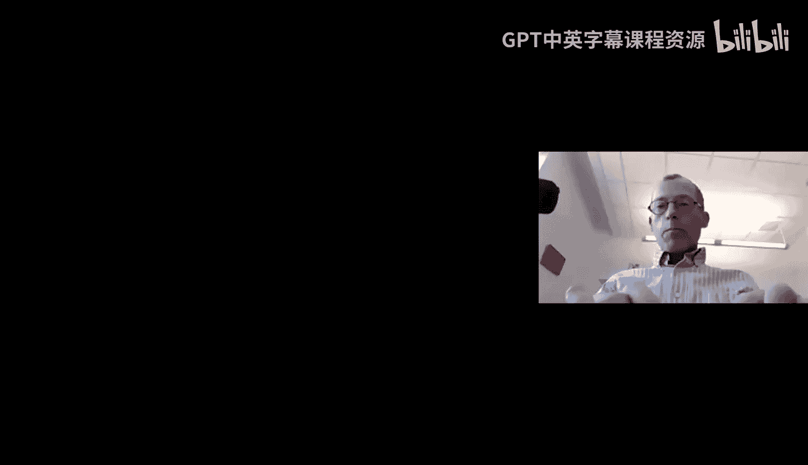
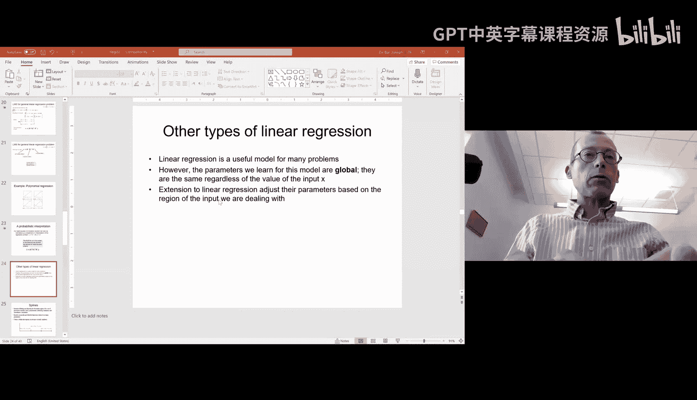
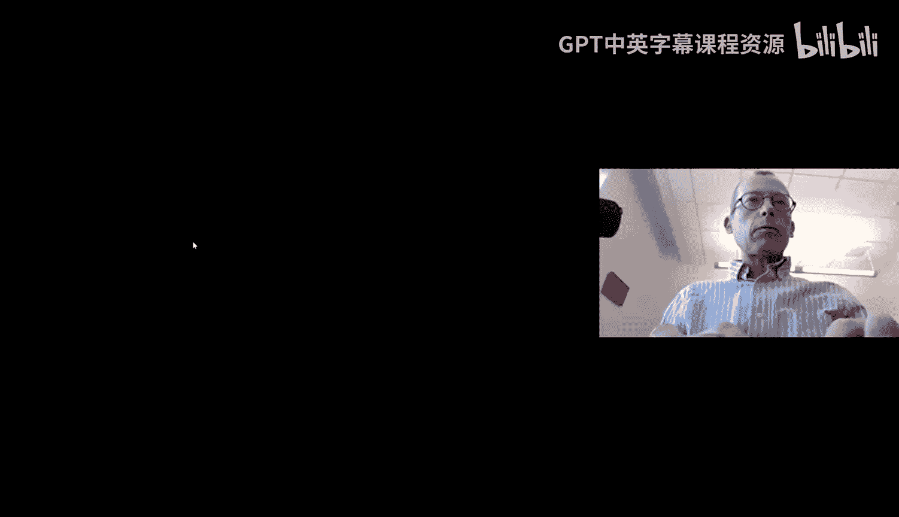
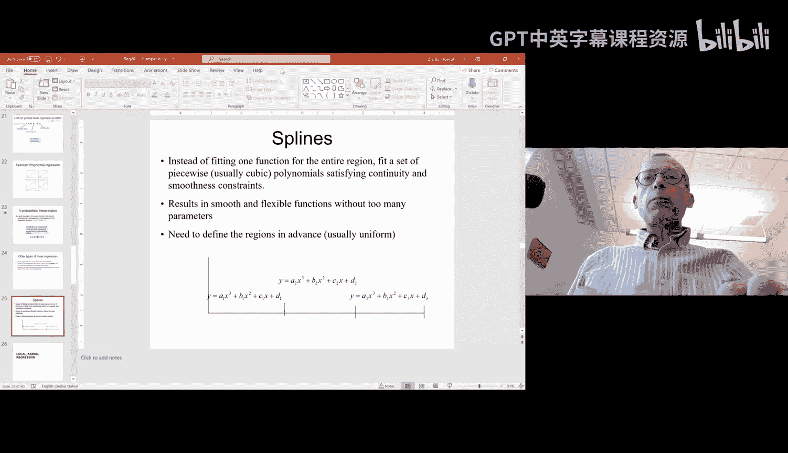
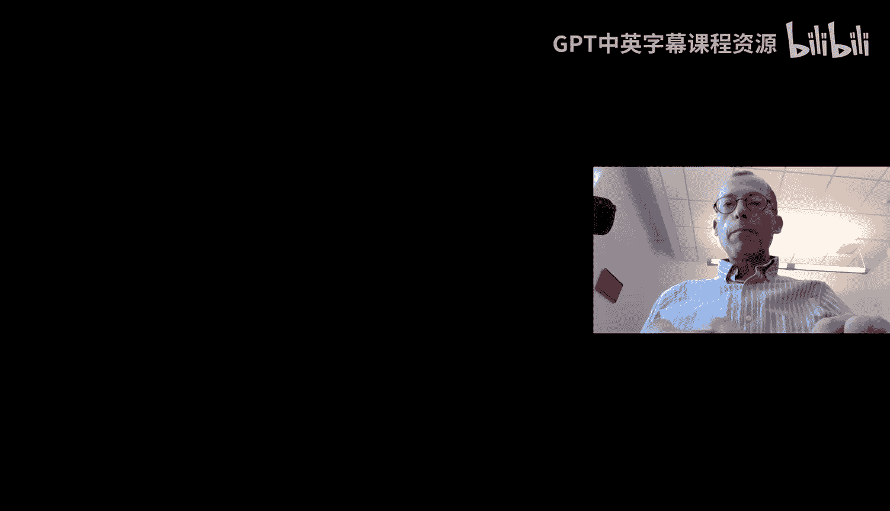
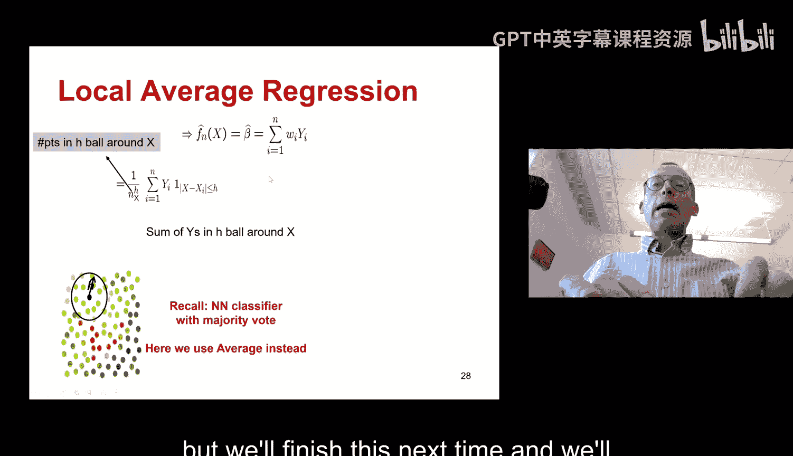

# CMU《机器学习导论（研究生）｜10-701 Introduction to Machine Learning 2020》中英字幕 p06 [06]10-701 Lecture 6  Ensemble of Trees Bagging and Random Forest.zh_en [BV144SuB8ETp_p6]

Okay so we continue to discuss supervised learning as I said we will do for at least the first third of this class and within supervised learning。

 we just finished talking about decision trees which are a method for classification and we ended the previous class by discussing the fact that while decision trees on their own work well but they are not the top performing classifiers。

 method that combine a lot of decision trees can work very well and still are in some domains state of the art so this is something that people actually use in real classification problems。

Whereas individual decision trees are rarely I would say used in practice they are very good to learn I mean I think it's important to learn about them but not something that you will usually use in practice on the other hand and symbols of the fees combination of the decision trees are being used and we mentioned three different methods I'm going to talk about two of them now briefly and the third which is boosting we will cover in a separate lecture okay so let's discuss a a bit more formally some andsemble methods。

嗯。

So decision tree and remember， decision3 we learn， as we said。

 we take the data and the features and the samples and we have this recursive method。

 which basically trains a decision tree。 so so select a question in each。

It stage and separates the samples based on the answer and repeats until we either stop learning or we exhausted all the features。

😡，And as we said， this is a feministic algorithm so if you do it multiple times。

 of course you will get the same trees so there's no way to combine trees if you just do the method or if you just use the method we're discusseding class so how can you still get combinations of trees。

 there are multiple ways let's discuss two of the more popular ones。

 one is called bagging decision tree and the other is called a random forest so basically bagging is a way to use bootstrap approach bootstrap is a way that you take some of the samples each time so instead of learning the tree from all of the samples。

 you learn the tree from a subset a random subset of the sample with replacement so usually we take 90% of the samples or 80% of the samples obviously when we only use the subset of the samples we may actually end up with different trees each time we use a different subset because we split or we ask the questions based on the samples that we have at our disposal。

So this is called a bagging and then once you have a lot of trees， once you learn a lot of trees。😡。

Using this idea right each one on a subset of the samples， you just take a new sample。

 run it through all the trees， each tree will give you an answer yes or no for a class and then you combine all of these together okay so this is the idea and we take bootswarap applications from the samples and each so basically we sample from these data we use it as training and we learn a new tree from each of these from each of these samples once we have a tree right so we create a lot of different a lot of different trees and once a new sample comes in right this could be one decision tree write one of them and we have others for the other ones。

😡，And once a new sample come in， we just run it through all of these trees。😡。

And take either the majority vote or we can even compute a probability right if we read this as 200 trees we can have actually the fraction of the trees that vote in one direction。

 the decision is going to be of course the one that select or the class that is selected by most of the trees but we can also say like how confident we are and something and those kind of things of course this is not a probabilistic model but we can provide a probabilistic interpretation so this is called the begging decision trees and again it's just a summation or majority vote over the trees that we selected and each tree is generated using a subset of the sample so that's one way to do it and we mentioned last time another way to do it is rather than going on subset of the samples you can go and subset of the features and that will also generate different trees right if I am only allowed to ask a specific subset of the questions then obviously I will get a different tree each time I change the set of questions that I can ask。

Okay， so this is begging， as we said at the end you just sum up over all the answers and take the majority。

😡，And it seems to work well， I will skip that okay。

 the second approach is called Vdo Fors and similar to begging it works on sampling。

 but unlike begging with samples the sample which samples from the samples basically the inputs。😡。

A randomandom forest samples from the。Features so basically let's say we have。

 I don't know in biology， we can have， let's say1000 genes that we can use as questions。😡。

Rather than using all 1000， we will use for each tree。

 100 or 50 or something like that and build a lot of trees。

 each one with a different subset random width replacement of the features。😡，And that， of course。

 each time we want to have a random sample， we will get a new tree。😡。

And each tree will give us a different or can give us a different answer for the same sample because it can it's going to ask different questions Okay。

 so this is the way we get we inject randomness into the process。😡，Okay。

 so this is the training data we have n examples， let's say， n samples and M features。😡，嗯。好。So。bri。

Right so now we create the bootstrap or we create the new samples by choosing and that's actually very I mean there's no theory for that it's just a matter of doing it。

 you can either select the subset which most people do select the subset of the features for all of the tree or you can select the subset of the features for each randomly again for each for each node in the tree so you go here you have。

😡，The ability to ask only M of those questions， or you decide in advance that these are the set of questions that you ask for the tree again。

 either of this will work。😡，The whole idea is just to generate another or a lot of different treess。

 each one combining different questions from our data so you can either use you can either preselect the subset of the questions for the entire tree or select it to each node up to you and at the end you will get basically a random tree because。

😡，The tree is the function of the set of questions that you're allowed to ask and this is why it's called the random forest。

 a forest of course， a collection of trees and random is each tree basically is randomly generated is generated by randomly sampling a subset of the questions we can ask Of course。

 once we have a subset of the questions we pick the best question out of this subset。

 but we don't pick the best question out of all of the possible questions we can ask just of the specific subset of the questions that we have in this。

That we selected for this。Okay， so we we do it once for。

So so once for one set of questions and then we do it for another set of questions and we do it for another qua of questions and we end up with lots of three。

 each one is going to ask different questions of different notess because it cannot ask some of these questions in each of the note just because we restricted it and as before as we did with begging we take the majority vote and decide on that okay so the outcome is the same the difference betweengging boosting is how do we generate the tweet begging we sample from the。

From the samples in boosting in sorry in Rand Forest。

 we sample from the we sample from the features or from the questions Okay， and as I said。

 boosting is a completely separate approach we will get to that。Right， so this is a。😊。

Some performance some performance measures right so if you're allowed to。

Right so it says that if you're allowed to select a lot of questions the t will end up pretty similar。

 so that's fine， but of course it depends on how many questions you ask and this is some type of a random forest for biological question if you want to ask。

Okay so this is the idea of random forest and of begging。

 I would just say so in terms of begging usually we go in practice what we do is we usually select 80 or 90% if you select more than that the trees will be too similar so that's like if you go to 99% obviously the trees will be very similar 80% seems to be fine if you go much lower than that then the trees won't be as good as they can be of course because we have less sample so begging usually is on the other of 80% in terms of random forest so there is no。

There is no good of course， number for the features。

 but most people in most applications you usually go for square root if you have enough features so for each tree you select a square root。

😡，Of the possible features and you do it multiple times， hundreds of signs and Okay。

 but this is just。😡，What people do in practice， there's no proof that this would be the best。Okay。

 so this is8 for ensemble and as we said， ensemble of methods that combine。😡。

Different trees or combine a lot of trees usually work a almost always work better than a single tree。

 but more importantly they are competitive with some of the top methods including neural networks for at least some of the domains and they still retain the advantages of decision trees which are intertoppability so you can still because again this is a bit more involved than just looking at a tree but you can still go over all the trees and ask what is the questions that these trees are asking what is the most important question that these trees are asking what is the second most important questions and so forth and explain to your users。

Why these trees or how these trees work， which is very hard to do in support vector machines or neural Orleans so it retains most of the advantages of decision trees while doing much。

 much better in terms of classification compared to individual。😡，Okay。

 so this is it for enemble methods or at least enemble methods based on trees， as I said。

 this is very specific right begging and Randolph Forrest are very specific for oh begging actually is a bit more general。

 but Randolph Forret is very specific for trees。We will have a class on ensemble methods that are more general and can be applied toques。

 but can also be applied to other things later in this class。😡，Okay。

 so this is it for decision trees and for and for ensemble and now we are moving。

To the next lecture and the next lecture is actually going to introduce。And you type。

Of supervised learning， which I mentioned， but we haven't discussed yet and this is called regression Okay。

 so until now we focused on classification classificationification means。

That we obtain samples which have。😡，Features right， the features can be continuous。

 they can be discreted， they can be categorical， they can be whatever。😊。

But we obtain these samples and our goal is to output a discrete value， class one， class two。

 maybe class one，2， three or four or five， but relatively the possible set of outputs is very small。

 usually one or two maybe two， maybe a bit more and discrete。😡。

Reggression is different in regression our goal is to get samples so we get again a training set with the features or the inputs and the labels。

 but the labels are now continuous so they can be any number sometimes theyre restricted to be only positive number sometimes they are really unrestricted completely and the goal is to come up with a method。

😡，That generalizes right， so for the next sample we' also output。😡，Some continuous value。

 which best matches this。Okay， so as before we will have a training set。

 we may have a test set or course validation， whatever。

 but the goal now would be to find the best continuous value rather than the best class for this。😡。

Data now of course regression is the whole regression itself is an important problem on its own will I will motivate it by some examples。

 but also as you will see later in the class including on Wednesday regression can also be used as a component in classification so some classification problems can be solved by first using regression and then。

Somehow translating or using that result for for classification。 Okay。

 so even though we are talking about regression today， we are not completely finished。 or in fact。

 we haven't。I guess we are only halfway through classification so a lot of the classification methods we'll discuss later in the class will use regression as a component。

 even though the goal would be to do classification。

 but today the goal is mainly on regression so let's do an example so let's say you want to choose a restaurant but rather than you doing whether I like it or not which maybe you like a lot of different restaurants maybe you want to rank them based on some criteria that you have but you don't really know which criteria to rank on right so maybe you know sometimes or maybe there's a lot of options right so you have what's the reviews for this restaurant but on the other hand you know some of them get very high reviews but they're very expensive or maybe they're very far or maybe you personally even though the reviews are great。

 you don't like the cuisine so you know you have some data that you collected over the years about your own preference right so for each restaurant you get the score let's say 8。

 that's your own score。And now you go back and you want to come up with a score for a new restaurant that you haven't been to before。

😡，How can you do that now the score now is not whether you liked it or not maybe you liked all of them。

 but the score is how much you liked it right so now it's a continuous value rather than zero1 because you want to rank and like let's say you have five more restaurants that you can go to you want to choose the best one。

😡，So how can we do this rankingking you look at the features right these are if you look at the table that I'm showing this is the score that I assigned and these are the features of this restaurant of course and this is based on your previous history or your previous。

😡，Experience and the goal is， you know， these are things， of course。

 that you don't need to go to the restaurant to know， right you can see the reviews thats the price。

 the distance and the type of cuisine and and you can actually rank new restaurants once you have this Okay。

 so the goal is to take these different numbers and output the score that is as close as possible to the score that you actually gave it。

 Okay which so this is called regression basically get get the inputs like we did before with the classification。

 But now the output has to be as close as possible。To a continuous value that we already get。Okay。

 so this is the goal。😊，And this is not something you know， this is not something extremely hard。

 I mean people or you probably have seen this before in linear Japan and in other domains and the first example is something called linear regression or the first of the method that we'll talk about in this class is linear regression。

Although as you will see， linear regression can be a bit more involved than just using the inputs and outputs to compute some relationship。

 but we'll get to that So as we said， right let's say we want to have so let's start with a simple problem where we only have two values one is the input and one is the output for example you tell me your height and I want to predict your age or you tell me the price of one stock and I want to predict the price of another stock or you tell me some reading of a sensor and I want to predict the real distance Okay so lots of problems where you have one input and one output and you want to have a function between。

So how do we do this？😮，We usually represent this as a regression with a parameter in this case we can represent it by y equals W x if we assume that the relationship is linear linear means that the value of the output is a linear function of the input and again we will extend this later but for now let's assume that it's a linear function of the input okay。

 so when x goes twice as much y will go twice as much but it's not necessarily。😡。

It's not necessarily one to one， so it's not necessarily that y equals6。

 it could be that y equals 3x。min x or something like that。 Okay， so w is the parameter。

 and epsilon here means the measurement noise， right， So， for example。

 if I want to predict a relationship between age and height， we know there is a linear relationship。

 right as you get older or at least let's say for the first 20 years， as you get older。

You you grow higher， but obviously different individuals are going to have different heights so we cannot assume that everybody follows the same model what we assume is that there is some model and samples can contain individual noise right so basically for some people this will be very good for some others it might be very bad and so epsilon is basically not something we compute。

😡，Or observe， this is just an assumption that the model is not perfect。😡。

That because and the model is not perfect for a lot of reasons。

 one reason is that it's not really a linear relationship。

 so we model something with a linear relationship even though it's not we need to allow for noise because otherwise we won't get there's no solution that will be perfect right if I take all the individuals in this class I will never be able to learn one value that matches agents to height that's not going to work or if I take you know20 individuals in different different edges so we need to account for the fact that the model is not perfect and we account for that with the noise star。

😡，Okay but assuming that this is the model that we have that y equals w x plus epsilon。

 the next question is so y and x are the inputs right this is input epsilon we said we just assume is noise。

 so the goal of linear regression is basically to find the value of w。😡。

What should be the value of w that will be the best or that will lead to the best relationship between Y and x？

😡，That's the motivation。 But of course， what do we mean by the best relationship between Y and X。

 How do you define the best relationship？😡，So we are going to make an arbitrary decision here。

 which I will motivate in a minute， but it's only a motivation， it's not the only way to do it。

 so we are going to use an arbitrary decision that the best W。😡。

For a specific input set is the w that minimizes the list square okay list square means the difference between Yi and of course w X we want it to be as close as possible to Yi。

 but it's not going to be as close it's not going to be perfect we know there is noise。

 so a goal is to find w that minimizes。😡，The least square okay this is just an arbitrary decision and as you will see in the problem set that's not the only way to learn w so you can learn w by finding the w that minimizes the absolute error rather than the sum of the absolutearrow rather than least square or maybe some other function of thearrow okay but for this class and there is a reason why but for this class we will focus on least square minimization so we will try to find a w that minis the least square of course minimizing thearrow is always good the question is how do we define thearrow and in this case minimizing least square。

😡，And as I said there could be several other approaches but least squares is the thing that we will use and I will mention maybe towards the end that this has a nice for ballistic interpretation so if you use these squares you can basically interpret the noise。

😡，As a basically a probabilistic object or a probabilistic function with some mean and some variance okay we are not going to explicitly model it。

 but we can say we assume that the noise is a Gaussian basedarrow with mean zero and somevari if you use this square if you use other things then this interpretation does not hold so that's why one of the reasons people use the square but there are other reasons I mean。

As you will see， it's very easy to compute unlike some other。😡。

Things that you will work on in the problems that it's much easier to completely square， for example。

 than to compute absolute all。So this is the thing that we will use at least for this lecture and then also something pretty popular most in many applications。

 that's that。Type of error or that's the minimization function that well use。😡，Okay。

 so assuming we want to do list square。😡，Then the question is， what is the best W？😡。

And the answer is going to be like we did before， this is not probabilistic anymore。

 but still we want to find the minimum of function， so if we want to find the minimum function。

 we take the derivative with respect to the parameter。

 the parameter here is w so we can take the derivative with to W and say that in order to find the minimum of this。

 we take the derivative is leftw so it's minus I mean the internal derivative times2 times parameterhesis and you go through the math and you get the best or the optimal solution for w is sum over X over sum over X。

😡，Okay， so this is just the solution if we assume linear regression。

 or if you assume that we want to minimize the list square L。

 the w that will minimize the least square L is w。😡，That is computed in this way okay。

 just comes out of the de and you can compute the Okay。

 so this is good and now if we want to find a linear relationship between two variables。

That's how we would find the best that's how we will find the parameter for them。

And this works pretty well， for example， if I generate。😡。

some data so I generated here some data where basically y equals 2x plus some noise I generated Gaussian random noise with being zero and some deviation of one and you can see this is the results and they obviously the points do not lie on the line just because I added the noise and if you use this square you get something like 2。

03 which is very close to two with pretty small noise so that's good if you increase the noise so if I increase the noise you can see that the points are pretty far from the line。

 but still the w that we get from least squares is pretty good it's not even though I introduced a lot of noise and even if even increase the noise dramatically and you can see now that the points are very far from the line or some of them are very far from the line because we have enough points if you use this square we get a very good solution for them okay so this works reasonably well if you have enough data and if you assume a linear relationship。

Between the point， so the model really isn't the。So this is a regular or general regression program。

😊，So this so far we basically assumed a linear Russia a linear relationship sometimes linear relationship is not enough。

 for example let's say that we have two stocks right let's say Google and Apple one is priced around 100。

 I mean just a matter of how many stocks there and one is priced around 500 okay so if that's the case then when Google goes up 10%。

😡，Apple also maybe goes up 10%。But there is right mean。😡，We want。Well， I guess yeah， so there might。

 let's say there is an additional term that we want to use to model the difference。 so maybe the。

Well， let's you know。Let's let's forget the let's say that for every year you go up。

For every year in the first 10 years， you go up by 5% okay。

 but of course you start with some a height， So you start with maybe six feet or two feet or something and then you go up by this percentages。

 So we don't want to say that every year you are X percent greater than what you were born with because when you were born。

 this is like the baseline and then for there you go you go up by， let's say。

You know with year you go up by 110 centimeters or four inches okay。

 so in this case we have a biaster a biast is this w0 which is independent of the x which is independent of the x and we have this shift in the results which are so basically we want to model the outcome as y equals w0 plus w1 x okay so we want to introduce the biast that is not dependent on x。

And then the value that is dependent on x， okay so。Right， so you always。AndRight so if your age。

Let's say goes up by one yield， you go up by1 percent a4 inches， and if you go two inch。

 it goes up by。Eight inches， but you always know that you started with two feet okay。

 so you start with two feet and then you add the inches based on the you。Okay。

 so this is also a linear regression problem。 I mean。

 it's not we didn't change the fact that we are multiplying the input by linear time。

 We just added another parameter of w0 that we don't know if we have enough samples， we can still。😡。

Do the a analysis or do the list squares and find the best values for these two parameters and again it's the same thing right so we want to minimize now rather than minimizing。

😡，Right， rather than minimizing the list square for the。

Rather than minimizing the list squares for the original problem， we can write mean。😡。

Over W sum over I。😮，The不思啊。Xi。Okay， so this is also。This is also， I mean， a least square。

 but now rather than assuming that Yi equals wxi， we assume that Yi equals w0 plus w1xi and this is the equation that we want to minimize。

Overall and when we do that。So this is something that we can easily write and when we do that so when we write it as the optimization function that I just showed you the results are going to be so basically now we are doing again we take the derivative with respect to W0 and w1 we usually do it as a partial derivatives so first we take the with respect to w0 and we get w0 equals this。

😊，AndYi minus w1 x over n n is the number of samples and I is the set of samples okay so this is w0 and then we can once we have w0 we plug it into the we use it basically in order to compute w1 and w1 becomes some over Y x I Y some some function okay so this is this is the regression problem for two parameters right w1 and w0。

And we will give a simplest solution in a second a bit more but before I give the simplest solution I want to motivate why we need okay so this seems to be all we need right either a linear term for one variable or a linear term plus bias but actually I mean we can use regression for a much more complicated problems for example so far we did regression for a unvariate univari admit that I want to predict one variable or one value from another value either with a biaster or without a biasst。

 but in practice in many cases I would like to predict one value from a lot of different from a combination of a lot of different values let's say I want to predict the Google stock price。

 but why just use Microsoft stock price。hYou can see that this is all slide because Yahoo does not exist anymore。

Good Netflix still exists。Thebody doesn't exist right， Microsoft called them， I thought。

AndBryon owns them。No I't okay， so even better Okay， anyway， but but you know。

 you understand at least the basic idea， regardless of the。Mistakes so basically the companies exist。

 but not understand that's what I let's say you want to predict the stock price from a lot of other stocks right so maybe a few 10 or 20 and again this is something you will doing the problem but let's say you have a number of different variables and you want to predict the value of a single variable out of all of right so you have Google and you have a lot of other other tech stocks and you want to predict that price so this still is the linear regression problem because each of the different stock prices is multiplied by a linear term basically by a parameter one individual parameter which linearly multiplies the stock price but now unlike before where we add one or maybe two parameters now we can have up to know depending on how many features you have in your input we can have k parameters K can be very out so now of course we can start doing this partial。

thing which we take the derivative respect to one and then take those another plug it in but that would be a very time consuming and also not very efficient It turns out that there is a simpler way to do it or well I don't know if simpler but at least a much more。

A much better way to represent this and solve it in a one basically in a one you can solve this problem not by doing this partial thing over and over but by one computation a single computation can find the values for all the different parameters okay so this is what we will do we will talk about how to find or how to and again the goal is to find the list square so we are still fine to find the parameters that minimize the list square error between W and and the standard that we compute but rather than do it intuitively one at a time computer partial derivative and then plug it in and the computer next one we can do it in one shot basically we will have a close form solution for all of these values okay so this will be a goal or this is the goal of the next few slides before we do it。

I just want to mention that。😡，Linear regression， even though we talked about the fact that linear regression only uses a linear combination of the input。

😡，It's not restricted to the values of the input what do I mean by that let's say that I want to compute the relationship between your height and your age okay but in fact your height is not really related to your age it's collected it's related to your age square for some reason。

😡，Your8 square is still an input， right because I don't need to learn any new parameter in order to compute the square value of an input。

😡，In other words， any transformation of the input that is pretermined that is fixed like taking a square or square root or log or whatever is still an input of course you need to define before you use it what transformation you want but if you do a transformation of the input it still remains an input as long as the transformation is fixed so basically linear regression can work of course on the inputs themselves on your age。

 but it can also work on your age square if that's what you're using as an input。😡。

The point is that this is also a linear regression problem。

 even though it seems to us as a polynomial problem。

 but let's say I want to predict the Google price from the square root of Microsoft and the square root of Netflix。

😡，I can write that down and this will still be a linear regression problem so 5103 and 2 will still remain a linear regression problem why because once I know x1 it's easy for me to compute x1 square I don't need to learn anything and similarly once I know x2 I can compute easily x to square so basically the point I want to make is that any transformation of the input that is fixed that you do before you learn the function or before you use the function is still an input and if it's still an input this is still linear regression。

😡，So what is not linear regression there are things that are not linear regression we will talk about them next time when we talk about logistic regression so not everything is linear regression。

 but any regression that multiplies the parameter by the input or transformation。

 a fixed transformation of the input that does not include any parameters that you learn。😡。

Is still linear regression。 And the reason why I emphasizing this is because the solutions that we give。

In a few slides to finding the best parameters for linear regression will also work for any transformation of the linear regression。

 of course you need to use the central information in the training and the testing so you need to fix the transformation you're using。

😡，But once youve decided all that transformation， you can still use all the methods we learned for linear regression for that。

 and that's good news because now we have a much much bigger class of functions that we can basically learn with linear。

😡，Okay， so as long as the coefficients， the ws are linear。This still is a linear regression problem。

RightSo this is basically a linear regression program where we instead of using X1。

You use x1 squared and xk squared。Right， because before you actually。

Learn the ws you already do the transformation and when you get a new sample。

 you can also do the transformation and use the ws that you learned for these square ones Okay。

 so this is。😊，And there's lots of ways to do it， for example polynomial learning is linear regression because you can do。

 let's say y equals w0 plus w1 x1 plus w2 x1 square plus w3 x1 cube and so forth。

 this is a linear regression problem because once you have x。

 you can learn or you can actually basically find all the exponential values of x for any value。

Gussian， so if you have a fixed mu and sigma for each of the features， you can also learn that。

 you can use other functions， any function that is a deterministic value of the input is going to be a fair thing or a possible thing to do for linear equation。

Okay so this is important and again， expands greatly what we can do with linear regression or once we know how to find the parameterss。

 which are the ws， that's the goal to find the best value for W。

 this expands it greatly because now we can assign it to any transformation of the input。😡。

So linear regression is more general than that。Then just the actual values of think。😡，Okay。

 so if that's the case， then we can write the linear regression problem rather than as we did before as some of WI Xi。

 rather than that， we can write it as basically y equals sum of j equals 0 to n。

 where basically we basically expand the feature space to include1。😡。

RightOne is the value that we multiply w0 by and other than that it's all the all the transform features so w0 is multiplying1 and all the others are multiplying some function of the input it could be the input itself so this can be just w1 times a x or it could be any transformation x square cube whatever you want for the J's feature and the goal is to learn the WJs right the WJs are the parameters that multiply the different transformations of our features。

😡，Okay so they can be the actual value， they can be a unifier an identity value for example。

 for the stock this could be just the price of the stock quadratic value of that or whatever Okay so this is the the general the general representation of the least square problem right so the WJ stays the same that's the parameters and VJ is a transformation of the。

😡，And our goal is now to as now we go back to our multivariate problem。

 our goal is to find the optimal WJs where optimal， in our case。

 is the WJs that minimize the list square。😡，Okay， and as I said。

 there could be other ways to define optimalality in this class we use this squareil to define optimalality。

😡，Okay， so this is the general setting for linear regression and now the question is how do we do？😡。

Sorry， now the question is， what's the oh， how can we find these？😡，Ws。So again。

 this is the goal right we say that w or y sorry equals wj Pj of x and our goal is to minimize this function。

 which is。😡，The sum of this squares， Yi minus and sum of WJ， Pj，Okay， so this is Xi of course。

 is the X input and Pj is the JS feature。Or the J transform feature of the I input and the goal is to minimize so this is the value we get from the regression。

 This is the input that we get for this specific sample and our goal is to minimize the square How do we do it We do it in the same way that we did for the。

Sve， I just have a quick question in chat， someone's asking how we select the best files。

Yeah good so that's a great question and there is no i'm not going to provide there is actually no way to select the best filess one thing that you should consider and that's something that will come up actually later in discuss but also others let's say that you want to look at the relationship between y and x okay just one value。

X， let's say H， you can represent H as the polynomial right so you can actually from one value so in your goal is to predict the sorry your goal is to predict the height from the age right so you can predict you can use the h as one value but you can actually represent it as1 values because you can take h h square hq and so forth。

😡，So what's the problem with that， The problem with that is the more values you introduce。

 the more parameters you have， the more parameters you have， the more likely you are to overfi。

 So one thing you should worry about when you introduce these filess is the fact that you can have lots of them and the more you have。

😡，The more a fitting you can get， but other than that。😡。

There is no formula for which ones are the best， you know。

 as we always say one thing is just to try right so you for example。

 you can do consolidation if you want to decide。😡，Right， let's say regression for age thing。

 right we don't know if we want to use age or age square or H cube。

 One thing you can do is possible validation and test which one is the best for you。

 at stop at some stage。 Okay， so again， we will have。

 I think a class on model selection and future selection。 and we'll talk about that。

 But that's one way。 But generally speaking， there is no formula for assigning the best。

 when we talk about so again， this idea of transformation is something that will come up again I mean。

 this is basically all regression program can use transformation。

 and but it's especially important for support vector machines。

 which we haven a discussed what well get to。 And when we talk about support vector machines。

 we will mention a bit in some ideas on how to choose。The best transformation。

And these can be applied to linear regression as well。

 although usually there's no good formula you just either try or just do something that you think is good for your auto。

😡，The important thing for this class is that any transformation you want to use you can still find the best W for those。

 that's the point I want to make how to find the transformation。😡，Not Korea。Okay。

 so this is again the goal to basically find the best this is the goal to find the least square and of course。

 the way we do it is we take the derivative。😡，With respect to W again。

 just to illustrate so in order to do that right our goal is to find a derivative or we said before。

 the best the way to do it is to take the partial derivative with respect to each of the WIs。

 find the best values unfortunately when we take the derivative respect to WI。

 we have all the other WIs in that equation as well so we need to somehow get rid of all of them together。

😡，So in order to show how we can do this， we are going to move to rather than this is scalar representation right each w is one value。

 each vhi is one value and so forth， y is one value I'm going to move to a vector representation so y remains one value so for each II have one value of5 W is now a vector。

😡，A row vector， WT。I a line vector and and p is also a raw vector right so when you multiply sorry w is a column vector and wt is a row vector when you multiply a line vector with a row with a column vector you get one value so this is one value one is small another value and this is okay so this is just。

A vector representation of this problem and we can do derivatives in vector space in matrix space and so forth。

😡，So now we are going to take the next thing is we're going to take the partial the derivative but now with not with respect to individual ws but with respect to the W vector。

 of course the w vector itself is composed of a lot of different ws but we are walking now in vector space when you walk in vector space things that are pretty similar to how they are in scal space for those familiar within the algebra so basically we take the derivative respect to W in that case it means that we need to do two times the internal derivative of the parentheses the value in the parentheses in this case this stays the same Y minus wt ofxii and we multiply by pxii which is the internal derivative。

😡，Okay， so this is now。This， we already said this is one value， right， This is one， this is a scalar。

 This is。A vector and the output is again a vector right because we are doing it for all the ws so the output is basically the vector of all the ws or the thing we want to minimize the value for each of the ws。

😡，Okay so this is taking the derivative on the vector space next we want to find the best solution of the optimal values for w and for that we need to as always equate to0 right equ to0 means that we equ it now because this is the vector now so we equate the zero to the zero vector so all the rows in this vector have to be。

😡，All the columns in the spec have to be zero。Okay， so we equate this to zero。😡，Which is this。

 and when we equate it to zero， we can open up the summation and move things around。😡，And。

And we get basically。So basically we multiply this and we basically separated it into the sum so this is WI P of XI and this is WT which is here。

 which we can take out of the sum because it's not related it's not dependent on I sum over I fear of XI fee of XI now important very important thing here。

This is， as we said， this is a row vector。😡，This is actually what is this。

 can anybody tell me what is this thing here， how does it look like？😡，So what is， I mean， yeah。

 when I stop but basically a P of X， which is。A column vector。Times that were vector。Yeah， no right。

 so the answer is correct。 it doesn't matter exactly what we call it， but as most of you， if not。

Everybody who answered correctly this is now a matrix so now we have basically basically right so so this is a row vector so multiplying by a matrix will give us a vector and this is also a vector so basically we get this matrix here which is basically a function of all of the different inputs。

Right it's a function of all of the transformation sorry of the default inputs because we are summing over so this is a summation matrix of all of the inputs that we have for each input we create basically so this is one matrix and we sum over all of them to get the sum of these matrices sorry am I sharing is so what we get is this matrix so each of these is a matrix and the sum of all of them is basically the summation of the contribution of each of the individual components okay so this is what we get again so until now I just copied it from the previous slide and now we are going to take a big step that you will have to convince yourself that is correct。

So if you define a big fee as basically， again， this is not any computation， this is just a matrix。😡。

Of the inputs of the transform inputs， as we said， for each of the samples， so this is the raw。😡。

For the first input， this is the world for the second input。

 this is the world for the third input and so forth right so the sort sample right so the transformation of the first sample。

 the second sample and so forth。You can actually write。😮，So if you take this。

 you can actually write it as this part here， this summation， not that value itself。

 but the summation over all of the individual products is basically 50 times feet。

 basically each one here。😡，And multiippllies by this and summing over all of the individual components。

 so this sum here is 50 times feet。😡，Okay， and this thing here is basically。ItIs basically。

Multiplying that by fitt。 So if you take the if you take this to the minus1 or if you take the inverse of this。

 you basically multiply this by this。 Why， of course， you can represent as a vector。

 So if you represent this rather than as a sum as a matrix， you actually get fitt p times Pt。Times y。

 which in this case， y is vector so it multiplies individually each of the samples。😡，Okay。

 so basically this part here goes here and inverse and then you basically can separate w out and then it multiplies or this part here multiplies this sum here and when you do it you write when you sum over eye。

😡，Of all of these individual ones you get the product。

 so when you multiply this and you sum when you multiply this and you sum over an I you get the summation over all of the individuals multiplications which is basically this function here so 50 phi minus1 50 times1 and y again is the vector so it's basically the vector of the。

😡，The vector of the samples Okay and w again is the is the input。 So again。

 let me just explain in a bit and to show you why this is or this is indeed doable。

 So first of all we know that this is an n by K1 matrix right so n means if we look at p we have basically n rows which is the samples and K。

K columns， or K plus one columns， which are the features。 right， So this is n times K plus one。

 This is。K plus one by n。RightIt's k plus one by n because it's the transpo。

 so basically this is k plus1 times k plus1 matrix。😡。

The inverse of this is so this is of course a square matrix when you multiply something by transpose it becomes a square matrix and the inverse is still a squared matrix。

 which is still k plus one times k plus one This is 5050 is k plus one by。😡，And right， because。

That's the when you multiply k plus1。😡，ItTime in by a Cap。

Or when you multiply k plus 1 by K plus 1 times k plus 1 by n， you end up with a k plus 1 rows。😡。

Sorry k plus1 columns sorry k plus 1 rows n n rows okay so this all of this here is k plus 1 by n and then you multiply it by y y is the column vector of length n so each row here is n and this is n and so we get output k plus1 values。

😡，Okay from all of this we get k plus one values and the size of w is again k plus1 as well K plus1 w is basically the parameters and we have one parameter for each of the features plus the w0 so K plus one feature so at least in terms of dimensions this makes sense so this is k plus1 K plus1 this is a n by this is k plus one by n so this total thing is k plus one by n and when you multiply it we get k plus one values which is okay so using this the important thing is that using this and computing of course you need to compute the inverse for this but there is an inverse this is we know that for this squared matrix there is an inverse so matrix fixed times this onepo does have an inverse。

When you get the inverse of that， you actually can get the value of revenue。

And when you get the value of W basically you solve all the partial derivatives together right so now we didn't take one partial derivative plug it into the other and then the other and then the other。

 we basically found all of them together by doing this computation。😡。

Okay so this is the way to solve or this is the least query solution for linear regression and this gives us a close form solution it's important because in the next lecture we will discuss other ways of doing it this gives us a close form solution which basically provides the n so the optimal value for the w for any of the transformation we use right so whatever transformation we use we plug in that transformation into the P matrix and when we use that and we have that we can。

😡，Reconstruct the values of the W Now importantly， I should say this is a good solution for linear regressiong because it solves the problem。

 but it might be time consuming It depends on how many samples you have and how many transformation you did because taking the inverse is usually a cubic it's cubic in the dimension of the matrix or let's say in the dimension of the samples。

 let's say if you have a lot of samples than usually usually we have more samples than features so this can be cubic in the dimensions or in the size of the matrix and if。

Yeah so well actually sorry I take it back this is cubic in that dimensions that you're using so if you do a big transformation this would be this could be very large so if you use a lot of features this can be a very large value if you have a relatively small number of features this is going to be fine。

Okay， but if you have a lot of features， this can be very time consuming， but still， I mean。

 once you do it， you actually can get the optimal solution。😡。

Okay so this is it just to show you an example how we can use it。

 so here is a linear threshold for a polynomial so let's say I have in this case y and x。😊。

And I assume that x is a function of y。Sorry why is the function of x but I can do a lot of transformations right I can represent x as a1 degree polynomial if I do a1 degree polynomial。

 then I have two parameters w0 and w1 I can represent x as the third degree polynomial and in that case I have four parameters I can5 degree or7 degree polynoial and one thing you can see very clearly is the higher the polynomial value we get。

😡，We get a pretty good fit for the for the points right， So if I want to perfectly fit the points。

 I can use a very high degree polynomial， although the cross validation is not necessarily。Okay。

 but anyway it's less important， I mean we will talk in a second about this。

 but the important thing is that you can do it for any degree right now now that we have a general solution。

 you can fit any degree polyomic 7 degree， 10 degree， 15 degree。

 you will get the best values for your。😡，As I mentioned， we we use this square pretty arbitrarily。

 that's not the only thing you can do， you can use other things rather than this square。

 one advantage of one possible explanation to why we use this square。😡，Is that？

We can have a probabilistic interpretation for this function and the probabilistic interpretation is that epsilon in this case。

Is distributed with a of zero。😡，And some standard deviation， if that's the case。

let's say we assume that and I'm going to do it for the uniform at one。

 but it's the same for everything。Okay， so if I assume that epsilon is distributed with a mean of zero and some standard deviation。

 let's say。Sigma square。Okay， so this is just the assumption then。😡。

The maximum likelihood estimation， the maximum likelihood estimator for w is going to be the w that we found using the list square approach。

😡，Why is that because in that case what's the so this is the probability right so what's the what we can write the like or we can write now the likelihood of the data right L。

Of the data given the model。😮，It's just a product on thearrow， right， So we now take thearrow。

 So it's one over2 by。😡，Tings well。This E。Minus and now what I'm writing is the difference。

Between the AO。Y minus？啊。出。Okay， so this is the likelihood of the data this is a product over。😡。

This is the product over eye of this and when you take the derivative with to W。

 what you get basically is this part here。😡，which I mean you take a log and you take the log like you。

 then you take derivative， you get this part here， which basically means that in order to find a Sw。

 you have to find a least square， which is this square here so this is basically the reason why if we assume that epsilon is distributed sorry if we assume that epsilon is distributed this is why if we assume that epsilon is distributed with mean zero n some standard deviation we actually get back that the optim solution is going to be least square and this is basically true for using a regression with one one variable but also using regression with multivariate。

 it doesn't matter because the probability is on the l it's not on the w right because we assume that the l is distributed with some mean n variance。

 so we still get the least square in the exponent of the of Gaussian function and again minus zero。

We assume that the mean of the error is Okay， so this is the explanation of why if we assume that epsilon is distributed with mean  zero and some standard deviation。

 the solution， the best w or the W that maximizes the likelihood。😡，Again。

 right we already motivated why maximum likelihood is a good thing。

 the w that maximizes the likelihood of the data is the least per solution， although again as I said。

 there are other reasons to selectly square not even if we don't assume any probabilities。

 it's just much easier to solve as you will see in the problem set when we will try to do other types of。

😡，Solutions， for example， absolutely。Okay， so this is regression regression you can use okay let me stop here for one second and let's do a poll。

 a piazza poll and talk a bit about the different transformations we can do and what's the advantages and what's the danger that they can provide okay so I'm releasing two questions on the Piazza。

And you know， take your time， as I said， no grading， this is Lton for me。

And for you to see if you were able to。So yeah take a few second a few minutes and try to do so there's going to be two questions today Okay so let's talk about this and again I basically showed similar example when I talked about the polynomial thing but now we will talk about it a bit more formally so basically I asked you two questions about using linear regression for polynomial analysis。

诶。So let's start with the first one。😔。

So the first is I'm asking you about a。About learning a function where you get samples that have two values。

 x and y， you want to and you can learn because of the linear regressionation you can learn from them degree five orpo layer of degrees seven。

And you use the data to learn both polynomials and you compute thearrow on the training set。😡。

And the question is which will lead to a lower error for the training set or which would likely lead to a lower error of the training set and the answer is almost regardless of what is the real。

Almost regardless of what is the real data that generated so whether the data will generate polynoial of degree1。

2，3，4， or five or six or seven or nine， polynomial degree seven will usually lead to a better result for the training data as most of you I don't determine why is that that's exactly what I showed in the slide about the polynomial because even if you have data with a lot of noise when you have a higher degree polynomial the polynomial can fit the noise better it's not the right thing to do but it's going to fit the noise much better。

😡，So in that case， the errorss that the polynomial of the seventh degree will make。

 even if it's really data from a first degree or second degree polynomial will be lower because it can fit to the noise。

 of course that's not a good general solution but for the training data that。😡，Okay。

 so usually generally speaking， that's true for a lot of different problems when we have more parameters and in the seventh degree polynomial we have eight parameters right w0 to w7。

 whereas in the fifth we only have six parameters， when we have more parameters usually we will see the training data。

😡，Unfortunately that's not what we are really interested in the question is which the real question for us is what will fit the general database so which degree of the polynomial will fit the general data and in this question the answer is as again most of you found out number four so the real answer。

😡，iss that it depends on what is the data being generated by if the data is really coming from a fifth degree polynomial。

 then a seventh degree polynomial will overfit and it wouldn't generalize well and that's also true for a fourth degree polynomial and a third degree polynomial on the other hand。

 if the data is coming from a seventh degree polynomial。😡。

Then the seventh degree polyal we learned will be better than the fifth degree poly because it's really a function of a service degree。

 And that's why the way is the also tool is the data comes from a higher degree polyoma，8，9，10。

 seventh degree is much better at approximating 8，9，10 then。Identified a  fifth degree on node。

 so the answer is we don't know because it really depends on how the data was generated and that's something we don't really know oh we are not told at least。

😡，Right so the answer is going to be depend on how the data itself。

 so the answer in this case is number four。Okay， so just eight for this today and again。

 as I said last time， if you got it correct to great， if you didn't get it correct。

This is the first time or at least for some of the first time you see this。

 or maybe you didn't you know， you didn't understand or。

Or you didn't understand the question or whatever don't take it too bad。

 it's not like you don't understand the class， just go off the material after the class and of course in the problem setting you'll be fine。

Okay， so let's go back to our lecture and discuss some other types of regression。

 so we talked about linear regression， but that's not the only。😡。

Thing we can do with the methods we defined there are a lot of other types of regression I'm going to talk about two that are pretty popular but there's lots of other things and the reason why I'm mentioning them is they use ideas similar to linear regression but they don't use them globally they use them locally what do I mean by locally right now we said let's take the inputs let's take di and let's find the global function that matches the input and the output but that might not be the only way to do it there could be wise where we learn local functions so learn regressions that are only。

we are only going to use in a subset of them， for example。

 let's say we want to predict y as a function of x。😡。

Okay but I can have one regression function for x between  zero and 10 another regression function for x between 10 and 20 another regression for x between 20 and 30 and so forth。

 this is called the local regression model rather than a global and there are lots of different variants of local regression one very famous example is something called sps。

😡，Okay， so splines are polynomials we said linear regression is about polynomials。

 but unlike regular polynomial as we said before as I showed you。

 I'm fitting the splines to a subset of the input so here I'm fitting one spline to values between let's say z and 10 I'm fitting another spline to values between 20 and 20 another one values between 10 and 20 and 30 and so forth right we can do it because we can just take and that's pretty easy right we check the samples we look at the samples and we ask for which samples we have x between 10 and 20 we use those xs to learn the sp for that and then we use the other x and that might be better because that might mean that we will have a different function。

😡，For different parts of the inputs， which can behave very differently。

 So that's the nice thing here is that we learn a relatively small degree polynomial right So for example。

 in this case we learn a third degree polynomial， which still fits the data very well because unlike before。

 we don't need to apply to all of the data if we had to apply to all the data maybe we had we needed to use a 10 degree polynom 20 degree which is very dangerous we already said but now we can use a sub a set of small degree polynomials to fit the data pretty well。

 even though we are only using relatively few parameters。😡。

What's the danger with this type of approach， what can people think of a problem with this type of approach with learning these individual polynomials？

😡。

What could be a problem？

Overfitting yes， but let's assume that we have enough samples for each of the individual subsets。

Exactly， so that's a big problem a big problem in this model is that because we learn these。

Because we learn these polynomials for each section separately。😡，What can happen is that。买出呢。

Sketch this here。So we can learn one polynomial here。

 which will fit pretty well and will be pretty smooth。

 but the second polynomial will start here and move here and then the third one will start here and move here。

😡，So now when we are at the boundary between two polynomials。😡，We get a huge jump in the prediction。

 which doesn't make sense it doesn't make sense that I don't know， let's say this is 10。😡。

That's from 9。99999， you have a value of 1。 and then 10。000， You have a value of 5。

 That's not a reasonable function。Okay， so the continuity is the big issue for these local prediction tasks what can we do in sps there is a simple or not a simple。

 but there is a solution that people adopted and that is to require。😡，That splines are continuous。

 what does it mean that splines are continuous， it means that the endpoint for this polynomial or the value of this polynomial at 10 will be the value of this polynomial at 1。

😡，So they have to be equal while they meet。ok。That's good， but it's not enough。

 why isn't it enough because we don't just want to have equality， we also want to have continuity。

 we want to have derivatives that are pretty smooth。😡，For example。If you draw this again。😡。

Then these two polynomials actually are quite good in the sense that they have the same value at the intersection。

 but they are not continuous right， you have a break point where you have this big jump from one direction to the other or basically there is no derivative。

😡，もいつ啊。The derivative here is basically infinite。So another thing that people require in splines and in other local regression models is that in addition to being continuous。

The first and second derivatives are also smooth， basically they're equal。😡。

That means that when we have two splines that meet in one point， they have to be the same。😡。

The values of that point have to be the same and also the first and second derivatives of these two splines have to be the same。

😡，What does it mean in terms of three parameters， so if I have two splines I learned the value for this line here。

 how many three parameters do I have for this spline on the right？😡。

If we define this as equal and equal in the first derivative and equal in the second derivative。

 anybody？How many free parameters do we actually have？So in total。

 cubic polynomial are four parameters， right W0， w1， W2， W3。😡，For the first one。

 we set the parameters， but for the second one， we said that it has to satisfy three equations。

 one is equality， another is equality of the first derivative and another is the first equality of the third if the second if you write these equations down you find out as was mentioned in the chat that you only have one three parameter for this this means that this is another nice thing about splines is that in addition to the fact that you have local colonomials。

 you don't have a lot of parameters。😡，Right you don't overfi as was mentioned before because unlike with regular polynomials。

 we have a lot of constraint on those values that we can add so rather than we are not really adding four new parameters for each of the new splines we add but instead one parameter and again this is splines with the degree cubic degree you can have splines with other degrees which will lead to more parameters or different type of parameters but usually that's the idea but again the key point here is that is that we are using local。

😡，We are using local computations rather than global computations to compute parameters in addition to splines。

 there are other ways to do this， so sps are one way to learn polynoia to learn local regression there is also something called canal regression。

And kernel regression basically is the same idea rather than computing some global function。

 you compute local function and now the question is what do I mean by local and how do I compute the functions。

 for example， if you want to compute some average in a room。

 you can just take you can do measurements and a lot of points in the room and take the average value。

 but if you want to compute an average at a specific point。

 or sorry if you want to compute the temperature at a specific point。

 maybe it's better better for you to do the a not for all the points。

 not a global average but rather a local average right you want to compute the local average at this location。

😡，S if there's a quick question in the chat someone says。

 is the single free parameter the reason why Cbic sps are most common？No no sorry嘅送咩。

So cubic liness are indeed the most common， but you can actually have one free parameter for a fourth degree polynomial if you require also that the third degree is the same so it's up to you to make the requirements right so it's up to you to say how many free parameters there will be so you can do four degree fifth degree and just make continue to make requirements on the on the on the。

😡，On the similarity of continuity， I think the reason why cubic polynoomas are useful is because if you think about the way functions can represent things then you know a linear functions can only go up a quadratic functions can go up and down a cubic is really the first that can have multiple endpoints so if you divide the data into small enough regions then a cubic polynomial usually can fit most of the potential functions so that's why they're pretty popular。

But you know， there's no， I don't think there's the big theory about why Cuba。

 but indeed cubic slims are usually the most popular supply methods。But again。

 cubic spines and deluuse is very common in graphics and other domains less so in。

 I mean machine learning is。😡，Oh it's not as useful in machine learning as in other。

 so I don't want to talk too much about it。Again its I'm not saying it's not useful it's not being used as much it's very very useful okay。

 so this so we talked about a local regression model for splines we can also do local averaging right in this case rather than taking the average on the entire room we can take the average on a subset of the point。

😡，anybody， does this remind anyone of some other algorithm we learned？

That takes the average in a specific location rather than taking it on yeah exactly so this is very similar to the idea of K&A but again K&N is as we said。

 KNN is a supervised learning method。For classification。

 Now we are talking about supervised learning regression， for regression。

 So like we did in KNN where we took the majority vote in a location。

 we can do them the average the average value or the average regression for a specific location。

 So this is the idea of kernel or local regression。 The wallken basically in this case。

 and it was being used in other notations as well。 But the warken here means the area around the points that we are interested in。

 In this case， I'm taking some cutoff based on the distance between the points。

 I'm using all the points within the specific ball to compute the average and all the points outside I'm excluding。

 but I'm not given different weight to point based on distance that can also be done。Okay。

 so this is a rather than computing the global regression， for example。

 one over n for all the points， I can compute the local regression。

 which is one over n just for the points within my reach。😊，Okay。

 and I have a bit more to say about that and about a cans but we'll finish this next time and will move to another type of regression which is called logistic regression Okay so that's it。

