# CMU《机器学习导论（研究生）｜10-701 Introduction to Machine Learning 2020》中英字幕 p07 [07]10-701 Lecture 7  Local  Kernel Regression.zh_en [BV144SuB8ETp_p7]

So we are talking about a canal or or local regression and I showed last time something about sps which are one type of local regression。

 but the more general type is called canal regression and we motivated that by saying that sometimes we want to do regression globally but sometimes we care about a local regression regression or trying to combine sources of information continuous sources for continuous outputpost from local areas for example。

 if I want to compute a temperature in a very large room。

 maybe I don't care about the average temperature inside on the room but I just care about the average I have some sensors and I want to compute the temperature next to me right so that's one form of local regression and we said we can do it by basically selecting some ball or some area around the specific point and rather than using all the points use just the points in this area so that's definitely one way to do it and I mentioned last time that this really resemble something we didt。

vised classification supervised classification， which was Ken neighbor where we also selected so this is the same idea。

 but now rather than doing it。😊，诶。For classification we can also do this for regressionggress right and then basically we just compute some function of the values that we care about right so basically here in general regression we compute some weight of all the values and when we do local regression。

We may put the same weight on all of the points in our a ball， right。

 So this is the weight that we put。 And we just use those that are within why I is the is the value for that。

 And we just use the values for the points in the ball。 right， So this is very close to。

A k and classifier。So for that， this is so what is the kernel function。

 the kernel function is basically the weight that we put。😡，On the point。

And there could be different canals， for example， this is called the box called canal boxer kernel basically puts a weight of one or one over n depending on how you normalize it。

 but puts a weight of one or all points within some box or some silkel。

 however you define it some distance around you。😡，And puts a weight of zero on anything outside that okay so it's an indicator function one means that you're in zero means that you're out everything that is in have the same weight one or one over n depending on how you want to assign it and everything that is out has a different has a weight of zero so that's definitely one way to do it but that's not the only way to do local regression because maybe we only care about things that are inside。

There's a quick question in the chat someone says。Is KNN regression considered a special case of kernel regression？

So again， so。So so again， so when you say canan regression。

 the question is how do you do the regression right。

 So if so even for canan so basically by definition can。Okay。So the short answer is yes。

 when you say KNN regression basically you define the ball based on the K nearest neighbors okay that's definitely one way to define it here。

 for example， the kernelnel that I mentioned is going is different than KN yeah maybe I should have emphasized it the idea is the same that you just want to compute things in your ball but they unlike KnN which basically defines balls of different sizes at different locations depending on the distribution of the point in boxcal kernelnel the size of the ball is fixed okay we have some fixed ball defined by age。

So that's a different kernelnel than K and N K andN is another kernelel。

 right if you want to use KNN as a kel， that's fine。

 but then the boards that you will get will be a function of the density in your area。

 Bcar is different。 It's fixed size。So of course the points change but the size is fixed regardless of where the point is okay so both of these are possible kernels and in fact。

 honestly kernelnel is up to you completely to the as you will see both K andN and boxcar are actually defining one for things that are in and zero for things that are out that's not the only way to do it when we do kernel or when we look at continuous values we can do something even better than and that will be so this is the box kernel or if you want to use it but there are better ways of doing this and oh different ways I would say and one of them is to use rather than a box kernel which basically is very sharp right anything inside is one and anything outside。

Which might not be the best option why because if you have things that are very close to the boundary Iev。

 could you mute John since I gave you both privileges。

 I don't think he realized that he's unuted you just hover over his picture click the buttons in the top corner and go back thank you。

Good。SoSo so one one problem unlike N， where we said look。

 we are looking at classification within a specific region and we have really a discrete case value in in regression。

 we already mentioned it that we want something that is a that is continuous right we want functions that will not be very different when we move from when we slightly move in classification。

 it's not a big deal because anyway， we move from 0 to1。

 So it some stage we will have to jump from0 to1。 But regression。

 we don't need to jump we can always be very gently sloping right and that's a problem if you use a box color kernel。

 if you think about it right because。

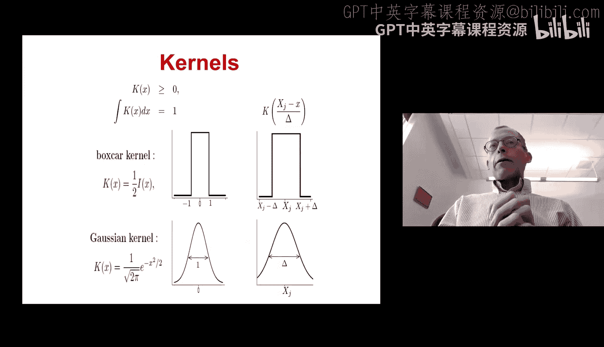

Let's say I'm using this this is the size of my kernel， right and these are the points。

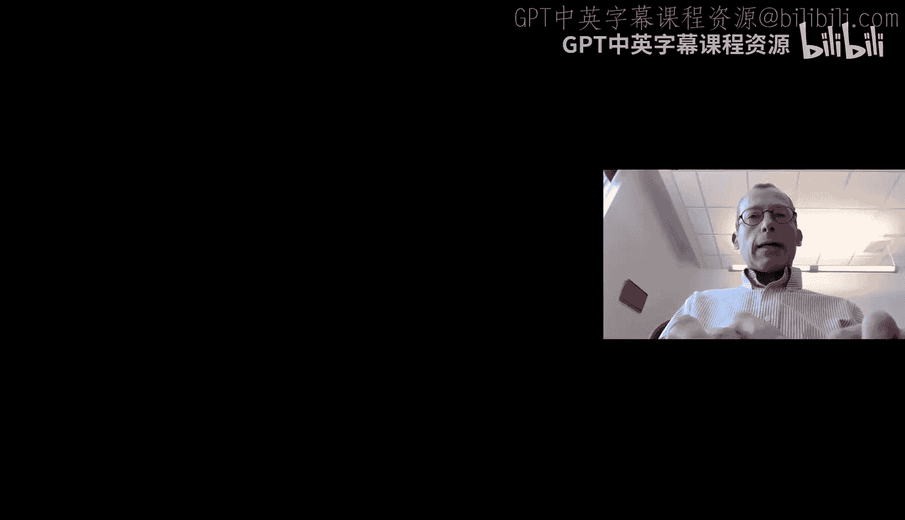

So if you have a point here， it if you have a point here in the middle， it might only use this point。

 but when you slightly move it to here， it suddenly uses all of the points on the outside here as well。

😡，And that can make complete or the jump can be very loud right so that's dangerous because the boundary is very strict either a point is in all point is out that's okay that's not you know。

 I'm not saying it's not something we can use we can use it but maybe that's not ideal。

 So another way of using kernelnels is to use something called the Gaussian can a Gaussian canal says that unlike box can all the points are in。

😡，There is no point that is out I'm taking into account all the points which is similar to what we did in regression but now we still want the local aspects of what is the local aspect。

 the local aspect is the weight you put on the point in boxka all the points have the same weight in Gaussian points have different weights this based on how far they are for me okay。

😡，So you can do a can basically that basically for each point gives you a weight and K basically represents the weight of that point and then when you do the averaging you average some points with a higher weight and some point with a lower weight。

 but if you move if you really move a little bit， then the weight stays more or less the same for all the points because the distance of the other points too you doesn't change dramatically。

Okay， so this is called Gaussianken and there's lots of otherkennels in fact。

 as we we will talk more aboutkens when we'll discuss support vector machines。

 but basically speaking， you can use a lot of。They're spatially adaptive。

 that doesn't really matter and they can be used forD。Right， so， so this is the yeah， this。

 I don't know why。Yeah， for some reason， these are multiply。I don't know， why。For some reason， I。

Yeah， I included this too much。Anyway， one one one thing to mention is the choice of the size of the bandwidth。

 even if you're using a box car camera can have a big impact as you as you can see on the。

On the results right so this is I mean some some way to alter the points and the predictions that you make and you can see that。

RightSo things look much much so this is just some result based on distances。

 it doesn't really matter what the outcome what the input is。

 but the important thing is that you can see that we get even for small changes in location。

 we can have a big difference in values whereas things become much more smooth。嗯。

Much more smooth when the size of the or when the size of the number of points that are included increases。

 of course， there is a danger because if you put too many points in。

 then basically all the points will have the same result。

So there is the trade off between being too smooth。😮。

And not changing based on locality so this is something that really depends on where you are。

 but this is again for boxc kernelal， as we said， one solution to this is to use a Gaussian kernelal which smoother things much better because basically small changes do not affect big but it's still an issue to decide even for Gaussian kernelals you need to decide on the widths of thekenal right so for Gaussian canals。

Yeah， for goussian canals， the widths of the  canal。

Right is the function of the variance here I'm choosing variance of one。

 but of course you can choose another variance， so the mean is always going to be centerd on the point that you're looking at。

 but the variance is something you have to choose， the bigger the variance。

 the bigger the impact that farther away points will have the smaller the variance the small and again there's no it's up to you。

 it depends on the domain and。

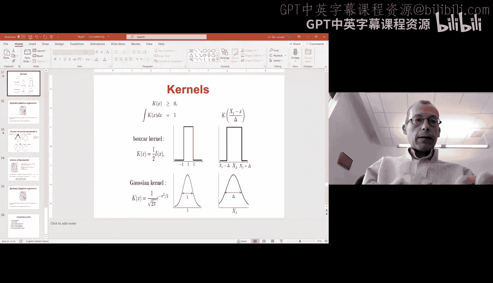

So this is basically it for local regression and as I said。

 we will get back to kernels that we'll discuss kernels in more detail when we talk about support vector machines and there they will have slightly different meaning but。

Much more important the same in terms of values。Okay。

 so this is for linear regression and again we mentioned linear regression is linear because we use the we multiply the output y is a linear function of the inputs or transformation of the inputs but fixed transformation of the inputs right so basically we do some transformation and then we take a linear combination of this transformation which is parameterized by w。

 the parameters that we are interested in， and this is the output that we have and this is why this is called linear regression because it's a linear combination of the inputs or transformation of the inputs。

But that's not the only regression we can can do we can do a regression where the output Y is not a linear transformation。

 but some other transformation of the input， maybe quadratic transformation of the input maybe combination of some quadratic W square or something or maybe or maybe a exponential and so forth。

 one of the more useful types of regression that is not linear regression is something called logistic regression and we'll talk about it in the next or this is the topic of the next lecture so let's okay good so let's talk about logistic regression。

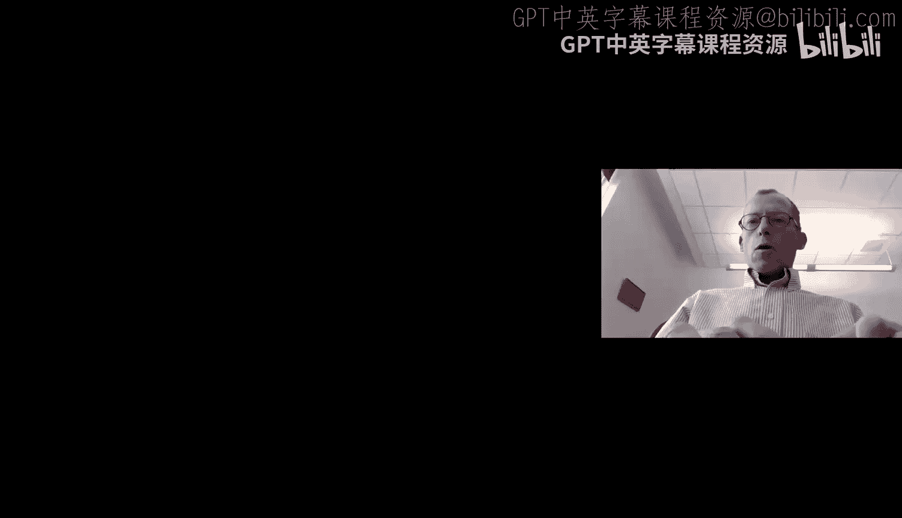

So logistic regression is a regression of course a method。

 but we are now back to a classification so we are of course in supervised learning but we are back to classification so we are back to classification that means that the inputs are still the same inputs as we had before they can be continuous discrete categorical whatever the output is going to be for logistic regression is going to be discrete so 001 actually this can extend to a lot of classes so 01 to3 and so forth okay and logistic regression is a discriminative classificationifier okay so in the same familiar as decision trees upon vector emissions which we haven't discussed and so on。

Okay， so let's。Before so I'm going to of course， spend this lecture discussing logistic regression。

 but as you will see， logistic regressionggression is a probabilistic classifier。

Why is that important because when we will try to find the parameters for logistic regression unlike when we did linear regression and we said we're going to use this square and maybe motivated by some probability in logistic regression it's going to be based on maximum likelihood estimation you will see we'll get to that。

😡，In in a few slides。 But the reason I'm bringing this up is because this may， unlike， for example。

 decision2， which is not probabilistic or support vector machine or even neural networks that are not probabilistic。

 So logistic regression does use probability， However， when I introduced it。

 I said that it's a discriminative classifier。 Why don't I say that it's a generative classifier。

 we already say that probabilistic or generative is a function of probability。

 So why do we call logistic regressionggress， even though it's using probability a deterministic discriminative classifier。

The reason is， because， unlike generative classifiers。Right。😡。

Logistic regression does not tell us how to compute P of x given y。

 It tells us how to compute p of y given x， which is the output， the class Y。

 but it doesn't tell us so we cannot use it for the base part。

 So we are not right in contrast right in in if base we explicitly try to compute P of x given y。

 So that's why it's generative。 but logistic regression。

 which still compute p of y given x is not generative。 It's not trying to compute P of x Okay。

 that's just a point I wanted to make because this sometimes confuses people that you know。😡。

C or哦 or哦哦哦哦 here that timem。Classifying I'm categorizing this as a discriminative classifier but it's probabilistic so okay it's probabilistic but the probabil is or there is no way to compute P fixed given y okay but that's just the minor point the major point is how we define the classifiers what is the max likelihood estimation problem we are trying to solve and when we solve it what we get。

So for motivating that， let's say that we want to use regression ideas for classification。

 okay why because maybe you know maybe it's a good way to combine features right we saw already that for regression we get pretty good results when we combine features so why not combine feature with some linear or either combination and try to get the classification that we want？

Okay， and we already talked about linear regression， which is a great model for doing regression。

 so what if we wanted to use linear regression for classification？😡，Okay， that's。

Maybe it sounds good maybe not but we can actually or we can actually at least set up the problem of linear regression for classification in the following way so of course in in classification unlike in regression we are only going to have two values let's say two classes for now okay this can be extended to no but let's say two classes in classification we are only going to have two classes so some points and again i'm assuming now that x is univariate although that will be true for other things so for some xs we are going to have one。

So， plus minus1 and for some excess， we are going to have。😡。

A class of a class of one okay now if you want to find the linear regression in this case you basically find the line right what is a linear regression it's this line that connects x and y。

Right so so given x， it will give you y。 and let's say we want to find a line。😡。

A line right that if w Tx， so w is the parameter in this case， w is just one value。

 if wx is greater than zero， basically if you're on one side of the line。😡，You will be positive。

 we'll say class1， and if you're on the other side of the line。

 we will say that you're negative class minus1。Is there any line that would walk for this set of points。

 anybody can think of a line that would walk for this set， I mean。

 can we find such lines for this set of points that will lead to optimal classification？😡，Basically。

 well， basically， a line means that。Right if we have a line then y equals some function of x right I mean or with with a bias because it doesn't go through00。

 so y equals w0 plus w1 x that's basically the definition of a line right that。😡。

By definition a line， so let's say we want to find a line for this problem， Can you suggest a line。

 can anybody suggest a line that will solve this problem perfectly， let's see。So唯 do啊。Yeah。

 horizontal， horizontal at0 again， depends on what you call 0， but I guess。Right， so the answer is。

 of course， as people said， yes， and in fact there's multiple lines at least for the data that I gave you right so for example。

 if we put a line here wherever this is that would be perfect。

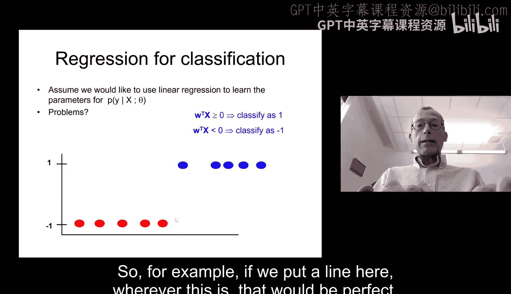

Maybe I can plot it， but there are other lines as well， obviously that you can find。Right。

 so we have this and we have some points here。And some points here。And we can put a line here。

 or we can put a line here。 I mean， a lot of lines will will separate these points pretty well。

Online here and again， depend， I mean， maybe maybe the straight line is the best right。

 because we assume that there is a strict but but given the points all of these lines would work for the training data。

 all of these lines will work。

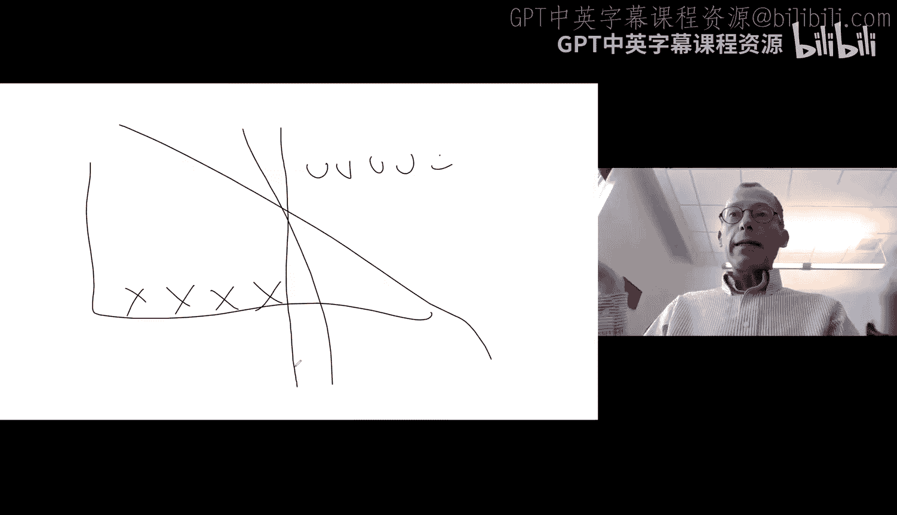

Okay， so basically so。😡，The reason why I'm bringing this is because given this definition。😡。

Right， there is a solution。For the linear for the linear regression problem that。

If we look at classification， well walk optimally right if I put this line， it will classify again。

 we don't know about the test data， but all the training data will be classified perfectly if we choose this line。

😡，Right that's by definition in line and we can find this line Okay。

 so now let's say that we now learn a linear regression model。😡，ok。Using this definition， basically。

 what is this definition， So the linear regression model gets x， which are these values here。

 It gets the ys that are these values here。😡，And it gives us a line because we said we want w0 plus w1 x。

 what line will the linear regression classifier give us， Any can。😡。

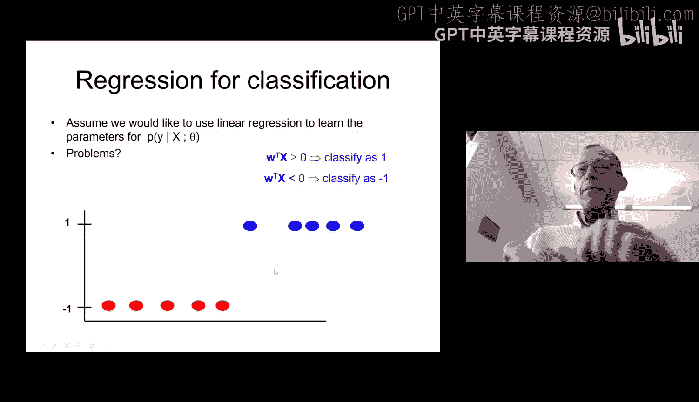

Predict can say。Right， so we want to predict y from x。 Yeah， I mean， of course。

 from our the our perspective， Y is the class and X is。And x is the x is the input。AndSo what？

What line would the classifier give us， would it give us the straight line。

 would it give us a little bit slightly different line， what type of what？😡。

What do you think would be the actual line that the classifier will give us？If we plot it then。

Anybody can guess。Exactly， so yeah。Yeah yeah so the answer is going to be actually a very bad line for classification。

 so if we go back to our drawing the line that will get from solving the linear regression as we defined it before right the least square linear regression problem that's the way we define will be something like this。

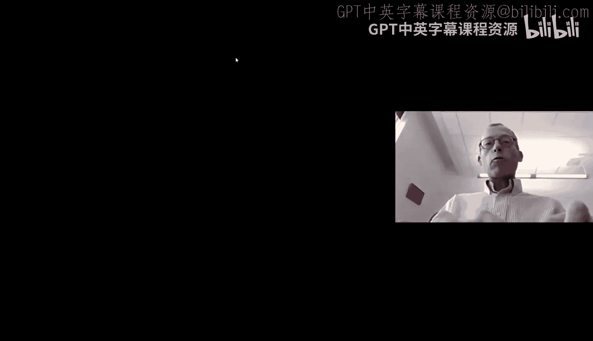

Why is this the case Because this line？😡，Is closest in terms of the projection of the points to the line right each of these points is very close if you put the line here。

😡，Then the point on the right is very far from the line and also the point from the left。

 So this is not a good way to minimize the squarearrow， thearrow is going to be very loud。

 On the other end， if we go like this， it's great it's a great line in terms of the middle square unfortunately if if that's the line then the classifier is going to make mistakes on this two here N on this to here depend on how we define even though we can get a perfect line the line we get from solving the linear regression problem as we defined it is not going to be a good line for classification and again that may or may not be surprising but thats the reason is because we are not I mean we didn't intend linear regression to solve classification problem。

 it was meant to solve a regression problem and regression problem we want to get the point as close to the line as possible we don't care about whether it's more than the line or less I mean we just want the least square。

 So that's not going to walk。

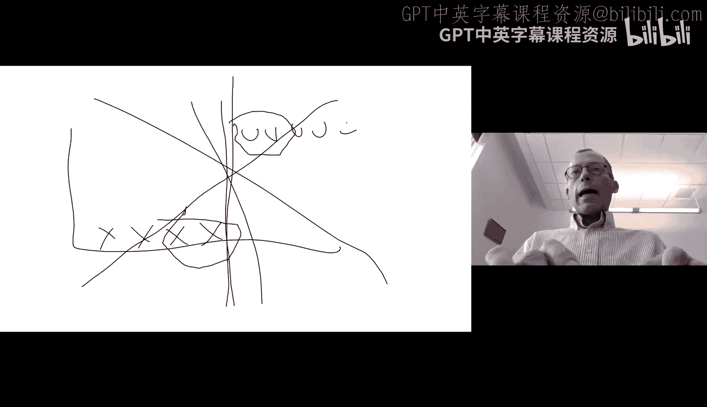

Anyway， the reason we did this exercise is to show that on the one hand。

 regression can maybe be used， but on the other hand， the way we define it is not so what can we do？

😡。

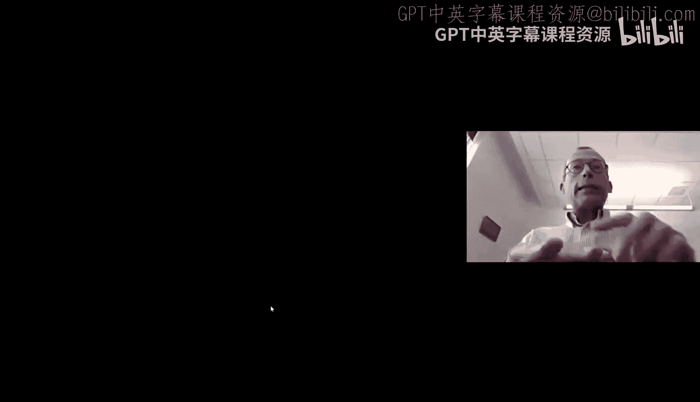

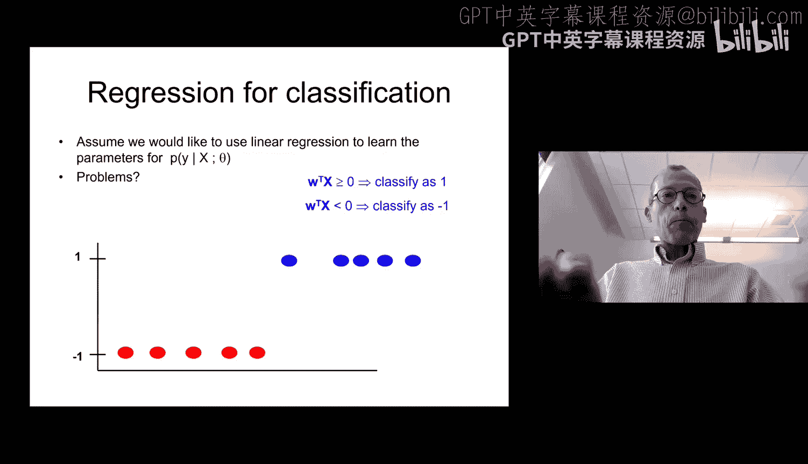

What we can do is change the target function that we are trying to optimize rather than optimize this square。

 which wouldn't work well for classification。😡，Maybe we should optimize another target function。

 we still want to use regression but optimize another okay， so this is the optimal regression model。

 which is not good for us。

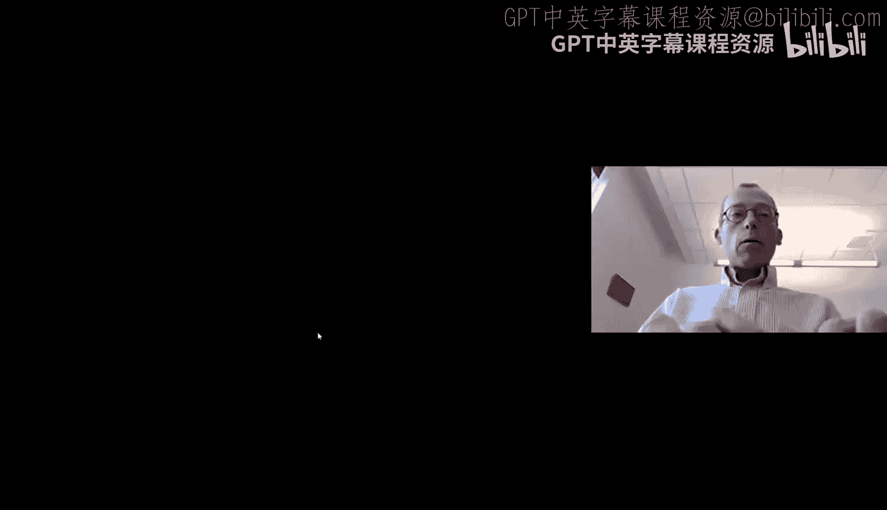

So for that， I'm going to introduce a new function。 and then I'm going to say。😡。

How we can use it for English。The function that we'll use is called the sigmoid function。

 and it's a function of one value H。😡，Of course， H can be computed as。😡。

H could be equal to some other thing， but but given the value H is the this is the function so you can see a few things about this function the value is always between0 and1。

Okay， so。So when H approaches minus infinity， this will be zero and when H approaches infinity。

 this will be one， but even for very a small values of H it's already very。

 very close to0 or minus will be very close to okay and there is some slope here。

 which is this slope here of course you can control the slope by looking at I mean if I do e to the e to the minus 100 h then the slope will be much steeper because any h will be multiplied by 100 or if I do e to the e to the minus 0。

0001 h， the slope will be much smoother right because every h will be。

Okay so you can play by playing with the values of H you can actually play with the slope but there is some slope here between I mean so it's not going straight up。

 there is some slope but the slope that the scale of the slope is a function basically of h right so if you change if you change some value that multiplies h it change the slope so this is a function again the important for us is that it's always between0 and1 which immediately brings the idea of using it from probabilities so we we can I mean we know probabilities are always between zero and1 as well and we need to show that integrate it so using that an idea we can use。

One possible way to use this is to define the probability of a class using a sigmoid function。😡。

So we have and they can use that as the tangian function and we will see in the next slide why this might be useful。

 but for now we can just have this definition that we will set。😡，P of y equals zero。

 the probability that y equals0 condition on x and theta is the parameters。

 but condition on x the input as one over one plus EwTx so what did we do here WTx is a regression right w is the parameters x is the inputs and this is the H that we have here。

😡，I drop the minus， Why do I drop the minus because？😡。

I can just plug in the minus in the ws right so w can be plus minus so I don't really need the minus that I have here if I really want the minus I can put it in the w so W are unrestricted okay and some of them will be minus some but but anyway once I define that then wTx will control。

Where the prediction is going to be along this curve here right if I think this should be class zero then I want the value of wTx to be very very low and negative right I want it to be close to this and this will be basically zero because if wTx is negative then the soid function is zero if wTx is very high or if I'm in class1 then I want wTx to be very high in that case this will be close to1 and we can put it on。

😡，And and if it might， it might get very close to one。 I mean， this， I mean。

 the reason why we are doing this is because this has to sum to one as a probability， right。

 the probability of class1 plus plus。 So we know that the values have to be always between the that that's one requirement for probability。

 The other requirement is that if we have two independent events or。

If the domain contains two independent events then the sum of these two events has to be one so that's what we are requiring here but the important thing again is that by controlling the value of wTx in which we get to set we can set the probability of a specific sample to be either zero or one that's the part we want to learn the other thing I want to mention is that this still is a regression problem so we end up with W multiplying x but it's not a linear regression anymore because everything now is in the exponent of some function。

😡，So this is not a linear regression because why the output， which we treat as probability。

 but it doesn't matter right， it's a continuous value so we can still do regression。

 although we treat it as a probability of a class， but why the output is a combination。

 but it's not a linear combination anymore of the inputs。

 it's some function of the inputs which is not linear right because it's one over e to the point so it's still regression W is still multiplying x。

 but the output is not direct function of that， but rather of the exponent of one over the。😡。

Okay so this we are in the regression space， we are talking about probabilities and we get probability okay so this is just a definition。

 the important thing about this definition is first it provides it provides a probability for the two classes and second the probability is valid so the values are always between zero11 and the domain or if we look at some of the events in the domain days they have to sub to one by definition。

Okay， so that's at least。It's a valid probabilistic assumption I assignment it。As I said。

 this is not a linear question。Okay， another thing we said in the beginning。

 but now you can see is that we don't really know how to do x given y in this model。

 we don't even define what it means to be or we don't define a distribution for x in class1 and a distribution for x in class2 we don't know how to compute it we don't unlike in for example。

 negative phase The only thing we care about is the probability of y given x。

 we don't know how to do the other side。😡，Right we don't deal with that。

 are only we only care about the this side， the probabilitybil of y。

 So this is a discreative function。 It's not a generative function because we cannot generate x if we knew Y。

😡，Because we never defined any probability of X， we only defined the probability of。😡，那's。Okay。

So now right， let's look at the differences between what we said before。

 The nice thing about logistic regressiong function is that。It can set this boundary and of course。

 x can be any dimension。 It doesn't have to be singled unifier variable。

 It could be multiied and so forth， but it can set the probability of any input。😡。

To be between zero and1 and the boundary that it computes right is the boundary between the point so the goal of the function unlike linear regression is not to be very close to each point it's to get the actual class correct because we want to maximize or we want the probability of y to be as close as possible to the actual one so if y is 0 we want the probability of y equals zero to be close to zero and if y is 1 we want the probability of y equals1 to be close。

😡，Then another important thing is that we control the shape of the boundary here so the boundary is always going to be something like this。

 but if we are very very confident in our model， we can have very。

 very large w values that for any x will either push it very， very much to the left or very。

 very much to the right。😡，So we can have a very tight slope right when it exchanges even a little it can move from being minus negative to minus positive okay so so on the other hand。

 if we are not very confident in the center we can have the slope be much smoother right much less steep。

😡，And then we can have things that are 0。4， 0。3， depending on。

 you know we are not very confident about that， so that's something we control by changing with Ws。😡。

Okay so that's another advantage of logistic Okay so this is something we defined as a function we said that it's a valid probabilistic model。

 but we didn't say how we are going to actually find the parameters that will lead to the best answer because now we want to find parameters that for samples in class zero will say the probability of zero is very high and for samples in class one I will say the probability on class1 right that's the。

That's the question that we would like to answer。 How do we answer that question， How do we find。😡。

Such parameter， the answer is because this is a probabilistic， even if it's not generative model。

 it's still a probabilistic model。😡，As we discussed in the first or second lecture。

 the way we do it is using maximum likelihood estimation Okay。

 so once we have a balllistic model in this case。For classification。

 but it doesn't matter once we have a probabilistic model， we can use maximum likelihood estimation。

😊，In order to find we can also use that in case but we don't want to make any assumptions。

 so in this case we just use maximumim likelihood estimation using the training data in order to find upon。

O。😊，So the goal the goal of the or the next part is basically or the goal of the rest。

 I guess part of the rest of the lecture is actually to find the values of the parameters that will maximize that likelihood okay how do we define the likelihood of the data given the model？

Right so this is again the definition that we had for the logistic regression function right we said the probability of y given zero is one over1 plus e to the power of x I'm going to use a short notation for that and I will call it Gxw and this is one minus Gxw because this is one minus the probability the probability of1 is1 minus the probability of zero so I can write it this way as right I mean you can see that these two something1。

So this is just a notational issue don't I didn't do anything here okay but I will use that in the maximum likelihood estimation so this is the maximum likelihood estimation and I'm going to i'm using a slide I don't want to say quick but but a shortened notation for that basically the maximum likelihood estimation is the probability right of the data given the model。

😡，What is the data the data is basically the label that we assign to each of these samples that's the input and the model is the prediction based on x right so for each。

😊，for each。So for each example that is in class one we want to use the probability of class one that the model gives them right because that's the probability thats that's the right solution we need to give for a sample of class one so if I have a sample of class one then I'm using the prediction for class one which is one minus GxW。

😡，And I'm taking that to the power of Yi right which is basically one so if if Yi is class one。

 then I'm going to use this part here So if I is from class one。

 I'm going to use this part here if I is class0 then I want to use the probability for class zero because that's the right solution that I that's what I want to maximize that's the probability I want to maximize and which is D X I W and that case。

I take that to the power of1 minus I so if I get a sample of class one I'm going to use this probability and if I get a sample of class zero I'm going to use this probability and I take the product to follow of them this is just the way to write it。

😡，I could have written it as pi over all samples of class one this and then pi over times pi of overall all samples of class one of class zero of this。

 but this is just a way to write it together okay， but the important thing is this is the likelihood of the data given the model right the probability that we find the right class。

😡，Divided by the two classes， Okay， just the definition and again， a shortened way of writing it。

 but。Other than that it's correct and now we want to find so this is the likelihood of the data given the model and now we want to find the maximum value of oh we want to find the value of the parameters W that maximizes this likely that's the goal。

😊。

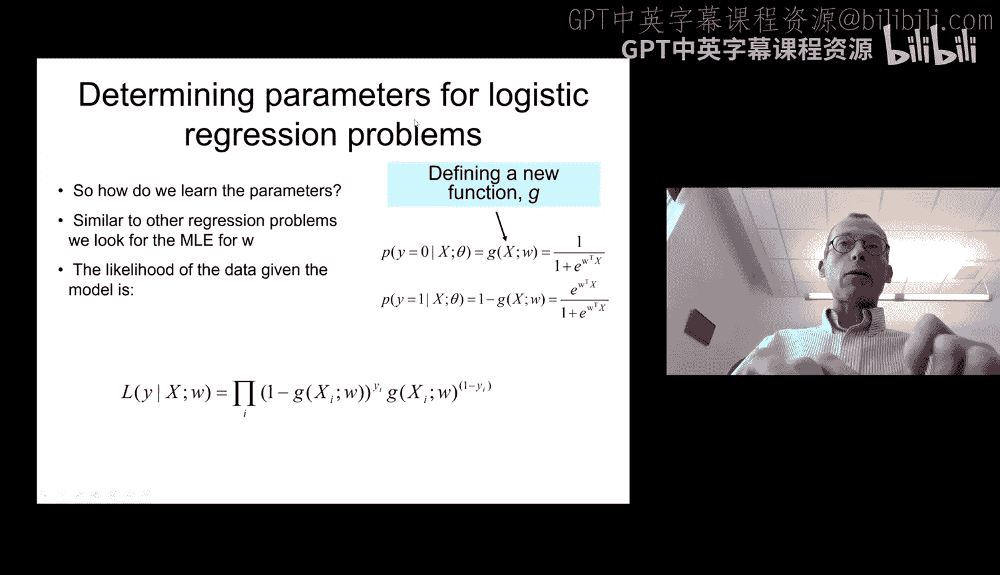

What's the first？If someone has a quick question， someone says MLA should be the probability of data given W。

 but here it's the probability of y given x and W So the data right so x we don't have right so in this case。

Right， we don't have right， I mean， you can okay。Good， let me。Yes， so。

So right we are computeut P of x Y given the model， right。

 that's what people said and this is basically right P of y given。Times p of x given right。

 This is the chain rule。 Everybody is okay with that。 I only focused on this。

Because basically x doesn't or we don't have any model for generating x so we don't even care about generating x so this will basically whatever values we assign to data this will stay the same so we don't I mean the maximization function doesn't care about this part。

 it only cares about y given x。😡，Okay， so you're right， I mean。

 we are only maximizing the path of y given x because。😡。

the probability x and of x given theta is not defined as something that we don't care about or will be the same basically for all parameters that we use。

Okay good， so that's a good point， but in this case that's。没。Okay， good。

 thank you for for the question。 so let's。😊。

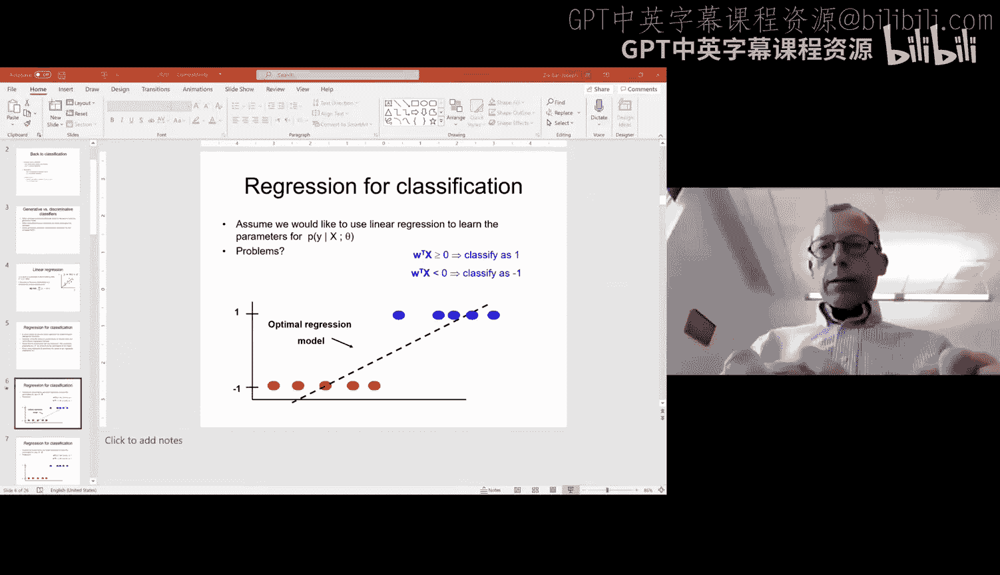

Oh， I actually wanted to use。 So， yeah。 so， so what's the first thing we should do in order to to。

So what's the first thing we should do to find a maximum likelihood estimation？

RightSo we want to find maximum estimation what's the first thing we would be good to do for this data。

 you've all done the problem so you should now be clearly。

Right so we write down the likelihood we wrote it down of course and now what's next now we want to find the yeah so the first thing even before we take the derivative which we'll have to do is is the log right because we have these exponents here it makes sense that taking the log would be a nice idea。

 which is true。

As most of you found out， Okay， so the next， the first step is is rather than compute。

 So this is the likelihood of the data， right， the likelihood of the data of Y given X W and and the next and the first part is really to take the log of the data。

 So let's do that。 So this is LL is the log likelihood。 We are not doing any derivation or anything。

 We are just taking the log。And。Right， so if you take the log， obviously all the wise go here。

 this becomes the log， it's log of this function here。😡，Yeah， I'm not going to derive this。

But basically what I did is I right so this one is just why I learn I mean I'm taking the log of base E in this case right because we have E in the exponent so we are using log E rather than log2 but this is the first right this is just taking the log and moving the exponents out and then right and then we basically sum the values that have Y I so this one is one minus this so this becomes。

A ratio right or a fraction one of this over this and this is the part one and then if you actually put the so right if you now substitute G of xw to what it really is。

 you actually get these two values okay so this comes out of actually putting the values。Here okay。

 so again， this was one over this， so this one minus-1 went here the denominator went up to the numerator that's exactly that's not very problem。

Anyway， this is simple logical so once we do this we get to a dysfunction here which is you know sum sum over YiWTX it doesn't matter and now we have the log likelihood of the data so the next step of course is to take the derivative with respect to the parameters right so now we have the log likelihood we made it as simple as possible and the next step is to take the derivative。

😊，And we take the derivative with respect to the parameter， in this case。

 the parameter is of course lovely。Or let's take a partial derivative with respect to one of the Ws。

 it doesn't matter， let's say WJ。Now， if you want to take the derivative with respect to W for this function because it's a sum basically so this is very easy right。

 I mean the derivative is just W。In this case， if you take that over WJ。

 it's just XJI times Yi because everything else falls apart if you take it with respect to one of the。

One of the parameters， the derivative here is slightly more involved， but not much more right。

 if you have a derivative of a function， then you take the derivative of the function for this case。

 it's n it's one over the value here times the internal derivative。

 which is basically E to the power of WTX times。😊，The internal derivative， which is XIj。

And basically this becomes so you basically you get this part for the first and this is the part you get for the second okay。

 and you can do this yourself， but basically the derivative of a line is one over the value you have in the line times the internal derivative and the only thing you have to careful for is the internal derivative here is EwTxi times the internal derivative on the exponent of x of wt which is Xig so that's where you get the Xig。

Other than that， this is pretty simple algebra。Okay so this is the derivative that we get and again here I write it in the notations that we used of1 minus G which is basically right here。

 basically this is just e to the power of wTx1 over this， but more importantly。

 we already said that one minus G X I W is the probability of y equals。😊，Okay。😊。

So this is what we end up at the end， which is nice。 I mean， it's nice because it shows you right。

 and then we want to what So what's the next step doing that we need to do So we took the derivative。

 the next step is to。Equator to zero right and when we say when equ to zero。

 this will lead to the best wY data case because when this equals zero， what happens？😡。

If my eyes is one？Right in order for this to be0， then the probability that y y equals 1 has to be1。

 Otherwise， it wouldn't be 0， assuming that X is some arbitrary value。 So for this to be 0。😡。

When Y is one， this should be one。😡，And when y I is 0， this should be  zero。

 Otherwise it So that's actually shows you that just， I mean。

 we don't need that because we did a derivation， but you can see from the derivation that if we find a w that basically maximize a。

Right that that。Well， yeah， I guess that minimizes the error here。

 you actually get the maximum or you can get the maximum。 Otherwise， you can get like the the sign。

 because this will be basically a minus value。 It's not always to depend on the value of X I。

 But generally speaking， this is the L that you get for the function， right。

 And when this comes close to or when this comes close to or when this is， in order for this to be 0。

 or the other error around。 If w is such that we get all the values perfectly， then this is 0。

And when this is zero， this is the optimal we can get， obviously。

Maybe we can't get to zero all the time， but at least we can't always get that this path will be zero。

 so maybe this parts out some sometimes will not be zero and this will make it like the summation will make it zero。

 but anyway。If we do have the perfect solution， this would be zero by definition。

 but that's just the minor point to show you， but it doesn't matter it comes from the Okay， good。

 so now we did this regression， we took the derivative， everything is good。

But we still have a challenge right we still need to find the value of w So how do we find the w of the value of w here Well we usually just separate things。

 we move this to one side， we move this to the other side we divide we do this unfortunately this is not going to work in this case because W is in the exponent or and this what this is really is this path here you can play with it you can try but a lot of people have tried for several decades and there is just no close form solution for this okay so there is no way to get w out of this equation even after youequ to zero。

Just effect， I mean， again， I'm not going to try and you can try if you want and if you have time。

 but。The consensus is that you cannot get w out of this equation。 So what do we do。

 we still want to find the value of w What do we do。

 We are going to introduce now a method that is very important in this class and we already introduced one general important function which is called MLE。

 which we used already several times and will'll use again the function that the。

The the method that I'm going to introduce next is similar to ML a general purpose function。

 we are going to introduce it now for logistic regression。

 but it's going something you will use a lot in your networks and in other other cases。

 okay and this is called this is something that is called gradient descent。

Or graduate As for this because we are maximizing the argument where and descent is organizationization project。

So what is gradientian asscent and why do we want to use it so again。

 remember we have this issue that we want to find w but we don't know or we cannot separate w out of the other components so how can we still find w？

😡，The answer is we can improve on W rather than find a closed form solution for W。

 we can iteratively try to improve on the Ws that we get。How do we improve on W， How do we。

 let's say we started with some Bbe and want to find the better W。 How do we do that？😡。

So one way there are several ways of doing it， one of the most popular ways is something called gradient descent gradient descent means that you need to take the derivative with respect to W which we already did。

😡，And then look at that derivative to decide how to change W。😮，For the next iteration。

 it's not a way to find the best W， it's not like if you did it， you will find the best W。

 The only thing that it tells you is that you will move slightly closer to the optimal W and if you repeat it enough times you will get pretty close to the opt W or maybe you'll get exactly to the optimal W if you can get。

😡，What's the idea， the idea is that depending on the shape of the function right in our case we want to find the maximum likelihood so the shape of the function。

 if it's convex， it looks something like this so it's going up it's up to some value of w and then it's going down and this is true by the way for one value w but it's also true for individual。

😡，W so W I W I plus one， W1， W2 W3， Okay， so we have this type of scope where there is one optimal value and before and after it。

The function， which is what we want to maximize。is right the function that we are maximizing is slightly less than the max model。

Okay， so this is the function that we want to maximize Now if we look at the slope here。

 the slope of the function that we want to maximize is the derivative right that by definition。

 derivatives are the slope of the function。😡，So let's see what the relationship between the change in W and the slope？

😡，If the slope is positive， so we have to if we go from here to here， we see a positive slope。😡。

Basically， we increase。If the slope is positive， we increase deelta z increases the value of the function。

That means that we are in the range where we would like to increase value。😡，So if W increases。

 if we are here， the slope is positive。 It means that if we increase W will go closer to the。Maxma。

If we are here， the slope is negative， right because once we move in this direction。

 the value reduces， so the slope is negative。😡，That means that we would like to decrease w。😡，Okay。

 so if the clause is positive， we would like to increase w， if the slope is negative。

 we would like to decrease w， we don't know by how much because we don't really know if we knew this function right if we knew how this function looked。

 we would just go to the maxs and take it we don't know how the function looks。

 but we can say more or less where we are on the function。

 not with respect to the peak but with respect to all we're going up or are we're going down if we are going up we want to continue to go up until we reach the peak。

 if we are going down， we want to reverse that and start going back to the other direction。😡。

Okay so what we have here is something called gradient as so we look at the gradient。

 we look at the derivative based on the derivative， we decide on our next move。

 but we don't know how big the move should be because we don't know the function the only thing we know is the direction of the move。

😡，So if the slope is positive， we increase w a little bit because we don't want to jump over the peak。

 if the slope is negative， we decrease w again a little bit because we don't want to jump to the other side。

😡，That's the idea of gradientianscent gradientian descent。

 compute the slope based on the slope and the function， in this case maximization。

 change the w a little bit in the direction of the slope。😡，Where the end descent is the opposite。

 where the end descent means usually for minimization functions and in that case you change it in the opposite direction to the slope。

 but in our case we are trying to maximize the function。

 so we're going with the direction of the slope。😡，Okay so this is gradient and descent right where we have a minimization function and when we have a mini and the reason why I mentioned it is because you will run。

 I mean most people actually use gradient and descent rather than gradient descent because in many cases or most cases this is used for minimization functions and in that case when we have a minimization function like some squares or something then the goal is to go in the other direction right so when the slope is positive right here you want to decrease the because here the function goes up。

😊，But you want it to go down so you want to decrease W and when the slope is negative， which is here。

😡，Right so the function goes down， you want to increase that because your goal is to go to the negative side。

Okay， so this is again just difference between gradient de and gradient and the important thing is not so much the name。

 the important thing is the function， the method， the method is iterative。

 you compute this gradient iterative degree and I will show you in a second how you do it。

 you compute this gradient intly and once you compute them you move in the direction of the gradient。

 the quantity that you move in the direction is not part of the algorithm it' except up to you to decide and I will show you in a second that this can have a huge difference on how fast you get to the optimal。

Sution。And again， the worry is on the one hand you don't want to jump from one side to the other right because if you start if you miss the peak if you increase W too much and you go to the other side then you have to go back and forth and back and forth sometimes too much on the other end if you go to slowly you will get to the peak but maybe it will take you two years which you don't so there is this trade off between a size that is big enough to make a difference and small enough to not jump over to the other side and I will show you there's no way to actually。

😡，Oh it's hard to find the right solution， but this is something you try。

So this is the way we do gradient ascent basically， so we compute the derivative for W。

Right which is this value here。 this is the derivative for W。

That we computed right this is the a derivative so before I mean that's what when we took six this is the log likelihood but it doesn't matter when we find the derivative this is what we found and now we start with some guess for WJ and we change WJ based on the direction of this right so this is positive time some epsilon time some very small one。

Okay， so we are not going to use this value that we computed because we are multiplying it by relatively small value。

 but we will use basically the direction if this is so epsilon is always positive。

 if this is positive， w will increase， if this is negative w will。😡。

So this is the basic idea of logistic regressionggress with a gradient descent right so we start with an epsilon which is what we call the learning rate we guess W。

Okay， so we guess value we have to start with a guess you can guess w is0。

 right so just guess all the values of w is0， you can guess1 or whatever you want。

And now we start iterating。First we compute the derivative with respect so once we have w we can compute this function right this is a function of w。

 the derivative once we know w， we can compute the value of this function because this is a function of w why and X are given to us the only thing that is missing is W we guess w so we can use it so now we compute this once we compute this we can see if it's positive or negative we actually have the value we multiply by epsilon and we increase changes this。

😡，Okay and now we test the likelihood function using w and we compare it to the so we have a new W function right which we computed and now we ask whether there is an improvement to the overall likelihood or not if we are moving slowly up。

 then there should be an improvement right because now the w is getting better and better and better and better So if we are moving slowly up we will find an improvement until at some stage we go over the top and we start decreasing then we stop because we reach the peak。

😡，If we move too fast， then we can have actually a decrease， not because we moved up。

 but because we just jump too much。 So it's very important that Epson is very small。And again。

 I will show you an example。Okay， but once we do that。

 we basically stop when these things convergence， convergence means that we cannot improve the likelihood function。

One point I want to make is that this is the general gradient descent algorithm。

 the challenge with that or not the challenge， but one thing you should realize is that each iteration you should basically sum over all the samples。

So this can take a long time， especially if you have a lot of samples and of course this is done separately for each of the WJs so you need to do it for all the Js and for each J you need to sample you need to go all the samples so this is called gradientian descent there is another method that speeds this up that is called stochastic gradient descent and it's stochastic gradient descent which I think you will use in the problem set rather than computing this for all the samples you just do it for one sample。

Okay， so the equation remains the same， but rather than summing up on all the samples。

 you just pick one sample at randomom and do it and do it again and the idea is that if you do it enough times you basically approximate the re gradient descent in neural networks you will see another solution which is called batch gradient descent。

 which rather than do it on one or everything does it on a subset which is called a batch。😡，Okay。

 all of these things are just approximation to what I'm showing you here and the reason why we need this approximation is because we want to speed up this can take a very。

 very long time if you have 1 million images and you need to do it it you can think how long this takes but but this is the actual gradient is set out okay just for。

😡，Okay， good， so if that's clear， let me show you an example of gradient descent and the example I'm going to show you just because it's easier is gradient descent applied to linear regression。

😊，So that's may or may not。是。Let me stop sharing for a second so that may or may not sound like a reasonable thing to do because we already said that we can find the W for linear regression in one shot。

😡，The problem with the problem when we do it in one shot is that it can take a very long time because as we said。

 we need to convert。A cubic matrix or sorry we need to inverse the matrix and that could be cubic in the size of the in this case in our case in the size of the features so if we have a lot of pixels。

 if we have a lot of features maybe we cannot solve or we don't want to solve linear regression in close form it turns out that you can use we and descent for linear regression as well okay even though we are doing linear regression you can do it we and descent and you will get to the same solution but you will be right again in linear regression it's a minimization program unlike an optimization so we are going to use descent rather than asset but rather than that we can we can do the same thing and we are guaranteed because it's a convex problem we are guaranteed that if we move slowly slowly we will get to the optimal solution which will be the same as the closed form solution。

So we can use linear you can use gradientian descent regression。 It's something that we often do。

For speed， but also in neural networks， for example。

 which sometimes combine linear regression or logistic regression and other functions。

 it might be better to use the same optimization method for all of them。

 So linear regression of course so logistic regression we can only use gradient descent So it's good to use gradient descent for linear regression as well So sometimes we use it even if we can solve it in close form sometimes for the ease or for the consistency we use gradient Okay just again just a motivation but but the example that I'm showing you is for linear regression Okay so so I don't know if you can see my screen second sharing it。

So I'm showing you a quick MAA implementation of gradient and descent。

So we'll start by setting up the problem。 so so basically I'm setting up values for x between you know0 and 20。

 So this is a linear regression program。 So x is the input Why is the output and I want to introduce some noise I'm going to set。

Some random noise let's say with mean zero， this is normal distributed with mean  zero and something。

And now I'm setting y to be2 times x， okay， so y equals it's a linear regression problem。

 so the w that we're looking for is to。Okay， so now we have the inputs x， we have the outputs y。

 and our goal is to find the w which is okay so let's do that using gradientant descent。😡。

And in this case， just to show you x and y are the values that we put as input。

 zero is the original prediction。Or the initial prediction for W writing gradient descent we need to have an initial prediction for W。

 it can be0。 I can change it later。2 is the real W and and I'm just using I mean the algorithm is not using it。

 but it's good for and this is the learning rate。 And as you will see this has a big impact。

 So if we use a different learning rate it will either be faster or slower or it can completely diverge Okay so let's see what happens when we do this。

嗯，我已经收死了。What's your white so slow。😔，Anyway， so this is the value this is the what you get if you use the real w the real w which is2 and this is the linear regression gradient descent approach so red is that the value of w that it predicts a ititeration。

 you can see that it gets closer and closer to the real one it started with zero and it's getting closer and closer to the actual one。

😊，Why is it taking so long。Okay。So now what happens when we change the initial prediction。

 let's say we start with minus 10。数。You can see that it starts much worse。

 but it's still getting pretty close to the right solution。

 even if we start at worth I mean it's moving in the right direction and eventually it will get to the right solution。

 even if we start very bad W as long as it doesn't jump from plus to minus。It's going to get， oh。

 I stopped it after tenerations， but if I let it go， it would have gotten to the right solution。

 Okay， so this is for this What happens when we change the learning rate， right？

 So we started with 0，05。 If I change it to a lower learning rate。

You can see that it's moving in the right direction， but it's moving very， very slowly。

 so this starts at 0003。I dont know it's not moving。嗯。Okay， so now it's moving but it's moving very。

 very slowly right if we had the bigger one， it would have moved the so it's it's moving but it's moving pretty slowly to the right direction I'm stopping it after 10 iterations so it will never get there if I make the learning rates faster。

 let's say this。Then it will move very fast， but sometimes in this case it just overshoots it and it goes back and forth from the side so that's also not good so there is some learning rates that are optimal because they on the one hand they move fast enough but they don't overshoot and some learning rates are。

So， this one should be。RightYou can see this moves pretty quickly along the point and gets there very quickly and to the solution。

By the way， the optimal solution， even though it's true， the optimal solution for this case is 2。

02 which is even better than two if you look at the error。

 the error for2 is 18 and the error for the solution that we found is 16 points so basically it gets you betterarrow again because this fits some of the noise that we have。

Okay， good， so this is an example of Gian， is that the key points are that if you change the learning rate。

 you will do faster or slower depending on the learning rate。

 unfortunately you don't want to do too fast because if you do too fast。

 then your learning rate or then you basically jump back and forth and you will never。😡。

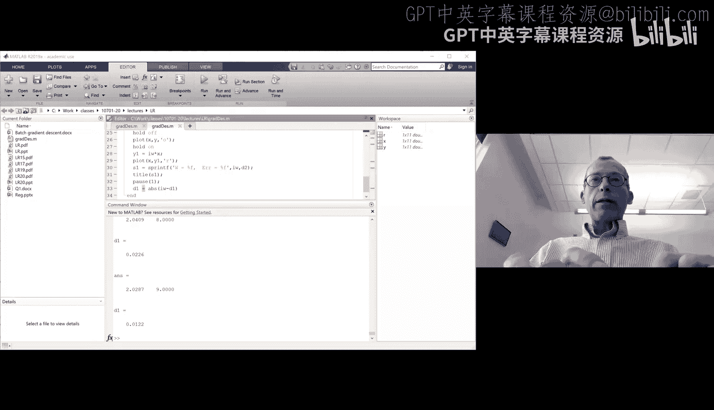

Okay， good。Yeah， so I changed okay good So so this is an example。 Let me okay。

 so now let's do a piazza poll。 Okay， I mean it's good time to review some of the material。

 so I'm going to release the poll on logistically regression。As before， right， there is no way。

There is no grading or anything， but yeah。Yeah， so please take a look at the poll and do the two questions that I released。

Yeah， so the second question obviously is more involved。

 You might need to think a little bit about it。 Of course， we saw a similar question for。

KN and decision to in fact， the same question， so as I said， this is。

A nice question because it really maybe gets you to think about different models and the impact that different things have on them。

Okay， so a few more seconds yeah， try to get an as I said， this is。Not trivial questions。

 so if you don't get it right it's not a huge， I mean， I'm talking about the second one。

And the first one should be easier。Okay， if someone had a question。

 they said they're wondering if the from it is the linear regression in question two will be estimated as the X matrix now has multiple。

Pall it Polity。Okay， so let's assume we use gradient descent if that。Right。

 I mean we can do very time。Okay， so let me start with the first question which hopefully everybody。

Had time to complete。So the first question I ask you something pretty basic about just a question that I actually mentioned in my slides and that is if we have a probability for class1 and class2。

 what's the relationship between them and the answer is because this is the probabilitybaities function and we assume that the probability the log regression calculates is p of y given x and the domain can only have two values for now we assume that it's two classess01。

 then the sum of the probabilitybabilities for the two events which are this joint has to be one。

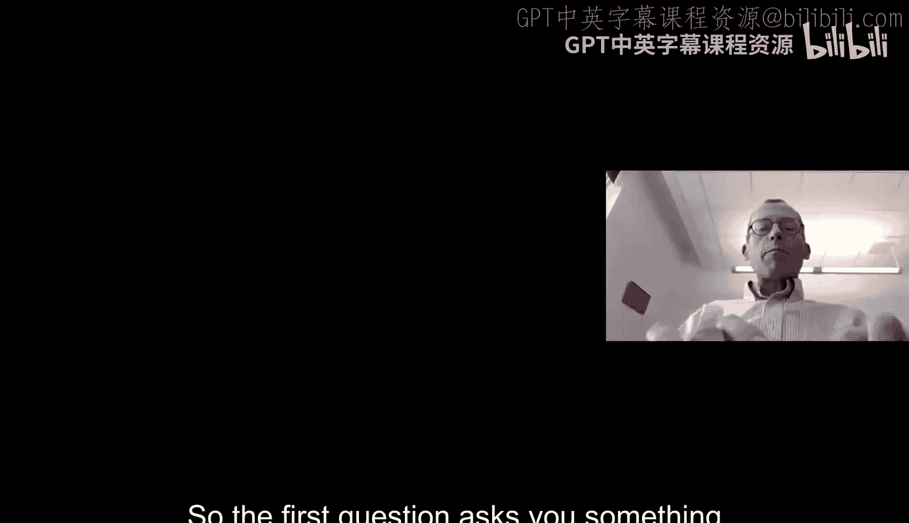

So if the probability for one class is 0。7， the probability for the other class has to be 0。3 okay。

 so most of you the vast majority that it。The second question is more interesting and fun because we already asked this question about K neighbor and decision fees and in that not decision fees。

 we actually did not ask it about decision fees， although I should have asked it on decision fees you can think about for decision fees。

 but I did ask it for Ken neighbor and E base and for both of them the answer was that the classifier will change。

😊，Okay， so now we're asking the same question。 Basically， I'm duplicating the value of the first。

Of the first input of the first feature of the first feature in each input。

 and I'm asking how is this going to affect the classifiers？

Now a key point in this question is that the classifiers that we get are optimal。

 basically we have a lot of data enough for us to find the optimal classification or regression mode okay。

 so there's no better answer。😡，Then the answer that we already have found the。

From the data that we have。Okay， so what would happen to linear regression and what would happen to logistic regression？

😡。

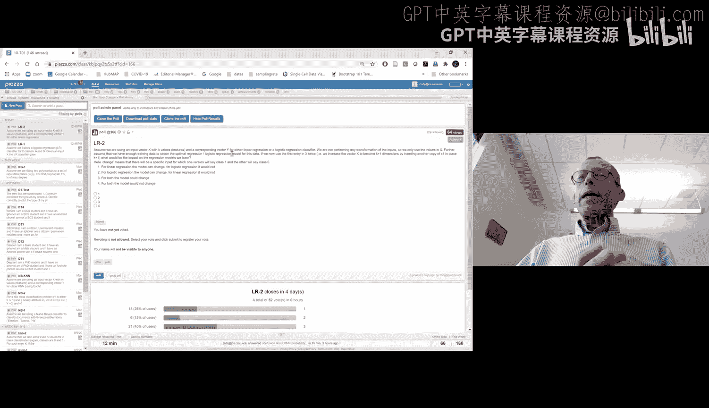

什么。So， we know。And this is true for both them， but let's start with another question。

 We know that there is w1 that is optimal for x1， right。

So linear regression y equals W1 plus W to x to， let's say for individual samples。 right。

 That's that we know that there is W1 that is optimal for x1。 Now， we split x 1 to x 1，1 and x 1，2。

Right that's the dony difference， everything else stays the same。

Is there a W that will be optimal for these two？What W will be optimal for these two？😡，For example。

 W1 over 2 plus w1 over or you can think of other combinations。

But any combination will do x11 plus x12。😡，It kind of basically right if we have， let's say。

Any combination in which let's say we put W。1，1， x 1，1 plus W 1，2， x，1，2。

And any combination will W11。Is equal to w1 would lead to the same solution as the original solution right so it's not impossible in fact it's easy for us to get to the same solution What do we know we know that the previous solution is the optimal we cannot do better than that so the new solution must have the ws obey this function here they must have w1 equals w1 plus one plus otherwise right。

😡，W1 will be different。 If W1 will different， the solution will be different from the previous one。

 but it's not going to be optimal。 Now， of course， if we cannot get to the optimal。

 that's something else。 but we know we can get to the optimal business samples。

 So it must be that the new solution will have the same value。😡。

And so the answer is that linear regression is not going to change what about logistic regression same thing right if we look at E to the power of Wx。

If I set w11 plus w12 to be w1， then e to the power of Wx。😡。

When I have x11 and x12 will still be the same and we know that the previous method or the previous ws led us to the perfect classification。

 we cannot do better classification in that case， the perfect classification will be when W1 equals w11 plus w12 and in that case。

 any point that we will get will get the same prediction as before。Because the w times x。

 the overall value will still be the same。😡。

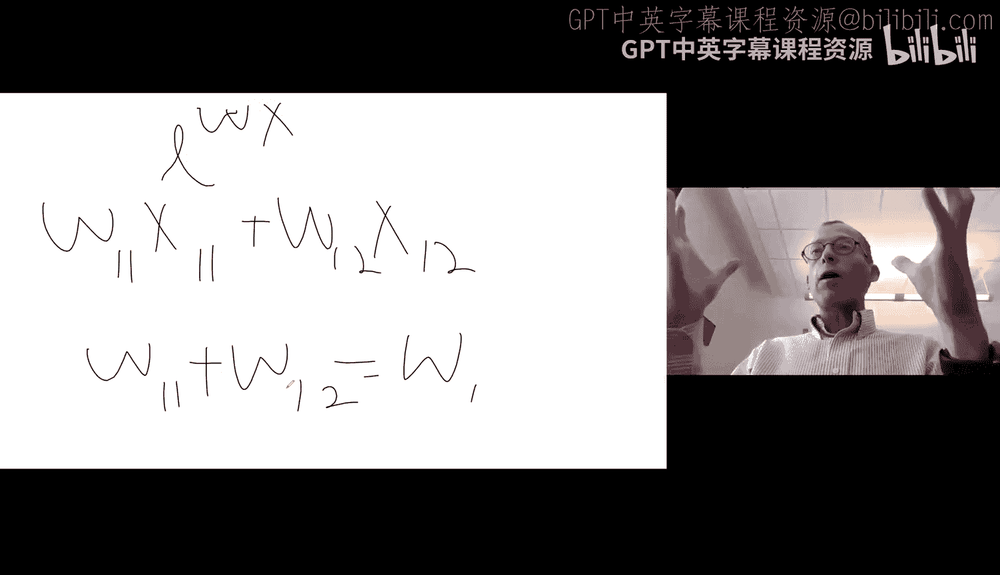

Okay so this is slightly very different I would say from what we had for can neighbors and A base where we did have a difference in this case again this is only true again it's only true based on the caveat that I wrote that we have the optimal classifier the classifier is not optimal there will be a difference because we are introducing a new value here it could change at least for logistic regression i'm not sure about linear regression actually linear regression。

It shouldn't change because we basically get the same but for logistic regression I think it can change。

 but definitely yeah， I remember this came up。So for linear regression yeah。

 that's actually an interesting question that I keep asking myself。

 So clearly when the classifier is optimal there's not going to be change when the classifier is not optimal for linear regression is not going to be changed for logistic regressionggression I'm not sure actually I have to think about it I don't know if anybody has。

A good argument why it could or could not change because it might actually not change even if it's not optimal。

 but anyway， in this case， if it's optimal it's definitely not going to change。Okay。

 so let's go back to our problem。我撞。Cl。AndAnd I want to mention a few more things about logistic regression before we finish。

 so we already talked about how to find the values for logistic。

 which is the most important the thing， but that's。

But there are other ways of doing so so far， we basically solve the MLE version of logistic regression。

😡，But there is also something called regularization， which is much more similar to the map。

Estimate then to Emily what is this regularization thing that you will actually work on in the problem set Regization is a way to limit the value we assign to parameters。

 Why do we want to limit the values we assign to parameters because sometimes we may think that there is not enough data to accurately predict the values of the parameters and I already showed you in the polynomial case that if we give too many parameters。

 we are going to fit the data very well， but we will end up overfitting and in fact。

 in polynomial regression if you look at it you will see that。

What happens in practice is that if you allow for a much higher polynomial。

 you will get ws that are very， very large。😡，Because they have to go very high and then come down and。

So it turns out that a good way to reduce the overfitting issues or to reduce the impact of overfitting is to limit the values that the Ws can take。

 for example， one way to regular it to limit this set of values is to say that we have some trial on the Ws。

😡，RightThis is a probabilistic function if we have a prior this becomes rather than an MLE it becomes a map estimate what is a potential prior the potential prior is that most features are not important that's the motivation most features are not important for data only relatively few features are important right。

😡，So if most features are not important， what should be the W for these features， it should be zero。

 we shouldn't take them into account。😡，So that's the file we have。

We can set the probability of w to be zero sorry to be a Gaussian with mean zero and some standard deviation the standard deviations means that some features are important so we allow them to take values even very large values although they will be penalized but most features should be zero if that's the case then we assume that Wj is distributed with mean with means that is0 because we assume most of them are not important and some standard deviation so some of them do have values。

 some can even have a large value depending on sigma square and in that case the likelihood function is a map function and now rather than maximizing the likelihood of y given x we max the likelihood of y given y and theta which is basically right I mean based on the chain rule is the probability of y given x theta which we did already times the probability of theta and the probability of theta now is basically if you take the log function and sigma square and sigma square we take out because it's fixed。

😡，We don't care about it， basically it becomes Wj square over atlu square。

Okay you I mean it's I mean everything else drops out and this is the log so e to the power of minus so this becomes a minus of this Okay。

 so this is now a new log likelihood function。Again。

 we still cannot solve it in a closed form solution。

 but we can iterate and find the best solution but now take into account not just the derivative for this one but the derivative for the entire function。

 so if this is positive we go up if this is negative we go down but when I say this。

 I mean that we take into account。😡，The prior that we had as well。

Okay so this is called regularization and again this is using some probabilistic assumption that basically leads to a map estimate in the problem set you will use other regularization that has the same motivation so the motivation is that we don't want to have very large value or very large value for parameters so most features because we think most features are not that important so we want to have most features be close to zero so one way to do it is to minimize the least square or the square value with some function of the variance another is to minimize the absolute value so this is called L2 regularization because we are maximizing the square of the parameters and absolute is called L1 because we are minimizing in the absolute。

And it's actually a bit harder to do， so related to the problem set rather than the validity costs。

Which is fairly I'm sure right okay good so this is basically the new update rule so the only difference is that we still do the gradient descent and we still move slowly。

 but now we take into account not just the function but also the prior that we have on the。😊，Okay。

 so this is the mapestator mentioned。And as I said， there are other ways to doization。

 I mean the most common ones are L2 and L1 honestly。

 so L1 usually also known as or sometimes known as lessO for logistic equation and L2 which is the standard one。

Okay good so this is mainly it for a logistic regression this is what you will need for the problem set we are still missing one last point which is the fact that logistic regression can be applied to multiple classes it's really a small point so I will mention it at the beginning we' are out of time so I'll discuss it at the beginning of the next lecture a problem set one is due today so don't forget everybody who is not and problem set two is also going to be released I guess later today or early tomorrow Daniel should be released pretty soon Okay so later today we should。

😊，Okay， and I'll see oh one very important thing so we are Wednesday there is not there is no class I should have mentioned in the beginning。

 hopefully people didn't keep there is no class on Monday so Monday is。😡。

The holiest Jewish holiday of the year so I'm usually taking tough and it's not going to be a class on Monday so we will meet again on Wednesday okay so we will and next time we are talking about support membership but there's no class on Monday。

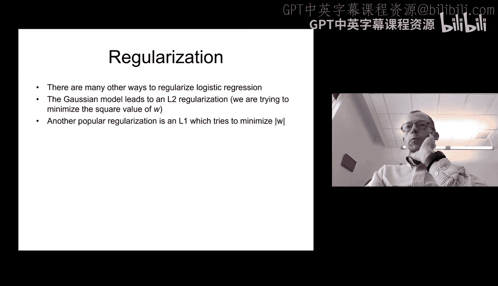

Okay， and so we'll see everybody next week。