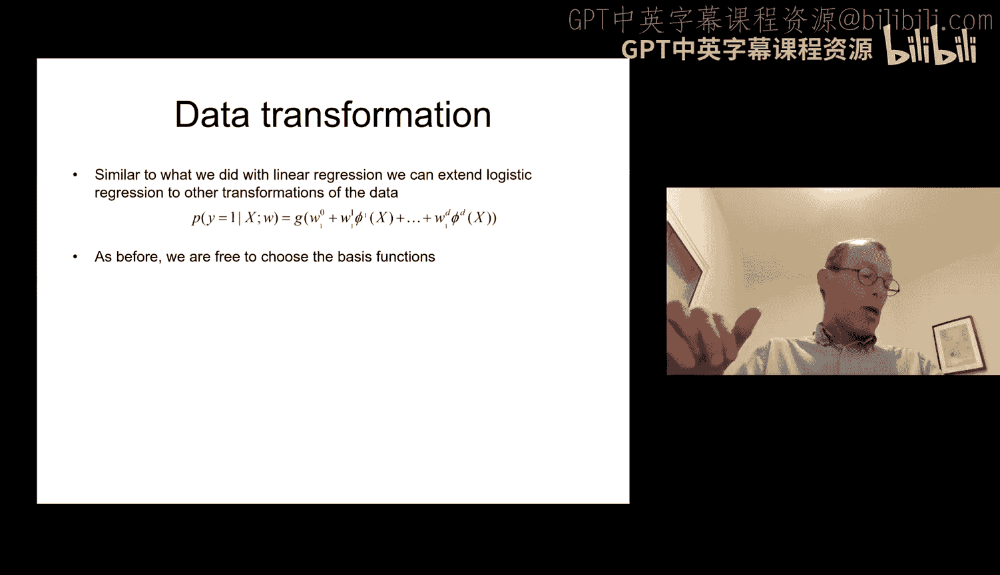
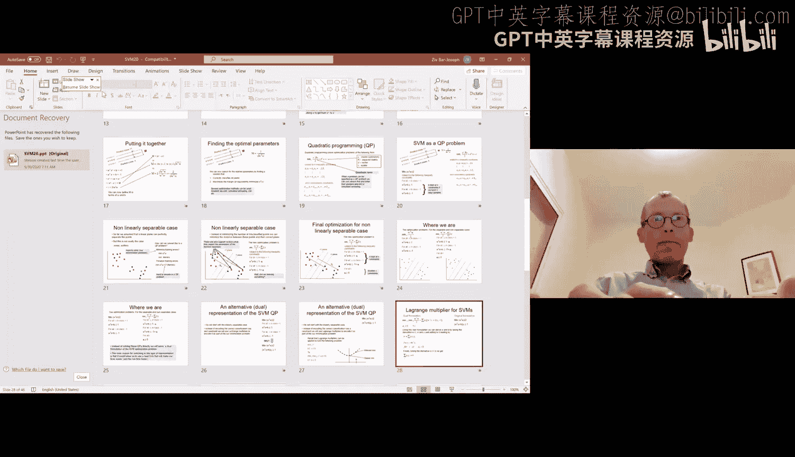
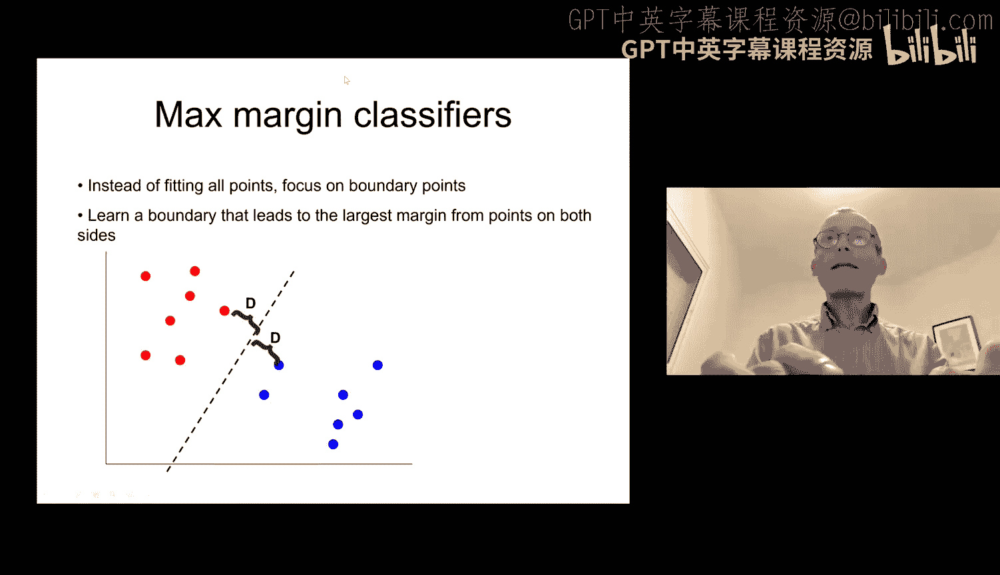
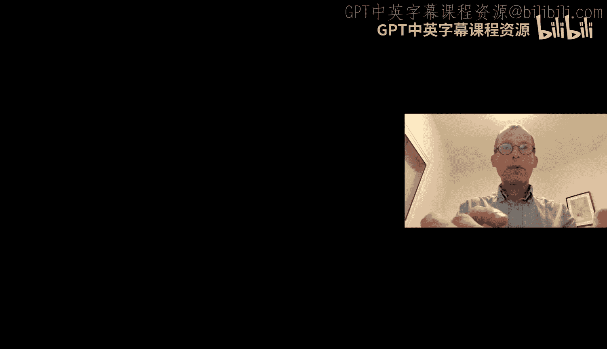
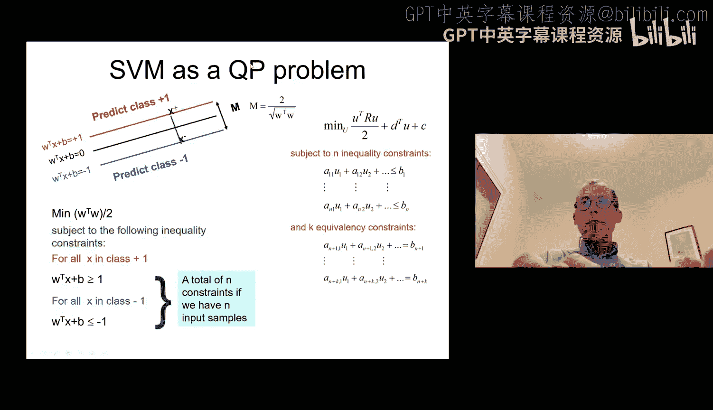
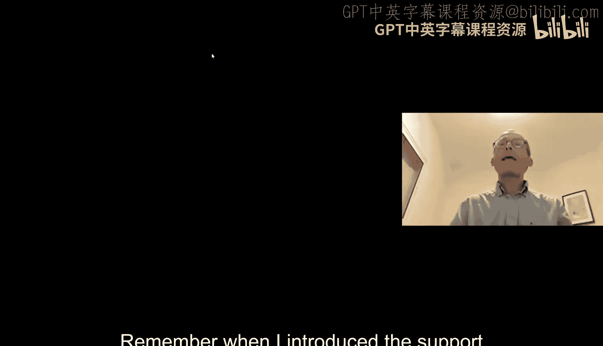
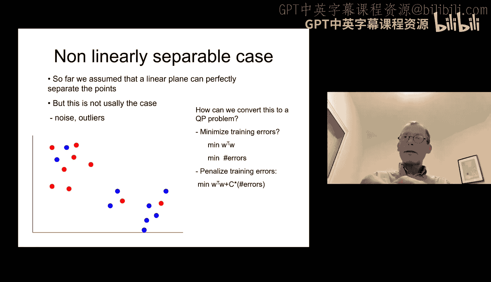
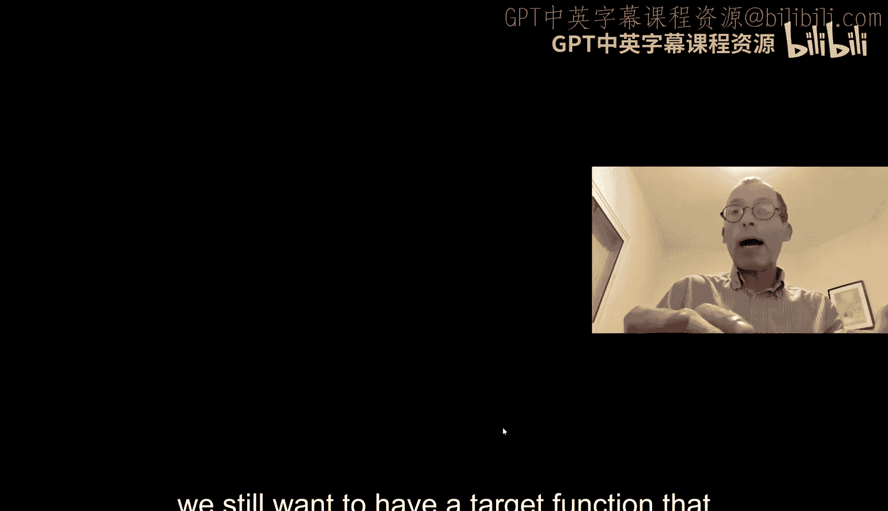
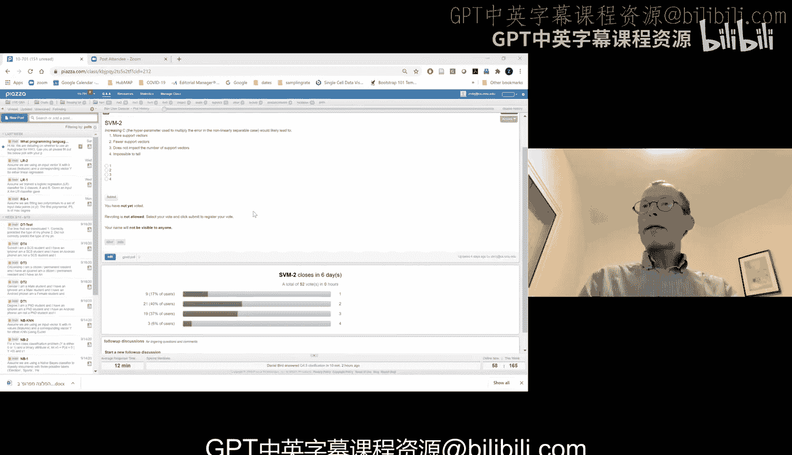

# CMU《机器学习导论（研究生）｜10-701 Introduction to Machine Learning 2020》中英字幕 p08 [08]10-701 Lecture 8  Multi Class Logistic Regression and SVMs.zh_en [BV144SuB8ETp_p8]

Let's start as always any questions， any comments please post to the chat or raise your hand and Daniel hopefully we'll be able to monitor and either answer you as he seems to have been doing for most of the questions or alert me if he wants me to answer and I will take it so today we are going to finish discussing logistic regression so obviously we didn't have a class on Monday but last week we started a discussion logistical regression we went through most of the stuff on logistic regression and in fact you are working on logistic regression problem in the problem set but we didn't finish discussing how to extend logistic regression to multiple classes so all of the discussions we had so far was on two classes。

And today we will extend it to more than two classes。

 so that will be first the first part of today's lecture and then we will move to another supervised classification method so again we are talking about supervised learning and within supervised learning we did a small detail to regression but most of the focus is on classification and next the next method we'll discuss is support vector machine which also uses ideas。

From regression to do classification。 And we'll get to that。

 And what's the difference between using support vector machine and another method Okay。

 but let's start with or let's。Conclude our discussion of logistic regression before moving on to。

The next topic。So for those of you following the slides。

 this is the still the slides on logistic question that I posted a week or two weeks ago Okay。

 so just a short reminder I won't go into the full discussion that we had the last time。

But generally， if you remember， we defined。A probability function for two classes。

 so the probability of y given x we said logistic regression is not a generative model。

 so it doesn't tell us how to predict x given y， but since our goal is to predict the label。

This is definitely something logistication provides。 and we defined it as。

1 over one plus EwTx for y equals0 and one minus that。Which is e to the probability Tx over one plus。

E to Wgx for class one okay so this is a probability and we showed last time that this is a valid probability so it sums to1 it's always between zero and1 right it's two events that have to be you know the sum of these two events is one so this was a valid probability function and we spent most of the class on trying to learn or trying to discuss how we learn the best values for W for a specific input that was the major focus of logistic function a class and we said we can do it with with training of course we need training data but once we have training data we can do it with ready and descent。

gracent for the maximum likelihood destination so and then we discussed a little bit about granian descent but generally speaking。

 we define this as the two class classification problem where the probabilityb for one class is always one minus the probabilityb for the other What do we do if we have multiple classes so right I mean all of the classifiers we talked about so far and that's not trivial because when you will talk about vector machine。

 you would see that that's not always the case but most of the classifiers that people use can be applied to multiple class labels right for example。

 if you want to predict cats dogs， horses and cows right so you don't just want a binary classification and we talked about how to do that for defion trees can neighbors na base your networks can do this a lot of methods can do this one about logistic regressionggress so it turns out that logistic regressionggression can be naturally extended to more than two classes。

And I will you know I will show you in a second definition。

 the important thing to understand is that this of course。

 requires to learn more parameters basically。Any number the number of parameters we need a special set of parameters for each of the classes except for the last one。

 so for example in the binary case we have two classes we have double use which we can associate with class zero and we don't have parameters for class one right because one minus that is the probability of class  one but when we have two cluster。

😡，When we have three， sorry， when we have three classes。

 we are going to have another set of ws for class 0， another set for class 1。 and for class 2。

 we are not because we are doing one minus the probability of the。 So the more classes we have。😡。

In a logistical regression problem， the more parameters we have and these scale linearly with the number of classes okay that's the basic idea let's let's see what's the definition so。

If we have a multiclass specification problem， we can define p of y I y equals I given x for all eyes that are less than k so K is the total now let's say case5 so for the first four classes。

😡，Okay we define it as some function right the logistic regression function with parameters w0 w1 and I right so for class0 we have w0 or0 for class one we have w10 and so forth so each of the first four classes has its own set of regression parameters in this case logistic regression but ws that we need to learn the last class does not have its own set of parameters because the probability for that class is one minus the sum of the probabilitybabilities for all the other classes okay so。

😊，This is the definition。😊，Right， then and and。Right basically by doing this we guarantee that the probability remains between0 and1 sum always sums to one just by defining this this is always positive obviously so right we can't have a negative value for this and the fact that this requires that this is in the probability of the last class basically guarantees that everything will sum to one okay so this is just the definition now okay so this is the definition and using that we can scale up to any number of course of cluster that we want the big question for us is how do we find the parameters for this right because now we have。

Rather than just W0， W1， W2， we have much more parameters than before because we have a set of regression parameters for each of the classes。

 except for the last month。Just to note that that so right for the last class。

 we have the probabilityba is one minus the sum of these probabilities。AndAnd basically。This is me。

Right。嗯。RightSo so this is basically the probability of the so I mean right it's easy to see that this is a valid probability。

 this is always between zero this is always positive。

 this is always between0 and1 it sums to one if you' just sum over all the cluster and everything should hold and the other thing I would say is that a binary regressionggress is just a special case of this where k equals two right then we have values from the first one。

😊，Okay， so this is the definition。😊，And the question of course is how do we learn the parameters and it turns out that we can learn the parameters exactly the same way that we did for the binary logistic regression program in other words we do it by taking the derivative with respect to each of the different parameters now we have rather than let's say we have k classes then instead of let's say m features then rather than having m or m plus one parameters we have k minus one times m plus one parameters right so we have more parameters but each parameter has its own meaning so one is for this class this feature and so on so we can take the derivative with respect to each of these parameters。

When we do that， it comes out and you can do it， it's not actually a very big or it's not much different than what we do for the two classes right so basically each parameter is only affecting its own class and the last class。

 it's not affecting any of the other classes because the last class is a combinational。

On the cluster， and basically when you take the derivative。

 you see that basically what you get is very similar to what we got in the binary case。

 after cleaning it up a bit， it's basically deelta M of Yi basically deelta M means that whether a sample I belongs to class M。

😊，Okay so this is one if it does if it does belong to class M and zero otherwise minus the probability basically the L that we have right because if sample one really belongs to class M and this is very high then thearrow is low if sample one doesn't belong and this is very low then again the error is low and if sample one doesn't belong but we predict that it does the error is very high so this is the same we define for the two classes but now apply to multiple classes and again there's no close form solution so we do gradient descent or gradient ascent in our case because it's a maximum likelihood problem。

😡，And we get this and again， I mean different different ways of doing its schastic which we mentioned last time。

 which does it based on one sample at a time or batch which does it on relatively small number of samples or global which does it on all the samples together it's up to you and the different advantages of different disadvantages for each one but the important thing is that this basically。

Well generalized it's basically the same algorithm compute to compute the to find out the values of the parameters。

 of course， when we have more classes， we have more parameters。

 it all might take more time or more iterations for this to conge， but other than that it's the same。

Okay so basically a logistic regressionggress can be applied and in fact in many cases it is applied to multiple classes and logistic regressionggress。

 unlike for example， naEb and single decision trees or nearest neighbors which are important to know and I we said already that a lot of methods extend them。

 logistic regressiong is still pretty popular and successful method。

 so even though you know it's not the most it's not the newest method and it doesn't work the best in some cases it's something that is's pretty easy to implement very general and works pretty well and as you will see neural networks it's basically a lot of the ideas in neural networks are based on logistic regression so the sigmoidoid function plays an important role in all the ideas of gradientian extent in neural networks well。

The last thing I want to say about a logistic regressionggress， although again。

 we' will talk much more about it for support machines。

 is that everything we said about transformation of the input。😊。

For linear regression applies the same for logistic regression。

So even though we treat the input or until now we treated it as basically working on the values we obtain as input。

 any transformation of the input that is a fixed or deter deterministic function can be used as features right I mean as long as we apply to all the training and test data from the point of view of the algorithm this is just inputs so any transformation if you want to take a univariate and make it into a polynomial as we show in the linear regression or some other transformation。

 a gausal whatever you can still do it with aistic regressiong， again。

 all the caveats we said apply here as well the。The more transformations you do。

 the more parameters you have， the more data you will need probably to reducable fitting。

 but other than that， everything we said would do all transformations。

And you can choose whatever transformation you want based on what you think。

Okay， so that's it for a logistic aggression and for multiclass logistic aggression。

 which is as I said， something that people still use a lot。

 in fact we use it in our research and I know that other people are using it it's pretty quick to learn and works unlike again unlike naE based which is really I mean it's a nice idea but it's。

Very naive right because in practice things are not independent logistic regressionggression seems to work still pretty well and again。

 extensions like neural networks work even better but。不知道做什么。Okay， good。

 so if there are no questions， then we can move to the next topic， which is support vector machines。

let's talk about support vector machineですね。

Okay， so support vector machines are by far the most interesting algorithm at least in terms of their name right what I mean this is for someone who hasn't seen support vector machines。

 the name should sound intriguing at least I mean neural network I guess is also intriguing but by now probably everybody knows what they are so if you haven't heard about support vector machine you might find the name intriguing and of course one of the first thing will do is we' explain what。

😊，Does a support vector machine or why do we call this method support vector machine。

 but basically speaking support vector machine is a classificationification method。

 although it can be used for regression， it's not designed for regression like decision trees。

 can use it people use it for regression。But it's not really designed and a lot of the discussions that we're going to a lot of the things we derive are not intended at least for regression so support vector machine is a classification method and in addition and this is something that our。

That should be emphasized support vector machine is regression is a classification method for a problem with two classes。

 so it's not trivial although it can be done we'll talk about it to extend support vector machine unlike almost all of the other classifiers we learn to more than two classes because the way we define the optimization function is really dependent on this idea of two classes。

AndAgain， there are ways to extend it。 We'll talk about it， but。

They are more heuristics than actually derived methods， unlike for example。

 the logistic regression where we actually derive the solution for multin。

Sup vector machine like logistic regression like decision trees is a discriative method。

 so it's not even probabilistic so it's not fine to compute probability。

 the only thing it's wise to do is to tell you if this sample is in class zero or class one that's the basic idea of support vector machine。

And I think I mentioned it until neural network came。😡，And really beat out everything else。

 support vector machines where the best method for classification except for the aggregate method。

 so we talked about begging and boosting oh I didn't talk about boosting but I mentioned it begging and Randol For。

They can walk the ensemble methods usually work better than the individual methods。

 but if you looked at individual classification method。

 including na based everything we talked about so far logistic regression knife based and so forth support vector machines where the best and one of the reasons why they were the best is because they were very。

 very flexible and we'll see later in the class。What is the flexibility。

 but also because the optimization function or the parameters that are trying to learn may be actually or the thing that is tries to optimize may be a good thing right so we will discuss it。

不。At least empirical， it seems like whatever it's trying to do is an important goal because it works very well。

😡，At least there's a standalone method compared to so this is the again comparison from several years ago。

 but still a valid comparison for the methods except for neural network。

 which since then have been greatly revolutionized， but all the other methods more or less。Okay。

 so this is support vector machines before neural networks the neural networks so before 2010。

 2012 support vector machines well the big hyp pin machine learning nowadays。

They don't get a lot of credit， yeah people still use them。

 but it's not but you know when I was this when I started teaching machine learning。

 they were on the high plan。Not anymore， there were actually clusters just on support vector machine and kennel spaces。

 hillil buildt spaces and so forth。AndI don't see as many classes today on that。

 but I do see a lot of neural network classes， so apparently。

The Cr has been moved to neural networks and let's see， you know， as I said。

 let's see when you guys teach machine learning， what will be be。

The method that will be the most attractive then but you we'll find out I guess in 10 years anyway so but still I mean it's still a useful method and light logistic regression people use it quite a lot again one of the main reasons is because it's very flexible you can do a lot of things with it as well okay so let's but before we jump into you know why it's good or you know how well it works let's just define the optimization function of course the goal is to do classification but。

How we are trying to do classification and try to motivate why this makes sense。😡，Okay。

 so we are still at this region of general theme of regression based classificationification method。

 so regression means that we have some function of parameters multiplying the inputs or transformation of the inputs like we did on just regression。

😡，And。And we defined right in the start of the logistic regressiong class。

 I mentioned that we can actually have a line。based on just the linear regression。

 not even the logistical regression that will walk at least in some cases to classify the data very well。

 for example in the data that I'm cloting here right so blue dots and red dots。

The light that I'm showing you here。😡，Is basically perfectly going to classify the point so some points are on one side of it and some points are on the other side。

So it's a perfect line and if we actually solve the optimization function。And that's right。

 I mean there may be but this is pretty or this can be again maybe slight different。

 but this can be pretty reasonable outcome if we optimized just the。Just the。

Re method so the regression basically the regression model will say that all the values here should be one and all the values here should be minus one okay。

 and then we try to solve it with a line and this is maybe one of the lines that we will see。I mean。

 it could also be a horizontal line， it depends on slightly。

 but let's assume that this is the line that we get I mean we get something so this is a perfect classificationification line it works very well。

But it's not the only perfect classification line right if I move this line a bit here or a bit here or a bit here or a bit here it will still be a perfect classification if I change the degree or the angle it will also be a perfect why do we get this line why is the line here where it is rather than at other places if we solve the。

Regression problem， can anybody tell me？Why is the line where I put the line basically？😡。

So what what drives right if I mean that's maybe harder to explain。

 but you know what what drives the exact location of the line so we know that the line has to be let's say a good line will be between blue and red。

 but what drives the exact location of the line in this case that。😡，You know。

 may or may not be a good idea， but it definitely happens here based on the optimization function we're using for regression。

Yeah， so we are doing this perization right and the answer right so so the answer from Joseph is the is the one I was I was looking for and indeed that's what I was trying to emphasize if you look at the point here。

 you see that。The blue dots are a bit more spread out。😡，But then the red dots。

And the line is trying to basically be as close as possible to both points。

 but because the blue dots are slightly far from the line。

 it moves closer to the blue dots than the reds in terms of classificationification it doesn't matter right but in terms of in terms of the line itself it would matter however。

 however there of course a lot of other lines right so the line is closer to the blue because it tries to be as close as possible to as most point as it can。

 however there's lots of other lines that will do the same or will perfectly work on the classification and we already said that logistic equation is identifying。

You knowIn this case it's not a linear line， but it's identifying a logistic line that does a very good job at classifying without caring too much about the about the about the distance from the points as long as it classifies them correctly but what if we want to stain the linear space so logistic regression works well but it's not working in the linear space right logistic regression has this logistic space what if we want to stain the linear space can we define a target function。

That will lead us to find the best line。😡，In terms of discrimination。

 lot in terms of optimizing the distance， which we don't care。

 because as long as we get the point correctly， why do we care about the distance。

 The only thing we care about is accuracy can we find。😡。

The best line using regression model but not optimizing the least square which doesn't seem to be a good idea for classificationification。

 some other optimization function and still get a good a good linear line that separates these two so again it's not always possible sometimes there's no linear line that separates the point but there are cases where there is right and this is an example of a case where a linear line would be a good way to separate the point but if we just use the linear regression method of the optimization based on least square we wouldn't find a line that is maybe the best。

😡，This seems to be a better line， right because it's right roughly halfway between all the blue。

 I mean， the closest blue point and the closest red points。😡，This line that is basically。

As close to any point on one side as it is to the other side right so basically what this line does is it doesn't try to be close to all the points on both sides。

 what it tries to do is to be as far as possible from the closest point on either other side basically to provide the biggest margin margin is the distance between line and points from both sides。

😡，So the margin is defined as the distance of the line to any of the points。😡。

So obviously because we are doing two cluster specificification problem。

 you will have one point that is the closest on one side and one point that closest on the other side they have to be the same if they are not then moving it slightly in one direction would make the margin big so when the margin。

😡，When the margin is optimal， it has to be symmetric for the closest point on both sides。😡。

Everybody hopefully sees that， but that's just a minor comment the more important comment is that。

If we agree so we can do the optimization based on least square。

 but it doesn't seem to be a good idea， so margin is another idea of doing the optimization。

 it doesn't it doesn't tell us how to find the values。

 but it's just a conceptual idea of saying that rather than minimizing distance to all the points。😡。

The goal of the linear still linear line， the goal of the linear line is to maximize the boundary basically to be as far as possible from any of the points。

😡，And still of course get the classification correct right I mean I can put the line infinity and it will be very small but that's not going to help in terms of classification so the goal is to get the classification correct while being as far as possible from any of the points。

😡，Okay so this may actually be on average very close to one points in this case the line is on average closer to the red points and the blue points but we don't care about that the only thing we care about is the points that are closest to the line okay so this is called the margin。

😡，And the goal is to find the location or the line itself that will maximize the margin。😡，Okay。

 so the margin in this case， you can see it as yellow。

 this is the area that does not have any point from either side and the margin is symmetric because as I said。

 if it's not symmetric， then moving it slightly in one direction or the other will lead to a bigger margin。

Okay， so this is called a margin and the goal of support vector machine。😡，Is to find the max margin。

 This is why it's also called a max margin classifier。😡，So as we said again。

 rather than doing list square， which takes into account all the points， right。

 I mean the sum of the distances from all the points。

 march margin classifiers only focus on a small subset of the points that define the margin。😡。

If I add a new point。😡，Right， if let's say。

Just to illustrate this。

Let's say I'm doing this。This classification problem and this is the line that I find right now in list squares if I add another point it's going to move the it's going to impact the line because the line takes into account all the point in max margin classifier I can at this point the line doesn't move at all。

😡，Stays the same。Because the margin doesn is not affected even if I had hundreds of points here。

 but if I had the point here， it might move the line because now I want the line to move that's the idea of max margin cost。

😡，Okay， so it's affected by the classificationification， but not by all the points。

 just the points that are closest to the。😡，Of course we need to define what this point should be and and it's not really I mean I didn't say how we find it。

 but once we find it， the important thing is that whatever we find is only affected by a small number of points and these are the points that are closest to the lines okay so this is the idea of much margin classifier。

😡，Now this seems like a good idea， but of course I haven't theoretically showed you that Max margin will be the best with the best method for classification then it definitely seems like。

😡，Trying to optimize distance from all the points does not make sense we already showed several examples as well。

😡，The target function for linear regression is not a good idea。

 but nobody or nobody I haven't proven that mark margin。😡，Is is the best thing to do。 Okay， so。

 but still let's。Let's try to or if we assume that it is then。😡。

Most of the rest of the lecture will be about how to find it。

 but in practice the reason why people like Mark margin is first of all it's intuitive right it makes sense that we want to have the as far as possible from both of the classes because we don't care about getting one class right or the other we care about getting both of them right。

😡，There is some theoretical support but more importantly this works very well in practice so so when you try max margin classifier support vector machine they seem to work extremely well again the other the other things that walk in their favor but basically the idea of max margin is。

Is a proven idea Okay， so from now on we assume that max margin is a good idea and the question is how to find it。

 we won't explain why max margin is a good idea。😡，Okay， so the motivation is。

That you know it seems like a good idea getting folks。But I'm not proving that this is a good idea。

Okay so if it is a good oh and the last point before we go into the method or how to find the max margin is the name so this specific example that I've shown you where we try to find a linear line with a different optimization function not with regression with a different optimization function is known as linear support vector machines why is it called support vector machines what's the。

What's the name the name comes from the fact that only a subset of the points support the line support means impact the line as I showed you I can add a lot of other points they don't have any impact。

😡，But there are a few points that do define the line these are the points that basically are with the minimal distance to the line and these are called support vectors these are the most important points of course you know sample because they affect the boundary those lots of other points that don't have an impact on the line okay at least in the linear supplement case and this so this is why it's called support vector machines support vectors are the points that support it machines is just to show that this is an automated method but the support vectors are the points that basically define。

The margin or the ones that the margin is closest to， which basically。

Is what the margin is defined by Okay， so this is support vector machines。 This is the name and idea。

 as we said， is to find。To find a solution that maximizes or to find the line that maximizes the much okay。

 so this is the setup for the problem the rest of the lecture。😡，At least for today。

 most of what we will work on is how to basically find。😡，This line， Okay。

 so a line by definition is a set of a parameters， right， so a parameter multiplying。

In this case in the one dimensional space it's two values but in a higher dimension this could be multiple values so the question is how do we find parameters that we lead to the max margin separation okay so for that we need to somehow connect the max margin to the classification outcome。

So let's see how we do it。So this is， again， this is the setup of our problem。

RightThis is the linear classification problem， but now rather than optimizing。Distance。

 we optimize accuracy and we maximize the margin while trying to keep， of course。

 we try to optimize or keep the accuracy perfect basically。😡。

So I should say that's a question that maybe you asked or maybe you shouldn't you haven't asked。

 I'm going to assume。For the next few slides at some stage I will relax that assumption， but for now。

 I'm going to assume that the problem is linearly seable。

 What does it mean that the problem is linear seable。

 There is a line or there is a plane that completely separates the two classes In fact those infinitely many of them and are going to find the best one。

 but we are assuming that they areseparable Sometimes in most cases。

 if they are not superparable right in practice。It's very hard to find a line that separates samples in the tools。

 So so we will deal with that。 if it's not separable。 But for now。

 let's assume that they are separable。 Okay， so if they are separable。

 then there are lots of lines that can separate them。 We already showed that。

 And our goal is to find the line that， first of all， separates them。

 And second leads to the max margin。 Okay， so let's say that this is the this is the classification problem。

 right， So this is the line。And this is the mounting between them。

 so if we say the WTx plus b is less than minus1， we predict class minus one and if it's greater than one we say we say it's greater it's class one and in the middle there shouldn't be any point。

 this is the margin。Okay， now we selected one， one is an arbitrary number。

 and I will get to that maybe later， but for now we are selecting one as the distance between the closest point and the line。

😡，The actual value doesn't really matter here， so you could select， okay， we'll see that。AndOkay。

 so so if that's the case， then we are trying to find a line。

 so basically we are trying to find a set of values w and b b is the parameter for right the bias parameter and w are the parameters multiclined input。

 we are trying to find parameter w and B， such that first of all。😡，AndFor all points in class one。

 we want WT X plus B to be greater or equal to one for all points in class -1。

 we want W X plus B to be less than -1。 And between -1 and1， we don't want to have any points。

 We know those by because we attribute， we know those。😡。

Several in fact infinitely many lines that can guarantee this The question is which line do we want to find and the answer is we want the line that maximizes so I talked about the linear separation and we'll get to them so we want the line that will maximize the margin between these two so the line should satisfy both correct classification so all points in class1 should be greater than one all points in class minus- one should be less than minus-1 we are guaranteed that such line exist but in addition we want to have the width。

😡，The distance between。😡，The decision and the boundary for class one and class -1 be the maximal that it can。

 Okay， so the question for us， So we already encoded the accuracy with the parameter。

 So we want wtx plus B to be greater than one or less than -1 from different causes。 That's good。

 So we are able to connect W to the classification outcome， but we haven't defined。

How to link the margin to the parameters， right in order to maximize the margin。

 we need to have it as a function of the parameters。😡，So how do we？

Write the margin as a function of the parameters。😡，Right， again， in linear regression。

 we had the list square。 So we linked the optimization function to the parameters using， you know。

 W X plus B minus y square。 How do we do it for the maximum。So for that。

 we need to start with a few observations and then we will use them to derive basically an optimization function that will lead or will help us find the max。

So first of all， we observe。😡，That given our definition， just based on the definition。

 we can say that。😡，If we have basically a line or a plane right in high dimensional space that defines。

The class one right so the points on that plane are the closest to the margin for class one and all the other points are below them right and farther away if we have such plane and this could be a 2D plane or it could be a much higher dimensional plane or it could be a line。

😡，If we that then w， the vector w， which is the parameters is autogonal to the plane。

 what does it mean autoagonal， it means that when you multiply a line。

 if you have a line on that plane right any vector on the plane is defined as the distance between two points of the plane when when you multiply a line defined by two points of the plane by the。

😡，By w， you get basically zero。Okay， so w times any so autogonal means that the are 90 degrees in some sense。

Okay with all the points on this with all the vector sorry in display so a plane a vector defines the plane because it goes just on the plane it cannot go out and w is autogonal because any vector。

 the plane times w will be0， how do we show that？😡，Well。

 we just use linear algebra in this case and we know that each line on a plane or on high dimensional space is defined by two points right so two points define a line of course in 2D but also in higher dimensions。

And so if we take two points， let's say UN V that both reside on the class one claim。😡。

Right they define u minus b is the line and when we multiply u minus b and by w。

 we get WTu minus WTv， we know that WTU equals。😡，Yeah。

In this case it's 1 minus B because it's on so again， remember。

 oh I should say this is points on the on the plus one plane plus one plane is the plane where points that are closest。

😡，To the boundary， to the margin res。😡，To the Broway design， okay， so all the point on that plane。😡。

They don't have WT X plus B greater than one。 They have exactly equals one。😡，Okay。

 if they were greater than one then we can move the boundary a bit more and have it even higher so we know that points on the plane the define and we know that there's at least one point there if there wasn't a point there。

You wouldn't right I mean the are multiple points because infinitely many points。

 but from the sample we have at least1 point0 otherwise we wouldn't have that as the SDd plane anyway so we know that if we we don't know how to find it but if we had a plus1 plane and we had a w that maximizes the margin then it would mean that w times any vector on that plane which is defined by this as between two points is0 right because wT is1 minus B wtv is also1 minus B so this minus this is going to be0 so this means that the two vectors are autogonal and if the autogonal。

Right if they are autogonal， it means that basically so in this case W is autogonal to two points on the plane V and if it's autogonal to any two points。

 it will be autogonal to the entire plane， so any vector is defined by two points and we can do it for any vector and show that it's autogonal to that。

😡，Okay， so this is just an observation， but of course if this is true for the plus one plane it's also true for the minus one plane。

So whatever we said about class one points on class one， it's also for class one。

 it's also true four points in class1 okay， so this is straight evation。

And now we are getting into something a bit more interesting that can tell us a little bit about the distance between the two planes。

If I take a point on the plus one claim。😮，There must be a point on the minus one plane that is the closest to that one。

 I mean by definition， if I take， I mean they have to be paralleled to each other because we know that the distance between the plane is fixed。

😡，It's always the margin that's a distance between the plus one and -1 plane。

 so if I take a point on the plus one plane there's going to be a point on the minus one plane that is the closest to that point。

 which point is that going to be it's the point defined by a vector with 90 degrees autogonal to the point that I took or to a vector defined by the point that I took on the。

😡，On the plus one plane， okay， which vector is autogonal to does to this point or to any point on the plus one plane。

 it's W。😡，So if I take a point on the class one plane and take w。

 then and I go W is just a direction it's a vector I go along the direction。

 I will get to the minus one plane at some stage because I'm going 90 degrees and when I get to the minus one plane。

 I'm guaranteed that I will get to the closest point。😡，To my point。

 because we have a 90 degree angle both in this plane and in this plane when we are going with Dublin。

😡，The only thing I don't know is what's the distance between these two I don't we haven't defined that。

 but if we use W we know that W is basically connecting the two planes right and we have to travel using W some distance let's call it Columbiaia I don't。

😡，But that's just。An observation about distance right。

 the distance is defined by a 90 degree angle from both planes in this case。

 and w is the vector that satisfi this。So of course， we don't know Lambda， but if we knew Lambda。

 it can give us some information on the margin because Lambda basically lambmbda w is exactly the distance between the two planes。

Right， that's。But of course we don't okay， so these observation。

 it doesn't tell us still what the optimization function is。

 but it's helping it moves us in the right direction， so now let's use this observation。

 especially this one that the distance traveling point from point on the class one plane to the closest point or the minus- one plane goes along W to derive the maxim margin optimization function。

😡，Okay， so this is the information we already have。😊。

So we know the w for a point on the plus one plane right if I take x plus which is a point on the plus one plane because it's on the plus one plane。

 we know the WTx plus b equals1 by definition of the plus one plane Nw。😡。

If we take a point on the minus1 plane， then wTx minus。

 which I'll just select the point plus b equals minus1 again by definition。

 we know that if I want to go from x plus， let's say x plus and x minus so let's start with x plus on the plus1 plane and select S minus as the closest point on the minus plane okay so we know that these two holds for that。

😡，The next thing is that I also know that I can get from x plus to x minus by going along w some distance and the margin is defined as the distance between the two planes。

 which is just a distance between x plus and x minus of course we don't know what it is this is M but this is the margin。

 that's what we want to maximize optimize。😡，We also want to fix。

Okay so now we can do some algebra and try to see if we can the goal really of this exercise is define M in terms of W and B right that's the goal because w of the parameters we want to find a way to maximize the margin by selecting a set of parameters so how do we define so that would be the goal。

😡，So let's start with this， we know that WTx plus plus b equals1。

 we can replace x plus by basically lambda w plus x minus right we just showed that now we open this up and we get WTX minus plus B we had that before plus lambda WTw equals one。

What is this Wtx minus1 plus B？😮，This is from here we see that it's minus1， right？

So basically we have minus1 plus lambda wtw equals one， and we can move this around and say that。

lambda equals 2 over w t them。Again that's not our goal our goal is to find them。

 but at least we were able to get rid of Lada， which is also good because we didn't know what Lambda is as well Okay。

 so this is where we are after。after some derivation that we can actually get rid of lambda and define it using w which is good。

 but we still really our goal as I said is to find n so how do we get to n so now let's add that information to our to a set of equations and now we know that M is basically defined as the distance between x plus and x minus。

Now we can use this information here。😡，That lambda w is also the distance between x plus and x minus right remember we said we are traveling over w with lambda distance lambda if that's the case。

 then lambda w is also the distance basically between x plus and x minus let's stay lambda out and now。

You know，W。Oh this is the。So this is the absolute value ofw Tw square。

 so we have lambda times Wtw square sorry lambda times square root of Wt square is equal to M。

And we know that lambda itself is right2 over WTW。 and so if we plug in the value of lambda， we get。

This of course， cancels out and we get to over。So M equals two of the WTW。😡。

That's exactly what we wanted， right we wanted to define M。😡。

As a function of w because w is are the parameter， of course we don't know what they are。

 but once we know how to define the margin as a function of the parameter we can maximize the margin by maximizing a function of the parameters in this case to maximize them we need to maximize two of the w。

😡，Okay， so this is basically the again， the goal of maximizing the margin is something we started with。

 but the way to link that goal to palmtails is what we were able to derive what we。😡。

The right by now， which is basically saying that。If we want to maximize the margin。

 we need to maximize two over WTW。😡，Okay， so this is where we are in the skin Okay。

 so so that's the goal。 Now we put everything together。

What we really want is parameters that do two things。

 first of all they correctly classify the point so all points in class1 should be wtx plus w greater or equal to1 all points in class minus1 should be wtx plus b less or equal to minus1 and。

😡，They need to maximize them or。😡，Maximize2 of WTw。 Oh， if you want， I mean。

 because this is a denominator。 And， we know， it's positive， we can minimize WTw。

 That's the equivalent。 right， if we minimize this， then this。Fraction is maximized。Okay。

 so this is the way to link。The accuracy and the margin to the phs。Okay， so。

So this is basically the problem right， or this is the problem we are trying to solve。

 so we want to maximize the margin and still get everything correct。How do we solve it。

 how do we find the value of w so now we have an optimization function right optimization function means that we want to maximize something and we have some constraints right the thing we want to maximize is this and the constraint is that we want things to be correct so wTx plus b is greater than one for class one less than minus1。

😡，Right so distance。So how do we solve it， there's lots of ways of doing it。

 you can do simulated ania， you can do what we talked about Brad and descent。

 there are a few other methods。I'm not going to talk about all of these methods I'm going to introduce one method that is actually much more appropriate for this specific type of problem and we'll say in a second。

 but honestly even that method which is very appropriate for this is not the method people use and we'll get to why probably on Monday but it's important to know that this can be done but in practice as you will see it's not necessarily something people do so how do we solve this remember we have this constrained optimization problem optimization because we want to maximize this value here constraint because we want to make sure that WTx plus v is greater than one for class1 and less than one for class less than minus1。

So in order to solve content optimization problems， there's actually a lot of classes of solutions。

 one of them is called proratic program that's a very general。

Way of specifying constraint optimization problem where you have a quadratic term means that you have a vector multiplied by with a matrix r。

 which is an input。So in quadratic programming， the goal is to find you， which is the。😡，Parameter。

 in our case， W。To qualify you and you assume that the optimization function is defined as U TL U R is an input。

 it's not something you have to find's it's given to you。

 but it's a matrix basically so this is a vector a matrix a vector so you get a value and D T U is。😡。

DTU is there。D is again a vector is so this is the cotic term this is called the linear term and C is just some constant okay。

 so this is the minimization part。😊，And this has to be subject to some inequality constraint and someality cont Okay so this is the general formulation of a growing。

 Why is it important for us to know that this formulation exist。

 It's important because there are very， very good solvers out there for quaratic If you can define a problem as a quadratic programming problem then you don't use gradient dissent and simulate any which are general functions。

 you can use solvers that are specific to quadratic programming and actually walk much better。

 usually faster and more accurate because this is a set of problems where people spend a lot of time on trying to develop methods that can optimize the problem if you can use gradient dissent to similar for any method for any problem this as well。

 but it's not the optimal thing because as a general solution， it works for everything but。

It doesn't work as best as the best solution。Okay， so that's why we might be interested in trying to specify。

Support vector machine as a general or in terms of a more general set of optimization function， Okay。

 so why is support vector machine a robottic programming problem。

 What is our in support vector machine can anybody tell me。😡，So how is the input matrix。

 what is it in the support vector machine？😡，Let's see。

Yeah good so people got it correct so R is the identity matrix identity matrix it's still a matrix。

 but it has one on the diagonal and0 everywhere else so basically in this case we get w times w which is what we are trying to minimize so in this case square root but it's also minimizing square root of wtw is the same as minimizing wtw right it's not it's not going to be so yeah so very good R is the identity what is the。

What is the in list square in support vector machine Yeah， so D again。

 we don't have a linear theorem in support vector machine we'll just trying to optimize the。

We are just trying to optimize the quadratic term。 So D in our case， is a zero vector。

 It's still at fine。 I mean， it's still。 So basically， the minimization is a quadratic minimization。

C， it doesn't matter honestly because it's not affecting really， I mean we are minimizing over you。

 so C， can we don't need to define it， in fact in practice it doesn't have any impact。😡。

RightBecause really the only thing we can minimize is you right so there's no savings。

AndAnd in addition， we have this， we don't have equality constraints because we say that everything has to be greater or equal to one or I'm sorry。

 but we have a lot of inequality basically for any sample we have inequality constraints for the plus one samples we say that it has to be less or equal to greater or equal to plus one and less or equal to minus one for the minus so basically again the whole exercise is to show you that we can define the optimization function。

😡，That we specified for support vector machine as a calledtic programming problem and if we can。

 then we can just plug it into a solver in Python in R in MATla。

 whatever you want and get a solution。😡，So this is good news。O。So here is the。The way we define it。

 So again， on the right， we have the。General quadratic programming optimization and on the left。😡。

So and on the left we have the quadratic programming for support vector quadratic programming tries to minimize WTw over2 again square root or I mean。

 so in originally we maximized the margin which was one over square root。

 it's equivalent to minimizing the denominator。Wwhich is the square root and because this is positive it's equivalent to reducing the square root and just minimizing WTw okay so we get the same solution just easier to write up okay so this is the optimization part and this is the constraint part all points in class plus one should be WTx plus be greater than one and all points in class minus one should be wTx must be less。

😡，ok。Good， so this is the right so we have a total of end constraints for example。

Any questions on this？

So let me ask you a question， let's do a quick Piazza poll on this and see how people are。Okay， yeah。

 this is only one question， so yeah， maybe。Choose， as I always say， this is not graded。

 although this is actually a question that。knowIt's not trivial to do on the fly。

 but if you have time after class， you should revisit it and try to do it a bit more carefully and see the results。

Basically plug in the numbers and follow the same thing as we did and you will see hopefully the outcome it's again。

 not something I expect you to do in the poll， the poll is just a very quick thought and if you got it wrong no problem。

In exam in problems that you will have much more time to work so don't I just want to emphasize the point that's why I asked this question。

 but if you didn't get it correct， don't feel bad。Okay， so。Let's say。

Let's talk about this and then move on。So I asked you a following question。

 remember when I introduced the sub machine optimization problem。

 I said that I'm selecting one as an arbitrary value so I'm saying class one has to be greater or equal to one and class zero has to be less than minus one。

 but y one， why not two， why not seven， why not？😡。

50 right maybe you know maybe 50 would lead to bigger better margins or smaller margins and so on。

 so the question i'm asking here is about changing one to two one is arbitrary。😡。

We could just as well pick half or pick。オオピ2。Why did we pick what is the impact of changing that much and the answer to this question is actually answer three。

So the margin is not going to change or the optimization function is not going to change。

 what is going to change？😡，There's one thing that is going to change as I said。

 I mean you should try if you have time after class to walk this out。

 but I'm just going to tell you and that this is more less what you should get。😡，Sa。

So when we did the optimization function。Remember， we ended up？

With this m equals 2 of the WTW right when you change one to2， this becomes four。😡。

But it doesn't matter right I mean because really the w that will maximize this for two over this will also maximize it for four over days for 16 over whatever so again the important thing is that whatever you value you select does not make a difference which is good because that's a completely arbitrary decision we made so it's good to know that it doesn't make a difference but again if you have time you can walk it out and see that distance is the case。

😡，But this is good news because then it means that we made an arbitrary decision。

 but it didn't affect the results of。F， okay， so let's go back to where we are and now stop relaxing some of the assumptions that we。

😡，So the first thing is， right， I mentioned already that。

we ended up by saying that we can define a support vector machine as a quadtic pro problem。

And but remember we made a very strong assumption initially about the fact that a line even exists between the two points right if a line doesn't exist。

 then it doesn't make sense even to ask which line is the best because there is no line so there's no margin if there's no margin we cannot define。

😡，right in this case there is no if you look at this set of points。

 there is no line that separates the set of blue points and red points。

 so if there's no line we can define the margin if we can define the margin we cannot find support vectors and we cannot define any line。

So what can we do and in fact， right， so we can say， look。

 we don't want to work on this type of problems， but unfortunately in most cases。😡。

The data is not linearly superparable， it's very hard to find a linear line or even nonlinear line that separates the points perfectly。

😡，Unless youre in very， very high dimensions but in that case you may actually overfit and maybe it takes a long time。

 although that's exactly what support vector machines are powerful but we'll get to that but for now let's assume that we walk in two dimensions we want one line and we see that there is no line that will separate our points are we saying that we cannot use support vector machines maybe use regression maybe use linear regression the answer is maybe not maybe we can still find a line that of course does not completely separated it but still provides a much how can we do that what we should do is try to combine two things。

One is the margin， we still want to launch margin。😡，But the second is also minimizing the errorss。

 We know there's going to be errorss because there's no linear is separable but we want to minimize those so we want to have two things one is still define a good margin。

 but second is minimize thels。 How can we do it how can we combine these things。😡，Thoses a few ideas。

 for example， we want to change our chromratic programming problem to say rather than require that everything is greater Al class 1 is greater than WTX plus B is greater than is greater than one。

 we can't require that， but we can say that we want to minimize the maximize the margin by minimizing the WTW and also minimize the number of role。

😡，So that's a good way to basically combine the two problems right on the one hand we minimize we maximize the margin and on the other end we minimize the or another way is to penalize the number of fail so maybe you know maybe we don't want to solve a double minimization problem because that might be very hard instead we basically have a one minimization problem where we have some weight。

😡，That we assign to the errorss and the goal is to minimize the combined number of errorss and with some weight on each one。

Okay， these are definitely possible answers and both combine our desire to maximize the margin。

 the WTw maximization or minimization without our design to limit errors。

 but both of them are not very good ways of really。😡，Both of these are not good ways of。😡。

You know to define an optimization function， what's the problem with these definitions anybody can tell me a problem with this type of definitions。

We didn't have before。Anybody can tell me， I mean， yeah， I mean。Let's go。

You can return to the quiz later， but now I asked the different program I asked you know we want to minimize。

 of course， not minimize we know there's no linear seable solution。

There's no a second solution and our goal is to try to find the solution that on the one hand。

 maximize the margin while on the other hand minimizes the o。

And I suggest there' two options for that， either double minimization or some type of joint minimization of the number of fails and the margin。

 what's the problem with that？So of course the problem is it's not really acceptableceptparable。

 but that's by definition， but what's the problem with trying to optimize this type of function right so we have a target function we want to minimize either the sum or what's the problem with minimizing this？

All errors are treateded equally， that might be a problem， but it's not the biggest problem。

Anybody can tell me a problem with optimization of the function that I showed you？You know。

 think about other optimization functions we used， I didn't tell you how people solve quadratic programming。

 but it's。😡，The souls assume something that this doesn't。嗯。Yeah， so let's assume we have some。嗯 know。

So i'm looking for something oh good yeah I see some some answers along the lines yeah so there's not of course of problems with this of course we need to make some arbitrary decision about C that's true that's a problem by the way that will be a problem going forward as well but the real problem for optimization function is that the new target functions that are defined are。

Not continuous， so they are not differentiable。 The number of errors is a discrete quantity。

 margin is continuous。😡，It can go up， it can go down， but it's continuous number of errors。

 regardless if we do a double miniization or number or is not continuous right if we move the line slightly。

 we change very rapidly from zero to one in terms of the error。

 that's not something that is easy to optimize General speaking when we optimize something we really。

 really would like a target function that is continuous because we usually do a search。

 it doesn't matter if we do gradient decent or quatic work we do some search if things change very rapidly in the search。

 then we can't really search effectively。😡，So usually we would prefer。

 and that's true in this case is why， we would prefer target functions and outcome teams。But again。

 we still want to have a target function that combines the errorss and the margin。

 so how can we do it， so let's do what people implied in their answer and take into account not just the number of errors but the magnitude of the errorss。

😡。

So let's define in addition to the margin so we have this boundary and we have the margin between the two planes that we defined。

 of course we are making arrows， but now let's define the magnitude of the arrow as the distance。😡。

Betweenween a point and the line that it should reside on the other side of right so for example。

 the blue point here should have resided on the other side of this line， so the L that we are making。

😡，InWhen we use this line is the distance between this line and the point。😡。

And similarly for this one so we will call this epsilon K for this point and we'll call this epsilon J for this point and our goal will be to maximize the margin while minimizing the sum of thearrows of course if these sum of thearrows is zero then we make and again don't the important thing here is that we only take into account in this minimization the points on which we make an error or the points that are on the boundary points here these group points that we make that that are correct are still not being used to compute right they are not。

😡，As we did in the original discussion they are not affecting the boundary the boundary is going to be affected by the point on the boundary obviously。

 and the ones where we make mistake。😡，Okay， so this is the new optimization function。😡。

And it's slightly different because now we have， of course。

 the optimization for the boundary and we also have a minimmunization term for the L so eon is the L it's always positive it's the distance between a point and the line。

Defined as you will see in a second how we defined it so but it's always positive and C is the weight So we need to select an arbitrary right and our goal this too manual this is of course continuous right because if I slightly move the line thearrow。

Move slightly， right？😡，It can change， but if it changes from I mean if I make it now not an error anymore it means that before thearrow is very small because it was very close to the line so this is much more continuous than in fact。

 this is fully continuous than before much easier to optimize the thing we have to do of course is now we should allow forarrows so we should require that all points in class1 have wtx plus B greater equal to1 minus epsilon where epsilon is the error there for some points epsilon is going to be zero because they are on the right side of the line we don't need epsilon to them but for other points epsilon is going to be a real number so now epsilon becomes。

😡，Part of the parameters of our problem okay before we only add W。

 it's important to understand epsilon is not a given input input it's part of the solution right we can still define this honestly or not honestly。

 we can still define this as a quabartic program we'll get to that in a second。

 but you should understand that epsilons。😡，Are now part of the parametersits。😡。

The solve has to decide because once the solve sets W it influences the epsilon。

 we don't know what epsilons are to begin with， we don't know where the line is。

 so this is part of the solution， not part of the input whereas of course x whereas x is the input and the class is the input right so1 or minus。

😡，Okay， one other point is that before we set points on the band we are support vectors because they defined any points away from the margin basically or not support vectors。

 now we have more support vectors on the points on which we make error our support vectors because they are going to affect the optimization function。

😡，Wwhich in turn will change diabetes so these are also now support vectors。

 not all the points of support vectors like the blue points here on the right side of the boundary they not support vectors because if I move this point here or here it doesn't change the solution。

😡，But points that I make a mistake on， if I move this here， it's going to change epsilon。

 if I change epsilon， it's going to change double。😡。

Okay and also epsilon of course has to be positive right we don't if we allow epsilon to be negative then these points will also have an impact impact we don't want that we just want the ones we make a mistake so epsilon has to be positive。

😡，诶。Right for all I so of course， if you are correct。

 then epsilon you set to zero and by definition you are correct， but if you are incorrect。

 you have to set epsilon to some positive value otherwise be incorrect these statements will be incorrect but you are paying a penalty in the minimization function so if you can set epsilon to zero it's best because epsilon cannot be less than zero and you pay a penalty for any value of epsilon so if you can set epsilon to zero then you set it to zero from termsization point of view because this will be correct。

And this will be minimal if you cannot set it to zero。

 your goal is to find an epsilon that is the minimal so you somehow move the line so that you will decrease so there is this tradeoff between moving the line which changes epsilon。

 but on the other hand also changes the margin right because it can be closer to one set of points or farther from another and lead to a bigger a bigger smaller margin。

😡，So this is the trade off that we get from C and C is out so C is up to us to decide and。

I will ask maybe in a second something about C and also I think in the recitation you will see some discussion of C。

 you are free to choose C that selection of C has an impact on the results obviously so if you change C the results are going to change。

And still we have these optimization。Just one point before I ask you a question。

 so this is also a codtic problem okay， so even though we added some terms。

 this is still a codtic component for right because now we have the quadratic term and the linear term。

😡，It's important to realize， though， that the matrix R that we said is not。😡，Diaagonal anymore。😡。

Why is that because the vector now is not w， it's w and then offendended by epsilon。😡。

And for Epsilon， we have all zeros because it's not part of the kbatic formula。😡，Okay。

 so we have this vector the solution vector for us is W and below we append epsilon as another set of parameters for our problem。

😡，W is multiplied by a。😡，Diaagonal matrix， epsilon， we don't have a corratic term for it。

 So we leave that part as completely0。 On the other hand， that now we have a linear part。

Which is zero for all the Ws， we don't need them， but it's c for all the epsilons。😡。

So this is still a quaoddtic polling problem， but of course the matrix R and the vector D are slightly different because it's a different optimization function and we have a slightly a different set of not a slightly。

 we have a different set of，Inequality strength okay。

 so this is the so this is linear nonlinear both of them are robottic following problems or basically you can feed both of them to a co problems。

Good okay so now yeah we have more of course I mean this is only a halfway for support project vector machine because soon everything will change but not in this lecture so let's do another a short piazza poll on the impact of C okay and as I said you will see more on。

Gs in the recitation and maybe。maybe in the province I'm not sure。

 but definitely the recation we discussed。So let me open another poll and let's see if I can find it。

Sid， there's a quick question on Slack， someone's asking where the point is it's not on Slack sorry。

In a Zoom， someone's saying， where is the point when epsilon is equal to one？

What is the point when I're saying on the boundary， it could be any any in fact epsilon if epsilon。

Yeah that's actually an interesting point if epsilon is less than one if it's more than one then it's on the wrong side。

 if epsilon is less than one it's on the right side。

 but still in the the margin where we want things to be empty so this could be the case there could be things inside the margin we don't want anything to be there so we are still paying the price but epsilon can be also between zero and one。

😡，So basically we would be correct， but we don't want points there。😡，Yeah， so this could happen。

And if it's one， it's exactly on the ground， but still it's not something we want because we want it to be on the other side of the margin。

 not on the ground。😡，Good。Yeah， okay， so let's say I mean were running out of time so let's say discuss the poll。

 it's not a simple question。😊，I think it's especially since we just discussed it so again'm。

I'm asking this as a Paul， I would mention it anyway， so just a way of。

You know you know introducing some break to the class but but if you didn't understand or if you don't get it correct don't feel bad I mean this is really we just discussed it and it takes some time to realize but but let's go and discuss this question so I asked's what's going to be the impact of C I settled by the C is arbitrary we decide C ands it's a way to weight the maximization of the margin with the reduction in error right so C is multiplying the effect of the errors and the question is what happens when we increase C so when we increase C。

RightWe are doing them in science so when we increasingly we put more emphasis on theels。😡。

When sea is very low， when C is zero， for example， we don't care about their。😡。

When things is very high， we care a lot about errorss。

 in fact we want to minimize the errorss as much as possible。

 even if it comes at the expense of the margin， so I was asked before what happens when the L is less than one。

 let's say it's half if it half it means that the point lies between。😡。

The between the the plus one plane and the boundary。

 we can actually make thisarrow disappear by moving the line。

They're moving the pla one plane towards the boundary。😡，In that case。

 the point starts suddenly will be on the on the right side。 So thearrow will disappear。

 but the margin will shrink。 So this is exactly the tradeoff。Now when C is very high。

 we will minimize the number of errors we are going to make or we will try to minimize as much as possible。

 this means that most of the points we will try to get correct that will be on the right side of the boundary any point that is on the right side of the boundary is not a the port vector。

😡，On the other hand， points that our mistakes are support vectors because they are affecting the answer。

 So the answer for this is when we increase C。We put more emphasis on airs。

 so we try to reduce thearrows， when we reduce thearrows， we reduce the number of support vector。😡。

So the answer in this case is two。Okay， and again， hopefully in the recitation。

 you will go through some visual examples of。I think and well try of what happens。

To the boundary when you change the okay， or if not this week or next week。

 because this should be tied with what I'm going to talk about Monday day。Okay， again。

 so if this is not clear， you know， take your time， go over。😡。

The definition again after class and that's basically next time we' are going to talk about we're going to continue about support Proor machine but introduce a completely different way to solve it it's still the same optimization function but a different way of solving it and we'll discuss why this is a good idea and what it gives us okay so yeah I'll see everybody on Monday。

Yeah。