# CMU《机器学习导论（研究生）｜10-701 Introduction to Machine Learning 2020》中英字幕 p09 [09]10-701 Lecture 9 Dual SVM Form and Kernels.zh_en [BV144SuB8ETp_p9]

Okay， welcome back everybody。As usual， if you have any comments or questions。

 please post them to the chat and raise your hand and Daniel will either answer them directly or alert me。

We'll stop the lecture and ask the question。嗯。I see that the number of people who are logging into the online class is dropping the number of people who take the class is not changing。

 so this means that a lot of students。Decide to watch it watch the video。

 I must say that this is not unusual we see it also when we have in person classes that the attendance starts to drop。

😡，During the semester and I always say that even if you can look at the videos and of course in this case we post everything including visits。

 I highly recommend if you can to attend the lectures themselves， first of all。

 you know if you watch it anyway why not attend it when the class is given you 1140 at least on those four days Coast it's not too early and the other thing of course is that it's much easier to ask questions or to follow some of the things that we are doing when we are doing it online you know the Piazza polls and everything so。

I highly recommend that you try to stick to the lectures if you can， even if you can watch it。Ofline。

Okay， so today we continue to discuss。Sup vector machines。😮，In。So suppose vector machines we。

Explain the name so we said support vector machine in our a classificationification method。

 they can be used for regression but they were really generated and developed for classification。

 we are talking about supervised learning， even in a larger context and within supervised learning we are talking about classification so discrete outcomes and specifically support vector machines even though we'll discuss at the end how to extend them to multiple classes。

 the basic formulation of support vector machines is for two classes。So two class classifications。

 however， we wanted to use the idea of regression so this WT。

 we wanted to still use it for classification and we said that even though we wanted to use WT，😡。

X right some parameter times the input we didn't want to select Fil and find linear separations right we didn't want to select the line that is closest to the points for example the line that minimizes this square which is the solution that we would get from the regression problem because we said that's not necessarily the best target function for classification so then we asked what is the good target function for classification and we said one idea is max maxm means that the line doesn't care about all the points like linear regression line but instead it only cares about the points that define the boundary between the two classes and for this point we want to be very far from both of them。

So this is the idea of support vector machine or max mount classifiers with support vector machines。

The most famous and most used representation and。That's what we derived， and we derived。

This idea by trying to。Re the meulging with the parameters and we did some derivation and found out that if we minimize this optimization function。

 W2 Wtw and subject to the constraints， we will indeed find the line and assuming that the data is acceptable about the line or the plane right because x could be multidimensional。

 it doesn't have to be uniified value， it could be a multivari parameter input we will find the plane that is maximizing the marginl。

 basically that is the fastest from both of the。Closest points and so this is the linear re subparable case we derived it here and we said that this works in some cases。

 but in most cases the data is not linearly subparable， so instead oh。😡。

We expanded this idea to include errors， but we want to minimize not the number of errors we said that would be great。

 but it's very hard to derive so instead we want to minimize the magnitude of the error which we defined as epsilon and we had some weight。

😡，To weight the difference between the margin， which is this part and the and that's what we ended up。

 and you know， we did some。We went through some poll that。

In which I argued that C has an impact on the number of support vectors so if C is very large。

 we're going to a relatively few support vectors and C is very small we may have more support vectors so C has an impact on the number of support vectors but other than that it can be applied and so once you have that you still have a margin here although you make some mistakes and you pay price for these mistakes with it。

Okay， so this is where we ended up and oh we also said that both of these things can be solved using a quadratic programming tool。

😡，Okay， so that's now one thing to note and you know it may seem trivial。😡。

You will see in the next few slides that we can change that is that the number of parameters in the linear re suffparable case is。

😡，Equival is equal to the number of features in our data right so the number of parameters W is the number of features plus one because we have this but it basically on the order of the number of features here the number of parameters。

😡，Is the number of features and epsilon is also an unknown， so it's also the number of samples Okay。

 so the number of parameterss here is the number of features plus the number of samples。

 and here it's just the number of features。😡，Okay， but in both cases。

 the number of features is part of the parameter set right I mean in both cases we have them。😡。

Okay so this is definitely one way to define the max margin classifier。

 but it turns out there's another way to do it， so the same optimization problem can be defined in a slightly different manner or very different manner and the biggest advantage there is that we are moving from walking in parental space to walking in sampled space。

😡，And first， I'm going to show you the derivation of this new optimization。

 which basically tries to optimize the same problem。😡，Okay。

 but slightly different solution and then we will discuss why this might be a useful direction where can this help us okay but first let's ignore why we are doing this and just try to do this change in parameterization basically from parameters in the feature space to parameters in the sample space。

😡，Okay， and this will lead to a different optimization problem。

So let's again let's start with the optimization problem we defined right it's mean of WTw where for all samples in class1。

 we want wTx to be greater than one and for all samples in class minus11 wTx plus now we can write this as a so these are two different inequalities one for each class we can also write it a bit more compactly as。

This so we still have the same minimization function and now because right why can be we can basically we multiply by YI on both sides。

😡，So if y is1， then this becomes wTx plus then we don't have to change the direction of the sign right because if y is 1。

 if it's positive， we don't have to change if y is minus one。

 we have to change the direction of the sign， so this becomes greater than this right。😡。

And this becomes one because minus one times minus1 and this so this is the same I didn't change anything I just combined the two。

😡，Seets of inequalities into one representation and it will be slightly easier to work okay but other than that this is the same minimization problem just slightly different I mean or include i'm using Yi which is an input right I didn't include it here but it is an input so I can include it into this inality。

😡，Very good okay， so now we are going to define something called the dual representation of support vector machine。

 basically the same optimization function， but slightly different optimization and for that we are going to use something called Larange multiplieries。

😡，Likegue multipliers are ways or are a way to solve。😡。

A constraint optimize so this is a constrained optimization problem what is a constraint optimization problem constraint optimization means that we have an optimization of trying to optimize the function under some constraints this is the function we are trying to optimize and these are the constraints so this is a constrained optimization problem。

😡，The problem with constraint optimization problem or a problem is that you cannot take the derivative because the derivative will not apply to the contraint So you have to do some iterative analysis right this is what we're doing quickly。

😡，But it would be nice if we can combine both of them into a single optimization and then take the river。

😡，Because then this becomes a continuous problem rather than just an inality and optimization and it turns out that this can be done using something called a grant multiplies。

 I think in the problem set in the problem interpretations you will go through some examples more but generally speaking the branch multipliers the basic idea is that you take an optimization problem in this case we want to minimize x。

😡，X square， let's say。And we have some constraints that x is greater than B right if there were no constraints。

 then obviously x would have to be0， that's the minimum。

 but we have a constraint that x has to be greater than B okay。

 so this is a constraint optimization problem。😡，And it turns out that you can combine the two using another parameter called alpha that has to be positive。

 but other than that it can be anything， and this becomes a minm optimizationization problem。😡。

And the constraint is now inserted into the optimization， so now we had here we had the optimization。

 another constraint and here we have only one optimization function。😡，It has two parts。 It has。

For anyx， it tries to find the maximum alpha for this function。😡，Why would this work here。

 it would work here because if you select an x， such that x is less than B。😡。

You're allowed to select an x， of course， but if you select an x such that x is less than b。

 for example， if you select zero， which we know would minimize the x part。😡。

Then this part is negative， right， If x is less than B， then this part is negative。

 If this is negative， then infinite alpha。😡，Would maximize this function here。😡。

But an infinite alpha would lead to very very right would lead to a very bad outcome because this is negative negative。

 so this will be very high so for x it wouldn't be a good idea to select an x that is less than B right the way it works is that first we select an x then we select an alpha but x has to take into account the fact that alpha can be different value so for x to minimize this function it would have to be an x where x minus b is greater than0 otherwise the alpha can completely ruin the minimization by selecting an infinitely high alpha so the idea is that when you insert the when you insert the constraint or the inequality into the function it leads to a joint optimization function that when you solve it you get a solution for your original value which is x in this case also you get a solution for alpha。

But that's not goal。 So this is a way， again， you know the deal。

The idea of La Grand Volo is not something we are going to present or hopefully you have at least heard about it before this class。

 but I think the global idea is that this is a way to turn constraint optimization problems into。

Optimization functions or continuous optimization functions that can be I mean in most cases you can do the derivative okay now in order to find a solution you have to take the derivative with respect to x and respect respect to alpha and solve such that it would work on both so maximizing with respect to alpha and minimize with respect to alpha or you have to show that that's the case and then you will have the combined solution for these two problems and then you just find the x that minimizes this。

In function。Okay， so this is the idea of constraint minimization of sorry of dual representation using Lavan multiplierers and now we want to apply that to our problem our problem again is this problem here support vector machine。

 which is an optimization or constraint optimization problem because we have mean an inequality we have a lot of inequality constraint so we need a lot of alphas right Al for in inequality constraint we need to introduce one alpha。

😡，In our case we have several inequality constraints。

 in fact we have the same number of inequality constraints as the number of samples for each one we introduce a new value alpha in La ground multiplier sometimes alpha is denoted by I'm going to use alpha here because we useda in other cases but。

If you are familiar with the global trial， usually sometimes they are co as well。Anyway。

 so this is the new A。This is the new this is the like orange multiplier applied to this problem。

 So we take the optimization。 We put it here mean on w and B。

 which is the parameters right like x wtw over2 which is what we wanted to appear here and then we take the constraint and we insert it into the into the optimization So minus alpha I times wt x plus the right big the constraint has to be0 So we move minus so this becomes minus1 greater equal to0 and we multiply this by alpha okay so the constraint has to be greater or equal to0 for like one multiplier to1 so we put the minus1 here。

 but other than that this is exactly the same and we sum over then because we do it for the first one plus the second one plus the third one so forth。

Okay so this so far we didn't do anything but we reparameterized the problem so now we have ws which remember ws this is for I should say this is for the linear we are working on the linear separable case hopefully everybody sees because I'm not using C here right so this is the linear se so in the linear separable case we started with parameterization in the feature space and now we still have parameters in the feature space which are ws but we also have alpha I's which are in the sample space so for example we have the alpha。

😡，Okay， so this is the Laang multiplierants。The next thing we want or the next thing we do in order to find the value of。

 in this case， W or the general the parameters is we take now the derivative with respect to that parameter。

 but we also need to take the derivative with respect to the alphas to the lag multipliers themselves。

😡，And only by combining these two， we will find solutions that agree both with the constraint and with optimization。

😡，So the next step is taking derivatives with respect to the different parameters we have。

 so we have parameters for W， in fact for each WI is a parameter and we have parameters for。😡。

So when we take that derivative。😊，We get these three equations。First。

 when we take the derivative with respect to W。😡，H can you。嗯。是。

So when we take the derivative with respect to WW is a vector， right so we can。😊。

So a WT W the derivative with respect to W。It's like taking the derivative of a square value。

 so it's like in this case， so this is what we are trying to take derivative for。

 so it's2 wT over over2。So this is like taking a derivative of something square。

So we get this is wT okay， so the derivative of WTw over the two is them okay， that's。

The other place where W appearss is in the constraint right so we have for each eye we have alpha I。

😡，Wュ。T X。And also， if you think we also have it times see。关。😡，嗯。RightY I。Okay。

 so if we take the derivative with respect to them and this is minus and a sum。

 so if we take the derivative respect then w we get w equal and equal to0。

 we get w equals sum over I。Alpha I， X I。喂啊。Right， let's see。So this is what we get。嗯。Okay。

 so this is what we get that the w basically equals。😡，When we take the derivative with V to W。

 this is。嗯。Yeah。So when we take derivative derivative W， we basically get that w equals。Right。

 the W equals。Some over alpha， X Al I and x and Yi are univariate values they are just one value X is the vector of the same dimension as w。

 so that's fine in this case。😡，When we take the derivative with respect to alpha。

 we basically get back。The contrain right which is basically Wt minus1 equals0 so we can move it to the other side multiply by Yi and basically one Yi times Yi is always one and one times Y is always Yi so that's what we get。

 the only thing I would say here is that when you take the derivative spectral to alpha p you have to be slightly careful why is that。

😡，Why do we need to be careful when we take the respect to Al， anybody can tell me？

So again we took the w respect to W which is the x in the original lagang and we showed that this leads to w equals sum of I Y X alpha that's good。

 the next thing is we take the little respect to alpha I and we can get basically that in this case that we get that w Tx plus b equals Y that's good but you have to be a bit careful when you take the little respect to alpha why is that？

😡，Anybody can tell me， where do we need to be careful？😮，Exactly good。

 so the answer I was looking for is the answer that some of you have written into the Alhi has to be greater or equal to zero that means that there is a discontinuity in alpha I when you get to zero。

😡，Because it cannot go lower than that， this means that anything above zero is continuous because it can go。

😡，We are not talking about continuous value but we cannot take the derivative if alpha is not zero。😡。

The only alpha so if alpha is 0， it's  zero， if not， we can take the derivative。😡，And in that case。

 if you take the derivative with respect to Al and you assume that it's not zero。

 then you get that BI equals Yi minus wTxi for alphas that are not zero。😡，F phi is that are zero。

 we are not taking okay， because they' are zero。😡，But find find that is not zero， it's continuous。😡。

It can go all the way down to zero， there's lots of space between any value and zero so we can take the derivative and this is what we get I this is pretty to take the derivative spectral function。

😡，Okay， so this is what we get from inserting therangerange multipliers and taking the certificate。😡。

Now let's see for before， so this is not good enough。😡，Let see in let's see first。

 what is the interpretation of what we got here？Oh sorry if we take the derivative to respect to B。

 we get a oh yeah， so if you take the to B， you have basically alpha I b alpha some of I alpha b if you just take B out。

 then it's sum over I BY I so you get some over the I alpha Y equals 0 if you take the derivative respect to B。

😊，Again， that's pretty simple。Okay， so these are the three derivatives that we took。

 we took derivative respect to the parameters which are w and B。

 this is what we got for W and this is what we got for B。

 and we took the noise vector to alpha and this is what we got for all alpha is greater。😡。

What does it mean？Remember， W you。Is our parameter， right？Now， if we want to get W。

 we have to sum of alpha I， X I， Y I。😡，This is the values that we get for W。

For some of these X and Yi alpha I is zero， we don't know which。

 but for some of them it's zero for the others it's non zero， it's clear from here。😡。

But the ones that impact w are only the ones that alpha is not zero if a sample is zero。

 then we are not using the Xi and the y of that sample。

 we are not using it for w at all we are only using for w those Xi and y is where the alpha is are not zero on the other hand we said when we talked about support vectors that support vectors are points that impact the value of the margin O in this case W。

😡，So this is a simple way of finding the support vectors if you have an alpha I that is zero。

 you're not a support vector。😡，The only ones that are support vectors are the ones that had alpha is thatt do again。

 we didn't say how to find alpha， but if we know how to find alpha I'。

 we can easily find what are the support vectors before we set the support vectors are the ones where remember we said in the previous lecture where wTx plus B equals exactly one so we need to thats oh minus one in this case it's even easier when we have alpha is we just look at them if you're zero you're not a support vector if you're。

😡，Anything other than0 you have to be alphahi has to be positive than you are。😡，Again。

 we didn't say how to find it， but just an observation if we know alpha I is that' something we can see。

😡，Okay， so basically all of the support vectors。Have have a alpha that is greater than zero。

 all of these have alpha is than zero because they are not of they're not impacting them。

Okay but this is not enough for us， we still want to get a slightly less complicated function。

 so this is again this is the optimization function we had remember this is the mean mark with the grand multiplier and then we took the derivative we to some constraints and now we want to use these constraints to change the optimization function or in other words we would use these constraints to remove some of the parameters we have here by replacing them with the parameters we have from the derivation that we did because for example w records this we can every time we see W we can just put this。

Because that's that has to be done again， we don't know what alpha is， but when we find it。😡，Okay。

 so how do we do this？So for that， again， let's use what we wrote and then try to。😡。

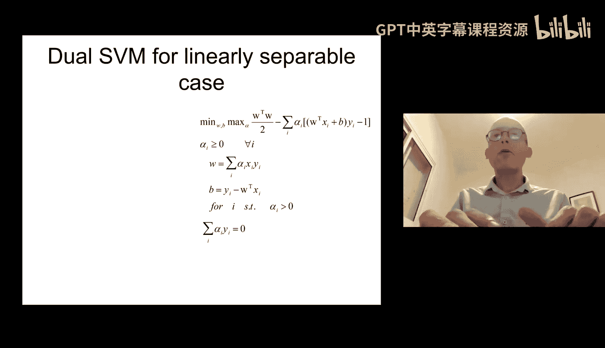

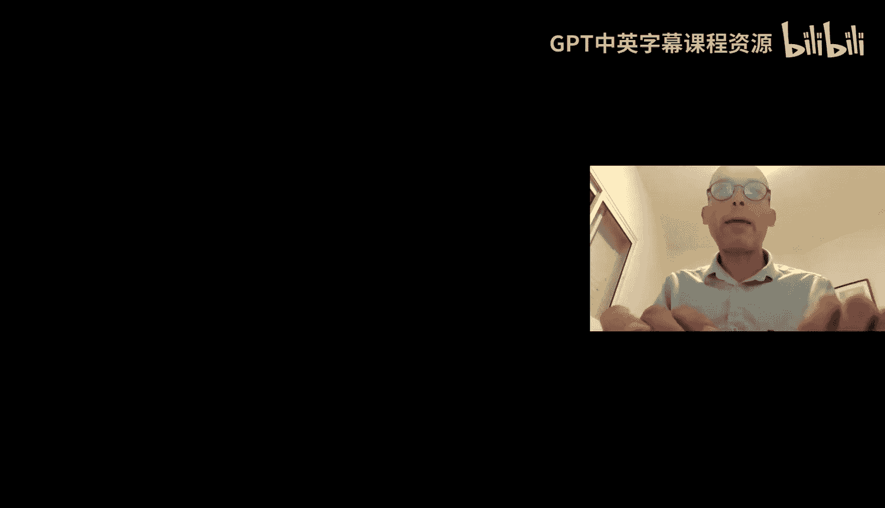

Try to reconstruct the。Optimization function using the values with the Y。

 so the first thing we have is W Tw。And we said that w equals sum over I， alpha I， X， I， Y。

In that case， WTW basically is this times itself right， so this times the same sum。😮。

And if you open this up， you will see that this comes down to some of INJ。Alpha I， alpha J。

Which could be the same， I mean， all cares X I， Xj。😡，Yhy I， Yj。Well。

 this here is something called the dot product， so this is basically。😡。

Point wise multiplication of every entry in X by every entry in X chain。

 all the others are just values， they're not vector。😡，But this is W TW。

 so we can write this as alpha alpha J X I， X J， Y I y， again。

 if you just write it as two sums and multiply them， that's what you will get。😡。

I and J can be the same okay they can be different I mean so we go over all pairs of samples the same one and the same so this is one part of the equation and we also have this sum over I。

爱爱。And WTX。Plus， B。W I。Okay， so again， we replace when we replace w。

 so this basically equals sum over I。😡，Alpha I W TX， Y I。Right。Plus。Some over I。22页。D， why I。And him。

Basically minus， this is all in minus， right this is all in big minus。

And so this is everything here is in the minus and then we have also。111。

So everything this is minus this， minus this。N plus Al， some of the I alpha。

Right because this multilines by -1 in the minus。Okay。

 so we have plus we have some over the high alpha that's part of the thing now what about this alpha X X I。

 Y I times wT。😡，Is exactly the same or we can take WT out。😡。

Because it's not a function of I and then we basically get the same thing we had before right sum over I alpha X times sum over I alpha WTx so it's exactly what we derived before right in the previous one so this is exactly this thing here this was over two so this is also over the two。

😡，But other than that， it's the same。some over the I alpha。

 we don't have a lot to say now what is alpha b Yi or we can write again B is not a function of I so we can write it as minus B sum over I alpha I Yi。

😡，What's the value of this function？😡，Anybody can write to the chat？

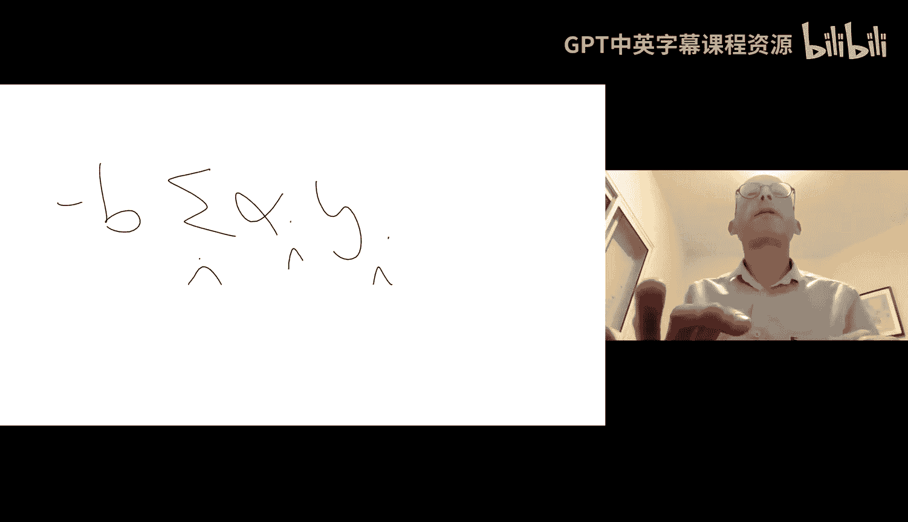

That town disappears， why does it disappear？Because it's zero， exactly right， Very good。

We already said that some of the rightYi after we took the derivative is this sum here is zero。

 so minus b times 0 is0， so is this goes。😡。

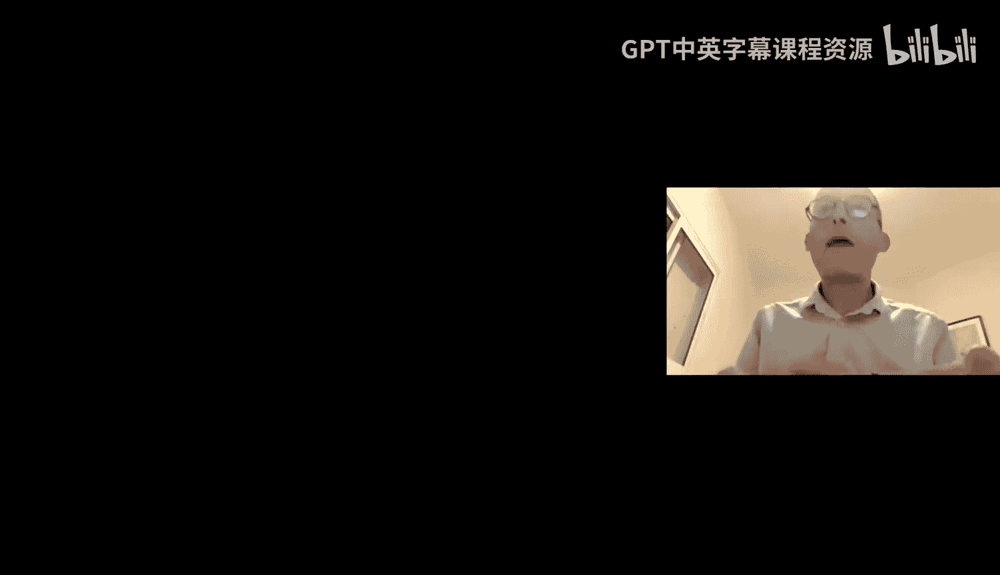

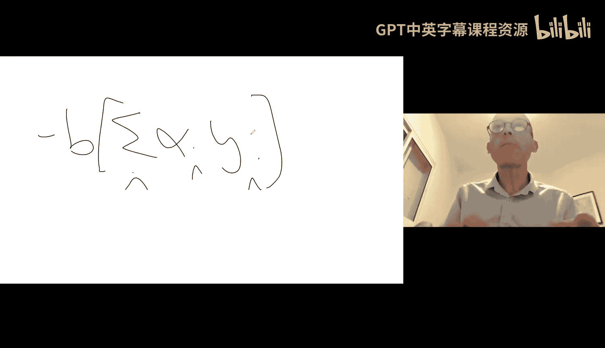

And after all of this devation thing， we get to the following。Set of equations。

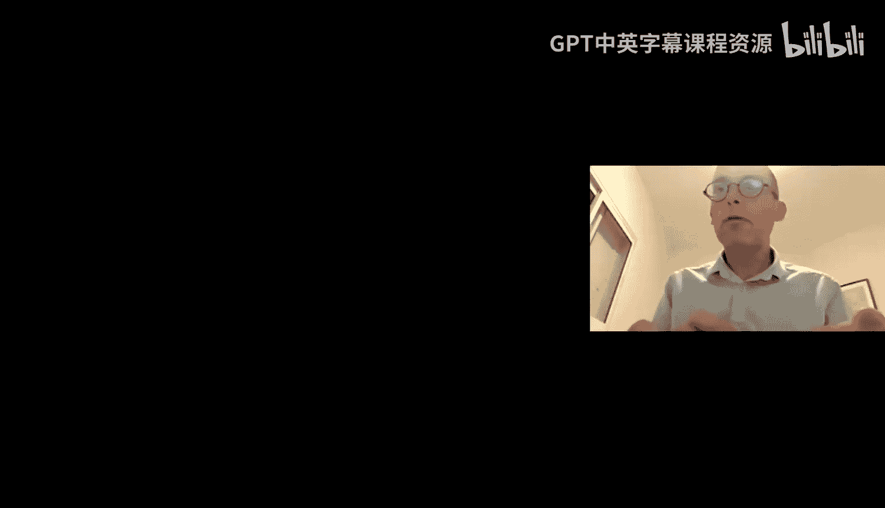

So after we did the derivation， basically we get sum over alpha that we got from the last part here alpha times the minus1。

And then we had this thing here as。Alpha， alphapha J， Y I， Y， J， X I， T X J。

 basically a that product between the two。S。Here we got it as over2 in the plus side and here we get it as without over2 in the minus。

 so this minus this is one and half of this thing here。😡，And we still require the alpha y equals0。

 so we still use it here。And。And alpha， of course， has to be greater than zero。嗯。

We don't need to use this because we don't have de anymore in our equation if you see it。😡。

And we don't have W and B here so we don't need this。

 but we still have alpha and y so we use it here okay so this is the this is the equation we got from basically substituting everything we derived into the optimization function and this is the new optimization function that we got。

This is called the dual formulation of support vector machines。

 and there a few interesting things to notice when we look at this。First。

W disappeared from our parameter set。😡，All the parameters we have here。

 or the only parameter we have here is Al。😡，Al Phi。

 we said the conity of alphahi or the number of parameters we have for Alhi is the number of samples。

😡，It's not the number of parameters here we had the number of parameters here we move to a different。

😡，It's still parameters we don't know the value of alphahis。

 but the number of a Ps is the same or the number of alphas we need to find is the same as the number of sun clones。

😡，And it's completely independent of all， not completely， I don't want to say completely event。

 but it's not the number of features。😡，This is good news。

 it's good news because if we now take data to a very high dimension。

 we already said like if we have Uniivari data， we can represent it as a polynomial of degree 10 or 20 or 30。

 the number of parameters doesn't change。😡，Right everybody see that。

 let's say we take values and we want to predict an outcome。

 let's say height and want to predict whether you are male or female。😡。

We said that we can basically turn the height into a polynomial。

 but that would require more parameters， more parameters can lead to auto fitting in this case。

 the number of parameters doesn't change because we are working in the sample space we not。😡。

So that might be good。😡，But I will show you in a second well this is really crucial in some cases this is really something that so this is definitely one thing we see here the other thing is that we see that all the analysis we do is in terms of dot products between two inputs right so Y Yj Y Yj or just so that's not a big problem but the way we use the inputs is as a dot product we don't have X anywhere else the only way we use X is as a dot product with another part with another sample Xj which could be the same it could be also X X but we basically some of all okay these are just observations would second。

Someone has a question， someone said， when doing the min Max here。

 does the order of the Min Max matter？So the order of the min marks representing the not representing in writing the analysis matters and the fact that we are minimizing with respect to W and maximizing with respect to Alpha is important。

Okay， now what I haven't shown you and should be done and people have learned is to take the second derivative and show that indeed whatever we did。

 the derivative for alpha would lead to a maximization and whatever we did。

 the derivative for x would lead to minimization。😡，We haven't done that， but that yeah。

 that is important， so it's not so much right。😡，So this has to be shown that you get this to。

But the order does matter， yes。嗯。Yeah， so we are not maximizing for W minimum mean take the derivative if it could also be minimum necessarily。

But you have to show that this is indeed meaningful mons。

Okay so this is for the optimization function and the dual presentation and this is the final thing we got right this is all in alpha space but just some function that we have max over I alpha I minus of something and in this we have dot product so the only way we are using the input or the only time we use them is as a dot product with another input we don't multiply them by another vector for example a parameter vector right we don't have a parameter vector and the alpha I is are kept separate don't。

😊，We don't officially multily we only multiply alpha by alpha J， we don't multiply alpha alpha。

 so we don't take the vector of alpha or we don't explicitly use the vector alpha。😡，I mean。

 there's a way to do that as well， but the important thing is the dot product and of course this can be computed directly from the inputs we don't this is not an unknown。

 we can compute these values easily from the inputs。And。

To evaluate the use right so this is the optimization function， assuming that we solved it。😡。

Let's say we solve this we found the parameters forphihi how do we evaluate a new function so there's two ways to do it one is to derive W and b we said that when we have alpha we can derive w easily right w equals alpha X I y so if we know alpha we can get w and if we know a w we can get B。

😡，Okay， for the alpha， so that's easy。So that's one way， but another way is not to learn W andB。

 but to use the alphas directly。😡，Because we know that w is equal to Al Yi X some of them。

 right so we can sum all of this and multiply this by x xcan can go outside the doesn't matter because it's not there。

😡，It's not necessarily right， but if we want to do the dot product。

 we can also do it inside the stand， it's going to be the same value。😡。

So this is another way to do it directly， we still need to compute B。

 but this is another way to do it directly without actually computing W explicitly because W is also already computed as a function。

😡，ok。And of course， in order to get the。In order to find B。

 we need at least one alpha I that is greater than zero。 What happens if all the alpha is are zero。

 how can we get B？😡，Anybody can tell me， so again right B。

 we said we want to find W we know is just some of this， but W can be0。

 but let's say w is I mean if everything is zero then w is0。

 that's not a good way to solve but it's a valid， but for B we really need to have at least one alpha or zero otherwise there's no b。

😡，How do we know that we have at least one alpha that is not zero？😡。

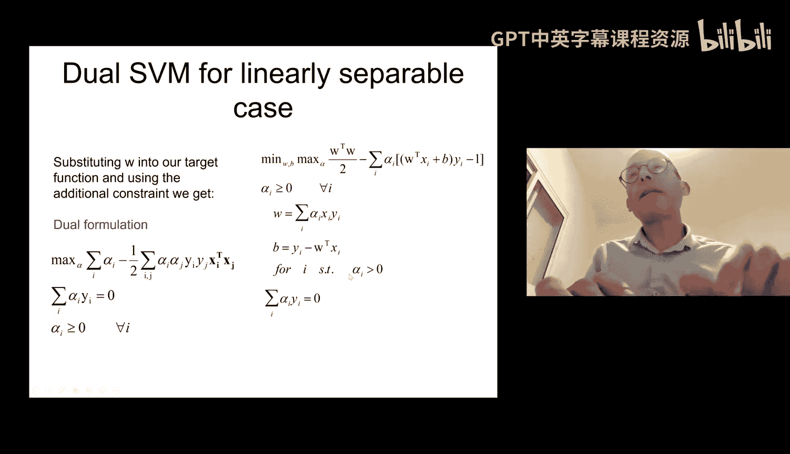

Anybody can tell me？

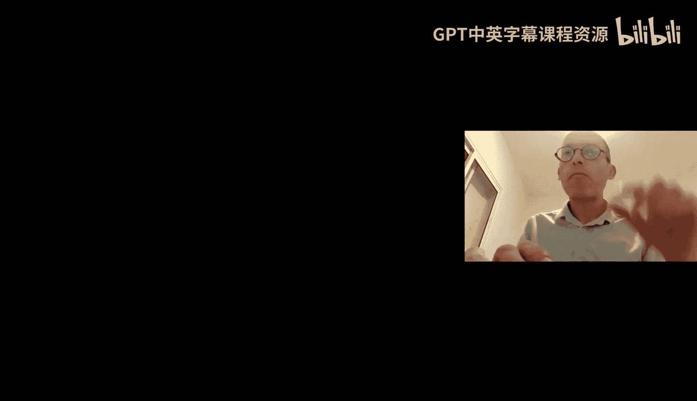

Again， the question is clear in order to get B we need at least one of the alphas。

 if all the alpha is are zero， we don't have a B， but we want to get a B because otherwise we don't know how to solve or even if we have the alphas。

 we don't know how to assign the value so how do we what guarantees that at least one alpha is non zero？

😡，你嗰啲。So remember， we said。Yeah， exactly so that's the answer remember we said that if you are a support vector。

😡，Your alpha is nonze by definition， all support vector non0 we must have support vectors otherwise there's no margin。

 there's no solution and we assume this is linear resparable so there is a solution and there is a by assumption Again。

 if it does not we'll get to that but for now so there must be at least two honestly right because for the margin we need at least one on each class Al is are for both classes we need at least two usually more than that there are support vectors So both of these will have alpha is that non non0ro and we can get B from either of them it will be the same。

Basically， fine。Okay， so this is just， again， this is just a sanity check that we will always get。😡。

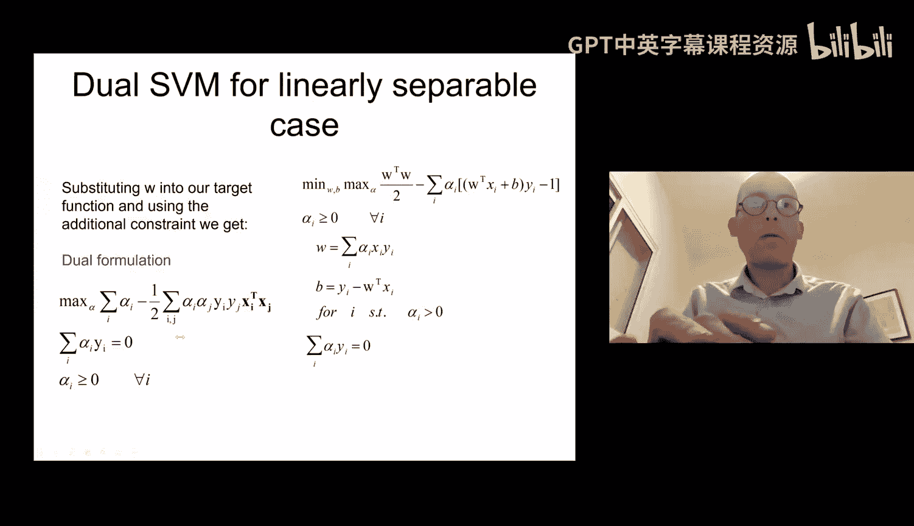

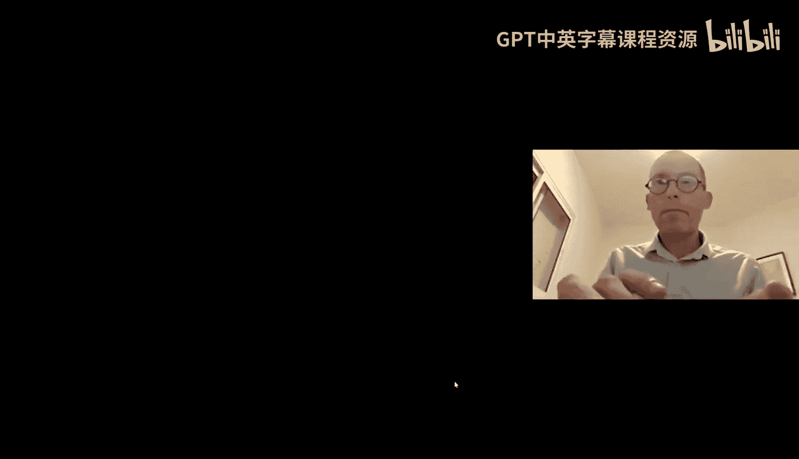

OkaySo this so far has just been another way to represent support recs。But。You know， I didn't say。

 oh we didn't discuss why this would be useful。 We。

 we did say that this is a different productization because it's moving to the sample space in terms of productization。

 But other than that。AndWhy is this useful compared to the original or the former the original representation of support vector machine。

 why is the dual so interesting or so useful so here's an example where the dual is actually pretty useful。

So let's look at this data set， okay， so this is one D， we have two samples in class  one。

 two the red ones two samples in class minus1 and clearly we can separate them right we can put a line or a line here to separate them or a point here to separate them that's really easy。

But if we have this and we are working in 1D space right so we're working even in 2D it doesn't matter there is no line that will separate these two points right I mean obviously it's clear。

😡，Because they all they all share the same value for the y axis to not9 however。

 if we transform this so these are all points。Let's say these are all points in one d right so so we are not changing why is the fixed but if we move these points to 2D so basically if I write x and x squared instead of representing this point as one value。

 I do it transformation， which is a。😡，Just the function of the input。

 it's not the function of anything else， then I can represent this as this and now we can actually find the line that separates them so now they become linearly re suparable these are not linearly resuppparable。

😡，Sorry these are not linear reciparable in 1 d 1 d adjustment value there's no value that will separate them。

 but in 2 d and again this 2 d means that we change the representation of the input they become linear reseparable What's the problem we said with that The problem is that。

😡，We need to add more parameters because now we have more values we have more values for each of the input more parameters。

 however in support vector machine dual presenting we don't need to add more parameters the parameter space is only a function of the samples the number of parameters we need to estimate the alpha is remains the same in this case and so that's a very big advantage for support vector machine the dual presentation compared to the original presentation。

😡，AndAnd this is another example right in 2D space right there's no linear line that separates the red and the blue points。

 no linear， there isn't circle， but no linear line。

 however if you transform them into three dimensional space or you take x1 x2 and x1 x2 okay and you know you walk in x1 square it doesn't matter。

 but it just this three dimensional space， now there is suddenly a linear line that separates them。

Okay， but again， the downside is that we increased。The size of the feature space。 And again。

 this is pretty small increases we went one to two or from2 to 3， But you can think of much。

 much larger increases right so going from。😡，Let's say 10 values to 10 squared because we go from you know all the individual。

 let's say we take I don't know some measurement with 10 values some table that has 10 features and we take all combinations of these features x1 x to x2 I mean x1 x3 and so forth as inputs right not as x now x1 x2 is not the sample it's a feature in a sample so this will go from x from 10 to 100 or maybe cube will take all triplets。

 1000， 10000 and so forth at some stage we will just get to a very very large dimensional feature space which will definitely be overfitting however in suppose vector machine we can overfit because the number of parameters is fixed。

It's a bit tweaky。 It's not completely fixed， but it's pretty close to fix。So as a statement。

 if the data is map to a very， very high dimensional space。

 then everything becomes linear in suparable at some stage if you go high enough in the high dimensional space。

 unless the points are exactly the same， then you can start separating them linearly。😡。

The challenge is， of course， mapping it to very high dimension space requires a lot of time because we need to store a lot of。

😡，A lot of a lot of values， right if we go from 10 features to 100 features to 1 million features。

 we need to。😡，EvenEven if we don't need new parameters。

 we still need to compute these features because we need the X sign and x we need the sample。

 so that's one problem， the other problem that we don't have in support vector machine is the idea of parameters because we don't have more parameters when we don't dimension space。

Okay so this is something we discussed already in the context of linear regression in the context of logistic regression。

 but we said maybe not so fast with the transformation because they introduce many more parameters。

 but in this case they don't introduce more parameters we still have another problem right so we don't have more parameters because support vectors the number of parameters in the dual space is fixed but it's still a lot of computational right if I go from 10 features to 1 million features I need to compute all these1 million features right if I go from combinations of you know value I get 10 values and I want to compute all combinations of。

还个哎。X X square xq maybe I mean I go to1 million features then maybe I don't need more parameters but I still need a lot of time to compute them and to represent them I need a lot of storage to represent them so the first answer for many more parameters we already discussed the second is an interesting trick called the kernell T here we use kernel in a very different way than we used it。

In the local regression sense。I mean， that's the word people use for support vector machine and the idea is that you can。

Do sound transformation， not all transformation okay。

 but sound transformation you can do without explicitly computing them。 for example。

 you can move from 10 dimension space to one million dimension space without computing the million dimensions without storing them but you will still work in the million dimension space again that's not true for8 transformation but some transformation you can do And if you can do that then you solve two problems at the same time One is you walk in very high dimensional space so you can get linear separation but you don't need to pay the price in terms of over 50 because you don't have more parameters and two you don't need to spend a lot of time and computation on finding these million values because you can represent them pretty simple So let's do an example and show。

😡，How this works and then we can make。So these the first example we'll talk about is something called quadratic cannons。

 quadratic cans。Our kernels that use a value， a set of inputs， let's say x1 to x， let's say。

 I don't know， pixels in a picture， so we have let's say。

4 by48 by8 or 32 by 32 images each one has one value for each pixel and we want to represent it as the value plus the product of all the different pixels so this becomes now square in the size of the input feature so let's say one sample has M。

😡，Input values。And we want to represent。😡，This in a high dimensional space by N square。😡。

So let's start with this representation， so we are going to have rather than m values。

 we are going to have almost m square values by taking x1 and multiplying it by square root of two but still using the linear version of it and then we take all the quadratic version of the single values and then all the pairwise features。

😡，So this will take us to， we have more or less m linear terms and forvaritic terms。

 but really the large number of terms is m squared。😡，A pair of features Okay。

 this is a possible representation。 I mean I'm not saying why this is useful。

 but but this is definitely going to much higher dimension。

 So we started with let's say 900 and now we have 900 square dimensions。😡，In our input space。

 this is good because now we are going to 900 square dimension。

 it's going to be much easier to do a classification of cats and dogs， for example。

 because we have we settled but if we go to a high enough dimension space。

 things become really superpar we can support use SVM to solve。😡。

But the problem is that now rather than working with 900 value inputs。

 we have to work in 900 square inputs， which is huge and also very tang it turns out that in support vector machines we don't need to do that and the reason why we don't need to do that is because as I showed you all the computations we are doing。

😡，Oh。Related to dog products， we don't multiply the parameters by the samples themselves。

 We multiply parameters by do product of samples。😡。

So if there is a simple way to represent dot products， we don't care about the inputs themselves。

 the only thing we care about is how to represent simply dot products。😡，And how do we do it here？

So let's take a dot product of two samples that we transformed in the way we transformed。

 so let's say x and z right3 x times phi。😡，X we transform it by taking all the linear terms。😡，Okay。

 so x this should be x1。This should be XM， and this is x Y。

 XM and x Y and so forth and similarly for Z okay。I can change it on the fly anyway。

So this should be right rather than one， this should be x2 or。

 doesn't mean these are the m linear terms， these are the quadratic， and these are the color。Okay。

 so this is the dot product we need to compute what is the computation here。

 basically it's a sum of all the linear terms times themselves。

 the sum of all the contic terms times themselves， and then pair of Xy Xz Z I Z right this is just the summation to get here。

😡，Okay， so this is we didn't do anything， we just did a transformation and if we have 900 square we need to do it in 100 square times because we have 900 square here。

 900 square here and the summ takes 100 square so this is a lot of computation but also a lot of things。

😊，However。😮，So more or less m squared value the sum。However。

 it turns out that this can also be solved much in a much different way。😡。

Let's look at rather than doing the transformation and then doing the dot product。

 let's do the dot product first and then squaret。😡，Okay， so again。

 I'm saying that we do a dot product plus one。Again， y plus one and so forth。

You will see in a second， but let's say that we do this as x times z plus one and that's easy because we can just put the values of Xz right here we also have plus one here。

So if we do this。😮，And we take the square， which is basically what we did here。

 right one times this plus the dot product of these two if we keep one out。If we do this。

 then what we get is。😡，This is all the linear quadratic and pairwise terms and one is the value we added at the beginning of input if we do this then basically this is just taking quadratic equations or this is x。

Dot z square plus 2 xz plus1 x dot z square you can just open it up。

 but basically this is sum of I X I Z I square。Again， we'll open this in a second。

 this becomes just some of the I2 X ZI right this is just。Some over the dot product。

 which is basically this is the dot product this is just。

Another way to represent the total product so this is all the linear term and plus one comes from here so this is the same as the linear terms we have here right this is this this is the same as one and what about this this is some over all the X Z times X Z so we get all the pairs of X all the pairs of Z and the quadratic terms as well so this is just。

Ptting it up into things where XXj are the same and those't all know the same。

 but basically this is exactly the same vine so if we do this。Which requires only 900 operations。

 right， because if we start with 900 value vector computing the dot product is 900 operations。

 if we only do 900 operation and square is one operation so we only need 900 operations so we don't need to represent。

😡，The transform value， but we still get operations in the transform space all the dot products we compute are in the transform space。

 so even though we walk in the original space， we don't need to do any computation to explicitly represent things in the transform space and we don't need to store the values in the transform space the actual outcome if instead of computing dot product we compute dot product square is like we walked in the transform space。

😡，So this vis us by using the fact that all the computation we are doing are only dot product。

 if that wasn't the case it wouldn't do， but because all the computations。

 including not just finding the values representing the optimization。

 but also solving applying the classification itself is also in the dot product space。

 we never need to compute the actual representation。😡。

We just need to be able to compute what would be that we done if we walked in the in the high dimensional presentation。

 so this is a way of course here I did it square but you can take it to the power of three power 4 any polynomial。

 which is a huge number right like 900 to the power of 10， 12。

 whatever you can still do it in 900 space， but walk as if you're walking in the highly polynomial space。

😡，That's an advantage of support product that is not true for others because they don't have this idea of product。

😡，Okay， so again， this is only true because the both the optimization function we need to solve only requires the product computation and。

😡，After we solve it， we don't need to have the representations all find Ws right if we had to find Ws。

 we would still be in a problem because it's nice that we can find the optimization in XI。

 but now we need to find W， we are going back to the feature space which is very large but we don't because even for evaluation we don't really need to find W。

😡，We can just do this。Okay， so this is nice and in terms of dynamic operations rather than walking in very high dimensional space。

 we only need to compute。M times R well the support vectors we don't even need to take it so this is much faster than before and also much much more space and time efficient because we don't really need to go to。

highigh dimensional space Now cans again you should show not all cans can or not all transformations would work because the transformation that walk or transformation that can be computed efficiently by dot if they cannot be compute efficient by dot products or there is a simple way to compute with thet product they wouldn't walk right if you now take some sinusoid of this and or log of that。

 it's not necessarily wrong because you can't apply the dot product but people have walked for a long time and coming up with different with different transformation that do work for example any polynomial you can represent this way you can do something called radioial raial basis function which is basically like a Gaussian that also works1age and so forth and a lot of these things you will see again when we talk about when you talk about neural networks but these actually started their life in supports so there are I mean so the canl idea again。

 something that can be easily represented in high dimensional space。

But something that can be computed easily by dot products。

 but actually represent a very different thing in high dimensional space is a very powerful method and works only in SVM because of this dot product thing and in this sense once you have that you can actually now basically work as if you're walking in very high dimensional space。

 move things to high dimensional space， even if they are not linear separate in the original space。

 they are very likely to be separate in a high dimensional space。

 you solve the support vector machine problem and then you have a solution that not only classifies correctly the two samples。

 but also has a pretty good margin or at least attempts to have a pretty good margin。Okay。

 and then you can apply so this is the idea of careness and of the product and of the dual formulation。

And that's why we do the dual formulation， first of all， we are moving into。😡，Into another space。

 which is not affected by the size of the transformation， which is a big problem for us。

 And the second thing is that。Once we do the dual formulation。

 we move into the products of all the functions of the internal products and that opens the door to a lot of interesting。

😡，Okay， so I have a few piazza questions， but before that I wanted to ask you and。😡。

A question and then we'll do Piazza poll， but this is like more about a bit more theoretical question。

Os。嗯。So I said that。When we move to high dimensional space， basically we don't pay a price because。😡。

Unlike in the prim， in the original representation where we get many， many， minimal features。

 when move to high dimensional when we move to the dual problem。

 it doesn't matter how many features we have， the number of parameters is still fixed。😡，And its。

The number of and it ends the number of samples right alpha's are always a function of the number of samples it doesn't matter however。

 that's not completely true what happens when we move from relatively low dimensional presentation to very。

 very high dimensional presentation in terms of parameters do we in space do we see any impact on parameters there or we don't see any impact well because we're all working in the sample space。

😡，Anybody can think of an impact we will have， of course， if we walked in the pre space。

 we would have a huge impact and we have many， many more parameters， one for each feature。😡，W。😡。

So the answer， as was mentioned in the chat is that it's true that the number of alpha hi's does not change。

😡，Because the number of alphas is the number of samples that doesn't change if we move to very high dimensional space。

 because each sample now is represented by very large dimensional space。

 but but it's not true that the number of support vector doesn't change when we move to very high dimensional space we have more and more support vectors because there。

😡，The dimension becomes larger and larger we need more support for each of the transformations。

 and that means that even though alpha is the totallta number of alphas doesn't change the number of alpha is that are known zero or equivalently the number of support vector does change so the effective number of parameters does change however there is a limit it cannot be more than the samples so there is a limit to the number of features but obviously the number of。

😡，The number of non zero alphas is changing when we go to higher speciess， okay。

 so this is something to keep in mind。😡，Okay， so now let's turn to the Piazza poll and I have two questions for you。

In。Yes。Okay， so let's discuss the questions that I asked you the first question which。诶。Okay。

Which you probably should have asked yourself is okay， so we defined the dual formulation。

 but how do we solve it right we didn't say how do we solve it it we said that we can easily once we have any transformation we can easily write it。

 but we didn't say how we solved。So the answer is that。I mean， like with the original formulation。

 there are many ways of doing it， you can just take derivatives， but in fact。

 this is still a QP problem。😡，So we still have of course constraints so this is not a linear problem we still have constraints for example Al has to be greater than zero so those it's definitely not an unconstrained problem it's still a constrained problem but not only is it constraint problem it's still a QP problem because we have basically alpha I times alpha J write to alpha times alpha in the optimization we also have the linear term which is some of the alpha so this is still a linear this is still a QP problem you need to actually once you have the samples you can write the matrix without the samples of course we can but once we have the samples we can write the quadratic matrix the vector for the linear is just vector of one right and then we have all the constraints that we derive which are basically alpha greater than zero。

Oh little explain。嗯。Yeah， some of the I alpha equals zero that's another constraint and some of the I alpha y equals to zero。

 that's a linear equality constraint and we have the inequality constraint。Okay。

 so this is the answer to the first problem。So this so basically again。

 so so right even though we mainly discussed QP in the context of the prim S support vector machine。

 it also works for the there are other ways， I mean you can do other ways of I lots of different ways to solve it。

 but。QP is probably the best idea。嗯。The second question I asked is about the number of parameter for a linear reseparable case right so in the long re separable case it's different but for the linear reseparable case that's why I asked so we have n samples。

And we have k minus1 features and we want to know and we know that the resultant model had n minus n1 support vectors。

 however， of course we don't know which which ones they are right so in order to find which ones they are we need to define all the parameters to the QP and then the QP will give us the n in the alpha case it will give us n1 that are not0 in the rest of0 in the prim case it will just there are some w and B we can get。

But anyway， the question is how many parameters should we define for the solver for this and the answer is。

😡，AndBa we said right in the linear re sparable case， the female SBA walks in the feature space。

 so it will need K parameters。😡，So K -1 features plus B， which is another feature。

 So K parameterss the dual space works in the feature space， sorry in the sample space。

 only in the sample space， it doesn't know what are the support vectors So it cannot use the fact that we know that n1 is the number of support vectors because we don't know which one there。

 So for the dual formulation， we would need n kilometerss。 So for the solve， we would have。

Alpha I parameters， for example， for dual case n and K parameters for the features right k minus1 for the inputs and B which is。

Okay， so this is the answer so the first one is the right concern in this case。Okay， good。

 so this is okay， so we talked about other canons， two things we haven't discussed yet。

One is what happens in the known nonlinear is the pro case。😡，So first of all。

 we said that using the dual formulation and the k tweak。

 most problems can be solved in a linear reciparable case by going to another dimension and then using linear reciparable solutions most that's what we do most of the time so we can go to high enough dimension and eventually we will be able to solve it with no errors。

😡，However， there are cases where this cannot be done or maybe cases where we don't want to go through very high dimensions and in that case we can still use the same。

😡，Forulation that we did for the。not only a sparable case in the primal and then take the derivatives now with respect to the parameters that are defined there which are also the alpha the which are also the epsilons okay so now we have more parameters before we only add W and B but now we also have the epsilons so we need to take the derivatives for those as well when you do that and we won't go through that exercise but you know this is something that can be done it's the same idea so you define again a newular branche multiplier but now rather than using the。

A multiplier for the equation， equality， you use it for the inequality that is defined by。

So rather than using the greater equal to1 we will use greater equal to 1 or less than minus1 we do it for one minus epsilon which is what we define for the case and when you do that you get very very similar optimization function so the target function stays the same the constraints on alpha y it stays the same and this is the new constraint that we get so alpha is now are basically constrained to be greater than0 they of course have to be greater than0 by the definition of dig multiplieries but C now comes into play and basically all the alpha is have to be less than0 this is still a constraint optimization so still a  Qp solve I mean I'm representing this as one but this is really two different contrain so Al has to be greater than0 and alpha has to be less than for。

And they but again， so this is。And your representation of the constraints， the meaning of C。

 the fact that increase C when you increase C you get less support vectors as we discussed before。

 that stays the same that doesn't change the way we define support vectors or anything else okay and again。

 once we move to dual formulation we can actually in most cases not use the nonlinear constraints because if we go to high enough dimension things。

But again， this can definitely be done in the geo formulation well。

 so this is one point that we haven't finished。嗯。Yeah so so right people have walked for a long time on trying to understand why SBM work right so we already said that the motivation for a max margin classifier makes sense and。

You know， it's nice， but you know， can you theoretically show that this is the best way to classify the answer is no there are some theoretical results but but。

You know， there's no proof that this will work for all cases， but still， as I said in practice。

 support vector machine as a standalone classifier， so not an assem all different。

 but as a standalone classifier。😡，And without neural networks， which are really， you know。

 you can fit neural networks as stand alone。 But honestly。

 they do a lot of things with a lot of features。 So they are also some sort of ensem。

 But support vector machine works very well。 And the reason why it works well is that。

AndBaically the support vectors are putting some type of aization on the function sorry the max margin is some type ofization on the parameters that we have。

 even though we walk in very high dimensional space the fact that we are trying to minimize something in this case we're trying to minimize the margin of maximize the margin usually helps in terms of limiting the set of parameters or the values of the parameters that we are selecting and even though we walk in very high dimensionmenal spaces。

 eventually only a small number of points usually。YouAgain。

 depending on the size of the dimension but if we go to a reasonable dimension。

 only a small number of samples are going to have an impact and if we don't need to feed all of the samples right that's the real problem we had with overfitting we had to feed all the inputs to get through them in regression but if we don't really care about most of the inputs we only care about the support vectors this acts as some sort of aization and leads to relatively good results so again this is in practice。

You know， more hand waving， I would say than proof but it does work very well and as I mentioned before we had neuraler network。

 everybody used support vector machines so those are。

Those were the classifiers that people have used most of the time oh。

 these were the most successful possible。Yeah， there's a lot of software support vector machines。

 I mean this is on the slide。 The last thing I wanted to ask you guys or ask the class is。😊。

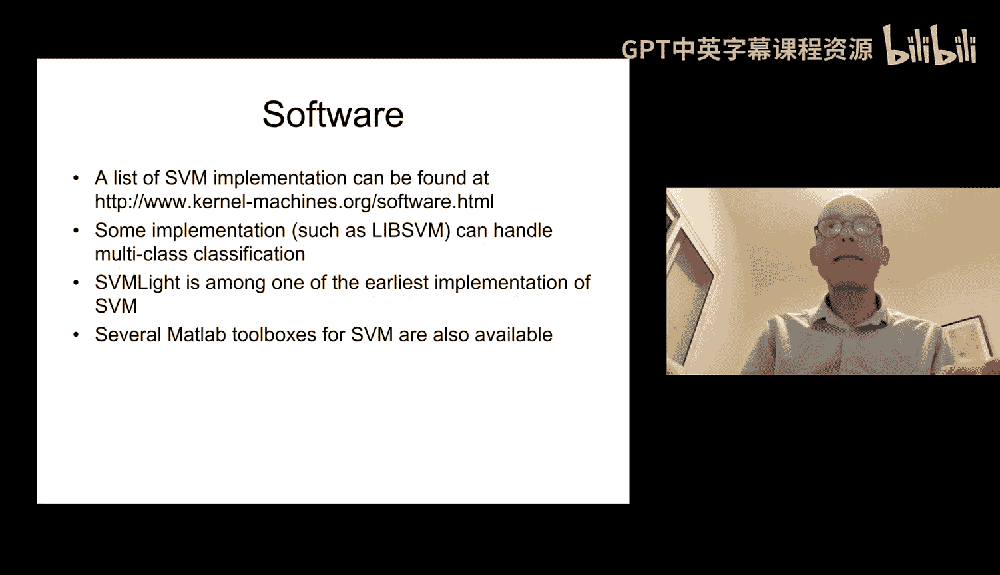

About multiclass support vectors。😡，So we define support vector machines。

 remember that in the logistic regression case we said。

 you know we can just define new parameters for each class。

 but in support vector machine it's much more problematic because we said that even though if we change it to one or two or three。

 it doesn't matter it will be the same we cannot just add parameters and say。

 okay you have a margin between class1 and 2 and this is another margin class2 and 3。

 we don't know what the order of the cluster is right if we had the linear line between clusters。

 we needed to order the clusters but maybe there is no order and of the clusters So how do we extend support vector machines to multiple cluster。

 any ideas how do we extend this idea to multiclass right in K andn big logistic was pretty easy。

 we just either define new parameters or in K andN just the majority that's easy What about support vector machines。

 How can we extend it to multiclasss。Yes， okay， good。 So the answer that people put in the。

Put in the。Put in the chat is what people do， it is indeed going to do something like one versus all so we can in order to find class one between train a classifier that classifies class one versus all the samples from the other classes so we learn this is one classifier and then we learn a classifier for class two which classifies class two versus all the other classifier。

😡，All the other sample。 And then we learn a sample of class3 and we and then we learn a classifier for class3 that's classifier。

 And now when we have a new sample， we use all these classifiers and we select the class that the classifier says is the class for this sample。

 Okay， everybody's okay with this。 So we do this rather than doing it。😊，In one shot。

 like were dating all the other ones， we do separate classifiers。😡，Okay。

 for each of the classes that we have in this case， if we have five classes。

 we learn five different classifier so we don't learn for and save the rest。

 we learn five classifier and select the one that。And once you have a new sample， the classifier。

Oh I was writing for the question， this is a nice idea but it doesn't work because what if two of the classifiers claim that this is the same is this class right so classifier one tells us that the new sample is class one and classifier three tells us that the classifier is class3。

😡，Or what if no classifier wants to use this once this sample。

 none of the classifiers tells that that they think it's theirs。😡。

What do we do right I mean of course in all the other classifiers we had the multiclass we would have to assign to one of the classes。

 but here we can either assign to two or three all the classes or to zero classes。

 how do we deal with that？😡，So the answer is。Yeah， so the answer as was mentioned in the chat。

 which is completely wrong because the support vector machine is not trying to optimize this。

 but this is what people do in practice is they look in addition to the classifier result。

 they look at the margin right so each classifier will tell you I believe that this sample belongs to my class and also it can compute the margin right how much。

😡，So let's say right， I mean， it the margin is how not the margin， but we have a value right。

 which is。😡，Greater than zero， you belong to my class less than zero， you don't belong to my class。

 we can actually and we choose the classifier that has the highest value。😡。

That's what people do in practice。 Now it's important to realize that that's not。😡。

A theoretically motivated day because we are not trying to maximize this value for any classifier。

 We are just trying to maximize the margin， but we are not trying to maximize how far you are for the margin。

 As long as you are more than one for the margin。 I don't care where you are。

 We already said there's no impact。😡，Still， in practice， this seems to work reasonably well。

 so again， in multiclass specification， we train a lot of different classifiers。😡。

And we select the classifier and then we have a new sample。

 if one of the classifiers select that sample and all the other classifier says this is not ours。

 that's great then we are done， but if two classifiers on none of the classifiers select this we look at the margin。

😡，And， you know， if it's a positive margin， we take the ice positive， it's a negative。

 we take the lowest negative that's how we do the classification Okay。

 so this is the way people actually use multiclass support vector machine， as I mentioned。

 there are I should say there are other ways of doing it， I mean this is just one。Euristic。

 there are other ways， but they're all heuristics because support vector machines at least。😡。

The way it was originally defined was not。😡，It defined or was not meant to be applied to a multiclass classification。

 so we do want those as all and then we compared the margin and we done。Okay。

 so even though it's absolutely sorry't。So even though this is not the。AndYou know。

 the most theoretically justifiable thing to do， in practice， that's what a lot of。

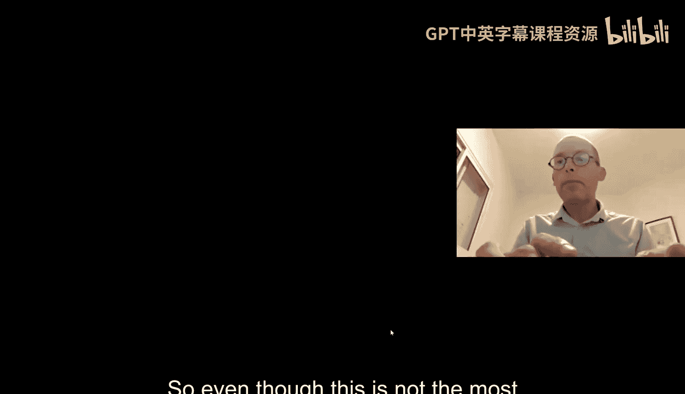

And again support vector machines have been applied quite a lot at some stage they were the state of the art。

 especially for images， nowadays we know very well that neural networks are doing better but。

But if you compare， for example， digit recognition， which is basically a sort of image analysis。嗯。

And again， depending on exactly which but simple neural networks with only three layers or four layers were getting so nearest Ne was doing reasonably well。

 simple neural networks， not convolutional， but。Simple neural networks with a few layers we' getting between one and one and a half percent。

And back then， this was several years ago supposed vector machine go doing the best nowadays。

 of course we can get much much better with the。Convolution of the neural networks， but。At least。

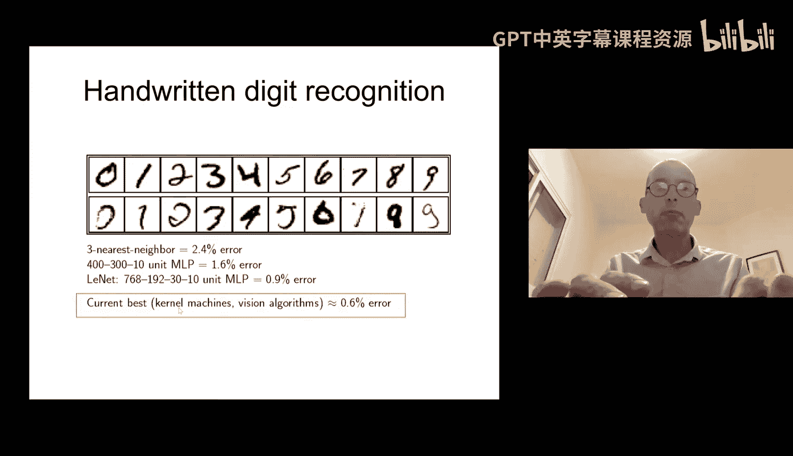

Okay， good。I actually have a demo for support vector machine but we are running out of time。

 I will ask the TA to present it and go through some examples and it shows examples on mal genes and on changing the value of the of the error weight in the non nonlinearly separable case so you will see this demo and of course you will provide the link you can play with it yourself to see that basically support vector machines or how the impact adding more samples or changing the weight of the classifier or even changing the camera so that demo also has different camera is impacting the success of the classic okay so this will be in the recitation on Friday and that's it for support vector machine I think the next vector is actually going to be on。

诶 you are嘅 box finally你 wrong actually。嗯 see。Yeah， so next time we are going to neural networks and after that to ensemble custom price okay？

Yep， so see everybody on Wednesday。