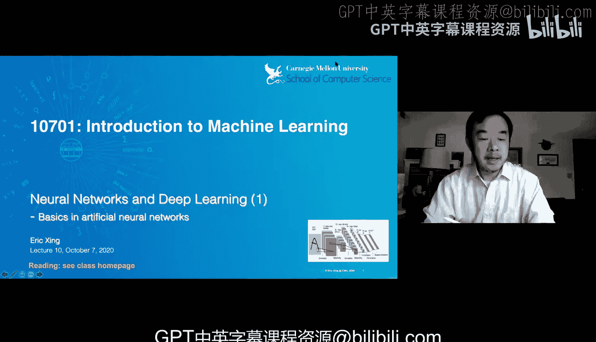
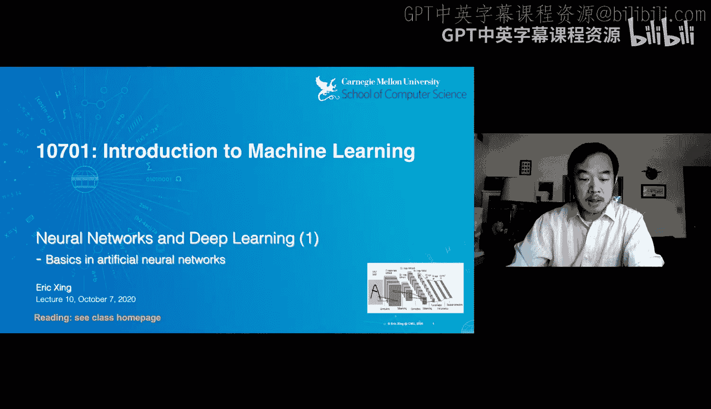
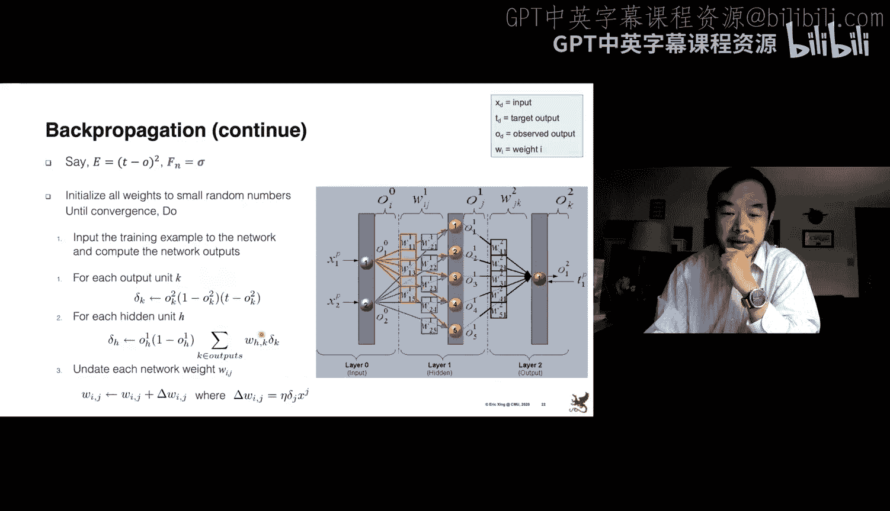
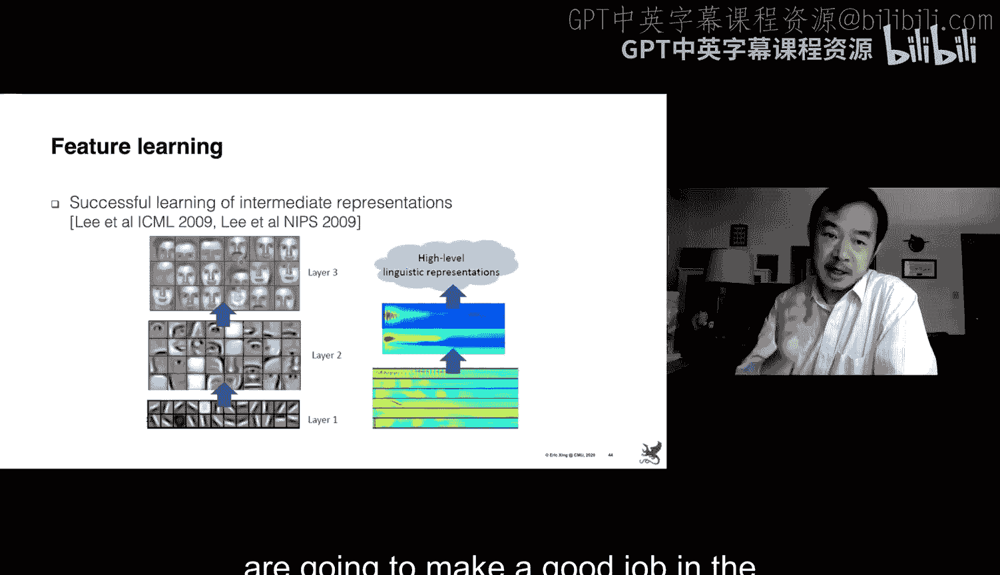
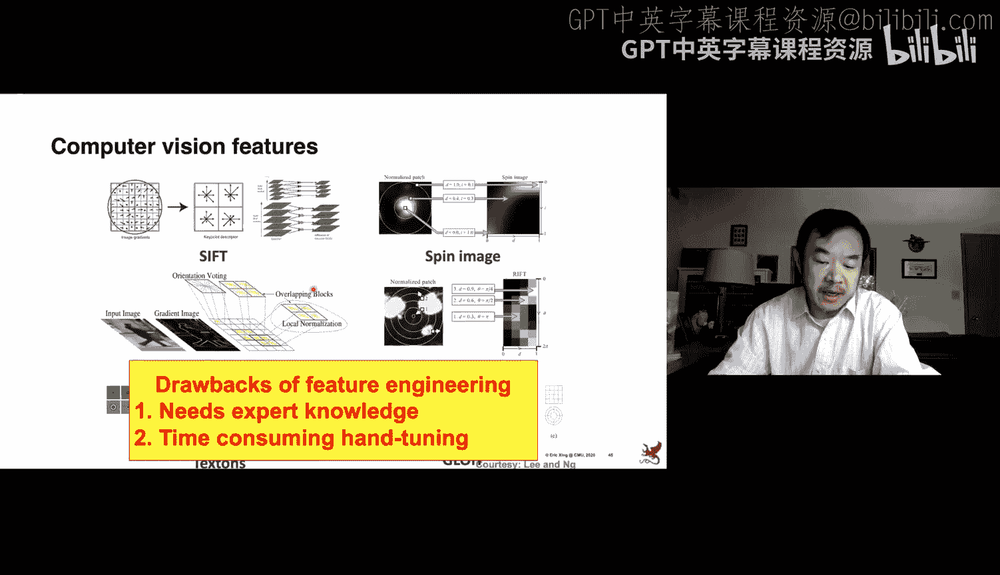
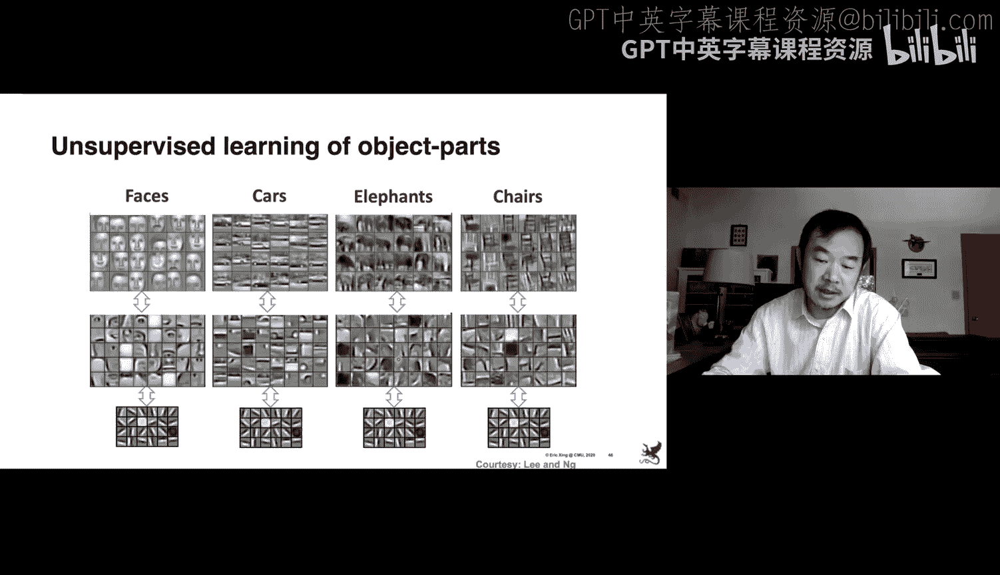
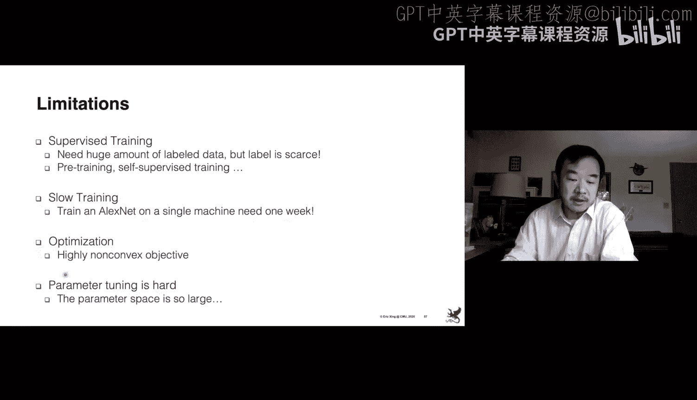
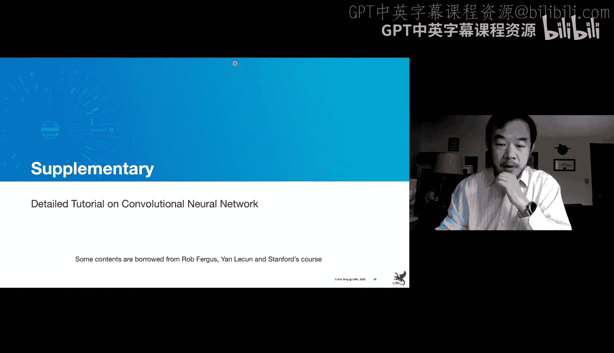

# CMU《机器学习导论（研究生）｜10-701 Introduction to Machine Learning 2020》中英字幕 p10 [10]10-701 Lecture 10 Neural Networks and Deep Learning 1.zh_en [BV144SuB8ETp_p10]

Hi， class。

So great to see you guys。 I'm Eric Xing。 I'm the second。Lecter instructor of the class of 70。

1 and me and professorfessor Zivva Joseph will be alternating in covering materials。 And today。

 I'm going to cover the neural networks and also down the road。

 a few other lectures on boosting uned learning and sos。I guess neural network is a very。Sorry。

 I have a。All right， okay。Ne network is a very， very hot topic these days， so by itself。

 you know we can open the whole semester of lectures， you know to talk about the details。

But unfortunately， you know。Instructuction machine learning is a more comprehensive lecture covering different topics in machine learning。

 so we are going to condense some of the key messages in the field of deep learning into two lectures。

 and today I'm going to talk about the basics of the foundation of artificial neural networks。

 and next time I'm going to go more practical and present some of the building blocks for modern day neural network and deep learning components in action。

So just a bit of a context， I guess the reason why deep learning and neural networks are becoming extremely hot these days is because it's really becoming a very powerful tool to solve many machine learning problems to the point that now people are even maybe thinking you know machine learning is entirely about deep learning。

So hopefully after our lectures， you will see that indeed it is powerful。

 but also there are still a lot of room to further improve and still there are a lot of room to use other technologies。

So here is our outline in today I'm going to give the historical remarks of early day neural networks。

 so what you learn today are almost entirely the stuff that was developed 20 or 30 years ago but still they are very。

 very you know neat and fundamental， it's actually the foundation of what we are doing now in modern day deep neural network and deep learning and also in fact without too many fundamental theoretical changes。

 the game and the advancement are more on the engineering side and next time I'm going to cover modern day building blocks。

So let's look at， first of all， the problem that we are trying to solve。So far， I guess， you know。

 in the lectures we had for machine learning， you'll probably see that one of the major goal in machine learning。

It's。Sorry， let me get。The pointers， I couldn't find the pointers in here。Give me a second。Okay。

Great， all right， so one of the major going machine learning is to find a function that maps from x to y。

And in many cases， you know I think so far we learned logistic progression， linear regression。

 support better machines， These are all looking for a linear function where you are looking like a surface like this as a decision boundary and then you know。

 use them to classify you know a points or to put you know training data on the line and sos。

But there are many problems in real world where a linear function is not adequate。 For example。

 in this case， I'm going to explain a little bit more in the next few slides。

 You have the socalled X or problem where the blue dots and the red dots cannot be separated by a linear surface。

And in other real problems， such as in speech recognition。

 if you record my voice and then do a spectrum decomposition and then project them into say a frequency space。

 you actually will see that different word pronunciations will be mapped into such a point cloud and you can see that different words。

 the way they are pronounced by different people cannot be separated by a linear boundary。

 they kind of form into strangely shaped little clusters。So。

One of the major elements of modern neural networks。

 which actually we will be describing to solve such nonlinear problem is known as the percept。

 It is coming from a biological root， mainly due to the early work of malum and pits in their monumental paper in the 943。

 where they built a mathematical model of the biological neuron。 So what is a biological neuron。

 Well this is the cell in our brain， which is you know processing signals and producing a response。

 right， it's roughly like you know， it's a cell of very strange shape， It has the dendrite。

 it has the which is more like the head you know of the cell。

 which has a core called nucleus and then many other little arms， okay called dendrites。

 And then there is also something called a exxon， which is like the little。Cable， you know。

 connecting， you know， through distance to another neuro cell。

And what's happening here is that the cable is almost like a conducting wire that can carry electronic shocks。

 you know from other cells into a cell and they can collect such signal from multiple other cells okay and then when they receive such an electronic shock and accumulate them from multiple sources。

 you can reach a threshold which is represented by a voltage and then when the voltage is getting too high。

 it can open a gate on the cell and discharge some of the elements。

 you a molecules to create another signal to the other direction。

And this mathematical model was captured in the McCan and pits model called the artificial neuron。

 where you can see there are inputs represented by the axis and they are you weighted through a linear combination and these weights can be kind of viewed as the physical property of this exxon like theyre conduct conductivities and there you know material and other things so therefore the signal can be attenuated or can be enhanced and then there is a linear combinator in here。

 which are just some or the signals and then there is a threshold function which leads to a output in response to the input So this is the McCn and the pits model known as the artificial neuron also known as the perception So this is just one corresponding to one neuron cell。

The activation function is a very interesting one it actually does a number of things mathematically you know for you know what is happening in the biological system。

 you know， first of all， there is a linear combination of the signal using a bunch of weights。

And then there is this a threshold function， which typically， you know。

 is equivalent equivalent to producing a linear decision surface like this。

 This is like what you see in SVM in logistic regression。

But then we have what is known as the neural network， what is a network。

 what network means that many such perceptions are interconnected to form a graph。

 which is again you know originally exist in the biological system。

 you know the biological neural network is like this。

 you have multiple neurons connected through through axons and then the signal gets relay either amplified or you know synthesized and then here mathematically you can combine such perceptions similarly into different layers and then they will create some interesting mathematical effects as we will see in a second。

It's actually interesting to put the。biiological neuron and the artificial neuron next to each other and see how they differ and how they are similar to each other。

You know consider a human， you know， these are some of the key metrics of you know biological neural networks。

 you can view each neuron as a switch in that gate function。

 the switching time is actually not very impressive it's like you know a millisecond something like that compared to our you know you know silicon transistors。

 this is a pretty low switching speed okay and then human has a large number of neurons like you know10 a billion something。

And and also， the the in degree。So called the connections per neuron is pretty vast。

 That's actually very impressive。 You know， every neuron can be connected to another， you know。

 10000， you know， or two maybe even100000 neurons。And then magically the recognition speed。

 you know to say I show you a picture and then I ask you to tell what is in the picture you need to only watch the picture for a 0。

1 second， you are pretty much already able to recognize main stuff in that so you can see you know per neuron switching time is pretty you know ordinary maybe even a low performanceant。

 the amount of neurons are large number， the amount of connectivity is very large and also the overall response speed are very good so it doesn't push story together because here if you divide 0。

1 secondd to you know1 millisecond， it looks like only 100 steps is allowed and it' needed to understand you know image。

 this is not validated in our artificial neural network， usually you know100 inference step you in。

Arificial neural network say you have 100 flops in your computer program。

 that's not enough to do anything。Like this。 So obviously。

 there are some differences between the artificial neuro and， you know， the the biological neurons。

 I'm going to discuss some of the differences， You know why you know。

 with a much faster switching time of transistors in， you know， in in human infrastructure。

 we still take longer time and maybe even a， you know。

 a more energy and resource to do something a lot more simpler。Okay。

 now there are some jargons so that you know which will be helpful for you to digest the literature。

There is a deep connection of the neural network building blocks versus the statistically originated you know mathematical functions。

 for example， I mentioned already about the logistic regression。

 which actually is very close to what a perceptron is trying to realize。And in statistics。

 we have these names like independent variables， dependent variables， coefficients and estimates。

 and in the neural network literature， they were called input， output。

 weights and targets and so forths， and here is you know an example that puts everything together。

From the graph， you actually don't see a lot of differences between a perceptron and a logic regression。

 you know， you have the inputs， you have the coefficients， all the weights。

 and then you have a sigmoidoid function which produce a you know a real valued signal outside right so this is what typically a logic regression model would do you know in classification。

Then how to learn you a perceptrum in terms of their weights and what's the differences between the percept learning algorithm versus a logistic learning regression learning algorithm。

 well it can be viewed very， very explicitly from this very simple display of their mathematical structure and loss function。

So here we see logistic regression， right， We are going to maximize the log likelihood of the conditional probability of the output y。

 given the input X and this conditional probability of x。

 given y is defined by something known as the sigma function， right， and in the sigoid function。

 you have you know this intermediate kind of components called nets。

 which is corresponding to the weighted combination of the inputs。

And we all know that there is a nice property of the logic function in which that it's derivative over the argument。

 it's taking this a very nice nice looking form， you know the sigmoid times one minus the sigmoid。

And then， you know， the conditional likelihood is basically built on such a noise model where the output will be given also a noise signal on top of it。

Now in the perception learning algorithm， instead of optimizing you know a loss function defined on the conditional likelihood。

 we actually use this data model where our observation Y is no longer the probability of the y it is going to be the real value of y plus you know a say a Gaus noise。

 therefore our goal is to minimize you know the true signal you see versus the predicted signal that you are going to generate from this perception function and therefore the loss function is this a squared loss function。

So you can see the differences here you have a logistic loss and here you have a square loss over the logistic signal。

 Okay， so that's the key differences between the perception learning algorithm versus the logistic regression algorithm。

And once you have that， how to solve it。How to solve the the W。 Anyone want to。Want to speak out。嗯。

Well， we have a Ts there。 and if you have a suggestion， you can basically type and they can probably。

 you know invite you to speak or they can respond to you just to make sure that we are still on time as we lose a few seconds in the setup at the beginning。

 I'm going to directly show you how to solve it。We're going to use a gradient method， as usual。

 as we do very often in a logistic and linear equation。 Take the derivative of you know。

 the square loss over the thing to be optimized， which is the weights。

And then after a few steps of algebra， you will see these are three elements， you know。

 in the derivative。The first part， target minus the output。 Well。

 this is the derivative of the loss function。Right over its entire input。

And then this O times 1 minus-0 is the derivative of the logistic loss， right。

 And this x is the derivative of the net， with respect to the weights。

 So it's very very straightforward，3 multiants。And then this is going to be used as an update。

 you know， in a iterative setting for the weights， you， in the end， get this very。

 very you know simple gradient update function。 Either way。

 this summation is over all data points because you want to really you know optimize you know。

 the weight and loss over all the trading data。 therefore， this is the summation to combine that。

But sometimes， what if your data is coming in sequence。

Then you can use what is known as the stochastic version of the perception learning algorithm。

 where you drop this summation sign， you are going to basically every time update based on a single data points。

Okay， and this econ is what we call the learning rates。

 But you can adjust to control the speed of updates。Okay， so very very straightforward algorithm。

And thiss where algorithm learns you。Something very similar to a logistic regression。

 which is a linear division surface like this。OkayIf we are given a problem like this。

 say we have four points with such coordinates and one is from the blue class and the other three are from the red class even visually you can kind of see that a linear surface would work right and you actually could just use the perception learning algorithm I just show and solve them you know numerically and this is a possible。

Weight value。 In fact， there are many， many different weight value。

 You I imagine that this particular linear surface could take some other angle like this like that。

 they do， they still work。 Therefore， you see these four options。 In fact。

 there are infinite such options of a pair of ws。ok。All right。Actually。

 Daniel did Zve allow you know spontaneous questions from the audience during the lectureuring or they are mut So typically they' be posted in chat and I would answer them if I can answer them I'll just kind of indirect you and ask it yeah yeah yeah。

 for those of you know who are listening feel free to raise your hand and R TAs and Daniel will hopefully unmute you and we can directly have a discussion。

Now let's change the problem to a slightly more challenging one Now I rela the data okay。

 I label these two to be the red and these two to be the to be the blue and now you can see that however hard you try to draw a linear surface like this。

 you just cannot classify them correctly using a single linear surface okay so therefore this a socalled land gate which is a term in the in the a silicon you know a design word it' not going to work you know you just cannot you know find a pair of weights which can solve this problem without making error。

Now how to solve it。It turns out that you need to build a new gate function called X or gate。

 which is now having two steps。They are going to be built on two separate linear surfaces in the first phase。

 and then the output， you know， of you know， the the signal from the original non nonlinear seable data will be entered into another set of you know。

 decision surfaces。 And then at the end of day， you are going to make correct prediction。

 So this is called X or gate。 It is non nonlinear。 It's kind of creating a surfaces， which you know。

 you can see that the surface obviously is not linear in this graphical design。

And here are examples of such possible sets of values for the weight factor。

 Okay now we need to have six weight parameters instead of just two in the past。

And such problems are very real， in fact， you know the X or problem is not just a mathematical game here I give you a very interesting example。

 say you have a symptom of a code of flu or whatever。

And then you want to go to see a doctor and see whether they give treatment。

 And this is typically a formula that doctor will use。 It's very， very interesting。On the symptom。

 they measure you maybe two things。 That's why I'm going to show you just a two dimensional space and and with only 0 and one value as possible。

 right， They will measure whether you are coughing。Or whether you have a headache。

 if you do not cough， if you do not have a headache， they determine you don't have a disease， okay。

 fine， you're good go。If you have a headache， but you don't cough， maybe you are having a meningitis。

 therefore some treatment should be given。If you cough and you do not have a headache。

You are likely to have a pneumonia， and therefore， you also need to have a treatment。

 So these two cases are where the doctor actually are considering giving you a treatment。

But if you cough and you have a headache， which makes you look worse because you are suffering from both symptoms。

What chances are you are neither meningitis and pneumonia。

 you may be just catching a flu and you know， there are no killer medicines for flu。

 Therefore the doctor may his charge and say， oh， go home and take a few days of break and I don't treat you。

So that actually creates a nonlinear decision boundary that if you are having the lightest symptom or you are having the worst symptom。

 you get the same outcome in terms of treatment。And in terms of the treatment decision and if you have。

 you know， a part of the symptoms， you actually are more likely to be seriously ill。 and therefore。

 you will be treated。 So that's kind of a non nonlinear separation problem， you know。

 which requires a fancier decision surface and a decision mechanism。

 and that is known as the neural network， when you put you know， linear separation boundaries。

 you know， into layers and organize them into a network， you see something like this。 for example。

 in this particular case， you start with the first layer with a three inputs。And they are combined。

 weighted and combined and then generates a signal to the middle layer， and likewise。

 they can generate another signal using another set of weights also as the middle layer。

 and then these two intermediate outputs will be further combined and generated output in the us layer。

Right so this is also known as the combined logistic model。

 But end effect is that you no longer have just a linear decision boundary。

 You could actually twist them in a way that it creates you a X or gate or some other fancier linear surfaces。

 In fact， I'm going to show you in a second that in theory。

 such a simple structure can create arbitrary nonlinear surfaces， for arbitrary separation problem。

 you know， if you allow them to go very wide， for example。

 or you want to allow them to go a little bit more deeper than this okay。So now let's see。

 how can we train this model， What does train a training entail。

The training obviously means that we need to figure out the weights， these little numbers。

 Once you have this number， you can see everything goes very easily。

 you can just do the signal combination， pass through a gate and generate intermediate outputs all the final outputs。

 So it's really， really fast in even in an artificial neural network。

But training all this become very difficult。The reason is the following。

One of the favorite and most popular training algorithm is noise gradienting descent。

 which look at this， right you have the last function and you take a derivative over you know the weights。

But。Think here。The loss function needs you to compare the actual output versus the computed output。

Through the neural network， both will be observed， which is okay in the last layer because here you have your output as in the training data。

 and then youll have your computed output from this neural network。But in the hidden layers。

You don't actually have the， the true output。 You only have the computed output， you know。

 by using the current weights。 The true output was never given。Right， so that actually creates。

 you know， why it's called hidden， right， That actually creates a algebrabri problem because you cannot take this derivative word comfortably。

And that leads to one of the major innovations in the neurona history known as the B propagation algorithm。

 which I'm going to show you in a second。So the back propagation algorithm mathematically builds on a very simple idea known as the chain rule of ofs differentiations。

Now let's look at this graph， which is you know you know you can imagine them as a tool layer neural network。

 but this neural network is a little bit even fancier because here you have a connection directly into the third fact it's a three layer neural network。

 this one directly goes to the you know the second layer and the other tool goes to the first layer。

In computing the intermediate node value， it's very easy。 You just。Use the signal input。

You can basically apply the weights and then compute the output in here。

 and then they basically pass onto the output， and then they basically can compare with the real value。

But differential is about going backward， right？You know in in algebra， there is a in calculus。

 there is a rule called Chen Ru， where you can sequentially compute the differential of the final output versus the initial input in here。

 which are a few layers away using such a， you know， a recursive accumulation pattern。

You first compute the derivative of the final layer， the N layer versus the layer immediately。

Before that。Like this。Okay， so this is symbolically possible because you know the form of that already。

 right， and then you multiply that with you know this layer。

 the differential of this layer versus the first one。

 which is still not quite there because you have something missing in here。

You cannot directly take derivative of this4， for example， to to to x。Then。

 you know for this particular one， youll do another expansion。

Where you take derivative of the four variable 4 versus 2， which is edge break very explicit。

 And then you take a four， which is back one and then multiply together。

 So this is basically the Q rule in differential。So this algorithm is known as the back propagation。

 because you start from the。You know， the last layer and the walking back layer by layer and also compute and collect the differentiates。

Of partial differents of you know， these adjacent pairs。And if this function， you know。

 is a stochastic， then you know， you need to， you know build in noise models。

 there are some technicalities in terms of defining the specific forms of the F。

 which we don't need to discuss in here， they are， you know if you are interested you can read some of the papers。

 but I guess the fundamentals are very， very important。So， let's maybe。

Look more detailed in terms of how they can be used to train algorithm。 Basically。

 using this equation， you can see that the。Differentiation of any layer versus any other layer。

Its now feasible， right， And let's see how they can be used differently in computing the updates of a。

 you know， a neural network training algorithm。So here is a more concrete picture about the back prop algorithm in the implementationation。

 how the implantation look like。So here is the， again。

 a simplistic view of the neural network organized by layers。We have the first layer。

 which you can imagine has a lot of weights， you know， you know。

 multiplying the signal and produce output， maybe through a particular gate function activation function。

 say the signaloid， but could be other functions as well。And the second layer。

 they are organized as a block。And then there is this last layer where even after the output is given。

 you need to compare them with the real observation output Y and measure， you know。

 maybe a loss function， which is called energy。Now， our goal， remember， is actually， this a blue box。

 We need to compute。The differentiation of the final loss。

 with respect to the weights that you want to update。 In fact， any weights。

 not only the weight in the ns layer， but also the weight in other layers。

 But let's look at the last layer first。A Bly， you know， this one can be expressed by， you know。

 a partial differential of E versus X N and also differential of F。

 which is that activation function versus you know， the W weights。听。And。This one。Basically。

 needs to be computed from the loss function which respect to the last layer output。In here。Okay。

 and therefore， it's actually using， you know， you know， a operation that has to happen before that。

And this component。We know how to do it edge Bly because the F is a sigmoid it function。

 Let's say it's a sigmoid function。 Then edge Bly， it takes， you know， you know。

 this sigma it times1 minus sigoid it as the differential。 and then， you know， times x。

 which is the net。Divive of net versus the input X input the the the the argument W。

 which has the X left。So where does this x minus-1 come from。

 Well it comes from the previous iteration of the forward propagation because you can compute the input signal in every layer just by passing forward。

 And now we are doing the backward， right， But the backward start from the first layer。

 You can compute this。 and then you plug in this back to here。 We get this。

Let's say if we want to compute the next you know derivative into this layer。

 or then you need to have a differential of the final loss versus the output of the n minus1 layer。

Okay， which is in here and which can be using the Chen Ru to further， you know。

 expand into these two product， which we also knew how to produce already from the previous step。

 Therefore， the iteration basically of back propagation go from a top to bottom。And in each step。

 you compute differential of， you know， the final loss versus the X and also the W of that layer only。

 And you put them there as basically a temporary argument to be used in the next step。

And that's why it is called back propagation because you are really， you know。

 following a reverse sequence of how the output was generated from the input and now you are going you know。

 stepwise backward。停。And again， here are， you know the。Aject brake expression of the F function。

 the activation function versus the input。Of the signal， which gives you， you know， this form。

 which look like a little bit different from this one。 This is the derivative over the weights。

 This is the derivative over， you know， the output signal in that layer。

So these are very standard and in fact right now， they are automated in the program called Tensorflow where auto differentiation of arbitrary energy function and arbitrary F activation function is possible and that makes the whole production and composition of neural network a lot easier than before you don't know yourself in fact if you go to Tensorflow platform and want to build a network function all you need to do is to specify all these gate functions and so forth。

 you don't need to do all this algebra they will do it for you automatically。To get more concrete。

 if you plug in the energy function， just like a square loss。

 you plug in the F function as a sigmoid， you will get these very nice looking simple updates。

In a recursive fashion。Okay， any question on the back propagation at this point？

Usually people would only go through this equation only very， very high level。

 but I went a little bit further and give you some of the calculus details on how the exact computation looked like。

So any questions before I move on， this is maybe the most kind of a mathy part in this entire lecture。

Oh good， great。

There are some drawbacks， obviously， of back propagation。 First of all， it is very， very slow。

 especially for a very deep neural network， because you can see。Actually， let me ask。

 why do you think it is slow， Anyone want to offer an answer。

Some says we need to pick at the all the gradient for each direction。嗯哼。Yeah。

 that computation will take some time。 I saw， yeah， okay， I saw some type some here already。

 Someone suggests that it cannot be paralyzed。And。Good， actually， that's the key point。

 If you notice in the forward pass and the back proagation。

 you can only do the next step before the previous step is done。 Therefore， it's sequential。

RightAnd imagine you have a modern neural network of say，100 layers。

 That means you have to wait 100 kind of epos before the previous step are done。

 And then you need to iterate in multiple four and backward passes。

 which usually takes like thousands of iterations。 And then it would make the whole thing。 Yeah。

 that's actually one of the major weakness。And there are a couple of other issues。

I can never turn this off。ok cool。All right， did you see the right slice？Great。

 so there are some other drawbacks， for example， this whole loss function of the neural network is a highly。

 you know unsmoo and irregular one。What smoothness may be less of an issue。

 depending on what gate function you you define， but the irregular shape is actually one of the key challenge because there are a lot of hidden layers that creates something called a local optimization problem。

 Therefore， your algorithm could stuck in a local minimum。

do you guys have a idea about what does a local minimum mean？Or I cannot see the chart very。

 very clearly。 So anyway， I will show you a graph in a second。 and therefore。

 people invented a few tricks， you know， in the update procedure。 for example， here。

 you can see a momentum technique used in the updates。For the deelta， instead of， you know。

 computing this part， which is the gradient， you know， as we show before， you know。

 of the total loss versus that particular weight， you actually also add you know， a momentum。

 which was the deelta， the change from the previous iteration。

You can actually add even previous two iteration and so forth， which basically are trying to。

 it's like when you are running full speed， there is some kind of force to drag a little bit so that you don't completely lose pace and still have a way to balance。

 right。And there are some other techniques which I'm going to show you。

 which affects the bird design of the loss function itself。Yeah。

 so here is a graph of the the local minima， right， typically， you know。

 for complex machine learning optimization objective， like a loss function， their error shape。

Look like this。 Say this is the value of the weights。 and this is the value of the error。

They typically looks like not like a smooth surface like this or maybe a flat thing。

 They actually have a valley like a hill and another valley and so forth。Therefore。

 when you use a gradient algorithm， depending on where you start the initialization， remember。

 a gradient algorithm works like you randomly start the value of the W in some way。

 and then you use the gradient to incrementally drag them to the optim point。Now。

 if you are lucky enough to choose the initial to be in here， then it is， you know。

 it can be plotted on the graph like in here， then the gradient is usually you know。

 only dragging you into you know the optim point， therefore they are going to drag you like this。

 and then eventually you are going to for you know a stable into here。

But if you are unlucky enough that you get a starting here， for example， what will happen？

I don't want to try risky opening the chart， you can just unmute and shout out。

 maybe that's more natural in the response。You might not make it to the global minimum you might get stuck in like the local value。

Yeah， I can imagine if I start here， I was stuck because I was just almost almost like jumping over a cliff and directly get into here after a few grings。

I'm asking， what if I'm writing here， which looks like a flat kind of a platoon that is not having an obvious greetinging here。

 what will happen？You might get stuck there。You will get start。 you will be right there exactly。

 And also， you may be even thinking that you are already optimal because your gradient start to show  zero。

 right， So there are a lot of different challenges in the gradient method where you only have a very local view of your surrounding either by。

 you know， you mainly determined by the value of your current loss。

And also by the value of your current gradient， if your current gradient is 0。

 you usually determine to stop。 And that's happening here， right， and in here as well。So therefore。

 in training the neural network， one heuristic people use is to start multiple times in all randoming places and then compare what gets you the least value in the loss function。

Another challenge that we ran into is known as the overfitting I don't know whether if maybe maybe he didn't cover it。

 Yeah， I remember I have a lecture in the future to cover the theoretical insight behind overfitting。

 but overfittings like this， you have you know a trading data like this。And you know。

 we human being could easily see that this yellow line can fit everything very well。 But remember。

 neural network is an extremely extremely powerful， you know， a functional proximator。

 It can be so powerful that it remembers the position of every points if you have a very many layers and many parameters。

 Therefore， you may end up fitting this particular curve on the training data。Right。

 and that's going to be bad because then when I get a new testing data point， maybe in here。

 then it is going to be off the curve even greater than it is of verse respect to the the yellow line right so this is called overfitting or the poor generalizability of a train function。

So for this graph you can see， you know， even though in the training， your error keep losing。

 maybe jump to reach to zero， you know， in the real kind of holdout data set。

 you may enter this curby kind of behavior。Which drop at some point。

 But when you train further and further， thearrow start to go up again。

So that basically leads to some other techniques， you know， to overcome the overfitting。

 and one of the technique is known as regularization。

 which is also called penalized kind of technique where larger weights gets penalized。Okay。

 larger weights usually， you know， you know， you know， means， you know。

 maybe a a strong tendency to overfi data。 Therefore， there。

 you know magnitude will be also calculated and combined with the error loss function in here。 Okay。

 So this is known as the L2 regularization， which eventually encouraged， you know。

 a certain weights to go down to0。 many of them won't be you know， selected at the end。

Another technique is again， to augment the loss function。So that not only the loss， you know。

 the final error should be small， but also this guy， which is the you know， the the the degree。

 you know， the the derivative， the smoothness of that function is going to be also minimized。Okay。

 the differences of the target versus the the computed one。 They should be minimally different。

 even not only in the。Output value， but also in their derivatives， it should be similar。

So they are similar in zero order and the first order。And then sometimes you tie together weights。

 you basically force the two weights from two neurons to be identical to each other。

 that basically also reduces the flexibility of the model to overfi。Okay。

 so that's maybe the key mainstream ideas in thepre network。We start in the context。

 we cannot talk about a few popular tricks people can use to improve further the training performance。

especially in situations where you have inadequate label training data。

 you have complex needs such as understanding the explainability of the model and so forth。

 so I'm going to show you a few techniques addressing those necessities。

So pretrain is a technique People often use to get the model training a little bit more easy to converge。

 but also to overcome the small labeling problem or the small training set problem。 Remember。

 deep neural network or neural network training is a supervised learning problem。

 I talk about having the X and the y in the bottom。

 That means both the input and also the label need to be provided to form this close loop of having error measures and and and loss functions。

But labeling， you know， images can be expensive。 In fact， right now。

 you see many companies called data labeling companies who are just either manually or in some crosssourcing way。

 provide， you know， tagged images for the autonoous driving companies who will be using them to train their neural network。

So when you have limited data， one thing you can do is to pretrain the data without label or pretrain the model without label。

 and this is known as pretraining and one of the major technique beneath that is known as a autoencoder model using a statistical model known as the restricted boss machine again。

 these names are necessarily perplexing， but they actually correspond to a variable intuitive model。

 So this is actually the RBM look like the restricted boss machine。Basically。

 it's a two layer neural network with a one layer being visible and the other layer being missing and there is no output。

Okay。And one， define a joint distribution。Over these two layers like this。Again。

 you don't need to know that you know this is just for your information in the later class if you advance to graphic model class。

 you will learn you know what this correspond to this actually correspond to you know energy term to measure singleton strength and pairwise strengths you know of you know in the old day physics world atoms and molecules you know of their energy state。

 but anyway， the utility of this RBM model is to allow inference over this healing variables okay based on the observed variables。

 so it's an unsupervised learning problem。We haven't seen that yet。

 probably in the current lecture so far， we are going to learn more examples of unur learning problem in our next lectures called clustering。

 but here you just know hidden predicting hidden variable without label iss basically a uns learning problem。

So what RBM allow you to do is to predict the hidden value based on pure you know inference or。

Prediction。And then when it's used for pre training， it goes like this。

 You start with an input and you don't have an output out there。 You have multiple layers。

 What you are going to train。 The model is to use a sequential procedure like this。

You use the RBM I just mentioned。And you basically set up a few random variables called the features。

Okay， and you are going to use these features to， you know， reconstruct， you know， the image itself。

Okay， so these features can be inferred， you know， by the RBM I just mentioned。

 which is observed in here and you can do it here。 And then you can measure， you know。

 the quality of these features by， you know， their capability to reconstruct the input。

 which is identical to this one so this is actually a very wellknow effective trick nowadays known as a self supervision in computer vision and machine learning without any label data。

 you just predict yourself Okay， through， you know， a intermediate you know layer of features。

 And that allows you to hopefully derive the most sensible feature for other applications beyond just reconstructing yourself。

And then now this layer become visible， this feature layer become visible， right。

 you basically now have you know， a two layer network。

And then you do another layer of feature extraction， just like what we did in the first layer， okay。

 treating now this one as the observed input。And treating this as unobserved。

And then you just do the reconstruction again。 And all the way go up。

 And then hopefully you have a output out there。 Okay， so without output。

 this layer output to here are called pretrain already。And then when you are now。

 you know on a smaller training data set with the label。

 you basically are going to start the weights of the network with where you were during the pretraining phase。

 therefore it's not going to be a random initialization of the weights。

 they actually are already you know brought to the value which allows multiple layers of self supervision and so forth。

 therefore those values are close， hopefully to where they should be or optimal already。

So this have a couple of questions in the chat， someone has seen what is the difference between an RBM and an auto encodeder？

Aha， good question。RBM。Which is this one。You can view them as a building block of a auto encoder。

Yeah， in fact， in the neural network community， one of the major challenges。

 these names are getting fancier and fancier。 People start to lose the connection。

 The auto encoder sometimes was also known to the statistics as the poster distribution of a multi layer function。

It could also be known as， you know， the variational approximation and so forth。 But yeah。

 when you stack multiple RBMs like this。It becomes the auto encoder。

And should the features should the number of features in that layer be less than the input otherwise wanted to just learn the identity function That's a good question。

 no they don't have to be fewer than the inputs because in here over representation and the redundancy is not going to bother the practitioners。

But that's a good point if your goal to learn a feature is not just for predictability。

 but you actually want to know the interpretability。

 say which feature correspond to what key elements of prediction then there may be an issue of about identifiability because what if you know there are two redund features right or there are overlapping features and so forth。

 but in here at least in the practical application。People don't care。 you know。

 people typically use many， many， you know， features in the middle layer。

 which you will see as example in our， you know， later part on on when you talk about the conversion neural network。

 you will see more examples。Great questions， Are there any more questions yeah。Someone said。

 let me find it。嗯。In the augmented error function， it seems like we trained did D with respect x。

 how do we get this derivative？Can you'll repeat in the augmentedarrow function。

 it's the one on page 26， it seems like we take we differentiate T with respect to X。

 how do we get this derivative？We took let's say，10 page 26。This one。How do I get this？Yeah。

It's it's through a the T through X。 Well， that's a that's a good question。

You can get it numerically。Right， so yeah， O has the opt has has the edge break form because it is a compute from your network。

 The T is a real objective。 Yeah， I'm not too familiar with exactly how it was done。

 but I imagine numerically。 You can basically augment the T the the you know， you know， the T。

 you know， you can use different T and see how the X differs。But as a good point。

 I need to check a little more carefully on how exactly this is done。I think。Fll up the question。

I asked the question that I didn' I still don't really understand， so with the RBM here。

 so imagine that the features were initialized in like the say the first hidden layer such that the input features are exactly map as the output features so like it's the identity you mentioned that we may want to have fewer features for interpretability or whatnot but ignoring like it's not even concerned about that。

It seems like if the hidden layer is the identity function， then the error will be basically zero。

 right in terms of the reconstruction of the input。

There will be no error how can so we're not actually learning a representation that's useful for prediction。

 right？That's yeah， that's actually a good point， that's why typically the input layer。

 the hidden layer does not are not identical to the output layer in terms of the numbers。

They typically more， sometimes even fewer。Okay， thanks， yeah。

actually all all your remarks are sensible。 There are actually tricks to distill the features out of the train data we're using remember there was a algorithm called predictability machine by your Schmiid they basically are trying to for example。

 you can imagine that this particular hidden layer hidden node。

 the third one is not connecting only the first one and the third one in the in the in the visible layer。

 but not the second one。 And then they can be used to predict only the second one。

 That's basically the you know kind of a mutual predict between different input layers。

 So it's basically up to design So people design the hidden layer and also the selfsuff layer in a way that they get good feature out of it and you present one of the design which is kind of a trivial design which is not having value。

 For example， your output is。Same as the input and your middle layer is also the same as the input。

 Yeah， that design space does exist， but then it does not serve the function of training a useful neural network。

Am I answering the problem？Yep， okay， thanks。Great。

 yeah I like it I think being interactive is a lot making me a lot more kind of happier。

 you know in understanding how far you are with me。Any。More questions before I move on。Okay， in fact。

 let me show you a few examples about the art of design。 Okay， it's purely， you know， a。

 I would say a art of design。Because you want to get a useful feature for other purposes。

 And or sometimes you want to show a concept。 Okay， but that's， of course。

 not the only design that you must aide to for them in here。 you see a very strange neural network。

Which is actually rare in the sense that the input and output are more kind of are are having more nodes than the hidden ones。

 But the the going here is to really show how to distill meaningful hidden nodes with a clever design。

So here I have a problem of。You know， auto encoding， predicting yourself， okay with a very。

 very in low dimension middle layer。So network is like this。8 inputs，8 outputs。

 and three hidden nodes。And。You can basically design， you know， if a loss function。You know。

 just to measure the differences between the input and output。

And it turns out that after you train the model with examples and so forths。

 you get the following hidden layers。In fact， you learn the weights of all this。

 then you start to apply， you know， examples， say you apply a input 100，0，0。

 and then you see how the hidden layer look like。Okay。

 it turns out that this one will generate the hidden value to be this0。09089 and then 。

04 and  point06。And then when you apply this hidden layer。

To the next layer of weights and compute a output， it turns out that up to some kind of error intolerance。

 you get an output， which is itself。Because you're trained。

By optimizing the self regeneration and then in the post training kind of a testing。

You achieve the goal by making the right prediction。Now， if you look at these hidden values。

 what did you detect？So' very， just stare at it and look at a pattern。 What did you realize。Right。

 so these are basically， you know， the inputs。Represents basically position of the y in one of the eight spaces。

 right these are exactly how the input look like and the output is the same。Somehow magically。

 by designing the architect network like this， it automatically learns a binary representation of the position。

 This is 1，0，0。 This a 0，0，1。 This is a 0，1，0。 You can each translate them into basically， you know。

 a， you know， a。A normal digit。That tells you the disd onto one， Discd onto2。

 Disc onto3 and so forths。Right。O。😊，Right， so that's just example about the value the kind of the nuance in the in the hidden value in terms of their inability or their meaning。

 But many people ask what is happening inside the neural network， or this might be happening。

 And if you look at the training have a question。For the previous slides theres in the last input is the first value is for the hidden layer is 0。

6 so yeah there yeah exactly it's not quite there， but it give you a sense already right you can if you do just a rough kind of discretization。

Or digigitization， this close to one。Right， so it's 1，1，0。Yeah it's not quite identical。

 you know that's why maybe you're train it with maybe a million data points。

 I hope they can get to a better number， but remember this is a just roughly trained whole neural network in fact you can see the iteration in here right。

So that's actually the course of the training， you can see that the square error of each output unit。

Okay， and we have eight and you can see the curve in the in the as a function of the iteration numbers and they all drop。

 some drop quicker， some drop slower。And you can also see the value of。

The hidden layer corresponding to one input。 Again， they start off。

Proorly trained with almost like a uniform kind of a value。Of across three。 And eventually。

 they kind of diverge。And converge to basically where they should be1，1，0， right，1，1。

0 correspond to7。Which is this number。So it's kind of magical because it wasn't， you know。

 the network wasn't told to discover a binary code you of the position， but the way it is set up。

 the fact that it is a three hidden variable corresponding to eight input variable gives you that kind of capability。

So that basically leads to these slides。The network gives you， you know， a opportunity。

 not a guarantee， but opportunity to。Autmatic discover， you know， some。

 maybe sometimes even meaningful transformations of raw inputs。For example。

 here you can imagine you know making a linear prediction。

 a nonlinear prediction of three random variables。And one way to achieve nonlinearity is to introduce nonlinear features。

 you， you basically just create by yourself， you know， you know。

 a combinations and multiplications of a pair of features to have a quadratic effects and cubicle effects and so forth。

 And then you combine them linearly。 So this is a kind of a handmade polynomial expansion of a three。

Drendom variables， right through linear combination。

And the other way is to just use the original three kind of inputs。

And put the output there and introduce a hidden layer。

 and the output is corresponding to the input in the nonlinear fashion。

And among one of these equations， configurations of the hidden layer。

 you may be able to recover the following when you know some nodes correspond to a negation。

 some nodes correspond to you know a quadratic interaction， some correspond to a cubicle interaction。

 this is possible it's not guaranteed， but if you are very lucky。

 you could discover you know a nine nonlinear function like corresponding to exactly your own design like this。

So this is actually a way to even show you how to。Proof， you know。

 a complexity or richness of the representation power of neural network。 You can imagine that here。

 you have， you know， say N。Different random variables。

And then you can also imagine what's the total amount of9 nonlinear interaction that you could have out of。

 you know， N random variable。Can anybody give a guess about the the total amount of nonlinear interactions that N random variable can have。

I mean maybe I should limit little， not nonlinear， but poly no interactions。Someone will speak out。

To the n minus1。It's a。Well， it's a power set， right？Entra M or entries entries one M1。

 something like that。Anyway， so basically that basically gives you， you know a。

It guess that once you put these many hidden layers， or hidden units in the hidden layer。

 then you can capture all the nonlinear effects。You know， of the original and randomina variables。

Therefore， people say if you have a two layer neural network。

And with an unbounded number of hidden variables， you can approximate or capture all nine linear expressions。

Of random variables。 That's basically the idea behind。A claim or proof like this。So indeed。

 what I'm trying to show you here is that an artificial neural network is an extremely rich family of functions for nonlinear functional approximation。

Okay， so yeah， that goes here by， you know， a expressivity of the capability of AN N， you know。

 for booting functions， which are binary input variables。RightYou basically， can be represented。

By a neural network of only a single layer。Okay， although you need to have exponentially many hidden units。

 as you just mentioned。You know， in the hidden layer to capture that for continuous function。

 it was shown that you can achieve arbitrary close approximation by a network with only one。

He then layer。Okay， and。And if you have two layers。You know， you can。Approach any function。

 The previous claim was made on bounded continuous function。 But for any function。

 two layers are enough。All right， we have another five minutes。

 which is fine to now take a bird's view about some modern techniques that come out of the basic principles I just presented。

So what I just told you about the hidden layer， hidden variable estimation。

 self training and so forth was actually successfully used for a topic known as a feature learning。

 Okay， I wouldn't call them feature learning in a sense， it's not learning things。

 It's really about a feature harvesting or distillation， right， You train basically on many images。

And then you can see that when you visualize the weights of every layer， this is， by the way。

 the training outcome out of a image data set of faces。 Then you start to see， you know。

 at different layer you have patterns of different semantic meanings here you can see edges and you know。

 you know lines and some。Fundamental kind of image components。

But in here you start to see ears and nose and eyes， you know organs on the face。

 and then here you see different type of faces， by the way， these are really automatically obtained。

 you know from the resultant weights after training over lots of images。

 meaning that the neural network is indeed able to kind of distill or capture some of the patterns in the training data when you give them enough you know layers and also enough you know units of hidden random variables。

But of course， you know what is not told is that out of this you know little patterns。

 you know how they are chosen from the hidden layers。

 how many hidden layers in total and many how many of them don't have this pattern So this is people don't know What I will tell you that this results are chair picking You may have 10000 hidden notes and a subset of them will show nice faces like this and others can be completely meaningless。

 that's also possible。Okay。But at the end of the day。

 these in combination with those less integral features are going to make a good job in the prediction of faces in terms of gender age or even sometimes identity。

So that actually becomes one of the propeller of the popularity of deep learning in computer vision。

 because in computer vision， I don't know how many of you work on vision problems before。

 the computer vision community 20 years ago was completely different from what they are now at that time。

 you know I was in graduate school and I know that the computer vision people very few of them if any are using deep neural network。

 they are actually embracing the more kind of old fashioned you know。

 sophisticatedphistic way feature design， you know， we have names like a sit features。

 ho features text on， you know and and so forth。 there are whole kind of libraries and books describing the technique of many filters。

And the transformers to okay， not， not the neural network transformer。

 but the functional transformers extracting these features。 So it's a art。

 It's an enterprise of building all these features。And it's very difficult。 It's very， very。

 very engineering heavy， and also it's not very performant。

Now with the you know the deep learning deep neural network technology。

 especially the self supervision technique I just mentioned， you know。

 you can just train neural network on arbitraryrbitrly amount of images and let the weight keep kind of distilling you know essence and features out of the picture and eventually you know produce。

Collections of weights like this。Which you then can later use for downstream tasks。

 like predicting faces and so on。

So how this was achieved？Most of these technique are achieved by a particular type of neural network。

 known as the convolution neural network。 I have a whole kind of presentation in the supplementary material for you to understand how that C algorithm work。

 But in here， just to briefly summarize it is walking through you know， a sequence of you know。

 feature extraction blocks， each of which is a three layer or fewer layer neural networks。

 concateulated in a sequential way， and they can use on language and on images to extract， you know。

 meaningful features of all level。So here's how it works， let's look at some key ideas in here。

One key idea is known as the convolution。Meaning that for a particular input image。

 you're going to use this little square or some other shape to scan the to basically form a grid on the image and then transform basically what is inside the square into。

 you know， a particular， say feature or some output in here and form basically a mapping from this one to that one。

Then you shift the grid， say cool notch or three notch， okay， left or upward and so forth。

 and then you do the same， you create another plate of features。Okay。

 so this is known as convolution。 You are going to basically create multiple images of the input images by applying this great kind of induced transformation。

Okay， therefore， every particular feature will be kind of convoluted in multiple such next layer images。

 Okay， called simple cells。And then you are going to use another technique called pooling because when you start to you know draw a square in here。

 this is you know the meta features that correspond to you some kind of broader region in here。

And then you' are going to take a pulling operation， such as a max or an average in here。

 which gives you some kind of summarization or abstractstruction of the content in here and you're putting in here。

 So that gives you the complex cell， okay， which is it's complex because it's pulling and doing abstraction and summarization。

And then you do it again in the next tier。 Okay， maybe with a more kind of a convolution in terms of a finer granularity and more pooling。

Okay， and then you do this on and on with multiple you layers。 In this case。

 this is the example of Yang Laon's very， very groundbreaking first convol neural network for digit recognition。

 he used three5 layers， each with a design like2828 grid and 14 by 14 pulling and then you know becoming smaller and becoming larger and in and out in and out a kind of alternating operation。

 It's a big model that takes a long time to train it correspond to this many you know 400 k synapses and then it was basically used to successfully predict the digits。

 I believe even as early as in 1998 he already established a state of the art of a US postal digit0written1 digit prediction。

In some context。One of the trend of deep neural networks that's getting deeper and deeper。 Okay。

 so this a Google network now has how many layers，21 layers。 No， the L network was only five layers。

 right， So this is much bigger。 and there are also more units。AUsed。

 which I'm going to detail in next lecture。And also the parameters are becoming bigger。

 meaning that the network not only getting deeper， but also getting fatter like more and more units are used。

 So in this particular network， I think it's， I don't know。 it's maybe the Alexnet， it's becoming。

 you know 80 million meeting parameters。对。Okay， so I think I'm going to stop here， you know。

 in summarizing the following take home message， it's very expensive to train your network and there are a lot of tricks which I don't have time to go in through in detail。

 such as I mentioned about the regularization， but the dropout。You know。

 represents you know randomly throw away some weights to make the network spa and there are a couple of other techniques。

Which has been all now brought into the use of training neural networks。

And here are some of the really take home message that you want to remember。 It is expressive。

 nonlinear functions。It can be parallellyzed， you know at least in each particular layer to compute input in a parallel way。

 and then you know loss functions can be you know designed for specific needs。

 gradientding to algorithm was used for training， which becomes a back propagation when you have a multiple layers of hidden layers。

And there are issues in risk of overfitting and in terms of local minimumma。And then， you know。

 there are some practical challenges， you know， in training due to limited data sets due to slow speed and also due to the need for killing the parameters such as the learning rates and also the design of the loss functionine sos。

So hopefully that gives you a， you know， a high level description of the。

Fundamentals and classical ideas behind deep learning。It's a very large topic。

 So next time I'm going to talk about some of the modern day major building blocks that。That forms。

 you know， the architect of current contemporary big machine learning， big， deep learning solutions。

 but to help you appreciate those material， maybe you could just take some time to read this very high levell tutorial of conversionvol neural network to see at least how a particular architect was designed and and implemented。

 This actually are borrow from slice from Robson Young and other people。All right。

 I should stop here Any questions before we park。Co。

Thank you very much， I will see you next Monday。