# CMU《机器学习导论（研究生）｜10-701 Introduction to Machine Learning 2020》中英字幕 p11 [11]10-701 Lecture 11 Neural Networks and Deep Learning.zh_en [BV144SuB8ETp_p11]

Hi morning， class。

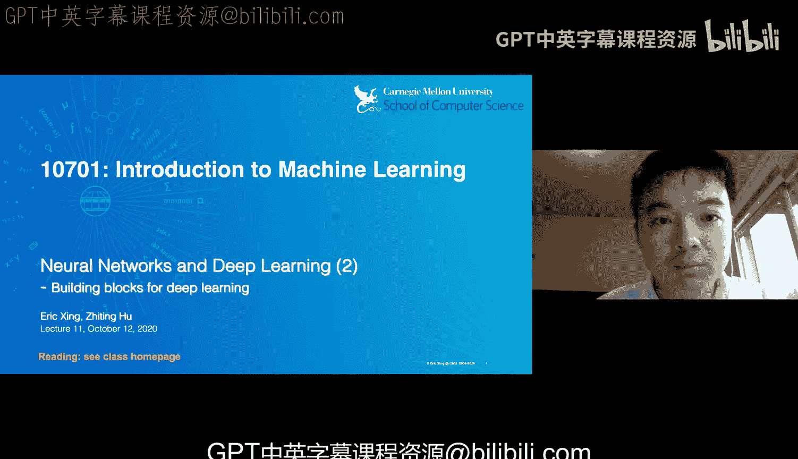

So good to see you again on Monday。Today， we are going to continue our discussion of neural networks and deep learning。

But before I kick start class I also have another very important message to broadcast so as you know at CMU we took student feedbacks on every course very seriously and usually we do class surveys you know in a couple of time points during the lecturing so that we can collect feedbacks and even improve or make adjustments of the lecturing contents and cadence accordingly to your feedback so that's very important for us to really get a real pause check during the presentation and during the delivery of the course。

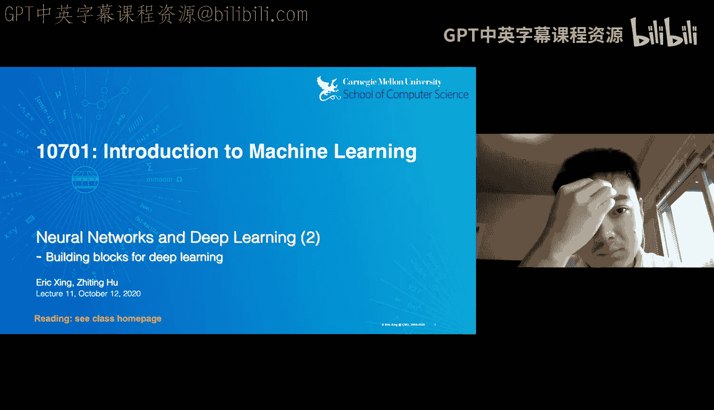

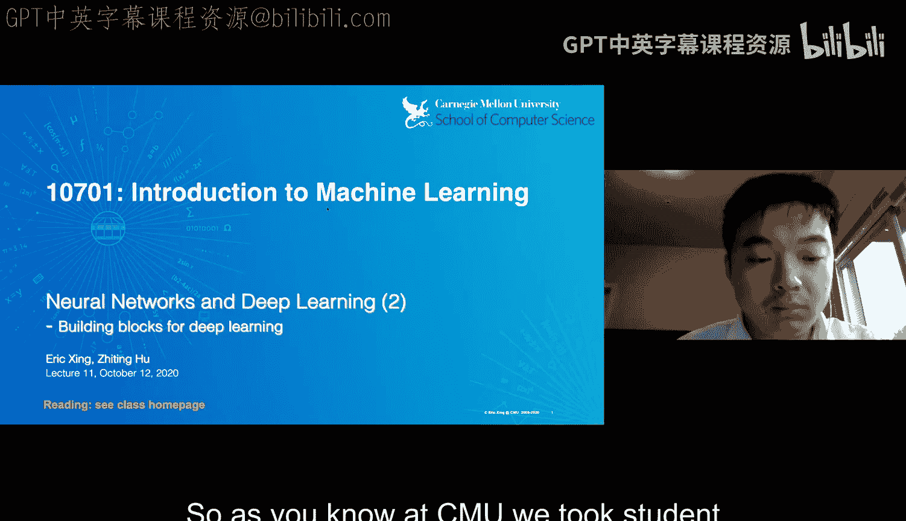

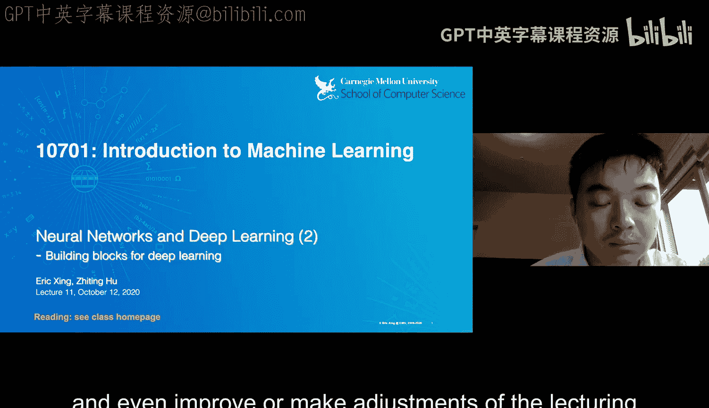

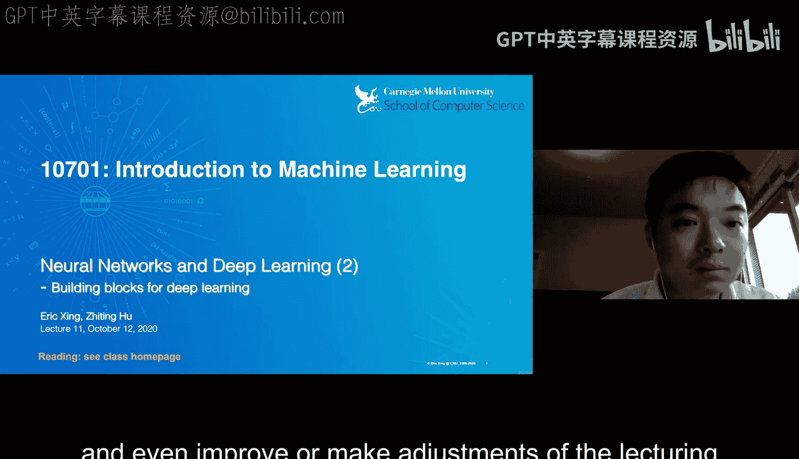

So today you will see on Piazza， you know， a midterm or mid semester course survey that why expecting all of you to fill in。

 So please make sure to take a few minutes to give us your feedback。

 you know you can be as candid as possible。 and while going to take the feedbacks very seriously and then accordingly make adjustments and make any changes if necessary。

 or at least get a sense about you know， how you feel about the overall presentation delivery。 Okay。

 so this is a message that I want you to broadcast even to those people who didn't show up， you know。

 in today's class。Maybe a Daniel can send a message also on PR to all the party。Okay。

 now go back to our normal program。I was planning to deliver today's lecture， but while I'm prepping。

 I hope that maybe I should invite someone even better who is himself you know a leader and a builder you know of many of the materials that I'm going to talk about today in deep neural network。

 especially in the building blocks of a contemporary deep neural network models。

 so here we have a professor J Tinghu who was my former student and recently graduated and become is going to become a professor of machine learning and computer science at the University of California in San Diego。

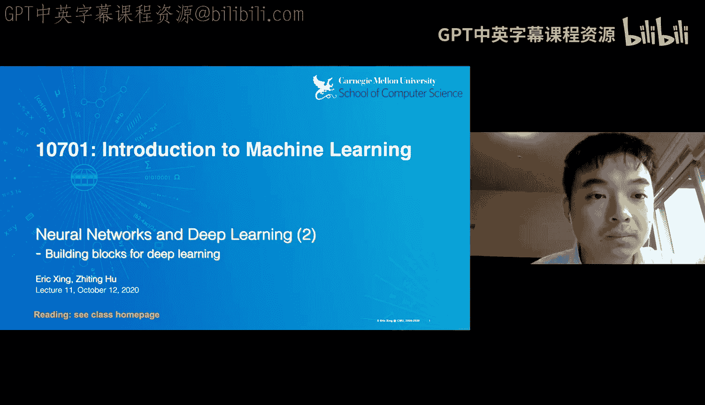

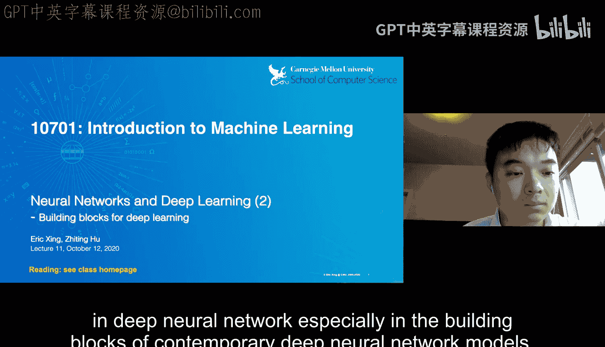

So he kindly agreed to give a guest lecture on today's material。

 he is an expert in many domain and particularly in deep neural network learning using logical rules and in language generation and many other applications。

So with that， I'm going to hand the floor to Juhi Ting， who will be covering today's lecture。嗯。

than you执听。Cool， thanks， Eric so hi everyone。Yes， so today we'll be talking about。

Building blocks from deep learning。Okay， so。

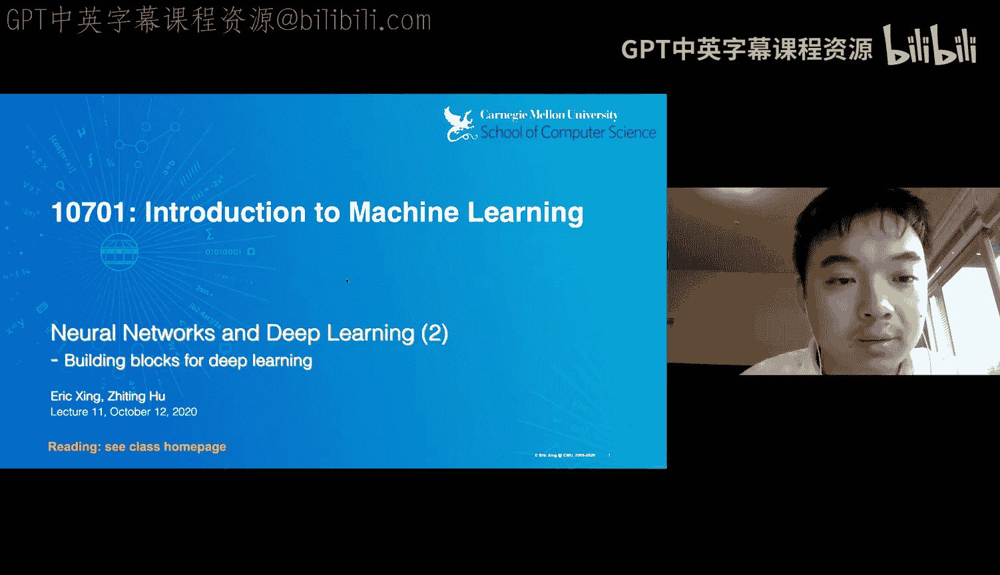

Yeah， so let's begin by thinking about like how are we human brains， how our human brains。

Represents and understand of the world。So we know that our brain can somehow combine and recombine simple concepts and to form more complex thoughts。

Let's say， we know the concept of like CM M U。And we know concept about， like's say ourselves。

 right And then we somehow know the meaning of the sentence， the sentence like I like CMU。

 but so this kind of like compositionality， though we don't really know like the exact mechanism of our brain。

 like how。We can really like， represent this。Compositional semantics。But we do have these very。

Are crucialci abilities。So， in analog。re in terms of like different neural networks。

Today we'll be seeing a kind of like a relevance and very similar compositional view of these neural network network components we'll see like how these different very complex neural network models。

Are indeed like consist consisting of like different sub components， like much simpler components。

So at the end， we'll see a kind of like hi lucky here。Basically。

 different simple components are composed into like more complex models。

So this is the concept of compositional machine learning， as I said。

 that different models in different learning and actually in the whole machine learning field can essentially be decomposed or breakdown into simple concept of building blocks。

 so we get a catalog of building blocks。And this building blocks enables a。

Very like modularized programming。 We can。That composed like data， structures， loss functions。

 and learning algorithms together to form quite complex machine learning functionalities。

And we can somehow building on this， we can get some intuitive conceptual level APIs。

For our like programming and creation of machine learning solutions。Yeah， so we will also see on。

Some like real tools that really operationalize this concepts so that we can like do this solution conclusion and easy switch between algorithm that we can。

Plug in or like plug out modules without changing other irrelevant parts。Okay， so。Yeah。

 this is the the general concept of this lecture， the outline of this lecture。

 so we'll be talking about different specific components of building blocks。In deep learning。

OurThis includes basically convolutional networks and recurrent networks。

And then are attention mechanisms。And the last part you will be on。

Talk about transformers a special type of attention mechanisms that achieves a state of art performance in many tasks。

So yeah， during the lecture， please feel free to interrupt me if you have any questions or you may like type your questions in the chat box and。

I address name。Maybe later after each each part。So to begin with。So we have seen this。

 It's kind of like a new one on in last lecture， so。

We can see this as the kind of like the most basic。Building block of deep learning。

 right you have some like inputs， X 1 x like。And you do a linear transformation kind of like by multiplying this x with the parameters W and then。

You feed this into a so called activation function to have a linear kind of to have a non nonlinear effect。

Let's say on。Save and we may use it。Reru activation function so that with with some with any input。

 right， youll get some。Nound nonlinear effects like please。

 and we have other active functions like sigmoid and different choices， basically。

So wastelets are simple as it's building rock。We can compose these neurons into a more complex component。

We call neural layers。So these layers have like different structures。

 you can see that we basically connect these neurons in different ways to get different kind of layers。

 like's say fully connected layers or like convolutional layers with pullinging will be seeing this later in this lecture。

And the recurrent networks recurren layers， you get basically a sequence of like。

Eurural components so that you can。Itsically reads the sequence data basically。

And like rednet and of a special case of convolutional networks。B。Yeah。

 so besides the neuralarchect is right concision of given the layers。

 another components is so called loss function， right？Which basically drives the model。

Driler learning to。Basically finds the best parameter values。

 So these loss functions can be of different types like cross enpy laws for classification for like language generation。

 This is kind of like one of the most common loss functions。Of course。

 we can have other type of loss functions like mean squared error for regression。

So putting all these things together， we can somehow build a fairly complex model。

 so this is a particular example showing a part of the Google Nes for like image classification。

So we can see in this very complex architecture。Different parts of the network。essentially。

These different are building blocks， I say here we have a convolutional blocks。

And we use like pouring or like average pouring or maximum pouring to basically aggregate information from the previous layers。

And we may have like fully connected layers to do further transformations。Yeah。

 and we may like to like concatenation to again as a different as another way to integrate information。

And。At last layer， we do like we apply activation to get another layer of non nonlinearity and。

We apply the laws like cross NP laws to。Basically define the quality of the current model status。

 and then we do the training like by minimizing a loss。

So we can see we can somehow actually combine the basic building blocks。

And we may apply on different loss functions on different tasks。And given enough data。

With these very complex architectures， we can often get very impressive results。

 like say image classificationapification and other machine translation tasks。So， these are。

Basically， like a bychan list model and with list even the blocks of neural components we。

guess the we learn the representation of the data right the networks learns increasingly more abstract representationation of the data that are somehow disentangled especially in this Google nets in this particular case。

 by disentangled we mean like。The representations of these。Newural res。

Are amenable to linear separation like you。You can somehow like see a particular dimension of the feature is representing a particular concept like like the colorter or the shape of the input image。

So yeah， we'll see more examples of these learned representations later。

So yeah with these very general concepts， let's now dive into more like specific models。

First is the conional network。So convolal networks on this。

This model is perhaps the most widely used neural models in computer vision at this point。So on。

So conversionvol networks is basically inspired biologically。Kind of like from our， like。

Fs visual cortex structure。So， on。There are some like basic concepts here。

 so receptive fields is one of the core concepts。So here， basically。

If you know like the structure of our visual cortex。

 this cortex contains a complex arrangement of different cells。

And these cells are sensitive to small sub regionsgions of the visual field so。

Convolution network is basically inspired by this we have given the cells。

 but all the neurons like and given at least one particular neuron is is sensitive to a small sub regionion of the input。

 let's say this raw image like this neuron is sensitive to this particular region of the。

Of the image。And these sub regionss are tail to cover the entire visual field。So basically。

 this network explore less strong spatially local cor presented in natural images。嗯。

Like a different neuron are sensitive to different subregions right and this image you can see。

 like say。Kind of like these local features， right？And also， like。In our natural image。

 a very cool a cool like properties that we have somehow so called a translation inference， like say。

 this， this。Particular person， right on we move this person a little bit to the right。Still。

 like this image is about this person， right so this is so called a translation invariance。

 so convol network is designed to build to bake this translation invariance into the model architecture。

Yeah， so these cells we we also call it local filters in convolutional networks。So， are。

A a couple of like key properties of con networks based on the architecture we just seen。So。

Or it it has a spa connectivity。Right because like given one neuron is only sensitive to a subreion of of the input features right so this say this particular neuron is connected to a part of the neurons from the last layer instead of all these layers。

 all the neurons in the previous layer。And we do this shared the waiting。Say。

 are these connections in the same color。A basically shared in the weight。

So lets basically give you this translation invari concepts， right on。Like say， a person is here。

 then this neuron can capture this signal or when the person is like translated to the right。

 this neuron can still like capture this concept。And with this stack， right。

 this neural network can increasingly capture the global concepts in the input image because here again。

 this neuron has the receptive fields， including these three neurons right from the previous layer。

And if we go layer up， in at least there， least neuronsn can receive signals from the three neurons。

 which in turn get the signals from all these neurons like in least there。

 so we can increasingly get the global receptive field。

So symbol cells at the lower there will detect local features and the complex cells will polar outputs of symbol cells。

To within the neighborhood， right to get the higher level pictures。

So with this hierarchical architecture we the model can like capture these increasingly abstracts and higher level features。

 so this is a particular example given this input image。

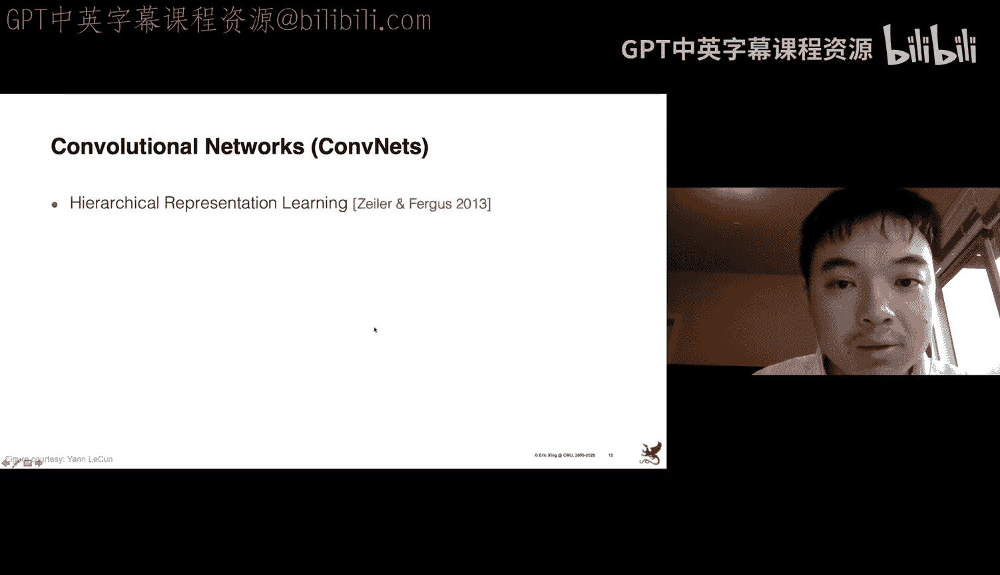

嗯。The lower layer of a convolutional network。Get this concept， kind of like edges and like corners。

And if we investigate the featuress learned by the middle layers。

 we get somehow like a more complex concept。And if we go into further right add to the higher layers。

 we get even higher level features like these kind of like more complex patterns and the concept。

So okay， I see a。Lise their hands so how we should yeah， please feel。Yeah， I was going to ask like。

 what's the difference between this and like the traditional neural network again， sorry。Yeah。

 so in traditional neural networks。So the so called traditional neural network is the multi layer perception right MLlP so it's basically a fully connected layer right so every there is like a fully connected with the the previous layer right so that's the。

Kind of like a most basic neural network。 So for those one like they choose like certain features to connect to them they don't connect to the entire layer。

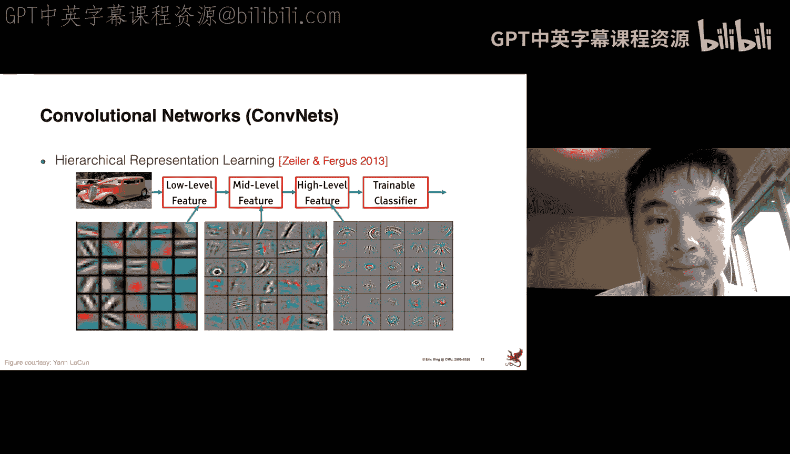

Yeah， so conversion network is designed to have this kind of a more special architecture it's not like before fully connect theres so we have these like spa connect shared weights and all right so with this we。

Incode these or inductive filess of like translation invari into the neural model。 So in other words。

 this model guarantee that this model can recognize the translation in in， in， in an temporal image。

So this is the key differences from previous like NLP。

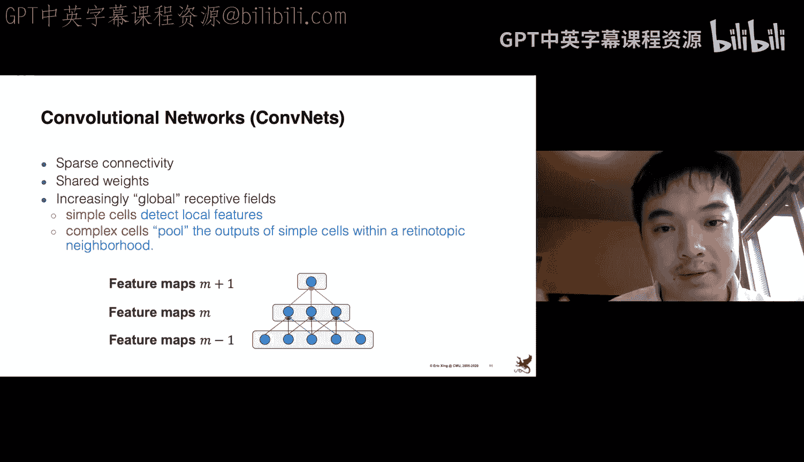

Okay， thank you。Yeah， so with the new network with this comp network。

 we can learn the hierarchical representations。

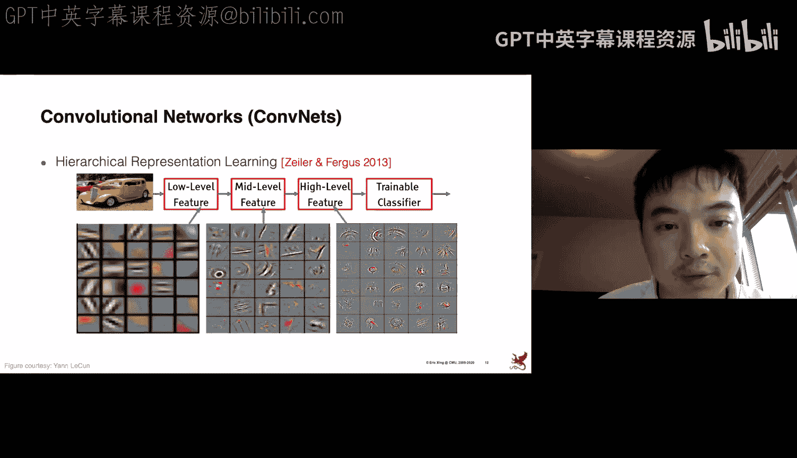

So this， so this is the kind of like most of the basic convolal network architecture and the things are。

2012 so Alex Netz was the first kind of like a large scale neural network that really large scale convolutional network that really achieved。

Very impressive kind of then's state of art performance in real task image classification on image nets。

So Alex nets consists of8 conutional layers。So， and later， we。2。

Kind of like got a more kind of like a much deeper and larger convol network called the BGG。

 consisting of 19 days。And the Google net， as which has a saw， is even like deeper。

And now the latest and the state of arts image classifier is built as a。

So called residual network rest net。It's much， much deeper than on the previous versions。

 so likes say it can consist of like up to like 100 layers or like even 1000 layers。

So these are a more advanced version of convolution networks。

 basically you can see them as a different composition of the convolutional layerss， which as a soil。

So this is a very simple and quick introduction of convolutional networks。

 The key concepts about the。The receptive fields and the special connections between neurons to enable to encode the inductive virus of translation invari。

So next on just because it's recurrence network。So from convolutional networks to recurrent networks。

 level motivation is that so convolutional networks， as we just see， we just saw。

It's more about the spatial motoring。Right on。One neuron is responsible for a particular sub regionion of the input image light。

 and this is。嗯，看到不那个呃。Of concept of like spatial modeling。And啊。

We can somehow like see this as a simplify this。This。

 this diagram into this kind of a single step model like a。

 you have input like a image and output is the feature of this image。 This is a one step modeling。

And on。So what if our input is a sequence， right， let's say a video， right。

 We have a sequence of frames or sequence of images。

Or like in like a language modeling or input is a sequence of tokens。So in these cases。

 we need sequential modeling to model the sequence of data。

So the idea is that we can repeatedly use this particular architecture to read the data like step by step。

 the sequential data。So this basically on。2。Leaders to the so called the recurrent network。

If we like let we unpack this kind of a loop for the sequence data。

 we somehow get this architecture right， say in language modeling。

 we feed the tokens one by one let's say the first token right we get we use like a convol network or whatever like MLLP to capture the features。

And then we based on the features of the first step。

 we can further fit in the second token in the sentence and get the feature of the second token and this process again goes go on and we get features of the whole sequence。

So we can see our recurrent network is for sequential modeling。

And compared to conversionional network or MLlP， single step MLlP。

We can see like in convolution network， we have a fixed number of computation computation steps given the inputs we this input will go through all these layers pre specify the end。

Gal outputs。So in recruitmentcurren networks this computation is not fixed right this really depends on your say the length of the sentence right the number of tokens in the sentence。

 so say you have 10 like tokens in the sentence， then you will apply these particular module for 10 times to capture all the features of all the tokens。

Again， like in convolal networks， we have different variance to like say ReNes or like AlexNes in recur networks。

 we also have different forms or architectures for different tasks。

We can see like image classification as a special case or degenative case of recruitment networks is a kind of a single step recruitment network。

Input is an image like saying like output is the the feature or the class of the image。

 so this is a one to one mapping。We can do like one too many mapping， like saying image captioning。

 like given an image， we want to generate a sequence of tokens。嗯。Which is。

Which is like a caption of the image， right？So given input is image， output is the。

 the tokens in the caption。So its one two many mapping。And similarly。

 we can do like many to one mapping， like say in sentence sentiment classification or like video recognition。

 but the input is a sequence like a sequence of tokens or sequence of frames。

 output is a single label， like say the sentiment positive negative of the sentence or like the action label within this video。

even further， we can do like many too many mapping like in machine translation。

 like inputs can be a a sentence in like in German and outputs might be a sentence in English。

So we call this kind of task as a sequence to sequence， like we map one sequence to another sequence。

And manage for many to many mapping， there is another case， saying named entity recognition。

Input is a is a sentence。 and for each of the tokens in the sentence。

 we want to predict a label for this sentence， say whether this token belongs to a particular entity。

 right so。You can see the difference architecture between this type of many too many mapping or this type like many too many mapping but this here the output is of the same depth of the with whistle inputs we have these 11 mapping of these output and input tokens。

And here this mapping is like in a more flexible way the output seek sentence may be of given the length of the input sentence。

So for for this kind of what management mapping， we usually call this as a sequence tapping task。嗯。

We kind of like tag or label each of the tokens in the input sentence。Okay， so I see a waist hands。嗯。

Yeah， so I had a question about like the one to many like RNN。

So I was wondering how this is different from like a normal neural network if we don't have like a sequence of inputs。

Sequence of input on。Yeah， so for like a let's。So for like a standard convolutional network right。

The inputs is like an image like a single， like a single step input。 and you get a single output。

 like a label。And for this kind of like one to many mapping， like say image captioning。

Kind of like very similar in this case， you don't really know the length of output like you may generate a sentence of like 10 tokens or maybe 100 tokens。

 so in this output parts you will generate a sequence of tokens basically using like recurrent networks like you can really use like convol networks to generate like variable lens sequence。

So does Li answer your question？Yeah， that helps。Yeah。

 so these are the basic comedy used kind of like formss of recurring networks。

So in this in a standard recruitment network， there is a。kindin of like个呃。

A bottleneck or like a key challengenge for training the neural network， the recurrent networks。

CoWe call these challenges called packaging or exploding gradient。So here's the more details on。

Few of the computation inside the recruitment network， but we have a sequence of let's say tokens。

And the accommodation is like this， we have the input the initial feature H。And we input the。

First token right and do some computation like in this way and gets the feature of the of this the first step and then this step will be fed into the next step to incorporate the second token right and again go through this computation right with with with the parameters W。

And do this activation and get the feature of the second step。

And this process will repeat until we read in all the tokens in in a sentence。

So the problem is that say at last step right and then we compute loss loss right say cross NP loss and then based on this laws。

 we want to minimize the loss using gradient back prop， right。Denoted in as red arrows。

So the problem here is that。With this the train of computation。

 right so after applying the grid back propag on。To compute the gradient of the， let's say。

 the initial feature。你 gradient。Of H 0 involves many factors of W， because in this computation。

 computation train， we basically multiply W， right again and again， right， So in the backward pass。

 this gradient will also involve many factors of W。

And the problem is that when the largest is the singular value of the of the。

Our the premises W is larger than one。We will are basically have this issue of like exploding gradient because we apply this W again。

 multiply W again again and。Multtitudeudes of the gradient will be like amplified right repeatedly and at the end of the day the gradient will explode。

And if the largest singular value is more than one。

 we experience vanish ingredients by a multiplying W again again， the gradient。

Will be kind of like a 10 to zero， basically。Making the the training very ineffective。

So for exploringloding gradient， we can somehow have have some like tricks。

 let say we we do this value clipping。 like when a gradient is like larger than a threshold， we just。

Ruth forcely Cless gradient。But furnish ingredients is us。Is is is's much harder to like have。

Some similar chips to。S established issue。So for more details， you may refer to these papers for let。

 say a theoretical analysis of this phenomenon。Yeah， so yeah， any question from this。I a question。

Um waitai， so what's the singular value of like what are you taking the singular values of？Yeah。

 for any matrix， right， you can compute this singular value with SVD decomposition。

 Is it kind of like the concepts in like any algebra。Yeah。

 but like are you taking the singular value of the W matrices or the yeah。

 singular value of tab matrix Okay， please print here。Thanks。ok， so on。

So with this computation issue this leads to another challenge。

 basically we call this long term dependency program problem， like say to model a sequence right。

 say I live in France and I know， say the task is to predict the next token。嗯。

Say the the answer is French， right。 So how how do we know。

 Because we know this particular token in the in the in the sentence， right and。

Kind of like a couple of like tokens before this the the the black。

So this this task might in this case， this prediction might be easy。

But what if we this sentence is much longer right I like France。

 a beautiful country and I know right and this and pretty this blank。

 this clue words kind of like pretty far away from this brand right so how can so modeling this much longer context or like a dependency is becoming a。

Much harder because of this vanish gradient and the explosion gradient problem。

 but we kind of really train this model to effectively capture this long term dependency。Yeah。

 so here comes a solution as a more like a systematic and principled solution to this definition or like exploring ingredients and the long term dependency problem。

啊，你。Model is called LSTM as a variance of Rita network。So this is a standard re network。

 right we have simple computation inside each of the steps。And the LTM is a different， more complex。

Architecture compared to the standard island in each cell， we have this material step of computation。

So here is more details of this competition。 You， you don't really have to。remember or like。Bristy。

 remember all these details of this competition。 I'm just going to give you a general intuition of this the the design of the particular。

Partdicular model。So this LTM designed a couple of like gate functions to make decisions of reading。

 writing， and resetting information。So it includes a couple of gates， gate function like for gates。

 input gates and output gates。So this forget gates will determine whether we I want to like erase the information from the previous sales and the input gates capture determines like how much information we should read from。

Okay， input case is here， right， how how much information we should。

Kind of like right into this into this particular cell based on the input and the output gates determines how much。

Information we should review to the next step please。

So forget gates decides how much we how much we want to remove from last step with this computation。

 So S market here is the activation function captures the the magnitude of like。

The informationform we want are。We want to remove Zing， we had a question in the chat。

 someone was saying what is CT in this case？I think it was on the previous slide。where city。啊。Asan。

 do you want to unmute and diagram with the LSNTN okay yeah？Yeah， this one right here okay。CT，O。

 so this is。You can see so in RTM， we have this representation of the features like at each step。

 so CT and H are all the features。i see， thank you。Okay。

 so input dates decide what new information to store in the cell with this computation again。

 you don't really have to like really like know while is designed like this is because its more on this heuristic right but the key information the key intuition is that we have this given like a feature transformation right with this matrix and these buyers and you then apply an activation function to capture like the proportion of information we want to incorporate。

Or into the cell。And then we update the sales states by combining the state from the last step basically captured and like scaled by the forget gate and the information from the inputs of this at least at the current step scaled by the input gate。

不。And the output gates determines like how much information we want to review or output to the next step or to the output。

Again， with the same mechanism， like this this gate function or the activity function。

So with this architecture。We can see that this FTM basically built this pathway to like back propate gradient like say from last step to the first step。

 we have so calledled uninterrupted gradient flow so within this path you don't really involve multiplications with the matrix W during back pro so this essentially alleviate the problem of finishinging gradient or expding gradient。

Okay， so we have seen these are the currentrent networks and the LTN as a particular case of recurrent networks。

 so STN is widely used in the language modeling。For like modeling wrong sequences。

So next let's see more like applications ofcur networks。

 basically each application falls into one of the categories here。Say， we have。

We can also do like a bidirectional like sequence modeling right we can model a sentence from left to right and we can also do this from right to left right to capture the dependencies between different tokens in the sentence。

So here we can basically a combine two directions together by directional recruitment the network。

We can also like capture even a more flexible structure of data， like say if the input is a tree。

 likes say， a passing tree of a sentence， we can also like organize the recurren network in this way in a tree structure。

And the say inputs of the of a particular cell in the FTN includes the。

The features of all the child node are in the tree。Similarly， we can like model like 2D sequences。

 like， say for for an image， like this is basically a 2D matrix。 each each node is is the pixel。

 right in in in loss in a raw image， and we can like say in。Yeah or。

When particular we can use a conversionvol networks to capture this image。

 like we can also use recurren networks to capture this to these data by defining a particular order of like encoding this different。

Of the encoding the the the pixel cellss。 So say for this new worm or this L TM cell。

 we the inputs includes the。The information from the of the cells。

In at least world and also in the previous database。

Or we can like organize in a different structure to capture this。These particular dependency orders。

So this， how do we decide this given the。Kind of like structure this is more based on your own intuition or the heuristics。

 like how I want to capture these dependencies between different pixels in the image。

And the similarly we can like our。Enable the kind of like most general structure。

 the graph structure right by like say first segments the image into different segmentations and for each each of those segmentation we can use apply LM cells to capture the information in this segmentation and we connect with different notes cells together to model the whole image。

ok， so on。We have seen the conversionvol networks re the networks。In the third part。

 we will be visiting the attention mechanism， which is the kind of one of the most important components in modern W networks to really kind of capture even like longer like longer term dependencies and to make sure。

To basically improve the performance of this modeling and classificationification and prediction。

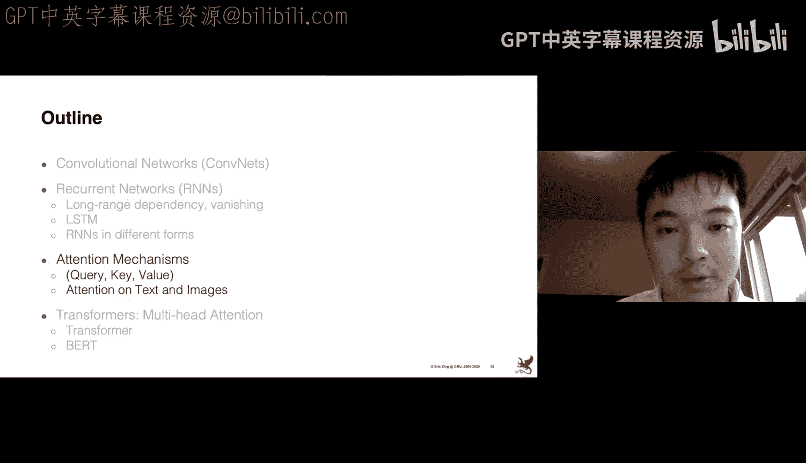

So first let me give an example of this attention， so here the task is image captioning。

 given an image we want to join is sentence to describe the image。So when we say for this image。

 like when we generate the token freeB。And we。As a human rights。

 we have attention rights likes say we attend to this particular part of the image。And based on this。

 we come up with this talkingken like this speak。And to say， yeah， basically like a stop sign。

 right this token stop is basically describing this particular region of the input image。

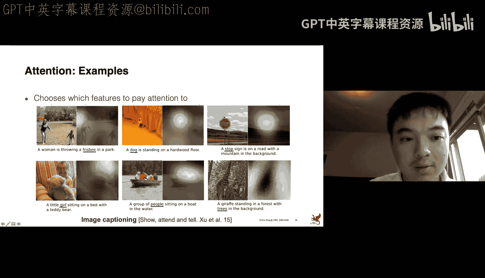

So this called attention。And similarly in in like a machine translation。

 that' given an English image sentence， we generate another sentence in a different language and when we translates and generate a particular token in the target language。

 like say， this token，This token really depends on really is because of this particular token in the input sentence。

 right European， so naturally least our generation will attend to or should attend to this particular token right to get the most critical information from the inputs。

So啊。Yeah， this is the basic concept attention。 Then computationally， Why do we need this attention。

 right first。This enables to better model this long range dependency or long term dependency。

Like say in this machine translation， right this particular output token depends on this particular input like like right。

 So you can see with standard recur network or even LTM network。

The the distance between this token to the input token is very very wrong， right very large。

 so the modeling of this dependency is very difficult。

But with attention that we have this attention module。

 then you can see there is a very much shorter pathway from this output token to the input token through these attention blocks。

And the second advantage of using attention is that we have we get a final grain laation instead of single global laation。

So this particular token will yeah， this particular output token will have socalled attention ways across all the inputs tokens and with ways you mix the input features according to these weights。

 I will see more detailed more details in next slide。

And different output token correspond to different attention ways。

 And these ways basically mix the input tokens in a。

specifically rise to a particular output token so that you get a fine grain distribution。

And also we get to improved interpretability by visualizing the attention ways we know like， okay。

 why this model predict this particular token， this is because this model finds that okay。

 this input token is relevant and the output is depending on this input。

So more details of attention computation again let's use the machine translation as an example。

 so we have encoder right say LTN current networks to encode each of the tokens in the input sentence and get this sequence of features。

And then when we do the decoding to generate the tokens in the output sentence， at each step。

 we perform a linear combination of the input vectors。Waited by the attention wait。

So we know attention ways S A。So here say the weight is like like this。

 right for each of the input features and we do this。Yeah。

 this is the weight and we do this weighted average of the input features。

And then we condition the generation of the output token on the resulting mixed features。

So first is how do we compute these attention waste， right？

So this involves a couple of like key concepts in attention computation。

Including a query and key and values。So at least particular decoding step。

This are the feature of this decoding step is called the query。

 and we use this as a query and use the input features of of the input sentence as as the keys。

Then we compute basically the similarity between this query and the issue of the keys。

And get the similarity score right corresponding to each of the input steps。

And then we do a normalization to get the。The， the attention weights， right。

 by applying the soft max function on top of the。诶。The the the similarity scores。Yeah。

 so this is the attention ways。And then we after getting these waste。

 we get we take a weighted sum of the of the values， which are the， again， the the encoded states。

 right， so that we get a mixed。We get the mixed the features of the input and these mixed features can be used to generate the next token。

So， this attention score。Or like least alignment score or similarity score between the query and keys can be computed in different ways。

 say we have like content based attention using this cosine or similarity function to compute the the。

Similararity between query and keys。 and we have other many other different ways to compute this similarity。

Okay， so let's see a couple of like more concrete examples on。In like in different applications。

So here in this image captioning， we just saw for this attention， right from the language to image。

 the input image。The query again is the state the decota state like say generally this token we have this query right and then we compute the similarity between the query and the keys and here key is the feature maps extracted by the covolal network right remember that in covol network we can extract the features of the sub regionsgions right as the receptive fields right of the input the image so we have a collection of like feature maps。

And then we compute the similarity between the query and the keys and gets the attention score and then do the mixing of the again。

 the values are like the visual feature maps and。Yeah， and with the mixed feature。

 we generate the tokens like one by one this。

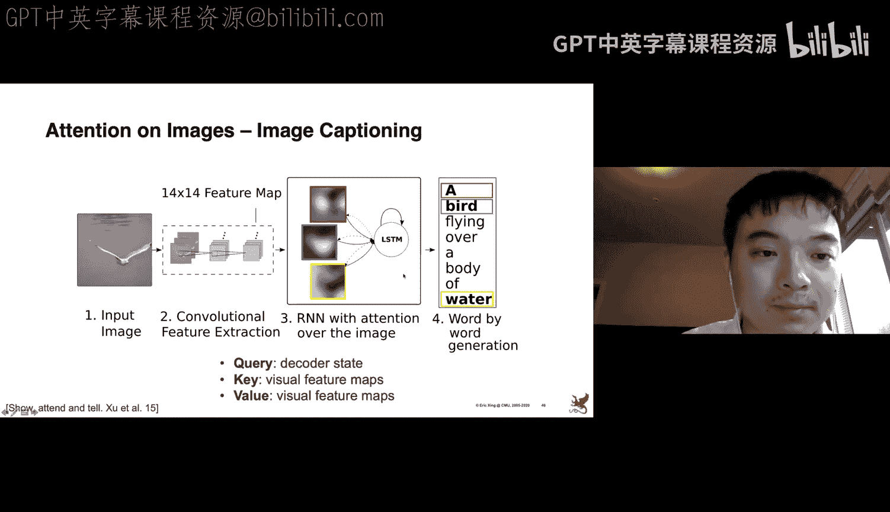

And yeah we'll skip these details so here are some results like say generating this sentence a bird flying over a body of water when we generate the birds。

 we we model correctly attended to this particular regional image and we can use like soft attention like by applying a soft max normalization on top of like the alignment score or similar score to get a soft attention。

AKind of a distribution of all the regions of the image， or when we apply hard attention。

 like to just。Get the， the， the highest value of the。

Of a similarity score right and use that particular respective input feature as the as the feature to generate is token。

 So for with hard attention， we get this kind of like attention pattern。

So this might be less effective， so soft attention is more widely used in in practice。

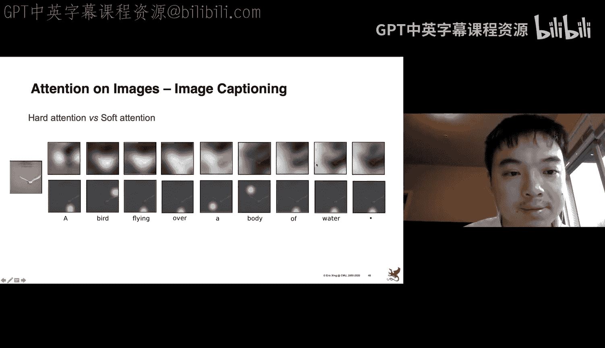

So attention on images say here for image paragraph generation。

 right instead of generating a single token， a single a single sentence。

 we sometimes want to generate a wrong paragraph to describe an image。

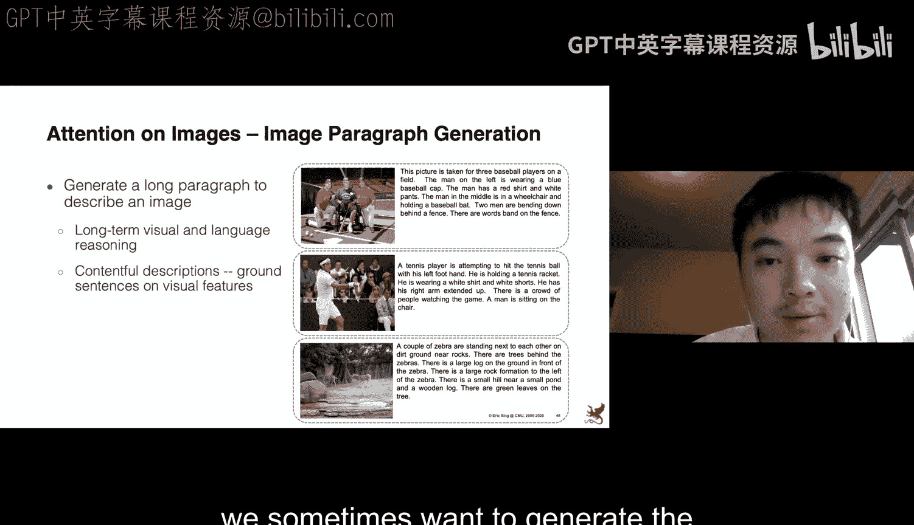

So this is kind of another more complex model to really handle this more difficult task。So here。

 on we  first。For image， we first like extract all the bonding boxes in。

 in the image to like capture like a different entities and different activities in the image。

And for each and then for each of the bonding box。We will generate a local phrase using the image captioning model we just we just saw to generate a single like phrase or like a sentence to describe the region。

And then。We要信。Attention attention reasoning or like a hierarchical generator to like a。嗯。

So both like attend to the regionss of the image and the local phrases we generated to like get an output paragraph。

So， on。Heres an example with this image with。We find these bonding boxes， and then we。

 for each bonding box， we generate a local phrase like people riding a bike。

 which is corresponds to the like。Look the whole region here right and then with co attention to the image and the phrases。

 we joined the paragraph like a global people are riding bikes like which essentially correspond to this bonding box and this phrase like。

So this is the image paragraph generation is a particular example of attention。Okay。

 so yeah having seen the attention mechanisms right， remember the key concept here。

 query key and value and we compute the attention ways based on query and the keys and then mix the values with these attention ways and use the mixed weights to as the condition to generate the prediction of the generation in a language generation task。

So， next， transformers。呃， is a。Transformer is a is a is a kind of like a very emerging model architecture that's achieve state of art performance in many tasks。

 And we'll see that the key components within transformers。

Is is a particular attention mechanism called multi head attention。So let's。

 let's take a look at this particular architecture。So yeah。

 transformers achieve data other results in like machine translation。

 preing the text representation probably we all know that birth is right as a text representation model and like language and。

So， I。Inside these transformers are。The key architecture is the multi attention。 The inputs is。Again。

 the key concept learning， the key concept， query， keys and value。

So this is a particular attention called scaled dot product attention。

 the key thing is that the computation of the similarity score between the query and the keys is carried out with this particular architecture you do this multiplication to a scaling and some masking and with the soft max attention to like normalizedize the weight there is a question in the chat。

 someone says for soft attention， we use the soft max function， but for hard attention。

 what was the activation function again？Yeah， so for hard attention， you can use different。 again。

 you have different choices that you can use like A max to like pick out the， the。

 the largest similarity rights， or you can use a stochastic。Kind of sampling。

 right based on the on the on the on the weight， based proportional to the weight。Okay， so on。Yeah。

 you have soft max to get the soft attention here， right， And then I do the mixing。

So this building this block attention block can be is repeated for multiple times like h times and you get the so called multi head attention。

嗯。Yeah， basically， you have in copies of the attention so that you get a。

 but with different parameters so that the model can capture different attention patterns in these of different cases。

And this multi head attention block is further encapsulated as a building block。

 multi head attention。 And in the transformers， we will stack will compose other components like add and normalization and fit forward module。

 and then add and normalization。 and this is。Kind of like a module in transporters。

And with this module。We see this as a block。And the this block can be further sta and combined with different blocks together to form the whole like transformer model。

 like including encoder and the decoder。So let's see yeah， for this。

 the whole like transformer model， right so。We have seen this parts， right， which is like encoders。

 we call encoder self attention， is because here query and keys and values are all set to the input values。

 the input features。This is why we call self attention。And then similarly for decoder。

 right to generate the output sentence， token by token。

 we again have this decoder self attention to basically attend to itself。

And then between the encode and the decoder we have encoder decoder attention again with the multi head attention and the key and the values are set to like the key the encoder features and the query is set to the decoder features like as in the machine translation models we have seen or like in image captioning models。

So with this architecture。This transformer， as it was first proposed in 2017。

 it achieved the state of art results in machine translation。And later， people like customize this。

The architecture little bits are especially using the transformer encoder to get a pre chained model called the birds pre chain text experimentation model。

And this is the kind of now the widely most widely used text representation model。

To get the features out of like the text data。So a little bit context of of text representation。

Traditionally， we use so called word embedding to capture the biscu to map discrete tokens to like continuous feature factors。

Like say in world to vector or like G， basically this word embedding is a joint matrix that each token corresponds to a feature vector。

Right。In the matrix。So啊。Given a paragraph， right， we map each of the tokens into the visual vector by look at。

 by looking up in the， in the， in the matrix or dictionary。So this is the traditional word embedding。

Birt is a different new way of like extracting text features by contextualizing the word embeddings。

 So the intuition is that。For each token right， this representation should be。

Or not only depending on its itself， but also its context， right。so诶。

So this model basically like capture the whole sequence。

 model the whole sequence and extract the features of each of the tokens like with very complex。

Computation inside the model。And the。We and actually in each of the blocks in the model on。Again。

 the， the block is the multi head attention block。We have seen in transformers。

So this model is very complex but you basically stack self attention and mod head attention blocks together to basically form this joint bird model。

And like say for like say for image sentence classification。

 that it you input these a sequence of tokens and you get a sequence of like a sequence of like features like corresponding to each of the tokens。

And for classification， we usually we have a special token appended it to the beginning of the sentence and this the feature of this particular token is used for like classification。

 like's say， for like a binary classification period。Yeah， so。

This birth achieve really impressive results achieving state of art on 12 NLP tasks， like say。

 a sentiment classification， question answering and like entailitlement prediction and a lot of like tasks。

So a little bit about how we really train this model。

 like for the model architecture is a big transformer encoder basically consisting of like hundreds of millions of to be trained。

And then the model is trained using a large data sets recording Wikipedia and a collectioning of free eBooks consisting of billions of tokens。

And then for the loss function， we use。The loss function is called master the language model。你。

The procedure is basically like this。 We must out some percent of the words from the input。

And the task is to reconstruct those words from the context。So here is the diagram on this training。

 so given the training sentence right like this， we random mask out some of the tokens like 15% of the tokens and replace this token with the mask token a special token。

And then we want the model to be able to reconstruct this particular token， the master of token。

 so we basically this is a classification task right on top of this master token。Yeah。

 with these features we apply a classifier here and maximize the likelihoods of the grand shows token right in the input。

So this is the the first task used to train the great model。

And the second task is so calledled two sentence task， so in the first task。

 the issue is that the first task may enforce the model to understand the the context within a particular sentence right and to predict the master of token。

But the， the drawback is that the model does not really know the。

 the dependency between different sentences or like longer term context。

 So these two sentence tasks is served as an augment to the first task to。

That's basically let the model understand relationships between sentencees。

So the task is to like connate two sentences and let the model predict whether this。

 the second sentence is a natural continuation of the first sentence so。Again。

 this is a binary classificationification task。Okay， so for training。

 this is a joint model with trained on a large data。 So the competition is really intensive。

 say within with the standard 4 GPU desktop top， you may have to like。

Spend like 100 days on like chain of the model， but fortunately this model is pre chained and the pre chain weights are released。

 so now we can just like load the pre chain weight and stack on whatever other components you want on top of this pre chain model to get whatever model like like sentence classification or like a machine translation right by stacking a decoder on top of this bird encoded。

Yeah， so for this practical use of birth and the other like pretrain models。

 like GP2 as a language model or like a transformer as a machine translation model。

There are are there are different tools to enable this。 and the text is a is a。

Kind of like a general purpose tool to enable like this kind of like different the applications。

 of course， including the word embedding stuff。So as I mentioned， right。

 for traditional word embedding like vector or graph， we have like a matrix。

 but basically a joint matrix， so we can with text we can like build these word em by initializing the matrix with the pretrained weights and then usually embed to encode to embed text into text embedding features。

So with Ta you can like build these like emers and like a stack classifier on top of the embedr to do this classification and you may specify the configurations like say now I want to use the to vector as the as the word embedding matrix。

 then we load the word vector or we can e load the glove to use the word embedding。

And now say we want to like upgrade this program， right to use a more advanced embedding。

 the bird embedding。 Then again， this is， again， a a word embedding model， right。

 So components in in a whole like a workflow。 So here we。Like build the transformer encoder。

 which is the underlying architecture of birds， and then we initialize this em using the bird checkpoint。

 right。And then we can like again embed the text using the emdding to get the bird embedding and do the classification。

 so you only need to change these embedded parts without touching other irrelevant parts the classifier layers。

So similarly， with To can like builds more complex models， like say。

 with attentional sequence to sequence model for machine translation。嗯。Yeah。

 we have this we read the data encode the source sentence using word ems and then using encoder to get the encoding features。

And then we use the decoder right to like with attentions to attend to the encoder features。

And then to decoding to get the。Output tokens one by one， basically。

And then we evaluate the loss function like cross NP to computer loss and do the optimization based on the loss。

Yeah， so again for like。Just like in embedded right for other tasks like for other modules like decoder encodeder。

 we can specify the library parameters or configurations like what likes say if this is a recruitment network decoder we can specify what type of cell we want to use。

 we can use HTM cell， we can also use other type of RN cells like GIU and many different more advanced ones。

 we can specify the number of layers for RN and what type of attention right based on like how we want to compute the similarity metrics between similarity scores between the query and the keys。

Right， so okay， so this pretty much about this lecture on the key takeaways。

So we have seen the convolutional networks， right as a variant of the MLLP to break the concept of like translation invaris into the model architecture。

You have like spars connectivity and shared ways to like really enable this property。

And the recruitcurren network is for like sequence modeling。

 We have LTM designed to capture long range dependency and combating the vanish ingredients。

 And iron is not ready only for sequence data。 We can also organize the model correctly properly to model like 2D sequences。

 cheese and graphs。And attention is a crucial addition to this basic architectures and RN to really get better performance and more interpretability by C3 core concepts in attention。

 query key and value and the many variant based on the alignment score function or like similarity score function between a query and keys and the attention we have seen application like in image captioning is to attend from text to image。

In machineine translation is text to text right。And transformers are。

Basically consists of many blocks of Mohead attention blocks like say the first transformer model is an encoded decoder structure architecture for like machine translation and birds basically use the transformer encoder on a very large transformer encoder to and pre chain on a large cor of text to get a pretrain text fragment model GBT2。

 we haven't really talked about this， but it's basically a transformer decoder with multihead attention right and again is per chain on a very large cor to get a pre chain language model。

Okay， so the last slide is includes some resources about TA if you are doing like cost projects or research。

 you may use Ter to like help use your like complex models so we have like GitHub rep this is open source project。

Ex we have example and documentations and we welcome any contributions and collaborations within this open source project。

Okay， least pretty much I want to talk today I happy to take more questions if we have any someone asked how big is the pretri weights of Bt？

How big is the file， sorry？How big is the model。How big is the preted Wes file of Bt？Oh。

 I don't really remember this is kind of like a couple of like a gigabytes， I guess for。

 for the large， the large one for the smaller version， you may have like couple hundreds of meytes。

Okay， looks like normal more questions。 Thank you J for the presentation。 Today。

 we hear a number of new concepts such as embedding， such as single values and so on。

 in their very advanced context in deep neural network In fact in the next couple factorss。

 we going to unwind and talk about some of the basic operations and original incarnation of such concepts。

 you know， in traditional machine learning models and methodologies。 so stay tuned。I guess we start。

 we can close today's lecture， See you next week。 no， see you on Wednesday。

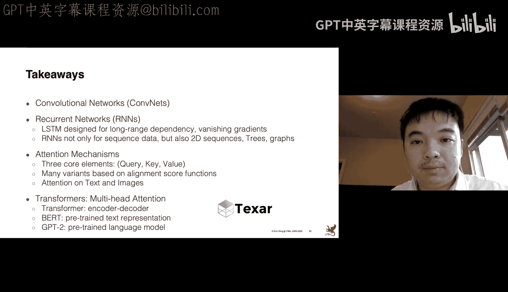