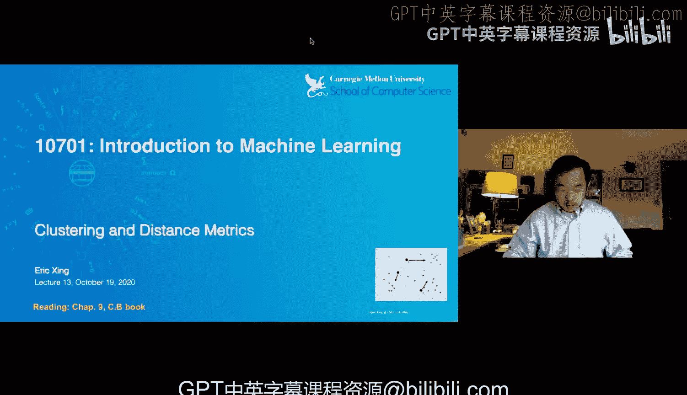
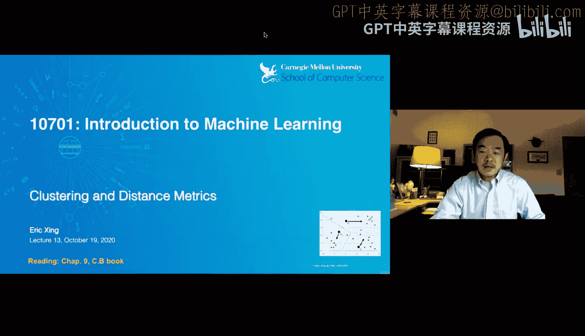
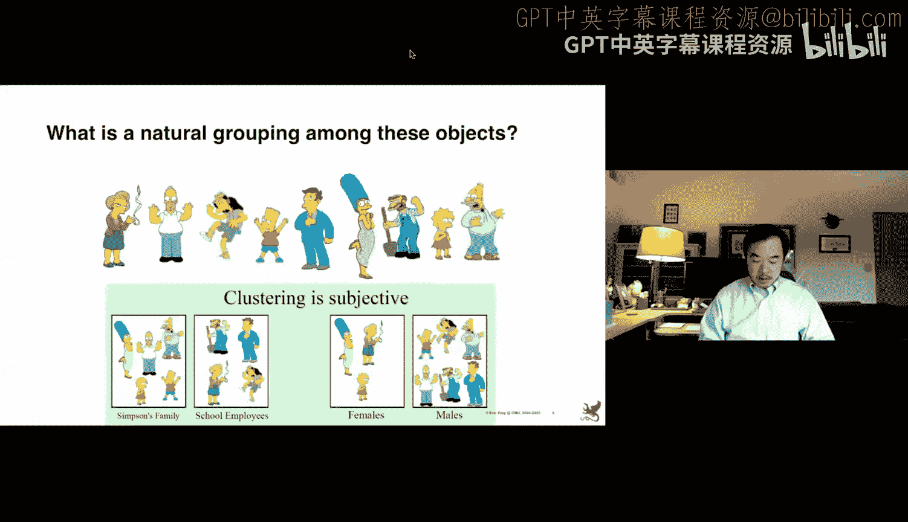
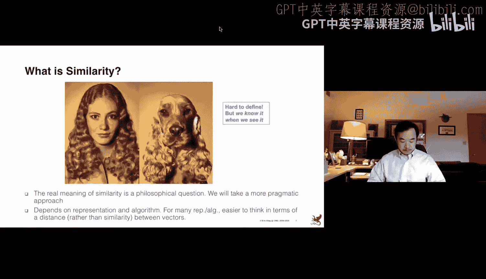
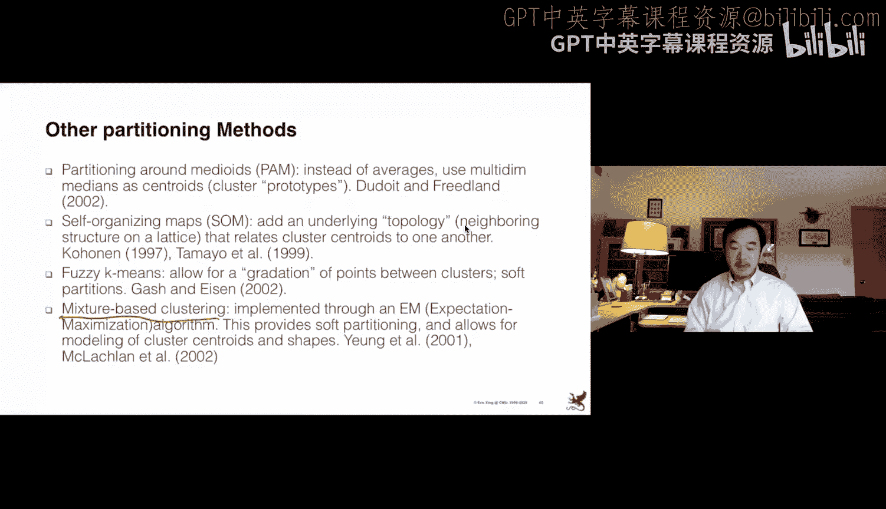
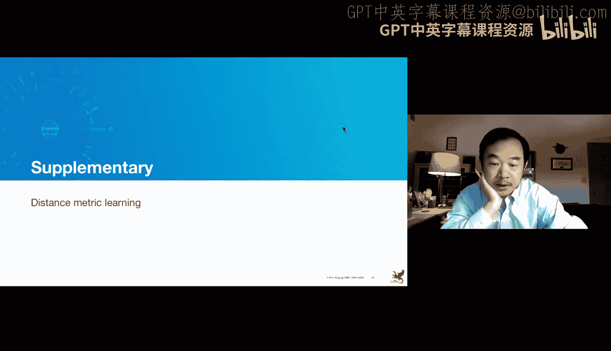
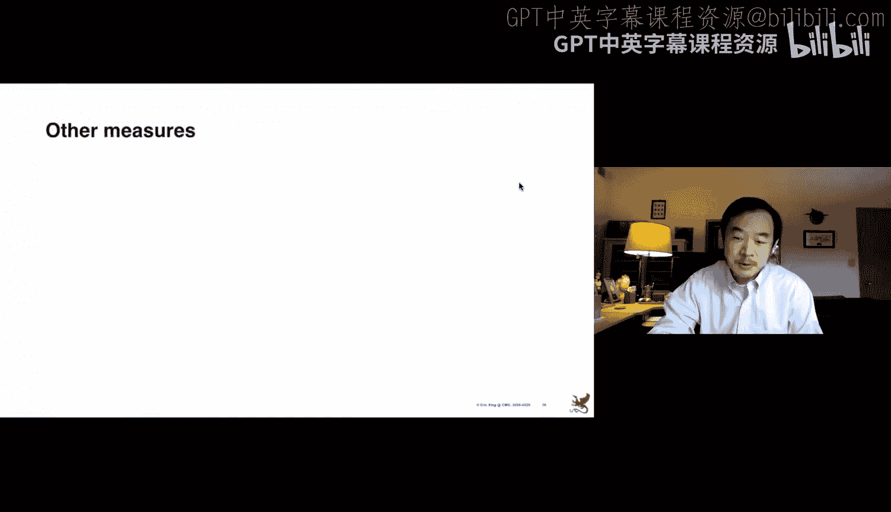
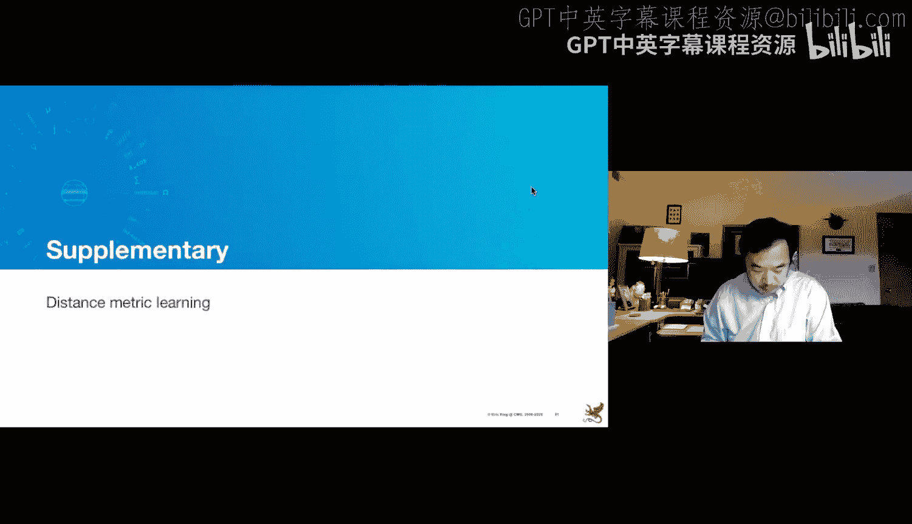
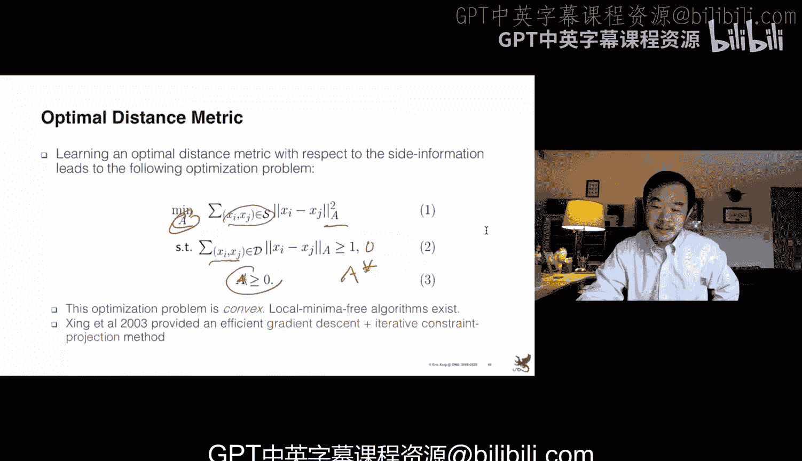

# CMU《机器学习导论（研究生）｜10-701 Introduction to Machine Learning 2020》中英字幕 p12 [12]10-701 Lecture 13 Clustering and Distance Metrics.zh_en [BV144SuB8ETp_p12]

Good morning， class。

So today we are going to discuss a new topic known as classroom。

It is important because now we are going to moving out of the territory of a supervised machine learning。

 which I've been covering most of the time until now。

 and what we are going to learn today is a technique known as the unsupervised learning。

So what is classroom。 So here is a graph that shows you a typical task in the problem classroom。

 right， So here， unlike in the supervised machine learning。 remember。

 in the past we do regression or classification， the training data points are like I give you X。

And why。Right， and。We have ended points， and then your goal is to learn a function of x。

 which predicts y。And in here， if you look at this particular data set。I didn't give you any label。

 therefore， your data points will be only the X。Okay。😊，And then clustering is about you know。

 answering questions like， how do you group these data points？And how many groups there are。

And then what's the right algorithm to find them， So let's take this particular data cloud addicts as example。

One obvious way is to say。Maybe there are pool causes like this。If you visualize them。

 you can group them very easily。But someone could also argue that maybe there are three classes。

Or maybe even there are four classes。And when you are able to visualize the data like this in two dimensional space。

 you don't need algorithm， you can just plot them and then use your pen to draw a boundary。

But in real world， you know， your data are like a set of image with a few couple of thousand images。

And sometimes， texts。If I give you， for example，10000 books。

 it will be very hard for to read all of them。 And then to classroom。

 it's time consuming and visualization is impossible because they are living in a very high dimensional space of pixels。

 you know， and maybe words， right， So today we are going to talk about a。

Arithic way of solving the classroom problem。So here are some more words about exactly what clustering probably entails。

 you know， in statistics in machine learning and also in our natural science research right， So here。

 for example， the process of a grouping the object into classes。

 is by itself a interesting algorithm topic。 You need to answer the questions like how to enforce a high intratro class similarity points within the class are similar to each other and then point between different clusters should be less similar。

And this is basically you know you know to be achieved without any supervision。

 so I just told you what is already the contrast between a supervised machine learning and unsupervised machine learning so here you know I made it a little bit more formal。

And this task is in fact， maybe the most common problem。

 you know in our scientific research in science， you know instead of education。

 science is about the discovery， so you often run into data that is of unknown nature， for example。

 if you take say you are astrophyysicists and you have pictures from the harbor telescope of you know the universe。

And you don't actually know exactly you know， how many stars they arere going to observe and how they form into。

 you know， systems， right leisure systems。And then you rely basically on a classroom algorithm to identify patterns out of it。

Here I have some easier pattern for you to recognize again when things become graphical and able to plot。

 it's actually easy， but imagine that now you either are facing a much bigger data volume so that you have not just a dozen kind of points but say millions of points or you run into a much higher dimensional problem then you really are going to face a challenge。

 but here it just to make you know intuitive sense about what do we mean by say intercster similarity and intercluster dissimilarity in these illustrations give you an economic concrete sense right you can cluster people in the image and language and natural species。

And there are these issues I just mentioned about the algorithmic issue of， you know。

 maybe in fact the philosophical issue about how to define groupness。

 which I'm going to discuss in a second。We are going to also study you know the very mathematical formula behind the notion of similarity and dissimilarity。

 how to make sure that two people， you know when they see the same data。

 they will be reaching to the same conclusion in terms of distances and similarities between them。

 that's why a mathematical formula is going to be very important。And then in fact。

 the representation of objects will also be very important。

 sometimes you will have a alternative way of representing， you know， a data points。

 say for a individual， how do you represent them， you represent them by their name or by their biometric right so we are going to discuss。

Forly。You know， some classical representations。And there is also a very。

 very deep issue in terms of how many clusters。Do you fix the cluster a prior or do you let statistics to guide you to。

 you know， find the optimal number Again， there is an open body of research for this topic。

Most of the machine learning research on clustering focus on algorithm。

 you how do you develop heuristics sometimes with or sometimes without guarantee to discover。

 basically the clustering based on the definition we have above on distances on number of clusters and sos。

And then of course， finally with the algorithm in place， you can also start analyzing complexity。

 convergency here and so forth， so today's lecture will be a very high level overview on all these topics but with just a very。

 very harsh I say superficial touch on some of the points the field itself is actually a lot deeper and maybe in our future lectures we're going to choose a few angles to study them in depth in depth such as you know the EM algorithm we're going to discover discuss in next lecture。

So what is the natural grouping among thing it's a very subjective thing right I give you。

 you know this of course is a picture that many of you are perhaps not very familiar with。

 you know in the good old days， one of the fun thing people do after dinner is to watch a movie theory called Simpson。

And here are the characters in the Simpson movie series。And now I just put their cartoon， you know。

 on the screen。And I asked to cluster these people again， you know。

 we already can run into some debates， right， for example。

 for people who are very familiar with this movie， they actually may know， you know。

 who are the folks belong to the family of Simpson right。

 He has a wife and he had a few kids and so forth。And then their kids go to a school， therefore。

 and maybe there are other， you know you people in the employed by the school。

 which belongs to another class， right， you can definitely you know find a natural way to group people based on whether they are Simpson family or not。

But for people who never watched the movie or the story I just talk about make no sense。

 but still you know you could naturally group people by their gender。

 you know all the females go together and all the males go together。

 you may even try to you know find patterns of their dresses and other things so it's a very subjective thing。

Therefore， we have to agree on a few things before we can even compare a classroom algorithm。

Well， one thing we agree on is maybe to define similarity。Okay， we are going to really say。

 let's already agree that we are going to cluster people by their family affiliation or their shape。

But then the similarity， you know， for individuals or for items within the class。

Is actually an open topic right， So here， you know I put you next to each other two pictures， right。

Well， I guess for a human eye， you know we probably can easily see the differences between them。

But if you turn me into a， a pixel level feature map。Based on the color histogram。

Or based on some kind of waveleletths and other things。 And through at them at a algorithm。

You can easily see a reason the algorithm being confused because at least for the color histogram。

 they are almost identical。So again， this similarity is another philosophical question。

 you know we have to you know you know come up with a pragmatic approach to really define what we measure。

RightAnd on what representation we measure between distances。

 So that's basically how we start formalizing the problem clustering into a more principled and explicit mathematical foundation。

对。

So here let's start with the definition of the similarity and start to introduce some formal notion of distance measure。

So that and what do we mean by a very qualified distance measure that we can use them pretty explicitly and robustly to define distances and similarities。

So here are some of the key properties people expect from a proper distance metric。

 The first thing is known as a symmetry。That if you measure the distance between two objects。

The way you plug in in the argument in the equation shouldn't be that the order of their plugin in shouldn't be affecting the outcome。

And also， if you measure the distance between the same thing。Then there should be zero distance。

 this is a consistency of cell similarity， you must be un ni to yourself。At the same time， okay？

And then there's also a thing called positive separation that you know。

 the distance between two objects are zero。Only and only if if and only if they are the same thing。

 if they are equal by， you know， your definition of their metric or their feature。

And then there's also a triangular inequality， which means that which says that distance between A and B must be smaller or equal to the distance between A and C and C and B。

 So there are some natural argument about why these you know definition are necessary。For example。

 if you really violate the symmetrymetery。Then you will find an awkward kind of a condition where you know a person is says Alex looks like Bob。

 but on the other hand Bob looks nothing like Alex。

 this is a very very contradictory statement and there are a few other kind of awkward statement that you could derive if such situations are violated so I'm not going to read all of that but you can hopefully find them to be already selfexplanatory and intuitive。

So what are the metrics that satisfy those conditions Okay so here I'm going to show you a broader class that you really need to go beyond there are other metrics but I guess we are going to focus on the mainstream you know common metrics。

Imagine that you have。The representation of the data points to be a vector。Say X and Y。

 it is a p dimensional vector。 Each of the x of I is a dimension of the data。

 say a pixel in the image or a word with frequency in a document and so forth。Then。

The min s metric is basically defined as the following， Its the R square root。

 r's root of the sum of Earth's power of the differences between every dimension。Okay。

 kind of intuitive。If this sounds a little bit too kind of unfamiliar。

 you can actually replace this R。Okay， with some real numbers。

 and that will turn you something familiar。 For example， if you left R to be 2。

Then you arrived at something called the AU click distance。ok k。

And I have a graph in the next slide showing you how does your taking distance look like。

If you turn the R into one。Then you get a distance known as the Manhattan distance。

And if your set R to be positive in infinity， then you have something called the max distance or super distance。

Okay， so how they look like this is the intuitive thing， the euclian distance。Is this one Basically。

 it's the straight line connecting the two points。Okay。And Manhattan distance。By their name。

 you can imagine that it's like when you want to get from Desttiy one to Destin 2 in the， you know。

 in Manhattan， there are， you know， this place is highly graded by blocks。 Therefore。

 you cannot just cut into a block， right， You have to basically walk along， you know the。

The streets and the avenues to get to another point， right， Therefore。

 the distance is defined as this。The soup distance is a little awkward。

 but it will be useful it's just measure in whatever direction the direction that gives you the maximum separation。

 Therefore it is only this part， the block distance， although it was a distance between the avenues。

In the Manhattan sense，And typically， you know， a classroom algorithm。

 what had the flexibility of choosing between all these distance functions。You know。

 for whatever purposes they want to achieve。For example， very often in information theory。

 in communication theory， people use a distance called hem distance。Okay。

 the human distance is basically， you know， the Manhattan distance when you know the features are binary。

Well， remember that in digital communication， if you want to send a signal。

 all the signals are encoded into a zero and one electronic pulse。

And that basically becomes the natural representation of a information you vector or variable you know in communication theory。

 and that's why people use the hem distance to measure their distances so that you can start a group information and messages。

Well， sometimes the distance I just talked about may still not work。

Because it is really measuring some kind of。You know。

 yeah distance know in terms of a length or differences along the dimension。

But now here I have some new data sets。And you can take a look。On this graph。

 it is the measurement over time of the expression level of two genes。Okay。And this is， again。

 the measurement of the two genes。a long time。And here are another set。Now。

 I want to ask which pair of jeans。Or in which cases do you feel they are most dissimilar？

Among these are three possible scenarios。我找。就是。呃， let me。Open the chart。 let me see any。The one。

The last one look mostly similar。The bottom right。You think this is mostly， yeah。

I can see why you say that。I saw another answer， which says the top left。Interesting。

 so I can see both your point。 You at least we have a consensus that this one。Right。

 iss not dissimilar enough。 That's good。 We have a consensus and between this one and this one。

 we have a disagreement。 Can can one of you give an argument about why you think this is most dissimilar or this is most dissimilar。

 maybe as accurate as possible， you know， using some kind of a。If you will， mathematical。

Characteristics。You can shout out or you can type either way its fine。

Can we say that the first one is like negatively correlated。

 so basically you can just take the opposite of what。Like if it's blue positive。

 then it's like the exact value but negative， so they're still like highly correlated。okay。

 thank you。 That's a， that's the answer。 He， She basically said that this one。It's literally。

You know， trying to。Well， it is negatively correlated。

 it means that they always do the opposite thing at every time point。Right。You know， in my opinion。

 that's the best way that I can be against you because whenever you say A， I'm going to say B。

 I'm going to always gonna oppose you。 So that means that you and me are completely dissimilar。

Anyone want to say something about this， you know why you feel， you know。

 this one is the most dissimilar。There is no clear relationship between the two。There is a。No what。

 there's no clear relationship。Okay， there's no relationship。 Basically， you know。

 B is indifferent about a， right， And also， if you measure the the you clean distance and whatever distance function we defined earlier。

 this one may give you a pretty big divergence because you can you can。

 you can see the distance between then， then， then， then。If you add them together can be quite big。

 right yeah， so that basically tells you， you know， you know， how interesting this problem can be。

 In fact， I don't have an answer。 I think both of you make sense at the end of day。

 it's really about how do you want to， you know you know。You know， achieve a particular credit goal。

 Do you want to turn one Jing to be agreeing with the other or you just want to， you know， you know。

 have a quick， easy kind of measurement， you know， on， you know， on some of the behavior or。

 you know， other patterns， right。So at least for this one and for this one。

 if we' are talking about their correlating this， there is another way to measure them。

 which is known as the correlation coefficients， many of you probably heard about already right in statistics。

 one of the famous notion to measure the similarity or the relationship between two random variable is known as the Pearson correlation Okay。

 it is。Mathematically defined by the ratio between the covariance of two random variables。

And the standard deviation， the product of the standard deviation of each of the random variables。

But note that this is a definition over two variables。Okay， not two vectors。

But the same kind of a rationale can be applied to。Data vectors， if you just treat， you know。

 the vectors as， you know， samples。Okay， as a samples from the the you know。

 the data as samples from the variables， Okay， so that basically turns you know。

 the the the calculation of the covariance and variance into this you know。

 sample based algebra that is also very easy to do。系。And if， you know， in a special case that。

 you know， your data is already centered。 you know， by the way， this X bar， Y bar。Is the， you know。

 the the mean of the sample of x and y， right If the min equals to0， meaning that your whole。

 you know data sample are centered， then this pearson correlation could reduce to something known as the cosine distance。

 Okay， imagine that I have a system here。 I have a point here。 I have a point here。

 then I draw an angle， then the cosine distance。Basically， it computed from this equation， okay？

So that gives you a sense about， you know， the relationship between two random variables。

 The correlation sometimes has a nice property。You know， of being im to the magnitude of the data。

 but focus more on pattern， right， For example， imagine that I have a two data points。 You know， two。

 two groups of data points。 one is in in in here。 and the other is in like in in here， for example。

You can see that there。You a magnitude can be very different。And maybe I have another point in here。

Right。So and another point that is in， so for example， in here。So if you measure the distances。

 you will see that these two are very close to each other and these two are further to each other。

 but in terms of direction， they move the same way， so they may be similar。

And by measuring the cosine distance， you can kind of normalize them to， you know。

 a kind of a unitable surface。 and then you can only compare their differences on the angle rather than the absolute lens。

 you know， of that the that data sample。Again， it's based on your need。

 there isn't the right and wrong， it depends really on what you want to achieve in the class。

Actually， I want to mention another distance， which is even more operationally interesting。

 Sometimes it's used。 It's called editing distance。For example， in these two individual。

When you compare these two ladies。Why you feel they are closer to each other。 Of course。

 they are both females， But the editing distance basically says that how many steps I need to do to turn from one kind of item to the other one。

 So here it says that you can change the dress color from blue to red。 You can change the earring。

 It's a little bit harder to see， but they do wear different earrings and the the the hairstyle need to be changed as well。

 That three steps makes you， you know， turning petty into Shima。And then to get to this point。

 another lady。Then you know， need to even do more editing， you know， including， you know。

 changing the heights and body weights and so forth。

 So that kind of distance sometimes is interesting， especially when you run into discrete measures。

Such as， you know， in word document that you have different words and it's a little bit harder to measure。

 you know， a numerical distance between two words， but more under editing distance。ok。😊，And in fact。

 there is a whole discipline known as the distance metric。

 which will automatically find you the right metric， you know， for your classroom。

 if you cannot tell you know exactly what metric should be， but you know examples。

 say I know these two guys are similar， although I don't want to tell I cannot tell why they are similar。

 just have a feeling that they are similar。 And if you are giving two data sets。

 and you can kind of identify a few examples of such similarity or other kind of information。

 which are known as side information， you can employ a algorithm which discover automatically a mathematically clean distance function for you。

 So this is a topic， I put in the appendix of today's lecture， if you have time。

 we can if we have time， we can go over them briefly， but otherwise you can read it offline。Now。

 having the distance function being determined。呃。And assuming that we also have well， let's。

 let's not assume anything yet。 Let's say just only have a distance already。

 How are we going to cool people。A group of items。 So this actually leads us to discuss the classroom algorithm。

 Again， there are two very broader family of algorithms。 One is known as the part algorithms。

 which yeah is like this。Sorry。You basically start from the whole thing and then you start to divide them into subgroups and you can further divide them and so forth。

So this is calleding。And the other there are some names we are some algorithm Wa studies。

 for example Kimmining's algorithm， which is a very famous algorithm Wa today。

 is one example of the partition algorithm and the next class we're going to study mixture models。

I have to say that partitioning algorithm is more favored over the alternative hierarchical algorithms due to many operational conveniences。

 including convergence speed and sos， but before I go that I'm going to cover the less favored one a little bit more because you will never see it again probably in this class So they are known as the hierarchical algorithms。

 it's a bottom up algorithm， it could also be top down。

 but the goal is to generate a hierarchy which touch upon which actually make explicit the relationship between every data points。

For example， here， you can imagine building a tree。Over， say， a species。

That explicitly gives you a sense of relationship。 For example， all the vertebrates。

 the other animals can be divided into vertebrates and invertebrate。And then in vertebrate。

 you have fish， you have reptile， you know， mammals and sos， and invertrate in in vertebrate。

 you have the worms， insects and sos。So it's very useful。😊。

Right and it is very often the preferred way of representing knowledge， but on the other hand。

 it may not be necessary， for example， if you have you know a thousand fishes maybe coming from the same species。

In here， but they are different just by size or whatever other body metric。

 You may not be interested in forming a little tree of1 thousand leaves just for every fish。

 right so。And that's why， you know， hierarchy algorithm is not very popular or practical when you handle really large。

Real data set。But at least went to the how to make that happen， you know。

 there are still some instances which even though big but still use hierarchical classroom。

 you know Yahoo still exist， but in the good days， Yahoo is the preferred kind of portal for search engine and for a web browsing and all their pages at least in the past were organized in a big hierarchy I don't know whether they updated it now already or not but that's what I know from the past。

So how do we do classroom algorithm？In fact， another way， you know。

 maybe advantage of the hierarchical algorithm is to， you know。

 allowing you to produce something called a denogram where you know， the distances between。

 you know every element and every， you know， super element， say a group， you know。

 or you know a latent entity， you know， can be both represented， and also be quantified。

 So thisogram is about the names， you know， of or the。The form of the name Peter， you know。

 in different languages。And you can see that。呃。I actually I'm not an expert in language。

 so I don't know which language。 I believe this maybe is a svic language。

 maybe we have also the Latin expression and so forth。

 right you can see that they you know this dogram show you the distances between them If you show me a d of you know you in the bio species。

 I guess it's easier for everybody to tell， you know how far they kind of diverge in the history and and what the ancestor may look like。

But having a dogram makes the classroom very easy because you can pretty much just say draw a thresholding here。

And once you draw that， you literally can start to see the data falling into different clusters right yeah I think I'm right。

 so in here the blue stuff the green stuff correspond to the Latin kind of language community and yeah the red ones indeed are maybe s。

Okay， so how do we， you know you know， design a algorithm for Hiarch classroom。

This is actually a very nontribut thing because the hiarch clustering need to touch upon every data point。

In a very nontri way。And first， you want to probably。Say， start to。From every object being in。

 you know， its own class， That means that you started from。You know， a singleton cluster。

 each one has one member。Then you may need to start joining the closest pair。 Okay， into class。

 maybe join this two。Join these tool and so forth。 But how to join them。

You need to compare the distance between the the the candidate pair。

 That means you need to compute the distance between every pair of the data。

So that probably should already sound a alarm be because comparing the distance between every pair is already a Nware operation。

 which is pretty expensive。And when you。Have a data set of， say， a million data points。

If you do a million square operations， it's going to be very prohibitive。

There are algorithm which can be a lot cheaper than this， you know。

 but still give you a classroom algorithm。 And that's why we' are going to discuss some other。

 you know， nonhierarchical approaches。Top down， you know could give you a little bit potentially advantage in computing。

 but if you want to do a good job， you still need to do this kind of pairwise computation。Okay， so。

We just talk about the issue about measuring distances， but this distance measure。

Or the closest measure is in the case of a hearing clustering is not just between pair of samples。

 right because if you reach to a level of two clusters and multiple clusters with each of them with just a few number of data points。

 you need to further to aggregate them， that requires you to to compute distances between two clusters。

And again， there are multiple strategies here。 I give you four such instances。

 One is known as the single link。Okay，It basically tells you to measure the closest neighbors。

You know， between the two clusters， maybe there's a pointing here， there's a pointing here。

 Then these distances is the distance between the two clusters， right。

Well complete link is the opposite， right， you measure the member that are further switch each other this one。

Right， and then centralroid your computer center and average， you know， it's intuitive by name。

 So I will show you an example about how this different definition will affect you， you know。

 the result of the classroom it's kind of interesting。First of all， you know， you need to compute。

Pairwise distance is between all of them。 That's actually where everything began。

 It's a very expensive operation。 sayy it is given。 I have these four points。

And their pair bus distances are all computed。Okay。

And then let's say we want to use the Euclidean distance， okay， so。And these are the numbers。

 I could precompute it。Now let's look at a single link。By single link。

 I need to first join the closest two points， which is two， therefore A and B form a cluster。ok。

And once A And B forer， this table gets reduced into。You know， a table with a one cluster less。

 therefore， this is a cluster and C and D are potential other clusters。 now how do you merge them？

The single link says that you measure the distances between you know this AB cluster to C just by looking at the distance of this point and that point。

ok。And also you look at the data point of this one and that one， and therefore。

 maybe this one is closer。Therefore， your group AB and a C again。

 so that's basically what achieved by a single link。A complete is a little bit， you know， you know。

 more interesting， right here you are measuring the distances between A B。

between C to A B and C to others using you know what is known as the the completing。

 meaning that the distance between A B to C is from this point to that point。

 which is further than the distance between C and D。Therefore。

 you are going to group C and D together first。Okay， so isn that interesting。

 you are not having this group and that group， and then you are going to continue to merge， right。

 so this distance function does actually affect the way you actually come up with a cluster solution。

And that gives you two different dangerograms， which， you know。

 kind of gives you interesting insight into how data are related。And okay， before I move on。

 I want to remind you about the computational complexity。 It's an expensive measure。

 You need to really start by computing， you know， the pairwise distances。Okay。

 even before you start the first step。But then you need to do the aggmration。

 the the the the hierarchical kind of division or aggregation。

 That means you need to redo such a distance calculation， you know， on and on。You know。

 depending on how you do it， if you have a smart algorithm。

Sometimes this computation can be a kind of table look after kind of procedure。

 and then in constant time， then your whole procedure will be optimally n square。But very often。

 you know， you may run into a naive algorithm， then you need to basically do a， you know。

 you run into a log n times n square or even a N cube algorithm so that every time you just recompute everything basically。

So this is an expensive algorithm， so to remember when n gets big。

This whole algorithm basic breaks down。Parttitioning acquisition is very similar。

 so I'm going to skip about that okay。If you want to do partition in an exhaustive way。

 but today I'm going to talk about a slightly different part approach。

 which is taking advantage of some algorithmmic， you know。

Tricks and some of the statistical properties。So in partition， let's say。

We decided you know at onset site that we're not going to reach down to the bottom of every data points。

 we're going to only group or partition the N data points into K clusters。Okay。And then， you know。

 our algorithm is trying to find the best way。To group， you know， the points into K clusters。

And one of the most popular and the most intuitive algorithm is known as the K Mins。

The K means is a very important algorithm， which gives you a number of insight into。

Arithmic analysis and complex analysis and statistical properties of unsupervised learning。

 So I'm going to give you a little bit in depth description of this algorithm。

So here is the zero code of that algorithm， okay。As input， you have the data points X I only。

And I equals the one to n。 Okay， so data Power point。And then you also are given a value K。

 which is the total number of clusters。Okay， then you run into a key initiation step。Okay。

 you are going to randomly pick。Either 10 points from within the data set。

All key imaginary data points that you just want to plug into， you know the algorithm。Okay。

 so these are called the centers。Okay， which are randomly initialized。

You have two ways already or maybe a combination of these two ways to initialize these centers。

And then what you are going to do is that for each of the the center。You are going to。呃。Well。

 let's see。Yeah， you are going to now， you know， compute which cluster they need to go to。

 for example， I have these few centers and then for a new data point X I。

I need to decide whether they go to this center or that center or that center。

And this is done by measuring the Uan distance。 You just compute the distance of you know。

 this particular data point to every center。And then， you make a label。Okay。

 and then after all these n data points are assigned to every cluster。

 you are going to now re estimate this you know K。Cost or centers。And obviously。

 the center will be different from where you initiate them， right。

 And then you are going to repeat this step。Caer assigned data points。

And then we're going to see when things stop changing。

Just to make sure that you get to what I just said。

 I'm going to give you a more kind of an intuitive graphic illustration。

Let's say we have all these initial data points to be the the blue diamonds。And I pick three centers。

 random。 and here are the three centers。 By the way， M my K equals to three in these cases。

And then what I'm going to do is to now compute the data points。You know， to a。

AThe computer distance of every data point for the center。Okay。

 this will be done on everyday data point。 And then accordingly。

 I'm going to assign them a cluster label。 Okay， I call this the red cluster。

A green cluster and a broadcast cluster。 And you can see intuitively。

 you know how their colors are labeled。And once we have this initial assignment。

 I'm going to now recompute the center and as a result because most of the red points are here。

 you know the center position will move this way and likewise for the green centers and for the blue centers right so I will be entering the next iteration with this configuration。

 the new centers。And then with new centers， all the points will be reassigned based on their distance to the new center。

 For example， you can imagine that this this green guy here。Right， originally they were green。

 Oh they were green。 but now with the the center of the green cluster moved leftward。

It becomes further to this point， but the red center actually becomes closer to this。

 So this one will be realassigned。What happened to this one Well， I don't know。

 We will need to compute numerically， right， So at the end of day。

 you have this re assignmentignment and then the center will move again。

You can imagine that after many， many iterations， you will run into a situation where we call it convergence that the center stop moving。

Okay， so that's the algorithm known as the K means。

It's a very interesting and easy algorithm hopefully you can imprint all that in using the loop and multiple loops。

 you know maybe in less than 10 lines of code。And。Just some background knowledge。

This algorithm is known as the special case of a k means known as the EM algorithm we' are going to discuss in next lecture。

ok。And the。Why this algorithm is converging， by the way， this algorithm will converge， okay。Well。

 the easy argument why converging is because we know EM equi is converging。 therefore。

 if Kmins is a special instance of the EM expectation optimization， it should also converge。

And I know this is a pretty laing argument because why you can ask why em is converging right we're going to discuss more later。

 but just to give you a dose of that feeling， what we exactly doing just now。

 which looks like a very heuristic， you know calculation of you know averaging and distance and so forth。

Actually reflects what we know as a gradient operation。 You are actually moving， you know。

 the direction or the magnitude of those centers and assignments。

In a direction that is maximizing the gradient that is along the gradient of how things should move to minimize a loss function。

 the loss function is actually the overall intercluster distances of the points to their centers we're going to make it more formal more in next lecture。

There are some questions already。Will it necessarily converge on the same outcome each time？Yeah。

 Daniel actually answered already， depending on the initialization， right。

 depending how you initialize， they may come a different point。And actually opens a deeper question。

 You know， do we do it only once or we actually want to leverage on this opportunity of random utilizationization to actually drive for different convergence and compare different convergence。

Yeah， I think some some nice discussions already on how to initial。 Yeah。

 I'm going to follow up a little bit。 but before I do that， let's also make clear a few other points。

 there is a measure of goodness of the cluster， which I just mentioned。

 it is the intracster intracster distance of points to the centers。 Okay。

 so this is usually what a came agree is than trying to minimize。In fact， statistically。

 they also correspond down to the maximum likelihood kind of situation。 You know。

 when the data are assumed to follow a gaus mixture model。 again。

 I'm going to make the mathematics more clear in next lecture。

And and all algorithm just now actually at least guarantees one thing that the realassignment will monotonically decrease this a so called S measure。

Okay， that's something you can prove by yourself， and that's why it is converging because it is monopoliically decreasing。

 they will converge。Do they converse to a global optimum？我 the local。That's actually a question。

 In fact， unfortunately， for。This type of a loss function。

 and also more generally for the E loss function。It is known as to be a noncom V loss function。Okay。

 what does Nancom Max mean？Just by example。Or non conve， I would say。

 depending on which direction you looking at the problem。 This is a concave loss。

Where if you start from somewhere and every time you move， you decrease the loss， then it will go。

Down to the bottom。 And this is called a global loss。

Sometimes the law function can be of a weird shape。 They have values and。Little hill and so forth。

 then， you know， if you initialize in the wrong place， let's say in here。

Then the best you can do is to convert here if your algorithm just keep minimizing the loss function。

 because here， if you want to jump over this hill， you have to now allow increasing of the loss function before you go to a much bigger decrease。

 but that's not allowed in this particular algorithm， which we know as the gradient algorithm。

And that's why analyzing the shape of a objective or loss function can be very interesting and this loss function。

 by the way， is not shaped like a concave when it is shaped as a very irregular one。

So that actually explains why we need a heuristics like what Daniel just mentioned。

 multiple initialization， if you， for example， if you are in such unfortunate situation where you have a very bad initialization。

 imagine that your initialization is that you pick three data points which are here and here and here。

I bet that you will be running into a convergence， which will be not looking so nicely。

 maybe everything I don't know。I even cannot imagine what the eventual cluster look like if I initialize in this way。

 but it probably wouldn't be as as nice as this。Okay。

 so what what you can do is that you try this particular utilizationization。

 youll try something else。And you try a couple of times that you compare。

The resultant converging value of this loss function。 and you pick the best one。Okay。

 so that's basically almost like a straight smart kind of。Quality I would expect from you。

 By the way， I do run into PhD level machine learning students at CM MU who does not realize that he or she needs to multiply randomly restart the CA algorithm to get a better classroom。

Because the theory didn't tell that。But in practice you。You better practice。

 which will get you some very nice results。对。It's like in this case， you put a start in here。

 you put a start in here， you put a star in here， and one of the start will drive you onto here and you can have a chance to pick them up。

P complexity of this algorithm。Well， there is a reason for favoring a like he meanss。

 even if it has a risk of running into a local optimum。You know， if you don't pick the random starch。

Often enough or lucky enough， you still can get stuck into a local minimum。

 but it's still a maybe a possibleus answer， not ideal， but it's an answer， right。

 But the cost you pay to reach answer is not as expensive as a hierarchical I just mentioned。

So now let's see how expensive to compare to compute distance。 say， I have a data point X。

 which is a。M dimensional。Vor。Then a single operation of computing the distance between2 x。

 X and x prime will be。The O of M， right？And then you want to compute the distance of a point x to the central it。

Of the K。And you have N such data points。And each of them need to compute a distance to the mu。

 not basically is K of N operations。Okay， so it's linear to the size of the data points。

And of course， if you want to multiply the vector cost。It's going to multiply with another M。

And then how often you to do this。Well， you need to do it in every iteration。Therefore。

 you basically are going to multiply with another number L， which is the number of iterations。

 And in fact， you don't know how many iteration you will need to converge。

But then based on kind of a a street smart or straight wisdom， you imagine that that number of。

Iteration L。Must have been much what it should be。Much much smaller than the number of and hopefully。

Right，For example， if you have a N of admitting examples。

You don't want to run the iteration a million times。You probably run it， you know，100 times。 Okay。

 that's a big win because youre， you know you have1 hundred over 1 m。

 and that basically will be making this particular turn way， way smaller than n square width。

Okay so that's basically the take home message you are really now you know you know introducing a heuristic which awards you to run a quadratic algorithm to the size of the data points and that's actually one of the major advantage of a case k algorithm。

See choice， as we just discussed earlier， you know， it will play a huge impact， you know， on a。

And outcome。So you may want to try multiple times of random seating。But again。

 you don't want to do it n times。 You probably didn't do it like 10 times or 30 times。

So as a just a folklore in a typical K meanss algorithm。

 people would try maybe anywhere from 10 to 20 kind of random interactionsization。

And run the iteration until convergence without really restricting。 but you put a a kind of a。

 how shall I say it， maybe a threshold of the max number。L max。You know。

 on the loop so that if your iteration does not converge yet until before you reach the x。

 say x equals to say 100 or maybe 500。You just for stop this algorithm。Because again。

 the folk wisdom says that if you are really at a good spot of initialization， say for example。

 in this loss function， if you start from here， chances are you are going to convertge pretty fast。

Right， the only reason you don't converge fast is because you are in a very awkward situation。

 maybe in here， you know， there is a shallow kind of， you know。

 valley where you start to bounce back and forth， and that basically gets you to a noncon point。

 and you want to get all of that anyway。 Therefore。

 you don't have to continue the iteration too long。 Okay So these are just heuristic and folk wisdom。

 I don't have a theory for that， but。Good to remember those tricks。All right。Well。

 now comes to the million dollar question， the how many number of clusters that we have to use。

You know in the I see now it happens less often in the past when CMU or many other universities are interviewing a machine learning faculty and when the faculty are giving you know a very exciting talk and so forth on you know say unsupvised learning algorithm oftentimes you know among the audience。

 you know， a smart student or a very， very smart demanding faculty will say aha your algorithm is great。

 but how do you determine K？Meaning， how do you choose the number of clusters or how do you determine the number of features you want to collect。

Well this is a real hard question， and if you get too serious about that。

 you don't have an answer for it。Okay， it's a still very debatable kind of a thing nowadays with many different heuristics。

So here I offered a few things that if you have to interview and face that question。

 it can make you smarter， okay。One thing could be that。I don't know what K is optimal。

 but I can choose a K to be anywhere from one to say， some bigger number。

And I'm going to do something called a cross validation。

You know or you know you know a some other kind of measure。Okay to， to determine。

 you know whether the K makes sense in which K gives you better answer。 Well。

 cross validation in here is little ill defined because it's unsupervised learning。

 It's not supervised learning。 Therefore， you have to be a little bit more careful in designing cross validating what and using what data。

 hold off data or what。Again， this is not the focus of today's topic。

 I don't want to drive dive too far into that it's very。

 very it's a slippery slope that you can get quite hearing， you know when we dig deeper。

Maybe a cleaner answer， which that just as a quick question someone said what will be the loss to cross validation exactly that's why I want to want to get into that because it's becoming a very heuristic and hair thing that depending on for example。

 whether you have a bias in terms of a prior kind of number under a distribution。

Or you say that number can allow you to define a proper you know intracster distances over no data points Again。

 there are no theory for that， I don't want to dive too deep into。

I do want to say one thing that has a nice theory， which is about the N metro Bas inference。In there。

 the number of classes K is treated as a random variable。 Okay， which has an infinite cardinality。

 meaning that it is literally from one to infinity in theory。

And you can actually write down a posterior distribution。P of K， given everything else。

During your inference step。So that you can pick a agon max of the K based on such a posterior。

So this is known as a Narmetric Beijing inference。Okay。

 and also sometimes known as the duration process or duration process mixture。If you are interested。

 I can point you to a few papers about that， there are nice theories behind。

 you know the justification and also the operation of that and also this infinity sometimes make people very。

 very kind of worrisome if you are an implementer because you have a finite memory in computing devices。

 you cannot keep infinite many cluster centrals as placeholder but the truth is that。

All we need to do is to keep whatever already is you know a concrete cluster having data membership already。

And for those empty clusters that doesn't have memberships， you just can。Keep it symbolically。

 And rather than。Physically， you know， in your memory and so forth。 So there are a few。

Tricks in terms of how to implement that dish process。But at least this issue has been studied。

 there are you know heuristic and more theory oriented answers to this problem， but in practice。

 I tell you what when you actually do the clusters。I would say you just choose a good number。Okay。

 and for a pragmatic convenience， you choose a number to be conservative， say big enough。

And then when you get a cluster back。If you see。A good number of clusters are so called very spae having only a few data points。

 That means that you are overshooting already， you can reduce number from there and you will be able to always hit a practically you know you know legitimate。

Kind of a cardinity of the cluster problem。Right so that's how people literally implement typical classroom algorithms。

Okay。Any questions？Yeah， I have someone asking privately in that probability distribution that you drew。

 the dot dot dots of the data right？Yeah， data data。In fact， it's more complicated than a data。😊。

Yeah， it's the data。It's also。The parameters of you know of your clusters， you know。

 the cluster may have a centers right， and that actually also come from a baesian prior， you know。

 with a more likelihood or less likelihood， Yeah， if you want to be full baes， you know。

 everything in your equation is a random variable， therefore they will be all put in here。Right。

Again， you know again， if you are interested you could read a few more papers， it's fun to read。

 it's a little bit mathematically challenging to read it， but still you know。

Welcome to give it a try。Any other questions？Okay， at least I hope by this point。

 youll know how to write a legitimate classroom algorithm， using a K meanss principle。Well。

 here we may want to even look a little bit further to talk about how to compare cluster outcomes。

So what we just have the SD measure is a intrinsic measure。

 which is you know the loss function of your of your own classroom algorithms right sometimes people may want to determine a few what they call the external criterias of the classroom algorithms right well there are a couple of different external criterias。

 one is that。Well， there may be some ground truths。But you know。

 the data should be clustered in a certain way。 Okay， for example， I could imagine。Clluing。

 for example， animals。You know that， you know， maybe cats and dogs， you know。

 you want to put them into the same cluster。And maybe fishes and crocodiles。

 reptiles should be in another class。 I don't know。 Maybe that's your way。 You。

 you call them ground truth。Well your cluster algorithm may agree or may disagree with you。

 depending on how you define the distance if you count the number of legs。 Well。

 the cause maybe that's that's going to give you the answer you want。

Maybe not quite of fish versus say dolphin， for example。Right。

 so then you get a cluster with the dog and cats and the fish and dolphin。

But if you specify a different distance metric， say their blood temperature， for example。Well。

 that will give you a cluster that is disagree with your so called ground truth。 Okay。

 that're going to probably put dolphin together with dogs and cats。So ground truth is a。

 we need to take it with a grain of salt。Another more quantitative， in fact。

 even with ground truth is how to quantitatively score that。And here I have a few things。

 One thing is known as a purity。 It's the very simple measure。It's basically saying that okay。

 you already have your ground truth labeling， say cats and dogs and dolphins and fishes and that。

 And then now you are given a artificial cluster from the algorithm。 and then you compute purity。

 which is the maximum number， you know， of a single kind of label。

 ground truth label appeared in the cluster versus the total size of the cluster。Okay。

 and that gives you the purative measure。Okay， and then you are going to now average them。Okay。

 and that gives you a single number。And sometimes this can be used to compare different implementations of the algorithm or different algorithms for clusters。

There is another more kind of sophisticated one， which look at not just the biggest kind of。

Kind of membership， but all memberships using a entropy measure。

 The entropy measure measures the disagreement of the actual label versus the artificial label。

 you know， by your classroom algorithm。I'm not going to write the equation down。

 but if youre interested him， you can Google it。ok。All right。呃。

There are a few other partitioning algorithms which I believe is beyond the scope of today's lecture。

 but one of them， a mixture based classroom will be discussed index in our next lecture。

 but I'm not going to sell discuss the self a map and fuzzy and algorithm as sos。

But if you are interested， here are some pointers to the papers for those evidence。

Okay， how are we doing on time， We have 10 minutes。Good， so any questions there。

Don't quite catch the notation of the purity。

What is WI， let's see。Oh，O呃。Thanks for pointing a out。 Yeah， the W I are， let me see any to。

These are just the reference the to the K clusters。Okay。It's a very， very kind of how should I say。

Abiguous notion， you could understood the W as referring to the centroid of the cluster。Or， you know。

 the data membership of all points into the cluster。 Yeah。

 it kind of just reflects the fact that your data points。Are now assigned to the K clusters。

 and this is a reference of their configurations。Okay， thanks， other questions before I。

Jump into a very quick discussion of the metric learning。Actually， yeah，s what's NIJ here？呃。

NIJ here嗯。It's the。Let's see。Jy， I believe， is。Hey， you are giving me a a good hard time。

 basically one of them。Is the actual cluster， you know， say your K clusters and the other one。

 either I or J is the ground truth clusters that you have。Basically。

 you are saying that my data points from cluster J in the artificial cluster of a cluster I。

 something like that。Is N。I mean， like what is end though？

And is the it's the number of members the number of membership Okay。

 so it's the number is it is this is NIJ the number of common members in the ground truth cluster in the。

Predicted Per。Okay， let me give it a try。 So you can imagine。 and in fact， I， I。

 Id rather you use this example to understand in it could be a little quiz。

 This example tells you what N IJ is。 But in here， it's really about the。You know， the cluster。

 the number of members from cluster J。In the artificial cluster of I。Produced by the eggwis。Okay。

 got it。Okay， yeah agree。Thanks， yeah， but I I I think you want to， yeah。

 all of you want to look into this example where carefully。 you can get it。 Okay。

 because sometimes there is a different way of saying the same thing。

 I want you to be able to say it in your way rather than the way I used。All right。

 I have another seven minutes。 I think it's still。The number of points with the same color。

 Yeah sure。With the same color meaning that to waste in the ground choice clusters， yeah。

I do want to mention metric learning， not because it's one of my earlier paper。

 it's because this is a modern topic that you know nowadays become you a kind of a foundational algorithm for many of the applications。

So imagine that you want to have some peculiar classroom problem。

Which is hard for you to specify metric。For example， you know， imagine that these are data points。

You know， I give it to you。嗯。What are these corresponding to？我。Typically。

 if I don't tell anything and you run killings， you may run into。Naturally， these two clusters。

 right， because they elong get along that direction and they are connected。

 but if I have to force to cut them into two， I probably cut in the middle。Right。

But if I tell you that while these data points are kind of special。

 they are the the GPS signals of cars on a two way highway。If I tell a doubt。What do you do。

Then you probably say aha， it doesn't make sense for me to cut them into the middle。

 I probably want to group them by lanes， right， but。How do I achieve that？I probably to ask you。

 okay， please label all this。 What the point is that I don't want to label it because I I。

 I'm asking a algorithm， you know to run in an unsupervised fashion。

 because I'm lazy or I don't have time or it's too much for me to label。

So and also how to articulate this metric that reflects the lane is also a tricky thing。

 you may be able to articulate that oh don't measure the distance across the lane。

 but measure the distance along the lane， something like that。

 it's a little bit hair to articulate when you run into a bigger problem， say image and other things。

So one of the thing people learned to communicate this kind of knowledge is to give you examples。

I will say， hey， I don't tell you anything else。 I will tell you that this point and that point are similar to each other。

And that point and that point are similar to each other。

 and this point and that point are dissimilar to each other。 I will tell you this。

And I will give you maybe three or four examples， even though I have a data set of a million dott point data points。

So how can we use that to discover metrics automatically？So this algorithm allows to do that。Okay。

 okay， so this slide has been explained already using the lane distance idea。

I'm going to give you just a key equation that you can， basically。

Inspect to get the gist of this particular algorithm。 But again， because of time limit。

 I'm not going to cover the details of the algorithm。 The paper is unlike and read it。

Right so I'm giving basically a data set。Like this。Then in additional data， I'm going to give you。

 you know， this so called site information。That it is a small data set of a pairs of labels or data points。

 which I call them to be similar。And this one， the dissimilar one I could choose to give you a few。

 or I could say that anything that is not in a similarar could be considered as dissimilar。

 it's also fine。Okay。So， imagine these are probably。Cheap and inexpensive。

 you know ci information that you can practically obtain from a trainer or from a data provider。

Then what you do is to now define what we call a distance metric in the following way。

 it is known as the Mahalo Ne's distance。Okay，It's basically very similar to the Euclidean distance we I saw。

 but with the a matrix， okay， which provides a way that you wait。Different directions。And also。

 the correlations between directions。Okay， and this is known as a unknown kind of matrix。Okay。

 if this is a diagonal matrix， but example if a is a diagonal。

Then it collapsed to your clinic distance。Okay。And then you are going to have a learning algorithm。

 which does the following。 I'm going to treat a as unknown。 I'm going to learn such a that minimizes。

The metric。Between the data points that I call to be similar。

And subject to a constraint that the data points that is dissimilar to each other in here never collapse。

 they should have a9 zero distance， always。So that when I shrink and shrink shrink。

 they will be kind of falling onto a ball that prevent them from further being reduced in terms of their distance。

Okay， and a is positive semi deffinite。So that's it， it's a very simple algorithm。

And in terms of a solution， well， it is， first of all， a convex algorithm， therefore， there are。

 you know no local minima， you can actually drive the a to a solution that you called a globally optimal。

Okay， and in terms of the aggressive approach， it could be a gradienting projection approach that every time you take this as a loss function and over a gradient。

 you know， on a。And then you are going to satisfy this constraint by projecting the gradient into this subspace。

Okay， so it's a very， very intuitive， easy algorithm for people to implement。And at the end of day。

 you get a， which will augment basically your distance。

 Every time you compute distance between a data points。

 you're going to now use this equation with a newly learned a， which actually。

Worked on transform data。 For example， you can see a few geometric examples。

 Here are your original data points。Okay， and of course。

 I show the label or show the color which which is the ground truth label in the algorithm。

 they don't see the color， Okay， and but I give them。

 you know just a small number of you know site information as similarity and dissimilarity constraints。

And you can see that after the a was learned， if it's learned diagonal。

 they can basically find out directions which maxly separate all these distances already。

 and if you only use a one dimension you know in the data，Again， it can still separate this。

 you know this data point in the cleanest possible way。

 right So it's an automatic way for you to really determine which dimension in the data you need to pay attention to。

Especially in a problem like this， for example， if you you know you know a user a naive we clustering。

If this is a data point， you are going to a cluster like this。Right。

 but if I told you that a data point in here and a data point in here are similar to each other。

 then the。A matrix will automatically tell you that you want to。

Discount the distances along this direction。Okay， and pay more attention on the distance on this dimension。

And at the end of the day， you can see the data collapse to this。

 which is that the distance along this way is pretty much collapsed and ignored。Okay。

 and that's because the site information told you that a particular dimension is more important than the others。

 and therefore that dimension is preserved and this dimension is collapsed。

 and that makes the problem a lot easier after this you know， redefinition of the business metric。

 you can still run K linkss on top of it or any other algorithms that is based on distance。

Definition to achieve a convergence。Why this whole thing can be no less than one， not0。

This is a very interesting question， but it is actually a more AGB question。

 If I make this attribute to be0， then I can make the a arbitrary small to shrink the data。

That therefore， nothing gets separated。In fact， it doesn't have to be one it it can be， you know。

 a a good number that allow easy algorithmic operation One is just a convenience。 It could be 0。5。

 for example， it could be a 100。ok。😊，Any other questions well already over time。So。If not。

 let's conclude today and tomorrow or on Wednesday I'm going to cover the K meanss the EM algorithm。

 which is a more general case of K meanss， but make sure that you digest these material so that you know what k meanss out and then we are going to have an easier time next time to proceed into the EM。

All right， to see you on Wednesday。

