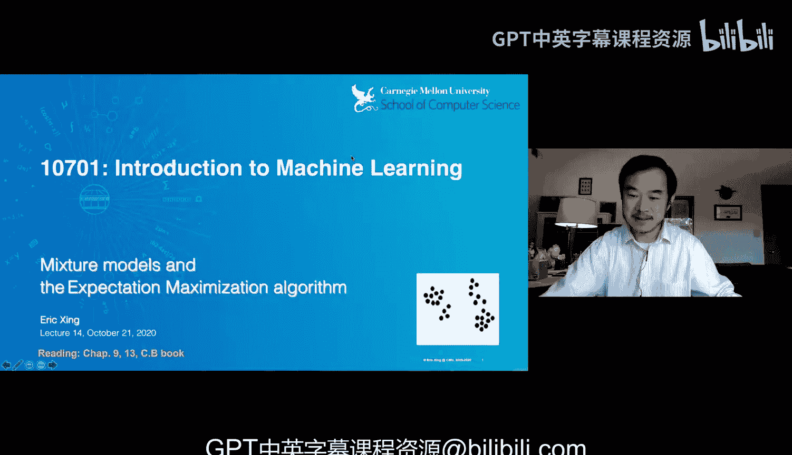
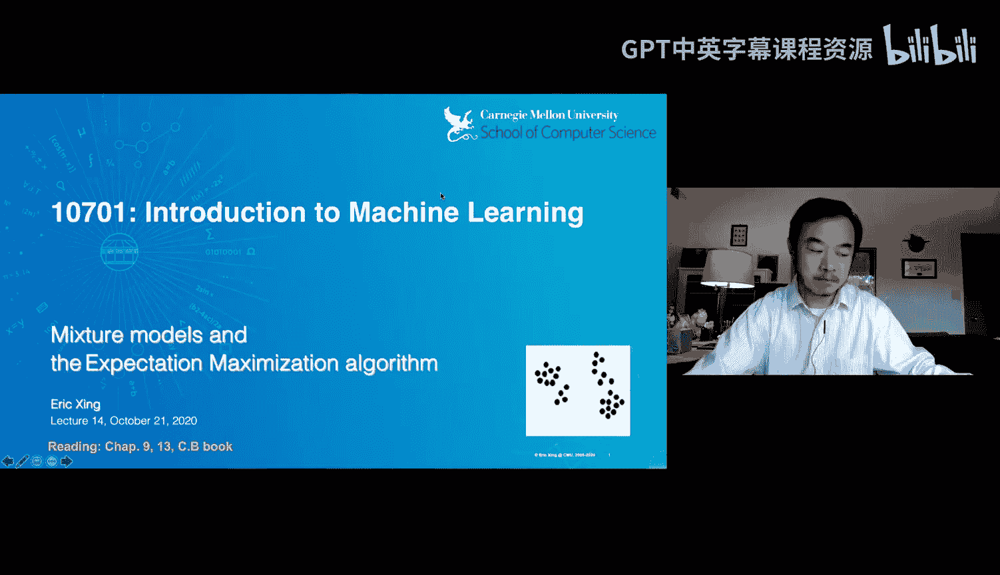
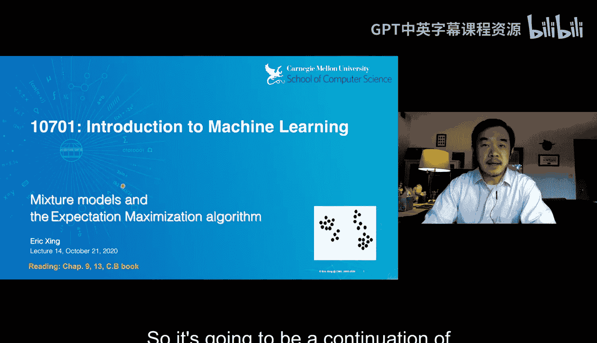
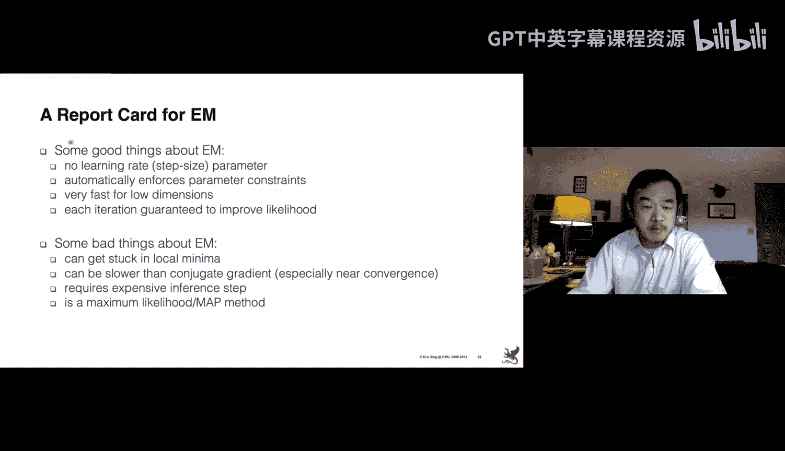

# CMU《机器学习导论（研究生）｜10-701 Introduction to Machine Learning 2020》中英字幕 p13 [13]10-701 Lecture 14_ Mixture models and the Expectation Maximization algorithm [BV144SuB8ETp_p13]

Yes so just first off I want to thank you all for filling in the midmester evaluation form this feedback is super useful to the course and the department so anyone who took the time to fill it out thank you very much we have flick through it and most of it is pretty positive we have identified places we can improve one common issue that was coming up was that office hours are usually very very busy and while generally this is true it's only true。

Right before the assignment is due， office hours a week before the assignment is due or like actually empty。

 so if you want to guarantee yourself space in office hours。

 going to those earlier office hours is definitely a good place to start。Additionally。

 if you're in person sections。The in person office hours that are hosted on Saturdays have been like actually empty。

So you know， if you're in an in person section， I would really recommend using that time to seek help。

Okay， thanks， Daniel。Let's get started。Today， we' are going to talk about the mixed models and EM algorithms。

 So it's going to be a continuation of last lecture on the classroom problem。

 So let's look at this graph again， right。

So， as I said， you know， we've been， you know， discussing how to， for example。

 group all these points into clusters。And we run over a algorithm known as the K meanss。

And today we're going to provide you a little bit more theoretical insight into what is happening behind this very smart heuristic call cas and what may be a more general version of that。

So before I do that， I don't know how much we've covered about some of the basics in statistical。

 you know， terminology and formulations here。 I want to give you a very， very quick overview of some。

Key concepts， a review of some key concepts that we are going to use today to derive some of the formulas。

We know how to to the coin。 It is a way to inensate the value of a random variable， which is binary。

 and you can actually describe the probability distribution， you know。

 of the outcome using a beno distribution， which is taking0 and one with probability P。

And the way to write down the probability of a tossing outcome。

 a coin tossing outcome is this P to the power of x times 1 minus p to the power of1 minus x。

 As you can see， this x is binary， it can be 0 or1。 Therefore， when it is0 or one。

 only one of these two terms will be honored。 The other will be basic reduced to one。

 because the power is 0。And then a little bit more gender than that。

We have a distribution for describing the discrete outcome of a multifaceted coin， in this case。

 a dice。Or it can be other discrete events， such as the the four letters of the of the DNA molecule。

 right， or different choices of the words in the article and so forth。

 So this distribution is known as the multinoial distribution and this value of the random variable is often described not by a numerical discrete value like 1。

2，3，4， because if you do that， it will make a lot of the calculation a lot more complex how to compute an average between 1。

2，3，4，1，5，6， right， But if you use this representation， which is known as the one hot。

Representation or indicator variable representation， where you have， you know。

 the number of dimensions equal to the number of possible outcomes。 And then on each dimension。

 you have a binary indicator indicating the presence and the absence of that event。

 Then you put on constraints。 that only one of these dimension can take a 90 value and others has to be all 0。

 And then that particular event of 90 for each dimension takes a probability of a theta J where j is dimension。

 And then you have a now clean way of describing a multinial distribution。

Or the description for the multinoe random variable。 And again。

 there is a systematic way of writing down the probability， the discrete。

 the probability of this discrete event。 For example， here is a。You know。

 almost like a natural language way of describing this， which is the probability of， you know， X。

 you know， N of K equals to one where K index the di sides and N indicates the runss of the row。

 right。And to make it easier， you can basically if the K dimension equals to one。

 obviously that that value equals to theta of k， which is the property of that case outcome。

 But if you do not know， you know what that K is ahead of time。

The way to express this very inclusively is to write down this product of theta K raised to the power of X。

 N。Common K。Basically， it helps you to select the particular theta that has been picked up， you know。

 by this random events。 So it's a cumbersome expression in here， which is a product of a K terms。

 But remember， because we have this a one hot property that only one K， a1 x K is equal to1。

 others equal to 0。 Therefore， out of this K terms in the product。

 only one of the theta K will be picked up。 Other will be reduced to one。Alright。

 so this is a typical set of discrete distributions we're going to use in the future very often in machine learning。

And once you have this， once you toss the dis or the coin n times。

 you have a very natural way of estimating the frequency， you know of events。

 which is pretty much you know intuitive， you know。

 it's the count of a particular event over the total number of times of your events。

 this is also known as the maximum likelihood estimation because the way to derive this outcome is to basically write down the maximum likelihood the likelihood of you know。

 this event， happening n times。 And then find a theta that is an art max of that。 And in this case。

 you are lucky enough to have a close form event right And today， in fact。

 were going to talk about the algorithms and problems where there isn't a close form event estimation of those parameters and how we're going to do it and solve the problem iteratively using some heuristic algorithms。

Now， back to the continuous variable， one of the most oftenly used type of continuous random variable are known as the Gausian variable。

 And here is a Gausing distribution for one dimensional continuous random variable。

 And we are all familiar with that。 right， This is the shape of the density。

And there's also a way to write down the shape of the cumulative distribution， property mass。

 which is the integration of this up to x。Just a reminder for you how it look like。 And then here。

 if you have a multidial Gaussian distribution， then the。Probity density of a x vector， given。

The key parameters in the Gausin， which is the M and covariance。

 You have this quadratic form raised to the exponent。 And then also。

 there are some term here to normalize the whole distribution。

And why this is interesting because today we' are going to use these building blocks to build some complex distributions。

 such as the mixture models。 what I're going to talk about。And having that distribution， again。

 in the continuous case， also allows you to achieve a obtain a maximum likelihood estimation of the parameters。

 In this case， the mu and the theta。A the sigma， the meal， which is the min is again。

 quite intuitive。 It is the sample min of all your examples。 X N is the Ns data points。

 Youre sum over that and divided by n。And then the covariance。Maxim likelihood estimation， again。

 is the sample covariance。 It is going to be computed from what is known as a scatter matrix that is defined in this way。

 and then you divide them by M。Very often， there are what is known as the matrix expression of the whole data set where you put you introduce a matrix X where each row。

 you know， is you know that data vector。 and you have n roles indicating having n data points。

 And then this S can be described by， you know， a matrix product X transform text multiplied by x。

And if you have this matrix form， you actually could even you know compute you determine whether you know there are they are full rank。

 whether this matrix is invertible or not， why that's important。

 because you notice the Gaussian distribution here here， you know in writing down the Gaussian。

 your theta， or sigma， the covariance matrix has to be inverted。

If from the sample estimation in here， you have a aninverttable sigma。

 That actually becomes a problem。 right， We actually will， you know。

 have a numerical technique to remedy that by putting regularizers by， you know。

 adding a diagonal matrix of ones and so forth。 But again。

 these are not the topic of today's discussion。Okay， so then moving on。

We have another interesting probabilistic density function known as the conditional Gausing。

 And that is for a particular type of data。 unlike what we just talk about， which has only， you know。

 a single type of data that you observe Here。 you have two types of data。 One is the X，1 is the Y。

 It is pretty much like your classification problem。 You know。

 Y is the label and X is the vector observation of you know， of numbers。

And the why you have this pair。And why it's called conditional Gausing。 Well in here。

 we are describing a phenomenon you can see in this graph where the X random variables may come from one of the two original Gausing distributions。

And they all have their own meal and sigma。And then which Gausian component they come from is indicated by the Y。

Okay， that's why， you know， Y is a discrete random variable using， for example。

 the multinomial or the benoi I just described。 Now。

 you know why I write down the likelihood like this， right， And then x is conditional Gausing。

 given that X Y is known once X Y is known， then you know which Gausing component it is coming from。

 For example， in here， we say y of N。Coma K equals to one。

 That means this n point comes from the case cluster。O case Gaussing component。 And then in here。

 you can pick the mu K。 And you may wonder where is the sigma sigma in here。

 It is the same for the two cluster。 Let's see as you。 So you。

 you pick the case centralroid to write down the conditional Gausing。

But if you don't know the actual value of the y or you want them to be very genetic to accommodate any possible assignment of the Y。

 then you just write down the conditional gausing like this X given y without making a specific assignment。

 and then the likelihood becomes now a very interesting expression like this in the inner bracket。

 you have a product over K terms。Which basically provides you the placeholder of K possible options。

Okay， of the， you know cluster centralroid or of the Gausing component。

 And then which one to be chosen is determined by this Y， which is now raised to the power position。

 because whether they equal to one or 0 will determine whether this particular component will be selected or reduced to one。

 Okay， and then this outer product of n just tell you we have n data points。Okay。

 so it's a very neat expression to represent conditional gaussian。And then for conditional gausing。

 the maximum likelihood estimation is also very intuitive。You know。

 because you already know that for each point， they come from one of the key possible components。

At the end of day， you are going to estimate the frequency of each component。Which is a pi of K。

 Youd basically just count this indicator， you know， a variable configuration。

 How many number of times this case component was equal to one。

And then for the meal and also for the sigma， which I didn't write here。

 you basically just pick those points。Of x that belongs to case cluster。

And then divided by the total number of times of being in case cluster。

 And then you basically can compute the component， the mean of that case component。Okay。

 so notice this expression。 I want you to be very， very careful in inspecting this expression because we' are going to very soon abuse it or overload it with some other tricks。

 So here， the way I pick examples is either to use a power kind of trick to put the indicator into the power position。

 Okay， or I use this multiplication trick where if y equals to one， they will pick x as it is。

 If y equals to 0， then x will be 0。 This whole thing。 Therefore。

 there is no contribution of that particular point to the estimation of the meal。ok。

My next question would be， what if now I don't have the why。

 which is actually the case we're going to discuss today in the cluster。 remember in here。

 we assume that the conditional Gausing are modeling data where both the X and Y are given。

 but in our classroom problem we only observed the X， not the Y。

 and that's where things become interesting and some heuristics needs to be known， for example。

 in the K means this y was actually provided by measuring the distance of a point to the cluster center and then give them a discrete assignment。

 but there are other ways of doing that。Okay， so now back to our classroom problem。Today。

 I'm going to introduce a new probabilistic model known as the mixture model to help you write down the likelihood。

 Okay， of this type of data。So what is the mixture model？Well， make some other。

If you want to visualize it， it looks like this。 It's basically a combination of multiple components。

 Each of them may be a Gaussing。Okay， and therefore， the density has now， you know。

 hills and valleys。 It becomes not a nicely nice looking Uni model shape。

 like you see in the Gaussian distribution。But if you want to be a little bit more kind of careful in inspect this。

 you may be able to realize that this whole thing may be a addition or summation of three component Gausings。

Okay， like this。 And this Z can be taken as an indicator for every point。

 So every point come from one of this three Gaussing component。 Yeah。

 they come from a single mixture model。 But if the mixture model has， say three Gausing component。

 then we can safely assume that this particular data point。 Okay。

 every data point come from one of the component Gaussing。Instead of coming from the entire mixture。

 it is more explicit。 And then， you know， A Z can be used to indicate that random event of coming from one of the three Gausing components。

 And this is basically a mixture model。 A mixture model is by itself， a one model。

 but it is a made up of a component models， which can be， you know。

 inferred by some probabilistic procedures。And why we have latent variables， right， So this Z。

 by the way， here is known as a latent variable。Okay， because we don't see it。

 It's something that we want to introduce as a placeholder for the component assignment of any given data points。

And as you can see， the rationale here is to make our inference procedure。

 or mathematical procedure more intuitive and easy。 You know。

 this Z may not be something that physically exists。 It's a conceptual thing。

 indicating the belonging of a point to a cluster or to a mixture components。Right， but in practice。

 unobserved random variables。Or latent variables are actually， even more， you know。

 have more underlin meanings than just a conceptual placeholder for cluster membership。

 So here I have a few examples。You know， sometimes it is actually a real world kind of a phenomenon。

Or object。 But you don't have， you know。The convenience of directly know observe or measure that。

For example， the temperature of a star。It's a real thing that that the that star has a temperature。

 It's a real physical property or phenomenon， but you cannot fly to the star and put thermometer there and measure it。

 right， So you basically observe， you know， the light or some kind of radiation， you know。

 from that star from your device。 And then you run some procedure to infi。

 to calculate the temperature of a star。 Therefore。

 the star temperature becomes a latent variable that you need to， you know， infer。

The causes of diseases， the ancestors in the evolutionary program have the same thing。 You know。

 we know that we evolved from maybe a a certain ancestor， or we were created in a certain way。

 but we never ourselves see it。You can make them as a un observed random variable and make inference about that if you accumulate enough current evidence。

 say， you know， populational data and so forth。系。And sometimes it is something that you probably。

 it's still real thing。And also， you can measure it。Unlike the star or the ancestor， for example。

 you know， you know， a traffic signals and radio signals from your radar and so forth。

But you have a maybe a 40 sensor or you have some noise or error in those measurements。 Therefore。

 the thing you measured may not reflect the true value of that physical quantity。

You can still basically model， you know， this quantity by making them a hidden random variable and introduce a noise model around it so that you can。

 you know， make a better estimation or provide， you know， a confidence interval and so forth。so诶。

There are also two types of late variables。 One is discrete。 The other is continuous。

 I talked quite a bit about the continuous ones already， such as temperatures such as you know。

 a radio signals， but discrete random variables。 You already saw it， right， So these are， you know。

 a cluster membership of a points， group membership of a points。For example， by。

 by looking at your behavior and in speech or in voting， I can probably make your party affiliation。

 You know， Democrats or Republicans as a discrete latent variable。

 and someone may be interested in making the inference about that to do targeted ads or campaign。

And the continuous ones， you know， I already said about that。

So written variables will be a very useful thing down the road that we're going to use a lot。

 In fact， the entire business of deep learning make heavy use of late variables in their intermediate layers to do in representation learning。

 feature expressions and so forths。Now， go back to our simple scenario。

 the Gausing mixture model or the mixture model here we' are going to talk about one type of mixture model known as the Gaussing mixture model。

And just to。Be very， very you know direct。 The expression of the Gausi mix model is rather intuitive。

You can see in assume that， you know， a now X follows a Gausing distribution。 Remember， in the past。

 when we assume that when。X follows a Gausian institution。 Then on the right hand side。

 you have a exponential expression of you know， the sample deviation against the Ming。

 And then there is a covariance。 and then there is a no constant。In here。

 I make a slightly kind of different statement。 I say X come from a Gausian mixture model。

 not from a Gausian distribution。 And then the expression will be now。

Converted into a weighted sum of multiple Gausian components。

 So each of these N of x given theta a mu K and sigma K is what you see before。 You know。

 the Gausian distribution。But it is actually already assuming that you are picking only the case component of the Gaussian distribution in your。

 maybe in your catalog or in your library。 And then there is a pie K。

 which is the weight of this particular sample coming from， you know， the distribution。Okay。

 and this is， again， a very graphically intuitive way of expressing the relationship of those indicator variable and the。

 the observed real variable。And then this is roughly a density curve that you can imagine coming from multiple gausian distributions。

And here is a two dimensional illustration of that。 Okay， so this is a Gaussian mixture model。

And I argue that Gaussian mixture model is perhaps a appropriate model to solve our data classroom problem。

 just I just described before。 Remember， our data points， right that we saw earlier。

 which is not as dramatic as this one， but they are kind of like this。

 a data cloud of multiple clusterutterters， and then in each of them may be modeled by a single multi union model Gaussian distribution。

 And when you put them together。You actually could model the entire dataset。

Now let's go a little bit further into the mathematical description or underpinning of a Gaussian mixture model。

系。So here we know that there are two random variables， X and Z， Z is not observed。 By the way。

 in the earlier slice， I may use Y。 Well， I apologize。 they are just the the same thing。

 I just hear converting to Z， because that's actually what's often used in the literature。 so。

We need to write down， you know， a。Probably distribution of the Z。

 because that's actually where everything gets started。

 You first make assignment of data points based on some discrete probability， you know， a pi of k。

And then the likelihood of the sample x。Can be now written easily using what we just talk about as the conditional constitution。

 because here the K is already given。Okay， so you can basically pick the case component。And then。

 the likelihood of a sample。Which actually does not contain any specific assignment of the Z。

 You don't actually know that。Which imply that the X can come from any of the key possible components。

 Therefore， we're going to put a probability of， you know， that assignment。you度啊。Here。

 and then they will be multiplied with the conditional Gausian likelihood。Okay， so this is， you know。

 the simplest way of using a Qn rule to write down the joint probability of a P of X and Z。

 X is the observation， and Z is the latent。Component assignment。

But know that this this particular term P of z times P of x given z， which leads to P of X and z。

Isn't the likelihood of our data because our data does not contain Z， Z is not observed。

 You only observe X。 Therefore， we need to do one step known as the marginalization。Of the Z。

 basically， with sum over all possible values of the Z so that the Z will be eliminated from the join distribution to make them into a marginal distribution of x。

Okay。And so how to make that happen。You plug in this expression。P of Z， what that's already in here。

 So plug in this term。Okay。And then you also plug in this part。

 which is the conditional gausing X given Z， which is written in here。 You just multiply in here。

And then we are going to not do the summ over the Z。 Remember the Z for each data point。 Okay。

 In fact， here we are talking about only one data point N。 So for that particular data point。

 Z can take you know，5 K possible options， right， from one to cap K。But remember。

 it is a indicator function， meaning that at each time， you know， K， only one of the K can be one。

 others are 0。 Therefore， when you have this multiplication of the K， you are going to you know。

 pick up， you know， only， you know， the case component once。Okay。

 so for each of these K assignment when， when， when this z equals to， you know， one of the ks。

This the product。Will result in one of the terms indexed by K。Okay， and then in the outer summation。

 you have a K such options。 And that basically leads you to this expression。

 which you saw in the previous slide already。 That's why I gave you upfront without derivation。

 But in here， youll see how they are derived。 It is not by a a smart gas。

 It is by a rigorous edge brickic derivation from a gaus mixture model。So in here， just some jargons。

 right， So in here， people call this pie of K， the mixture proportion or mixture weights and the N of X given milk K and sigma K to be the mixture component。

 It's a Gaussing component in this case。To be more general， you maybe have a question。

 do I have to stick to Gauss mixers， What the choices that you don't have to。

 You can have this particular component to be arbitrary distribution。

It's just like Gausing is very easy to write down and easy to compute。

 So that's becoming a favorite form。To produce the mixtureer components。Okay。

 so now we have a likelihood function of a sample under a mixture model。

And typically in machine learning， that's already， you know。

 maybe a majority of the game once you have the expression of the likelihood。

 what is the learning task？Maybe want to pause here first to receive any questions you have so far and also post at you a question。

 Having this already， What is the machine learning task that we want to solve。

Anybody want to shout out？Ill type your chat in your chat。

Do you want to estimate the mean and covariance of You want to estimate the mean。 Yeah， exactly。

 So this mu and sigma。 In fact， this meal and sigma is an expression of two sets of mules and sigma。

 right， Mi has a K possible mules and sigma has K possible sigmas。 You want to estimate that。

And how to estimate， Well， you have this expression of the likelihood already。

 You just do an Arc max。Right。And how to do Arcms。Anybody has an idea。You have a function already。

 and you have an argument in the function， and you want to find the argument that maximize the function。

 What you typically do。You think a gradient， right？In the past that we've learned。In the past。

 we've learned gradienting design algorithm， you started from random gas， and if you're lucky。

 you can basically keep updating from the random initialitization gas and you hopefully can converge you know to a you know。

 a stable estimation of those you arguments。Right， that could be an idea。 in fact， sometimes。

You know， in a very simple expression of the like who like the Gausing or the multinomial。

 we could even get a close form expression。 right， That's also achieved by taking the gradient to 0。

 And then suddenly， youll see that the right hand side of that equation can directly give you a one step e of the whole thing。

So taking gradient。And be able to use that to solve close form， or solve a fixed point。

Can be a very good approach。I a question here， estimationim proportion， Yes， okay， answer me。Now。

 let's see how does this idea work in the mixture model case， take a gradient。几。Remember that。

I already said， maybe I didn't， but I want to say now that for a mixture model like this。

The story wouldn't be as simple as you imagine that having a gradient。

 you either go to a close form or you have a very simple gradient that you can use to update and order way to convergence。

 The truth is that there are some。Unex capacities that were involve。

So now let's look at what could be the ideal case。Imagine that now we observe a fully observed data。

 Let's imagine there are no latent variables。Okay。So that basically makes makes the make the mixture of Gausing model。

 not necessarily a mixture model。 It's just， you know， you know， a， well， it's still a mixture model。

 but it's fully observed。 You don't have a classroom problem。 In this case， X and Z are both given。

 And then you write down the log likelihood of X。And Z。

 remember that the joint joint probability of x and Z can be expressed by a product of a P of Z and P of x given Z。

 and under logarism， they factor into2 sum。Right two terms and also even nicer。

In these two kind of terms， you know， in the log likelihood。

The two parameters that you want to estimate。Factored accordingly， they。

 their fact is exactly aligned with， you know， the bigger term that is factorized。

 Sta Z is only in here， and theta X is only in here。By the way呃。AChris here。

I use the theta to generically refer to those are hidden random variables or hidden parameters。

In the case of a gaus mixture model， what is theta Z。The parameters for Z。 What is that。

I that the pi It's the pie。 Thank you。 And obviously， here， you know also as well。

 right that the mules and the sigmas good。 And the nice thing is that you cannot estimate the pi only by counting the Z and estimate the mu and the sigma only by counting the X。

 right with there Z， as I already know。😊，But in our mixture model。You know， we have。

 we have to marginalize out the。 Therefore， there is a very annoying summation sign。

Right outside of the joint probability of X and C within the log。Okay， so therefore。

 we are going to now having an expression of the total likelihood。You know。

 in a form that is a logism of a sum of something。 and that actually creates some algebraic trouble。

 Let's look at how the gradient in this case， look like。Now take a gradient。

Of this log likelihood of a mixture model。With respect to say any of the parameters that you have to compute。

And I don't need to work through all these equations。

 You can expect them maybe more carefully afterwards。 But at the end of the day。

 you are going to have something like this。 This gradient over a particular， you know， parameter。

 say pi Z。Will be rather complicated， right， It's expressed as in here， you know。

 a sum of component wise gradient。 Okay， this is nice。 This is component wise gradient。

 but this weights of that component R of K includes everything。 pi of K。And P of x given。You know。

 the the Z value and so forth。And you probably can realize that in here。

 every parameters to be updated are coupled。 The X and the pi and the mu and the sigma will be all present。

You know， in this a whole。第二个题。Regardless of which particular random random parameters you know public parameters you are going to be taking derivative over。

 All the parameters to estimate will be present in this in this gradient。

 although they will be present in different forms。So that， of course， makes the whole thing very。

 very complicated。And also， in every step into compute all these big terms。Which is also very。

 very annoying。 You need to compute， reevaluate the X and under a particular component and over the entire mixture and so forth。

So it is not as straightforward as what we had before。

 where you can compute sample min and sample variance and also frequency for the pi and the theta。

And the sigma。And another numerical difficulty， which is very undesirable， is that when you。

 even when you are willing to do all this and just to compute the gradient boot force。

 you lose some nice control over certain properties of the parameters to be estimated。 For example。

 if the theta is the pi we want to estimate。So what is pi Pi are the frequencies of。You know。

 a discrete events， right， So they have some property。 They have to。Be non non negative。

 They have to be 0 and1。 And then all the pis show sum together to become one。

RightWhen you take a gradient， how can you enforce that kind of constraints？Well， it's tricky。Right。

 and then。You can other constraints， for example， this sigma， you know， has to be positive definite。

 otherwise it is not invertible。Therefore， you， you know， when you are running just a gradient。

 you lose control of the sigma。You know， they could take any value， you know。

 maybe asymmetric and also maybe not positive semi defite or invertible。

And you will arrived at a ecalator that is pretty much useless in the end。

 either by having negative pie or having， you know， you conditioned sigma and so forth。

 So that's basically just some problems that I want to bring forward if we are trying to adopt a good force gradient algorithm for mixture models。

So what I'm going to do next is to present you a heuristic and also some theories behind it to。

 you know， bypass all this。Difficulties so that we make a mixture model learning problem almost as easy as our fully observed。

 you know， component Gausing learning problem。 Okay Let's see what's going to happen。Okay， what is R。

 I think Daniel， you answered it already。 Good。 Thank you。Alright， so what is the E M algorithm。

 I want， I want to start straight with a algorithm。

 And then let's try to understand it by looking deeper into the math。So this is a algorithm， okay。

Maybe I will describe that first， in fact， I'm going to describe that later。

 let me show you the equation first。So we've got you know a mixture of k Gausings。Right。

These are the equation I just produced， you know， you know， you know， a marginal of the indicator。

 conditional of the observation and also the full likelihood。And let's compare， you know。

 the differences between what we are facing here to what we were facing in the。

Conditional gausing estimator where everything is observed。So in there。

 when the Z random variable is observed， you can leverage on that to select basically samples for you to compute the estimation。

 for example， you select those you know z， which equals to k to estimate frequency of pi k right and you select those x whose indicator y equals to k and then you compute the mu accordingly。

So this is pretty straightforward， and you can also do the same for thevariance for the covariance matrix。

And because this is this procedure is very similar。 In fact， identical to a routine， you know。

 standard Gausing parameter estimation， you have all these nice conditions that these from these multi normal parameters are。

 you know。9，0 and between 0 and1 and sum to  one。 and all these actually have nice properties and conditions。

Now， if Z is not observed。The key idea behind the E， M is to。Pretend that they are observed。

 You basically， you know， impute some value for the Z so that you go back from here to here。To。

Subsequently solve a fully observed conditional gausian estimation problem。Okay， so that's the trick。

 So what's the natural thing to do to replace Z。 Well you can replace them with the probability of a Z equals to a particular class。

 given your current observation of of X and how to compute that or by a very trivial formula known as the ratio of probability。

You can basically plug the x into one of this component。And divided by， you know。

 the sum of weighted components。 And then you can get a probability of X B in one of the components。

 right， so kind of intuitive。So let's see how it goes in practice。So here is a EM algorithm。

 both in equation and also in graphics。So you start from here， which is an uncolored set of points。

Of course， we have the same issue in Kmins。 You need to start with a guess of the K。

 How many clusters we are going to guess it to be 2。Okay。

 and then something that you are probably familiar with will be happening。

 You start by guessing randomly the centroids and the covariance of the two clusters。Okay。

 say they are in here and here。 You get them to be centered in here and centered in here。

 And then you guess the covariance to be standard kind of， you know， covariance， you know。

 basically a diagonal matrix of one， for example， you can start from there。

And then what you are going to do is to。Do the following estimation of the Z。

 So for each of these points。You are going to compute this quantity。

 which is the posteror probability of the Z label。A C indicator。

 given the observation X or given it the position of X。 and also given your current。Value of the。

Prometerters， the meal and sigma at time iteration。 Listen。

 This little script T indicates the time iteration get the T's iteration。 Now you I it iteration 1。

 So T equals to one okay。So you can imagine that each of the points will have a fractional probability of being in one or the other。

Gauing component， depending on how closely they are。

So K is a Well K is you can call it a hyper parametermeter or call it a unknown constant。Okay。

 just like in K means， you just set K to be 2 or3， whatever， okay。

And we said already that there is an issue about estimating the K。 But that's a advanced topic。

 maybe in later machine learning known as ametric base。

 But here we are shown K is already a given quantity。

For the for the sake of making things a little bit easier。O， so yeah。

 E M A always assume that you are given a fixed K already。

So now let's go back to our first iteration。 Once you estimate this。

 you can imagine that this is equivalent to assign a color or maybe a fractional number of each point。

 they can be very red， if they are very close to the red centralroid， they can be very blue。

 if they are very close to the blue centraloids。 but they can also be somewhere reddish and blueluish。

 if they are somewhere in the middle。 So you can imagine at this particular point。

 we have a P of Z given x to be half half。 that's possible， or maybe04 versus 0。6。Okay。

 so now you are going to， you know。Keep all this estimation。That's why it's called E step。

 It is the estimation of the probability of a data point X being assigned to one of the K possible clusters。

And then youre going to the M step。In the M step， you are going to compute now the Phi and the pi。

 the mi and sigma。By assuming that the Z are no longer a hidden random variable。

 They become observed。 Their value are replaced by this guy， which is a fractional number。

 Okay It's not 0 and 1。 It's a fraction between 0 and 1。And you are going to not do a sum over that。

Look in here， the summation is over n。Okay， which is not basically the only the number of points belonging to one of the components。

 because every component can belong to the component just with a different fraction of weights。

 Therefore， you' are going to some over order points。And then you divide them by n。

And that gives you the first iteration estimation of the frequency of the components。And likewise。

 you do the mu。 Remember， in the past， I have x times a quantity called y。

 which is the label of the data points， right， And y is discrete， either0 or one in here。

 I multiply x by tao。 Tau is a fraction number。 I'm literally saying that this particular point。

 X can be kind of cut into half。 and all of a particular type of a breakdown and a portion of that goes to the red cluster and a portion of the other goes to the blue cluster and then you compute you know。

 the mu accordingly， based on this fractional contribution of every point。And likewise。

 you do the sigma。 You can see that everything else。

 This part is the same as our conditional Gausian estimation， except that now this weights。Okay。

 it's computed in the E step to be the probability of the label。Okay， given the data points。

And then what's happening is that after you estimate this and then you want to continue and now re estimate the weights because big。

 you know， after this round， you can see that this particular two centraloids and covariance。

Won't be as naive as this one。 They probably will be moving closer to the data cloud。And also。

 their shape could reflect more on the distribution of the data clouds。And therefore。

 you are going to re the assignment of every data points。And you can see that some of the。

 the points like in here gets reassigned， you know， to be more blue。

 and here they are going to be more red。 And then you recompute and you go on and on until convergence。

从。So that's the EM step。In the initialization， they are also yeah， in the initialization。

 someone asks， how do I initialize this， They are random variable。 Yeah。

 you initialize them to be  one to be to be 。5， for example， That's a safe way to initialize。

Does this sound familiar to the Kmin's algorithm that you heard earlier？Right。

 so it's almost kind of in spirit the same。 You know。

 you basically get some assignments of the data points to some particular cluster components。

 And then you recompute the cluster center and cluster weights。 But in here。

 you also compute the cluster covariance matrix because it is a mixture model of Gausings。

I that result deterministic， well see， whether it is deterministic or not， Okay， well see very soon。

So let's first record the caings。 right， If you look at these two equations in here and in here， the。

 the differences are actually quite。Explicit， but not very， very strong。 right here。

 the Z is a discrete assignment that you do an arc max of this。Right， you basically， in fact。

 I think it's argument。 Sorry about that。 Okay， it's。It's going to be a， you know。

 a checking the closest kind of points， a center that I'm going to， to， to， to belong to。

And then in here， you are going to now count every data point in a hard fashion。

 It's a hard assignment。 It's a deelta function that you either are in this cluster or in the other cluster。

But in here， you have what is known as the soft assignment。Therefore。

 E M algorithm is often also known as the soft k meanss。

 All the K meanss is also sometimes known as the heart E M algorithm。Okay。

 but the procedure are the same。 You can see this E and E is and M is step in the k means algorithm。

Now， I think we are ready to answer a few additional technical questions。

Is this whole thing going to converge or deterministic， or certainly not。

Depending on your initialization and you know， how you pick the initial assignments。

It is very possible that you will be getting to different convergence because this the entire likelihood function。

Let's go back to this。The mixture model likelihood function like this， it is not a comevex one。Right。

It is actually a multimodal one。 Therefore， the likelihood you know。

 loss function surface has valleys and hill。 If you pick from here， for example。

 you maybe go down to here， but if pick from here， they will go outside。 So that's actually a。

The same thing， you know， you experienced already in the K meanss。

 Therefore practically people will do multiple random restarts and after converge。

 they will compute the likelihood of all data in with the final estimation and compare a few alternatives and pick the best one。

Okay。Okay， now。Let's see。What's basically why this algorithm makes sense， You know， what's the。

 what is actually happening， you know， during， you know， the E M algorithm。

 Because originally we say once you have a probability function。

 you are going to do maximum likelihood estimation。For this E M algorithm， I don't know yet。

 I'm just telling you a procedure。 I didn't tell you what particular loss function has been optimized yet。

 right， So we need to actually take talk about that。All right， no more question。First of all， yeah。

 in again， you know another， another iteration of this identifiability issue in the mixture model。

 It's not necessarily very identifiable because of the terrible， you know。

 irregularity of the likelihood surface。So we answer that。The other is how that algorithm。

 This algorithm seems to be very neat。 How is this derived， Okay， and hopefully。

 you can derive it at some point。So here I will give you a complete derivation。

Of the E M algorithm so that it is not， you know， in the end， a heuristic。

 It is really a principled procedure of a optimization problem。Okay， so we start from here。

 We've seen Gausing mixer models already three times。Okay， and at the end of day。

 we conclude that the likelihood of a sample in here is not a good target to optimize， right。

 because， you know， gradient is complex and so on so forth。Now， put the EM M algorithm aside。

 Let's say having this。How numerically we can。You know。

 maybe navigate through to still allow us to maximize this particular term without directly solving this problem。

So here， let me introduce another concept known as the complete likelihood。

 Complete likelihood is basically in here， you know。

 the likelihood of all random variables that matters。

Regardless whether they are observed or not observed。 So in this case， for example。

 Z is not observed， but we put it anyway。 So it is the joint of X and Z。

 we call them complete likelihood。Now， in the case of a mixture model。

 you probably already realize that this very definition of the complete likelihood itself is a random variable。

Right， this one is a unknown fixed quantity。 We know it's a fixed quantity， but it's unknown。

 But in here， we know that it is a random variable because y， because Z is a random variable。

 It is already written into。You know， you know， the the， the， the， the complete likelihood。

 the definition。Therefore， this is a variable that is you cannot take a derivative over a over a random quantity。

Okay， so now let's see how can we proceed。Well， complete likelihood has a nice。Property。

 which is that effectize， right。 You know， if you take a logarithm。

 they factorize exactly along in the Z and the x so that the pi and the miu， you know， are decoupled。

Now， let's see what will happen if Z is not a constant， but a variable of that is unobserved。

WellWhat you can do is you can turn this a whole thing into a determinous quantity by removing the randomness。

 right， One thing， one way of removing the randomness is to take expectation of this random variable。

 this complete likelihood。 with some distribution over what is random say the Z。

 So here I'm going to take a expectation of this random log， complete likelihood。

Over a distribution of Z， given X。Okay， I choose the distribution to be P of siggon x。

 which is the posterior of the hidden unknown label， given the observation。

 So this is always a well defined。 And we know that we have a way to compute it。

 right So if this is known， then this。Expected the complete likelihood。Also， factorizes。Okay。

 it factorizes the way very similar to the original complete likelihood。

 except that now the Z are replaced by a angular bracket of the Z。

 which is the expectation of Z under some distribution。Okay。Okay， now let's see what's happening。

Let's imagine that。 suppose this。I have a question here。 Why is the。He， on the lower right， Okay。

 this is just a a。Physicist expression， when you take a expectation over a random quantity over a certain distributions。

 it is a shorthand to put that distribution here to remind that over which distribution the expectation was taken from。

ok。So now let's imagine that this guy becomes our target of objective。

And let's see what happens when we maximize this expected likelihood iteratively。 Okay。

 we use the following procedure。In the E step。Remember that the expectation was taking on。

In the P of Z given x， which actually is unknown yet。 Therefore， in the E step。

 we are going to compute exactly that P of Z given x， given our current estimation of the。

Mal and sigma。Okay， so this is the expression。Okay。

 this is the fraction of a mixture component probability versus the entire mixture probability。

 And that gives you the， the probability of this particular data point。

 X N being in a particular component okay。And this particular step where we compute post probability of a hidden random variable。

 given the data is also known as inference in larger models， as we are going to see in the future。

 such as in the hidden Markov model， you know， we may be computing any hidden random variable。

 given any observations， using a procedure far more complicated than this one。

And then let's see what's in the M step。Now， assume that， you know， we have， you know。

 what is supposed to be in this in a lower index of the bracket already estimated。

 which is the P of Z given X， right， And then we are going to be able to now。You know。

 treat them as observed。Right， and remember， in our conditional gauss distribution。

 we know how to estimate the maximum likelihood estimation of a fully observed， you know。

 mixture model where Z and x are both given I showed the equation earlier already， right So in here。

 you just plug in because your P of Z given X is already given as the bracket angular bracket of Z。

 So I' going all the tall。 sometimes I call it a tau in here。 So I'm going to plug in。 you know。

 this exactly。And then do a maximum likelihood estimation of that。Right。So as you can see， you know。

 the the the E M algorithm is literally about you know。

 realizing our estimation by maximizing the complete likelihood。

 first computing the expectation of the expected log likelihood and then maximizing this by plug in you know。

 those Z estimations。Okay， that's basically how the EMA version was derived。

 It is derived from writing down the complete likelihood of data。And in here。

 all these situations can be easily satisfied because you know， it is a close form expression。

 you know， of， you know， the sample， you know， into the covariance and also the new。ok。

So as I just mentioned， this is isomorphic to the M E。

 except now that the random variables that were originally hidden are not replaced by their expectations okay。

Does the EM algorithm work for arbitrary。Parametric data。

Can you elaborate a little bit more by what do you mean by arbitrary。Yeah。

 I was just wondering like let's say I had a certain like method of generating data。

 like just say from any like arbitrary distributions， like mixture of Gaussians。

 like then would it be like what what are the conditions basically for EM to accurately。呃Yeah。

Very good question。 Yeah， in fact， E M is a procedure， right。

 and its success actually highly depends on the assumption of the model In here， for example。

 what is actually more important than E M is the Gaus mixture model。

 because that's basically allowing you to write down all these formula in you know。

 a very explicit parametric form， right， But if you generate the data from some very complex distribution。

 for example， the nowaday very popular gun model， the generative universal network models。

 which is obviously way more complicated than the Gaus mixture model。

 then your E M algorithm need to count heavily on your design of those component models。

And to the point that nowadays people use a full inference network， or I mean， a decoder。

 for example， you know， to represent that generative or the inference process。

 But these are topics which were。Probably not cover in in 701。 But if you are interested later in 7。

0，8 graphic models， there will be extensive discussion on that。 But yeah。

 E M algorithm itself is a sound algorithm that is used in， you know， in all these procedures。

Thank you。All right。I'm going to skip this。 You've seen k meanss now four times。

 So you probably already know their how they connect to the E M algorithm。

I will talk about the theory now， okay， so for example， you may already wonder， okay， you basically。

 you know， you know， you know， maybe solve a confusion by introducing yet another confusion。

 You know， we we， we know the E M is a procedure that come out of some smart design And now we know that it is designed from a complete likelihood。

 but complete likelihood is not likelihood。 still， you know， it can be puzzling what is going on。

 Why， for example， maximizing the complete likelihood is a is is a legitimate thing。

 Why not something else。 Maybe why not say。Yeah， entropy or whatever other terms， right？So诶。

The theory hopefully gives you another layer of clarity。I claim that what's happening underline E。

 M is just a very clever way of solving the。Villa， the original maximum likelihood estimation problem for the mixture model。

You know， this expected the complete likelihood is just a vehicle to attain you a nice approximation to that quantity that we are going to optimize okay。

Right。ok ， so诶。We say that this is difficult than what we do。

And we also know that there is a complete likelihood and a incomplete likelihood。

 which is our true target to optimize。 so what's the relationship between this guy and that guy and also the expectation of that guy。

So。So， here is a。Relationship。Basically， you know， we know that Z is not observed。

 It's hidden variable and to turn the hidden random variable into something that is more manageable。

1 needs to introduce any arbitrary distribution Q of Z。 Remember， in the past， just now。

 I introduced the P of Z given x to be that distribution， but you don't have to choose that。

 You can choose arbitrary anyone， As long as they give a probabilityity distribution of the Z。

 It could be a uniform， for example， although it is not very good。

And we can say why it is not very good in a second。But given that。

 you you are not able to define an expectation over the complete likelihood。

And here I want to introduce an important concept so that you can establish。This term。

Versus the incomp likelihood adjusted just introduced。So this term is。

 this concept is known as the Jensen's inequality。停。Which basically says that if you want to。

 you know， establish a relationship of the log of the sum of something versus the sum of the log of something。

You know， there is a explicit inequality relationship between these two。 Okay， the log of the sum。

Weighted sum of say anything in here。 this term， but it could be other terms。 Okay。

 iss going to be strictly greater or equal to the weighted sum of log of that function。Okay。

 so this is known as the Johnsons inequality。And geographic geometrically。

 it is very intuitive to understand it because this part。

The log of something is actually this log curve。Right the sum of logs is about picking two points or any points。

 you know， In on on the log curve and then draw a line between them and find somewhere in the middle。

 because this a weighted sum。 By the way， this is I should be more strict。

 It is not only a weighted sum。 It is a convexly weighted sum。Oh the Comvex is another complex word。

 It means that the weights in here are the weights that sum to one。

 and each weight is between 0 and1。 So this is known as the Comve combination。Of a。

 of a term of a function。 right， So that conve combination， you know， is always lying between。

 basically the extreme point。Okay， of the comeback set。 in this case。

 the line of this connected by this connecting to these two points， to extreme points。

 So this line is always behind a below this log curve。Right，Because log is a convex function。

 Therefore， it is always about that。 So this is the approved by visualization。

And we use this proof to actually now establish something that is very important。Because。

On the right hand side。On the left hand side。What's that。This is the logarithm of our。

Incomplete likelihood。Which is our true objective， right， the likelihood of the data of only x。

On this part， on the Rahhan side。You actually have a two termss。lockock。Oer p offer。

The complete likelihood， divided by。The Q of Z given x。ok。And。Unfortunately， I don't have a pen here。

 but you can see this part。Is what。Someone want to give it a try。

ItIt's the expected value of the complete likelihood。 Yes， yeah， exactly。 Thank you。

 So it is a sum of a Q of Z times the log of a P of the complete likelihood。

 right And then there is another term， which is the sum of the Q Z log of Q Z。

 which is what the entropy of the Q distribution。Right。Okay。So。

 and then there is this one is strictly a lower bound。Of that， therefore。

Our complete our expected complete likelihood is now a lower bound of our true likelihood。

Remember that in the EM algorithm， we were trying to push this term。

And if this term is actually a bound of our original target of objective。

 You can see that there is a rationale already。 Maybe you can imagine by pushing this particular term very high。

 You also at the same time are pushing this original loss function to be very high。

 So there is this synergy between these two terms。Now let's get a little bit more rigorousors， okay？

诶。What's happening is the following。Let's introduce a term known as the free energy。 Okay。

 which is exactly that lower bound。 but I'm going to re copypy okay。

And I claim that in the EM M algorithm， what is happening is that in the E step。

 you are actually doing something that is trying to find in the space of all possible Q distribution。

 Q。 remember， is the distribution of the hidden random variable Z。

 You' are going to find the best such distribution that maximize this lower bound。

 the free energy function。And then and you hold， of course， the other dimension theta。

 which is the parameters of the distribution to be fixed， you hold that constant。

And then in the M step， what is happening is that now you hold the Q that you just achieved constant。

And then you maximize， you know， the theta， maximize the F with respect to theta only。

So this approach is sometimes known as a coordinate ascent approach。

 Imagine that you plot the last function F like this and your machine space is Q and theta。

 then what's happening in the EMA equation is that you are going this that that in a z exact fashion to achieve optimal。

OkaySo it's a coordinate asccent algorithm over the loss function。Okay。Question。Okay。

 why they are asking in the E step， why that is maximizing。 Good question。

 I'm going to answer that exactly in the next step。Alright， so not in the east step。

 Let's see why taking that particular choice makes you the best choice。So let's look at the F。

 what it look like， what it looks like a。Actually， a the F is a general term。

W which could depend on the choice of the Q， right， Now， let's say we set the Q to be P of Z given X。

 right， Remember， it basically out of all possible distributions of the hidden variable Z。

 We choose that distribution to be P of Z given X， the posterior of of the hidden variable given the observation under current aspect of model。

 Now， let's plug in。 we just plug in this。Into F。And something very magic happened。ok this我 cancel。

And at the end of the day。You actually will have know a log of the P of x itself。Okay。

 so this is a little bit tricky， but what I'm trying to say is that。こ。

By picking the Q of Z in the particular form， which takes the form of P of Z given x， suddenly。

 youre so called lower bound。F of the original loss function。 Close the gap between the bounds。Okay。

 and become equal to。You know， the， the， the the upper limit of that bond。

And that's why we say that this is the optimalimum choice you can ever have。

Did I explain to you that。Any questions？Okay， so hopefully now you get at least one point。

 But in the E step， you actually， by making the right choice of the Q to be P of Z given x。

 you already achieve a step that optimizes the F。You know， in the。P direction。Well。

 it is optimize because it's reaching already the upper bound， nowhere else to go。

 That's why it is optimized， right。And then in the E step in the。Again， in the E step。

 after you get this estimated， what's the practical consequence。

 what the practical consequence is that now your Q is replaced by， you know this P of Z。

It's becoming a plug in。 and therefore， your objective， you know， the complete lock likelihood。

Is now， you know， a。Could enter expectation of this P of Z given X。

 which is exactly what do we show earlier in the E step。Right， and then in the M step。

 you are going to now optimize this particular term。Right and that's what we see earlier as well。

 which we compute， you know， all the theta， you know， the pi， the mu and the sigma， you know。

 that optimizes this particular term by holding the Q constant， of course， in fixed at this point。

 Therefore， they will only play a role in computing the expectation of the complete likelihood。Okay。

 I will take a pause here。Any questions at this point。Okay， I'm just about kind of finishing。The明。

Stuff of this lecture。 So here's a summary。 right， We've gone into three steps， you know。

 in understanding what is E M。 First， it's just a heuristic kind of procedure that we replace the heart assignment。

 you know， of a data membership of components by a soft assignment。

 And we claim that the soft assignment is achieved by completing the probability of a Z given X。

Right， and then we say that we have that particular formula of the E and M。

 because we are computing the complete log likelihood。

And also the expected complete likelihood and also maximize that。

 That's how we get to the formula of the E M。And then finally， in our third layer of of E study。

 we dive into the theory and we say that maximizing the expected complete likelihood makes sense because it is defining a lower bound of the true likelihood of the data and our EM algorithm is a coordinate as procedure that maximize this lower bound in the direction of Q and in the direction of data alternatively。

ok。So that completes the E algorithm at its core。 There are some variants which I'm not going to talk too much about。

 You can go through the procedures yourself。 you know。

 which sometimes you know results in more complete algorithm such as in the M step。

 you can continue to run inner loop that goes gradient and so on。 And in the sparse algorithm。

 you may try to subsle data and not using all the data to update the next round of estimation and sos。

 But these are just heuristics。 people practice and and also there's another heuristic which is to pick the number of k。

 I said already you pick different case and at the end of day。

 you compute the likelihood of data under different estimations and you pick the as。All right。

 so I'm going to stop here。This is your take home message， a reporting card for the E M algorithm。

 And in the supplementary， I have some fun deck telling you how to use the same algorithm to estimate fancier models like a hidden markov model。

 that algorithm was not known as E M is known as a forward and backward and bound while you have all these fancy names。

 but at a core， It is statistically a E M procedure。

 That's why I say at earlier Q A E M is a verrg procedure。

 In but the current neural network forward pass and backward path of neural network training can be also understood as a variant of the E M algorithm。

 You are basically performing E and M。 you know， in the alternating fashion。

Okay， with that， I'm going to close here。 Any last minute questions you may have。

Super looks like you are how happy。 We will see you next week then， bye bye。

