# CMU《机器学习导论（研究生）｜10-701 Introduction to Machine Learning 2020》中英字幕 p14 [14]10- 701 Lecture 15_ Dimensionality Reduction and Sub Space Analysis.zh_en [BV144SuB8ETp_p14]

Okay， good morning， class。

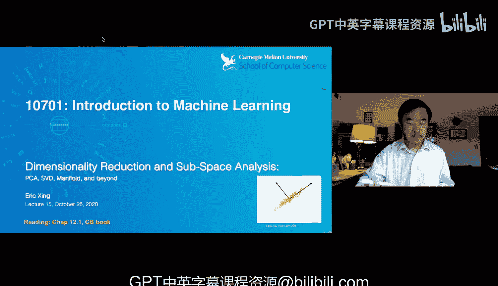

Today， we' are going to discuss another topic in unsupervised learning。

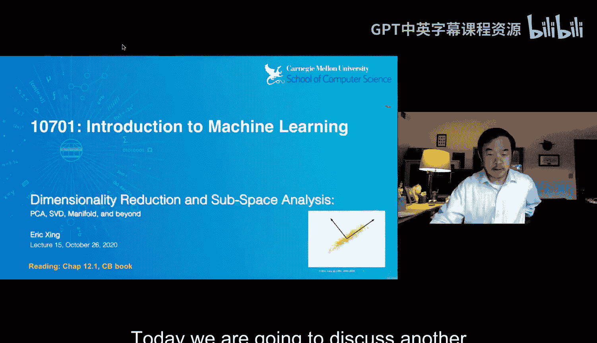

So we've learned two algorithm so far， right， K meanss and。

And EM algorithm in the context of unsupervised learning。

 So unsupervised learning means that you only have data points themselves without labels。

 and then you try to group them and try to find cluster。

There actually are a much richer set of problems in the scope of supervised learning。

 And today I'm going to talk about the problem of sometimes known as subspace analysis and also dimensionality reduction。

 which are。Arguably maybe even more popular and widely practiced in the field of machine learning。

 in fact， nowadays when we hear in deep learning research turns like transformers and encoders。

 they actually are conceptual closer to this subspace analysis。

 although not necessarily it is a dimensionary reduction。

 nowadays people may find the need to do dimensionality explosion to actually blow lower dimensional data into higher dimensional space for specific purposes。

So I'm going to talk about some very basic algorithms today just to get that conceptual principle clear。

 and then we will present a few algorithmic cases。

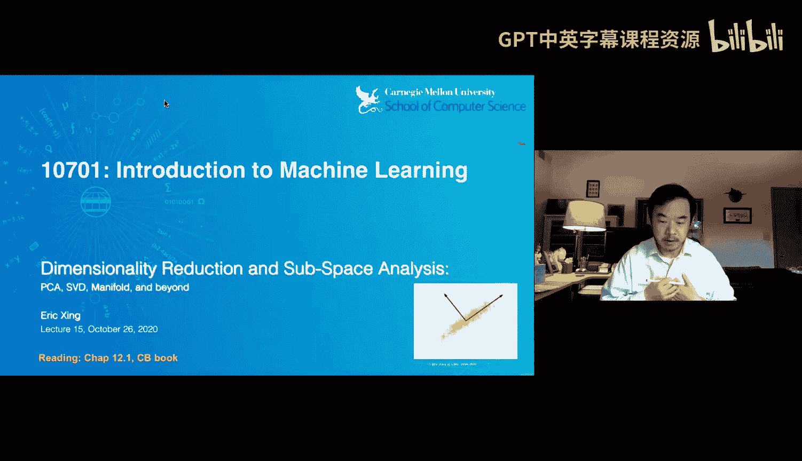

Okay， so here is a task that motivates this problem many， many decades ago。

 let's think about the problem of a document， tax document retrieval and labeling right。

 So you are given say a tax document like this。And one of the what each document， for example。

 are offer a different length， right， some are having， say1 hundred words。

 some may have a couple of hundred words， so how to compare。The different documents。

 say which one are similar。That actually leads to， you know， a representation of documents。

 which is known as the back of words。Okay， in the back of word representation， it's very intuitive。

 You basically just count the number of words。Okay， you know。

 based on a standard dictionary that all the documents will share。

And then you turn this document into a long vector of this accounting vector。 Okay。

 so that's a bag of representation。 And then， you know。

 you basically are getting something like this， a table whose columns are indexed by the different words。

 whose whose rows are different documents。And then you can basically measure， say。

 a e distance between the documents。So and you can compute the similarities。

 so you can even group documents in this web surface。

So you can obviously see that there are some problems with this a very naive representation， right。

 in fact， someone want to。Volunteer saying some potential issues with this a very。

 very straightforward intuitive representation。Let me open the chart。

To see whether somebody wants to。Does not capture the semantics information。Yes， and no， right。

 The words is semantics。 It doesn't capture fully。 That's true。

 But there are no technique that capture everything， but it's a。The amount。

Of capturing word must match exactly to provided a signal。

Cannot handle semantic similarity and term proximity。Dment呀。Some of these comments are quite sharp。

 for example， the dimensionality of the vectors is very huge。

 that's true because you may have a dictionary that could have a million word。So therefore。

 your 200 word document are going to be now represented by a million dimensional vector。

 which is pretty awkward。And there are then some other qualitative statements which dive into the semantic saency。

 basically of this presentation。Let's see what's wrong with the semantic part。For example。

 here are some obvious problems。One of the problem is called the synonyms。

 which is poorly captured in this presentation。Consider the two words， car and automobile。

 right these are two different words。And if just use the word count for representation。

 you will find a mismatch of the two documents。 One carries the word car。

 the other carries the word automobile。So therefore， you know。

 the true similarity between the two documents。Will be much larger than the measured similarity over that representation。

We also have some other issues， for example， the polysomy issue。That's the opposite of synonyms。

 right， For example， if you see the two document， one both contain the word apple。

If you don't look at the context， you may believe that they are the same。Or they are very similar。

 but we also know that the word Apple， you had very different meanings in different contexts。

 including the fruit， equi the company， the iPhone and so forth， depending on the rest of the world。

 what they are talking about。So in this case， the true similarity may be smaller than the obviously measure distance based on that representation。

I guess basically what this issue is pointing to is that。🎼Sometimes， you know，诶 we。Fail to， you know。

Express， you know that document or this data based on the concepts。

But only based on some surface indexes or or maybe dimensions such as the words right， so how can we。

 for example， represent the world in the space of concepts。The concept could be a sports topic。

 you know you know， a political topic， you know， the White House， for example。

 could mean the presidency rather than just a White House。

 right So these are what we want to capture。 So how can we generate these conversion representation and at the same time embed or project our raw data into this new space defined by the concepts。

So that basically leads to a task。What you want to do is to begin with a collection of unlabeled documents。

And then you want to find them， you know， embedding in some space， it can be words。

 but it can be also some other dimensions， let's say P1。P 2 P3， P1， instead of calling them word one。

 word two War 3 so that， you know， the documents are represented geometrically。

 but also have this conceptual saency for you to， you know。

 compare similarities to classify contents and and so forth。 Okay， so that's the task。And in the。

In fact， as early as in the 70s， people already were study this problem and there has been a very well knownn technique known as the latent semantic indexing which gained dominance in the 90s in the late 80s。

 which basically is taking a linear edge break view of the wording the document embedding problem and dimension reduction problems I just mentioned。

So there are a lot of different ways of understanding this technique。But the key idea。Is that。

Instead of representing the document。And， you know，queries， you know， in a like。

T dimensional space of terms like words。What this latent semantic indexing is doing is to compute eegbriically。

 some factors。Which can create a lower dimensional space。Okay， for example， in this case。

 you can imagine that I have a three dimensional original space。

 but I could identify two vectors in here， which could just define a plane。

That is a lower dimensional。And ideally， these two dimensions capture the most salient kind of concepts。

 you know， in the entire data set。And then you can basically discard the original coordination system。

And just use this one as the new space to embed your documents and how to embed is a very。

 very straightforward linear edge break operation， right， you thought product it。

 you basically make a projection and sos。And the SVD。

 also known as the single probability composition， is the mathematical tool to compute such salient vectors which can be used as the definition of the axis in the new space。

And these axis are also known sometimes as principal components。And sometimes they were also known。

 know called topics and bases， depending on their use cases。And mathematically。

 people also sometimes call them factors， although factors have other specific specific meaning。

 depending on the technique you use。So we're going to today study some of the operations and the computational procedures of this problem。

Okay。So let me continue a little bit to motivate on the conceptual level。

In terms of what's the utility and value， I think I'm going to just speak very highly。

 We can read the text in here。 right， We know that， you know， by using。You know。

 these latent factors， you achieved a hopefully a nice。Effect of lower dimensionality。

 because you can choose basically how many factors you need。

 that is sufficient to separate your documents。And and there， of course。

 a lot of nice motivations about doing dimension gravity reduction。And in the previous slide。

 the general motivation of factors， as we said earlier。

 is to capture this kind of a saency in the concepts and here you'll see a few more examples of what they mean。

Now。Mathematically， you know， we need to understand， you know， a few key ideas behind this SVD。

 the single value composition idea to turn what we just talked about， you know。

 in terms of conceptual saency， for example， in terms of the fundamental fundamental。

Directions or dimensions that documents can lie can be projected into without losing information。

 So these are all very high level， you know ideas。 but what do they mean algebraically。

 So here are some key concepts。First of all， the concept of variance in here plays a big role。

Because imagine that youll find a， you know， for example， I'm in such a space。

Right and I have a point clouds all over the place。And I happen to find the one direction in here。

On which if all the points， so basically the points are projected here。Projected here。And so forth。

If， you know， they projected like this。Okay， meaning that they are spreading across all these versus another direction。

 for example。Say in here， all the points are projected to just a small in here。

Meaning that this one has a high variance， this one has a low variance。

Which direction do you think is more interesting and carry more information？Right。

 so this is just an intuitive。Kind of。Guess， but hopefully leads to our mathematical operation。 Yeah。

 I got an answer。 high variance。Obviously， right， if you identify a direction like this one where all the data points are just collapsed into a single location or very。

 very narrow range。You probably can guess that this dimension is not useful in spreading data in tell apart data from each other。

 right， And but if data are lined in here and they happen to project very nicely to this dimension。

 That means this is a nice direction， right So area of of variance in the data is something we want to capture and we want to capture it in the mathematically。

 you know， explicit way。And then there is also this notion of correlateness， for example。

 now we know that this is a direction which has a lot of variances。

Then how interesting it is about this direction。Versus say， another direction， you know。

 maybe pointing to there。Which one is intuitively more interesting？

Someone want to type answer or shout the answer。I don't see answer， but I guess you probably can。

Appreciate yes， okay， I got the one one reply。 Thank you very much yeah。

You probably have a intuition that if I were to find the two best direction of projection。

 then the second direction is better to be more independent than the previous one than highly correlated because of the simple notion of redundancy。

Okay， and then， you know， basically we are trying to。

 the problem now turns into looking into the data cloud and maybe identifying some underlying directions。

Which is not given explicitly in the data。 but they kind of describe， you know the。

Extendent of information threat and the extent of redundancy or unreundancy， you know， in the data。

Right， and this basically defines the problem。 you know， that do I going to mathematically solve。

 right and。These directions。That way are talking about。

Refers to what we know as the principle components of factors。Okay。

 so so much for the high level discussion。 Now， let's look at the specific examples。

So here I have a data point cloud。It is in two dimensional space， like in here。Okay。If， you know。

 I will ask you to， I was asking you to say， save some effort and find one direction to。You know。

 a project data， you are only， you know， allowed to use one number rather than a two coordinate。

 you know， to express the same data set。Then you need to find a direction that could， you know。

 express， you know， the data in a more kind of compressed fashion。How to， you know。

 you probably already guessed that which direction， well， I guess this might be a good direction。

Right。If I ask you that I still want you to use two direction。

 but that direction probably give you the best kind of。

Information in terms of how data are distributed， what could be the second direction。

 or based on the redundancy principle， if the first one is already this one。

 then the second one should be this one。So this is exactly what do we want to achieve in our principal component analysis and edge break way to achieve that is actually written in here。

Imagine that all the data are centered， basically we're going to now first redefine the origin of the coordinateronary system so that the average of the data points becomes zero。

And then what you can do is to make one of this direction， let's say。

 let's start one by one来 make this direction。Which is， of course， expressed by a mule。you know。

You know， a unit to vector。Okay， indicating the direction。We make this as a unknown variable。

 It could be pointing here up here。But whatever it is pointing to。

 we can always compute the projection of any data point on police direction。

 which is computed by this。Right。So， I'm going to basically just。

Compute that projection because they are centered， therefore the square of that is actually the variance of the data along that direction。

Okay， we' are going to take expectation over that。Okay， that expectation can be， of course， you know。

 computed by just a numerical sum of all the you know。

 this square term and divided by one minus n you know， n over one over n。Okay。

 so now we get down to another problem where we can maximize the variance computed in this way。

 So this mu transpose times X times X transpose times U is actually the。Entire variance that。

 you know， you can compute from data。 by the way， this X is the data matrix。It's a matrix of。

All the vector。Each of them correspond to a document。

And we know that x times x transpose is also known as the covariance matrix of the data。 Therefore。

 you are literally just looking for you know， a projection direction mu， which achieved。

The following effect by left， multiplying the covariance matrix with mu transpose and the right multiplying the the the resultant vector with another mu。

Which actually leads to a scalar。 We want to maximize this quantity。Okay。So in the end of day。

 you know， this problem is about solving you know a direction of a mu that maximize the variance。

Of the data projected to this direction。And that leads to a very。

 very standard you know optimization problem， constrained optimization problem。

 so we maximize this and this is you know the constraint of the mu to avoid basically a trivial maximization result because you can make the the size of the mu infinite big so to achieve the maximization in here。

 but that's not meaningful because the information of the direction is lost。

 therefore we set the direction vector to be of unit lens。

And then only the orientation is going to be a variable。

And solving this is a pretty standard problem in。Constraint optimization。

 you build a like loing here。 Lambda is the。Is what is known as the lock launching coefficients。

 lock launching multiplier。 And then you take a derivative of the grand like launching over the mu。

 and then you get to this。Equation in the end， which gives you the solution。ok。

So if you look at this。You know you can probably see already this is a linear system and the solution basically called can be achieved by finding what is known as the eigenvector。

 you know of this covariance matrix。嗯。Okay， so let's study again I'm not going to use this lecture to discuss the linear algebrabra。

 therefore if you have some gap， you know to the concepts of eigenvalues and eigenvectors。

 I encourage you to read some review some of the college edge break books or go to the T on office hours to get some clarification。

 but here I just want to state a few key properties of the eigenvalues and eigenvectors。

So here this is the definition of the eigenvalue v and the eigen eigenvalue lambda and the eigenve V。

Okay。And the。The vector is to avoid trivial， it should be a90 vector。Okay， and also the lambda。

 the eigenvalues should be a real number。Okay， this is just an example for the definition of a eigenvector。

And also， it's secondvalue。And the next question， basically for any， you know， matrix， square matrix。

X， you can get， you know， it correspond to a set of eigenvalues and eigenvectors。 Okay。

 now how many eigenvalues。And eigenves you can have at most。 I mean。

 how many mean red non redundant ones。Well， there is a very simple mathematical proof。

 which will show you that for a matrix with a rank K。With rank M。

 you get at most M distinct solutions to this linear system， therefore you have M。

 you know at most distinct eigenvalues and eigenvectors Okay， so this is just。

 I'm not going to prove it。But yeah， someone actually give answer or that's great。 Yeah。

 but if you are not familiar with this， you can now take it as a fact and then figure out why it is so。

 you know， in your。After class effort。There are some other important properties of eigenvalue and eigenvectors。

 the one of the most important properties that by definition。Different eigen factorsctors。

Areknow as orthogonal to each other。Okay， meaning that their dog product always leads to a zero。Okay。

And in this case， you know， you have two eigenvectors， therefore。

 you these two must be different and they are authentic to each other。

Let's see what else assign need to cover。Yeah， it's already said so all lienves Oh yeah。

 there are some special cases if your if your matrix is real and symmetric。Then。

It is guaranteed that your eigenvalues。Will also be real。 Okay， that's a nice property to know。

 So symmetric matrix and real matrix makes the condition better。

 and the condition can be even better if your， you know， matrix S is called positive semideinite。

 if your matrix is a positive semideinite， then your eigenvalues will be not only real。

 but also non negative。Okay。嗯。Well， it's actually very easy to define what is the positive semi defite。

 but I'm not going to spend time here， you can basically in it。Defin in here。

 but you can discuss with Ts if you want in terms of exactly what it entails about the fatization of the matrix。

Okay， so now we've got quite a few concepts already， right， the eigenvectors， you know。

 of a matrix can be computed。And it is actually known as the component principal components in the context of our。

You knowあ。You know you know， LSI analysis， latent signal greenback analysis。

And the first placement component。Is actually guaranteed to have the greatest amount of variance in the sample。

Okay， so basically these principal components can be ordered。

 remember that in our point cloud with it just now。

 we basically make this the first and then this one is the second。So when we actually do PCA。

 you know， for the input covariance matrix， you always can rank。You know。

 the resultant M eigenvectors。And then after the rank， you know。

 you can you know have the following property guaranteed that the first PC is the one carried the greatest amount of variance。

 the next PC carries the next amount of greatest variance after the first one。

 basically when the first one was removed from data。

 and then the second one will carry the biggest variance。O。And。嗯。I think there isn't anything。Yeah。

 there is another concept you want to remember， which is the least square view， the piecess。

The principal components is a series of， you know，Linear squares fits to sample。Okay。

 which basically， you know， what I'm saying that if you want to fit the data point， you know。

 using one dimension。Then， you know， you can， you know， the the， the。

 the first dimension is basically the least square， because remember。Our very。

This is the least square。 if， you know， here you don't see that so clearly because the data are centered。

 but if your data are not centered， you actually will see that it is a meal time。

Right so this is by definition， the least square fit of the mu and once you fit that and you subtract you know basically the projection on mu from the data and then you find another least square fit of the mu。

 you get the second principle component so that basically tells you the correspondence between PC and also the least square fit of the direction。

Okay。All right， so then。Because the principle components。Are all ranked。You can now have a。

 a option to choose。You know， out of the impossible principal components。

How many I want to use to represent the data。Why this problem is interesting， because remember。

 to compute PC， you begin with a matrix of C， the covariance matrix。

 and what's the size of the covariance matrix？For it is N百 N。RightN being the number of data points。

And if you have a very large data set， say a few thousand data set， then you could， and if they are。

 you know， a non redundant。And therefore， full rank。

Then you can potentially get a few thousand such principle principle components。

 which is probably two cumbersome for you to carry all and if you just plot their you know eigenvalues。

 remember the eigenvalues correspond to the amount of variance in that particular direction。

 you actually could see。You know how much variance is carried in each direction？And typically。

 people observe that the distribution of the variance drops very quickly， you know。

 across all the principle components。 maybe after 10， the whole thing will be just residual。

 maybe 95% of the variance is already captured in the first 10 principle components。 Therefore。

 you can basically cut from here。So this plot of eigenvalues could help people to find a maybe a cut or a threshold of identifying how many PC rather than just a random gas。

 someone may choose to cut from here， for example， where you see， you know， anything。After that。

 stuck to a drop very slowly， but before that， you see a much， much higher number。Okay。Now。

 having talked about the。The PCA， let's move on to another concept called singular value decomposition。

So remember， in PCA， you started from a sematic matrix C。

Which goes from a comes from x times the x transpose。Right。And in the。

F of information re troubleval or in text mining。 People are not comfortable thinking in the form of the C。

 the covariance matrix， because it's very abstract。 You know， you， you。

 you get a sense of variance and covariance among data points。

 but the original meaning or ingredients of the data somehow get lost。 For example。

 the frequency of the word and the the the strength of the word and so forth。 Therefore。

 people are more comfortable just thinking about the X。

Which is also known as the term document matrix。 So here are the terms here are the documents。

 So every document is a say a vector。Something like this。Okay。Then， so they want to start from here。

 and then we can use a technique known as the SVD to also decompose them into a sequence of a matrix product。

 Okay， so， for example， given a matrix。Which is N by N。Okay。So this is a rectangular matrix。

And let's say it has a rank R。Rannk R is something that is not very obvious from the data。

 but when you compute you know the singular value decomposition， you actually will see。

 you know how many90 eigenvalues you will get， and that usually correspond to the rank of the matrix。

So it can be written as a U matrix， which is M by M。 It's a square matrix times， you know， a。M by N。

 diagonal matrix。And times， you know， a N by N rectangular matrix a square matrix again。 Okay。

 so this is known as the single value decomposition。

And this U and V matrix are very interesting in the sense that maybe I should just draw it in here。

 So this equals to， you know， maybe a。This matrix， times the this matrix and times the。

Something like that okay。Okay， so this U matrix in here。Is made of you know many columns。

It turns out that the columns in this matrix correspond to the orthogonal eigenvectors of this matrix a times a transpose。

Okay， and the columns in here。Correspond to the eigenvalues of this covariance matrix。

 It is the a transpose times a rather than a times a transpose。Which is a N by N matrix。And then。

 the eigenvalues。企。Of the lambda in this has a relationship with the eggigvalues in here， you know。

 like this。Okay， so the sigma。Which is the values in here， basically。

Correspond to the root mean square。is square root of the eigenvaluetes of these matrices。对。

By the way， you know this matrix and this matrix have the same eigenvalue。Okay。

AndYou can prove that by some edge break operations。 And therefore， you know， a， you know。

 their square root is actually corresponding to the。Numbers in this sigma matrix。Okay。

So that basically， you know， get us you know the SVD。Theorem， okay， for。呃。

You know the S to be a square matrix with M independent eigenvectors。

 then there exist at eigen decomposition， you know， of this。This is really what we have in the PCA。

And they have， again， this ranked list of eigenvalue。But， you know， they leads to， you know。

 the SVD in a close relationship where， you know the， you know， as I said， just， just now。You know。

 the。The columns in the left matrix and the right matrix。Corspond to basically， the PCA。

Of the full square matrix resulting from you know the a times a transpose or a transpose times a。

 And then the eigenvaluevalues of the rectangle matrix is just a。Square root of the。

Agonomes of the original matrix。So how that actually happened。Okay。

Remember where everything starts from here。Right， so this one， leads to a， you know you know a。

Single value deposition a PC principal component analysis is in the matrix decomposition of the square matrix。

And if we do this。Right， we is the。The V matrix is basically a matrix of column vectorctors。

 which are the eigenvalues of this guy。And then if I do something like this。

Let me see if I can do that。嗯。Okay。Anybody realize that I'm basically just making a trick of inserting a identity matrix in here here。

 You know， I introduce a matrix called the U。Okay， which is a orthogonal matrix。You know。

 if it's a matrix ofigenvalue eigenvectors， which are， you know。

 unit length vectors orthogonal to each other。And then I basically introduce U transpose times U。

 which actually leads to identity。And therefore， these two square root of the sigma can actually。

 you know， be。You know， a multiplied again to recover this new。

 So this identity is basically straightforward。And then if I look at this part。And this part。

You probably can see that这。X T times X。Equals 2。Wei。And that basically leads to this。

Where the rectangular matrix can be now expressed as a product of three matrices。

Mu and sigma and and V。 And then what is sigma and what is view and what is V are pretty straightforward。

 you know， from this definition in terms of why they are the eigenvalues and eigenvectors of the original square matrix of covariance。

Okay。Is there a difference between a single level。 Okay， so Daniel already answered the question。

 Any other questions at this point in terms of the。Relationship between SVD and PCA。It's a little to。

Confusing， but in fact， many people don't tell the difference between a PC A and A SVD。

 PC A is a bru force， kind of a。You know， PC is basically working on the covariance matrix。

 and SVD works on。Possibly a。A recectangular term document matrix。

 but then edgeically PCA is to directly solve a eigenvalue problem because it is a square matrix and the eigenvalue and eigenvalue problem is straightforward defined and SVD。

 you know， the solution of SVD requires， you know， to turn back to the PCA in terms of solving the eigenvectors and eigenvalues。

But indeed， they are very， very similar and in terms of the operation needed to get to the eigenvalues and eigenvalues。

So we start， let's move out of the algebra， which is a little bit painful and look at how how this technique can be used now to solve a real problem。

Okay， so here is an example。Of a data set with these many documents。Okay。

 each of them basically is represented now by you a term frequency。

So this is known as the turn document matrix。🎼Or by the way。

 you may be a little bit confused by X and X transpose。 yeah， this is a confusion term。

 Sometimes people you know， use the role to list all documents， sometimes they use the column。

 but that's not really a big deal because they all leads to the same eigenvectors。So in here。

 let's first inspect maybe these few documents。 You'll probably notice that there is a column where there are no。

Kind of instance of any of the terms given in the list。Okay， that caused this matrix。

 which has originally how many columns。8 columns to have effectively only seven columns。Okay。

 so this is a rank 7 matrix instead of a rank8 matrix， because this particular column， you know。

Has all zero elements。ok。And then we can do a SVD。Let's imagine that this is， you know， a X matrix。

 or maybe record it a a matrix in here。 This is a matrix。And it leads to a U and a sigma and a V。

 which can be numerically you know。Computute it。And again， in my lab， or there are many libraries。

 just does this for you in a single command line。Now let's see， you know。Usually after doing this。

 people would first inspect these eigenvalues to see how much each of the eigenvectors is preserving information。

 the larger the magnitude， the better， and also you can use this accordingly to chop off what you consider be less essential directions or eigenvectors so that they are left out。

So in this case， you can imagine how to choose a low rank。In fact。

 you can choose any of it the low rank， you know， based on a numerical justification。

 basically by setting。的。Smallest R minus K。Eigenvalues to be 0。

You are going to get an approximation to the original a matrix。 So this is what happens。

And then you are going to get a reconstruction of the a matrix。

 which only based on the first K eigenmes。Okay， so this is actually a reconstruction。

 and you can actually measure the distances between the original matrix a and this one。

That actually gives you a quantitative assessment of the quality of approximation by this low rank approximation。

And it turns out that the distances between these two， okay。

Can be measured by what is known as the Frrobinus norm。

 which is basically the utility distance between two matrices。

 you can view all the numbers in the matrix as a coordinate and then calculate the distance between the two matrices。

And it turns out that if you have a K rank approximation to the original full matrix。

 then the error is exactly defined by the。The K plus。呃The the the the the， the case。我的。

The number the next eigenvalues you know after the K eigenvaluectors。So it's pretty neat。

 That's why when we look at the all the numbers below， we actually could even quantitatively measure。

 you know， the approximation error。So in this case， you can imagine that we can now， you know a。

 you know， a see。You know， a very convenient way of reducing dimensionality。

And this is actually also what is known to be a major goal in LI， the singular。

 the latent semantic indexing。Say， starting from a huge， say matrix of。58，000 documents。And maybe。

50000 say terms。And。Maybe a million 10 million documents。Okay。Of course。

 this this matrix shape isn't represented that， in fact， here we have a way bigger kind of number。

 but in here we have five。50 k termss， which are still quite big。

And then this turn do matrix now gets a SVD， as we just see before。

 and here is how the SVD would give you right， They give you， you know。

 a ranked list of other a vectors and you can stop basically from somewhere。Say from here。

And then what you get are two smaller matrix， which are totally up to your control。

You can basically choose this to be。K。ok。And then， what you get is。You know， a sub matrix in here。

 which contain only the first， you know， K。Eigenvectors。

And in here you have also the first K eigenvectors in here。Okay。

 and this subset of the eigenvectors and eigenvalues will be able to reconstruct this original input matrix a。

 and we know that the error is defined by the sigma plus one。Okay。And in this particular case。

How do we make a correspondence of the original。Document in here。Okay， versus， you know， the。

Document in the projection space。Okay， actually， this is how it works If you look at this D matrix。

Okay， here you are going to get it's a， by the way， it's a K times N matrix。

 N is still basically the total number of documents。Therefore。

 each document now has a correspondent in this matrix， but it is now a lot shorter vector。 Okay。

 it is only of dimensionality K。Okay， and this one correspond to now the new representation of the document。

Okay， that basically achieved the goal of dimension and reduction， your document。

 which were originally。50 k dimensional becomes now a K dimensional， much shorter vector。

And then these K vector in this matrix， U。Actually carry seman meanings。

 They usually correspond to you know， the what is known as the topics， you know。

 in this entire copper， which allows you to spread， you know， to define the subspace。

 the latent space。On which your document can be projected into。So what I just talk about in LI， you。

 is also known as subspace analysis。Before I move on。

 I just want to have a brief kind of elaboration of this technique。

 subspace analysis so that you know that it actually correspond to something even beyond。呃，SCD。

For example， link here in the past。Several decades。

 there has been independently a number of different techniques developed for analyzing data without labels and making projections of the data into some space。

It turns out that they can be all unified under the concept of subspace analysis。

And the early differences between all these different technique， you know。

 is actually the very numerical conditions or characters of this a T matrix， lambda matrix。

 and also the D matrix。We've seen， for example， L S I already。

Right which basically says that these two matrices are arbitrary。

 they are just eigenvectors of some input matrix。And this one， can also have arbitrary real numbers。

But if you make a constraint， for example， if， you know a。Let's say this particular matrix。

Is constrained to be just the 0，1 matrix or the so called one hot matrix。

 meaning that every vector here。Okay， say this vector here is a one hot vector， meaning that。

Only one dimension is going to be呃 to be one， and all other dimensions is to be0。Then， you know。

 what this vector is achieving is to assign， you know。

 that particular document into one of the K clusters。 right you can imagine that the second。

 maybe this is one hoting here and that one is one hoting here and this one is one hoting here。

 then it basically achieved the goal of clustering the data， you know， into you know。

 some clusters and then the。Wtering here could be understood as the cluster central it the average of the points of those cluster。

 and then the analysis becomes a subspace， it becomes a cluster analysis。So in a sense。

 you can solve the classroom problem， you know like the you we have two algorithms。

 the Ks algorithm and EM algorithm， now you can have a third algorithm where you do a constraint optimization that you define such three matrices。

Okay， and you constrained the matrix to be of certain property， such as the 01 matrix property。

 And in here， you， you know， have some numerical correspondence of。You know。

 making every factor being an average of the points resultant。So this is a way of solving that。 so。

 although rarely people use this because this is a little bit numerically too hard to solve。

There is another technique known as the topic models。

 latentmatic indexing in the probabilistic domain， which actually requires the vector in here to be now as satorcchastic。

Vior and the whole matrix to be a stochastic matrix。 What does that mean， I means that。

Every vector in here is a vector of positive 90 positive numbers。

Between 0 and1 and the summation of that sums to one。Okay。

 so that means the probability of basically this particular document being in every topic。

 in every dimension。Sometimes you can also make this matrix spae。

Meaning that there are it's favor to have a fewer number of9 zero elements in here。

 how fuel or it depends on the strength of your regularization or constraints。

But that's actually another free parameters people can can tune。

 but the resultant results is also known as the sparse coding。

 You are going to now encode every of this document into， you know， a spae vector。

So these are already four examples of subspace analysis which were developed separately in different contexts。

 but using this matrix expression， you can basically view them to be variations of a pretty straightforward single concept。

That projects the data into latetnt space。Now let's look at how the example that I just showed proceeds right I said that given this turn on document matrix。

 you do SVD and you get this U matrix， this Lada matrix， and also this V matrix。And。

After inspecting the eigenvalues in here。I may decide to pick only two eigenvectors。Therefore。

 everything else is left out。Okay。Then what these two eigenverctor can be used is to define now a new space。

Of only two dimensions， rather than， you know， the original space of many more dimensions。

And then we can make a projection of all those data points know into the new space。

 and here is what projection look like。Okay。You know， these actually are the original articles。

Which produces this turn document matrix。And now you can see this projection resulting from the SVD and low rank approximation。

There are two dimensions only。Okay， and here you see two type of points。 One is those M points。Okay。

The endpoints are basically corresponding to。Disguise。Okay。

 it is basically the new coordinates of the original documents。You know， in the new space。听。

And you can see that one interesting thing is these documents do not go all over the place。 They are。

 for example， there are no documents in here。 right They are kind of aligning here and in here。

Which is already displaying some maybe nice pattern of a clustering effect in the latent space or in the topic space。

Then， there are also。You know， awards。You know， in here， these are some other projection。

 What are these。 These are basically。These numbers。Okay， it is the。The topic vector， but now。

 you know， expressed as the weights of every term， every original term in here。You know， in this new。

Tical space， Every word， for example， this word say。You know， a matrix。Right。

 could have different weights in these two topics。1 has a weight of 03。

 the other has a weight of negative point4。 That means this word matrix is strongly contributing to topic1 or eigenvector 1。

 but not eenvector 2。So now look at the pattern of the words， you kind of see that in here。You know。

 there are names like words like I don't， I cannot even see it， maybe I can blow it up a little bit。

You can see disease， for example word。And another word called it blood。

Maybe you can already guess that this particular dimension。Represented by， you know， a one eigenma。

Correspond to maybe a disease to the blood and something。And in here。

 we have words like depressed and I don't know。Culture， well， that may be another disease。

 which are more psychological。So that's why people say the LSI automatically discovers semantic topics。

You know， just by looking at the word frequency of word weights in each of the resultant you know eigenvectors。

 and that's exactly where you see here one is more like a blood disease。

 the other is more like a mental disease and then the documents can be grouped accordingly or projected accordingly。

So that's one utilityDT。 You visualize the data。Now， by I in a two dimensional space。

And this is achieved by reducing the dimensionality of the original data down to a two dimensional space。

And then you can also use the projection to more silently identify clustering or grouping patterns。

You know， of the documents and also to even identify the intrinsic topics exist in the coppers Okay so that's one major application of S LI or SVD。

Another application is to use what we just have as a tool to compute queries and to， for example。

 classify。The label of a incoming new article。For example， you know。

 I have a query which leads to the following original wording bedding， the bag of word presentation。

Then you can multiply this Q vector。We said the U matrix。

 remember the U matrix now have only two major eigenvectors。

And then you need to normalize it by multiplying a inverse of the eigenvalue matrix so that they become magnitude wise comparable to the already projected documents in here because they all basically have。

 the matrix in the eigenvalue weighting already done， you know， when they are projected。

So then you get now a new expression of the input query。Which is in here。Okay。

You'll have a bunch of it。In the representations of the original documents。

And then you have this new one in here。And what you do is to just compute a say。

 a pairwise distance or maybe a cosine value in this case。

 between this vector to any one of the other eight vectors in here。

And then you can determine which one is the closest， I guess this one is very close。

 Probably you want to match this query to that document。So geographically， you can also see that。

No not geometrically can see it， right， So among all the documents in here， M1， M3 M2 and so forth。

 your query basically land you in here， which is closer to to what I don't know。

 there there is a M2 in here。 maybe that is closest to this one。 I hope。Okay。

 so that's another application。 You compute， you know。

 use the use the the new eigenvalues and eigenvectors to compute projections of the query into the topic space。

Where you can make predictions of the title and topics， are label of the query documents。Okay。

 I think that's the end of the major bulk of the material today。 You know。

 I talked about what latent semantic indexing is and what it can be used for， you know， in。BR。In。

 you know， in。You know， a correlation analysis of query documents and all this other thing。

 noise reduction and exportation of redundant data is simultaneously achieved just by looking at the projected data into the latent space。

One other the challenge of SVD or PCA in general is the computational complexity。You know。

 we need to now do single value decomposition， and we know that it is a n square operation where n is the dimension of the matrix。

 so if you have a very big turn and document matrix， that n can be very。

 very big and that could leads you to some computational challenge。And that's also why， you know。

 a later technique known as the LDA， latent seman latent digital allocation。

Or probably talking model was invented because in there。

 you can use an E procedure to incrementally learn the topics without factorizing the whole matrix。

 at least that's one of the conveniences， you know， for that new technique。Okay。

 we have another 150 minutes。 I'm not going to read the summary again。

 You can take it home and review it by yourself。 But I want to say a few extensions of this technique。

 just for。

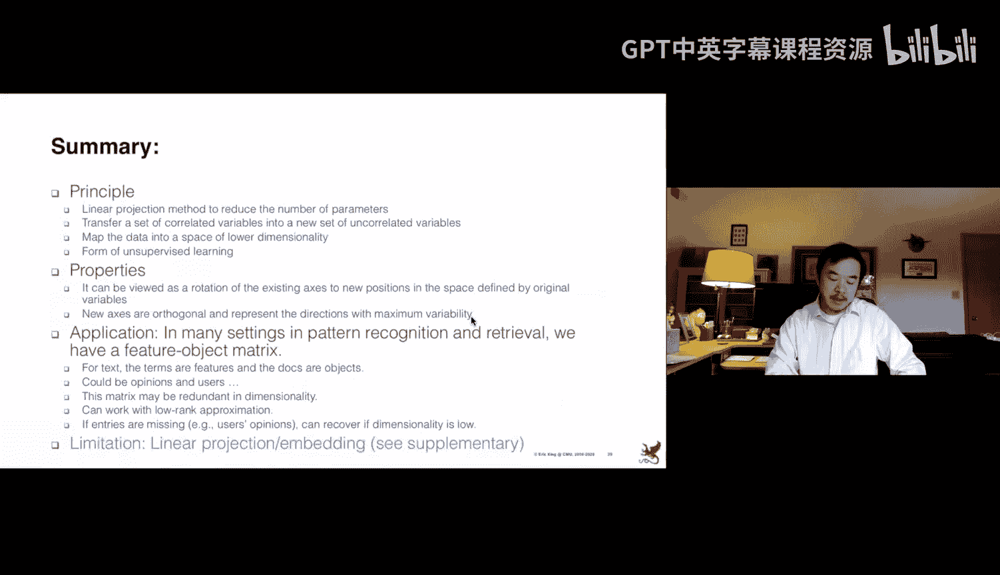

Just for our， you know， maybe knowledge and information， actually， before I do that。

 any questions so far from the materials presented already。

Any questions so far regarding the PCA and SVD and LSI data seman indexing？

Nopes， okay。Then let's look at we talk about the。The text， you know， N allP applications a lot。

In fact， in the image domain， computer domain， we have exact same problem。

 maybe even worse because a image is represented by pixels， therefore every image。You know。

 is represented by a huge matrix of pixels， which can be linearized into a very long vector。Okay。

 where N could be easily tens of thousands， if not meetings。

And here people also are facing the dimensionality bottlenecks because you know。

 images are just too high dimensional and hard to manipulate。

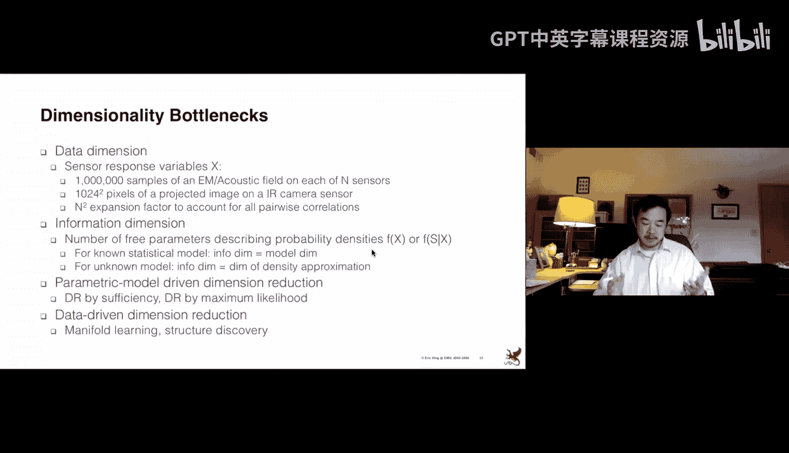

And then people ask， right， how can we group images and or how people mentally group images， right？

For example， in here， you know， that's our brain stored all these pixels literally or we。Kind of a。

Discover patterns from the images。 For example， here， you can probably see that。There are。

 maybe left side views。You know， maybe a middle views and。Rside viewss and so forths。

 maybe that's the way we you know recognized images， I don't know。

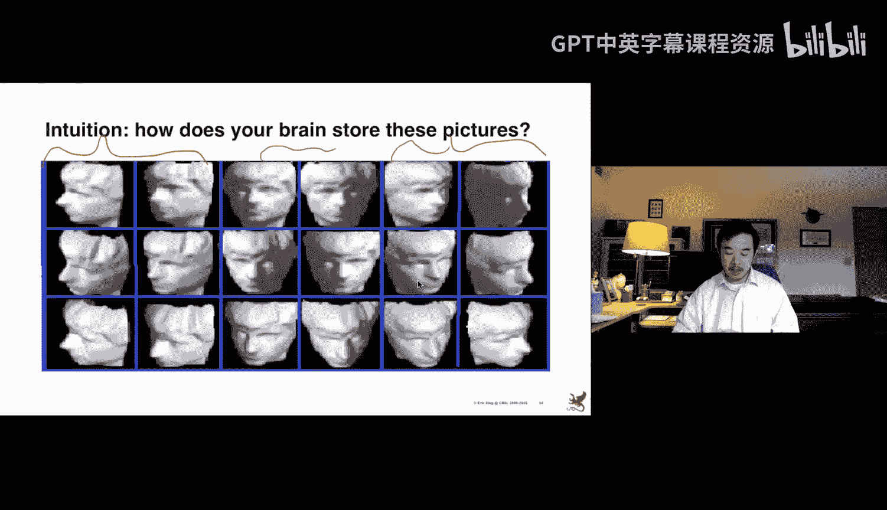

But the point is that how can we， you know a。Competationally， numerically， you。

 discover such groups of images。It turns out that the technique used is very similar to what I just described in the LSI。

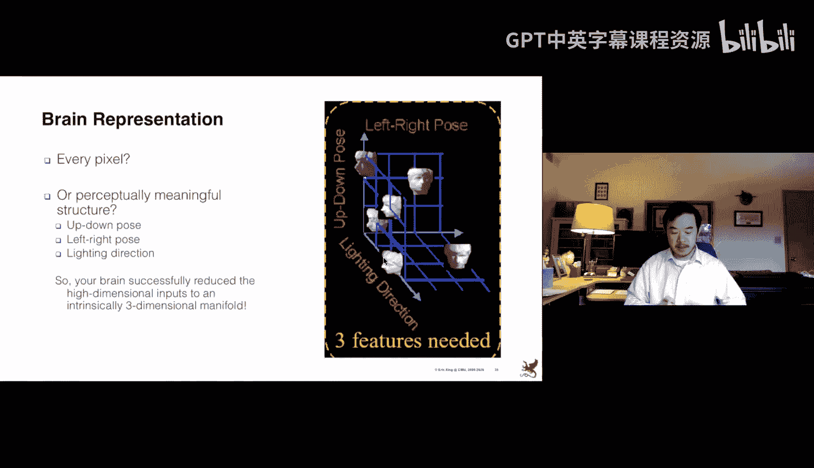

Here people。Also raised a few other interesting geometric points for people to consider。

One is what to preserve。You after you'll make a projection。You know in know。

In addition to you know maximizing variance， for example， you or achieving line redundancy。

 there is another angle， yet another angle to look into the problem。

 which is is my projected data preserve some of the key properties？That I have in originalal data。

 for example， here， this may be a original data。Which is three的 man no。Right。

 and then I want to project them into a two dimensional space。 or vice versa。

 I can project here from here， from2 to3 to make a dimensionality explosion。

When you make this projection， you can see this shape between this and that can be very different。

After the embedding， but what is the importance thing to be preserved？

So here one of the interesting things to preserve is the。You know。

 the neighborhood distances between points， if you and me were neighbor in our real life space。

Then when we were project to another space time or， you know of a space。

 maybe we still want to be neighbors。 That means this projection is preserving some good information。

 so this could be， you know what the image people want to do。

Another preservation is called information preservation。

 it's about representing the data not as its a raw surface value just as a pixel value coordinates。

 I want to use a model to for example this a whole you line。Is generated by a linear function。

 parameterized by theta。And maybe that underlyingline is preserved by another linear function。

Prompterurized by theta prime。And instead of asking the line to be close to each other。

 I may ask the theta to be close to each other。 That means the information content or， you know。

 you know， a meaning， you know， of the surface data gets preserved。

 So that leads to some other type of preservations。Okay。

So let's continue on how to make this embedding， using some additional ideas in terms of our what we see already in SVD。

What they want to achieve in here is to be more explicit。Of preserving， you know。

 the data dependencies in the training data。Remember， in our PCA。

 we didn't actually look at the data points in point to point to worry about preserving their distance。

We were basically talking about reducing， for example， this quantity。

It's the projection of the data onto a direction and then minimize their variance。

 We didn't talk about the data to data relationship。But in here。

 what if I want to achieve a projection which preserved me some data property？

So that basically leads to， an extension of the technique we just mentioned。Departing from here。

We can actually expand the notion of the covariance matrix。

 The covariance matrix is actually capturing some kind of affinity between the data points。Right。

But you can also use some other method to compute the affinity。 For example。

 you can just replace every entry in the seat in in the C matrix to be just the parawise you distance。

Between the points， this is known as the MS， okay对。Minimum description lenss something like that。

 I forgot the exact name。There is another technique to fill in the matrix a known as the geodistance。

So in this case， you are not going to be you know， relying on， you know， the entire kind of。Distance。

 you know， between all points。You basically are only going to pay your maybe you should wait。

 I should say that you pay stronger attention to the data points closer to you。ok。And also。

 maybe ignore the the numerical。Values。But more on the operational values， for example。

 after computing the pairwise distances between points， I I have a graph， yeah， have a graph here。

You can basically， you suppose I give you this graph these data points。You can compute a， a graph。

You know。Called neighborhood graph。Based on all the pairwise distances between data points。ok。

And then you can do， you know， a， you know， a shortest pass kind of operation on this graph to compute what is known as the geodance。

 The number of steps， you need to walk to the other data points。Okay。So this is not a quick distance。

 but you know， a operation distance of pass length， you know， on a distance graph。Okay。

 and then you can basically put this number into the C matrix and get you another type of decomposition。

So basically， the art of embedding is to really be creative about this C matrix。

Either using you know e eucliideine distance or geods。

 And there are many other kernelized and other you know。

 embeddings people come up with by different operations， which are not going to talk too much about。

 But at the end of day， what all these are trying to。Discover is what is known as the manifold。

You know， in the manyifold， you know， it's a topological space where， you know。

 data are only treated Euclidean locally。For example， here we have a manfold。Right， and。

In this manifold， the distance and is。Defined， you know， in a locally geometric way。

 but not a global way， for example， this point and this point。

Are considered to be far because they need to work across the entire kind of will to get to the other point。

But on the other hand， data points in here can be very close to each other。

And you cannot just cross the space， you know， to draw a direct line， you know。

 to know reflect the distance in in out of the manifold space。

So if this is a property you want to preserve。You know， for the data or in other words。

 you believe that the data is a manifold rather than a data cloud then the。

Distance this function I just described is one of the effective way of achieving that kind of embedding。

 they preserve， you the manyifold properties of the data。And this kind of。Properties are often very。

 very useful。 People。 One of the famous example， I don't know whether I have it or not is known as。

Yeah， the Swiss for example， right？I think people are very good at picking this continuity of data in the data space at this role。

 for example。Its defining a subspace where data lies right and you don't basically naively claim that this point and this point are very close to each other。

 simply because in the higher order space， they look close In fact。

 they are very far from each other by this amount。Because they live in a submanifold。So in image。

 people believe that in computer vision， people believe， for example。

 the head pictures I just mentioned。

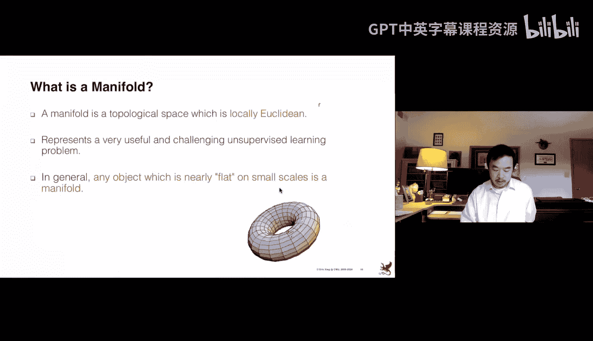

In here may actually be， you know， entities that is living in a manifold instead of living in the。

You'uccle in space of pixels。And therefore， to embed them to the proper lower dimensional space。

 you want to preserve this kind of a manifold property such as local geometry， a local Euclidean。

 and also past distance and so far， rather than preserving the straightforward。

 original high dimensional pixel space distance。Okay。

 so I think that's pretty much what I want to say。 So the technique of PC A or the technique of of a single valuecomposition。

 you know， can be used to achieve。

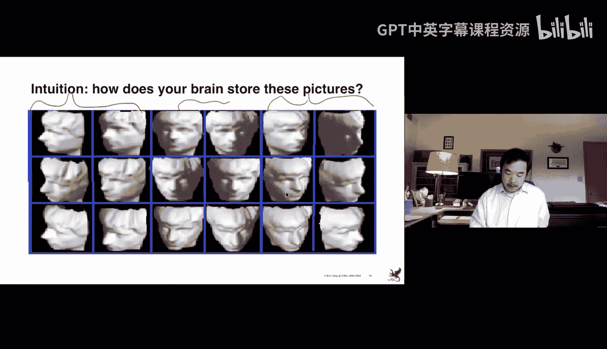

Now， one more go beyond DR beyond。Retrieval， they also could be used to recover submanifold in high dimensional space with a low dimensional representation so that you can start uncovering more kind of a salient grouping properties and dependencies between the data point that is in the submanifold space。

Okay， time is up。 There are some additional examples I didn't go through。

 but you can see these fun graphs， you know， telling you how， you know。

 such embedding can enroll data into a more intuitive form。

 and making them more easy to compute and cluster。 and there are other applications of you know。

Image， imputation and so forth， using very simple em technique。Okay， so with that。

 I think I'm going to finish today's lecture， any questions in the last minute？I had a question。

 it seems like PCA is kind of a sub problem of SVD。Like you， you get the。

The principal componentss for free when you do SD。So with one or the other。

That's a good question in myself， many people including myself probably get confused。

 you know PCA in a narrow sense literally means that you define that matrix of interest to be the covariance of the data。

And then you'll get principle component in a sense， SVD is a lot more generic。

 they basically literally refers to technique of decomposing any square matrix or any rectangular matrix into a product of other matrices。

Right， and with singular values corresponding to singular e vectors corresponding to certain。

 you know， you know， a design matrix。 Yeah， so I would say SVD is more general and PC A is a special case。

 Youre right。But I guess sometimes it's a little bit trickier to stick to such a very strict kind of hierarchy of definition because in that case。

 you know the new technique I just mentioned about manifold learning isn't really a clear instance of SVD right。

 it is also coming from you know a design matrix that is not covariance。

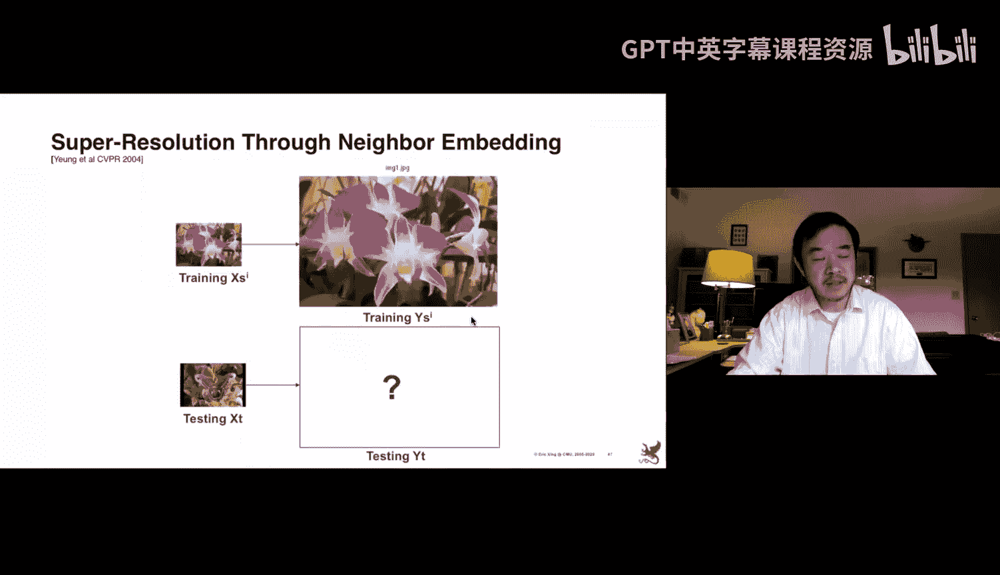

RightSo I wouldn't basically organize all this technique as a hierarchy。 One is at a root。

 The other are just special cases。 They are， it's a graph of different techniques。 They are related。

 but it's not that one subsume the other as a special case， not always。Okay， thanks， yeah。

Any other questions？All right。Then that's the end of today's class。 We'll see you on Wednesday。

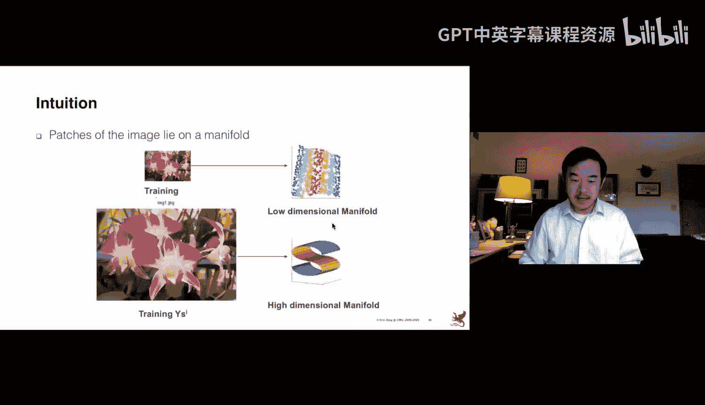