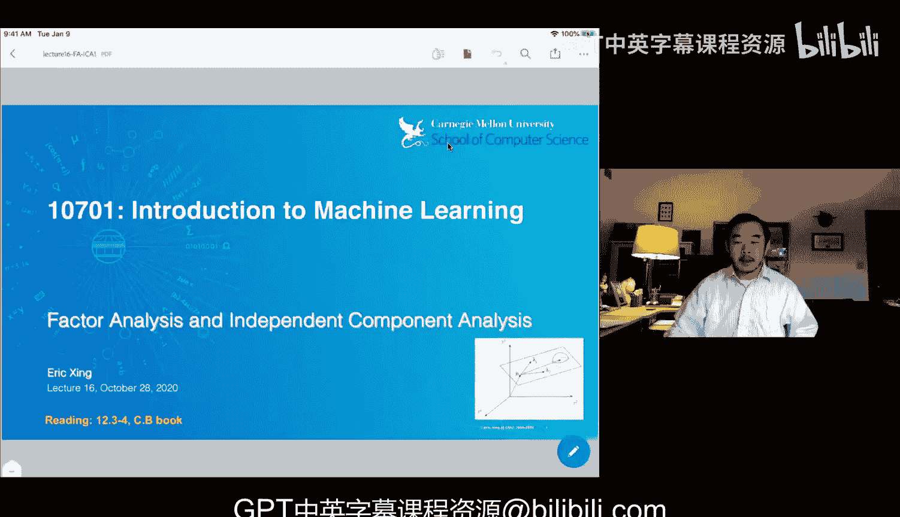
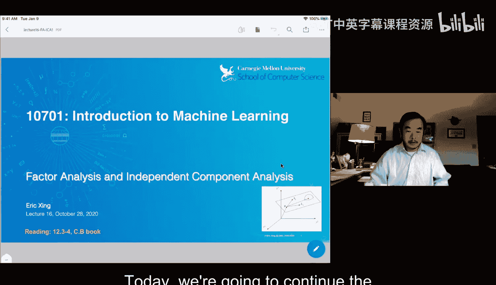
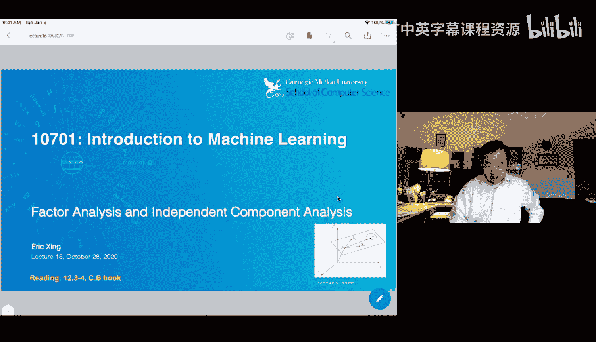
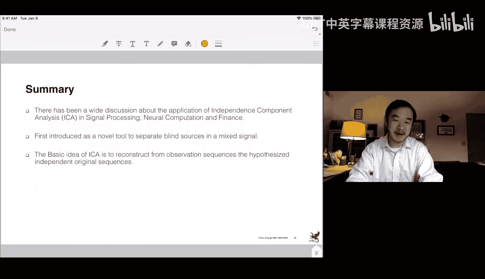

# CMU《机器学习导论（研究生）｜10-701 Introduction to Machine Learning 2020》中英字幕 p15 [15]10-701 Lecture 16 Factor Analysis and Independent Component Analysis.zh_en [BV144SuB8ETp_p15]

Okay， good morning， everyone。

Today。We are going to continue the discussion on a latent space analysis。

We will do a quick review of PCA and SVD we covered last time。

 And then we're going to talk about the two new techniques known as a factor analysis and ICA independent component analysis okay。

So。

That's a quick recap of PCA， right， PC A basically is a technique that finds principal components。

Of a given data set。And then you know， using these pre components to define， you know。

 a new space where the data points can be projected into right。

 And we also know that the property of these principal components in the setting of PCA is such that you know。

 they basically are capturing the maximum direction of variances。

The second maximum direction of variances and so forth。

So that creates some kind of a semantic and geometric meaning， you know， of those directions。

And then you can basically compute a projection of the data points。To this new space。

 using this operation。And then basically， you get， you know， a new type of representation of data X。

 which now has a nice property。 You know， they are uncorrelated on their different dimensions in this new representation。

 Okay， and also， you can choose the number of principal components。You know。

 use the value of the eigenvalues。And that eigenvalue correspond to a transition error as defined in here。

 Okay， So that's just a very quick recap of the key concepts in PCA。Now。

And this is a typical usage of the PCA， given a very high dimensional data。

 say you know a data cloud of word documents or images which are very high dimensional and very hard for you to directly visualize the data points。

 you can use， say in this case， three principle components to make projection。

 and if you are lucky enough， then after the projection。

 you can see a natural kind of a clustering or aggregation of the data points。

So this is a projection of the so-called Irish data set，s a very very wellknow data。

 you know for benchmarking some machine learning algorithms， you can see there are three clusters。

 and in this case， the three colors it nicely separated。 In fact， if I show this is a PT。

 this is a PF file in the PT file in the PowerPo file， actually。

 I have this a whole thing even rotating。 you can see from different angles。

 they are really providing a nice separation。There are some you know small kind of mathematical treatment of the data for you to do PCA。

 right， for example you need to do centering。Right and you need to yeah。

 center is the major thing and then you often need to compute the covariance matrix of the data to start PCA。

Now after I move on to the new problem， I also want to maybe do a recap of a few other related concepts which may cause confusion right so far I think in last class people already asked this question and I don't think I explained as good I wished。

 so I'm going to explain that again。呃。There is say a technique known as PCA。

And we also talked about single value decomposition。Right， and of course。

 there is a very generic matrix linear edge break technique known as the eigenvi decomposition。

 So what's the relationship between all these， I bet this is a question that is interesting to get down to the bottom and get it very clear。

So this part again， describe what is PCA， as I just mentioned before。Inside PCA。

 there are two key ideas。 One is that first of all。

 it is a eigenvalueal decomposition technique that you are going to decompose a square matrix。

Into you know， a the product of three matrices。 these two matrices， U and U T are。

Transpose of each other。 And then in the middle， there is a lambda matrix as the eigenvector this this is a very typical。

 you know， eigenvalue decomposition problem。But why it is known as PCA is because this matrix， okay。

 is the covariance matrix of the data。And by replacing or by defining this matrix。To be the。

The covariance matrix of the data。You actually are doing PCA What do you get is the principal components of the data。

 so that's actually the relationship between PCA and the e decomposition。

That SVD is also a matrix decomposition， but it is not eigenvalue decomposition。

 right it is you know matrix decomposition called single value decomposition。

 which result in these three matrix。Right there is a left eigenvalue matrix， eigen matrix。

 there is a right eigen matrix， and then there is a middle single value matrix called that is diagonal。

And the difference between， you know， SVD。And the the PCA is that in SVD。

 you get the two eigen matrix or eigen vector eigenvector matrix， the left one。This one。

Turns out to be the same as theigen。Beor matrix in PCA， if your input matrix here x。

Is the data used in PCA， but it is not the covariance matrix。

 It is the original data X the term by document matrix in here。And then the right。You know， know。

 eigenbacterctor matrix。I's actually the projection of the original data in here into that space defined in here。

 defined by the the left eigenvector matrix。 So in S VD。

 you basically are achieving a very nice effect where you simultaneously get the。Eingbacter matrix。

And also， the new representation of the original data in such a space。And also， the weights。

 which is the singular value。 And then the singular value is actually the square root of eigenvalue。

Okay， so I hope I I clarified the relationship between these three concepts， SVD。

 PCA and eigen decomposition， eigen decomposition is a generic linear edgeB technique to decompose any matrix。

 any square matrix。Okay， and then PCA is the when that square matrix is the covariance matrix of the data。

 and SVD is basically， you know， the direct decomposition of that data matrix and they related to the PCA if the PCA and SVD are really focusing on the same data set and then the eigenvectors in PCA and the eigenvectors in SVD has this correspondence and also the projection in SVD is also。

 you know， basically what you see in the previous operation in here。Sorry。His part。Okay。

 am I clear in making this clarification is that helpful， any questions at this point？Could。

 no question。Then let's move on and see some extensions of the PCA technique basically the extensions are just more different ways of computing the projection matrix and also different statistical interpretations of this operation remember last time in toward the end of the lecture。

 I already showed some additional technique which is replacing the covariance matrix in the PCA with some other matrix such as the geodistance matrix and so forth which results in the discovery of some lower dimensional representations for the manifold to be preserved okay。

And today I'm going to talk about a few alternative approach which defines newer relationship between the embedding and also the original data。

For example， this particular method known as the。The probabilistic PCA。It is， you know。

Very similar to the results people get in PCA。系。I'm trying to see whether I can move the cursor。No。

 I cannot， but you can see this。Already。Right， so here we start by assuming a linear dependenceencies between the projection and。

The original data， Okay， so here， you know， we are taking more of a probabilistic approach and also you know。

 a variable dependency approach where why is your data that you observed as the data points as a data vector。

And X， the projection that we want to compute。Is a。Is a did I get it。No， I think yeah。

 I think that's right。Excellent， yeah。Y is the observed data and x is in this case。

 the projection you want to compute， but it is latent that you don't observe it。

 just assume them to be a hidden random variable just like the cluster label or the cluster assignment that we compute it in the k meanss as and em as。

And then we define a explicit linear dependency that y is achieved by you know doing this linear edge brick operation。

You know by matrix multiplication， you know x gets left multiplied。为食。You know。

 a transformation matrix。 We call them sometimes a loading matrix。 So this is a rectangular matrix。

 which could be very。Ting。Okay。And， but which could be very tall。So what does that mean。

 The thin part， the column is basically correspond to let's say K， which are the dimension of the x。

 the latent space In this case， we assume them to be small。And x， the y is the original space。

 the data you observe。 they are high dimensional in this case， therefore。

 you can you can see that the lower dimensional x。Gets transformed into a high dimensional y through this matrix multiplication。

 as imagine， this is the X matrix， and this is the y matrix。Ping。And then I would add some noise。

Now no add a meal， which is you know a way to move the resultant points into different positions in the in the in the you hidden space without changing their direction。

 it's just the center of the data basically you can basically center the data anywhere now。

 and then plus also a noise。Okay， the noise could be a gausing noise。

And we also assume that this latent dimensional x itself is following some Q dimensional gausian distribution active。

Okay， so now the resultant data is basically this， you know， a new data y。

 which is what you observed。Because of this construction。

 you can actually do some linear algebra and。Conclude to yourself that it is also following a Gaussian distribution with M equal to mu and with covariance matrix equal to lambda times lambda transpose plus this diagonal matrix。

Okay。Once you have this maximum have this probabilistic。

 know procedure of generating the y from the latent X。

You can actually write down the maximum likelihood， you， a solution to the PCA。

It turns out that the results is pretty similar I'm not going to derive it。

 in fact I have a more elaborated model called factorern it down road which you can see how to make such derivations。

 but here I'm going to just show you the answer directly so that you can see the connection to our standard PCA。

So in the probabilistic PCA， the meal is just the data center， does say data mean that's very。

 very trivial。And then is the loading matrix。Which is often understood to be the equivalentvalence of that eigenvector matrix in the PC A is indeed very。

 very related to the PCs eigenvector matrix。 It is now basically， you can compute them to be。

This matrix。Of the original data， this matrix is the eigenbacter matrix of the original data， indeed。

 the same as in PCA。Times the London， which is the。The。What is the lambda。What the number is the the。

The eigenvalues of that matrix， and then also minus that noise， know from the generation process。

So remember， this is a diagonal matrix。And this is a skinny。Transformation matrix。Right。

 which is you know， K such eigenvectors。 Therefore， this one is also a skinny transmission matrix。

 So you can see how this operation connects to the mu， which is remember in the mu。

 If you remember the first page of this slice， we have this y equals to U times X。

 that is how you transform the data， you know， from eigenvector to the real data。

 right so here its the same except that now the matrix。For translation gets a little bit fancy。

So probably PCA is very similar to PCA in terms of the mathematical format。But on the other hand。

 using probabilistic model， as you will see later， there are some benefits， you know。

 in getting more kind of a computational convenience and efficiency。Remember that in the PCA。

 we talked about a very serious issue about the cost of a matrix inversion。Right。

 which requires you to do decomposition in version of the。N by M covariance matrix。

 If you have a very high dimensional data， that could be very expensive。

 It turns out that using the proba approach， as you will see very soon。

 we may be able to bypass this very expensive operation using。In fact， our old friend。

 the EMA with trick。Okay， so now。Having presented the public PC A， I'm going to now go to。

The series business， which is a more general version known as the factors analysis。 Okay。

 The factor analysis takes assumption， which is a little bit more general than probability PC A。

 So again， starting from a latent variable X。Which is assumed to be。

Lower dimensional in fact it doesn't have to be， but for the convenience and straightforwardness of the argument。

 I call it lower dimensional。And the why is the observed data that you see。

 which is higher dimensional。 say Y is in the three dimensional youating space。Okay。

 and X is lining in this two dimensional plane， for example。Okay。

So here we define what is known as a probability generation process。

 which can help you to define the marginal and conditional and joint of whatever random variables。

So in here。P of x。Its literally a lower dimensional Gaussian distribution with zero min and unit covariance。

 You can imagine that it is literally just something that is living in the data。

 you know in this two dimensional space。And then why is a little bit interesting， it is。

 first of all。Resultant from a linear transformation of the x。

 basically x in the lower dimensional space， for example， appointing here。Okay。

 which is defined by it a lower know two dimensional coordinate in the plane。

Gets now defined as a three dimensional point in the three dimensional space by left multiplying this loading matrix Lada。

 The lambda basically are just corresponding to the two。Kind of vectors， you know。

 defining the subspace。 You can imagine they are the eigenvectors， you know， in the PCA case。

And then plus a mu， which is the center of the data in the load dimensional space。 Therefore。

 you can see that the data in the higher dimensional space doesn't have to be centered。

 They can be anywhere， you know， centered around the arbitrary mu of unknown value。

And then their covariance is asi matrix。Which defines a little kind of a noise distribution in the true space。

 Okay， so you can imagine this is a little ball of a noise space。 you know。

 that is intersecting with the plane， which is a lower dimensional space。Question。What is the Q here。

 Where is the Q in the past in the previous slide， Q is。

The dimensionality of the lower dimension for example Q in here equals to two。Okay。Yeah。

 number of political components， same as it， yes。It says that the top Q covarince。 Yeah， okay。

 I think that question is explained。All right， so this is the generative story of factors analysis。

And the PC， the dependence， the prediction between PC probability PCA and FAA is you know is very。

 very close。 remember in the in the in the probability PC。

 we assume what is known as the isotropic Gaussian distribution or Gaussian noise but this one follows you know a Gaussian noise of zero mean and some you know you know diagonal covariance matrix。

But in the factors analysis。Thiss matrix is not necessarily diagonal。Okay。

 but it can be diagonal if it's easier。Okay。But even if it's diagonal。

 it doesn't have to be the same in all dimensions， so it's not asotropic okay。All right。

 so what's the learning problem now here？You know， in a。Solving the FAA problem。Someone，12。

questionI think there's a question in chat， someone says。

 you said the loading matrix represents two vectors， yes。The loading matrix， this one。

 the lambda actually are two columns。Right。And they basically could be understood as。

The two eigenvectors in the PCA case。They are literally just two vectors， lambda and this one。

In the original space。ok。that's a geometric way of understanding that otherwise。

 you could just imagine them to be a matrix of a left multiplication。

I'm trying to establish the geometric connection between feronlysis and PCA。

 so there are some kind of analogy。Of what you see in FA and of what you see in PCA。Actually。

 going back to the question of Lambda， do we know it？Dislamda matrix。We don't， right？In fact。

 the F A defines a problem that is very similar to PC A in PC A， we are given the raw data。

 but not sorry， sorry， I'm going to change notation here。

 I use the Y rather than X to describe the observed data。 Okay。

 the X are something that we don't know yet。So this y is the only given data points。

 it's a point cloud that we have。And in PCC， we need to figure out， you in PCCA。

When you figure out what is the。The U matrix， the eigenvector matrix and the sigma。

 the eigenvalue matrix。So in here， in F。We also have why。What need to be figured out？

So that you can get the X。Because both PCA and。FA， the goal is to be able to obtain the X from y。

So you hear what could be figured out。I do have another question someone is asking what is Phi the covariance of？

で what？What is fire is the covariance of what of the noise？

You can see here I'm defining a conditional distribution。

RightYou can basically say invited in the previous slides。Well， notice his on。 Let me write again。

 So you can imagine that the y equals to mi plus。Lambda times是 X。Plus， a noise。

And this epson noise follows a Gaussian distribution of 0 and。That's basically fine。Cl here。Yeah。

 someone else already。 I need to compute meal。 I need to compute lambda。Yes。

 maybe I also need to figure out the sign。 right， Yeah， that's the learning problem。

 So how do we do that， It's a little bit more cumbersome now than the the PCA。

But you kind of already see some fundamental differences in PCA。

When you want to get the mu and sigma， you typically do an entire eigenvalue decomposition of the original M by M matrix。

In here you are going to directly learn the land。 you already predetermined that you want the lower dimensional to be Q。

WithThe original dimension is M。And therefore， you only need to figure out this M by Q matrix。

And this can be way smaller than the M by M matrix。 and then you chop off the tail eigenvectors。

So that actually could be a place to save computing。And also here， of course。

 need will figure out the five， which gives you the noise。Okay， let's see how to do that。Remember。

 this is now a probabilistic model。 we have hidden variables and we have observed variables。Okay。

And when we have a probabilistic modeling problem with a hidden variable and observ variable。

 what are the algorithms that can jump into your minds？EM， great。 yeah。

 remember that there are three layers of I saw an article。

 Someone wrote that there are 10 different tiers of understanding for E M。 But in here。

 I think we can understand three tiers。 The first here being that if you have a latent variable and also ob variable。

 you use the E M to figure out the latent variable using expectation。

 And then you become a maximum accuracy。 That's actually a great way understanding that。Later on， we。

 of course， know that it is about you know maximizing the complete expectation of the complete likelihood。

 which actually gives you the mathematical justifications of the algorithm and also derive the updates。

 So we're going to see how these stories you know boils down to solving the。The FAA problem。Okay， so。

We are going to now try to derive some algorithm which helps us to estimate the mu。

 the lambda and the fine okay。And。Let's see how to。Jumpstar at EMA。So obviously。

 if you want to run an EMI within， you know， in this。

 the goal is to be able to write down the posterior distribution of the hidden random variable given the observed random variable。

so in九新 case。Remember， this is a Gausing， and this is a conditional Gausing。

 how to write down the post theor， you know of such a construction。

Here I'm going to just speak something that is you know， very standard。

 but I'm not going to prove them in in detail so you can remember its just as a kind of a given rule。

First of all， you know， when you have a Gausian distribution。

 you typically don't need to write down any equation for that because the Gausian distribution is fully characterized by a min。

And a covariance。RightOnce you know two of these， you actually are you understand the entire distribution already。

So in here， let's see， you know， we have the mean of the x already。

 because we say that x follows this distribution。Right。But we don't have， you know， the。

Ming and the covariance of the Y yet will only have a conditional of Y given X。So here。

 how can we write down the expectation of the x and the the of the y and the covariance of the y。

 so here is a single trick right y is a transformation coming from here。By the way， sorry。

 this noise just become you know a AW， it was also called a Epson in the previous presentation。

 but it's a noise term。And youll take expectation of these。Using the transformation。

 and you can easily see that the expectation of the Y is also new。Okay， the same。As in here。

And then the covariance of the y can be bruly computed by the definition of the covariance。

 and then you get you know this value， which is an outer product of the lambda plus the filehi。

 which is the noise covariance。So that's the standard way of computing a marginal distribution of the Gausing。

 so in this case， it is the marginal  for y。Okay。And from here， you kind of already see you know。

 some nice properties of the marginal distribution of the y。

They are defined by a M that is you know just a add on component in the form of a M dimensional staar。

A vector。 and then this covariance。Its actually not an arbitrary covariance matrix。

 It is made by an alter product of two skinny matrix。And plus， you know， a maybe diagonalized。

 you know， noise matrix。So what this tells you。It tells you that。

This is not actually what we usually understood as a fool。You know。

 covariance matrix where all dimensions， you know， are correlated in some way， a full matrix。

 dimensional matrix of。You know，M IM means that every dimension in the data has correlations。

 has nontri correlations。Okay， and that's usually mean the data is full rank。

 and it cannot really get se nicely projected into a load dimensional space。

But if your covariance matrix is like this， which means that it is almost low rank。

Meaning that only a few dimensions in the data is carrying information and others are not。

 and those other additional dimension that carries some information may be coming from the noise。

Okay， so that's basically what the factorize is trying to reverse engineer。

reverse actually means that you actually don't have the x yet， you have only the y。

 but you believe that the x or the y has this kind of low rank structure。

 and then you figure out what is the x and what is the lambda and the y。Okay。So in the E problem。

 before I I present algorithm， I need to， you know。

 you know bother you with a few mathematical details so that you know what the equation really means。

 these mathematical details are pretty standard， you know。

 in matrix manipulation for multiple gausing， but they are a little bit challenging for you to。

Always remember。 So you just。Basically try to appreciate that such thing has been derived already and you know where to look for。

 some people remember it， some people just don't remember this term。

 but at least you know where they come from。So starting from AX。

Which is a standard Gausing in this case。 I'm talking about the standard manipulation as a prim to multivari gausing then。

There is a sequence of ways to manipulate a joint Gaussian distribution that contains both x。

And why in this case， I just want to make the notation a little bit more uniform， X 1 and X2。Okay。😊。

And a join Gausing can be defined by， you， a stacking vector of two sub vectorctors， x1 and x2。

And then in this case， their distribution。Can be also defined by this term。

 which contains a stacking or concateated min of the two submins and also a bigger covariance matrix in which。

 you know， there are。Self covariance matrix of x1。Self covariance matrix of X 2。 remember， X 1。

 X 2 are two factors。 Okay， and also cross covariance matrix between 1 and2 and 2 and one。

So this is just the definition of the joint Gaus and distribution。

It turns out that there are very nice mechanical way of。Infferluencing on marginal of x1。

Conditional of X1 given2 and marginal or conditional of X 2， given X 1 and so forth。

By using just these blocks of sigma and vectors of the mu， it's just a mechanical manipulation。

For example， you know we can write down the marginal of the x2， which is this。Sub vector。Okay。

 and we saw that already。 It's basically directly reading off from， you know。

 a the new one and this one。Okay。The other more interesting result is actually the conditional of the X1 given x2。

This is useful because going back to the factor analysis that is something we want to estimate we want to estimate x1 given y in the factor analysis。

 so in here the x correspond to x1 and y correspond to x2。

 so what is the conditional of of that distribution。

But we knew that under a joint Gausian distribution。

 any marginal of a subset of the variable or any conditional of a subset given another subset。

Are all ga and distributions。 So this is a fact that people prove a long time ago。Therefore。

 in order to。Determine what is the conditional of say X 1 given x2。

 All you need to know is the mean of that conditional and covariance of a conditional。

So this actually can be easily achieved by following some very mechanical rules of the sub matrix manipulation。

 which I'm not going to derive。 Okay， it's it's edge B little Harry to derive all that。

 but hopefully you can remember it。 So the conditional mean of x 1 given x2。

 It's defined by its original Ming miu 1。Plus， some shifts。

And the shifts is basically defined by the differences of your observed x2。

 minus the mean of the x2 and multiplied with a few matrices。Okay。

And then the conditional covariance of the x1 given x2 also follows this particular sequence of a matrix attribute。

 Okay， Just remember this。The virtue here is that you can basically read off all these sub matrix that you need to compute the conditional mean and conditional covariance from the sub matrixrices of this join distribution。

All right。And there are some other matrix edge break rules。

 I want to just put it here in case you are interested for any matrix， which is a table of numbers。

You can define its trace。Okay， by basically， some over。You know， all the diagonal elements。ok。

And then there is also a rule called cyclical premutation。 The trace of these three matrices。

 you know， is invariant。You know， under cyclic operations of the three component of the three multiplicant matrix。

You can take a derivative of the trace with respect to you know some other matrix in here。

 let's say the argument is a product of two matrix。

And then the derivative of the trace of that with respect to one of the matrics。I's you know。

 just the other matrices transformed。That's actually quite useful because very often we see this quadratic form。

 you know in our you know data modeling， you know the x vector transpose times you know a matrix in the middle which could be the covariance matrix in the Gausin case and then write multiply by the another kind of instance of the data vector。

And using the cyclic permutation， you can now move this x into here。 and therefore。

 you have the two x here。And this here and x times x transpose。 remember。

 is the auto product of two vectors。 They become a matrix。And then when you take derivative of a。

 you have only this， so it's very neat。And the determinant of the matrix。You know， you know。

 if you take a logarismm of the determinant with respect to the matrix， you get the matrix itself。

Okay。All right， so these are just some rules we're going to use in a second to derive our EM algorithm。

Now， let's see how to solve the E M problem for。fact analysis。To repeat factor analysis。

 start with latent variable X following a lower dimensional Gaussian distribution。

And then transformed by a conditional gausing distribution， you know of a Y given x。

And here are the parameters of that transformation。And using these two equations。

You can actually compute。Both， you know， the， the Ming and the the covariance。Of x。And why。

Margially so that you can fill in this。And that。Okay， as we did already in the previous slides。

 but also， you can compute the cross covariance matrix between the x and y。

 just by using their ver definition。 and you find that the cross covariance matrix。

 cross covariance is actually equal to the lambda transpose。

And the cross covariance of y over x will be the transportse of this。 Therefore， you plug in this。

Thanks。Therefore， writing down the join distribution。Of X and Y in here is actually quite trivial。

 You basically just plug in， you know， all these matrix building blocks and also the means。Okay。

 and now you have the the joint。Okay， so now you see I started from X。

I use the the y and given x from the definition， and now I'm going to write down the X and y as a joint。

Using these the mechanical operations。And what's next？

What the next is to now go further and see whether we can write down the distribution of。X given y。

 Remember in here， we already figure out the rules of writing down the core conditional mean。

And conditional covariance， we're going to use this through。And we also have this matrix。

In here already computed for this particular problem FA， which is in here already， right？

So next we have sigma 1，1 equal to this， Sigma 1，2 and 2，1 equals to this。

 and sigma 22 equal to this。We are going to plug in。 These are three things。

Into here and into here so that we can compute the conditional M and conditional variance of that。

Conditional of that posteror distribution of the x given y。So the full multiple awards。

 but hopefully you get the point not where I'm driving。So mechanically plug this in。

 you get these two equations。Okay， these two equations are very important because it really。

 you know now solves your posterior inference problem。

 the conditional mean and the conditional distribution of x given y is basically well defined。

So we might be happy to start from here and jump to the EM algorithm because now the E step is solve。

 the E step about the computing， for example， the expectation of X when it is observed。

 can directly use the min and variance in here already。呃。It turns out that that is not quite nice。

Not quite satisfactory， I would say。So here I will， I will ask a very tough question。

 Can somebody help me to figure out what is the computational complexity。

 say of figuring out the conditional。Coeverance matrix of one given two。Of x given y， say。

How much computation is needed？So this is a very very challenging question。

 I want to just give you a try anyone can see it。Using this equation， by the way。

 using this equation。I will give you some hint。Size high， size of the high。Square yes。In fact， yeah。

 it said the pie pi is how how big。It's the same dimension of the data， right， It's n dimensional。

Yes， I saw it The dimension of the observed space。To the Q to the power of three。 Yes。

 so it is a M Q。It's a very expensive operation if you have a high dimensional data of why this would be a very expensive operation。

 as expensive as you do PCA， but not quite you know getting all these nicer results of privacy inference。

But because now we are manipulating the Gausing and using the structure， basically of this。

Self covariance of this conditional covariance matrix。 You know that this M by M matrix in here。

It's not a necessarily a very full rank matrix， because。Here。

 lambda times lambda transpose is a tall skinny matrix times its transpose。

And this pie is actually a diagonal matrix。Therefore。

 this the result and the whole thing to be inverted is actually not necessarily a full matrix。

In fact， you know there is another rule called the matrix inversion Lamma。

 which is a little bit difficult to remember， but once you apply it to these two equations。

 you get a new expression of the conditional mean。And the conditional covariance。Which is like this。

You are in the conditional covariance。Suddenly， you have the land transpose。Times the呃。

Inverse of the pine。And times lambda， which is now like this。Okay。

So this leads to this little matrix， which is Q by Q。Okay。Lambda sizes， also。No， landda， remember。

 Lada is my loading matrix， which is a size M times  Q。 It is a。

That's why it's called loading matrix。 It is to transform from M dimensional data to the Q dimensional data。

Right， so that's the key trick。Suddenly here， your inversion problem becomes say a Q square problem rather than a M square MQ problem rather than a QQ problem。

Okay。Okay， I don't want to stay here for too long， it's just a mathematical trick to allow an easier estimation of the conditional covariance and conditional meaning if you are interested in the edge break magic。

 you want to go to the office hourss here， I actually want to go forward and talk more about the itself okay。

All right， so now basically we are ready to apply the EI reason to estimate the lamb。

 We only know London as a as a placeholder， but we don't actually know it's that value yet， right。

 It's to be estimated。So in our original problem of data likelihood。

 we know how to write down the marginal of y already。

Right and you can actually work out the likelihood function， which looks like this。

It's a combination where lambda and and gets intertwined in complex way inside the determinant of a log of the determinant In a inversion and trace and so forth。

 Therefore， they are highly coupled。 You don't really have a very good hope to derive a clean expression。

 You know， of。Of the updates， just like what we see in the EM algorithm， you know。

 when you do mixture gausing， everything become， you know， intertwined。Now。

 in the complete likelihood where both the Y and the X are given， you have some nice。

Kind of a separation， where。Things gets better decoupled。 for example， in here in this term。

 you only see the five。In here， there is a nice linear kind of。Relationship between the S。

 which contains the land and the Phi， there isn't， you know， another inversion on top of it。

So that actually makes the dependency between the two parameters a little easier。But remember here。

This X and this S。Are actually latent。 They are not observed。 They are random variables。

So in our EM trick， you probably remember we're going to now replace。

These are random variables with their expectations， by putting a。And go to bracket of that。Therefore。

 the expected complete likelihood。You know， can be easily computed by replacing this term and this term with their expectation。

 and that's why， you know our earlier calculation of the conditional mean of x。

The M1 x given y and the V of X given y become very。

 very useful because X and y are gausing not random variables。 Therefore。

 you can use the Ming and their covariance to express the expectation of their first moment。

 My second moment。行。Questions， I think we bounded it by the time to inver it。

someone was asking about the time complexity， how did we count the time complexity and then someone was responding？

Yeah， let's discuss the time complexity later because I think I said enough。

 but maybe some of you didn't catch it when we have time toward the end of the lecture。

 we can review that about that because right now there are some other interesting point I really want to miss。

Okay， so once we have now the expectation。Thanks to our derivation in here。

We can basically plug in this into the E step so that this expected likelihood。

 a complete likelihood is no longer a random variable。And then in the E step。

 we're going to take a derivative。Of this this guy。

 with respect to all the parameters that we want to estimate。

 including the filehi and also the lambda and other things。Again， the algebra division will be heavy。

 but you can inspect these equations if you are interested。

 you probably don't need to recomple by yourself because these algorithms are well implemented。

 but you not know where they come from in the factor analysis。

 you are not doing a PCA right you are doing some lower dimensional matrix inversion to start a EM algorithm which allows you to iteratively estimate the loading matrix and also you know the covariance matrix。

Of the noise。Okay。Now let's do a side by step comparison， right， so in here PCA again。

 your observed data。Is， you know， embedded into a low dimension dimensional space。

 And the relationship between these two is the mu matrix， the U matrix。

 which is the eigenvector matrix。And we do a transitionn of eigenbacterctor therefore this U matrix could also be lower dimensional。

 but you need to begin by a full dimensional U matrix to do due to the single value decomposition or due to the eigenvalue decomposition。

And in here。You have this assumption。Very similar to what you have in PCA between the latent embedding and the observed data。

But they follow a probabilistic transformation， and then you can compute their expectation。Okay。

 using this matrix inversion and matrix conditioning type of rule。Which is easier for you to。

 you know， to invert and to compute， arguably。Of course。

 if our latent factor analysis is trying to blow the data from low dimensional to higher dimensional。

 then you lose all disadvantage。 and that's a different issue we are going to face in other problems。

ok。And then there's another important difference。In addition to the computing， okay。

 which is you know， the。The， you know，呃 the。Yeah， so the computing here， I think， is summarized。

 you know， you hear you have a K K or maybe I use M in the past basically it the observed dimension。

 This Q Q is the latent dimension。The other component issue I want to highlight。

 which is very important is the stability or the quality of the algorithm。

You know with respect to a change in the data。In PC A， PC A results is a covarient under rotation。

 if your Y。Experience a rotation。Of the data， say you just multiply all the data with a matrix to rotate it。

Then your PCA result will be changing。Okay， they will basically give you back other principal components。

对。In F。There is a。Coeverance， basically， if your data gets。スケちゃ。You know， by something。

 then your loading matrix will also be changing。 but if they rotate only。You may get the same。

 lambda matrix。ok。And you will see why it that's the case in a second。This is good and bad。 You know。

 sometimes it's good because it's very stable in terms of perturbations in data。

 but it can be also bad because that means even when data are rotated meaningfully。

 you cannot detect it in your loading matrix Lada。Okay， and in here， well。

 there are also techniques to find principal components incrementally one by one。

 but typically you need to find all of them。And in here。

 you can just you know predetermine the number of latent factors you want to find。

And here you have to find them all。 It's not an incremental algorithm in terms of the principal components。

 but that。Full algorithm is only relying on a low matrix inverse， low dimensional matrix inverse。

Okay， so here are some examples of what you see， right you begin with the original data matrix。

 the term document matrix。And in the PCA， you have this correlation matrix。Which is a square matrix。

But in the factor analysis， what you get is the lambmbda matrix and after you know the loading。

 you actually will be able to see that your data may actually load themselves to very different factors。

Okay， maybe the first few points are highly concentrated on the first dimension and second and so forth。

Okay， so this is a nice kind of visualization of the factor loading matrix。Okay， and then。

Go back to the。Model invari and an identification issue。

Remember that in our equation for estimating the。老年 matrixtri蓝nda。If you go back to the equation。

 you will always find that the lambda matrix never appeared。By itself， you know。

 in the likelihood function or in the in the in the optimization problem that we use。

 we need to solve。It only appears I when you already infer it and you want to achieve a transformation。

Like this。 But when you do the likelihood。Because it is a Gauss distribution to multiply。

 you know the the the data vector， you know by its transform。Transpose， therefore。

 what you see is basically always a out product。You know， offer， you know， the lambda matrix。

And this actually creates a problem known as rotational environmentvari。

 because if now you replace the land with a land multipied by Q where is a what we know as the autonmal matrix。

 meaning that you know Q times Q transpose， gives you an identity。

Then whatever queue that you plug in will leads you to。The same。You know。

 a outer product of lambmbda and lambda transports。 That means when you just， you know。

 rotate this lambda matrix with Q， you are not going to change the likelihood of the data under our factor analysis model。

So that actually creates a problem because you can imagine that two different estimations of the lambda will give you the same likelihood。

 therefore you cannot tell apart which one you know is is which so this is a problem known as the identifiability。

 therefore you know when talking about this loading matrix and when I mention they are you know to you know you know a vectors。

It's actually advisable not to say too much about the physical meaning of these two vectors。

It's just a loading kind of mechanism for you to transform the data into somewhere。

 but this vector itself。Are they corresponding to a particular semantic meaning or not？

Not necessarily。 Yeah that's actually a reality many people had a hard time to admit because many people like。

 you know FA for many reason and give you neat results like this one。

 you know you seems to be seeing you know a nice kind of kind of division of the feature loading。

 but in reality， if you rotate this matrix by some and go where all these numbers get screwed up you can still get the same results in terms of the likelihood of the projection。

So yeah， so this is a controversial issue for FAA， but again。

 the FA algorithm are still widely used because they gave you a lot of nice practical value in terms of transforming data into low dimension and also lower cost in computing estimations。

Okay， I have another 20 minutes， maybe I should pause here to take some additional questions before I cover briefly another more advanced technique。

 known as the independent component analysis。But let me stop here for a minute and take some additional questions。

 So just now， quite a few people still were asking the computational issue。 Are we all okay now。Sure。

 is the number of parameters identified arbitrarily？Number of parameters。 You mean the number of。

 say， dimensions。Or。Yeah， okay。 yeah。 it is like the E M I。 O means you need to predeefine。

 It's like， you know， I want to project into a three dimension space or something。 Yeah。

 this is a choice。Other questions？There is one above that， okay。

What does it mean by lambmbda only appeared as lambmbda lamb， okay。Let me switch back a few slides。

Maybe in here。Yeah， let's look at the complete likelihood function。Okay， or maybe the yeah。

 this likelihood function here， right， If you look at where you see， you know， occurrence of London。

 isn't that they always look like this。That's what I mean。 Basically。

 the way lambda yeah influence the the you know， the ultimate likelihood is through a outer product。

Okay， any other questions？cool。All right。I do want to say a few words about the ICA。

 even though I'm not going to dive in too deeply， but here let's be a little bit hand wavaving on some of the mathematical details。

 but hopefully you get the mathematical concept。And the design concept right。

 that's good enough because the I algorithm itself is arguably quite complicated and no one ever want to input it。

 you just download a code if you want to use it。All right， so ICA。By definition， you know。

 it is looking for components。That are independent。Right， so in here we get a lambmbda。

Which gives you a few vectors。And also in the PCA， we get a U matrix。

 which also give you principal components。But。These components。

Are not necessarily showing strong statistical property in terms of the independence。Okay， I。

 I will show you in a minute。 what do I mean by independence。 Maybe take an example。

Suppose that you want to， you know， solve this very， very famous problem known as the cocktail party。

 Let's say， In fact， right now， we are on cocktail party。 You know， we。

 we are talking to each other through a zoom， right， and imagine that I have 10 people here。ok。

 talking。And we don't actually we close the video and you have 100 people out there listening。Okay。

 so。How can you actually have a concise algorithm distinguishing from what you hear。

 who is speaking what？Right。So that's basically the cocktail party problem， you。

 especially when the the voice kind of transmission and encoding is not of high quality。

 maybe you know our very kind of personal characteristic is lost or especially when we all speak together。

 you know， at the same time， 10 people。It will be particularly hard for you to。Be involved， right。

 I guess that's just intuitive。So that's the problem Okay N source and M equals to n or M greater or smaller than n observations and how to resolve them So here。

 you know we can see， you know a real world example。

 supposeupp that you have these two independent sources。

 one is a susoidoidal kind of wave form and the other is just a square wave。And what you observe。

 you know， on the two receiver end could be look like this。 Okay， and they are basically result from。

 you know。This kind of a linear or nonlinear transformations that one kind of a receiver。Gets。

 of course， picked up， you know， Pick up are picking up two signals with different weighted combinations。

And our motivation is that given this。You want to recover that。So that's a quite practical problem。

Known as the blind source decoration。Okay。And。It's more than just the reverse engineering。

This H A matrix。ok呃。This is the matrix where you basically。Received your signal from the source。

But your goal is to uncover a form of the source， which could be achieved by reverse engineering the A。

 but also， it could be using some independent approach。

 or other approach as long as you get the S right。 So I'm going to show you what that means。Okay。

So here is a sketch diagram of the blind source separation problem so that we can make now mathematically clear about what our goal is。

Signal S。Transformed by。A into observation X。And we want to find a W matrix。

 which may be the same as the inverse of a or maybe different， but it's a matrix。

 We want to demix the signal and get a bunch of you。And。How can we know the use are nicely de mixed。

Well， that comes to the notion of independent analysis components。 We call the meals to be good。

If they are。Maximically independent of each other， that's basically the goal want to achieve。

So what does independent dependent mean， Well independence usually means that if you have a joint of say mu 1 and mi 2。

They can be。Factored into。To margin distribution like this。

 which is a pretty different conditional test。Okay。And how to even enforce this constraint。

 you know to， you know， a transformation model solution is even harder。All right。

 so now let's again try to see whether you know maybe you say isn't that the PCA is achieving something like that。

 isn't that PCA is trying to find a noise on one direction and another noise in the orthogonal direction and does it mean I'm already achieving separation independent separations。

 you may ask that already， in fact in this graph， you know I have maybe this result will be PCA。

And these two sources are and are orthogonal to each other。

But what I actually wanted is not necessarily ortho， right， I want independence。

 better aligned with original sources。And these independences， you know， you know， may be。You know。

Harle capture basically in a PCA kind of algorithm， which strongly assume linear transformation。

Of the data， say from the X to Y and also no gaus noise， if use properties PCA。

It is a little bit harder to dive into too deeply into that。

 but here I want to just give you a high level notion about why covariance or andcorrelation and independence are not necessarily the same thing。

Okay， so for example， you know， we know that you know PCA make heavy use of computing a covariance matrix。

Right to compute， know the the principal component。And this is the。Kind of a covariance of， say。

Let's forget about X and Y。 Maybe I use X1 and X2， for example。呃。But。

The goal is that even though your data may have a full covari to begin the PCA。This is why。

 But after let's say， you know， a mu and after the transformation。

You get a V where the covariance of the vectors， the V vectors in the new space is actually becoming a deco。

 So that's actually what PC is achieving。 It's quite nice that the new transform vectors are deco。

But deco correlation really isn't still mean independence。So以。As I said。

This is an important property that when Pearson correlation rh equals to0。

 it does not mean that these two elements are independent of each other。Okay。诶。

Do you want to see an example， Do you have a。Trying to see that you get this。Statement。

Why this is the case。yeah， okay， I'll be tricky。Let me try to give you an example。

I'm not going to diput， but， let's imagine I have a two variables， X and y， Okay。

 and I want to determine whether X and y are。Depenent。And also whether they are correlated or not。

Maybe I should decide the get the following， suppose that the X。You know， is in the space of。

Mus1 and plus one， it's basically two discrete random variables。Okay。And。Also。

 suppose that y equals to x square， for example。These are two random variables。

I encourage you to compute the Pearson correlation of x and Y。Of these are two random variables。

And you， you were actually。Conclude that the pice incor of these two variables was actually equals to0。

 They are not correlated。But just by design， you can see that the fact that the y equals to x squared。

Suggest that they are highly dependent of each other。So sometimes when two things， for example。

 my two signals， mu and mi tool， you， remember these two speakers， you， if they are， you。

 not linearly related， they have a nonlinear relationship like these two。Then。

 you know even though when you compute them to have a zero correlation。

 they still can be very dependent of each other。 so our goal is to find a source or a separation that these two signals still can be discovered because they are independent。

Okay， so I'm not going to go too far， but at least I claimed I established here that independence and uncorrelation are not the same thing。

 so at least you know by solving a different problem N PCA okay it's not the same problem。Okay。

 so let's imagine the problem formulation here from this graph you know our goal is to recover this。

Right and it's basically you know related to the observation and the source through a few linear transformation steps。

So in a sense， what we are trying to find is you know。

 this particular kind of equation or you know entity that relates the true kind of source from the discovered source。

They don't have to be the same， but this guy has to preserve independences。Therefore。

 they should have the following kind of a matrix structure where C should be a diagonal which really does not have any correlation and P is literally a permutation matrix whose only effect is to permute different the ordering of the sources。

If my V matrix as a result of discovering the W and A。You know， is of this property。

 then I claim that I successfully recovered all sources up to a puration。

 maybe up to some kind of a scaling， you know differences。

So this condition could be used as a constraint， in our qualifiers of the solution to W。

And then how to enforce， you know， you know， you know， independence。As I said。

 testing independence is very， very difficult and hard to enforce。

 So people come up with a term called non Gausing entity。It is recognized that if， you know。

 you recover the meal。Such that they are as non gausing as possible。What。

 how do we mean by non gaing what what going to introduce a few。Kind of measurement in the second。

 then， you know， everything else be the same in terms of construction error and you know and matrix decomposition。

 then you are likely to have you know， you know， the sources to be independent。

 This is originally a guess， but later on people proved it。

What the intuitions that by saying gausing。Gussing is invarient under ortho soft transformation。

 as I just mentioned， in the case of factor analysis。

 you can see that this kind of rotational orthogonal transformation。

 you know is you not affecting the estimation of the lambda and as you can imagine。

 if such lambda are to be recovered and when you get the X to be transformed in that way。

 there are high chances that when you rotate them without causing any harm you are not going to you this cannot be a nice kind of highly independent sources that you can because if they are the true sources。

 they are not that they shouldn't be a covarient of such rotational effects。Okay， so。Now。

 the eye transforms to N Gaussing identity。And non Gaussian entity is actually easier to enforce because they can be measured。

 For example， people can use a term called kosis to measure whether a variable is Gausian or not。

You can use the mutual information， negative entropy and a few other things to really quantify the magnitude of non causing entity。

 So that becomes now the loss function， you know， over， you know， the solution of the。

Mattrix estimation problem。 Remember， in the FAA， our loss function is a likelihood function。

You know， under a Gaussian distribution。 And that's actually where the Gaussian entity is strongly reliant on。

 In here， we are defining new loss functions， which has something to do with Gaussing。

So that's basically the spirit behind what is known as the fast PCA algorithm。

 the algorithm started with some preprocessing of data which includes centering and whitening and these are the equations being used which essentially transform to you know you know recognizing you know a particular way of transforming you know the observed data into some other more nicely behaving data which are centered and whitened okay so this is a linear transformation that's very easy people can do it without too much hassle。

Then， with the transformed data， with the white data。

You are going to run what is known as the fast PCA algorithm， which now I don't want to explain。

 we don't have time to explain this in detail， and it is a bit complicated to understand the tricks behind it。

But at a high level。It is a fixed point equation iteration。

 which actually maximize the measure of Ln Gaity。Okay so that's the most important thing。

 You can imagine that you can have a Newtons algorithm or a stochastic gradient algorithm to do the same。

 Yeah， indeed， there are other versions， but fast PC used a more sophisticated version。

 which involves you know， a first order derivative second order derivative of the nonn Gaoing loss function to make the algorithm conversionverging very fast。

Okay。And here are the example， Nan Gaussing addity measurement functions。

This particular algorithm used， but people can plug in other things。So just to sum up。

 the ICA algorithm basically is trying to solve the signal separation problem。

And the mixing problem and the basic idea is to really reconstruct from the observation data。

 those independent sources by maximizing non Gaussian an and still using a linear transformation between the observed signal and the transform signal。

So you can see IC FAAP PC all have some similarity which is about a transformation of the observation through matrix multiplication so that they go to a new space either of low dimensionality or of a principal components or factors。

 and in this case it is a new dimension a new space defined by independent source factors。

 and here the loss function is not a likelihood loss， not a maximum covariance loss。

 it is a maximum non gaussian entity loss that leads to the estimation of the W。Okay， hopefully。

 you know， I'm giving a story that ties together all these different techniques。

 but still show you the differences of their utility and also their operation。

But' the end of today's lecture， any additional questions before we close？

Can I ask a follow up on the rotation invariance？Souff。Sure， please， so。

Like my understanding is that since we're using expectation maximization for。For factor analysis。

 like we end up with rotation invari like because that's。Like we saw that。

Like the lambmbda lambmbda T term and。In the likelihood expression。

So like if we were to use like expectationation maximization for like。呃。For a PCA as well。

 would that also be like rotation andvari？呃。Let's see。 That's a good question。

It's not because of the expectation maximization。 Okay， It is really because of the loss function。

 Remember that the loss function。 remember， E algorithm is a gradient algorithm。

 It's a coordinate gradient de algorithm。 So it's an algorithm。 you know。

 it actually doesn't change any results。 If your loss function is designed in a certain way。 In here。

 our。Objective function or the loss function in FA is the gausian likelihood of the data。

And that's where youll see the lambda times lambda transpose。 so in the PCA。

It's a different loss function， right， It is the the loss of it defined by the。

The variance of the data。 So you need to go back and examine that particular form and see whether there is an opportunity for you to left and right。

 multiply some orthonormal matrix in the eigenvalue the eigenvector matrix and see if that change the loss or not。

 you can actually check by yourself If that does change， that means it is a sensitive to rotation。

 If it does not change， then it's not sensitive。Okay， okay， yeah。

 so I'm giving you I kind of not a clear answer， but I give you a method of testing your answer。

Any other questions， This is a great one。 By the way， I think it's better to give the。

Better to give the validation of the answer rather than straightforward to answer itself。Yeah。

 I I just forgot that we're like using a different boss for PCA。Yeah。哭。Great， okay。

 I will see you next week。 Okay， if it's going to take over for the next couple of lectures。

 but I will see you soon in later part of the semester。 Thank you bye。

