# CMU《机器学习导论（研究生）｜10-701 Introduction to Machine Learning 2020》中英字幕 p16 [16]10-701 Lecture 17 Graphical models and Bayesian networks.zh_en [BV144SuB8ETp_p16]

So today we are moving to a new topic until now at least the last several lectures where on unsupervised learning for those who remember we started and in fact spent much of this class I would say 40% on supervised learning we then move to unsupervised learning which was clustering and dimensionality reduction。

 very important topics and now we are moving to a new topic which we will spend a few weeks on and maybe later come back to and that is topic related to joint probability distribution representation andty and how to model the relationship between things and you can use this of course to do supervised learning and to do inference but that's not the only thing that you can do those's more things that you can do with these things so this is basically a way to represent our assumptions and our beliefs on the world and use these to。

Eith'll do classification if you want or to do something called inference。

 which is to infer values of things that were not observed okay so the topic of today's lecture and in fact the topic of this whole module I would say。

Is graphical models and within graphical models there's a bunch of and the name will become clear hopefully in the next few slides within graphical models there so you can think of graphical models as a family of。

Methods and within for example like neural networks right so we talked about Fi for neural network you know convolutional neural network we call neural networks so forth so similarly graphical models is a large family of methods within this family there are lots of different subtypes the first and the one we will spend the next two lectures on is called Ba networks we will also discuss other members of this family including something called hidden Markov models but we won't discuss all members so you should know that even though we are only spending four lectures on this there is an entire class you can take I think Eric is usually teaching a class every other year on graphical models where you spend the entire class on variants of okay so but today we are going to talk about graphical models generally and within graphical models on basin。

Okay。😊，So what is the whole idea of graphical models。

 why are they useful and what are we using them for so graphical models are basically way and there's different ways of doing it。

 but the general thinking is there a way to bring to bridge the gap between two extreme methods we discussed in class already。

😊，The first extreme my is this method of fully dependent set of variables right we call this joint probability distribution。

😡，If we want to compute the probability of A B and C。

 we can write P of A B and C right that's the joint probability of the A could be1 B could be two stick could be1 simply called the joint probability distribution right and we said that we can compute it。

 let's say A B and C are binary variables we can compute it but in order to fully represent this distribution we need a lot of parameters right if we have three binary variables we need seven parameters right because they have to sum to1 but two to the power of3 minus one parameters right we need to estimate。

😡，Which may or may not be a lot on the other extreme we talked about complete independence or conditional independence and we discussed it when we talked about na base。

 for example。😡，In complete independence， the probability of A E B C。

 the joint of ABAC C is the probability of A times the probability of B times the probability of C in that case we only need three parameters because we only need to estimate parameters for A B and C separately so these are the two extremes。

😡，It turns out that there is something in between these two extremes that on the one hand does not require us to use as many parameters as the fully joint model。

 but on the other hand does not assume fully dependent。😡，So in some sense。

 it's a way for us to introduce some belief about the relationship between these。😡。

Vables in order to reduce， the space of parameters without sacrificing accuracy。

 because we already said that if we can always assume independence， obviously。😡。

But this will come at the expense of accuracy that's why an naive base is not one of the top classifiers the assumption is too strong。

 that's why for example， decision trees a variant of decision trees that do not assume independents do much of that。

😡，So graphical models are a way to bridge between full dependent model， which are great。

 but usually impossible to learn because they require too many parameters and a lot of data and fully independent models which are bad for real estimation。

 but very easy to okay， so that's the basic idea。😡，Right and again。

 that's what we said if we have three binary variables， we need seven parameters， if we have 10。

 we need two to the power of 10 minus one， which is huge。

So graphical models are basically a way to bridge this gap。Okay。

 so why are they called graphical models and what do they do so graphical models and based the networks graphical models are set as I said。

 are a family of methods they are all represented by graphs graphs means that we have noted that edges。

😡，Different graphs or different members of this family will have different meaning for the edges and the nodes。

 usually nodes will represent random variables， but the edges will represent different things。

 So in this lecture we are going to talk about one of the members very important one。

 but still one of the members of this family， which is called basic networks Okay so let's。😡。

Discuss what is based network and explain the graph structure of base it so in based networks we have two main components there is another one we'll get to in a second but two main components one our node you can see here node。

😡，And the second edges okay node are the random of variables in our model， for example。

 this is a setting I mentioned already， let's say I want to learn a model about whether I will sleep in a movie or not okay。

 not really whether I slip but some joint distribution of three possible values。

 the length of the movie， whether I like it and whether I slept it okay。

 so there are three random variables。😡，You know how long maybe more than an hour。

 less than an hour whether I slept which is let's assume all of them are binary so these are one or variables right they can take the value of 0 or1 and there is a relationship between them so they are not independent obviously the movie is very long it's more like dys typed if I didn't like it and so forth。

 but they might not require a full dependent assumption so this is an example of a set of variables that can be represented with a graphic one。

So the graphical model takes each of these variables and represents it as a node。

 right length slept and liked each of these as a node， and then we have edges。

 edges represent dependency assumptions。😡，It's not necessarily and well get。

 that's actually a bit delicate。😡，Not trivial issue to explain exactly what is the dependency assumption that an edge has。

 but for now and we'll get to a more formal definition。

 an edge between two random variables indicate dependence between them。

 the lack of an edge is a strong statement， it means that given the other edges they are independent。

 not completely independent they might still be dependent but if we know something about the other edges they are independent。

😡，So in this case， for example， the interpretation is that whether I slept or not will depend on the length of the movie and whether I like the movie or not will depend sorry and whether I liked it will also depend on the length of the movie but。

😡，嗯。Right if I don't know anything about the land， these two are。一直不。Sorry， if I know the length。

 these two are independent， okay， we'll get to that in a second。But generally speaking， again。

 I don't want to go into the exact details of what the edges mean and we'll get to that。

 but I just want to mention that again， the node are the random variables and the edges are related to。

😡，dependency relationships again， if you have any question any comments if you want to raise your hand。

 please write to the chat Danielle agreed to monitor it and alert me and stop me。😡，Okay。

 that's something。Okay so this is base networks based networks and again that's not true for all members of graphical models but specifically for base network that is true。

 based networks are graphs so they have nodes and they have directed edges so the edge has a direction and they are areic。

😡，A cyclic means that we do not have a cycle， so for example， we cannot have an edge。😡。

So this is a valid based network， it has three variables， a B and C， it has some directions。

 this is a valid based network okay， but this one。😡。

But this one is not a value based network because it has a cycle， okay。

 so based networks are not allowed to have a cycle。😡，And we'll get to in a second。

 or we'll get to later why this is very useful and why this is a requirement for this。

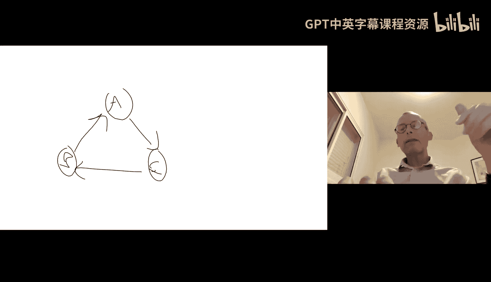

But it's definitely an important and op of that。嗯。But it's an important requirement and we'll see in a few slides why this is useful。

😡。

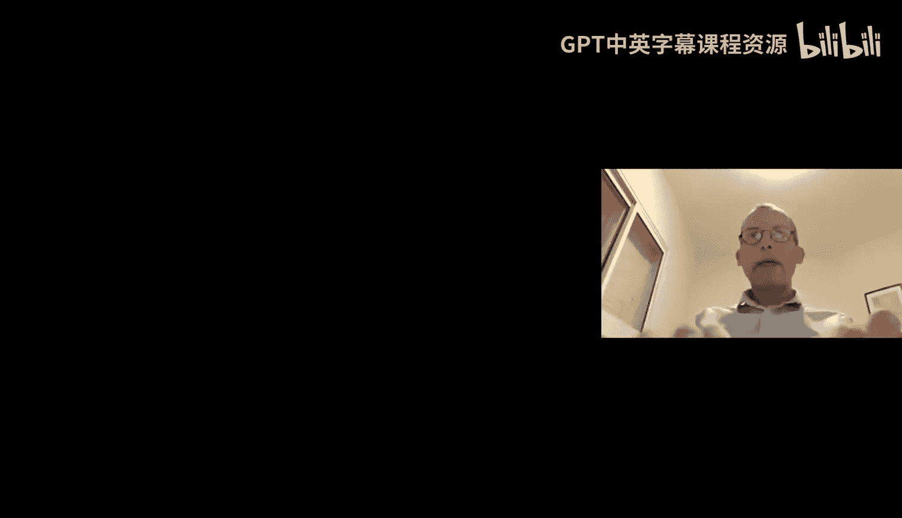

So this is a。😊，The meaning of the graph structure of based network。

And so we have nodes that represent a。So we have nodes that represent under variabless。

 we have edges that represent dependency relationships， and then we have something else。😡。

Wwhich is called conditional probability tables of CPTs CPTs define the probabilities that are related to the edges。

 so for example， length does not have any incoming edges。😡。

That means that for L we just have a prior it doesn't depend on anything else so there is a prior in this case let's say some of the movies along half the movies along and half the movies are short however。

 if you have an incoming edges then your probability is a function of the nodes that have an outgoing edge to you or in other words in based network terminology of your parents any node that has an edge going to you is one of your parents and your probability or the a model that we create for you is a function。

😡，Of your parents， in this case， S has one parent L E。

 So we have a probability of S equals one given L and the probability of S equals one， given not L。

 the probability of S equals 0 is one minus the probability of S equals 1。😡。

But these two do not have to sample one， right because these depend on the parent similarly here if we had two parents。

😡，So for example， if instead of this model， I would have an edge going from S to LI。😡。

D I would have two parents， in that case I would need more entries in this table。

 that's why it's called the conditional probabilityability table。😡。

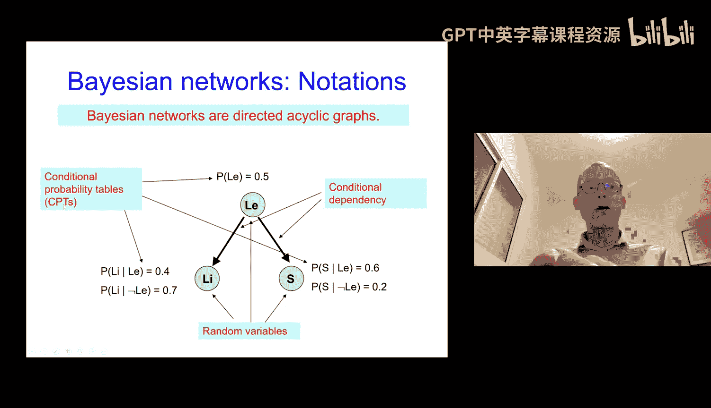

So it's not necessarily a line again if we had。😡。

嗯。So in this case， B has two parents， so we need the probability of B。😡。

Has to on has to be conditioned on its two parents， which is A andC。And so in that case。

 we need a four way table， right？So this is。P of B given A and C。Is basically P of B。In this case。

 P of b equals one， we need to have basically full。Four possible combinations， write 1，1， 1，0，0，1，0。

0， and for each one we have a probability。So this could be 0。20。

6 they don't have to sum to one obviously 0。7 and 0。

1 okay so this will be a table basically and these are the values of the parents and this is the probability that b is one given that this is the value of the parents okay and if we have I mean the number of entries in the table of course is exponential function of the number of the parents。

Okay， so this is a basic networks。Well basically this is the terminal or the language in which basic network is defined again nodes represent random variables edges represent dependency or conditional dependency and we have these conditional probability tables CPTs that define the probability of a node condition on the values of experiments okay so so far we just defined some notations in terms of graph now the big question is how is this related to joint probability distributions okay that's what we wanted to basically represent。

😊，In Baase a network。It turns out that the joint probability distribution defined by a Bay network。😡。

It's just a product。😮，Of the value of each node condition on its merit。

 so specifically if we want to know the joint of three values。😡，We have the product of each node。😡。

Conditioned on the product on the value of its parents。

 this is the joint so in this case we have the probability of LE doesn't have any parents times the probability of LI times L。

😡，Condition on L times the probability of S condition on L Okay。

 so this is the definition of a joint probability distribution defined by a based basically it's a product of each node。

Condition on its parent， if it doesn't have a parent then just a prior， if it has multiple parents。

 then this would be。😡，And you know， this would be a function of all the parents。

 all the values of the practice， but this is the joint problem decision。

Now we said that if we assume fully independent model for three random variables。

 we need three parameters， if we assume fully dependent model， we need seven。

 how many parameters do we need to define the probability of this table of this baseline network？😡。

Anybody？It's。

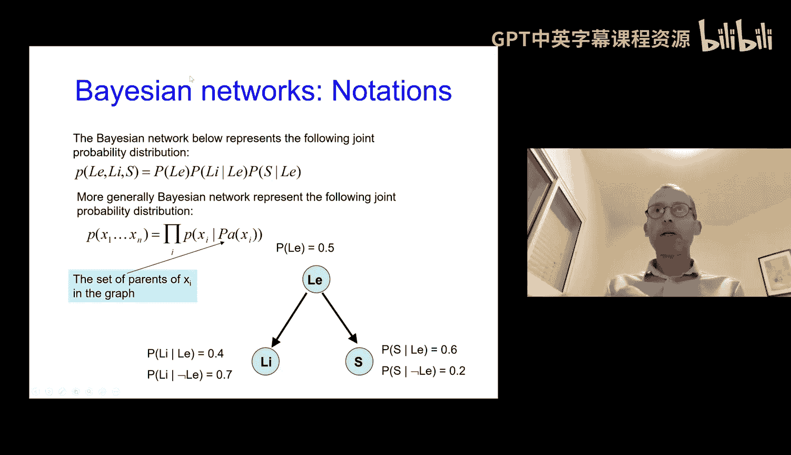

So。嗯。Right so as people said， and in fact that's something you can see in the slides。

 we need five parameters in this specific case。😡，And these five parameters are enough to define any joint。

 so 110， whatever， right any value of the five different variables we can get the joint probability using five parameters and the five parameters as I said are actually defined on the slides itself so basically。

😡。

So basically we need two parameters for right， we need two parameters for S。

 two parameters for AI and one parameter for。So in some sense。

We saved rather than for having the full joint we saved， we went from seven to five。

 on the other hand， we didn't sacrifice anything because our idea is that if we know，😡。

The value of LE， I can compute the sorry it's enough for me to know the probability of S given LE。

 if I know LE I don't need to do the full job okay and again this will be hopefully。😡，揭。

In some sense。Let's。

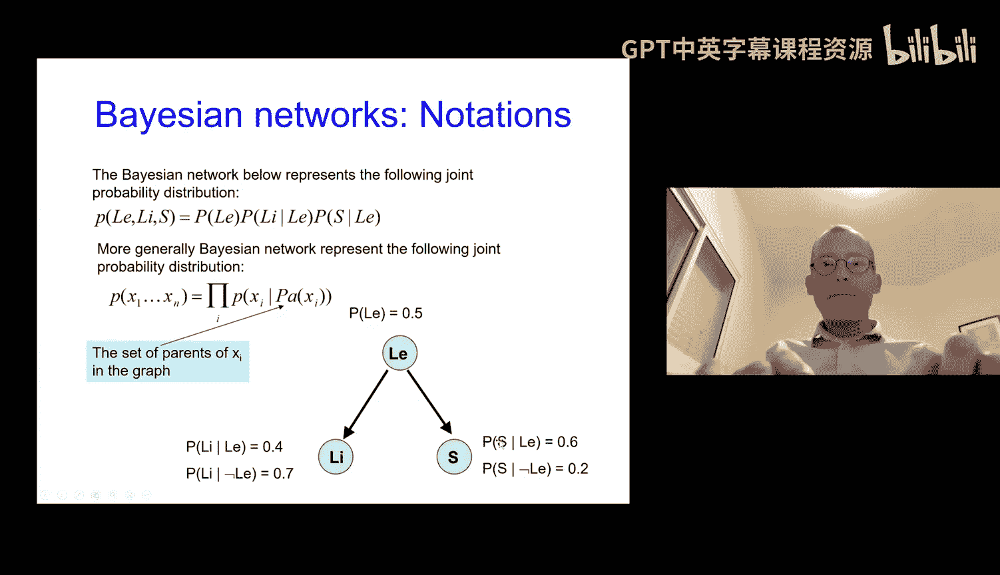

Let me explain this in a second and then hopefully this will be。

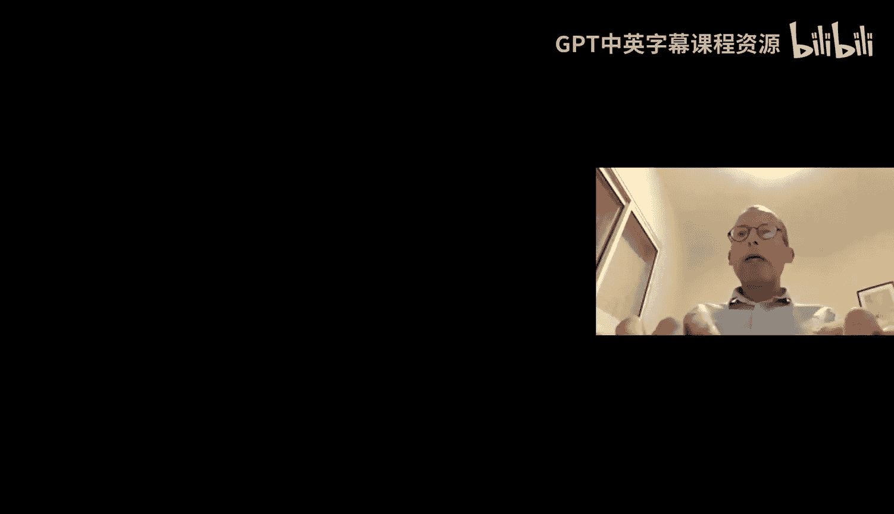

So why is this so useful， Okay， so we know that。The joint we can always factor right using the chain rule as。

😊，P of L。P of A。AndLet's say嗯。And来。So we can always factor it right that this is P of L。😡，So。

This is P of LI and S condition on LE。Times pure of failure。 that's true for any3 round of virus。

 that's not related to。That's not related to the network or something now this is a P of LiI。

Condition on S and L。P of S condition on LE， P of。Right， this is true for any three robot。😡，Okay。

 so this， of course we know because this is true for any this requires seven parameters why this part T requires four。

 this requires two and this requires one so a total of seven what did we gain from the base network from the base network。

 we gained the fact that if we condition on LE all is dependent on S。

 this is encoded as part of the Bay network。😡，This is where we sit。😡。

But it's not changing the accuracy of the joint。 This is some of the assumption that we make that if we really know L then all is independent of it so in some sense we get the correct joint but we still don't need to estimate as many parameters that's the advantage of place cook so in other words。

 if you have a good and stronger assumption about dependencies and dependencies。

 but you don't have to assume that everything is completely independent。

 if you assume partial dependencies or just something that is dependent on other。

 if you know and again we'll give some stronger definition soon。

 then you can save parameters without。😡，Helthing your ability to fully find the joint joint or correctly find the joint pro。

😡。

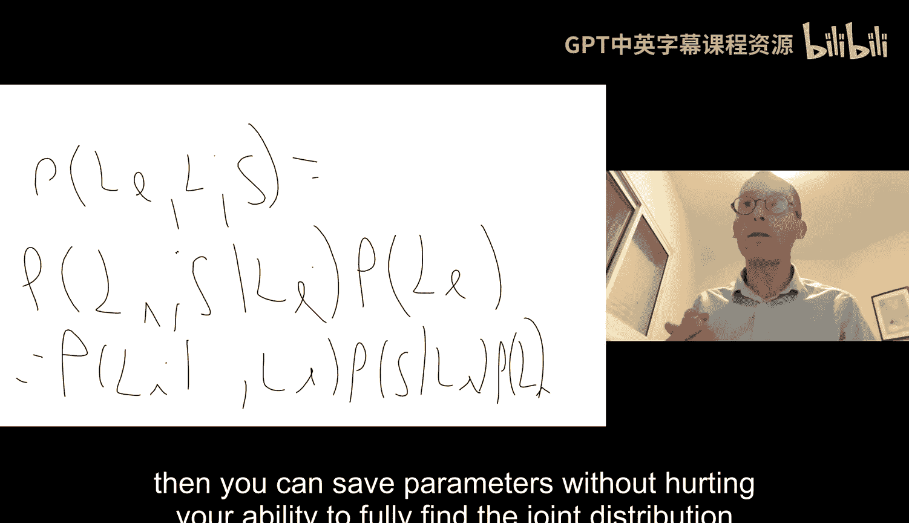

So that's the advantage of phase7。Okay， so given this， the question again， of course。

 is if we have a problem。😡。

How do we construct a base network or how should we， how should we go about constructing a base net？

😡，So there's a simple algorithm again， I mean it's simple to say it's much harder to actually or it sometimes could be how to do it in practice。

 but the basic idea is the fact first of all you identified the random of variables in your domain right so in our case we had three you can think of other cases but definitely you need to identify the random of variables in your domain then。

😡，There two options， one is to manually construct the dependency table if you don't have a lot of variables and you know about your domain。

 you can just do it and I will show you an example in a second。😡，And once you have the network。

 you can populate the conditional probability table， the conditional probability table。

 once you have the structure is very easy to populate。

 how do we populate the conditional probability table if we have the structure。

 anybody can give me an idea。😡，Which algorithm and should I use if I have a structure and I have training data。

 obviously？😡，And I want to popular conditional probability table。

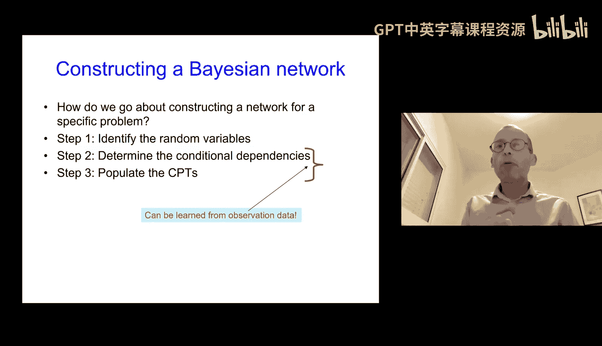

你body咁见面嚟啲啊。So very rule is something we use for inferences， no， but for this is more learning。

 it's not the inference。Yeah Emily right so basically this is simple Emily simple probability distribution right we want to learn the probability of a given B or a given Bc and this is exactly Emily so if we know the structure and we have training data it's very easy actually to compute。

😊，the CPTs， the challenge， of course， is that in most cases we don't know the structure。😡。

So now the question is how do we learn the structure in this class we will assume that we construct the structure by hand in practice there are algorithms that can learn the structure that's not trivial to do in fact you will see in a few slides that it's very hard to do but there are algorithms that learn the structure and with some sort of an EM algorithm something you discussed in the clustering method in the clustering lecture so you can use it here as well for this class or for this 701 we will assume that the network is constructed by hand okay。

But even constructing by hand is not trivial。So let's do an example of a network that we can construct by hand and see what do we gain from using based a network rather than just representing cases as a fu joint。

😊，And the reason why we bring this example is because this is the example that the person who I don't want to say invented but definitely popularized Ba network。

 a guy by the name of Judea Peril who won the Turing Award。think10 years ago， 15 years ago。

 that's the example that the canonical example he gave。

We usually at least explain it in the first time we show base and network it's a very simple one but hopefully intuitive so basically in this case we have five random variables B is whether or not someone walk into our house is whether an earthquake occur a is did the alarm sound and then I have two neighbor so I'm at walk that the setting is I'm at walk you know I have an alarm in my house this is LA he's in UCLA so earthquakes are pretty common probably burgllararies are also common so this is not Pitsburgh so。

Alarm so he I tell my neighbors， Mary and John that if they hear the alarm。

 they should call me and I will come home and see what happens right I mean maybe if it's a burglary I want to come home if it's an earthquake what can I do but anyway so there's five different random of variables of course they are not independent right because if there was an earthquake it can trigger the alarm of course if someone broke into my house it can also trigger the alarm if John calls it's likely that the alarm sounded and so forth so this is the set of random variables and I would like to do inference right for example if John called me I would like to know whether someone broke into my house or whether it was an earthquake if it was an earthquake maybe you know it can wait but if someone broke into my house maybe I should get I should get there and call the police or something。

Okay so this is the so the question is how do you construct this network so as we said we can always use the chain rule to construct a joint probability distribution for this and this is true for any five round variables we don't need to know anything about them we will get this joint probability distribution right everybody hopefully agree with it this requires because we have five round variables it requires two to the power of five minus1 so basically 31 parameters。

😡，And you can write it as a data network， right， because we said each one of these is a no depending on the set of parents。

😡，Right so A B E J and M and this is a valid based network it's you can see it's directed。

 it doesn't contain any cycle so this is a valid based network。

 however this based network does not contain any domain knowledge so it was not constructed with only knowledge so it contains a lot of parameters 31 parameters the power5 minutes。

On the other hand， if you do know something about the domain。😡。

You can set the base network as follows right so basically you have B and E out the two events the figure everything A is the alarm which only depends on these two right the alarm doesn't depend on whether John called the alarm of course if I know that John called me tells me something about the alarm but the alarm only depends on whether someone working into my house or else。

😡，And John calls me and Mary calls me because of the， right？

They don't know that somewhere walk into my house， let's say there are two houses the way they can see my house。

Yes， they can fill the earthquake but the assumption is that the earthquake is limited to my ounsome so they will only call me if they allow sound okay so this is again the same joint probability distribution so any joint that I compute。

On the five variables。😡，Using this structure will be perfectly correct so it will give the right if I have the no if I know the parameters。

 it will be the same as the joint that I computed using the previous network which was fully connected right this is the only difference is that here I'm using information that I know about the domain for example I know that A is a function of A and B whereas in the previous network I didn't assume anything about the domain。

😡，Okay but the saving is great because I get the fully correct right any joint probability distribution that I compute using the parameters of this network is correct。

 it doesn't I mean it's not making any relaxation or assumption like na base right which assumes independence I not assuming any independence。

 I'm assuming all the dependencies but I only need an parameters。😡。

Okay so this is the advantage of facing this you can represent joint probabilities this solution correctly but very efficiently。

 you only need very few parameters and when I say represent basically also have to learn these parameters so you have to learn much real parameters which means that you need much much less data right in the previous example we had the node with four parents in this case right so only even just for this table we have 15 different parameters we need a lot of data in this one which is again the same joint probability distribution in terms of accuracy only the one with the largest one has four parameters this is so we need much less data and we can get the same accuracy。

Okay， so by relying on domain knowledge we save。So again， as I said。

 in order to learn a basic network， the first thing we need to do is identify the random variable in this case with that five random variables。

 the next thing is we need to create the network， creating the network could be done either by learning doing some automated learning or by hand okay in order to do it by hand。

 you have to select an order okay and then add the information based on the order。

 it turns out that the ordering you select is critical。😡，For the same assumptions that you know。

 so even if you have the same domain knowledge， if you order the nodes that you add to the network differently。

 you will get the very different structure， again the same representing the same correct joint probability distribution。

 but with much more or muchque parameters so let's do an example and show why this is the case。😡，嗯。

So let's look at a problem right so I have to order the parameters right so I have alarm burglary earthquake John Colmer okay so let's say we start with the burglary。

😡，Obviously， if I only have one node in my network。

 I don't need any edges okay now I add the earthquake node。😡。

Does knowing that someone broke into my house tell me whether there was an earthquake at the same time？

The answer is no right I mean the fact that someone walk into my house could just accidentally be when the earthquake upul。

 but it could I mean there's no it's unlikely that theburglars knew something about earthquake quite most people and if they knew about that。

 they shouldn't。😡，Break into houses， they can just create a new company that predicts earthquake and there will be much。

More famous than what you are anyway， so there's no relationship between or there's no dependence between B so knowing something about B doesn't tell us anything about it。

😡，Okay， now let's add a the alarm。😡，Does knowing that the earthquake happened tell me something about whether the alarm sounded？

Obviously， yes' right， if the earthquake happened， the alarm。😡，May have sampled。

Now if I know that an earthquake happened or if I know something about earthquake and now someone tells me that a burglary happened。

 does tell that the earthquake didn't happen， let's say and someone told me that the burglary happened does this adding information about whether the alarm happened。

 then so is yes right because if the earthquake didn't happen but the burglary happened I would still predict an alarm so even though I have this edge this I still need this edge okay so that's it I mean I connected it to this to that now I'm adding John called。

Let's say that John called， which variables that I already have？😡。

Is John called dependent on so obviously John called John will call me if earthquake happened or burglary happened。

 but he will only call me if he hearals the alarm， so if I know whether the alarm happened or not it shields me from these two variabless。

😡，So because if I haven't had A， I would connect it， but because I don't have because I have a。

 I only need to connect John to a okay， this is the thinking that if I know A。

 everything else is independent。😡，Of whether John called， if I didn't know a no。

 but if I know a and similarly for Mary， so this is the model that we get right so this is nice and this is because we started B EA J and M but if we change the order things may look very different。

😡，So let's start with John。 Okay， let's start with Jay。Of course。

 this is the only one we are not connecting each one。😊，Now let's add Mary， if John called me。😡，Sorry。

 if I want to know whether Mary will call me， does knowing whether John called me。

 give me any information？😡，The answer is yes why because John likely called me because he held the alarm if John held the alarm maybe Mary also held the alarm。

 so if John called me it tells me that Mary likely will call what she doesn't have to the his pro but if I know that John called me then this is okay。

😡，对。Now。Let's add B。If I know that John and Mary called me。

 does this increase my probability that someone broke into my house？😡，Yes， right。

 they would call me because of the alarm， the alarm would sound likely because of burglaries so obviously。

😡，These two are important to me。Okay， now earthquake。Earthquake， obviously same reasoning for this。😡。

But also should be related to B why， because if the burglary didn't happen and John and Mary did call。

 then it's more likely that earthquake did happen。😡。

So knowing that John very called because it's not enough。

 I need to know also whether the burglary had and finally the alarm and the alarm in this case。😡。

Is influenced， of course， by the earthquake。End。By the burglary， however。

 because we already know John and Mary， let's say that the alarm just sounded off by itself without any earthquake or burglary well more if John and Mary called me it does tell me that this might have happened。

😡，So a different order， this is a different order so before I ordered it EB MJ here I ordered it JMBEA and both of them are used the same domain knowledge。

 this one is a fully connectedor basically 31 parameters， the previous one only10。😡。

So basically it means that the ordering of the base network is very very important or not only ordering of the nodes。

 even if you use the same domain knowledge is very important， generally speaking， how do you do it。

 you try to come up with the nodes that have the least dependence right so in this case。😡，you know。

 and burglary and earthquake are not dependent on anything else。

 they just triggering events and then you try to， but sometimes you know again especially if you have a lot of them there's the limit to how many orders you can test and so eventually you may not find the optimalim network。

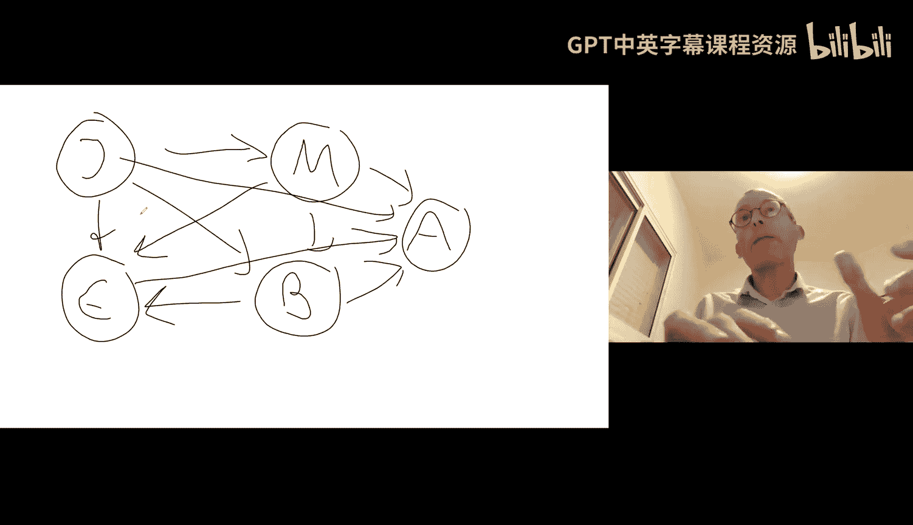

At least you can get better than the fully dependent。Okay。

 so this is the issue related to network ordering of the base network nodes。Very important。

And once you have a network， you can add other nodes， for example， a radio。

 let's say we want to know there whether there was an announcement on the radio that an earthquake occurred and of course。

 in this case， if we know already that earthquake if we have a no2 earthquake。

 we can add it to right so that's always。Basic networks are actually。

Let's put it this way and clean neural network became extremely popular actually I would say before so there was this three waves based networks were very popular in the early 2000s or in the late 90s I would say in practical application then they were I don't want to say replaced but superseded by support vector machines and now in neural networks still based in networks are very popular and still useful for a lot of different things。

 they were used in medical diagnostics so this is a simple example of how to use based networks to help clinicians make decisions。

 they are used a lot in computational biology to reason about interactions within biological entities。

 for example this is interactions between genes inside the cell and they are used by a lot of other。

A lot of other application areas where you want to represent things related to joint probability。

 but you also care about the relationship between them， for example。

 causality inference using this type of edges。We mentioned basic networks in the context of。

Generating the network A in the context of the meaning of the length， so what do the nodes mean。

 what do the edges mean and what do the conditional probability tables mean？😡。

And these are very important because as we will see。

 the major goal of base networks is to do something called inference so in this example that I've just shown you。

😡，Let's say I get a call from Mary， okay， so this is the only thing I observe。

 I want to know what's the probability that someone broke into my house。😡。

Right because that's the thing that would make me take action if someone walk into my house I have to go there so for example if I observe m equals1 and j equals0 I want to know what's the probability that someone walk into my house if I observe if I get a call from John and Mary I want to know what's the probability right so this is called inference if I observe some values and I don't observe the other values can you tell me what is the probability that some other value is one this is called inference and will get to that that's the main goal of race networks。

😡，So based networks can deal with cases where you observe a subset of the values and you want to know others。

😡，Okay， now you can think of one of these nodes。😡，As a classifier right as a predictor。

 so for example， in a Eve base。

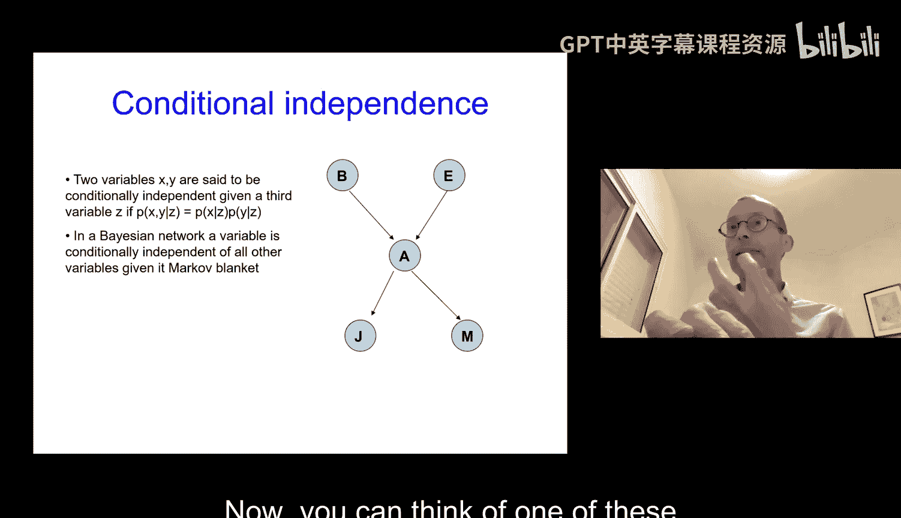

Naive Base is also a baseline network if you think about naive based。

 you can also represent it as a baseline network。😡，Right。And in the E Bay。

 the Bay network looks like this。

So let's say this is x1， x2。X 3， x 4。X5， and this is the label Y。

 and we know that everything is independent of everything else if we have the label。Oh。

 it's actually right， it's actually the other way around。

Right and the joint is p of x1 given y times p of x2 given y times p of x3 given y right this is just a base and network。

 of course an extreme one because we assume no conditional dependence between the x。

 but this is still a base and network and in this case inference would mean that we observe x1 to x5 and we want to know the label。

😡。

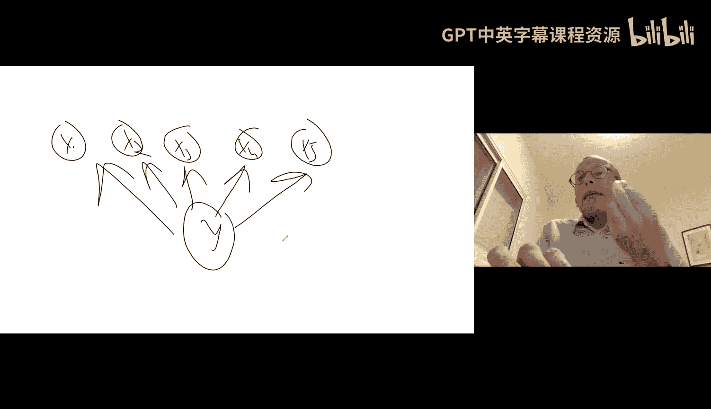

That's a simple inference problem。 There are more sophisticated or more problematic inference problems and we'll get to that。

 But before we get to the real or the main goal of base network。

 there are other things we can do from a base network that are not。

That are not related to inference， and this is to find relationships between variables。😡。

To find defined relationships between variables and the most important relationships we can define is something called conditional independence conditional independence we already defined several times we use it in a base。

 but for example， we say that x and y are conditionally independent given z if p of x given z equals p of y given z of course we can assume that。

 but if we have a specific based network structure。

 we can ask questions just looking at the network without knowing anything about the probabilities。😡。

That tell us whether things are conditionally dependent on them Why is this useful， for example。

 let's say that。I have a network and I want to find whether someone has cancer。😡，You know。

 I learned a network of a lot of variables and one of the nodes is breast cancer， okay。

 another node in this network is MRI。😡，Okay so now I want to know whether in order if breast cancer is independent from MRI given some other nodes。

 then I don't need to do the MRI because all the information that the MRI will provide is already given by the other nodes I can just do this but if breast cancer is not independent of MRI I would have to do the MRI in order to fully use the network so knowing when things are conditionally independent given some other things can tell you what you need to know in order to do the inference or whether you need to do some very expensive experiment or test or clinical work and so forth so knowing even just without parameterss just looking at the structure knowing in what is independent is a very important thing and this is something that basic networks are very good at and they provide information on。

😡，It turns out that there's a few rules that you can use to determine given a basic networks if things are dependent。

 conditionally independent or conditionally independent given something。😡。

This is what we will talk about next， so first of all。

 any node is independent of all the other nodes given its mark of blank。What is the mark of blanket。

 the mark of blanket is defined by all parents， children and co parents of children。😡，Okay。

 so for example， J， if you look at J J has。One parent。Right， a。

So a is and it doesn't have any children or co parentsent of children。

 so J is independent of everything else if we know A。😡，Okay。

 so if I know I want to know whether Jay called me， it's enough for me to know a。

 I don't care about anything else。😡，But some other nodes have a much more complicated mark of blanket。

 for example， what is the markov blanket of B？😡，The mark of blanket of B is all its parents。

 it doesn't have any parents， all its descendants， a and co parents of descendants in this case E okay。

 so the markov blanket of B is E and a。😡，If I O EA， then B is independent of anything else。😡。

So again， that's in terms of infants， that's important because if I want to know B。

 I just need to know E and A and I can find the value of B。😡，A on the other hand。

 is the markov blanket of phase， everything。Which could be okay slide because everything is either a parent or a child。

So this is Markov blanket， but Markov blanket is a very strong assumption。

 sometimes two variables can be independent even if we don't have the markov blanket of one of。😡。

Okay， so there's other rules on additional set of rules that talk about independence and these are called de separationation very important rules a bit confusing initially。

 but once you get them easy to walk out。Basically， a lot of questions about dependence or independence basin it。

Okay。Okay， so we say that two variables are disse。Condition on something against on the so basically we say that X and y are this separated condition on z where z is a set of other variables which could include variable or could be an empty state okay so we can have z as an empty state which means that x and y are independent if we don't know anything orz could be some other variables in terms so we say that。

😡，AndX and y are dis separated given we say the two variables are dis separated given z if they are conditionally independent given z okay。

 so this is the definition， I didn't tell you how to find it。

 but this is the definition this is what we want to find we want to find case or we want to know whether if I know a subset of variables or whether if I don't know anything。

 these two are independent。So there's three rules in order to determine if two things are deseated。

 in fact， the rules are not talking about de separationparation， they are going the other direction。

 they are talking about whether two nodes。😡，Are connected and if they are not so if two nodes are connected。

 they are not dis， but if you can rule out connections， then they are dis Okay。

 so that's the that's the idea if you want to know if two things are conditionally dependent you check whether they are connected。

 if they are not connected， they are independent。Okay， so what are the three rules。

 the first rule applies to the case well z is an empty set， so if this is an empty set，😡。

Then ifs and while disconnected。If there exists a past between them that does not contain a collider。

 what does it mean？😡。

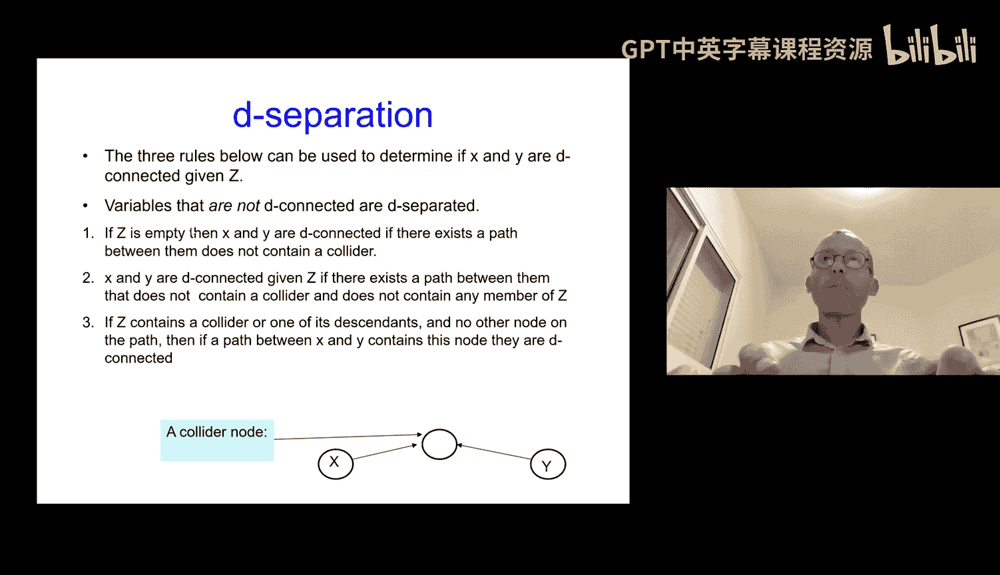

So， let's do。

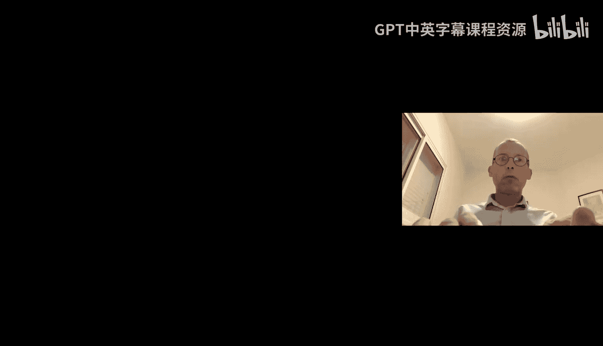

So let's say we have x here and y here。😡，If there is a path between them。😡。

Which contains some nodes or maybe。Okay， that's one it two or whatever and we of course and z is empty so we don't know anything about nodes in this path。

 then these two are connected okay so this is called a directed path between x and y however。😡。

If the path has a colider。The collider means that within the path。😮。

Or if all passes between them have a collider。This is called the collial Collial is that one node has。

Two incoming edges， one from each side， okay， so this is called the collider this is a collider if all the path between x and y right。

😡，If there is any have a collider， then they are not connected and and and of course。

 and N z is empty Okay， so if z is empty and there is a directed path they are connected。

 if there is no directed path either theyre not， I mean， for example， x and y and like this。

There's no path between them or there is a path that contains a collial。

 then they are not connected if these is empty。

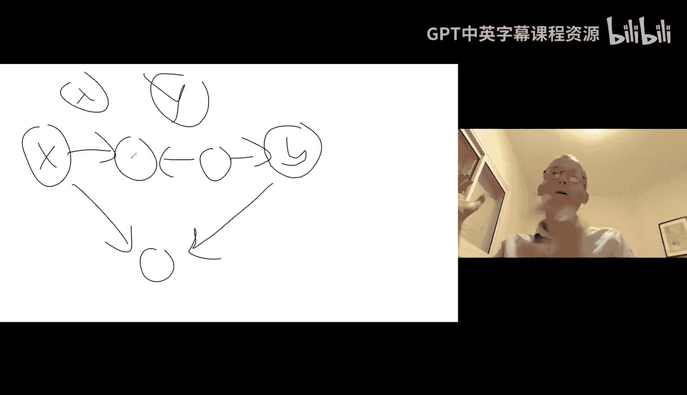

Okay， so this is the first rule。

The second rule is。I if so the second and third rule are if z is not empty okay so if x and y we say are disconnectned。

 if there exists a path between them that does not contain a colider and does not contain any member of C okay so if there is a directed path between x and y that does not contain any member that we condition on they are connected right it's similar to the empty set。

 there is a path， a directed path between them that are axis。😊，Now， if V。It's not empty。😮。

And there is a path between x and y， but oh， let's say， okay。

 so if this is not empty and all path between x and y that are directed。😡，Contain a member of Z。

We still say that X and Y are connected if there is a path between them that contain the colider。

And Z， basically the variable we condition on is either the colider or one of its descendants。

 so let me show you an example。😡。

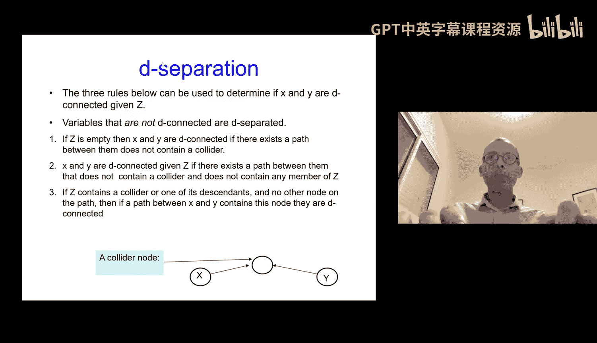

So again， if we have a path between x and y。

Let's say that we want to know whether x and Y are dependent given。M， right the variable M。

 so this is x， this is y。If we know M in a directed path， then they are not connected。😡。

Ifs the path contains one of the members of Z。 So in this case， Z equals。And okay， in this setting。

 so if the pass contains a member of the， then they are not connected， however。If M is a colllider。😮。

Or if M is a descendant of a collider。😡，Then Gaal connected it。

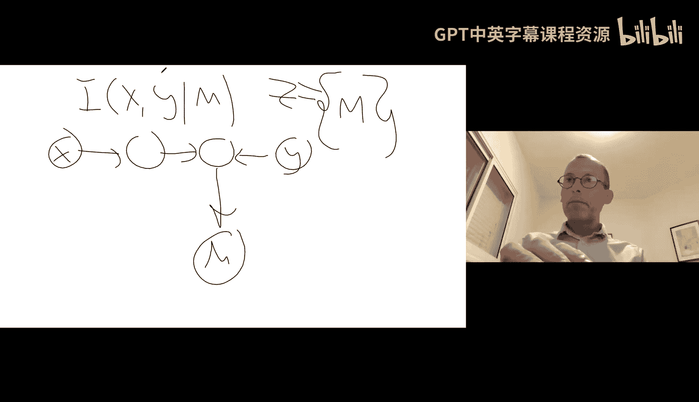

Okay， so this is the。Okay， this is the three rules I'm not going to prove it to you because proving this is not trivial。

 it's not too hard but。It's not trivial because it requires going through a bunch of cases where。

You have to， you know， basically it's it's a somewhat tedious proof。

 we will are we are going to ask you in the next problem set to do some。😡，Some， some proofs will。

that will lead to some of these rules， not all of them。

 but we don't want you to do the very long and detailed proof。

 but you will walk on proving some of these things in the next promise and so the promise that will be out this week。

But generally speaking， I'm not going to prove these rules。

 I'm just stating them that new the good news is that using these rules and I give if I give you two random variables。

 you can use these rules to determine whether nodes in the network are conditionally independent given。

😡，An empty or a set of nodes that contain some other nodes。

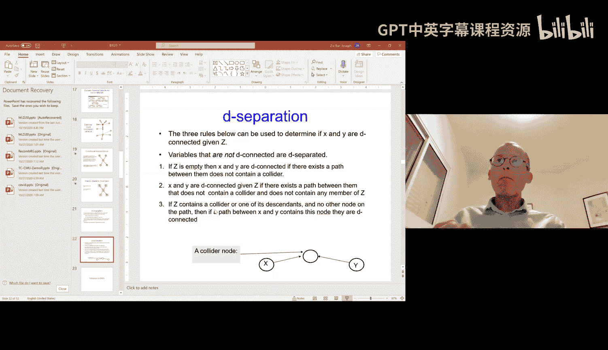

Okay good so this is this separation I guess this is not trivial for most of you at least hopefully and at least those who haven't seen it so I think the next thing and I know you asked some question and Daniel is answer them which is great the next thing I want to do is let's practice this with some examples I'm going to open up two quizzes related to independence Go dimension is well as I always say and I'm definitely going to say today this is very early right so you just saw this if you get it great if you didn't get it don't worry I mean more practice this is something we actually practice quite a lot in the problem set but you know let's the reason why we are doing this as a quizzes because these are things I wanted to show anyway so let's try as a quiz and then we'll talk about them。

In class okay， so I'm going to open up two quiz questions。

 hopefully people remember the Piazza quizzes so I have two questions on based network。In。

Both of them contain figures， so if you don't see the figure， let me know。

 I think you should see them。In。原要变松。Let's do this and we'll talk about them and how they relate to the。

Okay， so let's start with the first question I asked you。

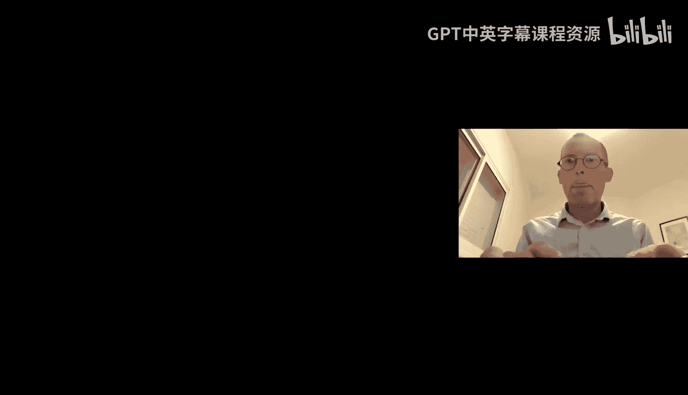

So I presented to a basic networks and I asked you whether they are equivalent means that basically these networks have the same assumption Now there are different ways to show equivalentence one is something I told you that they represent the same condition of probability the question is how do you show you can show all the pairs or all the subsets and show that the same but that's how to do another way to show equivalentence is to show that the joint probability basically if I write P of ABC。

 then the factorization basically the probability of know given its parent is the same in both networks。

So let's see how the factorization works for the second， okay， let's start with the second。😡。

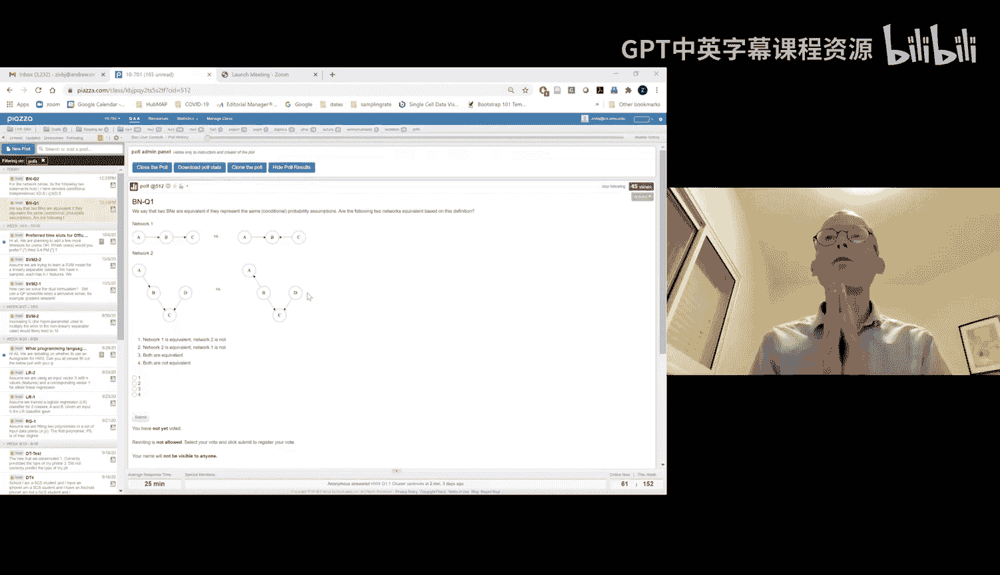

So for the second network。

一。But so if we look at the left network， we have。P of a。Right， P of。B of be。Given a fearoff。C。Given。

B。😡，Candy。Np of。right this is just the we said that's the joint probability of probability of every node condition on its parents。

😡，Everybody's okay with me here。Hopefully， yes， okay， what about the first network。

 the first network the one on the right， we have P of。😡，A， given B。Rightい。P of B。

 B doesn't have any incoming edge。😡，Is that true？And the rest is the same， right some P of C given。

And you。Right， everybody sees that。 Now， are these two the same。

So obviously this is the same this spot here and here and here and here right。

 I mean if we have some probability that we learned and it's。😡。

I mean that's the true probability that it's the same and now we are left with P of a times P of B given a and P of a given B times P of B are these do the thing。

😡，The answer is yes， right the train world will tell us that both of them are basically P of AB。

 doesn't matter honestly。😡，Which dependency assumption something we use。

 we can always factor P of A and B to P of A times Pb of a or P of B given。😡。

So basically both networks make the same assumption about independence in one in one network a A is the parent of B and in one network B is the parent of a。

 but both of them are basically the same。😡，The direction of the edge does not necessarily imply causality。

 it just implies relationships in terms of joint probability distribution so in this case the second network is the same。

😡，What about the network on the top and that's actually an example where。😡，All right。

 so we have P of。We are still。With PFA。Bef。B， given A and feel of C， given B。And for the other one。

We have P of A P of。B， given A can C。Ps。This can cancel out。But these two are not the same。

Unless you assume something about the relationship between these。

 you cannot always say that P of A given P of B given AC times P of C is P of B given A times P of c given B。

 that's not always true。😡，It's true under some assumptions about the relationship between。

 but it's not something that based on the probability assumptions you can say based on the chain rule。

 for example， right， if we use the chain rule or actually the opposite of the chain rule。

 it will not be something that we can derive unless you make some very strong assumptions that youre not allowed。

😡，So in this case， the answer is that。There's a quick question， Si En。Someone says。

 is P of C given B and D equivalent to rating P of C given Air B and D here？No。No。

 in this case you're right， I mean， if you knew a， it could lead to some other， I mean the network。

 the network does not require you to condition or let's put it this way。

 the network tells you that if you know B。😡，You don't need to know a。

 you can think about the fact that a once you know B， in this case， once you know B then。

If C is independent of a for both of them so the but again this is just for these variables right there could be I mean a is just an abstract variable。

 it could be the case where a is very important and B doesn't help you at all。

 but for this specific network that's not true。😡，Okay， let's go to the next question。

 which actually is using the dis separationation idea。So in this case I asked okay。

 sorry about this right so the answer in this case is to okay。

 so network two is equivalent and network one is not equivalent。A lot of you knew， which is great。

 I mean， not everybody， but this is just something we introduced。 Okay。

 what about the second question， the second question I asked about de separation and。Yeah， again。

 this is something we just learned。It's not。It's not trivial okay。😡，The first is were the LD。

 which is here and AS so independent。Without knowing anything else in order for them to be So we say they are independent unless they are。

They are separated unless they are connected if they are separated then they are independent。

 when will they be connected when there is a directed path going from D2S。

 otherwise if there is a path between them that has a colider because these is empty。

 they are not connected。😡，In this case， all particles from D2 S right， have a collider。

 you cannot go from D to S or from S to B without eating a collider。😡。

So the answer is that one is true。😡，So basically one holds so a， I guess is one in that case。

And so so this is true right DNS are conditionally independent given an empty oh basically are independent based on this if we don't know anything DNS are independent what about two if we know age。

Then we have a path between them that contains a collider oh in this case， really。

 this is the path between theH and this is SJH right H is a collider in this case。If we know H。

 we said they are connected， if they are connected， they are not independent。😡。

So B is so the answer in this case is one which。The majority select Okay。

 so this is just a way to use the dis separationation。

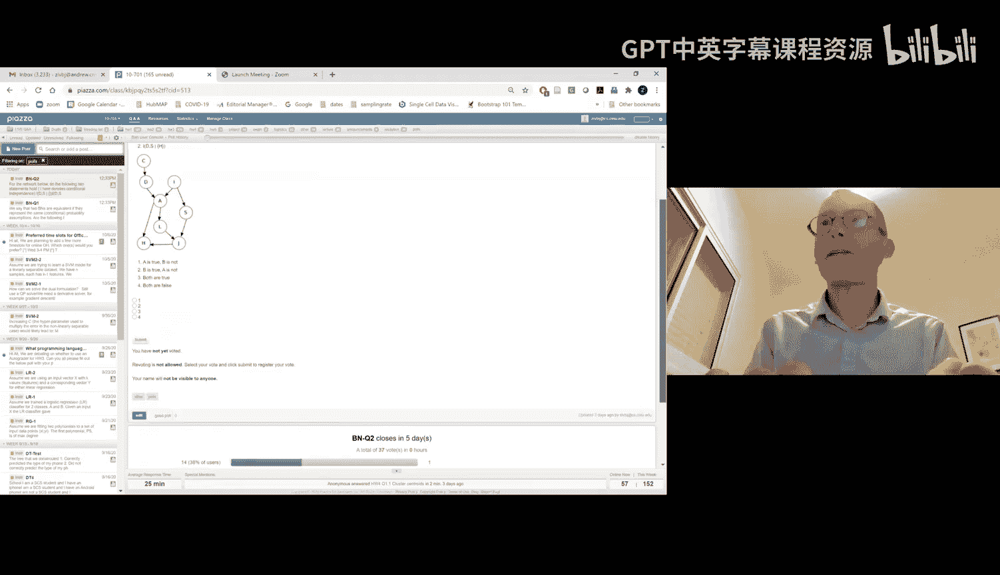

ok。Now， don't worry if you didn't get it right， as I said， this is extremely quick。

 we just learned it and we have lots of we usually ask。😡。

Related questions in the exam so this is something you should know eventually。

 but you have plenty of opportunity you are going to have in the problem set that you are going to release questions about dis separation and we have a lot of previous exams where you can train and walk on it and you know take your time and look again after the class。

Hi， professor， can I ask a question。So regarding the previous plot on the graph。

 the second condition here is that X and Y are disconnected given Z if there exists a path between them and the path between them meaning the path between x and Y。

Yes。Yes， okay。嗯。I'm not quite sure about the graph Y X X and Y or against this is X is Y。But。

 it's not showing。いやや好好。So in this case， D is x， for example， and s is y。😡。

And H is Z。Yes。So this is a colider， right？Yes， well if there is a colider and it's part of V。

 then they are connected。😡，Okay， not。Yeah， yeah gotcha， thanks。

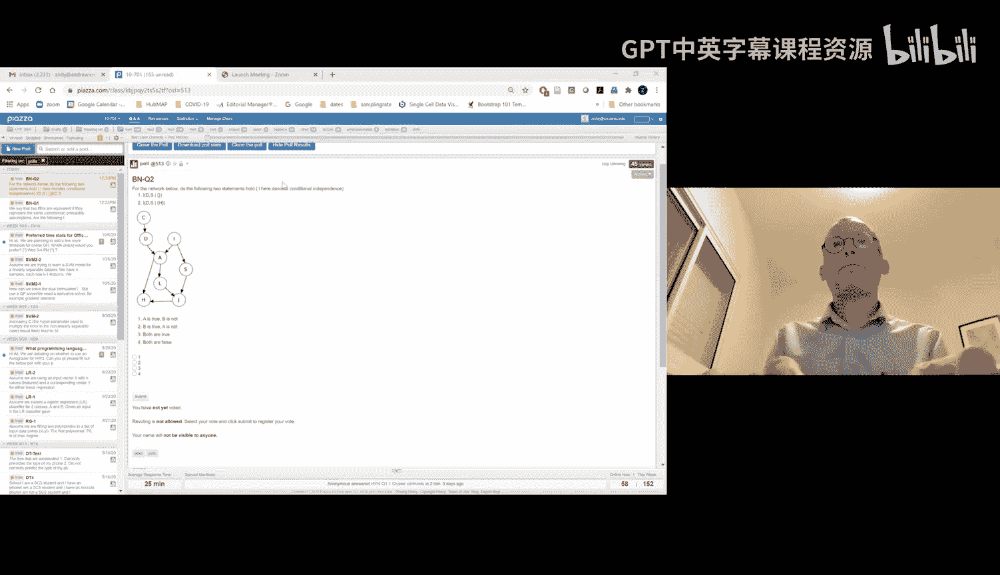

Okay， so let's go back to our class and now let's go to， as I said， what is the real or not real。

 but one of the major questions。

In Ba network and this is in fact basically asking。

About things that we didn't observe and wanted to know the answer。😡。

So once we have the network and okay， so I was say。

 for infants at this stage we assume that we have the network， we know the nodes。

 we know the edges and we know the CPTs， so the network is fully defined。😡。

We now want to ask questions about an network， so we want to infer values given that we observed only a subset of the values。

😡，For example。I want to know what's the joint probability of set of values。

 for example burglary occurred earthquake didn't occur allowing sounded J John called and Mary didn't call okay so in that case if I have this this is a fully observed set of values right we observed all five variables we can just look at the network right we have let's say some probabilitybabilities in the network and we take the joint and the joint is just the product of each node conditional experiment B and don't have parents A has two and so forth and this is the probability so we have a probability for observing the set is this number here right we just go to the network use the conditional probability tables that we compute that's pretty easy。

But of course， the interesting questions are when observe only sub so when we observe everything we just plug it in。

 that's it。😡，But the question is， what do we do about a partial distribution？So conditional。

 but let's take policy。So let's say I want to know what's the probability that someone broke into my house if John called me and Mary didn't call me this is a much more realistic scenario where I really want to use the network and I'm at2 John called me Mary didn't so。

😡，The thing that I really care about is whether someone broke into my house should I go home or not right I mean it's LA you know lots of traffic going home is not something you want to do in the middle of the work day unless you reach it so。

😡，So this is the question。Okay now I should say conditional probability is usually something pretty hard to do in base network。

 joint is much easier， right we I said that based network represents a joint probability disability。

 So if we have a conditional probability in this we want to compute the probability of B condition on J and not M we usually turned it into a jot right So the probability of a given B and C is just the probability of ABC divided by the probability of B and C。

 which is some over A， the probability of A B and right this is。😡。

Something we discussed many times again， just。

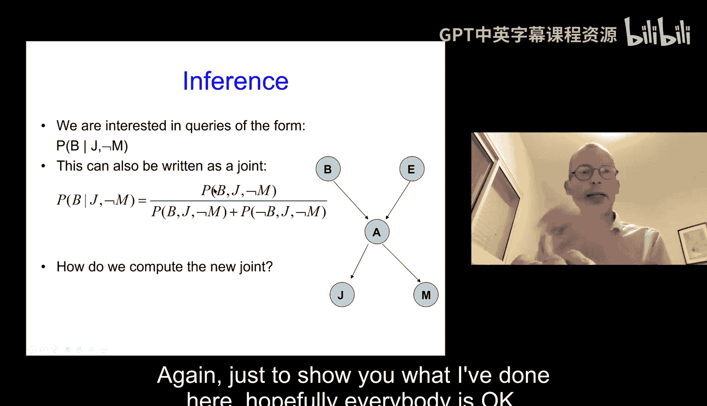

To show you what I've done here， hopefully everybody is okay。Rights the probability of。

P of A condition on B and C。一公。B a。B and C over sum over a。All right。

 this is the idea that we have for Android。So this is basically a simple way to turn conditional into joins okay that's not fully helpful but it's helpful okay so how do we but this is now a partial joint right we don't have all of the all of the values in this equation we only have three values or you know v is1 js1 Nm is zero how do we compute this probability from the network。

😡，We cannot just multiply the probabilities of each node versus its parents because， for example。

 for J， we don't know the value of its parents。😡，We don't have a in this equation。😡。

If we and all of them we can multiply but we don't right so what should we do。

 how do we do in France， how do we learn how do we determine this joint probability anybody。😡。

So again， so that's again， something pretty simple， although very time consuming， if I want to know。

So we know that P of b equals to sum over a。😡，P of A。This is an estimation idea。

Because we must a with one of the values of a， so let's say this is P of b equals 0。😡。

So some over AP of right this is just so we can do the same thing here right we can sum over if we want to compute a partial joint we can compute a full joint by summing over all the values of the other variables right so in this case we have two missing values。

😡，So in this case， we have two missing values which are in this case， A and E。

 so we can sum over them， right and this is called enumeration。😡。

And with sum over all the instances of all the values we didn't see。

And that's how we compute so for example， if I want to compute the probability of BJ and not M。

 I just compute the probability of GJ and not M， A and D。

 A and not A and D A and not E and not A and not right these are those basically for possible sets right11 for the missing ones which are A and D0。

0，11，01 pretty easy and we can compute it and that will give us the the partial drug。😡。

Okay so this is pretty easy， The big problem is if we have a base network with 100 variables。

 we observe two and we want to compute the joint probability of three of them。

 then we need two to the power of 97。😡，Voles to compute right everybody sees the problem with you know this is called enumeration basically we enumerate we compute all the missing or we sum over all the missing possibilities。

😡，But this is very， very time consuming right if we have， again， even if we have binary variables。

100 nodes， not a huge network and we only observe three and we want to compute the joint of three of them。

 this will be2 to half that's impossible to。😡，So it's not a good idea。😊，But， you know。

 in small networks， maybe this will。It be something we can do。

Now there are ways to improve it and we'll talk about them next time there's something called reusing calculations and so forth。

 this is similar to dynamic problem and we'll get to that。But obviously。

 even that is only going to provide。Improvement in some cases， but again。

 as we will discuss next time， there's no guarantee that whatever we're usinging of calculation we will do will really provide a solution that is fast right the problem with this solution that we mentioned this enumeration is that it's exponential。

Or could be exponential in the size of the number of variables。

 which is something we cannot tolerate right again， this is inference。

 this is not learning so that we assume that we know the network of this is just doing。😡。

So unfortunately， so like do you think is not。So this is a good idea。

 but unfortunately it doesn't solve the problem completely。

So what else can we do or how can we improve this issue？

So the answer is unfortunately that unlike other cases， for example， in na base or。😊。

Support vector machines where we use the gradient dissent and if we make assumptions and in general doing inference in based the network is NP hard NP hard for those who are less familiar with computational complexity means that unless。

Or NPN is a class of problems that we don't know how to solve in polynomial time and NP hard means that。

We can take one of these problems that we know or that we know we or that we can show that we can。😡。

Well let me take it back NP means that if we have a solution。

 we can easily validate that it works in polynomial time。😡，But to find that solution。

 we don't know how to do it， and it's slightly exponential。😡。

NP hard problems are problems where we can show that if we know how to solve them。

 we can solve all of the problems in this NP family。

 So basically in order to show that the problem is NP hard。

 you have to show that if you can solve it， you can solve another problem that is known to already to be NP hard。

 So this is a very big class of problems and it keeps going because every the time you show that if you can solve one problem using this。

 that problem becomes NP itself itself because if you solve that， you solve others and。😡。

So in order to show that the goal or the claim is that base network inference and inferring the values of finding the joint probability。

😡，The partial joint， of course， the full joint is easy。

 but the partial joint in this the network is NPH。😡。

AndHow do we show that that's the case in order to do that we reduce it from a problem called suicide since that is really the canonical NP health problem so this is really。

😊，One of the best problems of this family and Sw that is a problem of finding assignments to random variables。

😡，Which are organized in a set of。Conjunction so basically three variables we take the all of them and then we take the end of all these triplets okay。

 so we have you know n n let's say we have n variables， we organize them into triplets。😡，Okay。

 so each。So each triplet contains V of these variables， a variable can appear and multiple triplets。

 that's not a problem and a variable and its negation can appear so you can have like B or not B。😡。

That's valid and for each one each triplet we have an or between them so in order for this loop and we have an end between all of these triplets so basically in order for the statement to be satisfied in order to for this logical form to be one。

 we need each of the triplets to have at least one variable that is one。😡。

Because this is an end of all of these triplelets。😡，So if we can and the question is。

 can you find assignments to the variables because we have the variable and its negation。

 can you find an assignment to the variables， for example， As 1， B0， Cs1， D0， and so forth。

 such that this function that we defined is satisfy。😡。

This is called three startto statisticalfi problem， okay， and it's known to be an H health problem。😡。

And what we are going to do is to show that if we know how to do inference in based network。

 we can solve threeet if that's the case， then obviously Ba network is NPR because if we know how to do inference then we can solve reset。

 then we solve all the NP problems。😡，Okay so this is something we will do next time and I will show you the reduction I don't want to start we don't have a lot of time。

 I want to make one announce or two announcements basically so tomorrow as you all know hopefully is the electionction day some of you or maybe most of you have already voted I think。

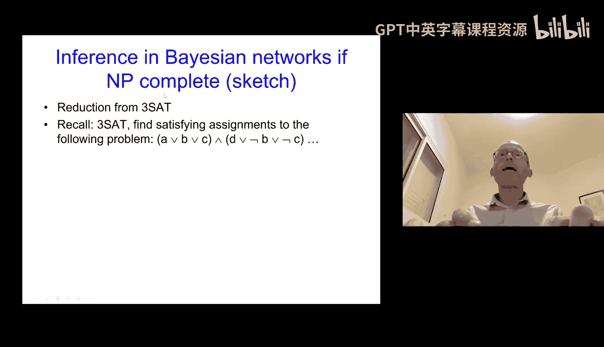

At least nationally twothirs of the people already voted， but if you haven't voted。

 we encourage everybody to vote and not we as but CMU encourages everybody to vote because of the vote tomorrow we decided to postpone the deadline and this was already announced but I'm making this announcement at the deadline to problems at four to Friday so you have until Friday to do problems at four problems that find is still going to be released tomorrow and not tomorrow on Wednesday right Daniela I mean that's the plan at least and you will have less than two weeks that was the original plan for right and I think we have until Monday。

😡，Now problem set five is very different from the other problem sets first of all it's the last problem set after that we have the exam then we let you spend the time on the project the second thing it's a shorter problem set so you will see we'll have less questions there is not going to be any programming as well so problem set five。

Again， I mean， we will still ask theoretical and some practical questions。

 but it' not going there's not going to be progress， so it should take you less time and yeah。

So that's the plan again， if you finished already， you can start。

 it's going to be released on Wednesday， but for those who haven't you haven until fighting to submit。

😡，And that's it， I'll see everybody on Wednesday and we'll continue to talk about this network and we'll start talking about other members of this graphic Mo family。

😊，Bye。