# CMU《机器学习导论（研究生）｜10-701 Introduction to Machine Learning 2020》中英字幕 p17 [17]10-701 Lecture 18 Inference in Bayesian Nets and HMMs.zh_en [BV144SuB8ETp_p17]

Okay， welcome back everybody， today we continue to discuss graphical models and specifically within graphical models we are talking about basic networks。

😊，Last time we defined what a base network is， we said that it represents joint probability distributions in a compact or efficient way。

 we said that Ba network is composed of nodes which represent random variables of edges that represent dependency assumptions and of conditional probability tables that represent the dependence of a variable on its parents。

 we discuss some properties of the network and specifically how we can determine just based on the structure of the network。

 some issues related to independence or conditional independence。

The last thing we mentioned before we ended was the fact that one of the major goals are one of the major reasons we are using based in addition to looking at。

Depenency issues is to do inferences to find the values of missing variables。 This can be。

Thought of as a classification problem， for example。

 I said that NA based can be represented as a base network， basically learning problem。

Where each node is basically one of the inputs and one of the nodes in the label。

 but you can think of it as a general inference problem， for example。

 in the case of the network that I've shown you if I want to know whether someone broke into my house or someone or the earthquake happenedend whatever I can ask any question I want condition on any of the subset of nodes that I've seen and we said that inference problems can be solved by turning the conditional because usually inferences。

 if I know this and this， what is the probability of that what's the probability that someone broke into my house if I know that John called an at least didn very didn't right so that's like an inference problem we said that invasive based network we usually don't deal with conditional probabilities we deal with joints so we can turn the conditional into a joint。

And then through infants using the base network， the only issue we had was that the joint that we have is the partial joint。

And basic networks provide a full joint probability distribution。

 so we said one way is just to loop over all unobsed variables。😡，Put them into the joint。

 then we'll have a full joint， just do the summation idea and in fair the partial joint that would work that that's valid。

 it will solve the partial joint if we have the partial joint we can do the conditional and we done the only issue is that this can take a very long time right if we have three observed variables or two observed and one missing and 97 others that we need to loop over。

 we said this can be very very time consuming So the question is is there any way to make it more efficient rather than really looping enumerating all the values。

 which is the first idea we use， can we do it better and we ended the lecture by saying that unfortunately that's impossible。

And the reason why is because inference is based in network is an NP complete problem。

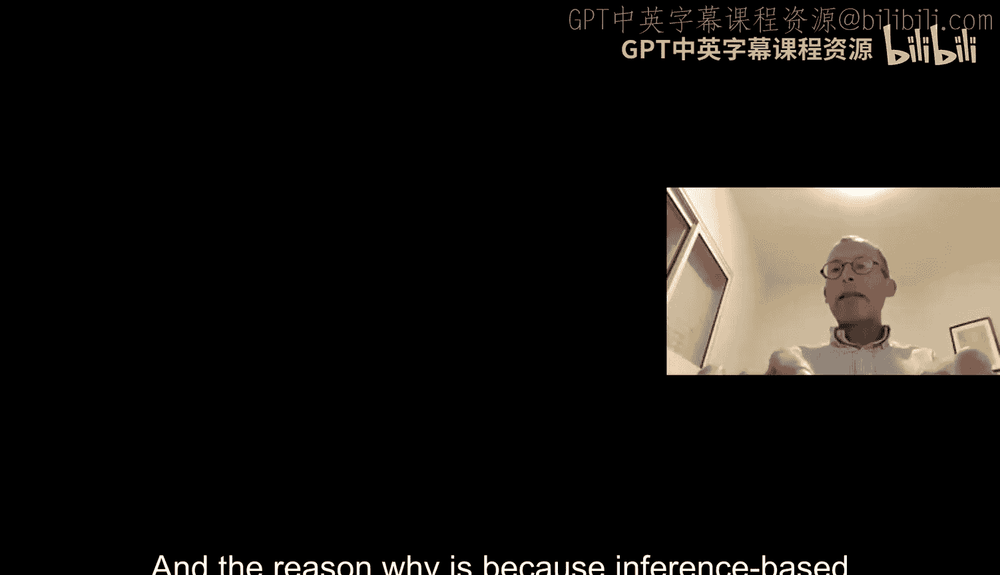

Now I mentioned what is NP completete NP completete are a set of problems that are unlikely to be solvable in polynomial time or we don't know how to solve in polynomial time if you solve one。

 if you know how to solve one of them， you can solve all of them polynomial time specifically one of them is the problem that I mentioned last time and I said that in order to prove and that a new problem is NP completete。

 what we need to do is something called a reduction basically we need to show that if you know how to solve this new problem。

 for example， in our case the new problem is inferenceencing based network you can solve using。😡。

This method， an existing NP program， if that's the case。

 then you basically it's called a reduction you reduced。😡。

A problem to your problem and your problem is now part of this big family。

 because if you can solve it， you can solve the the problem that。

You have shown to reduce to and then all the output。

And the problem that we selected was simply called so threestar， a collection of random variables。

 binary random variables where we are looking for a satisfying assumption an assumption。

 an assignment that will satisfy this logical clause。

 the logical clause is of triplets and ends of each of theses so each triple has to have at least one variable that is one or negation of a zero basically so it has be each one of these has to be satisfied in order for the entire logical term to be。

Okay， so this is a problem， I mean so basically the way the problem is formulated if you are given these three subsets and then you' asked can you find an assignment that will lead to basically a value of one for the entire and the question is can we use base and network to answer whether an assignment exist so this is like does the assignment exist or not even if we don't have the assignment？

😡，So that that。The testpherability of a threeat is an NP output so let's see how we can use based network for this so let's start by representing each of the random variables we have in the setting and again a random variable in the three set can appear multiple times so it can appear in the first clause in the second or in the third I mean right I mean it's similar to so we have the nodes here corresponding to the possible variables in the space set so maybe this is ABC whatever okay now each so this is the first row the second row is these clauses the three closes each clause has three values。

So it has three incoming edges。😡，Because it has three variables that link to that and the probability we assign and we need to assign a probability we'll get to in a second so what is the probability that we assign。

😡，So the first one I'll get to， but basically the probability is we say that this node is one。😡，If。

All the incoming nodes are one or if you want the negation you can do negation but whatever the close is we put it as the probability of one so this is a deterministic assignment。

 but it's also probabilistic so if these parents write one then this is one otherwise it's zero that's a probabilistic statement because the values are between zero and one they sum to one right I mean there is an assignment that is one all the others are zero so they cannot be more than one this is a valid probabilistic conditional probability table of course three on a three random variable set。

😡，Okay， so that's a valid statement， of course it's only one for one and zero for all the others。

 but still it's a valid probability assignment。😡，Okay。

 so this is the assignment we select for this and the last one is the node that evaluates the entire set of things and what we what we put here is basically the end of all of these so if all of these are one this is one otherwise it's zero again this is probabilistic so we have this table。

😡，All combinations of zero except for one is one again this is a valid probabilistic table because there is an assignment that is one the sum of the probabilities is one right so that's a valid probabilistic sign。

😡，Okay， so this is the， I mean， the reason why。Saying that this is valid that this is a valid based network。

😡，Okay， so so far we just defined the base network。😡，Now。

Here comes the interesting part we say that the first node of these random variables。

 we set each of them to one with probability 05。😡，We have a prior problem。And now。

We want to ask an inference question that if we solve it。😡。

We know how to solve threeS anybody can tell me or write to the chat。

 what is the inference question we want to ask of this network。😡，Oh， unfortunately， I， yeah， anyway。

It's on slide， unfortunately。So you see， but any but but yeah， so let me。

It works better in class before I switch from the presentation mode toD but anyway this is the based network this is a valid based network we have a probability distribution for each node。

 each one has a set of parents and based on that parent the probability so this is definitely a valid based network。

And now we ask the following question， which is an inference problem。

 what is the probability that y equals one if I don't know any other variable right so this is the valid partialial joint。

 it's a joint of one variable but it's a joint right I mean I don't know anything else。

 what's the probability that y equals one。😡，Okay， that's a again， it doesn't matter what the answer。

 but I want to make sure that you understand this is a valid。😡，Infer。Second， this is a valid。This。

So this is a valid inference problem okay， what's the probability of y equals one now why is that an interesting problem？

😡，Anybody can tell me why this question is relevant or how is this question relevant。

 you can write to the chat to the threea satisfiability problem。

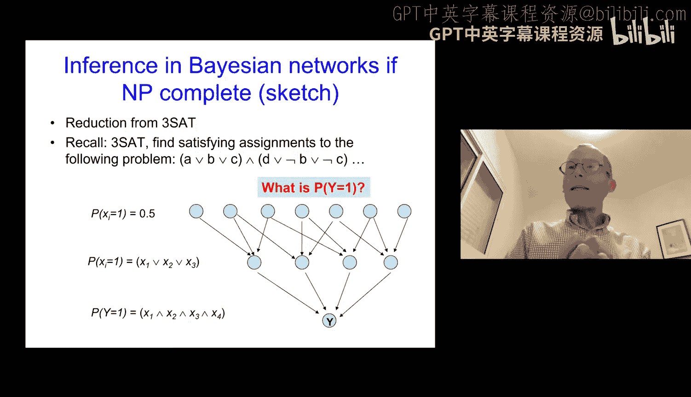

Remember， that's what we are talking about right so I'm basically saying that。

Asking this basically if I know how to solve this very simple。😡，Inference problem。

 or at least simple in terms of writing， what's the probability of y equals one？

That provides something about the。😡，Right， exactly good。

So the answer as was written in the chat is that there's two options for the or there's of course a lot of values that P of y equals zero can take。

 but there's two options that it was does， one is that p of y equals zero。

 sorry P of y equals1 is zero。If p of y equals 1 is0， then there is no way to assign。😡。

The variables is because we can make any assignment， the probability of an assignment is 0。

5 so we can do any assignment is a valid assignment。

 At least it has a probability right it's basically it's half to the power of end。

 but it's a valid probability。😡，So any assignment has the positive probability。

 if we know that the probability that y equals one is0。

 then there is no assignment that not to explain this any other value。😡，Any value greater than  zero。

 it means that there is an assignment that might otherwise。😡。

There's no way to associate right the only way to to make y equals one because of the logical。😡。

Probabilities we selected is if all the clauses are one。

 and basically that means that at least one of the values in each of the clause is one and this is satisfying。

😡，Okay， so if p of y equals1 is0， we know there's no satisfying assignment。

 if p of y equals  one is greater than zero， it doesn't matter what it is。

 there is a satisfying assumption assignment and。😡。

The idea is that if we can solve or if we can do inferenceferencing based network in a polynomial time。

 it means that we can solve the three instance。😡，Okay， so all of this was to show you and。😡。

You know in some sense， you know， we wasted a lot of time because we wanted to do inferences and I'm telling you that there's no way to do inferences。

 but it's important to know that because。If we know that there is no way to solve it polyial time then we can rather than waste our time trying to find such solutions。

 we can move to other things which are we know are not going to give us the optimal solution but at least can give us approximation or can do it very fast in some cases so that's a strategy that we are going to take so as I said the first strategy is enumeration what we did before enumeration works always unfortunately can take a long time but still a valid solution but you should know that。

It can be exponential and there's no way around it Okay， if you want to get the perfect solution。

 it's going to be exponential or it can be at least。Okay， but then。In that case。

 there are ways to do an approximation or maybe speed it up， even if it's not。😡。

So the thing that people do the most I must say， and the different ways of doing it but basically that's the most common way is something called stochastic inference。

tochastic inference is basically based on sampling。

 there are different ways of sampling I will mention one of them there's something called Gb sampling I think that we will ask you or we will talk about in the meditationation。

 there are different ways of doing sampling but each of them basically is of course not it's not going to comprehensively consider all of the possibilities。

 the idea is that we consider enough possibilities to get a good handle on what we should expect the outcome to be。

And if you sample enough times， of course， if you sample all the possibilities you back to enumeration。

 if you sample enough times， the idea is that you get a pretty good approximation of the solution。

 Okay so how do we sample。😡，So in order to sample， in order to do schastic inference。

 the idea is that we just sample。😡，From the joint probability distribution。😡。

How do we sample from the joint probability variable for example for B we know that the probability of b equals 1 is 0。

05 so I flip a coin that has 95% chance of being0 and 5% of being1 and isolate select okay similarly for similarly for E okay now once I have the value for B and E I can sample a because I know B and E right let's say I know that B and E are you know b is0 and e1 then I have to sample from this probability okay。

😡，And if B is0 and E0， I sample from this， but it's the same。 Once I sample B and E。

 I sample A and once I sample A， I can sample J， depending on what the value of a is and I get a full sample of this distribution。

 Okay， so that again， I didn't say what we are doing with the sample。

 I just said that in based network， we can always sample according。😡。

2D a probability that is assigned。There is one question I do want to ask you， and that is。

 it's only true that we can sample according to the probability。😡，If there is a free variable。

 but if all viable have parents。😡，Then where do we start right where do we start the sampling。

 we have to start at this free variable right， which is in this case B。😡，right。

 both of them we can start with。😡，Because they are just trials right and then we can start by sampling A。

 everybody sees that because if we don't know B& E。

 there's no way we don't know where to go to sample A。😡，We can sample a only if we know B and E。

 everybody hopefully see that similar for J we can sample J because the distribution of J depends on a。

 so which distribution to use depends on a， but for B and fortunately we can but what happens in networks where all parents all variables have parents where do we start in these networks？

😡。

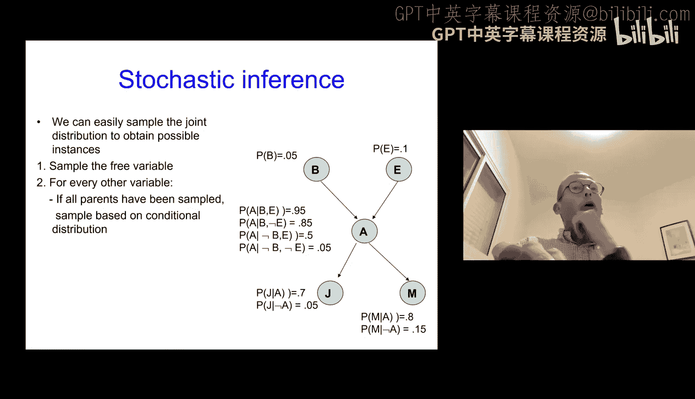

Anybody can tell me or you can write to the chat again you see the problem I mean if we have a free variable that's good we start with it and maybe we can go to its descendants。

 but what if all variabless have a parent or you know。Okay， some ideas the M。

Exactly good so people are onto this and great， very good observation one of the reasons。

One of the reasons why we insist that the base network is a D is because of this sampling issue so basically basic networks are as we initially said are directed the cyclic graphs and if they are directed the cyclic graph there must be a free variable this is something we sometimes in the problem set I don't think we're asking this time but you can try and prove it that in Ds there must I mean that's not necessarily I mean the definition of directed the cyclic graph is not that。

There is a free variable， but you can show that if if it's a duck。

 there is going to be a free variable。 Otherwise there's going to be a cycle。 Okay。

 so you can show that。 but for now， let's a。Take this as a fact that there is a free viable that we can start sampling okay。

 so if that's the case， then we can always sample and get the solution okay so what do we do when we have this sampling？

😡。

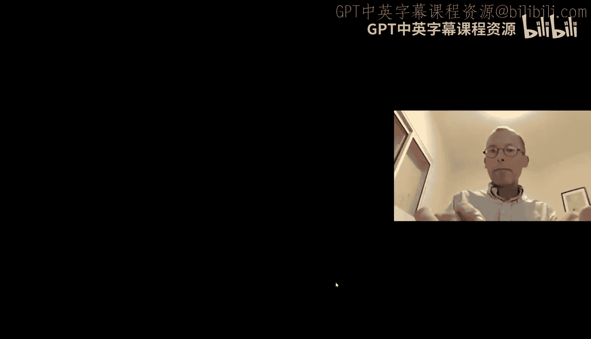

So we end up with once we sample so we sample B EA and so forth， once we have this sample。

 we have basically a sample that was obtained from the joint probability distribution and now we use it。

😡，And now we use it to determine the partial joint or the conditional whatever we want。

 so let's define as and the total number of samples we took。

AndC are the number are the samples in which J is one。😮。

And M is zero right I mean if we just sample some of them J will be1 and some J will be zero but there was going to be a subset。

 let's say we sample I don know 1000 times in a subset of those J is going to be one and M is going to be zero just a small subset but。

😡，Now we defined another subset where J is， I mean。

 so a subset of that where J is01 and me is0 and b is one。😡，Okay。

 and if we want to know what's the probability of B， given J and M， it's just the probability of B。

 J and O M divided by G and not M and approximating it is the number of times where this holds dividing by the number of times but this is of course more。

😡，When this holds of course this holds， but we want to know in how many cases where j is1 and M is0 p is1。

 I mean that's basically the fraction of time in the random sample that this holds right thats the。😡。

So that's fine and we can do it。And using that we can do any partial inference。

 any partial join and the nice thing is unlike of course the enumeration we control the runtime right because we can decide we take 1000 samples。

 we can decide we take 100000 samples obviously the most samples we take the closer we get to the real solution。

 but at least in terms of time， this is not going to be exponential in whatever we decide that and you know if we don't have a lot of time。

 maybe the results will suffer， but we will always finish okay that's。Okay。

 so this is definitely a possible option， very commonly used something calledtochastic infants。

 what's the downside of this？😡。

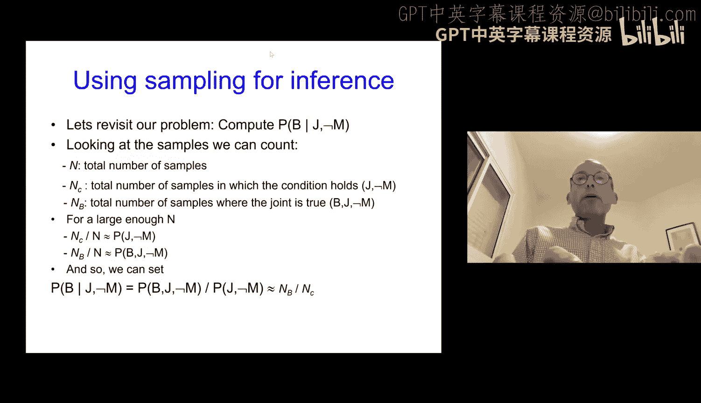

Anybody can think of a problem with this approach？😮，So again。

 we started the one with the free valuable and。Sle then we count how many times we saw。The condition。

 how many times have we sold in？Partial joint， divide and that。

 what could be a downside of this approach？Po downside of such approach。

 so it definitely works accurate and so forth。if we require a lot of samples。That's true Okay。

 I agree that it would require a lot of samples to get it correct but。But there's yeah， okay。

 so the fact that we need a lot of samples to get to good accuracy is true。I mean。

 theres slightly more。Oh the issue is slightly more delicate here。

Even beyond the fact that we need a lot of samples， we're doing something problematic here。😡。

What would happen most of the sample， or it could be the case that most of the samples we will get are going to be useless for us because if。

😡，Again， the only samples we care about are the samples where John called and Mary didn't call right so we're going to have a lot of samples where John didn't call and Mary called most of the samples we throwing away we are not even using them in the evaluation right everybody says that even though we know we need John to call and Mary not to call。

😡，Most of the samples that we get this way are not used at all at this evaluation。😡。

So it's not just that we need to do it a lot of times， most of the times we are doing。

 I'm not going to be used at all because they don't have the condition。😡，But we know the condition。

 so why don't we just sample。😡，Using the condition， why even sample the condition。

 why not set the condition and sample the rest？😡，You see the issue if we have a conditional probability。

 then the condition must hold for us for the computation otherwise。

 of course we don't know the thing we condition on but the value we are conditioning on these。

 but the condition John called that Mary didn't call weno， so why not fix those？😡。

And then sample the rest， any problem with that？😮，So again， if we look at our network。That's my idea。

😡，The idea I propose。rather than。Sampling， as I mentioned before。

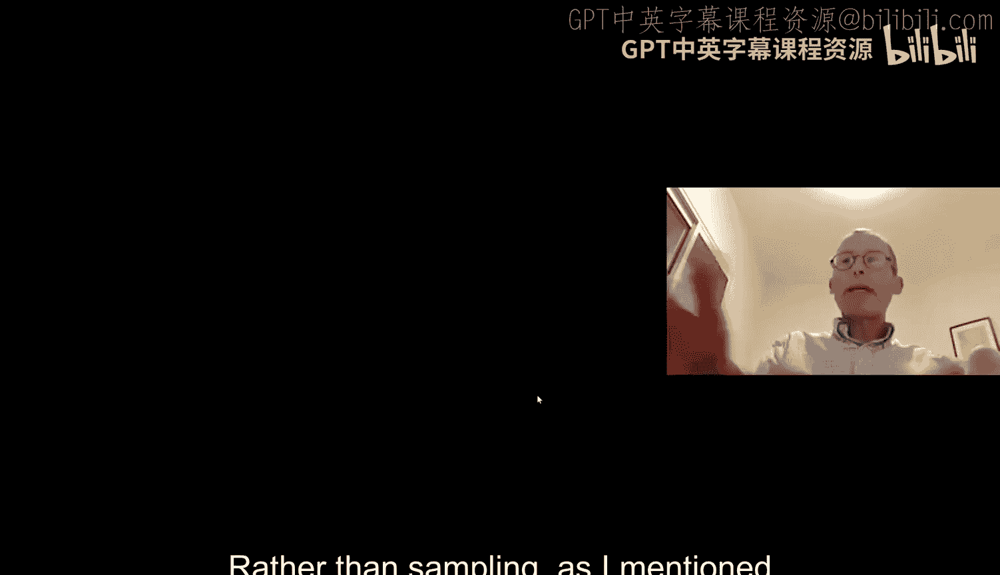

Let's do something else， let's fix J&M。😡，RightLet's fix J and not M so J will always be1 M will will always be。

Zero， and then sample the rest， in this case， we only need to sample B。

 but you know you can sample everything else。And then the good thing is all the samples that we'll get will be useful for us because we need just the samples for this。

😡，What could be a downside with this approach of fixing JNM？

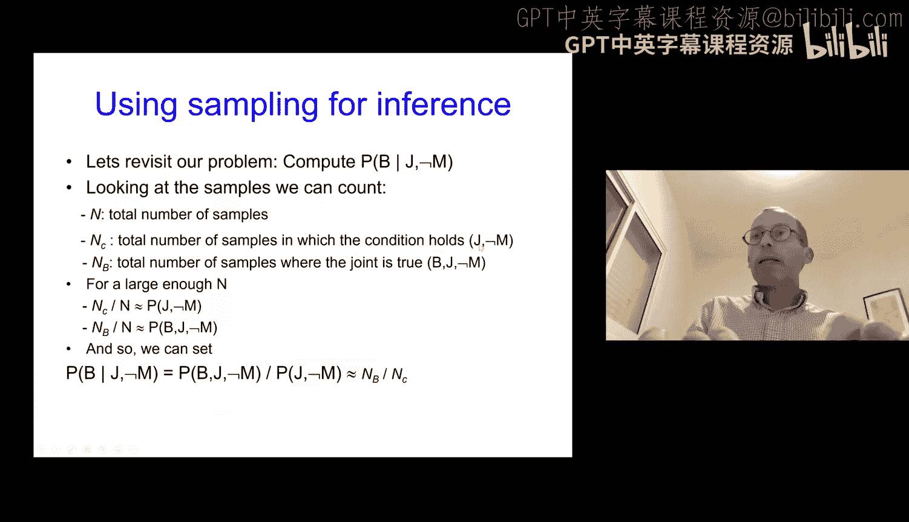

And then sampling the rest。你百啲。RightSo the problem is。

 which is something that people mentioned the chat is that if you fix the bottom values。

And you sample a free viable， it's not true that a free variable is independent of these values anymore。

😡，Of course， if you don't know anything， then the free variable can be sampled initially。

 but if you do know something， it is dependent on your， you can be dependent on your descendants。😡。

So if we fix some values， then we cannot sample freely from other values anymore。😡。

If we just go bottom top down， then yes， and if you don't know anything。

 then of course you're independent of anything else。

 you can just but but if once you know something you can so basically we cannot assume in this case。

 for example， in our case that if I fix。😡。

So if I fix J， for example， if I fix J to B1 and M to B1， right， let's say I fix it。

Right and now I sample B EA that's not a valid quantumom sample because if j is 1 and M is1 a is very likely to be one as well right they wouldn't call but I don't take that into account and I just sample here so I'm know that's not a valid sample。

😡，Okay so everybody see the problem it's fine to fix things I mean otherwise it's not useful but if you do fix it you have to take that into account and you sample the other things so one way is to see how this affects the sampling but that becomes complicated so how can we still do it how can we still fix it so that we can use all of the samples but take into account the fact that if I fix J to1 and m to1 and a is zero then it's very unlikely as a sample okay that's what we'll try to do next and that's save some time but you have to so the idea is the following。

😡，We fixed J to1 and m to0 because that's what we want。 And now we sample S before so we sample B。😡。

E and A okay， so we continue to sample， but now unlike before right before each sample had the same way。

 basically we just counted how many samples we had。😡。

And we said each of them can come from the joint probability distribution equally likely because we just randomly sampled Now we are going to do slightly the。

 So here， because we fixed it。😡，We are going to evaluate the likelihood of the sample that we got。😡。

Right if I have values for JM A B and D I can compute the likelihood of the joint likelihood of all the samples right it's just a product now if A and J and M don't agree because I fix those and I sample this independently the likelihood of this combined sample will be pretty low。

😡，Because it's unlikely that a is 0 and d201。😡，So the idea is that we fix it because we want to use all of it。

 but we weigh differently different samples， so if a is sampled to be one and these two are one。

 that's a reasonable sample， but if a is sampled to be zero。😡，I mean I still want to use it。

 it could be， but it's not a very good sample， so that's the idea is that we sample。

 but then we compute the full probability of the likelihood of VB。

 whatever we selected for BE and this should be a。😡，嗯。Right the value of a and so forth， okay。

 so and then we have this as a weight for the sample。😡，Okay。

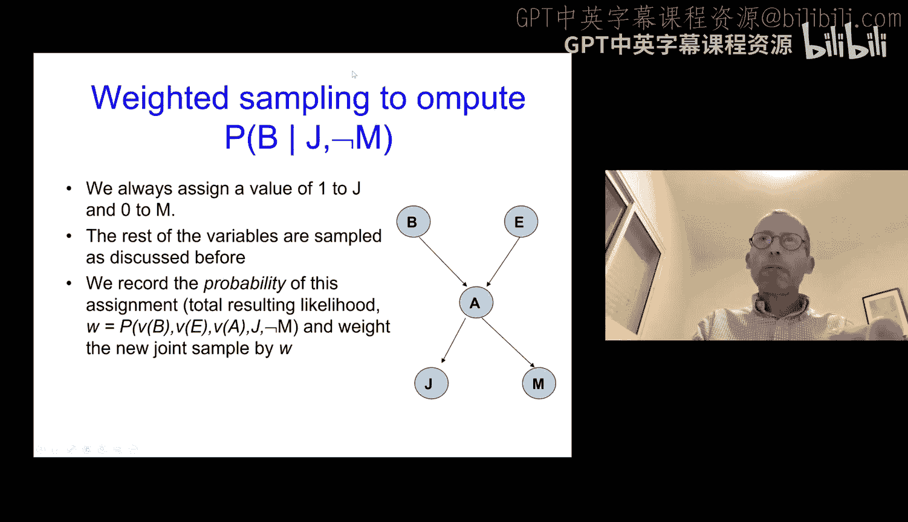

What's this spin next to what is this remote spotlight Danielelino？😮。

it's basically there to make sure that when the video is recorded。

 you are there and then your slides are there。Okay， anyway， sorry about that。 So again。

 so the idea is we are doing stochastic we are doing stochastic sampling。 we fix some of the。

Values in this case， what we are conditioning on， but we can't assume that if we fix them everything else is coming from a joint distribution which the things we fixed so we have to take the weight once we take the weight we we proceed。

😡，AndUs the weight so basically what we do is now we we don't need to count how many times because we use all of the samples。

 but now rather than counting how many samples we had as we did before。

 we sum over the weights so we have。😡，Because in all of the samples we have the condition holding we add to the condition and if b equals one。

 which is the thing we are conditioning on then we add that way to the condition and then at the end we divide NB by N so again still N is larger than NB because all the samples are going into N but they are not going with equal weight that are going with the weight associated with how likely this entire set of values coming together。

😡，Okay so again， if we just sample from a very large distribution and we only condition only a few variables。

 then maybe most of the samples will be very unlikely because we don't use that but at least some of them could be more likely and they will have a high weight okay so that's the idea this is still schastic so we can do it as many times as we want that the good news is that in this case we are using all of the samples okay some of them we may put very low weight on but at least we are not wasting any sampling right in the previous one。

Likely could have wasted 99。9% in the sense that they wouldn't have the condition wouldn't talk so in this case at least the condition holds。

 but maybe the probability that all of these will sample together is very low that's at least。

But that's maybe better than the ago。Okay， good， so this is schastic sampling and very commonly used in inference。

 not just in base networks， but in a lot of inference problems。有讲。Okay。

 so this is definitely one way and again this doesn't give you the accurate solution like enumeration。

 but if you sample more and more and more， you will get closer and closer to the wind solution。し。

The next idea is an idea that is not going to。So it's not an approximation idea it's still going to give you the complete solution。

 so if you get a complete solution， it means that。Oh it's not a completely the accurate solution so if we know if we know that something gives you the accurate solution。

 then there's no way to guarantee that it will be fast right we know that it's simply hard to find the accurate solution。

 however in many cases this can save time so there's no way to guarantee and I will show you an example where this doesn't help but there are cases where this actually can help quite a lot and this idea is called variable elimination variable elimination means that if you do computation basically when you do this enumeration right we have let's say。

I don't know9797 free free parameters that we need to of random variables that we need to to set right but in many cases when we change one of them it's not affecting any of the others right they are only affected there are areas of the network that are completely separate of this。

Nope。😡，So， right define。As an example， and again， I'm not。嗯。

Right let's say we have some network over here and then we have a random one round variable A。

 and then we have another network here。Okay and there's some edges going here and then there's some edges so there's a lot of fundamental variables inside here and a lot of fundamental variables inside here right but if I now change a variable here。

Then it doesn't impact anything about what I had here right I mean there's no changes but still if I have do the enumeration I have to recount every time right all of the random variables each time I change I we compute everything together that doesn't make sense so instead I mean again there's no way to eliminate it's not always going to be a nice break like this but if this doesn't happen maybe there is a way to just save time by saving some of this computation and we're using them whenever we don't change so whenever nothing changes here we just use the function that we have okay that's the basic idea of。

😡，Off。Right so this this is the basic idea of variable elimination。 So again， it's not a method for。

😡，Or there's no way to guarantee that it will save time。

 but in cases where there is a specific structure， it can save time。

It really depends on the structure。Just as an example， right in our problem。

 we basically had a partial joint and then we basically loop over all the values of frame。😡，Of of。

 of of。Of M and A， so basically sorry J of B and E， right？

So in some cases we basically recompute a lot of them are fixed but just e changes right so in this case why should we write m is only a function of a it's not when E changes right it's not going to change if a fixed then it's not going to change M so why why should we recompute it just and again here it's pretty simple we just go here but what if it's a much larger。

😡，Fun so again， it's not going to mean that we won't have to compute it。

 but rather than compute it many times we only compute it once。😡，Okay。

 so the idea is to reduceuse computation and the basic idea is just to basically each time we compute something。

 keep it as a function and then do a lookup table to look up at this function so for example right this is the if you look at what we this is the partial joint we want to compute the big letters are the ones that are fixed in this case B is always going to be one that's what we do J is1 and M has to be zero okay and then we loop over A and D right that's the function we want to compute that's the enumeration we are doing de enumeration in this case over。

So now in order， and again this is pretty simple， it's only four， so it's not a four option。

 so it's not a big deal， but you know you can think of much。

 much larger enumerations where we have 90 that we so we have the sum of the sum of the sum some。😡。

So the idea is to。Basically transform or use some of these as functions， for example。

 the probability of J given whatever value we assign assigned to a it's not going to change right it's only a function of a so for J if we give a as an input we should be able we don't need to go to the network。

 once we store it as a function of a we can go back to it each time we need to compute it。😡。

So basically we set this function of a for J and this function of a for M。

 and in this case again it's very simple it's just the probability of M given a probability of M given。

 and this is stored in some lookup table each time we need to compute the probability of M。

We go to this lookup table， we don't need to go to the network itself and again this is for one variable but。

You pick off mobile。And similarly for J， the same thing。And now once we do that。

 we can change the computation into rather than doing the computation on the probability which we have to go to the network。

Now we are telling ourselves that every time you change， a。

 you just go to these two functions and the answer is in these functions。😡。

So if you have some value of eight， put it， the input to the function is a。

 the output is a probability and that's what you need。😡，And this continues right so in this case。

 I mean you can stop at something and say okay， these are the functions。

 everything else I loop or you can continue so now we can say， okay。

 let's make a bigger function for everything in this loop here， the loop of a。嗯。

So this is the probability of a， we want to compute a probability of a as a function of in this case in B and D so a is the probability of B and D and again。

This is something we can look at the table right if we have B and D we can go to the table and see。

 but we can also store it as a function and in this case whenever we change B and D or in this case B is fixed so it's only it's only going to。

😡，Be a function V， we can write it as a BD。Which is the probability basically of a given B and a specific value of a。

And this can go on so and now we call this FAJM so this is now combining these two functions。

 so now as I said when we fix something below that we only need if we want to know what's the probability of something above it。

 we only need to know B and D and this already computes all the everything about right BEA is already computed using this function AJ。

FJM of P and D so these are already computed from the or we don't need to each time。

 let's say now we change just M we don't need to change this。

 then we can just go to this function with some of all the values and get。😡。

And now we can go on and make a bigger function of all the variables and the input is V。

W which is some of E defined as P of B， some of E。SoSo each function is basically defined as one of the values of the or one of the。

One of the functions we one of the probabilities we compute as part of theumeration and at the end we basically get this is the functions that we are using。

right， so if we want to compute PBG of M， we basically need to compute P V times this function here。

And if we want to compute this function， if we saved it， that's it， we can just use it。

 and if not we need to iterate over these things here and basically get the solution。

And again in this case because it's a very simple thing we we call I mean， when we open it up。

 we don't we use a lot of the functions but we do still use some of the functions right so we don't need to compute FJ of a multiple times we already compute it and we can use it multiple times and again in this case it's only one variable because it's a very small network but if this is much bigger and a is a variable that changes but doesn't change all the time。

 we might have a lot of rows where we're using the same function again again。Okay， so this again。

 this is not a major。Unlike stochastic inference where this is really something that will make your life simpler。

 not simpler but will enable you to solve something much quicker。

 this is just the way to reuse computation and in some cases this can help。

 however I should say that there aren't cases or。😊，Tim。Depending on the structure。

 this may not be or this is not going to save you a lot of time， for example。😡，So yeah。

 this is the algorithm I mean you can this is like more formally how we construct these networks。

 but just。If just to show that this solution is nice and can save time depending on some structure or depending on the network。

 there are cases where this solution is not going to help us at all， for example。

 if we have this type of network，Right if this is the type of network that we have。

 then inference here requires basically innovagurating over all the parents of these note right everybody sees that。

😡，I mean， if let's say this is known， but these are not known so we need to inaurate over all the possible values of the parent because they are all together in the CP theres no way to store any computation because we need to compute for each of the values。

 the probability of the node， so this is still exponential。😡，In the number of， however。

 if we have a network where we have a lot of parents， but each node has relatively small in degree。

This variable elimination can be very useful， so it's really。

 I mean the advantage of variable elimination is a function of the in。

 That's actually important to know not the out degree。So the other degree is how many？😡。

Children you have that's less critical。 The input is in if the in is very large。😡。

Then the CPT itself is already exponential， right because the CPT is， again for a binary variable。

 it's two to the power of the number of trendss， right， or maybe minus one。😡，But but basically。

 it stood to the power of the number of parents。 So if the CP is very large。

 then variable information is not going to help you because you have to look at the CPpt anyway。

 So this will be still exponential。 However， if the CPpts are small， basically。

 all nodes have relatively small number of parents， even though overall， theres many edges。Right。

 so you can have two networks with the same number of edges。But very。

 very different complexity in terms of a variable elimination right it's really not just the function of the number of edges and this is something guys usually ask in class what's the difference and people say the number of edges。

 but that's not necessarily the case it's not so much the number of edges。

 it's how the local edges are constructed。RightYou can have two networks it's exactly the same number of edges。

 one will be excellent in variable animation because let's say every node has two incoming edges okay so that's great and one will be terrible because one node has n over two incoming edges and all the others have one。

😡，Okay， so these may have the same number， but not the same complexity。😡，Okay， good。

 any questions on this？诶。

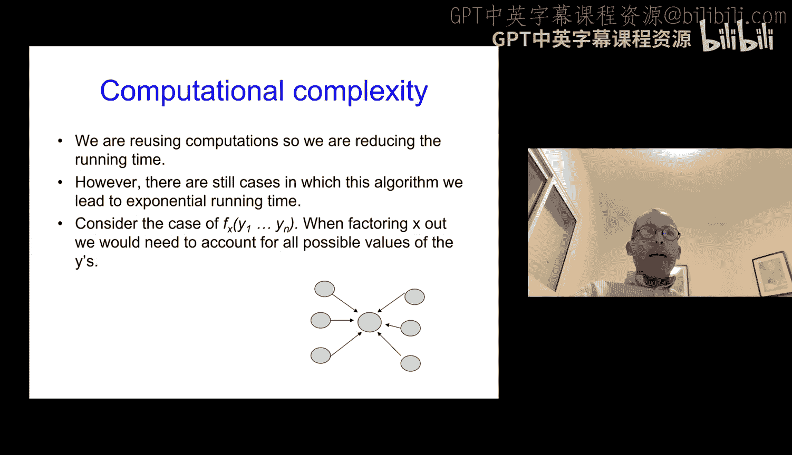

So let let's go if not， let's go to a poll on Piazza one poll is still related to the one of the questions is related to something we talked about last time and the other has to do more with inference and conditional independence okay so I'm going to open。

嗯。I'm going to open the two。Questions for you。嗯。Yeah。

 so B and three and B and4 you should have access to and take a look。And yeah。

 and these are related to some things we talked about today。

 but mainly to the definition of a run of。Based in the talks。Yeah。

 so we're still missing a few for the second one maybe let's say a few more seconds try to do again。

 I always say this is not an exam， you're not graded， this is completely anonymous just。

Something to get feedback last on Monday it was very early at this time。

You know hopefully you had a little bit more to look so the first question is related to something we talked about last time this one is more the second is more about inference but still。

You can get it。a few more seconds and we can stop。嗯。

Okay， so for the first question， I have a base network here with eight round0 variables and I'm telling you that each of these variables can take on 10 values okay。

 so the joint if we don't have a base network there is basically10 to the power of eight possible combinations of these。

P of variables and each one should have a probability the last one is basically has to is once you fixed all the other ones。

 the last one is fixed， but more or less it's tend to the power effect so so without the network it's tend to the power effect now we have this networks obviously we said that one of the advantages of based network is that。

If you have the baseline network you can save on the number of parameterss。

 but the saving is really a function， as I mentioned。

 of the largest incoming or the node with the largest number of incoming edges because the CP for that node would have to be defined with parameterss in this case we see that。

😡，Note F has three incoming edges， I think that's the biggest one。😡，If you have three incoming edges。

 then。😡，嗯。You need to take into account all possible values for your parents。

 so there's obviously 10 to the power three possible values for the parents and for each one of them you have to assign the probabilities of。

9ine a possible010 but you know the last one is fixed once you assign the first nine so for each one of them you have to assign more less 10 values for the for f itself right because I can be zero what's the probability of01 given this configuration of parents so this is 10 times 10 to the power three which is 10 to the power okay and this is a function in this case of the largest I mean there's some others that are 10 to the power three but but。

I mean， the largest one and by or order of magnitude here is F and so the total number of parameters is more or less than of course。

 the big O means that it's。The order of the parameterss， right。

 it's actually slightly larger because the other nodes have also have parameterss。😡。

They are much smaller compared basically an order of magnitude or more or less than okay。

 so that's the idea。So this is for the first question this is the number of parameterss。

 the second question is slightly different it's an inference problem or it's asking you about inference and here。

😊，Yeah。I'm hoping that even if you got it wrong you understand the basic idea here so I'm asking what's the probability that Es one we already said that in order to compute the probability of Es one。

 we can do a joint on all the other variabless。And if we do a joint on all the other variables。

 or if we enumerate on all the other variables， then of course we will find a probability for all the settings and we just sum up how many times f is 1。

 how many times F is0。😊，and compute the probability on。

 but it turns out that you can do or you can do it a bit more efficiently， of course there are some。

 but in this case the more efficient way is to consider something we talked about last time and to know that if you know the markov blanket of F is independent of everything else。

So if we have a subject of variables that knowing them makes f independent of everything else。

 then only the values that this round of variables take can impact F。😡，So the number of values。

Right that we can assign to。Or the number the number of different probabilities that can be assigned to P of F given one is basically the number of times we really need to consider is just the number of possible values we can assign to the mark market of F so the idea of this question is to understand that the number the number of values that or the number combinations we need to consider for F to be1 and again maybe that question was not。

It was not was not。I guess explained correctly， but that's the basic idea so if you got it wrong because you didn't understand the question that time but my idea was to ask you know what is basically the markov blanket of f and if you know the values of the mark blanket of f that's it I right you cannot no other value will a different will make a difference。

So now what is the markov blanket of F， we said Markov blanket is all the parents。

 descendants and co parentsents of descendants。😡，So in this case we have E D G and H right so E is the parent G and H are descendants direct descendants and I is also a descendants。

 but if you know H then I is independent of f so we don't need to use it if we know H and D is a coent of G again C and A are also coherent but but if we know so basically we have four in this case and the number of different values we need to consider in order to know what's the probability of f equals1 is basically the value all possible values of d4 and ask what's the probability that okay anything else will be just will have the same probability so any assignment to C A B and I where we fix E D G and H is not going to change the probability for F。

That's like if I fix E， D， G， and H， then I change any other variable。

 the probability for remains the same because F is independent of anything else given these full variables。

😡，Okay， that's the idea so in order to determine what's the probability of faith you need to look at 16 different values in this case。

 16 possible values for its neighbors for its v plant。Again the wording was not good I apologize。

 but that was the idea and again if you understand that these are the Markov blanket and the Markov blanket basically if we know the value of the Markov blanket it blocks everything else。

 that's the key point for this question okay and if we have an exam and you don't really understand what it means then you should definitely feel free to ask okay。

😡，The basic A here is the Mark of kit。😡。

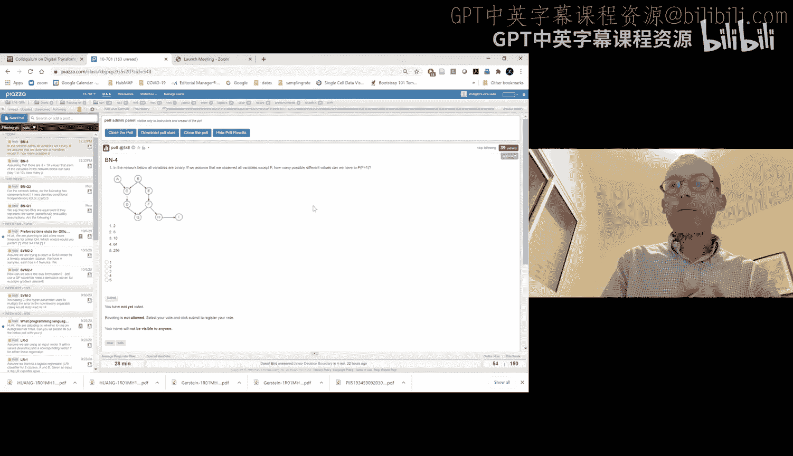

Okay， good。诶。Yeah。So let's go back to our。The channel。Sorry， Z。

 people are asking what was the answer for the second question？

The second question show so the second question， the answer was I think once I。So again。

 the second question was about it was three basically， and it's basically two to the power form。

So basically， there's four different。嗯。So， so。I mean。

 the number of values that we can have is the function of the set of other variables that can impact F in this case。

So the impact on F comes from its markov blanket。Okay。

 so if you any combination of its Markov blanket will lead to a different。

Proability for E equals one。But any other， but once you fix the mark of blanket。

 any changes to other variables this doesn't matter。😡。

So the set of values that f equals one have is a function of the。Of the walk of again that's。

I didn't ask it。Forget about the number of values if you understand these are the four that EHG and D are the markov blanket and that if we know the values of this。

 we know the value of F oh not we know， but if we know the value of this that F the value of F is dependent that's the point of this question okay。

I didn't ask it in a good way。

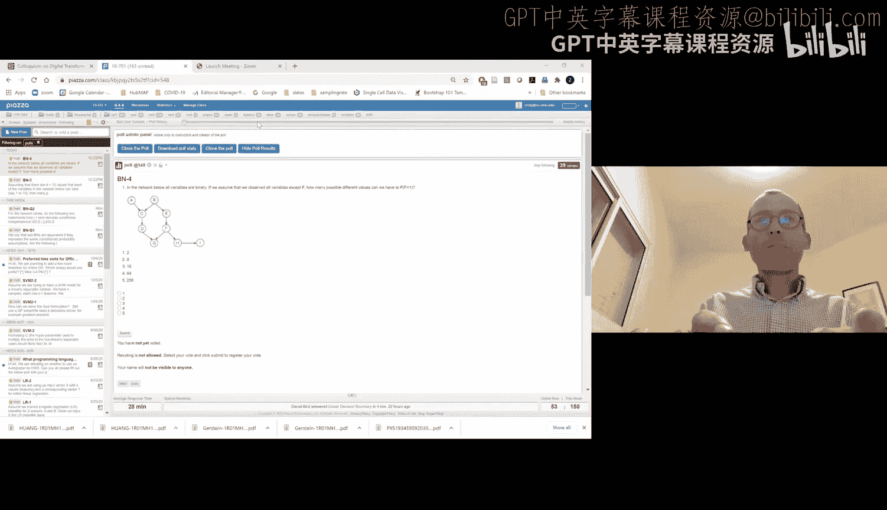

Okay。Let's go back to our class or to basic networks and specifically discuss。

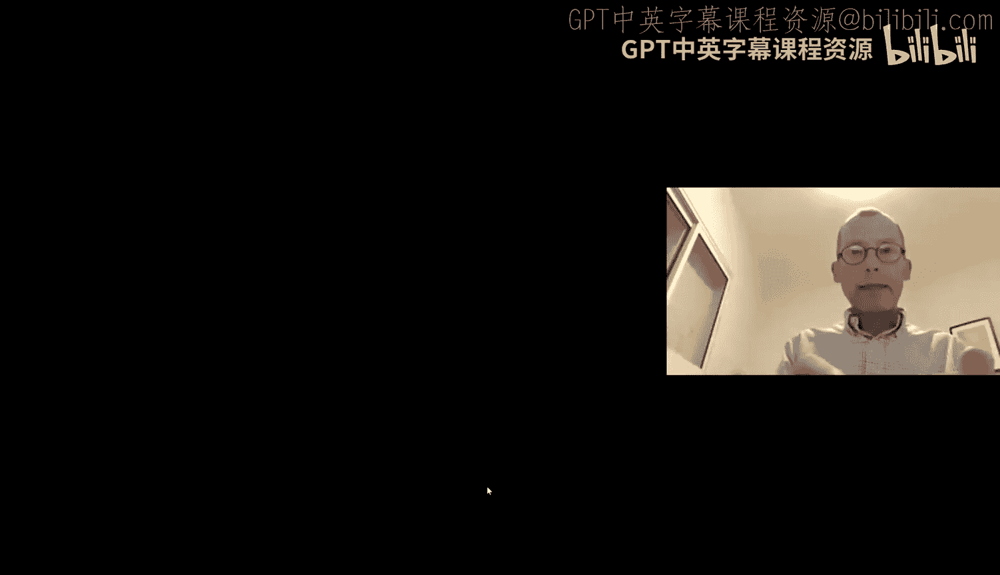

One other thing I want to mention we。Again I think sometimes we did ask a question on this in the problem sector we're not going to ask this time。

 but generally speaking there are other ways to improve the not to improve but to perform inference on base networks and as I said the most common one is stochastic so like sampling variable elimination is a good one but usually still doesn't save enough time a third option is to change the network into something called a poly。

A poly3， a definition of a3 is that two nodes have only one pass between them。😡，Okay， so for example。

 in this case， if you want to go from E to M， you can only go this way right there's no other path that you can use。

😡，To get to get to this node and in that case， if that's the case you can think very clearly why in this case variable elimination will be very good because once you remove that path then the impact of this node is only through one specific path so in those cases we can do very quick or we can do computations very easily unfortunately most of the best network for example this one here is not poly right in this case the one in the bottom we have two path to go from E to M。

We have going from e to a and we have directly from e to。😡，So the methods that poly。

 if you have a poly tree， or if the network is the poly tree doing inference is very， very quick。

 it's actually polynomial in the number， we know that。😡。

Unfortunately most networks are not poly so what can we do we can convert the network to become a poly。

 how do we do that， we do that by combining node to a single node so specifically one thing I can do is take EA and make a new node which I will call EA。

😡，right e has two values d1，1 a has two values， I can make a new node。

 let's say Z that has four values。😡，And these four values will represent all possible A and E right 00000 will be0 for z。

01 will be1 for zs，11 will be two for z， okay， everybody sees that I can easily combine binary nodes into a bigger node by setting more values for that node。

😡，ok。Now， if I combined A and D， then this is now a new node and this is now a poetry。

 right because there's still only one way to get from each node to each other。😡。

Because now E doesn't exist E and they and one load and you know you can just get from this node to to okay so once I combine this all the outgoing edges of these two becoming the outgoing edges all the incoming edges are the incoming edges right if they ever shared the incoming edges then it only so it's very easy in some sense to convert。

😡，A base a network into a poly， you just look at all the ones that have this the ones that have multiple you combined。

😡，And then so basically that means that we can take any base network and convert it into a poetry。😡。

So that's great。What's the downside， the downside is that now the polyry that we created。😮。

Has a much larger CPT， because now， rather than computing the probability of E separately and a separately。

 we need to compute the joint combination。 So we need a CP with four different values rather than just 2。

0 and one。So the downside of doing this is that we increase the complexity of each of the nodes itself。

So sometimes could not this could be fine and the complexity。

 but sometimes if we combined five different nodes。

 then basically the complexity is already due to the power side because we need to consider all combinations so we still get some exponential or we will get exponential explosion not in the inference itself because the inference will be very quick but in each of the different values we need to compute because now we need to compute 32 possible values from this specifically so again。

 so that's a possible way sometimes it works of course there's no magic bullet we know because doing inference based network isn't be complete but the basic idea is based networks can be or any base network can be converted to a poly and polyries can be so very efficient。

Unfortunately， within this conversion， we can introduce or we usually introduce a much more complex node。

 basically a node with many， many more。Possible assignments。

 if we have a lot of possible assignments， we need a lot of parameters， if we need our parameters。

 and when we basically go over all the when we do inferences。

 basically we will pay the price because we have to do inference for all of these possible values。

So it can save， but on the other hand， sometimes it can actually lead to a big exponential increase on individual notes okay。

 but again， just keep it in mind that that's a possible or one possible way to do fence investment。

If someone has a question， someone is asking what is the linear algorithm in the second bullet point？

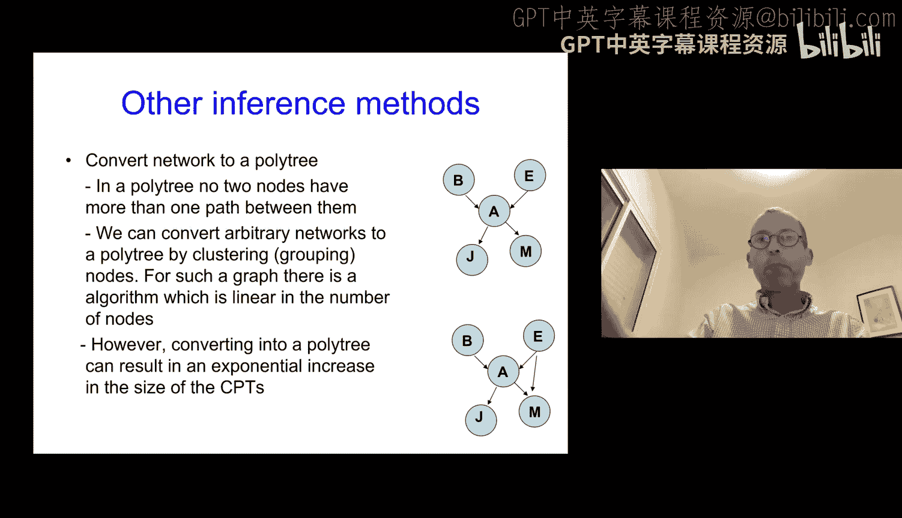

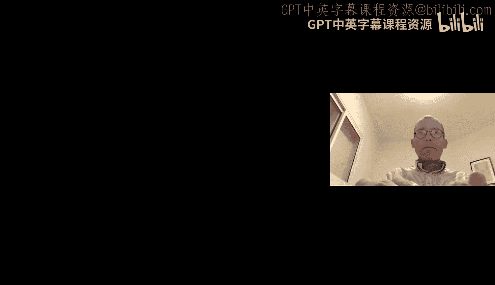

so if we have a poly tree， what's the algorithm for doing infants in Po？呀诶。Yeah， let's see。诶。嗯呀。

I dont know。 I mean， I will。Let me， I don't remember the algorithm and。

 I don't know if it's a very simple algorithm or not。

Very good question let me get back to it next time okay on Monday I will answer it okay I will look up and see if I can remove the algorithm。

So I mean， the fact that it's linear doesn't mean that it's simple， right。

Not to be confused so it might be a complicated algorithm which is why I haven't put it。

 but maybe it's simple I don't remember let me take a look and get back to you on Monday okay and if I don't please ask me again on Monday but I will remember。

Okay， great thanks for the question Okay so right so again。😊，So the algorithm， I should say。

 so I will again， I will come the fact that the misline algorithm does not。😡，Again。

 does not contradict this NP completeness why because the linear algorithm is linear in the number of nodes。

😡，But the time is still or the complexity of the algorithm is still a function of the number of possible values each node can take。

 so what we do when we convert to imp poly3 we basically reduce the linear on the number of nodes that we have。

 but each node itself now becomes or can become exponentially time consuming。😡。

So the linear algorithm is doing the inference or the algorithm is doing it linearly on the number of nodes。

 but if one node can take exponentially many values，😡，That that's going to still be exponential。

 right because we need to basically evaluate the values for all of these possible node。😡。

So when I say inference is linear in the number of nodes。

 I mean basically in the number of nodes times the number of values they you take so if it's a binary。

 if all the nodes are binary then it's fully linear。

 but if the number if each node itself is you know，😡，Due to the power and possible values， of course。

 there's no way to to do anything linear。 So the idea of poetry is that the network becomes very simple。

 but each node itself explodes。Which is or can be the problem or it doesn't have to。

 but it could be problem。So that's the basic。Okay good yeah but regardless。

 I will try to see if so again it could be that the algorithm is very complicated in which case even though it's linear I won't discuss it。

 but it could be that it's not and then will so that's it for based networks and again I will get back to the linear algorithm the next time before we move on so based networks as I said are just one part of graphical model they are not the only part we are going to have or we're going to discuss additional graphical models and the next graphical model we'll discuss it something called it the Markov model so we will start in a second the slides are posted so you should see them before that a few announcement the first announcement is problem set five so as we said problem set five I think should be out today Daniel right I means that's the plan it should be we're just weigh in on the test is to finalize。

Okay， yeah， anyway， probably fall is only due on Friday。

I don't know how many will start problem set five is out today or if not tomorrow it's much shorter than the other problem sets as I mentioned last time doesn't cause my programming there is one caveat so problem set five is due on Monday in a week and a half I think due on。

The 16th。Olf November。Which is okay I mean it's a shorter time so that's fine however we are only going to allow two grade days even if you have more for Pro at five so you will not be able to submit Pro at five beyond and the I think the 18 Yeah you will not be able to submit Pro at five beyond the 18 the reason why is because we are going to release solutions on the 18 so that you have them a few days before the exam so the exam is the week after that we want to make sure that the solutions are released in time so we are going to release solutions。

😡，On the 18th， so you will not end because this is theoretical。

There is no way that we can accept solutions after that so even if you have more grace days。

 you can only use at once two for purpose five。Okay。

 so' that's the issue for Prom5 another announcement which is more personal but why not I'll take the time so we are talking about graphical models which happens to be and and as I said next time we are going on we are going to start talking about HMMs which happens to be a topic that I personally my group personally focuses on on a lot and works on and uses of course like anybody else we have to use neural networks as well。

 but in addition we are also using and hidden Mark models and the reason why I mentioned it is because。

As part of some recent work on。On studying the sales of the COVID 19 epidemic。

 I received an award or a grant from a conium that is funded by a company called Swis。T3 do theI。

Which is know it's a consium that Microsoft and a few other companies contribute to and they are funding some research that we are doing related to the way the virus infects cells and part of this research is using a graphical models and specifically in our case variants of hidden markco models not something we are going to discuss in class。

 but some extent but definitely building on that and as part of this I'm giving a talk tomorrow。

 and we will post it on Pi I'm giving a talk tomorrow afternoon。

So this is 4 p Eastern time on how we are using these machine learning methods to reconstruct virus response pathways and you're all welcome to attend it's a Zoom call open to everybody。

 I don't know who would attend butm。Going to post as I said on Piazza just to make clear there is no requirement to attend。

 it's not part of this class， it's very oh it' nothing there will appear on the problem sets on the exam so if you do attend you won't get any advantage in the exam or anything but again this is an I think it is interested but even if not it's an application of stuff we learn in class to a problem that I'm sure a lot of you are interested in basically how the SA's virus works and what machine learning or how machine learning can be used。

To in this case look at the molecular aspects of the virus and there have been other talks looking at the more epidemiological aspects and infections and so forth。

 mine is completely molecular， but again the focus is on the machine learning method so again I invite everybody I will post it on piazza and as I said。

No formal relationships to this class but is using Okay， so this is this is for that okay。

 so let's go to our next topic which is hidden mark models。So let's start on that topic。

And as I said， the slides are posted so you should be able to。Okay。

 so I mentioned when we talked about。😊，But when we started discussing based networks that graphical models are not just one set of methods which are based on networks。

 or they are actually a family of networks， generally speaking in graphical models we distinguish between two subfamilies。

 one is called directed graphical models， and one is called undirected graphical models。

Based the networks are obviously directed we saw that they have directions on the graph and hidden Markov models which are the second part type of graphical models we'll discuss are also directed graphical models we will talk about the differences but they are directed there is a large set of methods that are undirected that we are not going to cover on this class and the most famous one is something called Markov bundle field again we are not covering so it's not going to be in the exam but you should at least know that these exist and as I said in machine learning we have a class a full semester class on graphical models where we discuss that and also interesting relationships between graphical models and various neural networks。

But today the next topic we are going to talk about is hidden Markov models， which are， as I said。

 another type of directedographical models。😡，So why do we need more graphical models。

 why not just use a basin？😡，The main problem with based networks and of course。

 an advantage as we saw when we talked about inference。

 but also a problem is the fact that they are very restrictive in terms of their assumptions of low cycles。

😡，In practice。Things have a lot of cycles， right？😡，If I am a robot and I'm moving。

 I get a feedback from the movement that I do， right。

 It's not like I move to this new and there's no impact on what happened before。

 feedbackback is a natural thing。😡，That the state tells another state what's the impact but that state also moves to that to the new state right if we read a sentence or if I listen to some voice then if I read a sentence that the world coming before one world or the world coming after I mean there's no way to say this one is affecting this one but I mean right high school right if you know the world school it tells you something about whether it was high before or not so and of course high tells you something about whether the next world is going to be school so this idea of no cycles is problematic to many real world applications。

Okay and especially for for example， for sequences where of course things converge things move forward but they are dependent on what happened before on temporal things right if I know what happened before me。

 it doesn't affect me but if I know what happened after me it also tells me something about my state at the time so this idea of no cycles very useful we saw for infants。

 but not very practical in real world application， for example in biology。😡。

A lot of things are cycles， like feedback loops are very common and that's something you cannot model with based。

And also， as I said， based networks are usually looking at the static image they don't take time。😊。

So just this small illustration right where you have something that is affecting something else and in turn whatever happens here affect this。

 which is very common in practice， right movement or some。😡。

I don't know some two particles that interact is not something that you can represent with a based network because it's already cycle right I mean the is cycle。

So to overcome this or to generate another model or another graphical model that still looks at joint probabilityity distribution。

 but does not assume。It does not assume the tag is hidden markov models。

 so we will first define like we did before the。The terminology or the graph structure of hidden mark models and then we'll talk about inference like we did okay so hidden markov models are a set of graphical models that initially mainly started at the language and speech recognition and they are still widely used in these domains because speech is a temporal process text。

I mean it's not temporal but it's sequential， so a lot of these domains require something that had this relationships between things that change over time or over subsequent。

😡，And the basic idea of hidden Markov models is to distinguish between the observations that we see。

 for example， if I talk， then I mean， I have some idea in mind that I want to convey and I convey it with a word。

 but you don't really hear the word， you hear some noise。

 some sound form and you can translate it in your head to the word that I mentioned right if I say the word word。

😡，RightI'm not saying WORD I'm saying some noise of some waveform and you have a way of translating that to so what you observe or what you hear is the waveform and the hidden state of what you inferry to be is what right so that's very common case in a lot of in a lot of domains so for speech right we have the sound signal。

😡，Wwhich represent parts of speech right maybe words in robot movement right a robot is moving around the room。

 it wants to know where it is， maybe it has some local map。

 but it cannot map itself the room doesn't have a map in each location right so it has some sensors and based on the sensors it knows you know I'm five feet from this wall。

 three feet from that wall or if you're moving inside the cave and you have a map of the cave。😡。

You know you can say I counted you know 500 feet， then I must be here。

 but you don't really know where you are on the map the location led to the observation。

 but the observation is not necessarily the location itself but some outcome of the location okay so if you're in a room。

😡，You know， if you want to know exactly where you are。

 you measure the distances to the wall and this tells with the location。😡，that you write。

 but that's just an observation， it's not the location。

 itself's the location is in failed based on the observed similarly for sound and in biology we have we have a lot of in any in text。

 we have these letters and together they can form。😡。

So the basic idea of hidden Markov models is that the hidden states generate the observation。

 basically when you are in the room will impact what observations you will see how far you are from each of the wall。

😡，Right， that's the key。But you don't know where you are， you just see the observations。😡。

So if you are in a specific location and you look at the sensor。

 it will impact what the sensor outcome is going to be。😡，But your next location。

Is dependent on your current location right of course it's depending on the estimate you get from the world。

 but regardless of that estimate if you're in a specific location。

 your next location is a function of where you're right。😡，Okay， so if you know your location。

 the observation to the world doesn't matter as long as you know where you are。

 it will tell you where youll be next time。😡，So we have these two different things。

 one is the observation， that's what we observe and these observation come from a hidden state that we don't observe。

😡，And I mean， inference， for example， is to find outing this heavenstone。But more importantly， this。

generates a graphical model， why does it generate a graphical model because the idea is that we have these states and states transitions to other states so if you're on this location you can move to another location。

 so this is one direction in the graph location is a state it's a node and transition is an edge going from one to the other。

😡，But in addition， there is another node in the graph and that node is the observation and the observation is generated from the location or from the stateoid。

😡，So graphic in hiddenma models， we have node representing states or observations and we have edges representing relationships between states and other states and states on observations。

😡，Okay， and again， some examples， this is a waveform that you can use to study speech。

 so this is what the let's say an automated speech process， that's what it hearals。This is German。

 I think and that's the hidden state， that's the world that whether whoever talked and that's what you want to infer。

 So though this world generated this sound， this world generated this sound。

 this wall generated this sound， and this is a sentence so this world came after this world came after this world。

 so this is the。😡，This is the hidden states and this is the observation。😡。

In biology this is just you know some ACGT， whatever。

 I mean this is the language of biology and in this case this is the observation。

 but what really generated them is some type of organization within a biological sense and again this is not a biological class we don't have to。

 but biology I just I'm showing you some textbook in biology。

 HMMs are extremely valuable in biology because so this is a textbook for computational biology where almost all the textbook is just how to use HMMs to biology so that's very useful。

Okay， so we're going to work on HMMs， define it formally。

 we're going to define inference in HMMs unlike based the network。

 the good news and not we will get to that， but the good news is that unlike based networks in HMMs we can do inference in polynomial time so we can get exact inference。

😡，You polynoial time and solve a lot of input， that's why Hs are extremely useful in practice。😊。

And yeah， but we'll talk all about that and about the type of inference questions we can ask and exactly how to formulate the model in the next spectrum。

So that's it and I'll see everybody Monday and we'll continue to discuss graphic models specifically。

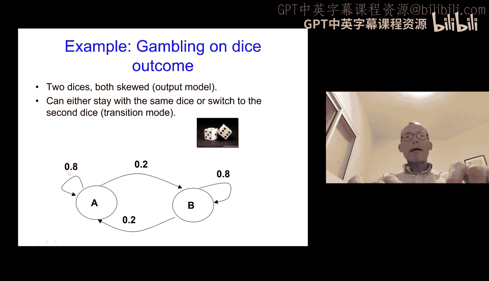