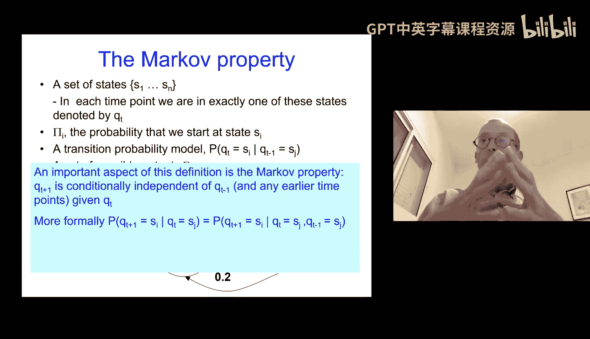
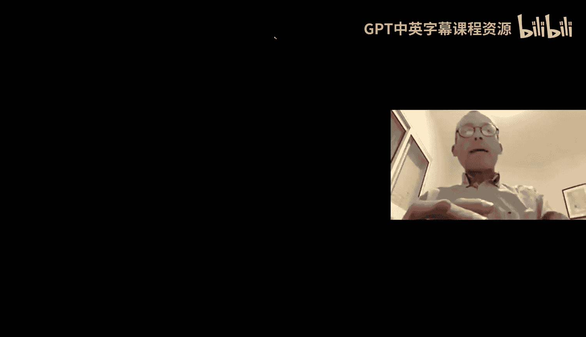
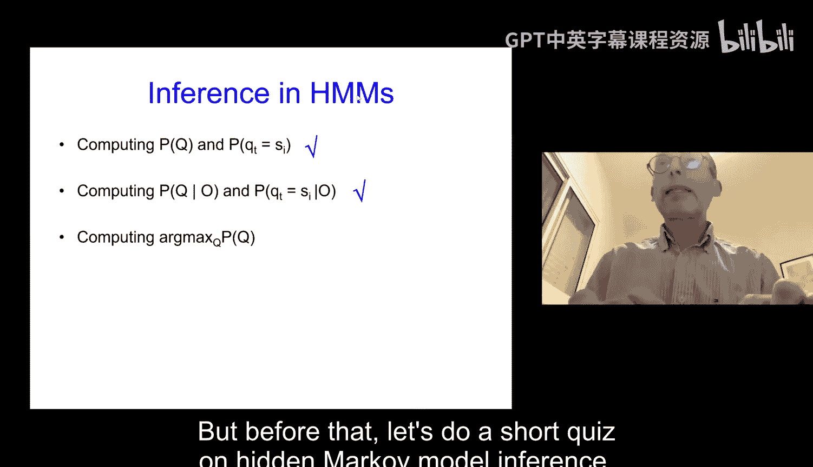
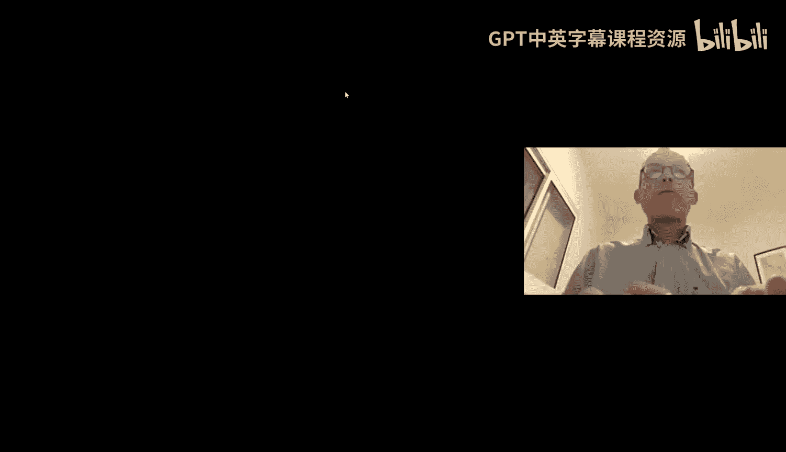
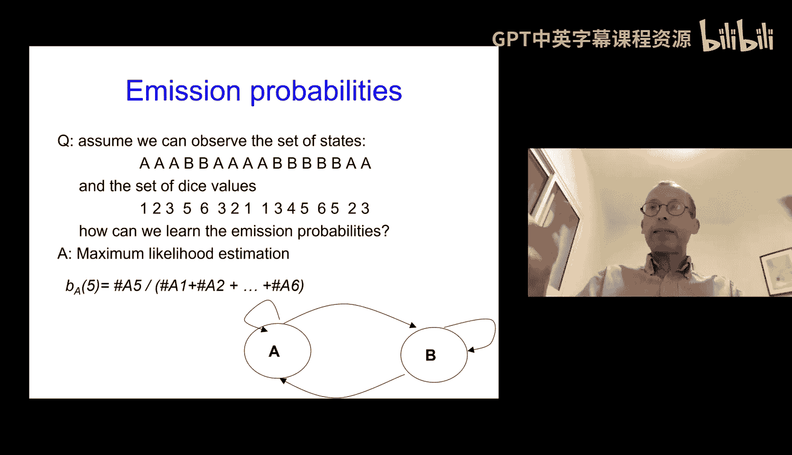

# CMU《机器学习导论（研究生）｜10-701 Introduction to Machine Learning 2020》中英字幕 p18 [18]10-701 Lecture 19_ Inference in Hidden Markov Models.zh_en [BV144SuB8ETp_p18]

Okay， welcome back， everybody。We continue to discuss graphical models and graphical models we set are ways to represent joint probability distribution or a compact way to represent joint probability distribution and mainly used for inference。

 so basically if we know something about some of the values and we want to infer about other values that we haven't observed or that we cannot observe even if。

even if we observe everything like as we said， for example in speech recognition。

 we can't really observe the words but we want to infer based on the wave sound that you make so this is the idea of graphical models and within graphical models we discussed based network which are very general graphical models and last time I motivated some downsides or motivated why based network sound not。

necessarilycessarily the solution to all of the problems or to all of the real world scenarios we would like to represent。

 and I discussed a few cases where they are not going to be useful because of the very strong assumption that based in network bank。

 which is that the that data actions are in a directedcycl graphs。😡，So one solution。

 there are other solutions that I mentioned that we are not going to talk about in this class。

 but big graphical models are a big class of models。

 one solution is something called underdirectected graphical models， which will not discuss。

 but another solution is another form of directed graphical models。

Which loosened some of the requirements of the basin networks but。

On the other hand it has a different type of assumption or makes very strong assumptions that base network do not make and these are called the hidden Markov models。

 we defined them informally last time today we are going to formally define them and more importantly we are going to discuss what type of questions we can ask。

About when we have these networks and how can we install them remember invest the network we said there is no way to answer in polynomial time inference problem or at least not generally we can do some approximation or sometimes we can if we use some algorithm itemss。

 but in general there is no way to do inference in base networks in polynomial time that's not true for hidden markov models where we actually have very efficient and very nice polynomial inference algorithms。

😡，So let's define them a bit more formally and then talk about inference。

So the hidden mark of models， we mentioned contained two components。

 one is a set of hidden states that generates the observation， for example。

 the word they speak to you that you don't see or you don't hear。And the second is the observation。

 which are the sounds that my mouse makes when I stay towards the waveform。

The hidden states generate the next hidden state so when I say a war。

 the next world is related to what I said before and so the word is related to the next world or the previous world。

 and it's also the one that generates the observation which in this case is the sound。😡，Right。

So this is an example we said we will use for this class but of course hiddenmacomods are more general but let's assume that I have two dice die a and dice B and you know I flip one of them and after I flip it I get some output one to six L with probability 02 I next time use the same one and 08 I switch between them okay so this is the meaning of these edges sorry the other way around so 08 I stay with the same one 0。

2 I move to the other one I flip it again so the second output is coming from the second state the third output comes from the third state and so forth and so。

So what do you need or what do you formally need in order to define a hidden markov model or what are the set of parameters that we need to formally define a hidden markov model？

😡，The first thing is a set of states， these states are hidden so for example。

 the set of words that I can say or in this case the two dies that I wrote。

 you don't see them only I can only tell you what is the output one， two， three，4。

We assume that at each time point or each observation that we have is coming from one of these states。

 so if I show you a number one，1，2516，😡，Each one of these values came from D A or D B。

 you don't know which one， or at least initially you don't know that's one of the infinite equation challenges。

 but each time point where at a specific state the state generates an observation and moves to the next state the next state could be the same as before it could be a different state that's depending on the model okay so these are the states in the model and these are defined so we don't learn them usually this is part of the definition。

Next we have something called piI which is the initial probability before we start what's the probability that we will start in state A or in state B in this case I'm listing these as 0。

5 but of course they can be different， this is the initial state okay so what's the probability that the first word I will say was welcome。

😡，Just as an example。Okay so piI is the probability。

 it's a special probability because it's not related to movement between the states。

 it's the probability of the first state。😡，Next， we have something that is more general and this is something called a transition probability。

😊，And transition probability is what's the probability of being in state J if I'm now at state。

 think about a robot moving in a room。😡，Right and each let's say each we define some grid on the room and each location is a point the grid you can say what's the probability that I will be in this location given that I'm now at dis location and this location right some locations I cannot get within the step so the probability will be zero some locations are close so I can get there but you know there are others so there is some probability similarly if I flip a die there is in this case as we said 80% probability that the next one will be the same but 20% probability that it will be that I'm switching it okay so this is called the transition probability going from one state to the other。

We have a set of possible outputs similarly to the set of states。

 we need to define what is the possible output of each state， for example， if my states are wordss。

 then the outputs are waveforms， the sound that I make， the forms of the sound。

 if the states are die， then the output is a discrete number between one and six。😡。

If the state is a robot or location， then the output is a continuous value。

 maybe about the distance between the robot and the wall。😡，Right， each。

Setting or each set of states might have a different set of outputs and this has to be defined that's part of the definition so you cannot see。

 for example， in a die。If I say that the states are die 1 and die2， you cannot observe 5。37。

 that's not in valid output the output has to be defined。😡，In a robots， I think you can。

 but if you look at sensors， for example， you cannot observe a negative value because this is the distance to the world。

 the distance has to be positive okay so that defines at least some restrictions on the threat of a generation。

And the last thing is something called the emission probability what's the probability that if I'm in state A I will see value K from the allowed values right so for example if I'm a robot and I know the location of the robot I know the distance from the wall but of course there might be some noise in my emission so I can say that there is let's say I'm five feet from the wall so there is a probability that I'll get five but maybe there's also a probability that I'll see 5。

2 from the same location of 5。3 and very very low probability of 6。

1 and so okay so for each state in each output there is a probability。😊。

Associated with seeing this output on the state now if the outputs are discrete the probability is usually a discrete probability right it could be binomial。

 it could be multinoial whatever if the values are continuous like in sensor you need a continuous probability of distribution because you have to be able to accomplish but that's up to you to。

😊，Okay， so the parameters right， so we have the states which are not parameters that are defined and we have the vocabulary which is also defined。

 but we have a set of parameters， the parameters that are the initial probability。😡。

The transition probability and the emission probability these are the set of parameters in terms of the number of parameters we have one initial probability parameter for each state。

😡，We have n square， let's say there's n state， we have n square transition probability。

 that's why usually we call it a transition probability matrix because we have to know the transition probability from one state to each of the other state。

 it could be zero。😡，Of course， they have to sum to one because if you are in a state。

 there is the sum of the states you can move to has to be one。😡。

But you have to define or that's part of the model。

 the definition of what's the probability of moving from every state to every other state。

 including itself。😡，Okay， so you can stay in the same states， that's part of them。

And also we have the emission probability model， the number of parameters we need for that depends on the distribution that we assume right so if we have a die。

 then we need six for each state if we have a coin， then maybe two。😡，Or maybe one actually。

 because one one is。 Okay， so that's really a function of the modern risk。

But these are the parameters of the model， one key observation we can make ready before we go into the。

😊，Into inference is this idea of transition now I mentioned it as a definition。

 but if you think about it it's not really trivial right so the mark of probability says that if order to know when you will be next it's important or it's only required to know where you are now。

Okay， that's a critical assumption that's the mark of property and this is what makes Mark of hidden Markov modelss very powerful because that's the only reason why we can do influence。

😡，In a reasonable polynomial kind， but it also is a weakness because in many cases that's not true。😡。

Let me show you an example of this assumption and where it's a problem。😡。

So let's say I'm drawing a line like this， okay？

So you know， let's say this is the value at time t minus1。This is the value at time T。😮。

And now you want to know the probability of time t class。😡，Then if I went from t minus1 to T。😡。

Then it's I mean that's the trajectory then this there is some pretty high probability that in t plus1 I will be in this state and not for example in this state right I mean it's unlikely that I'll change direction here。

😡，However， if I came from here。😡，Then you may say that。You know， I will continue to go here。

But if we assume the markov assumption， then you have to say the probability of the next step just based on the value at T。

 you don't know where you came from。😡，Of course you can increase that but based on the hidden macromod assumption you only observe this point here and then the question is the they I mean and now you want to know what's the probability of being here or being here where you say I want to know whether you came from down here or from up here you're not allowed to see you're only allowed to see the previous time so again that's a very strong assumption usually wrong right if you're a robot and you're moving around the room。

😡，Thenhen you would likely go on the same projector so the fact that you are here right in order to know where you will be next。

 it's very important to know where you came from， it's not enough to know that you're here。

 but in hidden Markov model we assume that it's enough to know where you are in order to know in order to say so that's a strong assumption it's wrong in many cases but it definitely helps a lot in doing inference and in some cases that's not a terrible assumption there are ways around it maybe I will talk about them later or actually in the next classes but for now that's the assumption we're going to make。

😡，Okay， so this is called the Markov property， a very strong assumption。😡。

And like other assumptions we made， for example， in the Eve base。

 when we assume things are independent conditional the label， usually not correct。

 but makes our life pretty easy as you will see when we don't。Okay。

 so we are or we believe the markov assumption or at least we accept the mark of assumption and if that's the case then in order to define the probability of the next step I only need to know what's the probability in this step this state and so that I have that transition probability table right so I have from each state I know the probability is to honest。

Okay， so for now， so there's two things you want to do when you see such definition， right？😡。

When you see this definition， maybe those two things， first of all。

 maybe the first question you ask is how do we get these values， how do we get the probability， piI。

 how do we get the transition probabilities， how do we get the emission probabilities？😡。

That's something that we will answer， but not in this lecture。😡。

Okay this is important and this is called learning right these are probabilities that we need to estimate learning probilities in this lecture we are going to focus on inference。

In France means that you know you assume you know these probabilities and then you want to ask questions that doesn't make sense why why shouldn't we start with learning and then do inference because we need the answer is that for learning we need to do inference France Okay so we will use what we learn and so what we're going to talk about in this lecture is inference France。

😡，It's important， of course， even if you know， but it's also useful for the learning。

 So so we will do the learning in the next lecture。 We'll start with inference。

 even though in practice， you of course need to hand the values before you can use the network okay。

 but。But rather than that， it's fine。Okay， so what type of questions can we ask。

 let's say we defined and based someone gave us all the parameters so they gave us， of course。

 the states and emission and。😡，The state and dictionary is something we define and someone gave us also all the probabilities。

 what can we do with them？So for example， in this model we can ask， okay。

 now you flip the dies seven times I want to know what dies are you using now。

 even if I haven't seen any output， I just want to know in advance at the seventh state which die will use。

😡，Or I can ask what's the probability of six right you're going to Vegas you want to you know the dealer is switching between two dice and you want to know what's the probability of six。

 maybe one of them isqued to higher numbers and one isque to a low number。

 this is a very important question。Because if you know the higher probability for six。

 then you can make some money and of course what's the probability for six in any of the next fews and so forth。

😊，Okay， so we are going to discuss the following specifically。

 these are all inference problems we are going to define and they can all be solved with what we are going to learn and specifically we are going to define or solve the following。

😡，Three or four inference questions， the first is。Computing P of Q。

 so what's the probability of a set of states？😡，What's the probability， for example。

 that we will see A B， BA as the states？N P Q T given equals S sign。 So for example。

 lots of probability that the seventh state will use the first die Okay， that's in of the state。

 And you can see here I'm not assuming anything about the observation。

 So this doesn't take into account the observation even before I start what's the probability that in the seventh states I will be at。

Stay date from。The second part is already is starting to take into account observation。

 so let's say that I've seen the first six states。😡，I want to know。😮，What sorry。

 the first six observations。 So I saw 1，2，1，1，2，3。 I want to know what's the probability that in。

State six， I am at die a or die B what's the probability that the set of states that led to this observation is AABB A right this is important。

 for example， when we do speech processing， you want to know what's the sentence that I said given the observations。

😡，And the last thing is something called a markx， which is not the probability of a sentence。

 but the most likely sentence or the most likely set of states。

 So this will give you a probability for any set of states， but the number of set of states is。😡。

Exponential， right if we have two possible states， you can find the probability for any of them。😡。

But it's true to the power of something。 This will give you the value of the best one。Okay。

 this will find you the best one and you can complete using the formula。

So this is the inference problems， let's start with the simplest or the first one and then do them by order。

So the first question is， we want to know what is the probability of being in guyA？😡。

In the seven time point， right without seeing any observation。😡。

So the assumption is we cannot observe any value， we just want to know what's the probability if we have this model that after seven rounds。

 because we have these transition probabilities， we will end up with state A or state B in this case on two states。

😡，So how can we compute it well， the simple answer is in order to finish to B in a in the seventh state。

😡，We can be in any of a set of states in the first six and then in the last part we have to transition to D right so if we sum over all possible sets of states for the first six and for each one we compute what's the probability of them and then also a or basically if we compute all the possible sets of seven states where the first six are unconstrained and the last one is a。

Then we will get the probability of that because essentially， I mean， for any time we ended the day。

 we had to be one of the states in the first， I mean。

 we had to be in a state each of the six previous time。😡，Okay。

 so if we sum over all of these possible combinations， we can get the probability of it。

 but how do we sum over all of them？😡，Well we can for each one right so this is like one of the again so so I'm putting a lowercase Q to denote the fact that Q1 can be A or B Q T1 can be a or B okay so they can be either of them for each one I want to compute what's the probability so how do we compute the probability of Q if I give you a set of states what's the probability of A A B B AA then you can use。

嗯。You can use the chain right so the probability of Q1 to Q T1 a is P of a condition on Q1 to Qt minus1 this is true for any any set of values that doesn't require any assumptions right this is just a chain however now we can use the markov assumption the markov assumptions tells us that the probability of the seventh state is only conditioned if I know on the probability on the value of the previous state and it's independent of anything that's happened before right so if we do that we can basically say that this basically comes down to P of A。

😡，P of a given  Q T minus1 P of K and so forth times p of  Q1 which is the initial state and any of these we can directly go into the parameters and compute right this is the initial probability and this is the and these are the transition probabilities are so these are really value so this can be a2 and this can be A B A A AB and so forth we just go to the problem and any set of states you give me I can tell you what's the probability for that set of states using the markov property and the transition probability。

😊，So how do we use that when we just sum over all possible sets of states where we end up with A？😡。

And we get that solution and basically right we have to finish in A but the first six states are not constrained。

 so with some of all possible sets of six states。And compute the probability of these six plus a at the end because some of them is really the probability that we end up in a。

😡，Okay， everybody sees that this works， unfortunately。😡。

And this is very time consuming so how much time will it take us to compute this for the two state model anybody can turn me in the chat。

So we need to compute all possible states up to， let's say seven。😡，Yeah， so this is exponential。

 this will take two of hour fan because for each location we can have one of two states AOB。😡。

And based so it's two to the power of the number of locations this case six。

 so it's two to the power of six possible combination， so that's definitely doable。

 but time consuming that's not a good thing。So how can we still solve it in a reasonable time？

So we're going to do something we do quite a lot and this is。Right， so this is。Very right。

 so this is exponential in T， which is too long。Instead。

 we are going to do an induction in order to compute this in a very， very。

Short amount of time we'll discuss exactly how long， how much this takes in a second。

 but let me just say first how we do it。So let's define a new parameter which I call PT of5hi so PT of5 is not part of the model。

 but we computed on the fly T is the state is the number and I is the state okay so PT of5 just the definition it's the probability that QT equals that I didn't say how to compute it but that's the definition okay what's the probability that in time seven I am in state A。

How can we determine it well for the first one it's easy it's just the initial probability we can just go to the model and ask what's the probability at time one being in state to I I O that's in the one what about P of I well？

😡，If I know。The probability of pt -1。😡，Then if I want to go now to I at time T。

 the only thing I can do is transition from another state to myself。😡。

And the probability of that is the probability of transition from J。

 let's say to I plus the probability of being in J in the first place。😡。

So Pt of I is just as sum of all possible states， including I itself。

 okay so we are not excluding the state of transitioning from that state to I in the seventh state and the probability we already computed in the direction of t minus 1j。

😡，Okay so this is very easy to compute basically it computes all of those possible settings。

 but it does it in much more efficient steps how long does it take to compute it well。

We need to do it T times， right， because we want to get to the7。 So we need to do it T times。

 So each step or we have seven steps or T steps。 each step here。

 we need to sum over all possible states。 So this is one n。 and we need to do it for all steps。

 So this is the second。 So each step is。Or each time point is n square because we are doing。

A sumation over end values right all the possible end states and we have to do it for all the states。

 even if we just want to compute it for A at the end。

 we need to do it along in the intermediate for all of the other states。😡。

So this will take over over ON square t， which is polynoial and very efficient compared， of course。

 to the previous solution， and where n is the number of states and T is the time point that you are interested in that probability that state7 is a。

😡，And the basic idea this is not， I mean Dagoing we'll use is just this。

 but this is also known as dynamic programming when you basically fill up the table in this case and you just I mean once you filled up the previous entries it's easy to fill up the next entry right this is what we do here once we know p of t minus one it's easy to fill the next one for this because you just use it。

I just want to make a comment I'm not going to prove it oh I owe you an explain so let me just make that comment and then something I owe you guys so I'm going to make a comment I'm not going to prove it but it's actually a nice thing to know it's not necessarily something unique to Markov models to hidden Markov models it's a property of any Markov models so hidden Markov models assumes that there is an emission and a transition there are something called the Markov models which you are not going to discuss where you don't assume that you have an emission you just observe the state and you have the transition to no emission that's the same idea but without the emissions。

It turns out， and that's an interesting property of Markov models。That is good to know that。

If you want to know， so let's say you know that you're in state a now and you want to know。😡。

What's the probability of being in state B in the next iteration？😡，So in the next time point。

 then you look at the transition probability table and you say， okay。

 what's the probability transition from A to B now what if I want to know what's the probability of being in B in two steps？

😡，It turns out that you can take the position probability。

 take it to the power of two and use that to compute that。😡。

And three steps and so forth so you can always do it for explanation above state。

 but an interesting observation that again we are not proving it's a statement is that if you take this transition probability table to a high enough power basically at the limit when it's exponential when it reaches when it leads to infinity。

 then each state。Has its own lending probability， so basically you get a vector where you expect it to be a probability for each of the state and it doesn't matter where you start。

😡，So if this is I if this is J if this is it doesn't matter right this is just a function of J so if I let's say I'm at state I and I do infinitely many states any many steps。

 then the probability that I will end up in any of the other states is independent of where I started okay this is a。

😡，Property of a Mark of money。Sometimes it's useful， sometimes it's not， but I do want to mention it。

 the reason why I'm mentioning it here is because this is independent of the emission。

 if you have emissions it's different， but this is if you don't see any emission。

One other thing last time I was asked about the poly algorithm and why the Po algorithm is linear right not linear。

 why is it simple to compute the poly algorithm， polyry just for those who don't remember is a base network where each although there is only one path。

😡，From a node to any other node， Okay， this is direct obvious there's only one direct from one node to any other node this node。

There's no way to reach one node or there's no way to reach from one node to another node into two different passes。

And it turns out that the algorithm is not that complicated。

 but it's based on something called message passing。

 where you get information from from the node above you and the node below you， you integrate it。😡。

And it turns out that in poetry because of the structure of the tree。

 you are guaranteed that this will convert very quickly。

 whereas in other models which are not poetry， it can take a long time because everybodys update themselves but in Po this convergence is much faster so the algorithm item would work on all of the basic networks the problem is the time and in Po you can show that this is very quick in other models it's not quick that's why it's explained oh we know already that it can't be complete from。

Okay， so this is something that I owed you from last time。

 but anyway this is about inference in in so but let's go back right to inference in hidden Markov models which is where we are and we finish the first step in know inference problem okay so basically if you know。

Or if you know the model， if you have the parameters of the model transition and initial probability。

 in this case we' we didn't choose a mission， then you can say what's the probability of being in a specific time point that the specific。

Okay so this is the first thing the next inference problem we ask is what's the probability of a set of states given a set of observations okay so now we start to take observations into account for example let's say that A and B so this is the transition probability it looks symmetric but in terms of emission that are different if you see low values it's likely to come from A and if you see high values it's likely to come from B now in you in Vegas right and you know that if you were in B you're very likely to stay in B。

😡，So you really want to know given the emissions you saw so far， which。😡。

Die dealer is you you can see that dealer the die you can just see the output right so if you know that the dealer is using B。

 then you would likely bet on higher numbers。😊，Question is， how can you tell which diet is， right。

 that's the。That's the question Okay， so this is again， I mean。

 we are not talking about learning so we assume that all of these values are given to us。

 we know the emission probability， we know the transition， we know the initial are given。😡。

And now we want to ask right right so this is like the emission。

 does it change our belief and the answer is yes， right if we see very high values。

 it's very likely wrong in B。😊，Well many。Okay， so let's say we want to compute the probability。😡。

Oh I should say this is the probability that in state seven we are at a given that we observed the values of one to7 okay。

 this is the notation so let's say we want to compute the probability that we are now or we ended in state seven in state time seven in state a given that we observed all the values up to an including seven。

😡，Okay， this is the probability want to complete。I'm going to use slightly different notations。

 it's not changing anything just to make the notation shorter。

 so I'm going to call AJI the transition probability of moving from J to I okay。

 so going from J to I。😡，I'm defining that as AJI going from J， state J probability of J。

 and BIOT is the emission probability of whatever we observe the time T if we are in state I。Okay。

 so for example， if I steal one。😡，And state I a， what's the probability of seeing one from diA and if state I B。

 what's the probability of seeing one， that's just notations， I didn't do anything。😡，Okay。

 so we want to compute the probability that after we saw a set of super。

 we are really at a specific state。Let's start with a simple question and then we'll go to the more and then we'll answer this question so let's say that I give you a set of observations sorry a set of states let's say A A B bB a and I want you to know to tell me what's the probability。

😡，Of that state， given the emissions。Okay， so basically you see the observations11 what's the probability of this set of states we already said there exponentially many possible states so maybe that's not always useful。

 but sometimes it's pretty it's is useful sometimes in speech let's say we have some sentences we have in mind and we see the observation we don't need to look at all possible combination of words because we have some sentence we just want to rank these sentences these set of。

W given into observations。 So that might be useful， right， even if I don't。😡。

But but even if it's not treated as an intermediate solution to the big question。

 which is definitely important， what's the state I'm at at this time after I saw our obsession。Okay。

 so everybody understands that's the question were going to solve。

 we're going to solve the probability of Q given our Q is a set of states。😡。

And O is the set of observations here we can use base rule obviously so P of Q given O is P of O given Q times P of Q divided by P of4 P of O given Q because of the hidden markov model assumption that each observation is only a function of the state and if I tell you what other the state this is very easy to compute it's just the probability of the first observation given Q1。

 whatever you set Q is given so let's say A， B， B A。

 so this is the first one given1 given A2 given B3 given B。

4 given B and so right so this is easy to compute。😡。

Just going to the tables and sorry just going to the parameters and completely P ofq is also easy to compute we just said that P of Q is easy to compute right it' just the initial probability of Q1 and transitions from Q to Q1 to Q2  Q to。

So these two are very easy to compute。If you again， assuming that I give you a set of states。😡。

The last thing is P ofO， that's how to compute。So how do we compute P4。

 what's the probability of an observation？😡，By the way this is something we are computing as part of computing P of you know。

 but actually P4 itself is an interesting quantity to compute why is that in many cases not in many but there are cases where we use HMs for classification so we have two models。

 one， let's say for let's say this let's say we have a robot and we want to predict which room the robot is in。

Is it in this room in that room And we see a set of measurements of the robot so I can compute what's the probability that the robot is in this room because I have a hidden markov order for this room and I compute the probability for that room so I can compute P of all the set of observations given basically P of O is for a specific hiddener markov。

😡，So if I know how to compute it I can do classificationification if I have two different models。

 I can run the observations on one， see what's the probability。

 run it on the other and take the one that has the probability Again this is just a sign node but it's sometimes it's useful okay so let's say we want but regardless let's say we want to compute P of4 either because we want to do classificationification or we want need it for our de how do we compute P ofO so again we are going to use this induction now I'm going to define a slightly different parameter I'm calling it alpha t of5 again just the definition Al t of5 is defined as all the observation up to1 T end so this is not condition this is n。

Q T equalss。 So basically all the observations and ending up in state S。Okay。

 this is not part what we want to compute is data condition， so this is just a joint but。😡。

Let's let's say this is something。Okay， so all for ti of5 is we observe all the observations and we end up in state。

 that's the only thing。😊，So do we let's first say how we compute it and then say how we use it， okay。

 so let's stick with me for a second on how we compute it and then you will see why it's useful。😡。

How do we compute alphaq fine？😊，So as before we are going to do an induction。

 Al1 of I so t is the time and I is the state Al1 of I is defined as the p of O1 n Q1 equals I we can use the chain rule p of Oi O1 given Q times p of Q I which is basically the initial probability this is the emission so we have that so that is the compute okay so this should be。

😡，We already computed this okay， and now let's assume that we computed alpha t minus1 and we want to move。

 sorry let's go let's assume that we computed alpha t and we want to move to alpha t plus1 alpha t plus1 by definition。

 out of definition， it's the joint of all the observations up to t plus1 plus ending up in state S alpha p plus7 of5 right？

😡，Okay， how do we operate on this or do we？How do we。Basically derive。A formula for this。

 So the goal would be。And I'll say in a second the actual steps， not just to motivate the goal。

 the goal would be to get into a state where we can use alpha t itself right。

 I mean because we already compute alpha t alpha we have completed alpha t equal one。

 we want to compute alpha t。😡，Not necessarily for I。

 we can use it for J because we computed R T for all the states。😡，So how do we do that？😊。

This is the summ rule right， we know that in state T we have to be in one of the in time T。

 we have to be in one of the states so I can add。😡，States。

The state attach T into the end but I have to sum of all the states because I can be in any of the states so now if I have this end basically I'll take what I have here and I add an end in the summation rule that basically coverss all the possibilities right I have to be in one of the states at the previous time。

😡，So I'm adding all of the possible states， so so far this is the estimation rule。😡，Okay。😊。

Now we can use the chain rule to break it and from here it's going to be pretty easy right we use the chain rule this is again by definition P of Ot and Qt equals aI condition on this times P of the slide just divided the date。

😡，The variables into two sets， one set， wecondition on， and then we compute the problem that's it。

Okay， now。What is this， what is square of01 to Ot and Qt equals S J？😡。

That's our definition of alpha Tj right that's the definition so that's easy that we have what about this we have Ot plus one  Qt plus one conditioned on a lot of observations and the previous state we said already that if we know the previous state were independent of everything else that happened before that and also the emission because the emission is only a function of the state so in this case we can drop all the observations and just stay with QT equals the I。

😡，Okay， so that's what we get we get。Alpha T of J and here we still I mean here in the next step I'm dropping it so I'm dropping everything just remaining Q T of Sj and here I can use the chain rule again and get P of QT plus one condition on this and P of Ot condition on QT plus one okay so I use the chain rule again here。

And then I get basically this function， this function uses all the values that we know alpha TJ we compute the first step step。

 this is the position probability and this is the emission probability。

Okay so this is the way to derive alpha t plus one so we can easily not easily but we can derive alpha t plus 1 once we derive alpha t plus 1。

 let's see how we use it just one comment if you look at the slides on PDF you will see it like this you will not see all the derivations。

😊，I uploaded a new version of the slides today where the last slides contained this slide without all the movements。

 so you have all this in the for those who don't see it in the PDFDS， okay。

 so just download a new version。Okay。So again， so just as an example。

 how do we compute this alpha value its right so let's say this is the model we have and we have the probability of starting in a。

7 starting in V 0。3 these are transition probability， the emission probability。

 alpha 1a is just by definition right think so we observe 23 and6 so the first value will observe is 2 so it's observing 2 n finishing in state A which is just P of 2 given a the diminish probability of 2 for state A which is 0。

2 times the initial probability 0。7 so it's this and we compute the same for B。

And then once we have alpha1 for a， alpha 1 for B， we can compute alphapha 24 a using， as we said。

 this induction step。And alphapha 2，4 B。 And then we compute all this alphapha 34 A and alpha B4。

 Okay， so this is just inserting values into the。Into the equation， once we have this equation。

 we can just put the values from the emission transition and the previous step。

Okay so let's go back to our problem so we want to compute P of Q given oh we said for this we only need to compute P of4 but we didn't really compute P of4 we compute P of alpha T so how do we compute P ofO well again we can use the summation rule if I want to compute P of O which is basically P of o1 to Ot right that's the observation we have to be in a specific state time T so we just sum of all the state I01 to0t and  Qt equals S I which by definition is alpha t。

😡，So if I sum over the I alpha T of phi， I get P of O， which is what we wanted。😡，Okay。

 so now we can compute however we wanted to compute P of Q given O。

 we said that we can compute the numerator very easily， the denominator is a bit harder。

 but it can be computed。RightThis is PFO now we can go back to our original question which was how do we compute the probability of being in state T state I in time T？

😡，right， what's the probability that we are at state A at times seven after we saw the first seven observations？

AndAnd that is basically right this is basically the conditional that we started with and if you do right if we do this as P of A given B is P of A and B divided by P of B right this is the chain rule。

😊，So the chain rule is sp of a and B equals p of a given b times sp of B， we can divide it。

 then this is right p of a given B， if Q T is a and O is B。

 then we said already that this is the joint right this is the probability of being at state I and observing O1 to0p that alpha t over alpha T and the probability of O is just sum over the J alpha Tg。

So the probability of being at any state at the last time point condition on。😡。

All the observations is alpha t of I for that state divided by alpha t。

 the sum over alpha t which is the probability of okay， so once we know how to compute alpha。

 we can solve both the general probability of P ofq given O which we said is important or can be important。

 we can compute the probability of O this way because the probability of O is just the sum over the alphas。

😊，For the last nine point， and we can also compute the conditional， how long did it take？😊，Well。

 computing P of Q given O is。You know， de nuerator is very quick the denominator takes n squarel T。

 Why does it take n squarel T again if we go to this。Induction。

 then we see that in each iteration we need to do right in order to compute it and up to the last nine point we need to do t times。

😡，And each time we sum over all the states， so that's N。😡。

And we have to do it for all of the steps right， so we do it alpha t plus 1， A， alpha t plus 1 B。

 C if we haven't。😡，So this is n n for its state with n state and square times t it's n squared。

Right and don't know what it does。嗯。Any questions on this on doing the inference basically in finding the last state of the most likely？

No okay good so the next thing is to compute the agon mark so again here we only compute the probability of a specific value or a specific set of states。

 but in many cases we want to know what is the most likely set of states。

 for example in speech recognition that's the next step but before that let's do a short quiz on hidden Markov model inference。

😡。

Open this for you so two questions on hidden man models。😔，And in this， I actually， as you can see。

 I write the。The parameters or the model is fully defined by the figure the incoming edge that doesn't have is not coming from any node is basically。

😡，嗯。Right， it's the initial probability Okay， so this model defines。Almost all the probilities。嗯。

you need。Yes， so for the second question，01000 or 10，000 means the 10，000 observation。

I think it's 10000 It 1000。Yeah， what's the probability， that the 10。

000 observation is A or B basically？Okay， so the first question I asked you was I give you an HMM。

 the HMM is fully defined so you have all the emission probabilities listed in each state。

 you didn't have to use them in this question but in general they are listed here and these are the transition probabilities I'm missing one transition probability I didn't write it here。

😊。

But we know the transition probabil that's actually an important thing， they have to sum to one。😡。

So the probability of going from this state to any of the other state has to sum to one because this is 0。

5 that this is 0。3， this has to be 0。2 okay， because you know you have to go from one state。😡。

To one of the other states in the next， so they have to some of the transition abilities is one。

And so the probability of being and we know that we start in S1， we have to start in S1。

 so the probability of starting in S1， moving from S1 to S1 and then moving to S3 is starting for S1 is1 times 0。

5 times in this case 0。2， so it's the third and is directed and most of you got it correct。😡。

So this didn't use emissions， it was just inference on transition probabilities。

What about when we have a mission so in this case I'm giving you another hidden micro model again here that the starting point is always one transition probabilities are listed and these are terminal states so once you get to this state to this state you never live in this state you can stay for a long time。

😊，As long as you now you can see that。The key observation here and most of you got to connect is that A and B aresymmetric except for state three right so if you。

Spend all your time in state S1， which has some probability or if you start a S1 and move it some stage to S2。

 then the probability of A and B is the same， but if you move to state three。

You had to output a since there is some probability， as we said， that you end up in state three。

 in fact， it's pretty high that you will end up in state three it' almost half。😡，I mean，'m not。

 I didn't tell you how to compute it， but it's。At least roughly half the time you will end up in state A in that case the probability of a is much large right because in B or if you're in state one or state two。

 then it's equal but here it's a is much higher and there is a nonzero probability that you do here so the total probability for a would be higher and again the nice thing here or the important thing here is that you don't really need to compute。

That's why these are the things that we like， for example。

 in example questions we don't we can ask you questions about 10，000。

 you don't really need to compute the probability of 1000。😡。

You just need to see that it's more likely that it's an A so that's the key point of this question。

 it's not so much why my goal was not that you really compute or do inference on this。

 just understand what does it mean to have the heart on。😡，Okay。

 so this is the the super and these are actually。I would say on the easy side。

 but not very different from exam questions that we ask on HM。

Basically if you understand if there's a quick question。

 someone is asking if state two and state three weren't terminal。

 like say you had like a 50% chance of going back to state one， would the answer still be the same。

 I think yes， but？Right， so let's say anyway。 So let's say， yeah。 So the again， Daniel is correct。

 This will be the thing again， because。As long as there is a non zero probability。😊。

That we will be in state three a time1， 10，000， then obviously the probability of a is higher than B because any of the other states is equal and there is some probability that will in state three。

😡，And state 3 is only a。 so A and B will be the same for the other two and for this， which is nonze。

 it will be one。 So the total probability of a will be high。 So the answer yes， Daniel。

 the answer is yes， even if it's non terminal， but honestly， we made it easier and in this case。

 it was terminal， So it's even easier。😡，Good， okay， let's go back to our inference。Problems and。Yeah。

 okay， so I have another question about the transition one so can let me show you the transition probability from。

this one yeah so the transition probability is defined here from S1， 0。5 to S1 03 to S2。

 and there is an edge saying that there is a pro transition from S1 to s3。

 but it's not defined as there is no number here。😡，As I said。

 you can calculate this number and understand that it's 0。

2 because there's only three statess in this model and from S1 you have to transition to another step so the sum of the probabilities have to sum to  one so this has to be 0。

2 even though within it does。😡，Point so this is something that we didn't give you。

 but you had to infer based on that。De of a hidden mark。これだつけど。Okay。

 so let's go back to our class or to the inference that we are doing。Okay。

 so we talked about inferring or we talked about doing inference when we don't see any observation。

 when we see a set of observation and we want to know what's the probability of a set of states。

Or the probability of the last state now， as I said， in many cases。

 we care not so much about the probability of the last state or set of states we want to know what's the probability of the most likely set of states。

 right so。😡，When we do speech processing right if I don't have any right I'd said if I have only three sentences I can compare all of them。

 but if I don't have any or you know I let you speak whatever you want。

 I really want to find out not what is the probability of every possible sentence I wouldn't。😡。

You know it's too long I want to know what is the most likely sentence you said right get me to an operator okay。

 so this is a speech processing very important， but it's also true in biology right we want to know what is the most likely set of genes or what is the most likely encoding of this part of the genome and so。

So this is， oh， I should say。One thing that you should know this is why this is an a max and not a max there could be multiple。

😡，There could be multiple states that have the same probability， which is the maxma。

 so there's no guarantee that's going to be only one。

The algorithm we' give now will give you actually you can get all of them。It will give you， I mean。

 if there are ties， it will only give you one of them， Okay， there are ways to find all of them。

 but again， the problem with that is that。😡，This can become exponential because the set of states is very large right it's basically exponential so if you insist on getting all of the maximal ones。

 it could be that this will be exponential so that's not so the outdoor thing I'll give you is going to give you one of the maximal ones definitely there's nothing more than that but it doesn't mean that there are no other states or sets of states that have the same ability okay that's important to realize about yeah so somewhere raised their hand hellello professors I have a question regarding the HM to question two so I wonder if it has anything to do with the limitthereorum of markov transitions so I mentioned the limitthereum but that doesn't have anything to do with that。

This was about observation so when you have the mark of transition assume is independent of observation in this case because we see the observation right that's different right so it's not I mean there is I mean once you see the observation。

It gives you some other information that。Is in the limit theorem does not applying so it's not related to that again。

 the reason why the probability of A is higher is because。It， can come from。

It's the only observation that can come from a state that we can be at。😡。

RightThe actual value of that， the probability that we will be there is not really important as long as the other two of the metric and this one is。

Positive then。I said。I did mention that if you do want to compute it。

 you can use the limit theorem and you will see that the probability that we will bring state in this state is more or less half。

But you don't really里 need to to说。Thank you， gotcha。Okay， again。

 so we are talking about inference and we are talking about inference of arc Max。

 not necessarily that maximum but one of them。Okay， so as we said。

 like if we have this set of we have the observation from the dye。

 what is the most likely set of states？How do we do we compute mark or the most probable past again。

 we are going to use a base here。And so arc marks of Q of p of  Q given O。

 which is what we' are trying to compute， right P ofq is。😡。

states always the observation and a max over Q is the set of states we want to find and using base well it's p ofO given Q times P of divided by P ofO P ofO is the same P ofO is not a function of Q so in order to maximize this which is what we want to find Q we just need to maximize the numerator right we don't care about the denominator we don't really care about the probability we just want to find the set of states that maximizes this once we have it honestly we can easily compute the probability because we already talked about how to compute for a given set of states but that's not our goal at this stage at this stage of only goal is to find the best Q so from now on I'm going to ignore P of4 doesn't change the maximal selection。

So again， we are going to define a new quantity， and this time we will call it deelta delelta T of I again is the step I is the state。

And Q of the5hi is defined as the set the maxim again， this is。😡，A maximal set not it's the a max。

 it's not the only max， but it's the maximal sets of states。😡。

In which we have seen this set of states and this observations。

 so this is now an end it's not in all it's not a condition right so we are doing the joint here。

 but the definition is that。😡，This is there is no other set of states that if you do a joint with these set of observations will have a higher probability。

😡，There could be a set of states that will have the same。

 but no one will have the higher probability。😡，Okay， so we want to find the most likely sets that。Oh。

 sorry。So this is L marks， but it has to okay so I take it back。

 so this is R marks over  Q1 to  Qt minus1 so this could be any of these states。

 but you have to finish in SI。😡，So this is the only one that is constrained and of course the observation are observed。

 but the last one has to be。😡，So were trying to find a set of states that。😡。

And we lead to the highest probability， given that the last state is I and the set of observations。😡。

Okay， that's the。Okay。We will see why this is useful。 but for now again， like before。

 let's see how we compute it。 So how do we compute Delta T of I Delta 1 of I is basically what's the it's the probability right。

 I mean， in this case， we only have the last one which is the first one as well right so it's only Q1 equals S I。

😡，And01， so this is just， right， so this is pretty easy。Because we said the last one is fixed。

 in this case， the first is the last one。😡，Okay， so how do we go from Delta T of I to delta t plus one ofhi？

😡，Okay， how do we find a set of states that are the best， given that we know what are the ones that。

That we know the best out of states for the previous one。So what do we need to do。

 we need to see another emission right because Delta T is using only emissions up to time t Dta t plus one uses another emission and we need to move to state time。

So now we can use again the chain rule the sorry we can use the well we'll use the chain rule but we can write this as this right so then the T plus1 is Q1 to QT。

And we fixed the last one to beSI。😡，Now right so this is maximizing over all of the previous state of states。

 however we already know that we compute deelta T for all of the states。😡。

So if we know the last state。😮，In this set here， Q1 to QT。

 we can know what is the best set of states before that we already computed it so we don't need to know some of all possible values of one two three the only thing we care about is the last one because we already computed everything before that。

😡，So now we basically take the maxov LJ。😡，Which is the one before I， in this case。

 Maxov Lj of Delta Tj。And we use then the chain rule right and we get the transition from J to I right。

 which is this here and the observation which is just observing Ot plus1 and state height okay but again the idea is that if we sum over J。

😡，Then we don't really need to take the maximization over Q1 to  Q 3 minus1 because we already did it in the previous。

 the only thing we care about now is what is the last state just before I。😡。

And this is basically Delta teaching or not the value of this set of states is Delta teaching。Okay。

 so we find Max J D CJ。And that's okay， so Delta T of plus one of I is defined as maxovlj。

Well J is the previous state Delta TJ A J B so it's easy to do right in each step we just compute Now one important thing here unlike before is that it's not enough to just compute the value we are not really interested in the value deelta T basically gives us the max of the probability it's important we need it but it's not the only thing we need we also need to know what is the state so when you compute delta t plus1 I you also need to record what is the J that led to this max I I mean we will use1 j there could be multiple ones but we will use1 j basically to compute this max because we max of the J we find one of them so I can record that for t plus1 I used for state I I use let's say state I is state a I use state a in the previous time。

Okay and for state B I use state A as well and this way I record for each state what is the previous state that had the maximum leading to that right this is easy to do because in order to set thatta T plus1 I need to select J that's part of the definition so I record this J and then I will use it as you will see in a second。

😡，So for this we can use dynamic programming the run time is very simple。

 it's basically oh the run time computation is the same right here we don't do summation。

 we do marks， but MAs is the same number of operations or summation， we have to do it n times。

Right because we compute it for state I， we compute it for state one and  two， three。

 four and 5 and we do it for all the states so this is still n squared for each iteration and we do it Terations。

 we have to do it t times so it's again t times n square。And once we do it， so once we got it， right。

 we can compute P of Q。Keep a know as。Basically the past defined by the al Mars of J Delta teacher。

 what does it mean？😡，If we are looking for the best set of states， right if you look at this。😡。

If you look at our definition。Right。😊，The last set of states。😮。

The last set of states is the state that gives us the highest probability right。

Maybe I should P of o given Q times P of Q given the chain rule is P of O andq right so if we a marks over this which is what we are doing here。

 we will find the best Q now how do we find the a marks over this。😡。

If we compute all the values up to T up to big T， then there is only one state or those maybe multiple but there is going to be a state which you look us the the highest value of p of o and  Q which is what we need to find P of  Q given so we find that J that J is the J that maximizes delta T of J well T is the last time point once we find that J we know that this is the last state how do we find that say before that。

 we keep track as we said， how do we got from t minus1。

 how do we got to this for J so we take that and then t minus2 of okay this is again something that people do quite a lot in dynamic programming and we just need to keep track of how we got here but once we do that basically this compute P of Q and O which is what we need。

😡，In order to compute this smia， right， so this is pure fault。

Okay and this is basically the agon markx this gives us the last basically this thing here is defined by the state that maximizes the last value of delta t。

 we find that we backtrack and we find the set of states as I said this set of states is not necessarily the only set of states that leads to this value but there is no other set of states that lead to a high's the thing。

😡，This is called the Viia algorithm， even though it's。Just the dynamic programming algorithm。

 but it's a very important one it's used a lot。Infer basically。

 this is usually one of the major inference tasks。唔系得嘛。Okay。So this is it。

 that's it for inference or actually not completely it we will see in a second or not in a second the next lecture。

 we will see another inference problem。That is required。For learning not so much to answer questions。

 but we already know how to answer most of the most important questions in Hi Macmon。

 so we know how to predict what state we are going to end up in specific term with annual observations given a set of observations we can stay what state we are in or what is the probability of a specific set of states or what is the probability of a specific set of observations which we did as part of this。

 but that's as we said during political classification and we can also compute the agon marks which is the term we algorithm into finding the best or the most likely set of states or a most likely set those multiple ones。

For a set of observations。Okay， so this is8 for inference。😡，The next step is to do learning right。

 so until now。😮，We assumed that someone gave us。So until now we assume that someone gave us。

 of course the parameters right， and we start already in hidden。

 or I should say in inner markov models， right this is the hidden markov model we defined。

 it has a set of states。It has an initial probability， piI， the probability of starting in any state。

 a transition probability from any state to any other state。

 and an initial probability based on the language that the model define。

The language or the set of emissions is usually very domain specific however the set of states is not always known right so if you have agreed for a room maybe you know the set of states but let's say you're in Vegas and there is a dealer that flips a set of dice and you don't know how many dice this guy is flipping maybe it's using one maybe it's using two and has some transition probability maybe be using three right so assuming that we know the set of states is not always a trivial thing。

Okay we are going to discuss learning and hidden macromods。

 but we will still assume that we know how many states there are， that's not always the case。

 there are cases where we don't know how many states there are we are not going to discuss algorithms for this but people have worked on trying to determine how many states there that's a separate issue but very important one in practice okay but for now we will assume that we know how many states we don't know the parameters of the states but we know how many states there are and of course we know the vocabulary okay so let's say our goal is now given and of course we see a set of we see not one set but we see a lot of sets of observations so we go to Vegas and we record the dealer flipping the guy。

 I don't know 50 times100 times each time each session is let's say a few minutes and you start with。

Based on the initial probability， you。Flip a die， get the output transition and so forth and you get a set of observations11。

112 this is one set and you get the second set， the third set and so forth and given these set of observations of course we don't know the states so the assumption is we don't know anything we just need to but we don't have only one set of observations we have a number of set of observations our goal is to learn the particles okay so that will be our task。

And again， parameters， it's the initial probability， transition probability and emission probability。

Right， and and there's， I mean if you think about it。

 there's a lot of things that are going on right， for example， if you want to build in。

In speech processing you need to define how the words are being pronounced right so how is the word AI or machine learning being pronounced so you need a model to associate wayform the speech part with the so that's one thing and the other is you need to learn a probability between the states so for example if you think the dictionary is and again in this case the states will be words from the dictionary right there are defined by someone but if you want to learn transition probability right AI class or machine learning classes。

As I said， while we discussed learning， we are not going to discuss how to get a set of states。

 that's assuming or we assume that this is。Okay。So if we observe a set of values。

 let's say not even so let's say we observe it 1，2，2，5。

6 and we know that they come from this mode right we know they come from and there is also initial probability that I'm not putting here。

 but we know that they come from a model with two states。

So two dice that can transition to themselves or to the other one we don't know what they are and we don't know the emission probability how can we determine the initial transition and emission probabilities？

Not very easy right， I mean because we don't know of course。

 anything about how to associate each of the observation， which each of the states。😡，However。

 we can make our life very easy if we observe the states。

 if I told you that in the first time point we're in state A in the second time point we're in state B in the third we're in state A in the first row're in state A5 and says if I told you the state。

 then learning the parameters， basically the emission position probability is very easy。

 becomes basically，AMaxim light estimation problem。Because I have the state。

 I have a set of observations so it's a multimvariate distribution right one2 one and if I have enough observation I can easily do MLE similarly for transitions right I have transitions from A to B from let's say two states right A to B and A to A it's a biomial model I have to transition from a to one of the other states A O B if I see enough transitions I see AB。

 AA AAB AA A B A A A A AA I can learn using MLE the transition for so if I see the set of observations。

So if I see the set of states， if I can associate with each of these。😡。

Observation the state this becomes a pretty simple ML problem， Unfortunately， of course。

 we don't have the set of states， but if we had。Then we can easily right if we see this set of states。

 right， let's say we see。As I said we have multiple observations， not one observation。

 but we have multiple observations and for each one we have the set of states so let's say this is the set of states we initially see AA BBAA。

😊，Then it's easy to learn the initial probability right we can just look at which state we started with and compute by normal distribution in this case and saying this is the probability of。

😡，The initial state we can look at the transitions right how many times we saw a going to a just as how many times we saw a going to B and this is the maximum likelihood just count of maximum likelihood right so this is the initial probability just counting how many times we started with the state。

right， so just the number of times were in a divided by the total number of observations we had。

 we can easily learn the transition probabilities right again MLE。

RightWe just count't how many times we went from a to B versus total number of times we were in a。

 right because we have to go from a to B or to enter。😡，And similarly。

 emission probability is the multivariial distribution and multi noial distribution。Okay， so。So。

So this is very simple of course， if we observe these states， as I said， in practice we go to Vegas。

 we do not observe the state that the dealer is using to die but he doesn't let us or she doesn't let us see what state he or she is using at each time so we need to do it fully unsupervised however。

 as I said this is good to know because。It turns out that there is an algorithm that you already learned and we'll talk about it next time that can fill in a missing button in this case。

 we have a missing button right if we knew。The the observer if we knew the states。

 we can easily learn the parameters on the other hand from the previous lecture。

 we already said that if we know the parameters。😊，We can also say what are the hidden states that's the inference thing right if I know the parameters I can tell you what state you are at each time。

😡，So this is like an EM algorithm， I won't go into it because you know this is the next this I I don't want to start it now。

 but we will talk about it next time and the basic idea will be to treat it like a missing。

Observation thing where the missing observations are the state and then if you know the missing observation it's easy to compute them ML if you don't know but you have the parameters it's easy to compute the expectation of the missing observations we will itte and this is the okay so this is how you use or this is generally an idea of using learning yeah and we'll get to Em how to do em and I mean that's the next lecture I dont want to go so if you have questions about that keep them for next time I want to say one thing so exam I will talk more about it maybe next time but exam is in two weeks so you know it's not too early we call it a midter but it's the only exam in class so of course we're not going to have a final and I wrote a post on Piazza on why we have done that and but anyway the exam Daniel wrote a very detailed post about the exam about the topics in the exam please take a look we haven't covered all of them yet。

But we will by the time the exam takes place so take a look at that and as Daniel note we just posted I will hold a review session in。

A bit less than two weeks where I will discuss not all the topics but some of the topics。

 especially those that I covered in my classes， the important thing is not really to cover these topics because I'm not going to teach anything new I'm going to just show you some previous exam questions and solve them and even though you have all the solutions I may just emphasize some of the ideas and explain and more importantly explain what we are trying to do in exams so for example exam questions if you look at them are very different from programs questions and there is a reason for them so I will mention that and try to explain what we are trying to achieve in exams in the review session in two weeks okay so that's it and I'll see everybody on Wednesday we will continue to discuss HMs and specifically we'll talk about learning。

quick questions just while everyone is here。Are you going to be recording the session？

I'm happy to record it you。是我们呀。Do you want me to recall。

 I guess John wouldn't be honest it so I can recall you。I think it records automatically。

 so I think it should be fine。let's put it this way， I'll make every effort to record it。

 but you should make every effort to attend。In case this doesn't work。😔，Well， you don't sorry。

 as Daniel wrote， there's no requirement you don't have to attend if you want to attend animation。😡。

There's no requirement。Okay。