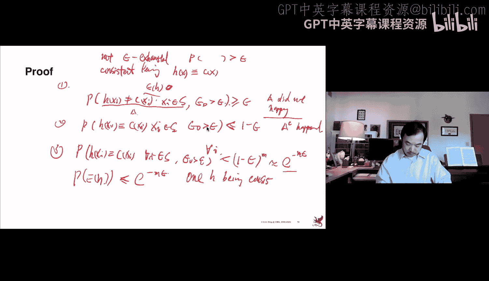
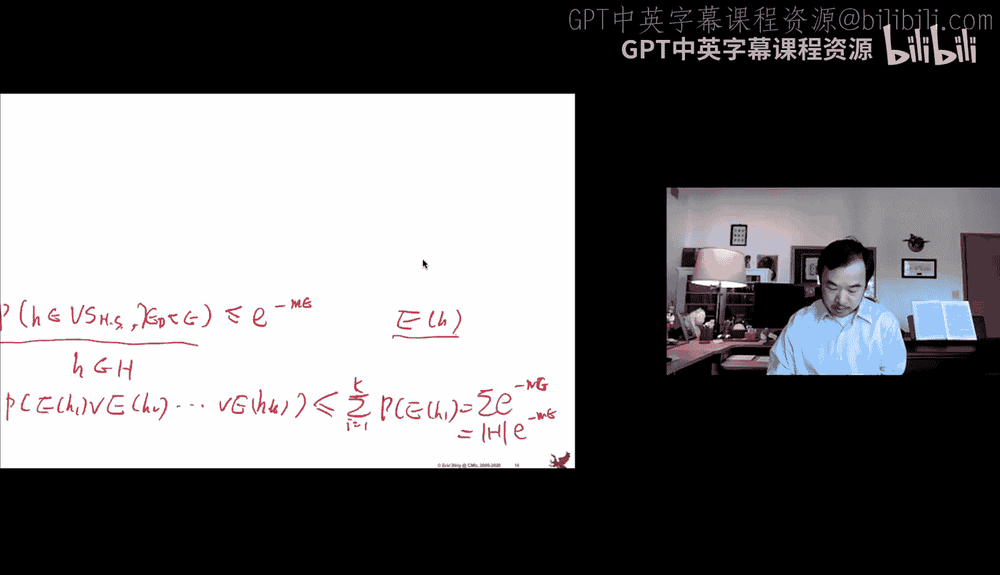
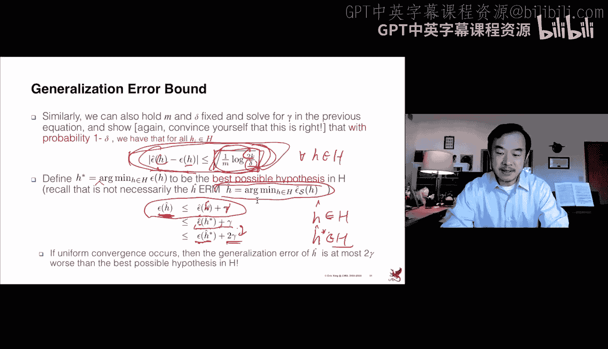

# CMU《机器学习导论（研究生）｜10-701 Introduction to Machine Learning 2020》中英字幕 p19 [19]10-701 Lecture 21_ Computational Learning Theory.zh_en [BV144SuB8ETp_p19]

All right， good morning everyone， good to see you again。So today we're going to talk about。

Competitional learning theory， okay， so this is an area that studies some of the theoretical entrepreneurpinnings of algorithms that has been invented in the machine learning field。

And the main purpose of such analysis is not to basically achieve a exact computation of say how much risk you' are going to have how many samples you are going to need to train a model down to certain you know error rates and so forth。

 but it's to really help people establish a connection between a few key tuning laws in the learning algorithms so that people can get a sense about how to influence the results by increasing sample of by designing different models。

 but this kind of analysis are。

I wouldn't say qualitative， but that not exactly quantitative， you will see numbers symbols。

 which will be entering the analysis in a big old type of fashion。

 which means that they are up to some constant or up to some lower terms， right？Okay。

 so one of the key issues about machine learning is actually something known as the generalizability of learning。

 say you're tracking a hypothesis。Which gives you an error。 so remember this error of the hypothesis。

It's usually， you know。Computute it on your training data set as。

Right which is the data you actually know， the labels and product。

 Then you usually minimize the error on the training。

And then you need to apply this H hypothesis to some new data。

 The new data may be coming from the same distribution from which your training data are coming from。

 but also they can be coming from a different distribution。

Right or maybe a distribution that is not captured so nicely by the training data。

 and then you want to ask how much risk I going I'm going to have how good this particular hypothesis is even though they are learned only from training data。

So this is the core of generalizability of machinery。

 so today we are going to introduce a few techniques that helps you to analyze behaviors of this kind。

Two of the main aspect of a core interest， you know in describing general ability is the notion of。

Cost right here there are two particular axis of the cost that is particularly interesting。

 One is known as the information cost， the other is known as the computational cost So information cost or information capacity is to do with how much you know training data you need to prepare to train a good algorithm and also how fast you can learn。

 say how many iterations right you can get to a convergence this is in the space of in the aspect of information complexity and the other is the computational complexity。

 you know how much cost you have to pay you know in learning from everyone example right so are going to see you know how these numbers can be connected to the accuracy you are going to achieve on testing data。

Okay， so here is a general kind of framework that were going to use to establish this connection。

We're going to introduce more formally sample complexity。

 and we're going to also capture computational complexity。

 and I want to have a theory that builds the connection between the following things。

When it about the training examples。For example， the quantity of training example。

 will you require M， this is basically a notion of the sample complexity。

We also want to establish the concept about the capacity of the hypothesis or concept space that actually has something to do with the cost of learning。

 the computational cost of learning because you know you may design a hypothesis which has a certain dimension which require a certain number of features that 10 features or 10 features that certainly will affect you know the computational cost of computing such hypothesis。

And also， it gives you a notion about how much it takes you to exhaust all the possibilities in the space。

And then we're going to introduce two probabilities you know that connects to the notion of accuracy one is the accuracy of proximity the target。

 basically the error you' are going to make you know under the training or on the testing example and also the probability of successfully attain that training error say it's small and what is the probability of achieving that So remember there are two types of a probability one is the probability of making the error and the other is the probability of attaining a hypothesis that makes。

Small probability on error， right， So this is a double hedging story。

And our conclusion will always be presented in the form of a big old notion。

 which basically means that whatever relationship we're going to present here is usually up to a constant or some lower order terms。

 so it's not going to be precise exact。So let's first get a sense about the H， the capital H。

 which is the hypothesis space and also the hypothesis。

So here is an example of such hypothesistheor space。It begins with the task of learning。

 okay because a different task， say regression or classification or multitask learning will definitely you know leads you to different hypothesisses and therefore there space。

So here let's use example， the simplest Wednesday say a binary classification。

 we've learned a number of different binary classifiers， right support vector machines。

Logistic questions and so forth， right？And here let's imagine the most maybe the simplest scenario where we can even visualize or quantify the hypothesis space。

Say our example X。It's just a list a finite list of discrete features say here I have six features to describe say the possible days。

 okay， say the sky being cloudy of sun and air temperature。

 humidity wind water and forecast so let's say we have the six dimensional feature for a day。

And then our target function is to enjoy or not sports。Okay so this is basic a binary classification。

 given every day I predict whether you're going to enjoy spots or not right therefore the Hy space。

In this case， it's just a conjunction of lit， right， You' are going to list all this。You know。

 you know， discrete features。Plus， the outcome of that。

And you can imagine there are all possible ways of combinations of different feature value。

 and that leads to a particular way of writing down the hypothesis and you probably imagine that you can even count the number of possible combinations you know such a space could offer right so that's leading to you the size of the hypothesisspace。

 one of them or some of them may be good enough for you to make you know a predictive model。

And then we're going to train our S。Okay， we are going to train the the age by training examples as。

 which is usually， you know， a you know， finite number of feature and outcome pairs。

 So we've no that already， right， and then we're going to determine， you know， the following things。

 First of all， were going to。Find a H， which we believe be good on the training set S。

And we call it empirical risk minimization in a second。

But that's not our goal because we want to use this for our， say， you know， testing examples。

 therefore， we need to also characterize how good this age is， you know。

 on all data come from some distribution D。 Okay， so that's kind of the whole setup of our analysis。

And。Just depending on how the H look like， we already will be landing on two analytic paradigms。

 One is known as the the pack learning framework。Okay， in here， we basically。

 you know are assuming that in the hyperspace H， there exists some little h。

 which allow you to perfectly。Okay， distinguish training examples。 Basically。

 the sample labels is going to be consistent with at least some of the H Okay。

 and that means you are going to make a zero error by one of the little H in the hypothesis space and then the generation error on the testing data。

Is going to be。0 plus something right because you make zero already on training then you are going to make more errors it has to be coming from other sources。

 so we're going to basically you know find the absolute upperpro bound of this error。

 so it is absolute because the training every zero。

The other framework is known as the agnostic framework。

Here things becomes a little bit more complicated， you have no prior restriction on the sample labels。

 basically you are going to label the sample in any arbitrary way。

 it could be even wrong labels okay but the result is that your hypothesis H okay may not contain a little H。

That perfectly labeled the training examples。And therefore， you are going to make a mistake， however。

🎼You try， you know on the training data， and then your generation error will have to be additional error on top of the training error already made。

 So it's going to be a relative kind of statement of the generation error。

 So these are the two framework I are going to study today。 and in both cases。

 H the size of age is finite。We're going to study infinite age in our next lecture。Okay。

 so the next notion is sample complexity， I just said it already that it's you know。

 in a simply in the most intuitive case， it's the number of training examples that you need。

To learn a target concept up to satisfaction。And in。Obtaining the M， there are multiple scenarios。

 you can imagine that you may be in a scenario where and as a learner。

 you are going to you propose an instance that is unlabeled and you ask a trainer to label or you will be dumped by the trainer just a batch of examples which are already labeled that you as a learner do not have the right to refute any of the examples or suggest new examples。

And sometimes it could be also a random source that the samples are generated just randomly from nature。

 and then the teacher provides that。 So all this actually also creates different type of。

Risk kind of guarantees。So in the two frameworks that I'm going to talk about today。

 the pack framework and also the agnostic framework， we are going to。Put a screen here。 And the way。

Make no distinction along these scenarios， which just basically say that we have examples。Okay。

 as a training data set。Okay， we are going to ignore for now the implications of these different scenarios。

 that makes the problem a little bit easy to analyze。Okay， so here is the protocol。

It's going to be very kind of standardized。We are going to begin with the set of examples called age。

Okay， and we're going to assume there is a fixed distribution。Of the data， which is unknown to us。

 by the way。And then the hypospace is H， which we have a ability to define。

And also the target concepts， say binary label， a multi label and so forth。

 which is provided already， you know， by the teacher or by the trainer。

And then the learner will observe this set， okay。The set is labeled， but more importantly。

 we'll assume that the examples in the data set in the training set。

Also come from that true distribution， even though we don't know what distribution is。

 we know we assume that the data come from that distribution。 Therefore。

 the training and also the future testing data are following the same distribution。

 So this is a very important simplification。W whichch allowed analysis to carry out。

 know more straightforwardly。And of course， you know。

 the labels also come from the space of all possible concepts， Okay， we are， of course。

 we don't actually know the labeling function。Based on what you the label was generated。

 we just know the label outcome。And our goal is to learn a hypothesis。

 which becomes the estimator of the C function。Okay， so and for now in the PE learning。

 when we say that pack learning is about a hypothesis space where there exists hypothesis that perfectly observe or respect you know the label in the training dataset。

 that basically means that these two are equivalent， the set of you know concepts。

 is the same as our concept of hypothesis or the set of hypothesis okay。And the data basically。

 in this case， is called noise free。So now let's look at the error more closely。

We already know that there is a term called the training error。

 which is defined explicitly in this equation， okay， it's epsilon hat。Subscript S over H。

 which is the probability of your predicted label by H disagree with the given label Cx and empirically。

 this probability can be estimated by a sample average。Okay， that's why it's a ahead。

 It is estimated from your training set。And this is an error that you actually can compute after you train your instance。

 right train your hypothesis and your goal of course is to establish a connection of this training error。

 empirical training error， you know on to the true errors， which is defining here。

 the true errors is the probability of any data coming from that distribution。

Where the prediction and the true label are different。Okay， so how these tool。Conect with each other。

And our guess is that they should be very close because otherwise it doesn't make any sense for us to train a hypothesis and use it for new data。

 right， but how can we assure us that it is indeed very close and how close they are。Okay。

So graphically， you can see that it is not necessarily automatically guaranteed that they are close。

 you have an instance of the X where data can be labeled in all different ways。

And the hypothesis space basically is probably just a subset of the way data can be labeled。

And the training labels C or the constant the the true labels C， Okay。

 is unknown to you in terms of the function。And you only see the instances。

 but a function probably is another subset of the ways how data can be labeled。

And in the event that they are not identical， then there are disagreements。Right。

 and that's basically， you know， a character。 The volume of these disagreements is basically corresponding to the。

Generation error we are going to have。 Okay， So now let's look into how we can kind of put some more explicit quantities and analysis on this error。

We' are going to use a few very famous property properties ors to prove certain property。

 so here I'm going to introduce two very important lamas okay。One is called the Union bond。

It basically characterized the probability of a certain event to happen。Okay。

 and by basically some simpler notion of individual probabilities of every event。So， these。

Statement says that the probability of you know at least one of the event out of a key events happening。

It's going to be upper boundunded by the sum of the probability of each event happening。Okay。

 so it's a kind of already intuitive why I' not going going to prove it。 Okay。

 it's also known as the bullying theory。 Okay， so this basically allows you to establish a a connection of。

you know啊。A complex event happening within a set versus individual events happening。

 you know with certain probabilities。Okay， the other very important demand is known as the health inequality。

 it is also very important。It is often used to characterize the quality of a estimate of a benoulli rate or a discrete the probability of a discrete event。

 so imagine you have a binary event， which say a coin tossing you know or a classification error of a binary outcomes。

And it is having a probability of。Of five， for example， Okay， and this event is a brutal event。

And this true file may be unknown to you， but after you toss a few coins of after you try a binary classifier on some examples。

 you can compute basically the probability of account basically the outcome of the binary events and then that allows you to compute a sample estimation of the file。

So the health equality tells you the following property。 It says that the probability of the。

The sample estimation of this random variable of this rate。

Which is the mean of the binary random variable is going to be close to the true rate。Okay。

 with a high probability。Okay， or in other way， you say the differences of the estimate and the true value to be greater than some small number gamma will be upper bounded by a small number。

Okay， the number being exponential of of to the of minus-2 times the the the error。To the square。

 and also very importantly， times the number of examples。 So if you reach this term。

 you can see that it's kind intuitive。The more the M is， okay， the more example you have。

 then the smaller number this entire term is。Right， therefore。

 that means if you estimate your rate from more examples， then， you know， the probability of。

Deviating from the true value will be smaller and smaller。Okay。

 so that's kind of the the the gist behind the healthy inequality。

 So I'm going to use these two theorems La down the road to prove some of the learning， you know。

 properties I' going to look into。Just remember this for now。Now another concept。

 which help us to further quantify different hypothesises。

 I mentioned that there is a H hypothesis space， and there are many little H inside it。

 but not all of them are equal。 There are some H， which is making no error。Right。Like this。And。

 and imagine that there are several such age。 Okay， in the entire space of a capital H。

 there is a subset where。They live in the， the little age， which is what we call consistent。ok。

Consistent means that they make no error。On the training example。And we call this the version space。

Okay， off the edge。 So this guy is the version space， which is defined in here。

 They only correspond to those a consistent hypothesis。

And you can see the version space is defined very carefully with two notions。 One is the capital H。

 which is the。The entirety， the universe of that particular type of hypothesis。

 like this little square， and then the S， which which is the training set。

 which you know defines this grants this consistency consistency with what with the labels in the training set。

So this is no as subversion space。And that basically allow us to look into a subset of the H from which we are going to take maybe one of them to be used as our generalizing hypothesis。

Okay，Okay， so consistent learner is basically an algorithm or an effort which allow you to pick out those little H that is in the version space。

Okay， of course， now we need to know how such hypothesis can general。

And how they generalize is you know with usually people say oh。

 they make very little error and they have a high chance of being successful and so forth right so here we want to tighten the statement a little bit so that they become a really very rigorous。

And that's what the PE learning you know framework is trying to achieve basically it says that the PE learner aims to produce hypothesis H hat。

 hackG means that it's empirically estimated from the sample。Which is approximately correct。

 What does approximately correct mean， It means that the error of such A H on the D on the true data distribution is close to 0。

OkayAnd then not only approximately correct， but also achieving this， you know。

 this high mark with a high probability。You know， you can say that， yeah， you know， if I train。

 you know，100 times of the hypothesis one of them will be having a very low error。

 but that's not very helpful because even though such a low error hypothesis exist in the age。

 you need to train 100 a different age to achieve such one， that's no good， right。

 You want to actually have a high probability of attaining this right So this is a double hedging story called approximately probable correct。

 So that's what the pack learning is is is is basically trying to stay。

Probably approximately correct。All right。Now， getting a little bit further， we knew that the H。

You know， we are going to get is from the version space， they make zero errors， you know。

 on the testing data， on the training data， and we knew that they are going to make some error on the training data。

And therefore， we need to put a cap on the training error to force it to be small。 right。

 So that leads to the notion of how to exhaust， you know， our version space。 Okay， So again。

 here I read the graph。 This a big square is the whole space of H。

 And this little shape in the middle is our version space。

Right version basically can see that there are， you know， all the Rs become zero。 But then， you know。

 out of this different， you know， zero error hypothesis on training data。

 they can still have a different values of the testing error one being 011 being 02。

 and obviously we prefer the the little ones。 Okay， Therefore， were going to now really。诶。

Put a upper bound。Okay， of the possible you know errors that the hypothesis can be can be made okay。

 and and that's basically a technique to qualify basically the version space or with noise as exhausting the version space。

 you know how good the version spaces， do they contain a lot of hypothesis which have a large error。

In that case， we may want to。Choose a different age so that their version space behave better right。

 but if the version space you know has a very small you know a true arrow bound。

 then we're going to basically hope that you know one of them you know will be very good。O。😊。

So here is an important statement。Which was discovered a long time ago by David Houssler。So。

 assess that。呃。You can start by building or identifying a version space with respect to H and S。

And you can characterize whether it is epsilon exhausted or not。By manipulating。

The numbers of a M and also some other kind of quantities to establish this connection。Basically。

 it says that。It is going to。The probability of。You know， a version space to be not。

Absolent exhausted。Okay， can be upper bounded。By a quantity in here。ok。

And that's actually very good because now you know that there is a probability upper bound of the probability of things not go well obviously we want you know you know a version space to be absolutely exhausted so that we know that every hypothesis inside the version space you know will have you know a true error smaller than that e but if it is not then we want this probability to be very small right so here this statement basically is that such an upper bound exists。

Okay， it is basically bounded by this quantity and the beauty of this is that now you can have a control because this M is the number of training examples。

Right， you can achieve， you know， a a very small upper bunch of this bad event。 Okay。

 just by adding more examples。Of course， you can also make the relaxation of making the the epsilon to be very relaxed。

 that will also make your bad event not happening so often。

 but that's not very helpful because after all， you want the data to be excellent small right So therefore。

 the thing that you need to manipulate this The other thing， of course， is this one。This size of the。

Of the hypothesis space is another thing but you could make some impact we are going to discuss that in the next lecture which amounts to how to do what we know as a structure mini risk mini where by choosing different hypothesis function at hypothesis space say be it a curve albeit a line。

 you actually also could have a way to bond such a better proba。All right。

 so this is a statement I'm going to。tryry my like to present a simple proof so that you also get a flavor about how people in the computational learning theory you know。

 use basic statements and properties in probability to establish these kind of guarantees on error。

So this is a cool exercise， many people are not comfortable with this level proof。

 but I'm not going to do it it very often， I think today well at the end of the semester already I'm going to try a proof so that you can see how it was carried out。

So we begin from a few kind of conditions， one is that it is not。Ipsom don exhausted。

That's one important character， meaning that the probability。You know。

 of a certain bad event will be greater than if。Right rather than bounded by aps。

And the other is the version space where we have consistent learners because we're going to only care about the horses in the version space。

Consistent learner。Meaning that H of x is going to be。Eal to C of X。So this is a good event。

Then we basically want to characterize。Saay啊。How。How basically likely that， you know。

 the age in here is going to be。Not able to upper bound it in terms of their true error by the asonmal。

So here。Let's look at all these events very in a sequence。So we are going to have a true error。입すnal。

Which we now assume that is going to be violated。Now， if the hypothesis has a。If， you know。

 we have a hypothesis which has a error， a true error of epsilon， then what is the probability of。

H disagree with the label。Okay， and X I in the training data X。Okay， and the true error。

Greatter than。Here什。So what is the probability of this event， By the way， this event didn't happen。

 Remember that you know this， let me say， call this event。诶诶。Okay， so even a。Did not happen。 Okay。

 that's very important to know， because we are really getting the hypothesis from a consistent version space。

 But let's just look at the probability of what if it happens， What's the likelihood。What is that？

Someone want to speak out。The probability of a consistent hypothesis。Okay。

 making an error in the training set。Given that the the。Version space is not aone exhausted。Okay。

 I'm going to suggest that it is going to be。Some number， greater than X。basicallysically。

 epsilon is just the upper bound。Of you know， all the errors that you could commit by any hypothesis and H is just one of this hypothesis right therefore it will be bigger than that。

But remember， this event didn't happen。 Okay， what happened is that we actually have something where。

 you know， H I actually。Equals 2。Right。😊，Given that。So this is what happened。

 so what is the probability of this happens？Do I see anybody charting or what。Right。

I saw someone answer already。It will be smaller than one minus。Right。Okay， that's nice。

 And you can imagine that we really want this probability to be big， right， so that you know。

 it will， you know， honor， you know our because this is happened this。Its a compliment。Happens。

Happened。Because we see it happened， we must have a good probability。

 otherwise we wouldn't see it happening。Okay， now let's look more how many examples we have in the training set。

Here we have only one event。Right。And。How about you know for all ice？So。Eric。

 there's a question in the chat， someone says， is this Epson the same as the delta we defined initially？

No， it's not。 that Delta is the probability of getting such a hypothesis。

And epsilon is the error of such hypothesis commit。ok。Yeah， you can go back and listen， you know。

 digest very， very deeply about this double hedging story。 Okay。

 one is the property of that hypothesis。You know， achieving a certain error probability。

 and the other is more on the learner side。 How likely I'm going to achieve that particular learner's performance。

 Okay， so it's not Delta。 you want see Delta person， it it will actually be in the picture。Okay， so。

Now， we are asking the probability of H of X I equals to C of X I。For all the ice in S。And。

Given that the whole thing is are not absolutely exhaustive。えそう。What's the probability of that？

This is probability one event。 This is probability of the M event。Well， here。

 someone is suggesting a union bond。I'm not saying at least some or one of the。

The correct label happens。 I'm literally saying that all labels are correct。Right。Yes， okay。

 I got an answer。 Thank you。It should be。1 minus epsilon put the power of M because it is a joint probability of all such event happens。

Right。And you can imagine that it is a number that is。you know啊。Close to a。玩。ok。

So you can basically play you know， approximate this。Waste the。A。Exponential。Okay。

 so this is just by Tayloror expansion and algebra。

 you can actually write it down in an exponential form。对。All right， so now we basically， you know。

Have a。Maybe必我看。We can see it。The following way。Basically， for a particular H。Right。

 we have a consistent age。It's consistent。And。We basically say that this happens with a probability upper bound by。

E to the minus M and epsil。This is the one hypothesis remember。Okay。

 well have positive been consistent？

嗯。

Too bad。 I'm losing all the pages。 That's okay。

Let's just write it from here。 So now we have。H。Being in the version space。Of H and S。Okay。

 the probability of this。Given问大者的。Version space is not epsilon exhaust。

Is going to be upper bounded by。Dis quantity一 to the。And。And it。Okay。Remember that to achieve this。

 we multiplied M times， not single event probability， but this is now a bigger event。

 you know on H as a hypo possibly consistent for with all the training examples。Okay。

 now our last point。We are talking about existence of age。In。Capital H。ok。Basically。

 we' saying that for a capital H hypothesisspace， there should be， let's call this event E。 Okay。

 let's call this event A E。We need to say that at least。One of the。Events。You know， this will happen。

 you know， in all the hypothesis in age。Maybe I should say。What is the probability of。E of H1。

Un name E of H 2。ok。So what is this probability， This is the probability of at least one of。

 you know， the。Hypo in age， being consistent。I have a question。

Cl ask the version space is defined as the。Subent hypotheses that are consistent with all training examples in us。

 right？So wouldn't the probability of。Each I thought this is being consistent B1。我。You see it。

 but it's we are not talking about a probability， you know， based on。You are talking about an event。

 I'm talking about the probability of an event。 that's different things。Right。

 you could have a version space where elder hypothesis are consistent at the event。

 But what's likelihood of having such a version space。So we're talking about different things。Okay。

 yeah。All right， so。Can can someone help with this？ This is the probability of you know。

Having at least one。Of the functions。In the version space to be consistent， there will be multiple。

 there be all of that， that's all possible， right。Hoful。Characterize this a probability。

That's where U B is。 Yes， so you are going to now upper bound this basically by the sum of the probability of every event。

Right， I equals to1 plus2 k。 And that basically becomes。The son of一。Right， and。

We use the volume of the H。To啊。Represent the sum。Okay， so that's how the proof is established。

 maybe actually should the flip next page， you can see where we are arriving。

嗯。Some reason， this。

Paper。Yeah， okay。So what we see just not being proven is basically this property okay。

 it's the host is a very famous you know pack learning bond okay it basically says that the property of the version space is not epsilon exhausted after M training example you know。

 is small。Okay， it's upper bounded by this quantity。

 The volume of the hypo space times the E to the minus epsilon and M。And let's say that。

We want this to happen， you know， with the small probability Delta。Okay。

 so that's basically Delta gets in。Okay。So you can see these are two errors。

 Delta is the probability of this event， okay， being happening。And epsilon。

It's just the probability of a hypothesis committing an error。So these are the two things。

And to achieve a hypothesis， which makes a small a。

And to achieve that with high probability 1 minus delta。

 you basically can connect the epsilon the delta and also the size of the hypothesis space with this equation。

 You need to have M examples greater than this quantity。Okay。

 to achieve a effect that you have a training error zero meaning getting one positive version space。

 and they are going to have a small epsilon with high probability。Okay。Are you with me？诶。😊。

Maybe the other way to say that is that you know。This what what's the complement of this event here basically say that there exist some hypothesis。

Which is not epimal exhaustive。The converse of that is that there does not exist any of such hypo。

 that is a greater。Then ifs a long error， right， and you want that probably to be very high。

 and that's basically what minus this。That means， you know， you know， in the version space。

 you are very unlikely to get a H that is committing。Big error or error greater than Eson。可以。Yes。

 yeah。 some people asking。 so error exhausted is equivalent to no training error。

 but testing error greater than some error， yes。So yeah。

 we are using this basically to establish now a notion of the ED。Okay， of H。Okay。

 and here we basically say that the ED is acrounded by the Epom。Okay。

 because on the training data you have only zero error， therefore you have not。

 you cannot really claim any error， you know on the training data set to directly extrapolate。

🎼All right， so let's move a little faster， this will take longer than I expect to explain。

 but let's do some exercise to see how they actually play out in your real training task。

Let's say that we are going to learn some simple hypothesis。

 say the good day or bad day classification example we mentioned earlier。

 it is basically you know you know the hypothesis was a bunch of bullying attributes。

 right you can imagine that maybe they are threeway bullying lits。

 you know yes and no and don't care。Okay。😊，And then。

 you know the number of hypothesis for such a you attribute function is basically you know three to the power of n being the number of booleing liters。

 right？And then you can use this equation， this theorem to conclude that you need to have the M greater than this quantity to achieve。

You know， you know， a generation error， no greater than Epsilon with high probability，1 minus delta。

You can plug in the numbers， in fact， remember that in our enjoy sports example。

 we have six bo lit and therefore your hypoase is3 power six。啦 in。And you can also say。

 I want to with probability。95 in1 such a classifier。Therefore， Delta is 005。And the epsilon。

The error， the general error of the classifier should be less than  point1% a。110%。 Okay。

 so plug in all these numbers， you roughly can。Conclude that you need to about 100 examples。Okay。

 to define aversion space。So this is kind of intuitive， right。

 The version space is a function of the hypothesis and also a function of the number of examples if you just use a say one example or two example as training。

You can define a version space pretty easily， you know。

 basically it's very easy to obtain a hypothesis， which is correct。

 making zero error under two examples。But you can imagine that it would do very bad with very high probability of doing bad。

 you know under the training right and here you are going to increase the M so that they have enough examples if you don't commit any error on enough examples。

 then you will have a high probability of achieving a good classifier making low errors on testing examples。

O。Okay， so this is basically the core of a。Pack learnability， Okay。

 learning algorithm is a P learnable。 If it requires no more than polynomial computation per training example and no more than polynomial number of examples。

🎼To achieve， you know， a good， you know， outcome with high probability。

 This polynomial is basically what justifies or qualifies a pack learnability and where do you see polynomial。

 or it's because you have a this equation。Okay， you can actually compute how many number of examples you actually need to achieve a good result。

 And in the previous case， you probably can already you know， plug in， for example， in here， H。

 if it is exponential， you know， some quantity。You know to the power of N for example。

 and then lot of that gets n out， therefore the number of examples is polynomial to the number of dimensions of the hypothesis。

Right so that's。That is a pe learnable hypothesis。And also。

 the polynomial is not only to the size of the feature。 it should also be。Ponometer size of the C。

Which is the number of ways you can label and also one over epsilon and one over delta。对。And here。

 of course， we see even better outcomes， it's the log of one。

 that's actually even you know a better number， you know， in terms of qualifying the app。All right。

 so I'm done with the pack learning。Which is the basis of all the。

Competitional learning theory we later developed for more advanced algorithms and more advanced hypothesis space and more advanced data distribution。

So are we still。On track， any additional questions before I move on to the next scenarios？Okay。

I'm going to move faster on the more challenging scenario of agnostic learning。

So in agnostic learning， we are going to basically drop the assumption of see the labeling function being within the hypothesis。

 that means that if you use a hypothesis inside H， they may make mistakes。は。

And we actually will show that in this case， the computational complexity or the sample complexity will be characterized by a different bond。

Okay， which is which is different。From the pack learning in here。

 you can see there is a epsilon of the of the sigma。

 And there are some a few other notions that you will see。

We' are going to use the health bond to define to actually approve this new property。Okay， so。

It few new concepts。When you have a hypothesis where there does not exist a version space。

 say I have the H。There isn't di version space anymore。Then how are you going to choose a hypothesis。

Right， with the version space， you choose hypothesis from the version space。

 which means that they make zero arrows。And without the version space。

 meaning that there are either a mis label or an accommodtable label C。

What you do could be to adopt this strategy， you're going to just minimize， you know， the error。

 you know un training example， this is known as the empirical risk minimization that's a very intuitive right you just without if you don't have a zero error hypothesis。

 you choose the hypothesis with zero with with the least error。So for example。

 in our linear classification， you can basically you know write down a loss function。

 the loss function could be you know a square error loss you know or logistic loss or other things and then you are going to find the data which minimizes that right so this is called ERM。

So ErM forgets your error。Which is this？What you want is an error， which is this。Right， so how。

This tool connects。Okay， that's the task。Again， we're going to。

Make the problem a little bit easier to analyze by assuming a finite H。

Although you'll probably see that this is not necessarily very popular because even in regression。

 are going to have an infinite h， you you are having continuous parameters right for the slope and intersections。

 if it is infinite， but just for the sake of argument， let's make it finite first。

To make the proof easy。And we're going to give a guarantee on the generation error of this。

 H hat is basically the empirical risk minimizer。ok。And we're going to show that you know。

 the empirical we need to first show that the empirical error of any hypothesis is going to be a reliable estimate of the true error of the hypothesis。

Okay， so right hat is always indicating empirical nature that you get it from data。

 no hat means it's the true value that exists， but you don't know and I' going to say that these two are close。

And then secondly， once this is established， we're going to say that this one。

Somehow leads to a nice upper bound of the error for this， which is the。Okay。Okay。

 so that's the strategy。The first one is very easy。The miscasttation probability， okay。

So classification could be viewed as a new event， it's right or wrong with an error probability。

Therefore， our empirical error of any hypothesis is just accounting of the classification outcome。

And now you remember in the healthy inequality， we basically have a way to bun the deviation of this estimated error。

Versus the true error。Right， just through making the error as a binary event。

 Then these two things are really equivalent。 So we can basically say the following that the probability of a sample estimation of the classification error。

Close to the true era of this hypothesis。 you know， by just a distance。

 greater than gamma will be small。 It will be upper bounded。By this term。Okay。

 basically say that having a bad estimator is going to be having small probability if your M。

 for example， is large enough。same thing。All right。

And then were going to have the uniform convergence。Which is quite useful here。

 so we are now again you know talking about you know in the hypothesis space。Which contain many。

 many hypothesisses。 Just now， we are talking about one hypothesis。

 And here we have many hypothesises， right， So we can use the un。

Could not characterize a upper bound of at least one hypothesis。Okay， being bare at。Okay， and。

Using the probability of only one hypothesis。Being bad。 Okay， so with sum together all these。

And we know that it is a finite hypothesis space。 Therefore the number of hypothesis is K。

Byith the way， this should be。A greater sign。看。Okay。So that means with a small probability。

 there exists at least one bad hypothesis。Okay， you know。You know， learn from data。

But this also means that the converse can be computed。

 that the probability that there are no bad hypothesiss。

Its going to be very high1 minus this small number。ok。

Meaning that the all hypothesis trained this way is good okay？Okay， so。So in the discussion above。

 we basically are able to now establish a connection you know， between， you know。

 the two type of errors。One is the true arrow， the other is the empirical  error for any hypothesis。

And then the gamma， which is the bunch of the differences， you know， is a function of。

Number of examples， the size of the hypopospace。And also the magnitude of the true errors and so forths。

So we can plug in those numbers。Let's assume that we want this probability to be very small。

 Basically having bad hypothesis， the probability should be very small， smaller than gamma。

 And then you can compute now how many number of examples M is needed to achieve that。Okay。

And that's equivalent to say that with probability at least one minus delta。

 your learned hypothesis will have a small error。Which is upper bounded by the gamma。Okay。

 so this is for neat。Somehow we were able to to prove that you， a empirically trained hypothesis。

You know， based on big enough number of examples。It's going to have a small error with a high probability。

Okay， and in here， there is an observation that is key here you can see that the dependency of that M。

On the size of the hyperspace K is through a logarithm。Okay。

 so this logarithmic in K is very important。That actually leads you to a notion very close to the pack learnability that a polynommal dependencies。

 Okay， between the number of examples and the。Difficulty of the problem or maybe the computation of the problem is going to be honored。

Why computation is here because you know。The cost of computing， you know， is very。

 very deeply related to the size of the example。 If you have an example X， which is you know。

 n dimensional， let's say。You know， features。Then computing a weight function or whatever for the x is usually n steps。

 right because of one for each dimension。And if this computation is not polynomly related to the M。

 that's a good thing because you don't have a explosion of the sample complexity when you want to learn a slightly bigger hypothesis。

 say you want to learn a hypothesis with a feature that is two times n。Right。

 then you are not going to basically you know you know， get an exponential。

 say M square number of examples， you are going to get two m examples necessary for the learning。

 That's good。Okay， so。The other thing that we can look into is the magnitude of the generation error。

 in addition to the sample capacity。🎼So you can plug in， you know。

 the delta back to the bonds I just had and。Replace the gamma with with this part。

And then you can actually see that the differences between this and that。Can be actually bounded by。

These quantities。Now let's see how far。Not your。G error of a estimated hypothesis can be away from the best possible options you have in a hypothesis space。

 because here， you know， iss a。A。A statement apply to any age。 This is for， you know， any age。

Inside the H， inside the capital H hypothesis space。

 But what are the H you actually are interested in at the end of the day。

I think there are two hs that you're particularly interested in right， one is the H of hat。

Which is the empirical risk minimizer。On the training data。

 you basically train A H to the best as you can on the training example， and you get a H all of it。

 So this， of course， is a member of the capital H。Maybe that's the only thing you worry。

 but some people also worried about another age， which we call them say H star。Okay。

H star is this imaginary thing that is also known as the best possible hypothesis in the H。

Due to your algorithm。You know， for example， in the EM algorithm that we used to use。

 you are not always guaranteed to achieve the global optimal， right。

 you get some kind of estimations。And therefore， your algorithm may not get you to the best possible hypothesis。

 It's a hypothesis that minimizes your training error in here， but， you know。

 maybe there are even better ones due to many reasons。So that defines you basically。

 so this particular H star。Deefs you the potential of the。Hpo space of age。

 So we basically want to establish， you know， a bond of what is achieved。I empirical risk minimizer。

Versus what can be achieved at best。Okay， you know， in terms of the error。

So that's basically a can be shown in this way。 So it's basically using a trick of。

Leveraging on this particular in healthying bound of error differences。

So we use the bond once in this equation。Okay， so this is the differences of the estimated epsilon versus the true epsilon。

Okay， the estimate Xon is on the data and the true epsilon is basic the generalization on testing data。

And this is a defer by atmost gamma。Okay。But， you know。This one， the H hat。

You know is guaranteed to be upper bounded by the best error that you can make。

Right so there could be another H head of star in the version space in the training data set that can do even better than your current empirical risk minimizer。

And therefore， we can plug in this in here。Right， so this is just by definition because it's the best possible hypothesis。

 So it's surely better than your empirical risk minimizer。 Maybe it's the same。

 but it couldn't be worse than that。And then remember， this is the excellent hat。Right。

 because it is an empirical error then。From here to here， we use this bond again。Okay。

 so that you can basically bond the empirical risk estimator， you know， with the true risk。

Of the same hypothesis。Plus a gamma。 Therefore， now we have two gammas in here。对。

Then putting things together， we have this very nice kind of statement。

Which is that the true error of your empirical risk imager。Okay。

 it's no worse than two gammas away from the true error of the best hypothesis that you can get from the hypothesis from the hypothesis space。

So what does it mean， it means that practicing empirical risk minimizeizer is a good idea。

It's not too far away from the best you can achieve， even though it is not necessarily achievable。

 but you can get very close to it and then the gap， which is the to Lada is basically this one。

Which is under control， because you can。Add more samples， for example。You can also relax your， your。

Your hedge on the probability of attaining that。You can also maybe try different hypothesis space to control the size。

But in all this， you can basically make sure that your gamma is under control so that your empirically trained you know estimator of hypothesis is not too far away from your ideal。

Hypo in that space。O。So that's basically what we are trying to achieve today。

 right so the pack learnability and also the agnostic learning framework is really giving you that kind of insight。

Which characterize first of all。Your error。Okay， obtained， you know， from， you know。

 the training data set。You know， it's going to hopefully leads you to a good， you know。

 hypothesis that generals to the。Testing examples。With this much additional risk。Okay。

 that's the first story， basically means that your algorithm in optimizing the training error makes sense。

系咪。And then it makes sense even better when you have the sample complexity under your control。

 if you can you know use more examples， then you are able to kind of you squash or attain that kind of low error of the hypothesis and high probability of attaining the good hypothesis。

And here， one of the key notion is the socal learnnerability。

 which is that the M and the hypothesis is related through a logarithm。

 which ensures pack learnnerability or or polynommal complexity， meaning that when you are。

Facing different problems or you know adding increased volume of the hypothesis space。

 you're not going to exponentially you know demanding more examples。

 you're going to be only linearly increasing examples。

 which actually is something that people can afford。Okay。

So I'm going to stop here any more questions from the audience。Okay。

 so I suggest you guys go home and read today's lecture notes very carefully because it is kind of abstract and it is a sometimes the the the wording is like awkward。

 right， you are basically characterizing a bad event to have a small probability。

 And then you claim that the good event will have high probability。

 make sure that you understand this kind of you know， indirect argument， you know， from you know。

 the probability series。 Next time I'm going to talk about how to get more natural by limiting。

By removing the limit of the size of the age they become infinite and then under there。

 what kind of strategy we can adopt to achieve good outcome with high guarantee。Okay question。Yes。

 please so just to understand Ka on。In the empirical sense。

 basically K means the number of unique labels in the training and test data。

The not the number of unique labels。It ways of labelling。Right， it's the hypothesis。Not。

Not just the complexity of the labels。I see see yeah you will actually see that the next time。

 if you have three examples， right， you have eight different ways of labeling then the cake correspond to that number rather than every label being just a binary。

 say you have three examples is just a two way of label plus and minus。

RightBecause we're talking about the hypothesis space， not about labeling space。

 these are two different spaces。Got it， thank you， Okay， any other questions。

 we have another two minutes。Can I quickly ask about the notations here， How do you。

 What's the differences between like error hat H and error H and error hat H star。

 like in the previous page。 Que， Yeah， this is。 So let's see。H hat。Is the empirical。Risk minimizer。

 right？We know that。And H。Had star。Is the best possible hypothesis inside the age。Okay， so best。

So usually this one will dominate the other one because it is the best。

 it doesn't mean that you can achieve it。 This one is achievable。Then。April。

Epsilom basically is usually suggesting true error。And epsilon hat。

It's basically the error that you measured on data。Okay。

 so usually you will put a S here to indicate that you use the S training set。To measure the error。

 And then when argument of H had put in， it measures the error of that one。

 If argument of H had star put in， you measure the other one。

 It doesn't mean you actually can measure it because we said that the H star isn't necessarily attainable。

 but you can imagine such a quantity exist。 Remember here， when are using the tricks to establish。

 you know， a reference point， which。We know it exists。

But we are not necessarily able to achieve that。Right。Yeah。Yes， thanks。Okay， good， thanks。All right。

 we right on time， thank you very much， what's due on Wednesday。

