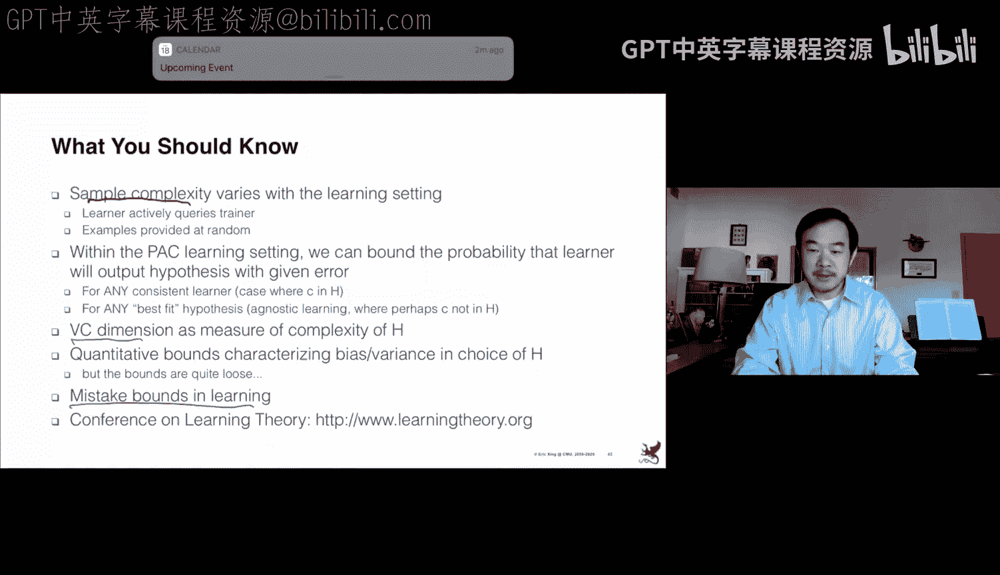

# CMU《机器学习导论（研究生）｜10-701 Introduction to Machine Learning 2020》中英字幕 p20 [20]10-701 Lecture 22 Computational Learning Theory II.zh_en [BV144SuB8ETp_p20]

So today， we are going to continue the discussion on computational learning theory。

 just a quick recap。

On Monday， we went through two simple scenarios of learning theory。 One is called pack learning。

 The other is known as the agnostic learning， right， So in the pack learning framework。

We begin with a finite hypothesis space and we also assume that the target function is within the space so we use concepts like version space an epsilon just the version space to actually in here is not using version space because the hypothesis in the space。

 therefore it's going to able to produce a hypothesis that has a zero error on the training data and then we proved a theorem which says that you know the probability of having at least one trained hypothesis that has a zero error on training but still have a true error greater than epsilon it' going to be very small right the bunch is defined by the size of the hypothesis space and also you know。

Some exponential that is negative to the number of samples。

 So the intuition here is that if you have a more and more sample making ms bigger and bigger。

 then this probability of having such a bad hypothesis will be very small。Right and conversely。

 you can confidently argue that if you have a hypothesis that has a zero error on training。

 then it is very likely to be having a very low true error。And according to that。

 we can actually start to characterize or estimate roughly how many examples is needed to reach a small error。

With a high probability， okay。Then the second scenario is slightly more complicated where you C is not in age。

 and in here we' are going to use a concept version space to basically you know capture you know some additional。

You know you know properties， in fact， I was confused version space actually does include actually apply to pack where the hypothesis commit zero error in here you are going to basically assume that you are going to do empirical risk miniization in which on the training data you get the best hypothesis you can have。

 which is a H hat right， and you get a training error that is9 zero。

 and you want to basically now understand you know how much true error you can expect from such a hypothesis then we use you know union bonds and have inequality and proved this property。

 which basically says that the probability of existing hypothesis which you know has。A true error。

 That is a。Bigger than the training error。By gamma， its going to be upper bounded in。

It should be a smaller sign here by this number Okay so this number again is very intuitive。

 you have a k， which is the size of the hypothesis space， you have a the gamma。

 which is the probability of attainability of such a hypothesis and M is the number of examples So roughly it gives you the same message that by increasing the number of M。

Okay， you are reducing the probability of having a bad hypothesis。

Which is that this hypothesis is worse than the training error by you a gamma。

So in here you can use the M to influence both the gamma。

 which is the discrepancy between the training error and the true error。

 and also the probability of attaining a satisfactory hypothesis。And with that。

 you can now even produce an upper bound of thearrow， which now has two terms。

 One is the empirical error that you commit。You know， on the training data， which is in here。

 and the other is a term which connects to the sample complexity and also the。

Size of the hypothesisspace， which is 2 k in here。Okay， so that's a quick recap。

 I hope you can at least on the road， remember the key ideas on this page。And then all the fancier。

You know， analysislysis such as the one we're going to present today and also a lot of the modern work。

 you know， published recently on deep learning and other things is actually， you know。

 following the same vein of you know， ideas。Now， obviously。

 you see already a limitation of this analysis in which for both cases， we claim that H is。Finite。

RightAnd obviously this is rather unrealistic， we are only able to now deal with hypoes which are conjunction of literals。

 and discrete choices and all that。Even if I want to fit a model。

 which is like y equals to a times x plus B。Right， and this is already producing you。 Basically。

 it is a line。Right， dividing， you know a two dimensional space and in a two dimensional space。

 how many lines you can draw or infinite。 therefore， this analysis doesn't apply。

To the analysis of even， you know， a a decision， you know， a boundary defined by a straight line。

So then what do we do？嗯。We are going to now， you know。

 explore another notion of the complexity of the age。So the size of the H。

 the number of hypothe exist in the space of H。It's meant to describe the capacity of it how rich this a whole space is。

 if you can count it， then or if it's finite， you can give a number。

 but what if it is not countable or infinite。So here we're going to introduce a very you know a monumental concept called the Wabk Travans dimension。

 VC dimension， that's actually the cornerstone of a modern computational learning theory analysis。

 it is really based on not just the you the specific say numbers tied to a hypothesis space such as the number of parameters of that it is connecting the space really toward its separation or discrimination power you know in the type of examples that you are going to work with。

 so I'm going to be more specific about that。So what do we mean by such a power？Well。

 let's just maybe think aloud and see what does power usually connects to， for example。

 if I give you a hypothesis。Which is the。Say， you know let's say it is a linear decision surface。

 okay， it is just parameterized by a weight vector w。Okay。And W basically is a vector of weights。

 If it is one dimension， you can imagine it is a straight line。A two dimension。 it's a straight line。

 basically in a two dimensional space with a slope and intersection。If it is three parameters。

Then it is becoming it defines now a plane in a three dimensional space with the intersection right。

 and you can imagine if I have a now one2 k dimension。

 then you know it is you know a K minus one dimensional hyper planee in that space right。

 So isn't this a good descriptional power。The higher the space。

The more kind of type of data points that you can allow， for example， Or。

 you have only data points which are described by two words。And now if your space become very big。

 you can classify documents which use a bag of word model in。

 say a million type of words or it picks those in images or not。

So power obviously connects to the dimension。You know， alpha the parameters。So more power。

 if you have more power。诶。What's the risk？Well typically we probably can guess that if you have a lot of parameters such as a deep neural network。

There is a very well known notion called overfiing。 You' are likely to overfi the data。Right。

And then if you have low power， then you may be not overfitting， but you also fit the data very。

 very poorly， you have a lot of errors on the training data， so this is again， trade off。

So that's usually more intuitive when you are talking about the dimension of the data of the hypothesis。

But we also have cases where high dimension does not necessarily mean a greater chance to overfit and low dimension or low number parameters does not necessarily mean that it is a weak okay so let's maybe take a different view about how to characterize the amount of power。

So here I'm going to introduce a very interesting concept called shattering。Okay。

 so here's a definition of the shattering。It starts with a data set。Of M examples。And the。Then。

Let's define the game。 I give you。M data are you I'm given M data points。Okay。

 and then I am going to provide a hypothesis space。

Say it's a line or it's a plane or it's a circle or whatever。 I'm going to name one。 Okay。

 then you are allowed to label。This endpoints arbitly any way you want。And you challenge me。

 Can you use your hypothesisspace to resolve all the ways that I can label the data。Okay。

 and and if you can resolve it like， you know a。My arbitrary way of labeling M data points using your hyperspace。

 but you cannot resolve it my arbitrary way of labeling M plus one data points。

Then系 say then I say that you。Your hypothesis space is shuttering this dataset set， F， S。Okay。

 so shadowttering is just basically you crush this oracle of arbitrary labeling with a predefined hypothesis space。

 So remember， this is a character of the capital H or calligraphic H， not a little H。 Okay。

 you are allowed to use any little H out of that capital H to kind of defeat my labeling or to resolve my labeling。

 but you cannot go beyond that capital H。 For example， if I say H is a line。

 you can use arbitrary slope and intersection， but you cannot use a circle。Okay。

 I'll use a problem something like that， other higher dimensional curves。So。Clear so far。

Let's look at an example。In fact。You can imagine that this is a pretty you know。

 interesting and challenging task， you know， in terms of shuting data said。

 because if you are just worried about binary label， for example， I have m data points。

 each one is a binary， then I have two to the power of M。Ways of labeling that， right。

 And your hypothesis is supposed to be powerful enough to resolve all these possible labels。

 So how that works。Let's take this example， so here I have an instance space of x these are three data points。

 the x are not in a digest just position in this way okay。And。Im professorfes， can I ask a question。

 yes。Yeah， so if you're labeling， so for the shattering definition， if your labeling is arbitrary。

 then why， for example， like H is limited to a certain class such as linear。Oh。

 because I'm using this concept to characterize different age。If you are choosing a different H。

 say there are circles。 like in here， I'm using ellipsoids as the H。Okay， then they may shutter。

They may have a different power of shattering a data point， a data center。Okay。

 but your arbitrary labeling is within that age。Or it's just any labeling any labeling on the S。

 So we have a S。We have a H， right， S basically is where I can apply arbitrary label。

And then my age is going to provide a way of resolving all this label。

 basically resolving means that I define a boundary and on this side。

 I label data one way on this side， I input put the data another way。And wait for example。

 you hopefully will see the clear cases Okay okay， thank you。For example， I claim that here。

 you know， I can label this three data points in arbitrary way and allow my， for example， I can say。

This one is positive。And this one is negative。 These two are negative。

Then even that this particular ellipide is helping to resolve that。Right， now I change the label。

 I'm saying that all of the data points。Are negative。And otherwise they are not。

 then I can also draw maybe， you know， this a big eoid and say within this esoid。

 they are all negative and otherwise they are positive。

I want you to try your experiment you can just draw， you know。

 there are eight possible ways of labeling these three points， you just label all of them。

 you draw eight graphs。Okay， you just put all your possible way of label。

 and I want you to convince yourself that by drawing positioning different ellipsoids。

You can basically literally have a clean separation with no mistake that the one label is inside the ellipoid and other label are outside of it。

Okay。😊，I that help to understand the council shatering。

 So labeling is basically the complexity of the problem。And then H。

Is providing the richness of the solution of to that that problem， Can I solve that problem or not。

 doess my kind of it's my house having， you know， the solution that solves your complex problem or not。

What is the point。Yeah， so。I'm just talking right now I don't actually say how these points are positioned Okay。

 that's actually another subtlety in the shuttering point it's only you know worry about the number of points。

Okay， I basically say that because we're talking about a limiting concept， not the special instance。

 I'm talking about the worst case scenario。ok。Or the best scenario that your data points are positioned you know。

 in some way， maybe I you give me three， I position the three data points and you label it upbit and then I shatter it。

 something like that。You just have to Daniel is answer has。 great， thanks， Daniel。Alright。

 so that actually helps us who now connects the hypothesis space。

 the complexity that to the complexity of the the problem。And with， you know， a concrete quantity。

 okay， which we call the the the V dimension。 The V dimension basically is the the size of the largest finite subset。

Okay， of H， that can be shattered by H。Okay， so X is， of course， is instance space。

 It can be anywhere from empty to many， many examples。 So what is you know， the largest subset。

Whose arbitrary labeling can be shattered， can be resolved by members in the age。

 So that basic defines what is known as the V dimension。If you have a scenarioware。

 like an arbitrary， you know infinite， you infinite set of H can be shattered。

 then you could run into a this dimension of infinity。Okay。Let's get another example。 Okay。

 I have many examples。 In fact， you may run into examples in your homework or elsewhere。

 but let's see how to crack this problem。 So here。Again， let's consider。

The X in a two dimensional space。And the concept is， again， binary labels。

And now I define a slightly weaker。VC space， okay， which is now just a line。Okay， so this is a space。

 your line can be arbitrarily oriented and having the intersection with the coordinates and so forth。

And。I have three points。ok。And。Let's first look at the three points。You know， oriented in this way。

And here are the eight ways of labeling all these three points。ok。

And you can see that I label it all positive and all negative and positive。

On some are negative on others and so forth。And I can always place a line somewhere。Okay。

 who perfectly classified it。ok。And you can also show that， if you have。Four points。Okay。

 and however you place it， it could be just the four points like this。It could be in any other way。

You know， as long as you allow me to arbitrary label them。

 you cannot have a line to resolve it because for example， I can label this as this。

And this and this。And that。You cannot resolve it。Where's a straight line？Right？So S， you know。

 the the the three is actually carrying a notion of a maximum。

 at least a maximum number of points that you can resolve。Okay。

 whose arbitrary labeling can be resolved by your line， Therefore。

 the V dimension of this line is how many。The VC dimension of okay， people answer three， great。Okay。

 good。 So then I think some people may may be curious about this case。Right。

 so I have now also three points。And one of my arbitrary label gets me to this configuration。

And obviously， this cannot be resolved by a line。Don't worry。

 the definition of the waste dimension basically is not meant to be exhausting。

 It basically said that as long as you can pick one data set， okay of size3。

Whose arbitrary labeling can be shattered， then we call it the this dimension of hypothesis。Well。

 this is by definition， that's how Wapick wants it the way and you will see a reason down the road because it basically gives you one way of consistently。

Characterizing the hypothesis at the power of the hypothesis space。 Okay， you may be finding。

Other ways。More appealing to you， but they may be less appeal to others。 There isn't agreement。

 This one is agreed upon。 It's very very consistent。

 It basically allows all people to be able to draw the same conclusion in terms of the power of the policies。

 whenever they look at。the same data set from different angles。Okay。

 so there is at least one set of the size D that H can shadow。ok。Alright。

 so that allow us to now start proving some good theorems。 Okay， for example， one of the theorem。

Says that if we consider the set of end points in our N n dimensional real space， okay。

 and we can choose any of the points to be the origin。Then， you can prove that。You know。

 the rest of the endpoint can be shattered by a oriented hyperplane。

 if and only if the other point vector。Are linearly independent of each other。This can be proved。

 we are not going to prove here， but you know the shutter。

 you know definition allows us to achieve at this definition at this property。Okay。Basically。

 you that set tells you， in a n dimensional space。And with a hyperplane in the environmental space。

What is the maximum number of data points that can be shattered？

Because if they have to be linearly independent with each other。You cannot make the number of points。

Go infinite anymore。Okay， they have to be smaller than some number， which actually is M numbers。

Otherwise， you will be able to show yourself a counter example that one of those points must be a linear combination of the others。

Okay， therefore， they are not chatterable。All right， questions。Okay。

 there are conversations going on， people can see it some good questions that Daniel was able to answer。

 great。All right， so that leads to a coronary， which basically says that for a hyperplane。

In the n dimensional space， we can directly conclude that the there dimensions。M plus one。Then。

Number of these dimensions are not related to this to number of data points are not。 Yeah。

 Well these two。呃。It's a your defined number of shaterable data points。Okay， is the base dimension。

That's how I see it。Yeah。All right。嗯。Now， let's go on and establish some intuition or maybe a deeper understanding about how this why we use this dimension instead of say some more intuitive quantities like the number of parameters to。

Characterize the power of the hypothesis space。It turns out that VC dimension is a very profound concept。

You know， which are more。I would say robust or maybe a。

More accurate in describing the power of the hypothesis。And again， here。

 I will show you at least just one country example to hopefully you know。

Argue against the desire to use the number of examples。

 a number of parameters as the power of the hypothesis。It turns out that there exist functions。

 which is infinite to based dimension。But only needs the one parameter。Okay。

 so this is kind of a magical， but it's a very famous example I just copied from the original Bs paper。

Imagine such a function。Okay， a function F over sinusoid of alpha times x。Basically。

 it's a sandoid wave with a different wavelengths。And。

I can show you that this particular function has infinite this dimension。

Meaning that it can actually shater infinite， number of data points。

Or if you have a particular set of data points which are infinite many and you can randomly or arbitrly label them。

 I can resolve it for you by making a perfect predictor out of it。

So that definitely sets you something about the power of this function， right。

 This is different from a another function， which is just a straight line that is also one parameter。

 right this little。Mine like this， obviously is more powerful than the straight line。

But how to show that， you cannot show that by comparing the number of parameters。

 but you can show that by comparing the number of data points you can shatter。

So here is how you can convince yourself。Here's the game。You choose the number L。Okay。

 you basically say that I want to see whether you can shutter Air points or not。

Then I'm going to choose the L data points for you。 I have the right to basically you know。

 set up how the data points are chosen。Okay， I'm chosen data points， not the label。

 but the data points。And the L， the number of difference points is given by you okay。

 and I chosen to be this。Okay，10 to the minus I。And。I is a1 to L。Then you can arbitrarily label it。

Okay， in a binary fashion。Then I claim that I'm going to be able to give you any label。

Using the function I just presented。Okay， by selecting the A to be of this number。Okay。So remember。

 the function says that it is alpha times the x to the sign。 So sine of alpha times x。Yeah。Okay。

And how this can equal to Y， I。Okay， so that's basic the question。

 And hopefully you can quickly show to yourself already。 So let's multiply X。Into here。

 so alpha times the X equals to what？Equs2。Yeah， so basically you bring the x into this equation and the x is equal able to cancel this。

And which is left with another term。And that is only you know， a y minus I'm1 minus Y I。

 then you can plug in， you know， different choices of the y， either being plus one or minus1。

 If it's plus one， then this term basically is eliminated。And then you are left with a one pie。

If it is a minus1， then this is leading to how much。Into a。one half。Right。

 and that basically leads you to the other sign of the sinusoid function。

So you can convince yourself after some little algebra。

 you know and after the class to show that all the widths can be recovered for each of the XI by plugging into this equation。

Okay。No more question。Okay， so。Till now， we arrived at a concept called the V dimension。

 and that's going to be in the future used as a replacement of what we originally used as the hypothesis H and then you can prove a bunch of sample complexity for the agnostic learning where on your right hand side。

The turn corresponding to the size of the model space is now， you know。

 replaced by a turn that is linear to the base dimension。

 And then there are some other constant term connecting to the errors and so forth。

So this look similar to this。 They are not identical。Okay。

 and that's because there are other assumptions， other mathematical conditions to be to be brought into。

 but the key part is that they are roughly， you know。

 telling the same story that there is a linear dependency between。

The v dimension and also the sample complexity， you know， of a particular problem。All right。

 there's a question in the chat， someone is saying does the indicator function make numbers numbers one and negative numbers negative one？

Does that indicator functioneng。Makes， yeah， it's， it's kind of a positive and negative。

I don't want to go into that can you can calculate it。 I don't think it's。

It's a little bit more subtle if I want to spend time。

 you can see that it tells you a little bit about how far you are away from the zero line and also how far you are from here。

 but maybe we should dive into the details after the class because these are very。

 very technical algebra details。Okay， yeah。ok。So now we are able to deal with the problem of having hypothesis based that is infinite many and still able to bond it。

 okay with a finite number or some explicit number that tells you the power of the hypothesis。

And then we move on， let's see how we can use this to start characterizing the error。

So the flip side of computational learning theory， which worry about sample complexity conversionvergnce rate。

It's really on the side of the mistake band， because at the end of the day。

 we want to do something to reduce the mistake， right by working on， you know， leverages in our hand。

 such as changing samples。But also by changing the hypothesis space。 Okay。

 these are basically two types of places that you can really make a difference。

And let's see what does the mistake B consist of？我。In the computational learning theory。

 we always learn a hypothesis using a risk minimization， we define the risk。

As the error measure you know of the hypothesis， you know of the prediction made by the hypothesis right so in here。

 you know， typically this error function Q you know， take as argument。

 the parameters and the examples。You know， and then， you know， the error cost could be， you know。

 a square laws or other laws and so forths and the the P is unknown。

 The distribution of the examples are unknown， right。And in practice， you know。

 we don't know the distribution， therefore we have to you know replace that。

Risk expectation by what we call empirical risk， which we basically are going to just count on the training example。

 you the cost you， paid by those mistakes。RightAnd that basically points us to the way of training the W or the hypothesis。

 right。And this training is typically known as the empirical risk minimization。

So we want to now ask what is the differences between the empirical risk that you train from here and the true risk。

 So it goes back to the same question we asked last time。

 there is a difference between the true error and the true and the empirical error in here we replace the error with a risk because there may be a different way of measuring the cost of the error。

 just beyond just discrepancy， it could be regression function， for example。

 which is not a binary counts of the mistake and there may be other probabilityba based you know a loss functions。

 but nevertheless， there is a difference between the empirical and the expectation and let's see what。

Are the contributors of these different sources of the discrepancy？

So here I want to emphasize some of the key concept in the description learning where people want to work against to make sure that they are contained。

One is a notion called consistency。Basically， it says when you are adding examples。

To the training program。You want to be under a condition where it leads the learning algorithm to converge to you know A H2。

Kind of a hypothesis。If such a exist。So there's a guarantee generalization that if you have infinite infinite examples。

 hopefully， you know， you are going to close the gap between the empirical risk and the true error and the true risk。

 you know， infinitely， that's the wishful thinking it may not be always the case。

 but that's what you want。And the other， of course， is the speed of achieving that right。

 so how much you gain by adding more examples and how fast you can converge。

And the third one is that there are many cases where。You cannot close the gap。

Just because the nature labeled data in such a way that is beyond your hypothesis space。right。

And then how can you make sure that you choose within your available hypospace。

 something that generates well。And with a bond that can you can control the capacity。

Of a general ability。And of course， last one is the strategy for good learning， you know。

 in terms of the algorithmic designs， you know， of learning rates and algorithms and so forth。

So let's look at each of these issue one by one under the guidance of the computational learning theory。

 so my point is that by studying the theory of computational learning。

 you actually could have less ad hoc and heuristic kind of design and choices and practices in improving on all these dimensions。

So， consistency。Consistency is a intrinsic concept， you know， waste the。

Hypothe space are going to use okay to learn a particular hypothesis。

It basically says that a learning process is consistent。You know， if， you know。

The model error measured on the new data。You know， which are coming from the same distribution as the training set。

Will basically be converging， okay to to0。It would be basically the same as the error you' are going to make on the training examples。

There's no gap， so empirically you can see the graph like this。This graph。

Gives you a particular kind of a behavior where you start with a few training examples。Okay。

 and it began with a zero error。And you can imagine the problem is very simple at the beginning。

 but when you have more and more examples， your labeling becomes more and more noisy。

 your training error start to increase。Right， but hopefully when you train one and more。

 your testing error or your true error。Assuming they are coming from the data under the same discussion will be reducing。

And at the end， they hopefully are you know， meeting in the middle。Okay。

 there is no gap between them， so this is basically a consistent learning。

But there are other scenarios where you know you still have the training error increase。

 but the true error decrease decrease decrease， but fail to get very close to the true error to the training error。

 and that's a sign of inconsistency， meaning that there is something wrong with your choice of the age。

 which does not allow basically you to consistently work on。The true， the the training。

 the testing data， then you probably should consider replacing the age with a new age。

So in the Waps theorem， there are some guidelines about where you could expect。

The phenomenon of consistency to happen is not a guarantee。

 but at least you can rule out situations where you never should expect the outcome is consistent。

Okay， so here is the first question under which condition a learner。

A learning model will be consistent。Well， then here， the answer gives you a necessary condition。

And a sufficient condition， it is consistent if and only if the function H， you know。

 defines the model comes from a family of functions， which has a finite twist dimension。

So this is a very， very important thing， you know your this dimension。

Help to characterize the capacity of the hypothesis。And only when it is finite。

 then you can expect that a model learned from this age can be consistent。Okay。But of course。

 a finite waste does not guarantee that， you know， you can have a consistency， you know， you know。

 of the arbitrary model inside that。 Okay， it's a necessary condition。

 You can pick a H in such a thing。And it is the only way to build a model that guarantees the consistencyency。

 we train it。You know， on on data。Okay。The second one is the convergence speed。 Basically。

 it tells you， even though you have a consistency guarantee。

 which is more about a asymptotic behavior， it meaning that it means that you will eventually consistent if you train on and on and and hopefully get the the the training the training error and the。

Testing error meet somewhere。But you don't want that to happen you know too slowly。

 right So how fast and how rewarding you can it can be when you add more and more examples。

 hopefully not infinite。So here the convergence speed can be characterized by a ratio between the dimension of the the base dimension of the model and also the size of the examples。

Okay basically says that the differences， you know you know。

 between the true error and the training error。Will be no greater than the limit。

 that only depends on。This guy。Okay， so this is another very insightful kind of observation that given a model。

 you should roughly expect the convergence rate to happen。

As a function of the dimension versus the data。Okay。And this is a very， very interesting theorem。

 which is also known as the common Go of S of Wa， because it is not depending on the data distributions。

 it is only you know a property of the hypothesis space itself， not just about the data。给。Okay。

 so now let's look into how these help us to analyze， you know the error bonds。

So it can be proven that the air bonds。Okay， between the empirical arrow。And the true arrow。

Will be now upper bounded by a big O of this term。Okay。

 which is a D over M times the log of M over D， and then another term， depending on the data。

 at some， complexity。And you can rewrite it and now start to expose the two sources of your true error。

 One comes from the empirical error， and the other comes from a complexity term。 That is， you know。

 a property of the。Training example and also the property of the hypothesis space。

so this is a little bit different from what we see before in the agnostic learning scenario scenario with a finite hypothesis space where youre basically have a 2K in here in here。

 you can explicitly see that the base dimension is going to be linearly you interacting with the data examples and then you control the rate of convergence。

Eric， there's two questions in chat referring to the previous slides。嗯哼。😊，Let me see。

 Does it mean that even if H is inconsistent， it can also converge。Yeah。

 data is inconsistent when let me see it can also converge。Yeah the first question。

 if at my capital age is inconsistent， you know， meaning that it may not close the gap。

 it can still converge that's possible there is a capacity issue because you have a finite based dimension。

 therefore they cannot just keep improving you know on the data points in terms of training errors。

 it will stay at a particular error rate。行。ok。The second question is that I'm confused as to how。

The previous slide relates to the convergence speed。

Doesn't it just talk about the limit of a differences between the errors。

Not sure what the question is about。The consistency and also the speech are talking about two different related things。

 right consistency is more about the asymptootic behavior but at the infinite horizon what you are going to see in terms of you know the true error。

Of your outcome versus the training error。It basic means that what's the ultimate capacity you're going to achieve？

But the learning rate is a more pragmatic matter。 it means that you how fast your error can drop。

You know， as a function of the user dimension and also the sample complexity。

One is about the attainability or existence of attainability。

 the other is how fast you' are going to attain that。Yeah， my。

 my question is mainly like so this talks about the difference is no greater than a limit。 but like。

 I'm not really sure how the speed。Fits into the slide。

If the difference is no greater than some limit， then I mean， I get that。

 but how does that affect the convergence speed？How does that affect the convert it's not affecting the the one affecting the speed is the size of the gap as a function of the model complexity and data points。

Right one inconsency means that the size will disappear at infinity or the gap will disappear at infinity。

That's just a statement of you know a。You know， a ancyeptoonic characterization。

But the other is about how you close the gap with the operators you have in the model。

So I'm not sure what words with the confusion， I'm not trying to even confuse you。

 I'm tro talking about two different concepts。No， I mean。

 the previous slide was just labeled with the convergence speed， so I just wasn't really sure。

This one， yeah。嗯我呃。Maybe this is just a terminology confusion。

 this guy sometimes is called convergence speed。Oh， okay。Okay， but that doesn't matter。 Yeah。

 it's confusing because sometimes you may think speed is a time concept at how soon in hour or in a day。

 I converge。 Yeah， here it's more of a complexity concept。Okay， that makes sense， I think okay。

Thanks。All right。Yeah， you can see still， you know， this work convertverse appearing here。

 It basically says that， you know， you know， what is the shape of this curve look like， you know。

 in terms of its dependencies， you know， of M and now also on D right， And once D is plain place。

 you don't actually see this curve anymore， you may see a much nice behaving。

Straightline or something to give you a better sense of speech。But anyway。

 these type of notion is very， very qualitative， I would say don't take the numbers so seriously。

 it really is meant to point you the direction on where you can improve you know those rates and the consistency rather than calculate in how many seconds I'm going to converge okay so that's not not the purpose of that。

So now at least we establish concept that the empirical the risk expectation or the true risk is consisting of two components。

 One is the empirical risk， the other is called confidence interval。 Yeah again， that another term。

 the gap is sometimes called a confidence interval。Okay， and again。

 it is very important that the numerical value of this limit is not very important。 In fact。

 you will see people don't use the v bond to calculate the error because it is usually off by several orders magnitude。

But the trend is very important， you kind of get a sense about when such an error will drop and when such error will reach a minimum。

 as you will see in a second。So maybe it's better to use an exact example to drive the conversation rather than talk about it。

In the abstract concepts。 So here I have a very， very concrete example。

 I want to fit a function Okay， in some space using this this particular form of the empirical risk recommendation。

 which is to minimize the squarearrow。And then using the previous insight。

You can see that this true risk， which is calculated from the distribution of data。

 which you don't know。 Therefore， this number actually is unknown。Okay。

And based on these two known terms， one is the empirical error， which is based on training examples。

 and the other is a confidence interval that is based on the sample size and also the width dimensions。

And then typically in our training。You basically are only minimizing this part。

 that's why it's called the empirical risk minimization， right？But。How to handle this part。Okay。

Because if you， for example， are choosing， you know， a hypothesis in a wrong space， which has a very。

 very big。Bace dimension。Then however good you do here。

 you will still have a very large risk in this part。

RightSo that basically tells you why learning theory can be useful to guide you， know how to train。

Examples just like， you know， in we talk about， for example， how to train linear classifiers。

 you have a point in here and you have points in here。

And one way is to choose to train a straight line， but the other way is to choose a highly kind of a you know a weak line。

 which has a you know better power in fitting the training examples and making no error。

 but our intuition tells us it's not going to be good。 It's going to overfi。 What does overfi me。

 It actually means that you have potentially this turn to be very big right Obviously this line has a very。

 very big risk dimension。 it can shutter more points right than a straight line。

 So that's basically the notion we want to take into account in designing our learning algorithms。

So curve this curve actually shows you that kind of behavior。

 You can see that the the V confidence okay， you is actually increase you know with you know you know the V dimension divided by sample size。

 therefore， you want to have a control over that。So that leads us to the notion ofH professor。

 so what is VC confidence？Yeah， these are the the artifacts of Hamilton。

 You can view that as something equivalent to a confidence intervals。Okay， thank you， yeah。Okay。

 so yeah， let me just label that。 Let's do it。So that'd be consistent。

So that leads us to the other dimension of the risk mini， which is known as the structure risk mini。

 different hypospace。Actually， are not equal。And if you are talking about a bias and variance trade off。

 which we didn't go deeply， but it's mentioned in our supplementary material I'm going to publish。

 you will see that you there can be in en nested set of hypo。

 which give you a different scale of the bias and variance trade off。Maybe inside here。

 youll have just a straight line X。Maybe in here， you have a you a second order function。

Maybe in here we have a third of the function sos。Right。

 so each of them is a space of all possible realizations， but they have a。

Larger and larger base dimension， and therefore they are more and more likely to be biased。Qu， and。

 and less current。So at the end of day， your structure risk miniization technique should choose a H。

 which is to minimize the overall bond。By choosing different age， this term will be changed。

 and this term also will be changed。 Therefore， you want to do it in conjunction with the empirical risk management so that the sum of them is going to be under control。

I have a I was looking at a curve。 Yeah， so this actually tells you some behaviors， right？

On the one hand， you want to select AH and train them so that it reduces the empirical risk。

But on the other hand， when you。Are choosing greater and greater model complexity。

 You actually are going to， you know， a widen the competence interval。 Okay。

 between the true error and the empirical error。So therefore。

 the best kind of total risk is a sum of these two together。 and therefore， your three spot maybe。

Somewhere in the middle like this。 But do you choose most hypothesis in its best kind of。

Competence interval， and also you minimize the empirical risk。

So this technique is known as the empirical risk mini。听。嗯。😊，Yeah， so this is。

 you know a slightly a more explicit dive down of the the strategy。You know。

 you can basically just use this bond and try to use the this dimension as a control parameter。

 you know， to start controlling the bounds。Okay， and typically， you are going to。Kind of a select。

From smaller to big， A H， whose this dimension is known。Okay。

And then you are going to train the best hypothesis。H。You know， inside this particular space。

And then you are going to now choose a different H and try a different dimension。

 and then you are going to train this again。So this is a little bit。Difficult to operate in practice。

 because when you plug in this number。Into here。It does not necessarily give you a。

Accurate estimate of the numerical value of the error。

 because there is a big O here that you don't know。Okay， so it only gives the trend。

 You actually don't know exactly which D is the best， you know， just by。

Computing the error in here and plug in this term。You have to basically go through a whole sequence of H。

 okay， and then， you know， just you know， train each of them。

And maybe have a hold out exact you know， a data set， you know， as a you know。

 cross validation data set to compute， you know， a estimation of that。Okay。

 and then you know whichever gives you the best kind of holdout error will leads you to the best choice of the hypothesis space and also the age inside it。

Okay， so this is something that confuse a lot of people。

 This equation is meant for a guidance of the strategy。

That you are going to choose a nested set of hypothesis space to try the hypothesis inside。

It's not an equation for you to actually compute the error bond， and start。

Qualifying different hypothesis。Okay， so this is very important。 never do the following。

 never do that I'm going to train a H of hat。 I'm going to basically define the sigma of that just by plug in the empirical。

 which I can train from the training example and plug in a term of say。

 you know H E of D and H and M and therefore I'm going to compare D guy directly， don't do that。

 it doesn't work because this particular function is highly unreliable。

 It give you a trend but not give you the numerical quantity。So in practice。

 what your students to do is to use cross validation， you are going to select hypothesis。

In this fashion。And then choose the best one out of it。P。Question， errorhead H is a bias of variance。

It is bias。And O is the variance， yes。Okay。All right。Now let's put the SRM in action。嗯。

How can we control basic the D。I already mentioned one， which is an easier one。Where you just。

Choosing the H to be a sequence of。Polynomial functions。For example， you know a first order。

 second order and third order， basically lying you know a curve。And a ball， whatever。 Okay。

 so this basically gives you the the order of the functions。诶。

But that's sometimes still maybe you know， not enough， because。It is。

Didn't give you enough kind of freedom to try additional control of the variant。

So here is a method people often use to allow you even stay within the linear models。Okay， and then。

 you know， try to。Control the the empirical the structure risk， because even in linear models。呃。

You actually still could run into what is known as a feature selection problem。

 you have a linear model of M dimensions。And then how to， you know， control the dimensionality。

Such that you know， they。Give you a trade off between， you know， a low dimensional。

 low risk dimensional。Villion model versus low bias classifier with versus more empirical error。

One way is to do cost validationization， I just mentioned， but here there is a way to directly。

 you know， a loop into the the the cost related to this dimension into the。

The empirical risk estimation。Which is achieved by something called a regularizer you probably already learned that before already。

 right， so in linear regression， one thing people often do is to jointly minimize a empirical error。

Like this。And also， you know， a regressionreation term which controls the size。Of the parameters。

Okay， so the public experience says that when the。The value of the norm of this parameter decreases。

 then the。W dimension of hypothesis defined by this is also decrease。

So we can actually leverage on this particular theorem to term basically the loss function to be directly dependent。

You know， on the base dimension。Okay。And that's actually a leads to the the technique of support vector machine which were covered in early lectures。

 If you remember in support vector machine， it is formulated as directly minimizing。的。

The orientation。Proometers。Subject to that they make small errors。Right。

And why that's actually the right thing to do， well， it's this because the inventor Wk， you know。

 from his inside of the VC theory。You know， concluded that reducing the。

L2 norm of the W is an act of reducing the errors。reducing empirical the structural risk of the hypothesis。

And then he was able to bring in the empirical error you by you this margin constraint。

 so that when you are solving the constraint or problem altogether。

 you suddenly are in the inner space where both the empirical error due to the margin and also the structure risk due to the norm of the parameters are jointly minimized。

Okay so that's kind of the beauty of that algorithm。

And there are some additional benefits offered by the SVM technique。

One of the key technique is known as the kernel trick。Right， basically says that in SVM。

 you are able to model the hypothesis space。You know， in what we called the the the the RHSS。

 the the Hubert reproducing kernel space。By basically transforming original data using a。

赛啊派啊赛 function身。You know， we're in the original space where you have a nonlinear kind of boundary。

 but after transformation， you are going to be you know， working in a linear space。Right。

And so then in this case， how to calculate the v dimension of SVM。

 or it's becoming very easy because this transformation you know is you implicitly used to transform data。

 then you can basically you know ask the this dimension of you the hypothesis in the transform space。

 which is usually very easy to characterize because we know that in a in the space of M dimension。

The this dimension of a hyperplane is just n plus one。 We know that as a fact。

So if you were able to now transform a original nonlinear problem into a linear problem in some higher dimensional space。

Then you can directly conclude the base dimension of the resulting hypothesis to be， you know。

 the dimension of this transform space plus one。 so that gives you again， a very。

 very explicit measure about the capacity of that policies using the kernel trick。All right。

 because there's a quick question， someone is saying like what is the value R on slide 35？The value。

The value R on 35。When the increase。value R is just an an normalization trick for the data。

 You can basically reormalize the data to make sure that they are all staying in a unitable。

All right， excellent。These type of things is basically a not necessarily interesting for to pay attention to。

 you know， in your practical implementation， they are usually used to make the analysis， you know。

 going through， you know， by limiting the size and so forth。 So， but thanks for pointing this out。

ok企。Now let's just a quick reminder of a where the kernel trade come from if you know it。

 then hopefully it's a review， but if you forgot， just a reminder。So in the SVM literature， you know。

 we make a pretty extensive use of the log launching technique to try switching between the primal problem space and the dual data space。

 the primal space， for example， you can build it like launching by you combining this loss with the weighted sum of the constraints as that's getting you the grand log launching。

Then by conjuggate dual， you are going to attain an equivalent problem in the dual space。

 which looks like this。If you recall that。So this alpha。Is what？

Its the laglan multipliers right of constraints。And we also know that due to complementary slackness。

 not many of the alphas are 90， and that guess they gives you the support vector kind of concept。

 only a few constraints will be activated。喂。😊，And then the other important trick is this part。

It turns out that the original data trading points will be only contributing to the loss function。

Okay， in the form of a dot product。They never exist。You know， alone， you know， as a data vector。

 they only exist when you have you know， a out product， adult product between the two vectors。

 even when you learned the the weights， which is a combination alpha of the data points。

And when you're testing a new data， let's say I'm going to have a new Z to be tested then。

This actually still results in。A adult product between two data points。

So that basically leads to the kernel trick， why don't we just define a kernel function。

 which is directly modeling the pair of data points。

And now it is a pair of data points which can undergo arbitrary transformation by5。

 So we imagine that they could be a dot product in some other space。So therefore。

 this one basically becomes a k of x and Xj。And that basically allows you to virtually operate in an infinite or arbitrary kind of euclding the Huber space to actually still using the support vector ideas。

So this inner product is what leads to the genesis of the kernel trick。

And there are some conditions to tell you that well。

 you are almost able to choose the arbitrary K function。

 but there are some qualifiers for the K function to or the kernel function to define legitimate inner product in some higher dimensional space。

 which is called the Mer condition， Mer condition is just a way to test whether you know。

 the the kernel function is known as positive。But again， these are。

Just some little maybe off topic discussions on how to make use of the kernel trick to allow you。

Pep into。The this dimension of a originally were complex， know functions。For example。

 one of the most oftenly used kernel trick is called the radio based kernels。

Which is a exponential of X I minus X J。To some window。Okay。

 so if I use a support vector machine with this particular kernel。Can someone tell me what is the。

The least dimension of the model。Infinite， yes， yeah。 So if you read through a paper。

 you will tell you will you will remember that people tell you this kernel is effectively equivalent to transforming the X。

You know， by a phi， which is infinite dimensional， therefore the kernel track the B is infinite。

Then you can also see that if the VC is infinite。You may have a nightmare on the consistency guarantee and so forth。

 so that gives you kind of a warning sign basically you know when using this kind of a very rich model you know for fitting data。

 you are actually at a high risk of overfitting。But to be honest， people use it anyway。

 very often this learning theory is used as a guideline。So that you know what you are doing。

 but it doesn't mean that you cannot take risk and try something that is practically working。Okay。

 so here is a conclusion slides， which tells you the first dimension of the SVM， I think。

This is the key by projecting them into a higher dimensional Euclidean space or hubber space。

 you can basically a。Massure the risk dimension in a pre true fashion。And here。

I reiterate the connection of your true risk。Which is in here。

Versus the calculated VC risk that you compute from the big O encapsulated complexity function。

Their trends are actually highly aligned， but their numerical values can be of orders or magnitude a different。

 Remember， this is the risk times 100。And they's still quite about that。

 So you don't want to take those numerical numbers seriously。 but the trend。

 when were they dip to minimum and where they increase are still aligned。Okay。

 I think we are at the end of the lecture， here are some take home message for the two learning theory lectures。

First of all， you want to。Recognize that the sample complexity analysis。Can vary， you know。

 depending on different learning settings， whether it is a pack learning or it is a agnostic learning。

 or it is about learning with a infinite hypothesis space。Right。And the。Also。

 you want to remember that the device dimension is a measure of the capacity of the hypothesis space better than counting the number of parameters。

嗯。Mistake bounds of the learning。Is consisting of both the empirical error and also the structure error or the the V the V C risk。

And therefore， you need to do both the empirical and also the structure risk human in order to train a generalizable hypothesis。

During learning。Okay， I'm going to end here Any additional questions。So next week。

 we' are going to have a。Oh exam。So hope I believe Daniel probably already announced or maybe going to announce that there will be some prep session for you to get familiar with the system we're going to use。

RightAnd also there may be some reviews toward the later part of this week。

To help you prepare the examinations。So Daniel you have anything to say about the exam， perhaps yeah。

 be there'll be a recitation on Friday of where the Ts are going to go through midterm from a previous semester and a final from a previous semester。

And I think Serve is also host in a session on Saturday， you can find the details on Pita。Great。

 yeah。 and the material will be everything from the starting of the semester until today。 right。

 so make sure that you have a time to review all the materials until today。嗯。Great。😊，Okay。

 I will see you at the exam then。

拜拜。