# CMU《机器学习导论（研究生）｜10-701 Introduction to Machine Learning 2020》中英字幕 p21 [21]10-701 Lecture 23 Toward High Precision Text Generation.zh_en [BV144SuB8ETp_p21]

Alright， good morning， everyone。 I hope everyone had a great Thanksgiving break。

诶 ok  today诶。I'm very happy to have you know a former member of the CM U Alumni， Dr。 Anka Paraak。

 who is right now a senior research scientist at Google and also adjunct professor at NYU to give us a industrial guest lecture on his very recent work on high precision tax generation。

So anchor。No thanks everyone， so you can stop me whenever if you have some questions。

 so I'm going to talk about something today that our team works on at Google。

And it's kind of an increasingly important research topic these days in natural language processing。

So the general topic of this lecture is on text generation。

 so text generation is a sort of a structured prediction task where you're given a source sequence x。

Which has S tokens X1 to excess。And your goal is to output a sequence target y， which is y1 to Yt。

In the real world， this says a lot of common practical applications like translation。

 where you have a sentence in one language like English and you want to translate it to a different language like French。

You can also sumization where x is a document or even a set of documents。

 and y is a one paragraph summary， maybe of all of this information。

Or data detects where access some sort of structured data。

 which we'll talk about like a table and why is a textual description of this of this structured data。

 like which could maybe be a spreadsheet or a Wikipedia table or something like that。嗯。And。

The high level of how people tend to solve these things。

These days with neural networks is that you have some sort of encoding function。

 F that encodes x into a set of vectors C。And the encoder is some neural network。

 which we won't really discuss the details of in this talk， but it could be some。

Recurrent network or some transformer up or attention based model or something like that。

And then conditioned on this dense representation of x， which the neural network has outputted。

You basically have a conditional language model， which is called the decoder。

 which is another neural network that given the previous tokens of the target that it' produced and given the。

The C， which is the encoding of the source， it learns how to produce the next token in the sequence or it models the next token。

And this is some visual description of translation where here we've taken a source sentence。

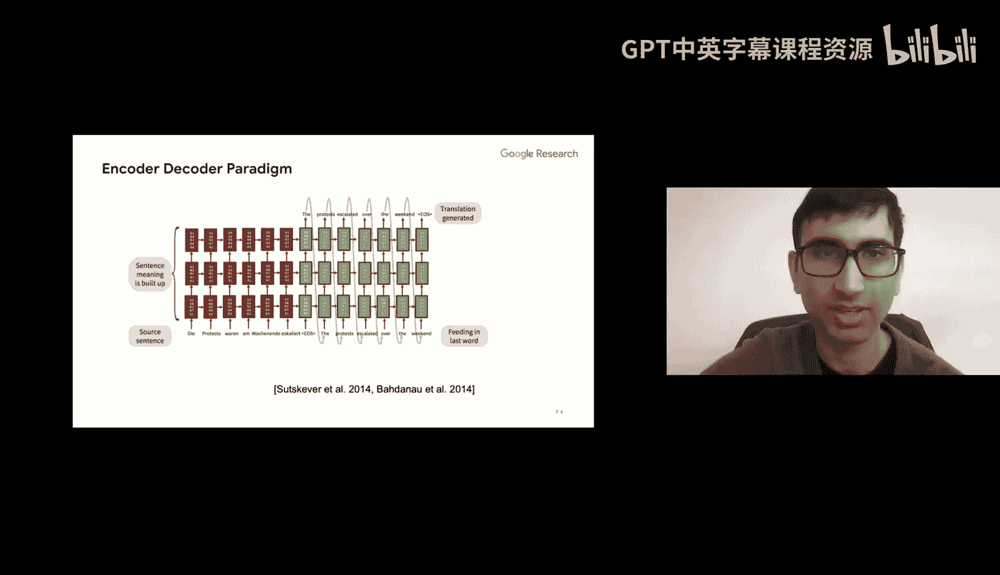

In German， and you can see that it's been this meaning of this sentence has been encoded using this neural network into these vectors。

 and now we have some encoding of the source， which is this blue。

And then this helps speed into the decoder， which is this green model， so given this blue。

 it helps influence it conditions on the green to help produce the green dense representation and the target tokens。

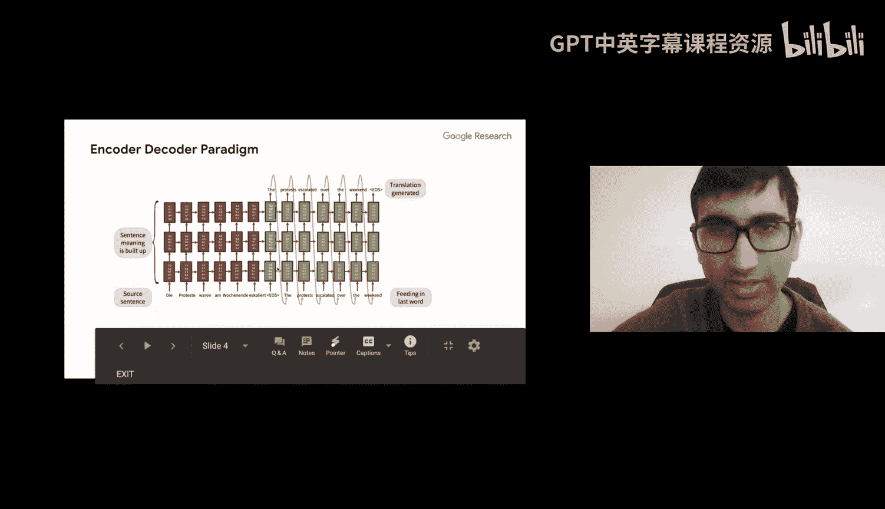

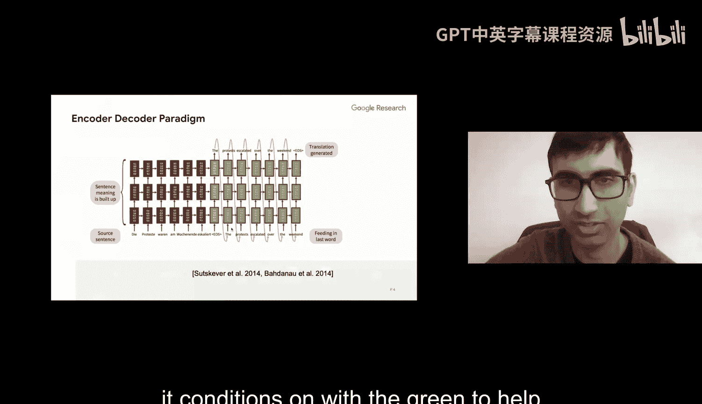

And I think for this talk， the exact details of how this works is not super important。

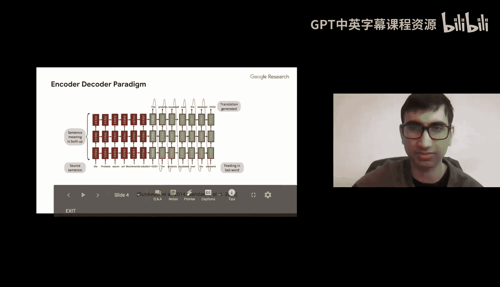

We're going to talk about。Problems that are kind of invariant to the underlying architecture and appear regardless of the type of architecture you use in these modelss。

So。What people have shown in recent years is that this strategy of generating Texas way is incredibly fluent。

You can build very， very big models if you've seen things like open AI GPT3 or things like that。

 which are very giant language models， which can generate kind of。

Entire paragraphs that sound very coherent。But the models are prone to hallucination。

Which makes them unsuitable for a lot of real world applications and we'll define what hallucination means on the next slide。

And what we're going to talk about this in talk is that how the hallucination is caused by different problems。

 which can be not just in models， but also in data and evaluation。

 and well propose ways of solving these problems。And I think。嘅。Okay。

So hallucination is basically when models generate phrases that are unsupported or they're contradictory to the source data。

So here， this is a paper from Harvard in 2017， and you can see that the goal of this task is you get a table of statistics from a basketball game。

And you want to generate the summary for this game。And so here。

You can see that what the neural model produces is on the right and it sounds very coherent if you ignore the colors right it talks about who won the game on Wednesday。

 where they played， what happened in the first quarter。

 then maybe what happened with different points and rebounds and things like that。

But when you actually study the actual pieces of information。

 you see that many of them which are all the ones highlighted in red are contradictory to the source table so the jazz did not defeat the rockets it was the other way around the scores are also wrong。

the model mentions a phrase like the rockets are able to out rebound the rockets 49 to 49。

It talks about them having an advantage in front of their home crowd， which is not true。

And lots of things like that。Or the Ja were led by Derek Fs and James Hardin。

 but James Hardin plays for the rocketets he doesn't play for the chestes。

And you can imagine that even if a model does this， you know， 10% of the time。

 it's unsuitable for a lot of real world for a lot of real world applications right and this has kind of been a main challenge in getting neural models adopted。

😊，Many kind of real world tasks。And so。This is not just limited to this data set here we see this is a。

task called Wikibio， where you get a Wikipedia info box of a person and you need to generate a one sentence description of this person。

And you can see that the model has hallucinated that Frank Lino is a criminal defense attorney。

 whereas this occupation is actually not stated in the source。

So there are many reasons of why models hallucinate。And the first reason is actually very simple。

 it's just in the data。So in kind of our effort to build bigger and bigger models。

 we need more and more data and the way we collect data sets is often very noisy。

And this is not often something we consider kind of in core machine learning。

 but it's important once we're trying to build models for certain real world tasks。And so here。

 for instance in Wikibio， the way the data has been collected is that I got the authors got 100。

000 or 500，000 examples， which is a lot of data， but it's all very noisy what they did was they basically took the info box and the first sentence of the Wikipedia page and pretended it was the target。

And you can see that the first sentence of the Wikipedia page often talks about lots of things that are not in the info box。

So here this person。Frank Lino， it's true that he's a sicilian American capitala regime in the bo crimeme family。

 but this is not something that's ever supported by the source。

 so when the model only sees the source table it has no idea how to produce these other phrases and it kind of is encouraged to hallucinate。

The other issue is evaluation。When you study classification or even kind of tasks like sequence tagging。

 there's a clear gold。Target to produce。And so it's very easy to measure accuracy。

This is not true in generation right so in generation I can have sequences that have different parts of information that have different synonyms。

 different other things， phrases that still make the generated target correct。

And typically what people have used in the past is blue。

 blue is a kind of Ngram overlap based metric， so blue will basically take the reference in the candidate and measure NgramM overlap and kind of heuristically determine a score。

And this is what people have been using for a long time， despite its simplicity。

 and what you can see is that。Blue kind of favors hallucination if the hallucination is very close to the gold label right so here the references about Michael Dalquist as a drummer in the Seattle band silkkworm。

And the candidate is that Michael Duckquist was a drummer in the California Ben Grateful Dead。

 which overlaps a lot of Ngrams， and the candidate is the same length as the reference。

Or almost the same and so it gets a very high blue score even though it's outputting wrong information。

Candidate two is actually correct， but because it's a more conservative estimate and it's a much shorter than the reference。

 blue doesn't like that it has based on the formula that computes it and so gives it a lower blue score。

 even though candidate two is better than candidate one。

And Canada3 is even better than Canada2 because it has more information it has higher recall。

 but it just happens that the information it's including is not information that was in the table。

 it's talking about where Michael Duckst was from as opposed to the band he's in which is also good information but blue also doesn't like having different information than what the reference has。

Um， so when we use kind of flawed evaluation metrics。

 we also encourage models to elicinate because people u hell climb on these metrics and basically report kind of models that have the best blue。

And。The loss functions like maximum likelihood lit， are also not useful to stopping hallucination。

Because。The way this loss looks right is that I'm I'm measuring the probability of the gold target y given the source x。

 and so if we decompose that into this product on the right。

 we see that I'm trying to predict the best Yt given the previous gold Yt and the x。

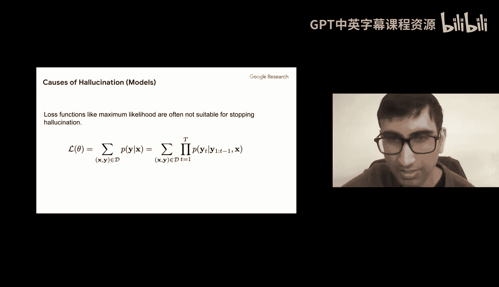

And。Since it's a probability， I basically need to do the best I can to maximize。

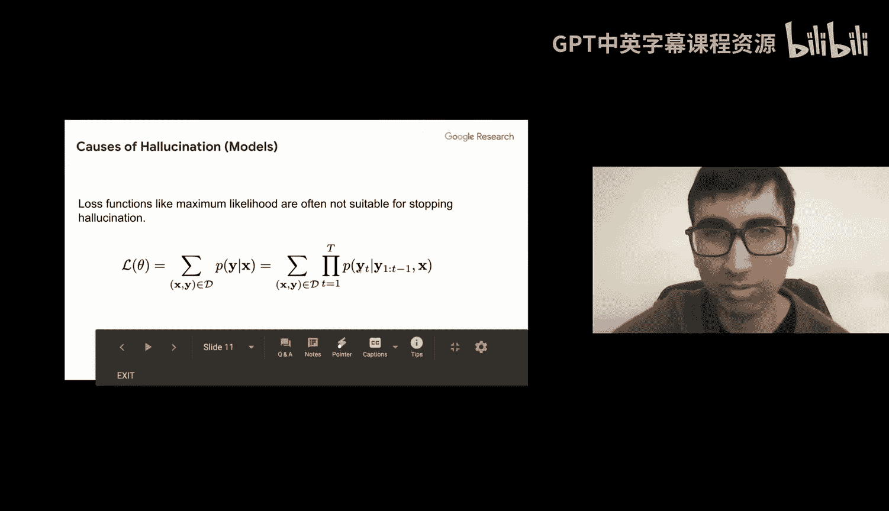

That that the goal token's probability， even if maybe I don't have enough information to generate that。

 so the model is kind of being encouraged to guess because it has no ability to kind of abstain from just outputting a token。

Which is what it kind of in some sense should be able to do to be more robust。

So what we've been doing in this team。For the last two years。

Is that we've been working on this problem， kind of from these three perspectives of dataval models。

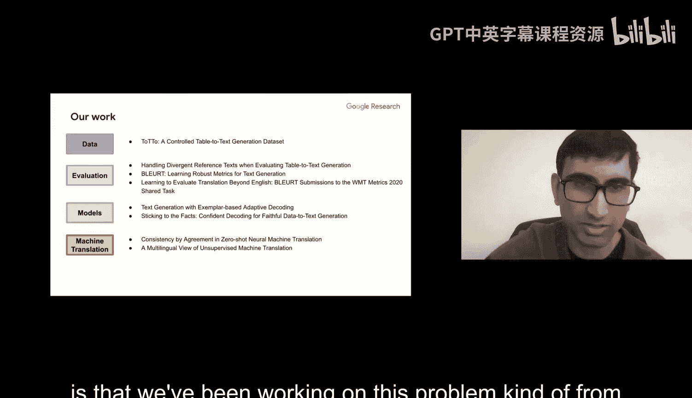

We also have an orthogonal effort on。Machine translation， which I won't talk about in this talk。

And basically， I'll just talk about one kind of one paper from each of these categories。

Is there any questions before I？

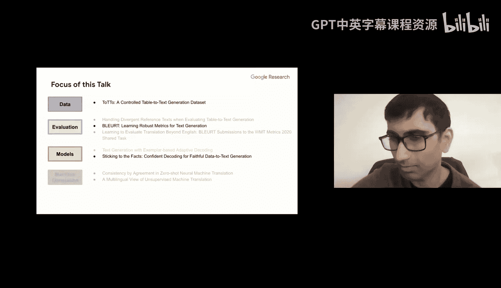

冇乜。

咁日。ok。I didn't quite understand your point with the loss function， can you go over that again？

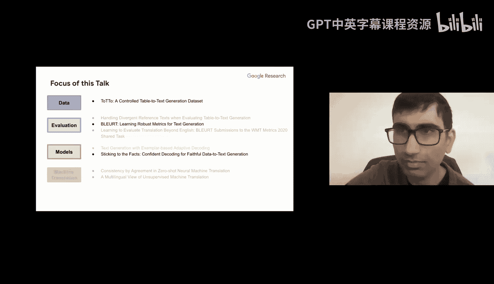

Yes。So。Sorry I'm using loss， this is like the likelihood right。

 so this is the data this is each example X Y。And I'm maximizing the conditional probability of y given x。

I guess there should be a lot here。约嘛？And then this decomposes in chain rule。 So this is the。

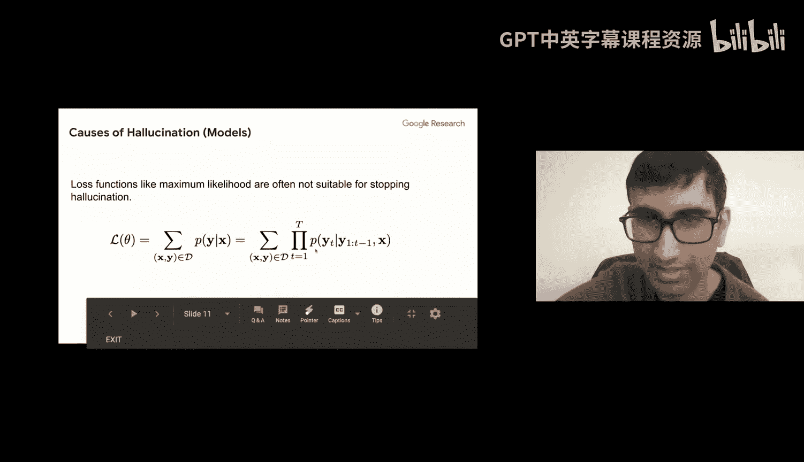

You're maximizing the probability of YT given the previous Y tokens and the source。And so。

Because it's like probability right， like you you cannot ever u if if I let one of the tokens be zero if I say that oh。

 I just don't want to guess Yt， then this probability will be zero and that will be bad， right？嗯。😊。

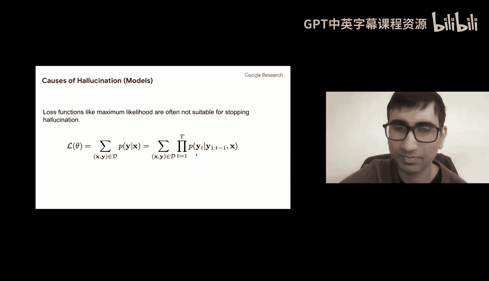

So I have to kind of max even if it's something that。For instance， here， this would be y， right。

 and this is x， and all of these tokens here actually cannot be inferred from the source。

But maximum likelihood is going to make me try to guess。

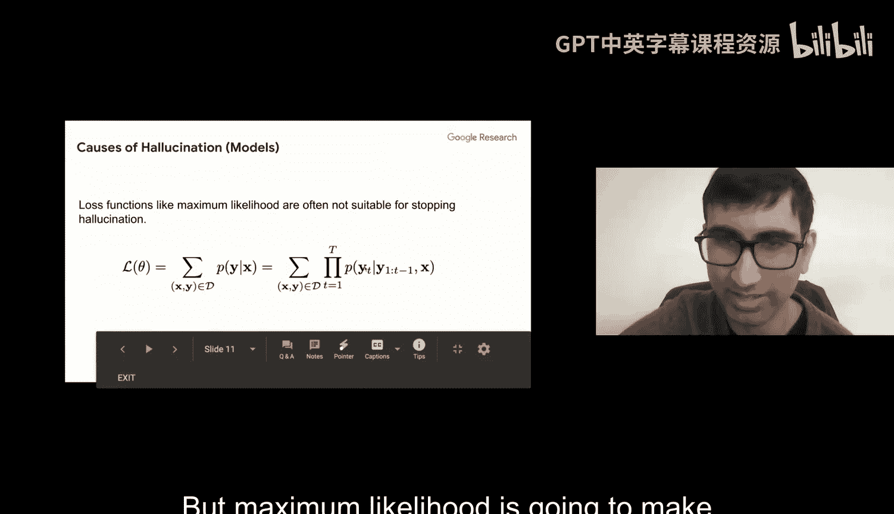

All of these tokens， even if some of these tokens are not easily are not able to be predicted by the model。

I don't know that thanks， yeah up okay。

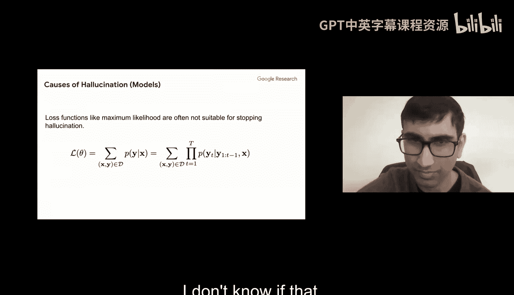

So。First I want to talk about some data， I never built a data set before before I built this one。

 but I think it's a very interesting experience so and you can find this data set is freely available at this link here。

😊。

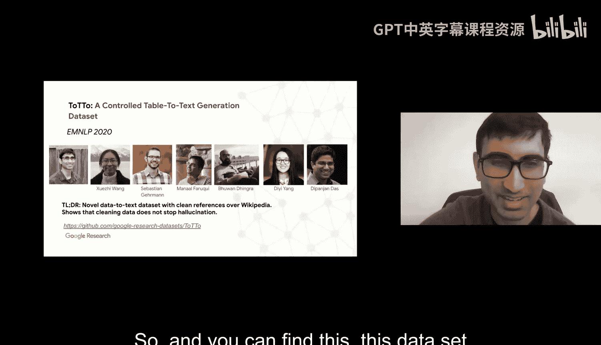

嗯。😊。

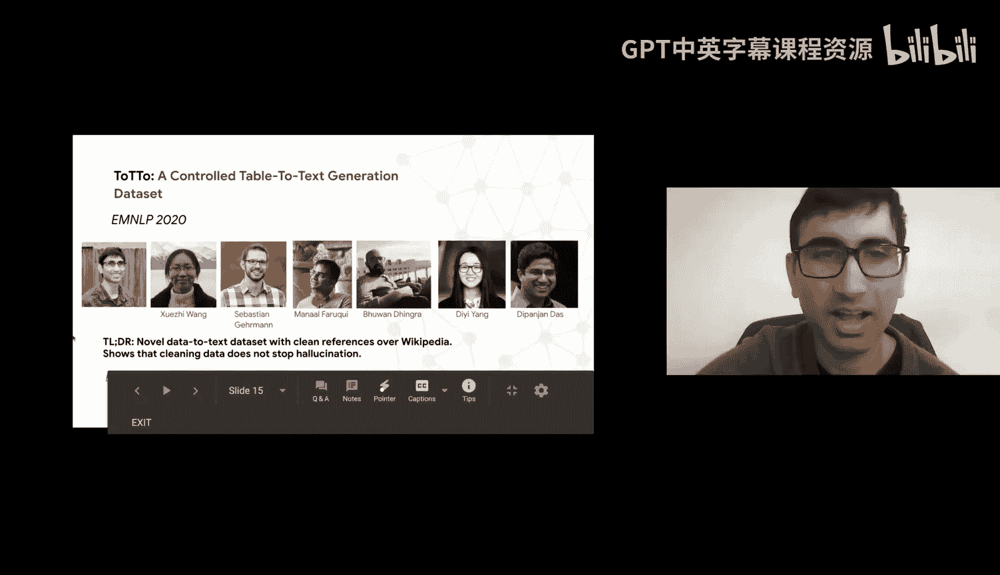

And so what we present is a control generation task to help us measure and study hallucination。

And in our control generation task。We have a source table。In this case。

 this table is about Robert Craig and his NFL football statistics。Some metadata about this table。

 like the table title， the section title and the table description。And a set of highlighted cells。

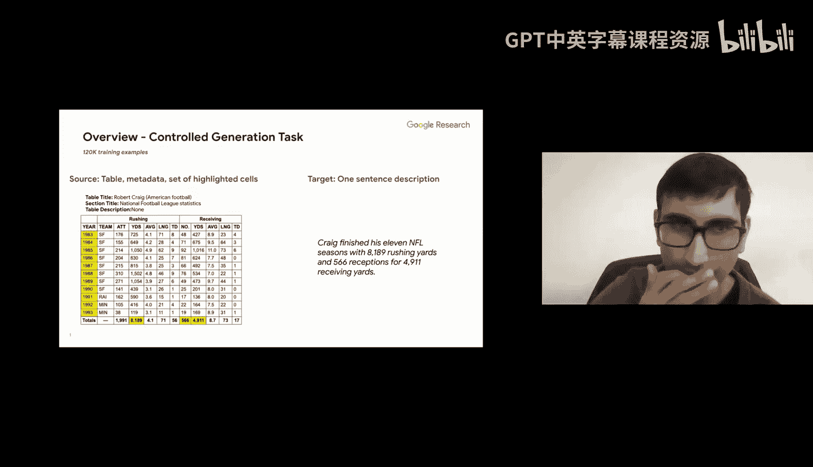

And the goal of the task is the model ingests all of the source information。

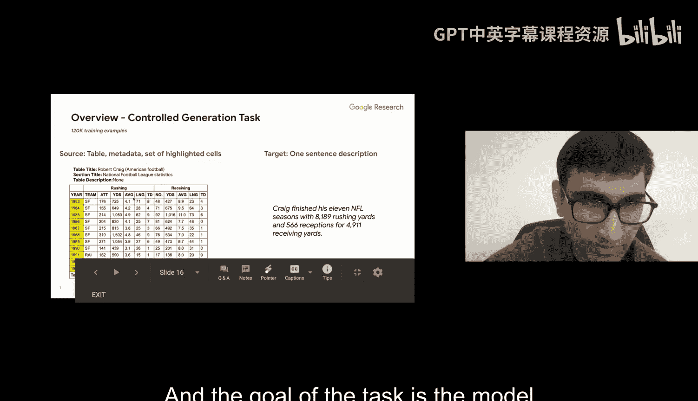

And it produces a one sentence target description about the highlighted itself cells in the context of the table。

So what we would say is that you can see that since the years that Robert Craig are played are highlighted and the yards and his rushing yards and receiving yards。

 what we should be talking about is kind of his total rushing and receiving yards over all of his seasons。

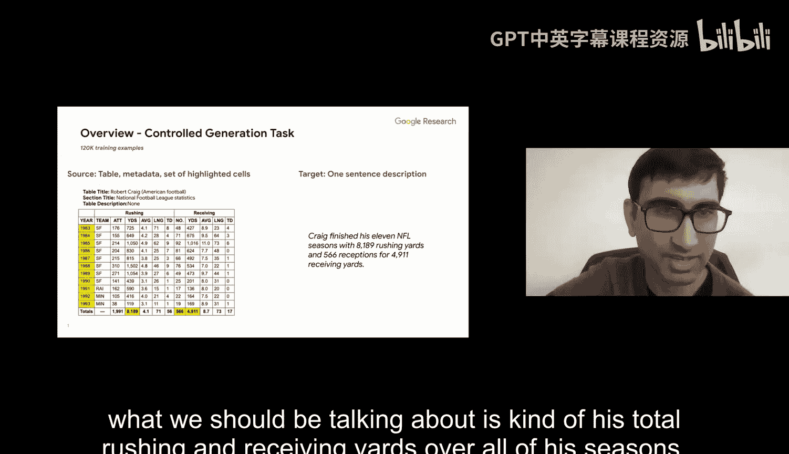

RightAnd so the goal target sentence is that Craig finished his 11 NFL seasons。

So Craig and NFL come from the metadata。11 comes from counting from 1983 to 1993。And then I get 8。

189 rushing yards。嗯。From copying the cell from the table along with its column header。

Similarly for the receptions。So you can see that the task kind of is a mix of copying different parts of the table with doing some inference over the table structure。

 whether it's counting。Kind 1983 to 1993， or it's kind of matching particular cells with their column headers。

Or it's interpreting what some of these column headers mean。

 like the model has learned to expand kind of YDS to yards。And。I want to。

 before I discuss how we build this data， I want to talk a little bit about why we wanted to build such a data set。

 right， And so one of the reasons I talked about is that。

A lot of existing data sets are very noisy right you have large scale data sets。

 but because they were collected in this heuristic way。

 it's unclear if the hallucination is caused by modeling weaknesses or by data noise so for instance。

 if we had clean data would the model still learn to hallucinate or would it not？And。

Another idea that you can do is you can just get annotators。To write sentences from scratch。

So they'll see the source data and they'll write a sentence from scratch the problem is that。

Annotators typically are not very creative so they will just write kind of the easiest kind of formulaic sentence they can write。

 so they would just probably write like Frankno was born in 1938 in graveson， Brooklyn。

 New York United States right and be nothing there'll be no kind of interesting language or variety that makes a lot of test challenging right and what we really want is something kind of like this where we have this 11 which was inferred from 1983 to 1993 which is not something an annotator would likely write from scratch。

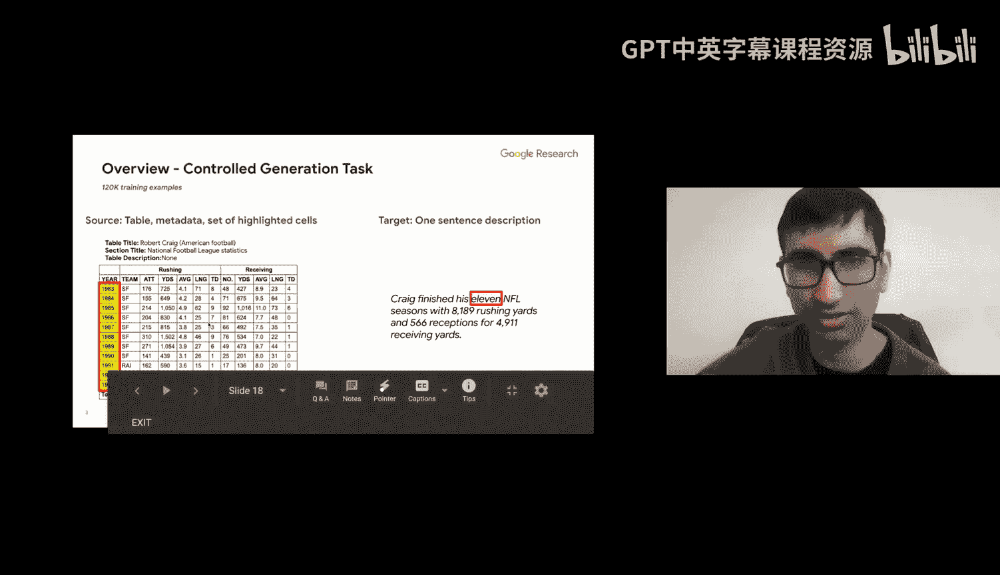

嗯。And another motivation that we have is actually in how we define the task。

 so if you define the task as summarization like what this data set does here。嗯。😊。

It's not very clear how to evaluate it right because given this table of statistics。

 there are many possible summaries I could have generated right and it's actually very subjective。

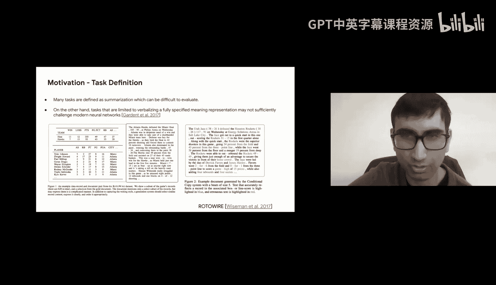

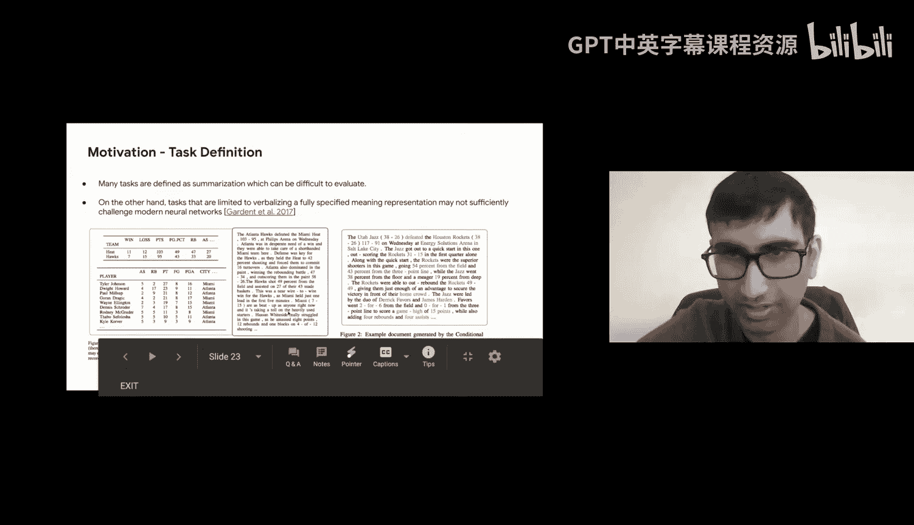

Which important pieces of information from the table are important in the summary and different annotators could come up with different。

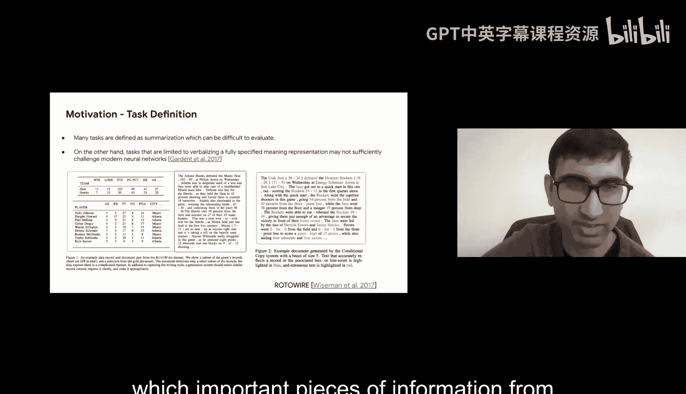

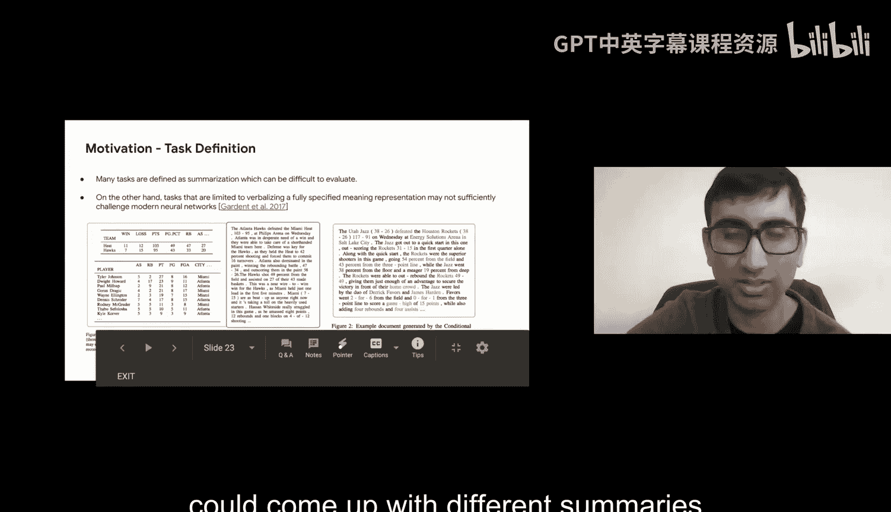

Summaries， there would be equally correct。And this makes things very difficult to evaluate。

 especially with automatic metrics。😊，And on the other hand， you could make it a very controlled task。

 you could kind of fully specify some meeting representation like a semantic parse and then just make a model produce a fluent sentence from that。

 but typically that's not very challenging these days to modern neural networks because they're already very good at producingent fluent text。

So our data is novel in two ways， it's a controlled generation task。And。

We basically have these set of highlight itself to give guidance to the model of what to generate。

 but at the same time as we've seen， the model still us to do inference about the larger table in order to actually get the gold target。

嗯。And our annotation process is also novel， we're basically going to ask annotators to iteratively revise natural sentences on Wikipedia。

 and this will allow us to preserve interesting language that you see on Wikipedia。

 but it will allow us to clean the sentences so that they're faithful to the table with the revision process。

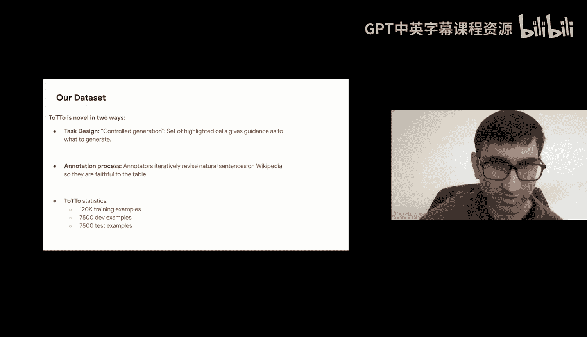

And this gives us a data set of about 120，000 examples after training examples with 7500 dev and 7500 tests。

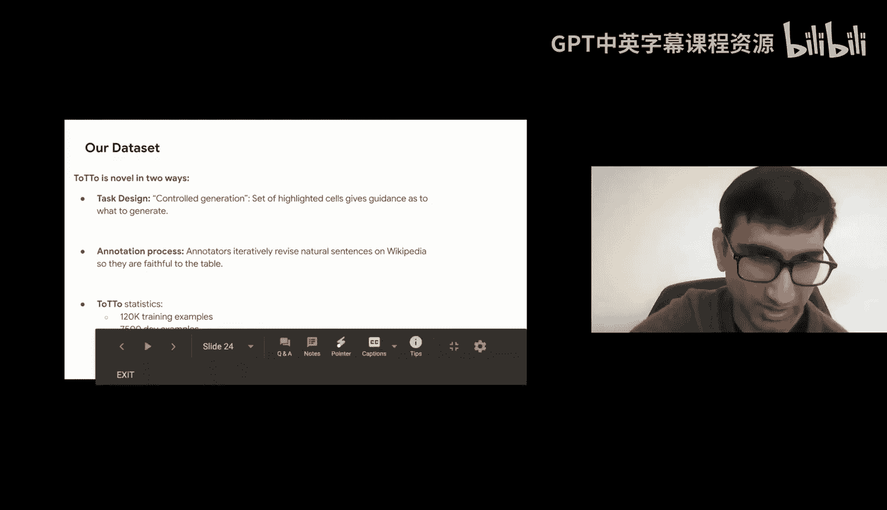

And so to get these data examples， we basically got a bunch of tables from Wikipedia。

And there you can see there are about different types of topics and they have different schema。

 which can make the data set more challenging。We then used word heuristics。

 like word overlap or hyperlinks to find sentences that might be related to the table。

So in this case we have a table about Gabriel Beckcker and we found a heuristic sentence we think。

Talks about this table。And the problem with this sentence is that just like the Wikibiio sentence I've shown you。

There's a lot of information that's not。Supported by the table。

 the table doesn't talk about that Gabriel Becker won the German under 23100 meter title。

It doesn't talk about that she was selected to run， there's nothing in the table about running。

 it could be that the relay is。About swimming or something like that。and furthermore。

 an additional complication is that since we've allowed any sentence from Wikipedia。

 the sentence does not standal alone， it can have pronouns or things like that。

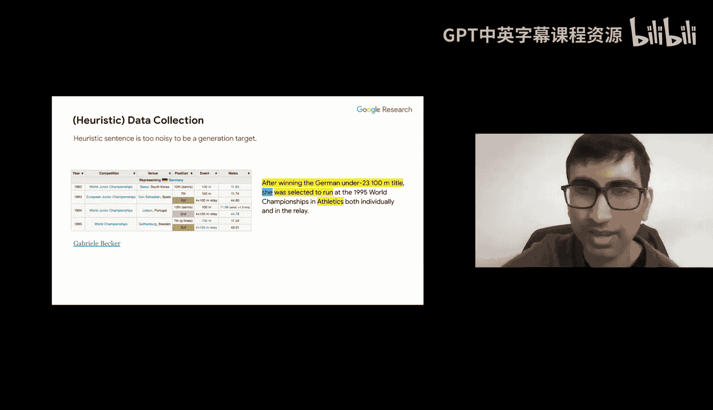

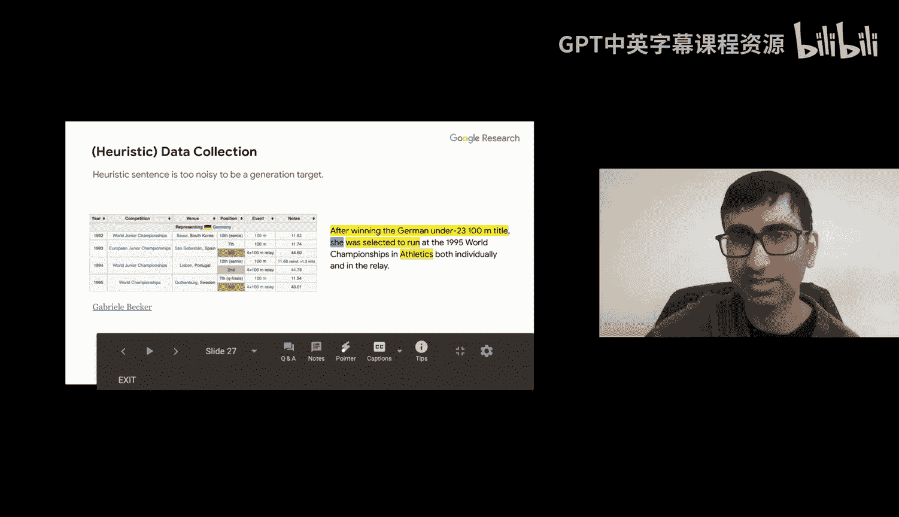

Which is highlighted in blue。So what our annotators then do。

Is they first have the table and the sentence and they highlight all the cells that support the sentence。

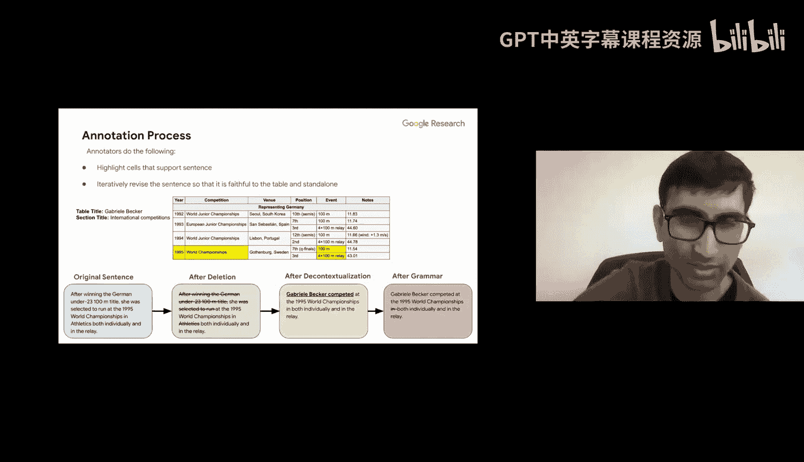

And so sometimes this is just highlighting kind of the words that are in the sentence。

 like 1995 on world championships。

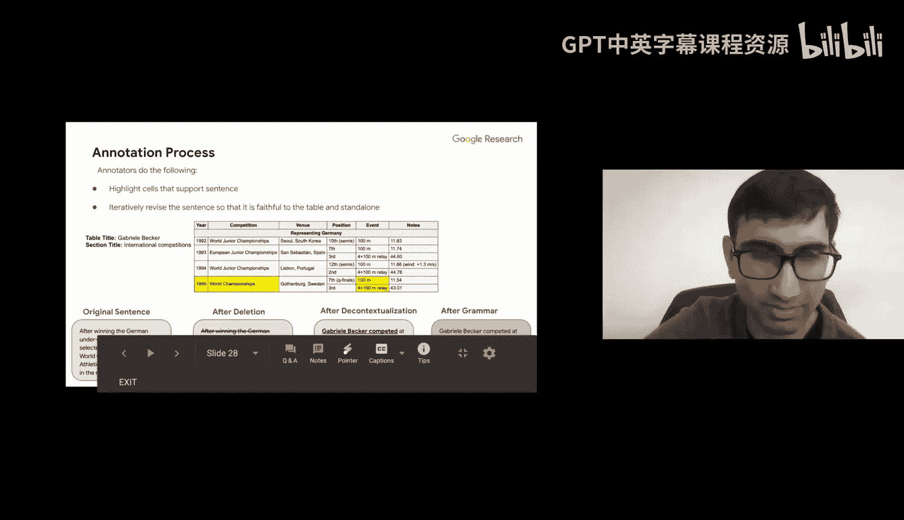

Sometimes there's some paraphrasing required or some inference。

 so here individually in the sentence is supported by 100 meter in the table and relay is supported by four times 100 meter relay。

And then the annotators basically clean the sentence and make it stand alone。

 so they delete all the phrases that are not supported by the table。诶。

And then they deconttextualize the sentence by。Replacing the pronoun with the Prorb rennoun Gabriel Beckcker。

And then they do some government correction so that it's a complete sentence。And so doing this。

 we get this data set with 120，000 examples， our target vocabulary size is about 136。

000 which is quite varied and there's 83，000 unique tables so there's。

Some some tables are associated with multiple sentences， but it's a maximum of five。

And we can see also here that the median number of cells per table is 87。

 so the tables are quite big and if we didn't have any highlighting。

 it would be very unclear what to generate from these 87 cells。

 but when we with the highlighting there's only about three highlights of cells per table。

And so that makes the task a lot more well defined。

And now we can measure some annotator agreement at every stage。So， we can see that。

After each stage the agreement goes down， which is what you would expect， so after deletion it's 82。

9 and it kind of gracefully degrades as you do more and more edits because you could expect that entertainnotators will defer more and more as the process goes on。

But still this annotator agreement is pretty high， so if you just copy if you compare the annotator with the original sentence。

The blue would be like in the '40s， which is much lower。

We can see that our data has a variety of topics as shown on the left。

 but half of the topics are sports in countries， and the other half are kind of more rare topics like literature or entertainment。

 etc。嗯。And then on the right， we basically took 100 randomly chosen examples and manually annotated some phenomena。

 so we can see that 21% require reasoning， 13% require comparisons across row columns or cells， etc。

So now I'll show you some baselines。Kind of at a high level， the first one。

 Bert to BRT is a pretrained encoder decoder model where basically。

 if you're familiar with BERT or some other types of pretrained models like GPD2。

 you basically initialize the encoder in the decoder functions with BRT。

And so the model kind of can adapt quickly。Then pointer generator is a normal seek to seek LSTM based model with a copy mechanism。

 pretty which is a pretty popular baseline in data detect before birth to B。

And the last model is kind of a specifically designed model for data detect with content planning。

Which was designed for Roto wire。And we have three metrics。Blue。

 which is a standard engrammetric which I talked about。

 and then we've proposed two metrics and the best one is called parent。

 which is an engrammetrics specifically for data to text and blur。

 which I'll talk about in the next section which is a learned about metric。

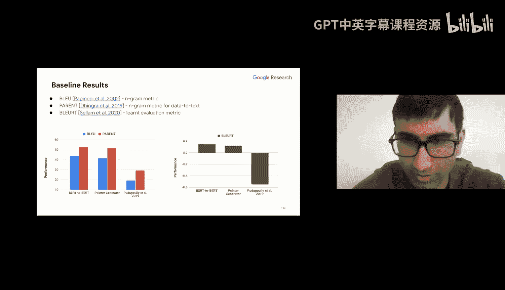

And with these baselines， you can see that all the metrics are completely。

 they rank everything similarly。嗯。🤧Yeah。It brings the B to bird model the highest followed by the pointer generator and followed by the content planning model。

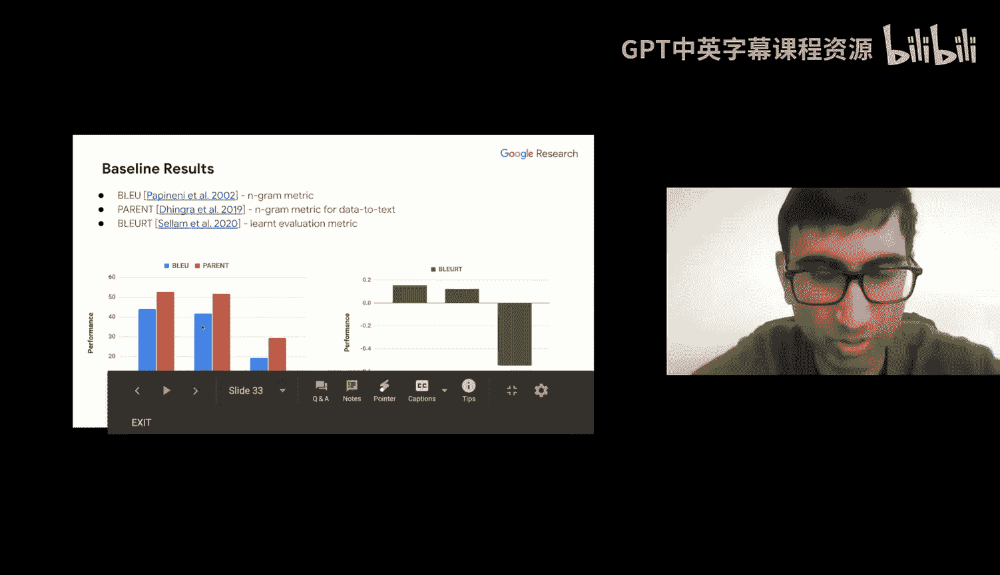

You can check our we have a leaderboard for this data set and you can see that I think for the most recent submission。

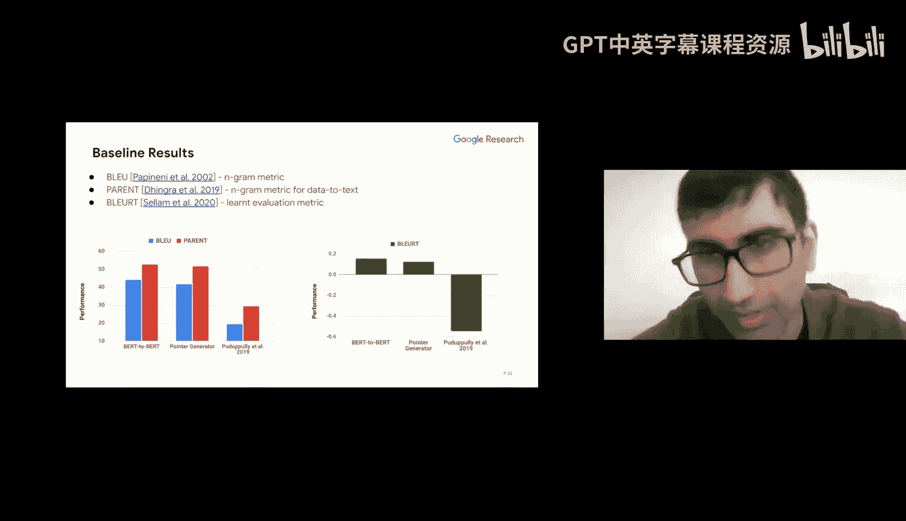

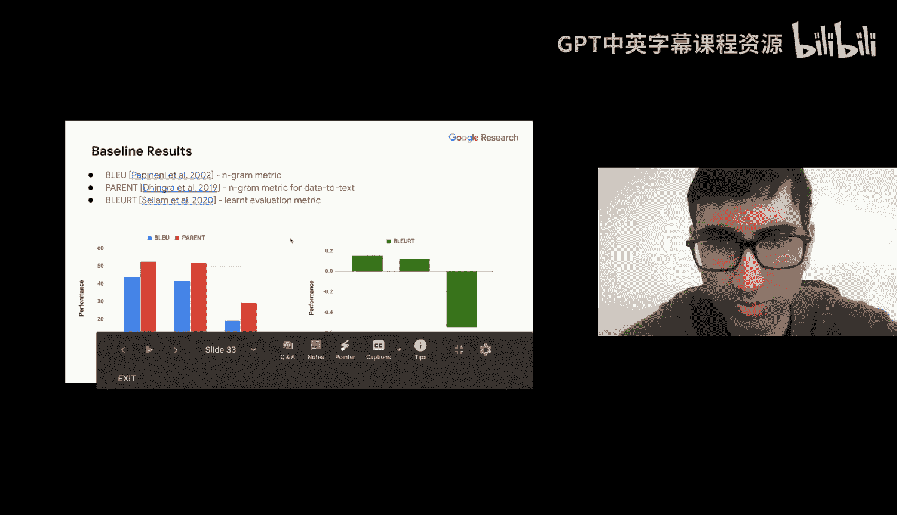

The metrics don't completely agree。嗯。We also did some human evaluation because no automatic metric is perfect for generation。

And so we compute an orac copper bound， basically our dev set has three。References for each example。

 we hold out one of the references and pretend it's a model prediction and ask the human annotator to compare it with the other two as well as the table。

And we see that the oracle is a 99。3% fluid and 93。

6% faithful faithful means that it's only outputting information that's supported by the source。

So 100% faithful would't mean there's no hallucination。

We can see that the bird to bird model is less fluent， it's 88。1% fluent。

 and it also hallucininates considerably more， the faithfulfulness is 76。2 versus the oracle of 93。6。

And this answers kind of the one key research questions in this stock that neural models hallucininate。

Even when you have clean data。And in the next couple sets。

 I'll kind of show you some examples of why they still hallucinate on our data set。

Indicating that it's kind of a challenging benchmark。So。

One area that models really struggle with these days is rare topics。

So this table is about microdves and about how microdves have increased in capacity as the years have gone by。

And we can see the reference outputs something very interesting。

 like a second generation of microdrivers announced by IBM。

In 2000 with increased capacities at 512 megabytes and 1 gigabyte。

The model prediction on the endman doesn't really understand this table in this topic very much。

 so just as there were 5 12 microdve models in 2000。And so can we see that one。

There's multiple kind of causes of hallucination here， one is the rare topic。

And also the other is that the reference has some interesting inference。

 right like second generation or increased capacities。

And these are things that are inferable from the table。

 but if the model doesn't learn the proper inference， if it's not learning that。

 then it won't understand itll just learn to guess or hallucinate instead。UAnd we see something。

 sorry。I thought someone asked question。Yes。😊，Hello。

I think someone un mututed themselves by accident。Okay。We see here that。

The prediction here is correct。But it's very boring and basically just copied the table cells。

And it said Kel finished the 2012 season with 45 receptions， et cetera。

The reference is much more interesting， it says that this was Travis Gilkis's last collegiate season。

 which you can infer from the table in that he had personal career highs in reception。

 yards per receptions and receiving tests。嗯。Yeah。So in summary， this is our data set。

 and we would like you to try it out， you can feel free to contact us if you have questions or suggestions。

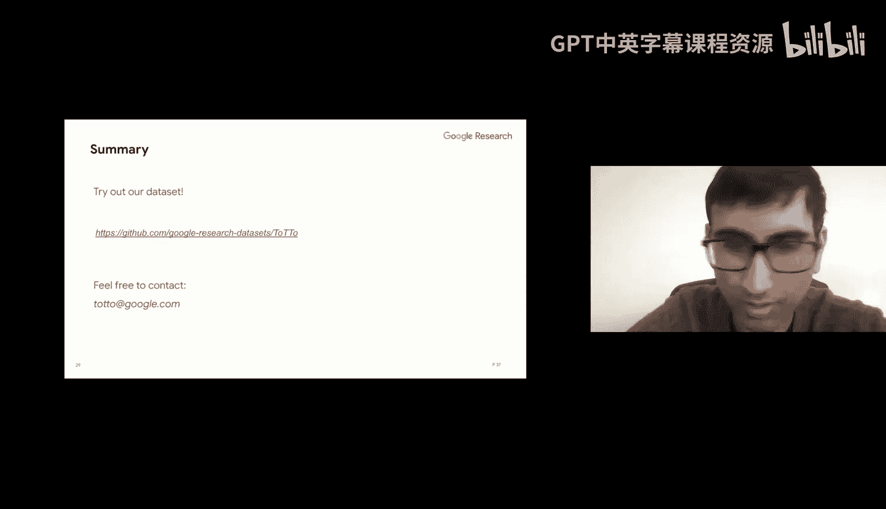

Okay， are there any questions before we move on to evaluation？No。Okay。Okay。

So we talked about how we can clean data and how we can build more challenging benchmarks。

The next question is how we actually evaluate these generation models。

And this has become a topic that's become very interesting to the research community recently because neural models are performing in a way that blue is no longer kind of distinguishing models correctly。

And we can see from this example why metrics would be a bottleneck to generation progress。

Because depending on what you're actually looking for in the metric。

 you may have a different criteria right so here in the first example the prediction is just completely off from the reference。

 it's incorrect， the word overlap is low， you can expect that blue would give it a low score because it's just very far off from the reference。

But in the second example。Everything is right besides the numbers right like eight is eight and six are correct。

 but sorry， eight and six are what the model predicts， but the reference has six and five。

So blue would probably be a very high， give it a high score， but this is clearly wrong。

 so we want to give it a low score。And the third example is actually subjective， right。

 like both the prediction and the model are correct， but the reference is in some sense better。

 it's more informative。So we may want to have a metric depending on the application that kind of rewards。

References that are predictions that are more informative。

And what has become exciting these days is to use learn metrics。

Which is kind of putting classifiers and metrics kind of on the same playing field。

RightSo you would also to basically train your metric， you would have data。

 which is human ratings data， you would get human annotators to evaluate model outputs。

And you would have data and then you would use kind of a standard transfer learning approach like maybe you would take a pretrained a large pretrained model off the shelf like Bert。

 you would fine tune this model on some human ratings data。

And then you would have this kind of learned metric， and so now to evaluate your model。

 you would also be using another model。嗯。😊，The problem is that this is brittle。

And it requires a lot of this human ratings or fine tune data for every new and data set and tasks that you have。

And the advantage kind of of blue or Ngram based metrics that people had been using in the past is that they're very easily portable to every task that you could think of。

So。Here we talk about how to kind of help bridge this gap。

 so we still want to have an end to end metric。

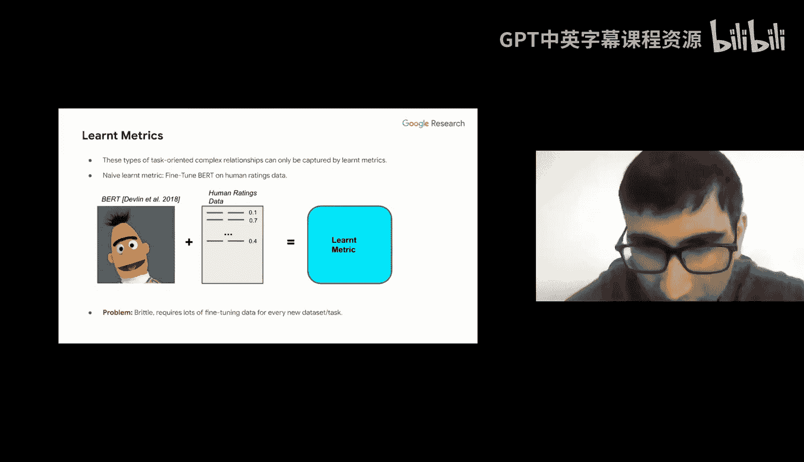

But we want a metric that has fast domain adaptation to other domains and is robust to train testcu。

That would make the metric robust over time。And what we propose is something simple。

 we propose to basically have a synthetic data。Additional pretraining stage where we generate synthetic reference candidate examples that we think simulate what a model would look like。

 what a model would see， along with scores， which are also computed by various heuristics。

And this builds a lot of representation knowledge， and then we basically fine tune it on some human ratings data to get our final classifier。

And we see that this， at least when it was published， it got state of the art results on both WMT。

 which is a machine transition。Evaluation set as well as Web energy。

 which is a data detect text evaluation。So the first question is how we would generate synthetic data。

And we want to generate pairs that resemble reference prediction pairs。So here I have a reference。

 which is I bought soy milk from the store on Tuesday。And。You know。

 the right kind of shows typical errors a model would make， it may delete some words。

 it may replace kind of the day of the week with a similar of a different day of the week。

It may add some adjectives， it may have some repetition like on Tuesday on Tuesday。

These typical errors are not found in existing paraphrasing data sets。

 so we can' just use some existing data set that exists。

So instead we use synthetic data and the way we generate synthetic data is we basically randomly mask text。

So we mask out you various words， and then we employ a pre chainne language model like Bt to fill these masks。

And you can see you can take random mass， you can also take contiguous blocks。

And the other strategy you use is something called the popular in the Community back transition where basically you can get a noisy paraphrase by taking it off the shelf transition model and you can。

You take an English sentence as you translate it to a different language。

And then you translate it back and you will get some nice linguistic variation usually。

By doing this kind of procedure， and so it'll get you this kind of noisy paraphrase。

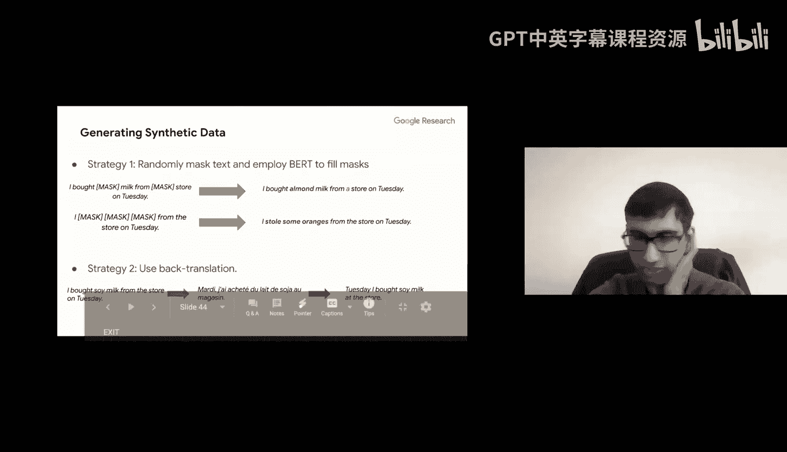

We then have a bunch of multitask signals。

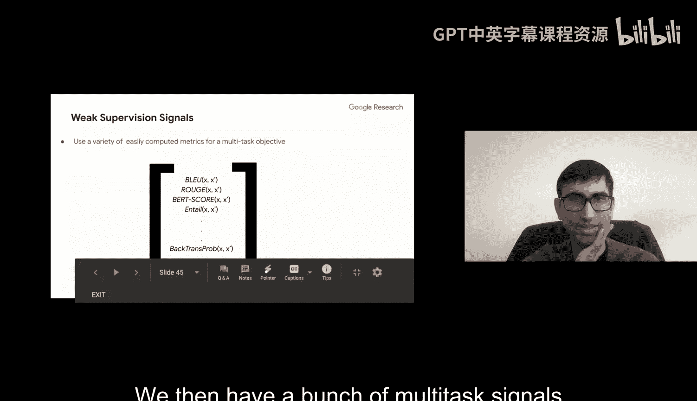

That we use for noisy supervision， so blue Rouge B score。Which is another learned metric entailment。

 which is。A different MLLP task back transition vul， a lot of metrics like this。And we compute。

 we perform the pre change。

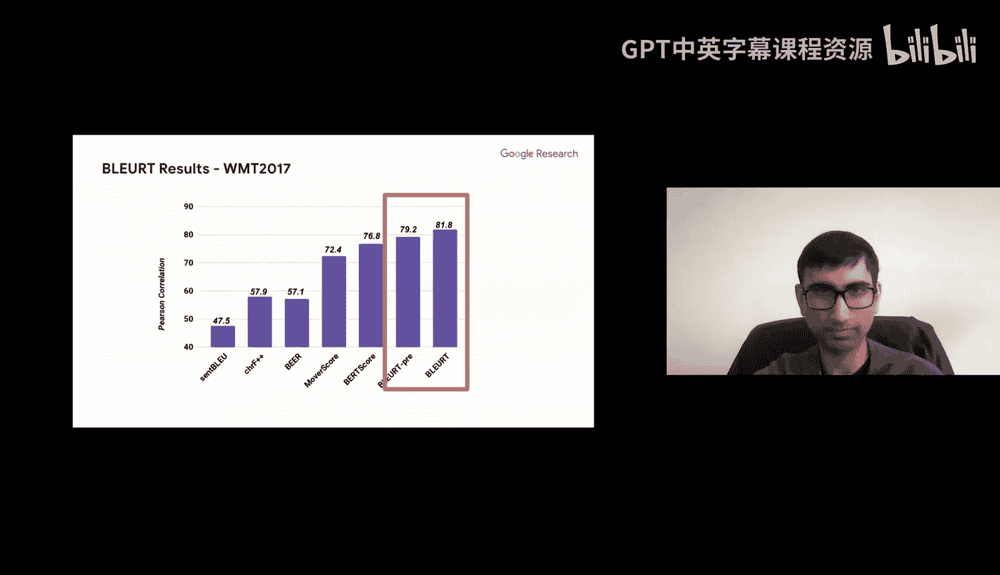

And then we find tune on the small amount of human rating data that we have for the task or domain。

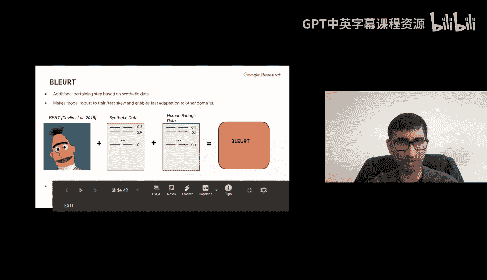

And。Now what we can see is that blurt minus the synthetic pretraining。

 which is basically just doing the vanilla fine tuning on the rating data already is actually a state of the art。

But when you add the pretrain， it goes up an additional two experimentear。

And this is a considerable gain， but not like very large。

But once we stress test the model and sort of robustness in SU。

 we see that the synthetic pretraining really helps a lot。

So what we do is we skew the training set toward lower ratings。

 which are worse predictions and the test set toward higher ratings， which are better predictions。

And we see。We only trade the model on the Sd training set。

 which has lower predictions if we can distinguish them among higher predictions。

And this is kind of important because you can imagine that metrics。

You know you want to fix metric maybe over some time like a year or two years and the models are getting better in this time right so the data you train the metric on has weaker models than what kind of more recent models would have right。

And we can see a kind of a picture of this on the left。Where we have this sw factor。

 the skew factor is skewed the training distribution to the left。

 and it' skewed the test distribution to the right。

And on the right we can see the effect of the pretraining so blur no pretrain you can see that the blue kind of the light blue to the dark blue is blurret under various degrees of skew and you can see the performance decreases considerably as you increase the skew whereas on the right you can see with pretraining the model is very robust so except for the very large skew which is the very dark blue the model is actually fairly robust and you can see the lines are clustered together。

This is a web energy result where we see。On a different data set。

 we basically see how quickly a model can adapt to a different domain。

And this is a little bit of a confusing of a picture。 But if we look at the bottom right。

We see that basically what's happening is so there's two halves。

 the left half is where we created the train test play by system。

 we held out certain models or systems in training and tested on those in test。

And the other way of splitting the data set is by input， so by the actual reference。

 so the models can overlap in train and test， but the actual examples cannot。

And we basically see that。

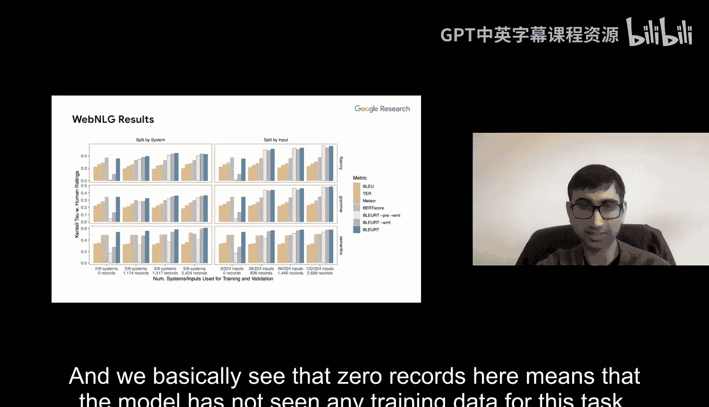

Zero records here means that the model has not seen any training data for this task。😡。

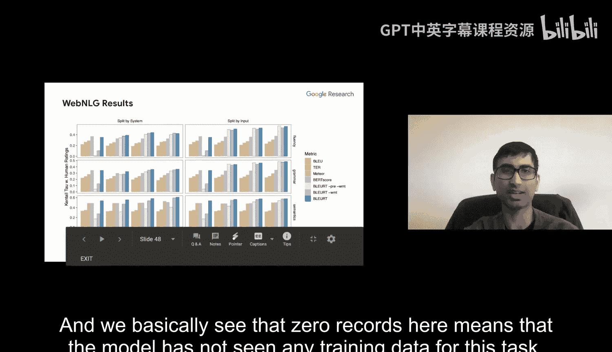

Right so we can expect that blue， TER， meteor， these are all and Gr based metrics。

 they perform the same regardless of how much in domain data you have。But。And birth score。

Right blurt minus pre minus WMT is basically just like burnt out of the box right because there's no rating data。

 there's no fine tuning or anything， so that's the white and or the very lightest blue。

 you can see the performance is not very good。Once you add the synthetic pretraining。

 but you remove the WMT data， you see this is the light blue。

 you can see the performance is a little bit better and once you see once you add the WMT data you get the full blurt and you can see that the model even without any。

Domain specific data on WebMLG is already getting kind of tied with state of the art and then as we move right in the graph。

 we're adding more and more data like 836 records， 1，400 records。

 2600 records and you can see that all the blurt models adapt very quickly obviously and get state of the art。

Are there any questions about our metric？We encourage you to try this metric if you are working on any texture direction。

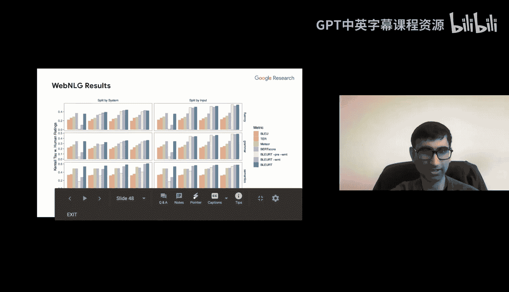

And let us know if you have any concerns or questions or shortcomings you've seen。诶。

Are there any questions or can I move on to the final portion of the talk？O。嗯。😊。

So let's say I want to talk about models。And this is a little bit more technical portion of the talk。

 maybe than previous。This is work that's led by R Tan in our team。And。

I've been showing this example quite a bit。Here we have this task to generate this。

Target sentence given the source info box。We see that the reference contains a lot of information that can be interpret by the source。

 the baseline hallucininates this person's occupation。

What we would like to do is produce a correct sentence， right。

 a sentence where everything is supported by the source。

 even if it's a little bit more conservative than the baseline and it's maybe shorter than the baseline and it has less information。

 but everything we want to say should be correct。And I want to give you some intuition as to why。

This model hallucininates。So。Our intentiontuition is that there's three types of tokens in the target sentence。

There's tokens， which are temptic worse。They do not convey any source information。

And if I trained a language model on just the targets without looking at the source at all。

 I would learn some of these patterns and learn how to generate some of these words。

 right like all people that are born at a certain time and the model always uses born you know after the name of the person。

In other words like is in commas and things like that。On the other hand， content words。

 which are faithful to the source， require the model to attend and pay attention to the source and use source information to generate the target。

Hallucinations are typically contentduit words that are not closely associated with the source。

So academic author and radio host are not things that an unconditional language model would easily generate。

 but they're not in the source either。So。What we want to do is we want to build a model that defines a per token confidence score。

That's high if the token is tempemplaatic， which is a word that's blue。Or is supported by the source。

 which is a word that's green。And the confidence score should be low if it's not a template court。

 it's not supported and it's not supported by the source。Which is the red words。

And so now the question is how we want to mathematically define the score。诶。So the blue one is easy。

 we basically just say the word is symotic if it has a high probability in your base language model that's not conditioned on the source。

So if we train a model just on the targets。And we don't look at the source at all。

And if the model can still reasonably generate these words， then they're considered template。

Other one， the green one is trigger。So， and this kind of depends a little bit on the architecture that you're actually considering。

嗯。😊，Basically， you can define this probability Yt given the previous tokens and x。

As a softmax distribution where you basically take。The decoder state at  timeing T， at position T。

 you take a dot product with the embedding vector of the token。

 and then you normalize over all the possible options in the vocabulary。And is new T。

 we assume zoom is decomposed into a sum。Where AT is the attention vector。

 it's a function of the source。If you're familiar with neural attention。

 this is basically a weighted average of the source states。

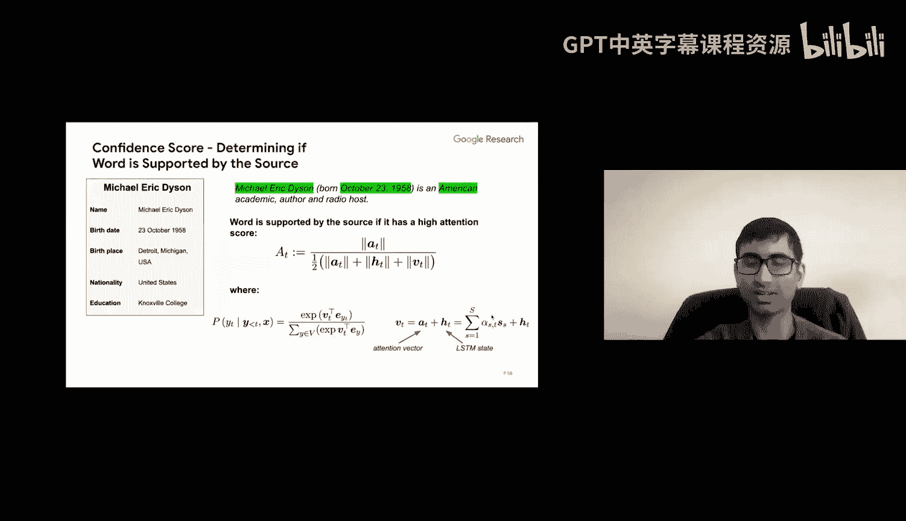

An HT， which is kind of the decoder LSTM state if you're using an LFT。

And I think the details don't matter so much except that AT is basically a function of the source。

 whereas HT is not really a function of the source， I mean it indirectly depends on the source。

 but it's only kind of vaguely related to the source。

And we're defining the attention score to be high if AT has a very high norm relative to H。

Which means that the model is really using the source tokens to influence the decoder state to make the prediction。

And then we basically kind of take the or of this， which mathematically is an addition right。

 so the confidence score at position T is high if A is high。Or if。The base language model scores。

And。The issue is that。

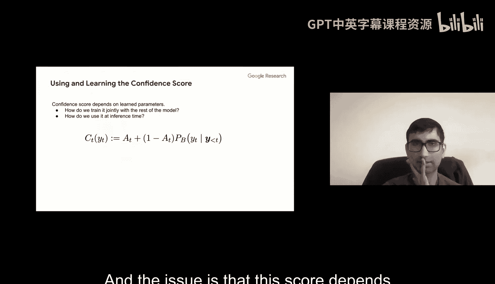

This score depends on some learned parameters， right A0 is a function of the model parameters。

This is also a language model， it's a function you know， if you want to train it jointly。

 it's also a function of parameters。And we want to train it jointly with the rest of the model。

And we also want to use it edit for instance。I'm sorry someone has a question Su。

 if you just want to unmute。Hi， can you like explain the ememp word part Again。

 I didn't got it actually， Yes， so。Tyemptic words are like， kind of。Words that are。

Let's say you had this language model here。You can see it's not conditioned on x right you're basically predicting Yt given the previous Ys right so it would be like predicting born given Michael Eric Dyson right and in this data set it's all about people right and all the people are always like。

It'll always talk about where they're born after their name， right？

The model doesn't ever need to see the table to be able to generate the word born。😡。

Given the previous words， so it sees Michael Eric Dyson。

 it knows that what it should say next is born regardless of when this person was actually born。

Similarly， once it's done saying the date。It knows that it should output like a verb。

Like is there something because。That's what all the other sentences and the data has。

 so that's what it knows what to do， regardless of what the actual source table says。

Does that make sense？Yeah， I get it no yeah thanks yeah and this is in contrast to the other words right so October 23r。

 the model couldn't generate just based on the previous document it would have to look at the source to be able to know that it's this particular date that he was born。

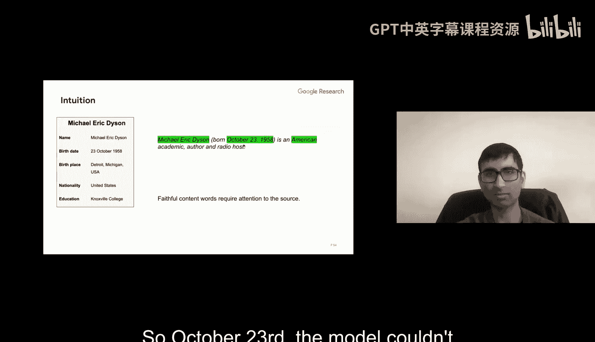

There's a chance that you would generate this date without looking at the source just pretty low given the number of possibilities？

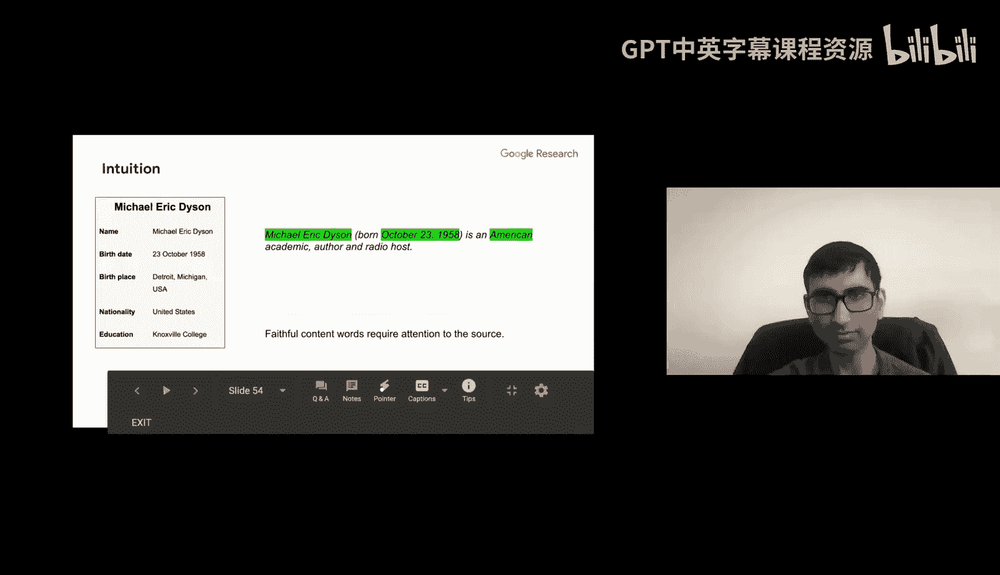

O。So now there's quite a bit of me here， which I will kind of just hand wave over。

But basically it's a little bit like EM right， so you can imagine this confidence score is a bit like a latent variable。

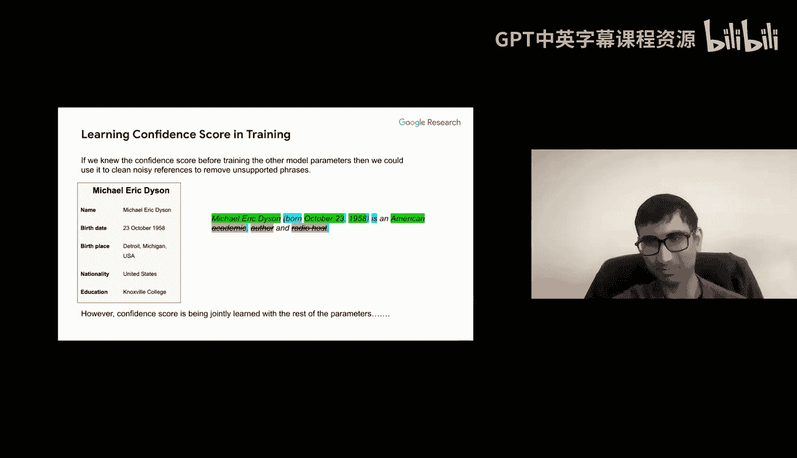

And。If I knew what it was。Then。I could basically clean up the data to remove unsupported phrases。

So if I knew that for the confidence score， every position。

I could basically just know that these have low confidence score and I could remove them from the data。

But I don't know because I'm training the confidence score with the model。

So we do some sort of variational base objective to kind of alternate between sampling confidence sub sequenceequences and training while learning the confidence score。

 and this is a bit like learning latent variables in graphical models。

RightSo here what we're doing first is that。Given the current iteration of the parameters。We。

Sample a confident sub sequenceequence based on the current confidence score to trainer so we have the sentence。

And every we have a current confidence score at every position。

We sample kind of a sub sequenceequence to keep。Which in this case has decided to skip these three things。

 which have low score。And we have this sentence and we train the model on this sentence as if it was the actual target。

 and then we use that to update the confidence card。And this is a bit like this is a bit like EM。

 like you're alternating between the sampling and then between performing this optimization。

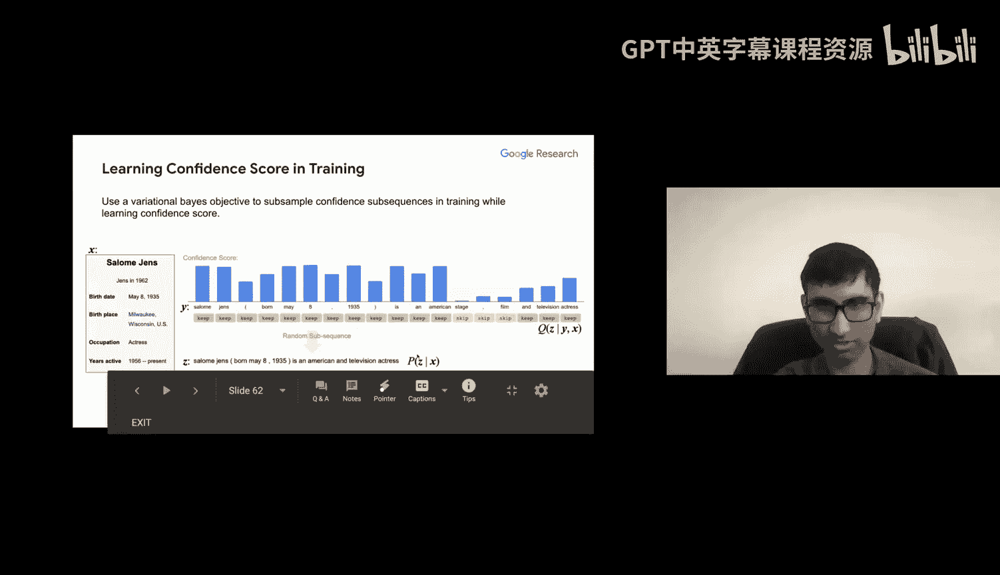

And we also have a calibration trick， which we got from Braverment at all。

 where basically you can have an additional term to the likelihood。

So there's a normal likelihoodlude term， but then you can have an additional term that calibrates probabilities。

So， here。

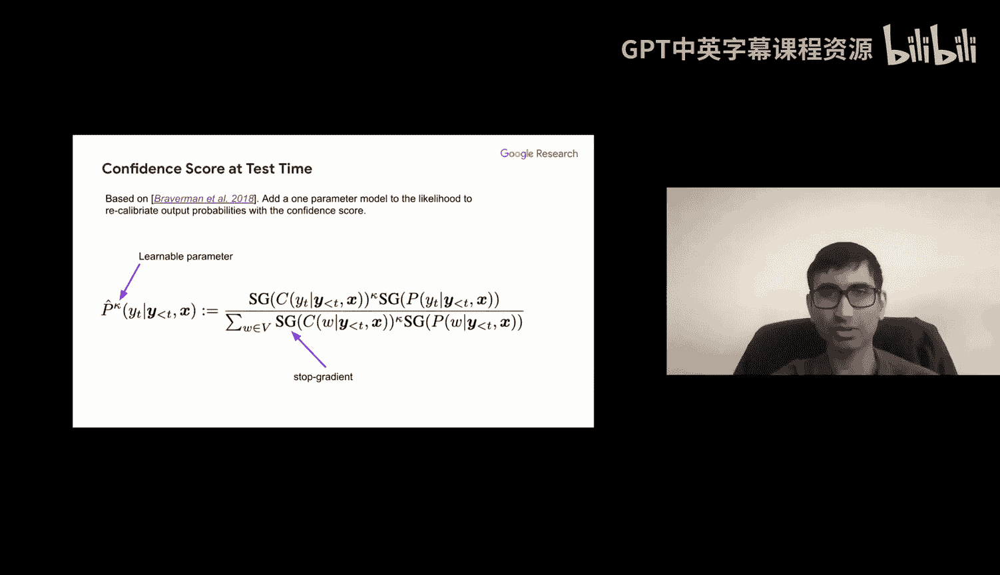

In this additional term， there's nothing being。There are no parameters that are being learned except for this ka。

 everything else has a stop gradient。So there's no。

 the gradient is not passing through C or P or anywhere else， on it's only being used on KaA。

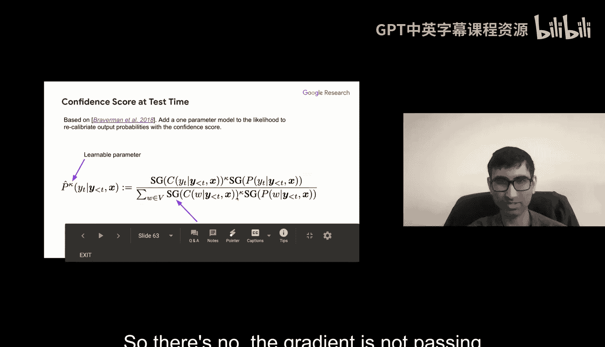

And you can see all of this confidence score is doing。

 it's reweighting the output probability distribution based on the confidence score。

So it's kind of adjusting it a little bit and when ka is zero， that means that。

You basically result to the normal， there's no modification。And typically。

 the model will learn a value of k that's not zero。

So we have some experiments I'll just show the Wikibio ones here our model works with different types of。

It's a method like it's a decoding method so it works with different types of underlying architecture architectures。

 so we show out what works with pointer generator and with a bird encodeder with an Lte decoder。

And then。We have some about metrics I'll focus mostly on human evaluation because that's the most accurate so。

We can see that when we run the human evaluation on faithfulness。

We consistently get more faithfulness with confidence decoding。

 so it's about here in the confidence for pointer generator moves up from 80 to 86。诶。And。

It also for B to LSTM， it moves up from 75。6 to 79。4。

This comes with some drop in blue because the model tends to output a shorter sentence。

 which blue doesn't。

The fluency is kind of similar across all the baselines。嗯。😊，As I mentioned。

 we do get a minor coverage drop from this conference decocoding because it's more conservative。

So you can see that the pointer generator is 39。4% coverage and the confident one is 37，28% coverage。

But there are ways to basically alleviate that， you can use a length penalty to force the model to produce a longer sentence and have more coverage。

 but this sometimes reduces the fluency。So they're always trade ups。嗯。

So this is kind of the main topics I had for today。嗯。And we talked about hallucination。

 we talked about solving hallucination in a multifaceted way from the perspective of data inval models。

And here are some links for the things I talked about。For the data set as well as blur。

And thanks a lot for your time。If there are any questions， feel free to about any part of the talk。

 feel free to。I have a question on the blurt。Yes， so I'm curious how well the blurt score。

Transfers to like different domains or even different。

Like how can you adapt that score to say a different domain or a different language when evaluating generation。

 like is it restricted to a high resource domain？No。

 right so we have kind of because of this pre traininging。

We have basically made like transfer learning makes things adapt fast with less data right。

 so when you do more transfer learning with this synthetic data。

 you need less kind of in domain data to be able to perform well。

So typically， if you had label a couple of hundred examples。For your domain。

 it will transfer to that domain。I see language is different because。Language， like if you use BRT。

 like the the English birdt and you also have English synthetic data， then。

You know it's not seen any foreign language right so that's pretty far off so it can't adapt like that we have we have multilingual versions of。

Of blurt that we submitted to WMT， I don't know if they're。

I think they're not publicly available yet。Yeah。We do have some multilingual things in the works。

Where you could evaluate text for different languages。

The vocab is also a challenge with multilingual， right because？

You need to not everything is with the English alphabet。

 so if it's Chinese or if it's Arabic or something like that。Or goodra。

 like everything is different scripts。So I think you need to kind of have a model from scratch that works in those languages and then you can adapt it to a given task。

Yeah， I think another tricky thing is that blurt doesn't look at the source， right so。

Bd only looks at it's basically taking in a prediction of a reference to produce a score。

And that's suitable for most tasks， but there are some tasks where。

You can imagine it's so subjective that you need to look at the source。And in those tasks。

 blood currently doesn't work。You would need to adapt it to use the source information。

Does that answer your question？Yeah， yeah。 it does。

 definitely I'll look for that multilingual blur paper when it comes out。Yeah。

 we have I can send you the or I can。呃。It's called this one。Yeah， I fraud this one。

 learning could value to terms of were submission。It's in WMT。Okay， thanks。

Are there any other questions before we end this session。Okay， if not， I think we're done here。

Thanks for stopping by everyone and again we really appreciate you coming by and giving this talk to the class Yeah thanks a lot thanks a lot for having me。

