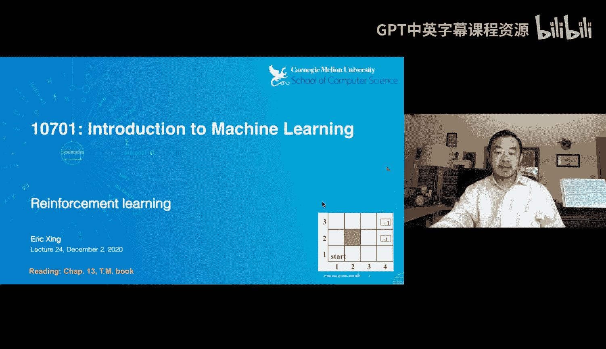
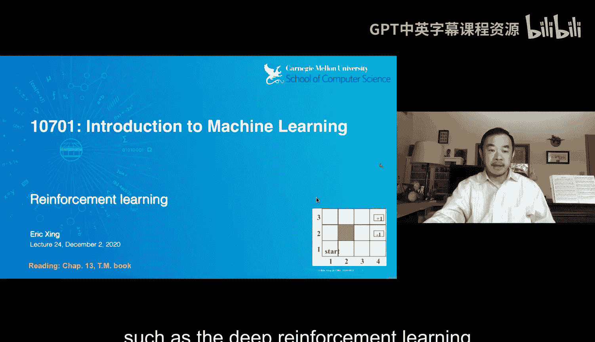
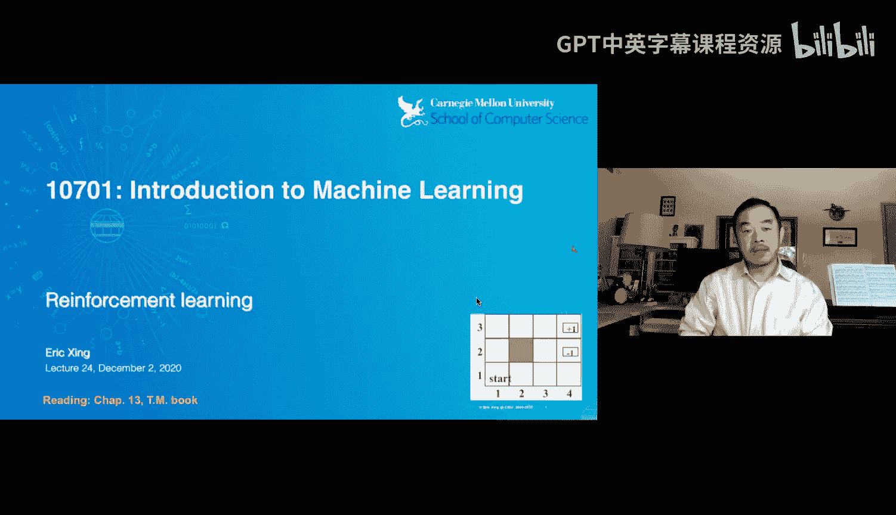
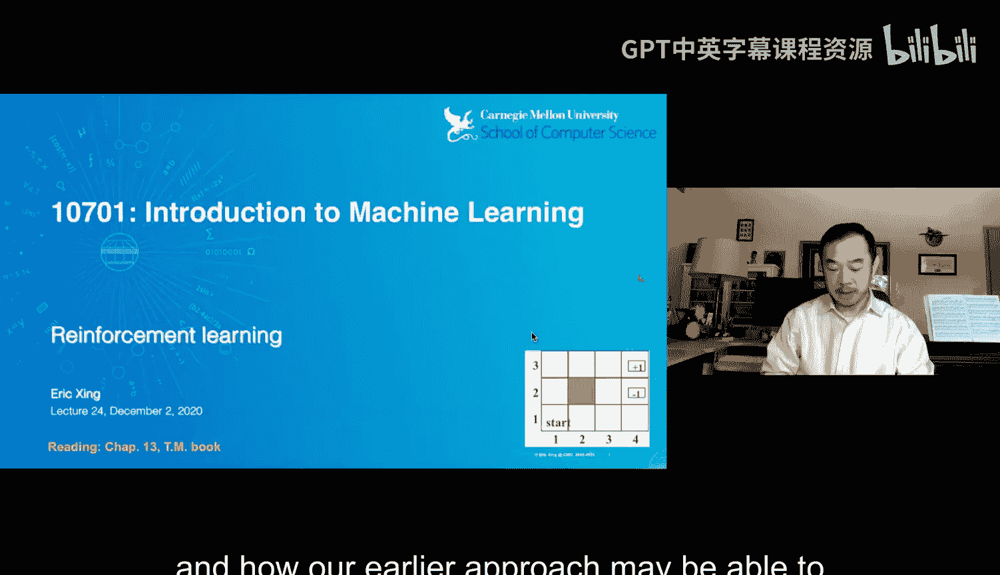
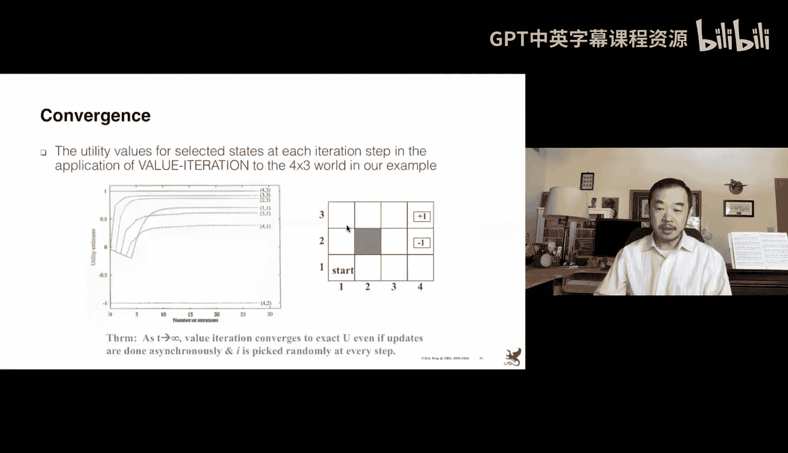
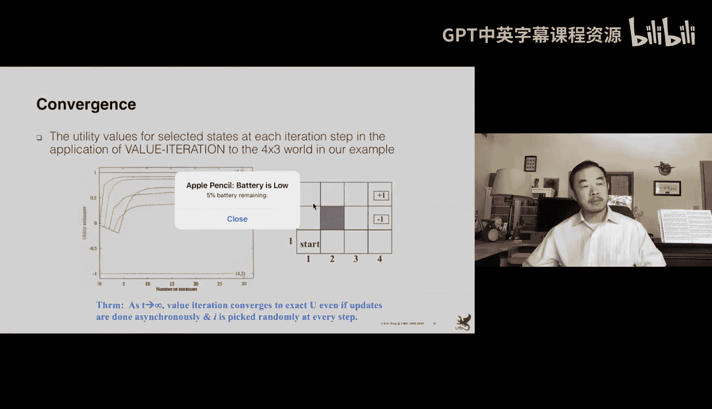
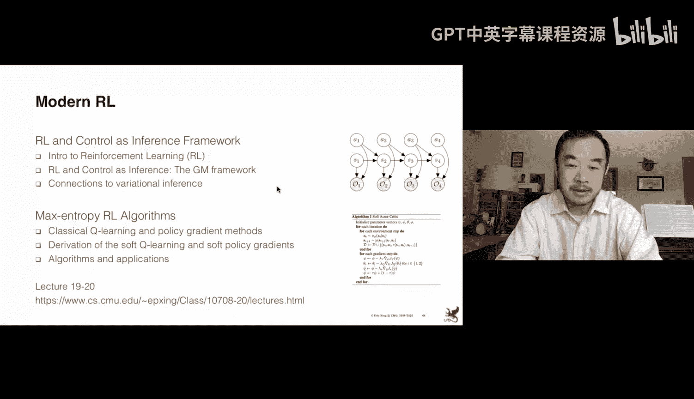

# CMU《机器学习导论（研究生）｜10-701 Introduction to Machine Learning 2020》中英字幕 p22 [22]10701 Lecture 24 Reinforcement Learning.zh_en [BV144SuB8ETp_p22]

Okay， good morning， everyone。呃。Right， so today we are going to actually declare closure of the all the lectures of machine learning 701。

 we had a slight adjustment of the plan next week's lecture will be canceled to give you more time to prepare for the project presentations。

 So where I'm going to combine what I originally plan to do next time into today's lecture。

 to make little dancer， but on hand we don't have to go through all the details。

 It's a new topic that you will learn a lot， you know in other dedicated courses such as a deep reinforcement learning taught by Catina and Ru and so on。

So hopefully， you know we will see you soon in other classes。

 but this one is the last one for 701 this semester。Right。Let's get started。

So reinforcement learning， many of you have heard about that already。

 it's often sounds very mysterious because people may view that as a complete new area you know in machine learning。

 so today I'm going to establish some basics and also some connections to what we've learned so far to actually hopefully review you how they are interconnected and how our earlier approach may be able to use for this new type of learning problem。

So let's do a quick recap of what is learning， right。Typically， the most general form of learning。

It's such that you have an agent and you have the word and the agent use information from the world to build you know a model or a hypothesis or a strategy so that they can generate outputs to the world。

And so far， you know， we've。Learned the following form of learning you know。

It's typically for learning a prediction， how to make a prediction。And how to recognize pattern。

And sometimes also how to understand， you know， the the world， such as in HMM。

 you are trying to also learn the transition model between states and so forth。

There is a big dimension in our real life that is actually not covered by the learning topics and techniques we learned we studied so far。

 which is how to use the learn model to do useful thing you know it's not just about classification if you recognize。

 for example， there is a boat you know on the bank。

 what do you do do you jump onto it or do you leave and so forth right so the action is actually the purpose in very many times the learning and also the cognitive activities。

And。Reinforcement learning is such a learning paradigm。

 which allows you to directly learn how to act。Given certain states and given certain incentives。

So just to recap， so here are the type of learnings we've seen so far。

 you've know a lot about supervised learning， which includes say classification regression and so on。

 and then there is this a bigger paradigm of unsupervised learning。

 which is you for problems like clustering and typically data in the unsupervised learning just the data without label and in the supervised learning。

 it does also come with the label。So here are examples in supervised learning where say I give you examples of the handwritten digits。

And after you see many examples， you can train classifiers right to make predictions of the digits。

And in the unsupervised learning， you know， this is a picture of the expression of many genes。

 you know， in different experiments。 You can imagine maybe these columns a row space are the genes。

And this column space are say conditions。Right。AndBut of course。

 the genes you know do not identify themselves in terms of their functions and in their you know structure categories and so forths。

 therefore you want to use the pattern that they behave， say active or no active。

 up and down and so forths in different environments。You know， to maybe reason about their classroom。

 their grouping and sos。 So this is a typical。I'm supering probably。

Now reinforced learning expands the horizon in the following way， first of all。

 the training data in here consists of the following3Q the tu consists of S。

 which is known as the states。It's like in which particular grid。

 you know or aboard configuration you are if you play chess。In which part of the city in the U are。

 so a kind of information and action。It is a space which define what you can do， you know。

 in those states。And then also very interestingly， a reward。

 which is you know you know a sign of achievement or or failure measured in a quantitative way。

 but it is a real number that is very different from the supervised learning where you it's one label。

 correct label or wrong label here there is no such a thing called the correct or incorrect。

 it's just a kind of a reaction and also you may not even get such a reward every time you do that actually you may receive a reward very late。

 for example， when you play chess or goal sometimes you can see a reward because you basically win a particular point。

 but very often you have a long-ter strategy where you only know the reward when you are in the game of the game so So our goal is to develop。

A policy at is optimal so that you can use it to generate actions。

🎼On every state so that yourative cumulative reward， you know， in the end， is maximized。

Okay so you can see where obviously this technique is very。

 very useful for you know playing board games， it is also a cornerstone for robotic training and algorithms。

Okay， so here is a robot and this agent is going to be only interacting with the environment through the following thing。

 you know， they perceive the state and they produce an action and then receive an award。

And sometimes the problem can be even harder， this problem in here is known as as I'm going to say in a few seconds。

 it's called MDP， the Markoff decision process， and this graph show here。

 you know is often understood as a fully observed MDP， meaning that you know， for example。

 which state you are。平ing。And also you perceive the rewards very clearly。

 there are also situations where you are under a partially observed optimization process。

 meaning that you don't actually completely perceive the environment。Okay， for example。

 you know in your。In your board game， you know you'll see the board configuration of yourself and your opponents right so that's kind of fully observed but if you play poker you actually don't know right the cards。

 the car configurations of the opponents and but you also can make an estimate probably and also you know you know what has been played so far so it's kind of partially observed。

So here are just some examples of very interesting applications of reinforcement learning。

 you see in the past few years， there was a big enthusiasm for developing alphago style you algorithm to beat human champions in games。

 right？And then in control theory， in fact， how to fly you know mechanical vehicles like a helicopter。

 a car and， you know drones and sos， can also leverage heavily on reinforcement technique because in there it is about executing a policy。

 right in different states， and you fly a drone somewhere there are air conditions， wind conditions。

 temperature， and also the you know， location， you know you know of your your mission and sos。

 and then you want to make the best maneuver， you know such as you know taking off landing。

 changing speed making turns and all that。You can imagine that this cannot be trained in a supervised learning way because you just cannot experience all the examples there may be a particular wind condition that you never experienced before but you don't want to fail right。

And also it cannot be all hard programmed ahead of time， which was the case in the past。

 you know for an auto pilotloing because then you need to enumerate all the conditions and having something like a if else and if then type of instruction sets to fly the mechanical vehicle。

 but this is a very very daunting and make the program super complicated So a modern way of doing control you know。

 can actually leverage on reinforcement learning that they learn a policy over a continuous infinite space of states and also interpolations between them and you can still act wisely know without causing trouble。

And of course， there are many other applications which I'm not going to enumerate in here。Okay。

 so let's start from the simplest setting， you know， for a robotic environment。

 which is just to navigate inside a grid space to get to a goal right that's actually already a adequate use case to illustrate all the ingredients of reinforcement learning。

So first of all， we have states， which are the board configurations like here in all the positions。

 these are the states。Okay。And we have also a set of actions you are allowed to move up。

And the left and the right。You can also move down， but in here I set a game such that you cannot move down。

 it's basically a by design action set， and it is also stochastic so that you will take chance to make all these different actions conditioning on your state。

And then you have the rewards in here the rewards is such that for every step you make。

 you are going to receive a penalty， for example， you are running battery and your battery meter is going down in every step right。

 but then you are going to receive a huge reward if you hit a target like a plus one。Okay。

 you are also going to receive a huge penalty if you hit a run target。 For example， here。

 there is a hole， for example， that is trapping you。 And if， if you fall into that， youre done you。

 youre done basically the the， the， the game is over。So and then there are obstacles in here。

 which is part of the states。And then I want you come up with a strategy which achieved the maximum reward。

 You can imagine this maximum reward is somehow， you know， achieving two things。

 One is that you need to get to the goal， but also the other is that you need to get to go fast。

 taking the minimum number of steps because you are burning batteries。

 right So that's why there are better policies and worse policies and you want to learn a optimum。

Right and the actions， in fact could I can make the whole thing even more complicated by making the action not deterministic。

 what does that mean， it means that even I decided to move upward。

 I still have a chance to move thatward because there is a mechanical uncertainty Okay in my robot that's very possible if you send a robot to Mars。

 you probably want to prepare for that kind of unexpected outcomes right So that's basically an example of reinforcement learning。

Another example of wrinkle learning which may sounds a little bit weird。

 but it's also solved very nicely by RL for example here it's a mechanical man maneuver like the draw here is a simpler setting of a pole balancing imagine that there is this pole hinged onto this moving car you know at this point。

And this car is afraid to move forward and backward in a certain state and then how to make the pole kind of a balance。

RightAnd when humans do that， right if you see these acrobats。

 you know you will see people you know hoisting a big pole and even maybe having a guy sitting on top of it。

 And you can see this guy， you know， holding the pole on the ground isn't static。

 Youll probably notice that he is kind of moving you know in subtle ways to counterbalance， you know。

 the gravity due to you know the tilt of the pole and the person on top of it。 And that's actually。

 you know a set of policies， how to learn that。There's also another example where say for example。

 you want to climb you know a cliff， you know， by driving a car， we don't want to do that。

 but sometimes it's necessary what speed you want to want to use to kind of dive down and so that they can come up and go to the other end right so this is a continuous game because you have a continuous space of speed and and positions and so forth Yeah but you can also。

In fact， the early days of solving this problem is to turn this problem into this problem。

 you just discreetize it， you digitize it， okay， and to make them tiny discreteet kind of choices of the numbers。

 and you can basically use the same algorithm solving this， Okay， to solve this problem。

So now let's look into how to。What are the algorithms of solving this problem？All right。

 so yeah before I move on， there is you know a long history of reinforcement learning which I'm not going to talk too much just to save time。

 it came out very early in animal study and then there are a few milestones such as the dynamic programming formulation of RL by Bellman in the 50s and then you know TD learning we are going to mention that today Q learning。

Today's lecture will be ending roughly here， which covers just about the classical material There's a whole modern era in the past 10 years。

 you know together with the rise of deep learning reinforced learning has been revisited you know from many new angles and there are new techniques such as reinforced learning as an inference。

 which is to use proba graphic models and other techniques to do reinforcement learning。

 deep reinforce learning where all the you know action functions。

 state action mapping functions and state reward functions becomes now a deep neural network。

And even aically， in addition to value iteration， policyeration， Q learning。

 which you are going to learn today， there are modern techniques such as a policy gradient。

 which makes the problem differentiable and more controllable。

 you know in in in reaching the solutions。 So it's a very exciting field。Okay。

 so let me reemphasize what's special about RL right So it is about maximizing a reward over time。

 so it is very different from a maximizing a predictive outcome。

 which is a one time deal like one single act and then this process is dynamic is my very often。

And typically you need to learn through a trial error kind of approach if you are not giving the full trajectory of the action state pair。

 you have to basically do experiment， you need to learn the environment by probing it。

And also you need to have enough patience because there is a decay effect that your failure and success may come late into the game。

 but your initial kind of action should already help you to achieve the goal so how to balance this kind of delay the effect and immediate actions。

Okay， so here are the elements I think I said it many times， let's get it a little more formal。

And more let's get it a little bit more in explicit and then become more formal。

 So what does a policy mean？So policy basically is just a state action pair once you are in a state。

 you are going to make an action， therefore this graph is a policy right in every great position you are going to take a particular step。

So it is a good policy or not？For example， actually， let me ask。

What do you think about this policy just by looking at it？Theyre good or not。Good。😊，Okay。

 why is good？We'll always hit to one， yeah， perfect。 That's a good answer。Someone said it's not good。

 It's taking too long good。 Yeah， bad。 a lot of steps。 Yeah I can already see， you know。

 it's that's why you know R is is a very fun field。

 It's kind of reflecting every people's personality quite nicely， Some people are conservative。

 Some people are adventurous， right So yeah， I would say this policy can be made better because you can see this particular way of doing things。

 yeah， it does get you to the game to the go。 but it's taking indeed a little longer。

 right What if I can do here， for example， But why I don't do this。

 What because it's getting me into this a very dangerous field。

 and we fall into you know a hole So that's kind of risky。Yeah。

 so this is actually an intuitive way of justifying or validating different policies Now let's see a different one。

Okay， so here， okay， wow， this is a policy。嗯。What about that？Probably you don't like it， right。

 because you already can see that in here， you're making a really bad choice， but。This policy。

 you know， does have virtue because it's going to get you very fast。 Okay， if you are here。

 you are only taking four steps to get to the pole get the the the goal and so forth。

 And there's also a numerical incentive for this policy to be valid because the penalty for every step is going to very expensive。

 You' are going to pay you know lose lot。 know burn a lot battery。You know when you make a step。

 therefore， you really， really want to be frugal， you， under energy。

And that actually leads to this policy。On the other hand， if you pay a little， okay， for every step。

Then， you know， you can see some different variations of the policy in between super conservative and super aggressive。

So you can get in sense kind of in intuition already。

 the configuration of a policy has a lot to do with the reward mechanisms， okay。And you have a super。

 super kind of a cheap kind of steps， then you'll actually get to the first policy you' see。

It doesn't make any difference if I work a few steps as signs that don't pay any cost。All right。

I think we all probably can have the intuition this policy is quite good。

 it's actually corresponding to a particularly kind of a reasonable reward。

 not too excessive and not too penalizing， but it gets you to probably a good compromise between the risk and the reward。

 so how to make all this argument formal。So now let's get a more precise goal。

 our goal is to learn a few things。Called value functions， basically for every state。

You should have a value function。Okay， which you know， tells you。

 you know how kind of far it is from the goal。And in fact， for every state and action。

 there should be also a value function that actually allows you to choose the best thing， right？So。

There are a couple of different approaches to get there all belonging to the bigger algorithm family called dynamicmic programming。

 So let's take a look。About that。So before we do that， let's introduce a few notations。

This notation is under the umbrella of what is known as the Markov decision process。

 and it is a 52 S A P and gamma and R。And the S is the environment。And and A is the possible actions。

 These are all in our current study discrete sets， but again。

 it can be made continuous and infinite okay。The environmental dynamics defines the transition probability of froming a old state to a new state after taking a particular action at time T。

 Okay， so this is a very important。Element in learning， you sometimes know it。

 but more oftentime you don't know it， okay。And the reward function is a function of the state and also the action。

 but sometimes it could just depend on state。And then gamma， by the way。

 is a decay function because if you know the reward come very late。

 you need to capture that kind of a time， you decay effect。

And then the life of agent is basically just。The repetitive episodes of。You know。

 this state action and reward triples， okay？So the dynamics is like this， you start from somewhere。

 some states， you take action， you land it at a particular state。

 and then you take action again and so forth， of course you perever see。

And then how to compute the reward， the reward of a particular state， say， starting from state zero。

ok。Should actually be you know， computed in the following way， basically starting from state zero。

You take this sequence of actions and you landed it at this sequence of states。

 each of them will incur a reward， and therefore the cumulative reward of a state zero should actually be the sum of all these rewards with a gamma decay every step。

And sometimes you don't have to worry about the action。

 maybe all actions are equally expensive or or has not nothing to do with the rewards。

 then it's going to be only depending on states。 So this is a special case that makes analysis simple。

And if there are sasticity， for example， for example， if there are distributions you know。

 of the states and so forth， then you take expectation of that。

And the policy policy basically is the state action pairs。Okay。And for every state。

 you will be having a distribution of the the all possible active actions and that function is noted as pi。

 which is also called policy。Okay， then with a policy。And with a reward。

 you can now define the value of a state， for example， here is a value of the state。

 you can see that it depends on two things。 it depends on the state itself and also a policy because the policy depends on how you navigate and experience the next couple of states okay。

And it is basically a cumulative weighted rewards。So our goal is to find such a pie。Okay。

 star such that this v of a pi star of S is optimize for every S。 Okay in our problem。 Okay。

 that's basically our problem。So let's take a deeper look of the value function。 This is， you know。

 a clean way of writing the value function， you know， immediate rewards at S。

 and then here you can see that I can。Basically， write this。Into as the value of the next state。

 therefore， I'm suddenly having a fixed point equation like type of expression of the value function that the value function of a state S is going to be。

 you know immediate reward plus the you know this guy。

 which is the the weighted sum of you know the value functions of the next state that I'm going to visit from here。

 and we suggest one step decay。对。😊，So that's basically also known as the Belllman equation。

 because it establish a dynamic programming type of formalism。 You can see that the same entity。

Applied to different arguments are appearing on both sides of the equation。

And if you write them down in a list of all states。

 you actually will be having a linear system of all the states。

And in here you are going to have also all the states， and there are some kind of a matrix and sos。

 maybe some other some other M matrix here， something like this。 Okay。

 so it's a linear system that you can explicitly write down you know if you actually know this P。

 which is the state transitional and also you know the pi。 So for every pi。

 you will have such a linear system and your goal is to you know try to solve the linear system and at the and choose the best pie。

It's not the best idea to do， but that's at least mathematically a clean way of understanding it。

More general Billman equation will include also say the reward with not undertable action。

 but they pretty much look the same。Okay， so that's the Belman equation。And then。Up to this point。

 I hope you remember one thing。 the value function of a state is a。

Depending on the state itself and also on the policy。 Okay， for example。

 that's why here I begin by saying， you know before I show you， for example， here， you know。

 a matrix of value functions。I need to first show you this policy。Okay， and then for this policy。

 we can write down a V function like this。And then we can determine whether this is a good policy or not by looking at how good this V matrix look like。

 So that's the whole and here I have some words about the harm DP and MDP to illustrate the fact that can you。

Precisely perceived the state configurations or not。

 but we're not going to discuss P repeatedly at all。All right。There are many value functions。

 Each of them is a dependent of the policy， and obviously there is one that is the best， right。

 so that's why， you know we are going to define the optimal value function。

 which is a agon max over all the possible pis Again。

 Just remind you pi is basically a state action pair function okay。Okay。

 and then if you plug in this into the Belman equation， you actually can have a， you know。

 a beman equation for the optim value function as well。

 which is a little bit different from the the value the Belman equation for any value function Here。

 you have a arc max okay over all the possible actions。And this function is going to be break。

Important， because the the later algorithms were used this as the basis to start the dynamic programming。

 you know through iterations。And there are some properties。

 very important properties of the optim policy， okay。You can either explicitly。You know。

 have a policy function。Or you can just keep it implicit inside the optimum value function and extract it when needed using this formula。

Okay。And。So optimum policy by definition。The value of the optimum state is actually by definition。

 the value of the state executed from optimum policy。

 and it is strictly greater and equal to the value function of any policy。Okay。😊。

And this optimism is global。Okay， it's not like when you start from some state and you arrive at this state。

 you have this particular states optimum policy to be something。

 And then if you start from another state you arrived at this particular state。

 you suddenly have a different definition of the policy。 That's not going to be the case in here。

 the optimum policy and also the optimum value is global， why。

 because the way we achieve that is through an infinite horizon cumulative reward。 Therefore。

 when we count't， you know， every policy or every state。

 we are already taking into account about all the future move that you can make。

 that includes also you know， the way to get to into this particular state from other states。

Therefore， globally， they already reach to equilibrium of opting， okay？Now。

 let's see what's the the the setup for learning， right， The learning in here could be。Well。

 they're equivalent， but they can have different facets。

The most obvious thing is that we want to learn。S。Right。But you can also say I want to learn pi。

But remember， pi can be extracted from S， and S can be also pi can be extracted from V using this equation。

 and V also can be extracted from。Pai using this equation。 so in a sense。

 you can learn each one of them。 And that actually indeed leads to two different learning algorithms。

But what do we learn from， Okay， so the data is look like this。 I just want to reiterate。

 The data are just the triplets。Of S and A and R， you know， in a long trajectory， many。

 many trajectories。And then you're going to learn policies and so forths。So algorithm one。

Called value iteration， it's unbelievably simple， okay？You just do the following。

 You start from an MP state， the value function where every state takes a zero。Okay。😊，And then。

 you have a。What。You have a。Yeah， that's it。 You basically are going to constantly。Exece this。

So starting from a M。You know， AV， if you know the state transition already。

You are basically going to repeatly recompute your S based on you know this equation that gives you the reward of that state and also the cumulative the expected value function of the next state by taking the optimal action So this is just a mechanical operation that helps you to compute a value from the current estimation of the value function and also the given transition matrix or state action transition matrix。

And you just keep doing it either synchronously or asynchronously。

 meaning that you can parallel know run for all the states or you could just go one state after another states。

Or in any order。What happens is that it will converge。Okay， so at the end of day。The S。

What conversege to。S alpha。You know， optimal。Just by doing this value iteration algorithms。

 so that's just one algorithm to get you to the optimalim value function。 It's called value it。

 because each time you just compute the value recursively from this equation。

 and the key trick of driven to optimal is that here you're not averaging over all the actions。

 you' are going to only take account the optimal action for that particular state。

I'm not going to prove why it is converging if you are interested。

 you can read Sutton's book of reinforcement learning where they have some very。

 very nice illustration and analysis of the behavior of this algorithm。

I had a question on that can ask。On the previous slide。In order to estimate the maximum action。

 the value of the state with the maximum action， the maximum value from choosing the action。

How do you just choose every possible combination of actions？Every one action。

 because here you are going to be only required to take a action from S。

And that will lend you to S prime。remember， S prime the value function or S prime is already known from the previous iteration。

 Therefore here， yeah， you are taking the the maximum operation by choosing from a finite set of all actions。

I see get that clear。Yeah， okay， great。The next algorithm is known as the policy tu is just as simple。

 Now， in this time， you are not going to be you know， you know， only worry about the the V。

 You are going to now directly jump onto the pie。 Okay。

 You are going to have a explicit expression of the policy。 and it was started randomly。Okay。

 and then。You are going to basically use a random policy to compute the V。Using the equation。

 we know already， right， We know how to compute the V from pi。

 And then you are going to now iterate on。The pie by taking this operation。

 which is very similar to the value iteration， The last chunk of the value it over there。Okay。

So you can see the inner loop is imputing repeat computing the value function。

Which is sometimes known as the estimation step。And then then you update the policy。

 which is also known as the improvement step so you can imagine this is sometimes known as the EI step you know we have an E algorithm here you have a EI algorithm so it is a flavor of alternating between different entities you know for a kind of you know alternating kind of improvements。

 it's a kind of a major style of this type learning algorithms。And again， sorry to interrupt。

 I have a question。Someone's asking is value iteration greedy？Its value it gradientding。

 it is very grading， yes。Yeah， it is great because you can see that each time it is taking this particular operation and it is guaranteed to improve。

 in fact， I have even a curve。我。嗯。There are some likeity， of course， because you know you know。

 we have。

嗯。I'm not sure。Whether the greediness is referring to with respect， because here。

The step here is Wey。Okay， but whether it is a greedy in terms of the exact function of the V and and pi。

Hard to say， because this is not a gradient。 It is somewhat related to that。

 as you can see from the analysis， but it is not equivalent。 Therefore。

 when you see the convergence curve， you can see that at the beginning， you know a。

They may have some kind of behavior， but in here， yeah， I would say it's still greedy。

 but you cannot directly you know use a gradientding argument to show that。

And starting on where you start， you will have different types of value functions。

 but you you can see that they converge quite rapidly after a few steps。Okay。

 so this is the key idea behind the dynamic programming。 Basically。

 you are going to be using the value functions。To really structure the search， for the good policy。

And what you need， of course， you need to have a perfect model for the environment。

 which is the P of S and A， that's something you always need it in all these different computations here and in here。

But they work quite nicely if you have all that， and these two main components will iterate alternate between V and pi until convergence。

Okay。Any questions so far of these two most important algorithms。

 value iteration positiveit iterations？People may wonder which one is better， are they equivalent。

 empirically， people find that the policy iteration is more easy to implement。And also leads to a。

Somewhat faster convergence in a very large scale problems。 if the problem is small。

 I think value iteration may have advantage， but when the the the problem。

 the state space is very big， the policy iteration seems to be giving you a better kind of more greedy。

 more effective convergence pass because every time you already maintain the best policy。

 right explicitly， and that leads you to take a better kind of convergence pass in updating the value functions。

 But again， this is just a high level description analysis if your interest can be found from the book。

Okay， so。Now I'm going to move on and depart from the basic， by the way。

 this technique that you see evaluation policy iteration were already known in the 60s。

 they are like a half century old algorithms， very old idea okay it's not always good enough because for example。

 you need to have the full knowledge of environment， which is often impossible。Right。

 and maybe you can only。You know， just like human being， when you go to a new territory。

 all you can do is to wander around and discover。 You really cannot just expect you have a map already for yourself。

 You need to build a map。As a part of the learning。And therefore。

 value iteration and policy iteration has its severe limitations。

So then that comes to the Monte Carlo methods， Monte Carlo methods is kind of taking some ideas from the DP。

 but it is relying heavily on long trajectories of a simulated experiences or actual experiences from the world without knowing the transition between action and states。

For example， here is an example of the Montecaro algorithm。Say I start from a particular state。

 I'm just going to keep kind of running the episode until end。Okay， and then I'm going to hopefully。

 you know， expect to。Rach to every state。 And in every state。

 I already documented the reward and so forth。 right， so therefore。

 after so many different episodes than for every state。You know， S。

 I can basically in a recover its reward and then compute average。Okay。

And that basically is for a given policy。 The given policy could be initially a random one。

And then you can basically once you have the first estimation of the of the V of a pi S。

You can now get a better pi， you know， from this， and then you are going to re the V of pi。

right so that's a Monte Carlo algorithm in here， you can see you don't need a P of S and a because the nature gives you that P of A and S already。

 You just collect all these actions。 Very expensive。 you can imagine， but that's the algorithm。

And these algorithm rely on simulated experiences。Okay呃。

And just to contrast the DP and the MC in the DP， if you have these experiences。

 I'm going to be plugged in these experiences into this transition model and compute you know a concily。

 you know， a cumulative reward or the value， but in MC。

 you are going to basically just using the sample average to update the V directly。

Right so that's the contrast。So。Looks to be expensive because here you have to also make sure that your your。

Your your your monkalo simulation should be episodic， meaning that issue finish， because otherwise。

 you may never get a reward。And therefore， that value can be unreliable all you basically collect is just the cost you pay for making a move。

 but you never got the final kind of a big trophy or big disaster。So。

So this type of algorithm and algorithm only applies to the games or the tasks where by simulation。

 you can come to an end。So I can imagine this is a pretty demanding expectation， not that triviale。

And also it requires a lot of simulations and also the computing is not a real time learning process because you are waiting for episodes to run for long time before you can collect numbers。

So。The temporal difference learning is another idea that was proposed in the believe 60s， I guess。

 which is to combine the idea。Between the M and the dynamic programming。Okayme。So， basically。

 instead of。Getting the V。From you know， just a collection of all the Rs。You know。

 with from all the episodes。In here， we are going to just do a what is known as the the one step learning。

Okay。Which is that。We're going to now update in every step based on the successor of that particular step using the following equation。

Say I start from S。Instead of accounting on this， a whole sequence of things。

 I'm going to only use a。State S and state prime。And which all has a， you know。

 earlier estimation of the。Value function already。 And I'm going to use you know。

 a temporal difference to update the S。You know， from。The S prime that I'm going to hit next。

 So though here you can see that I have a gamma times the next state value to reflect a time dependent account。

 a discount。And then I calculate the differences between the discounted value of the next state and the current state。

And then I add that difference to the reward that I receive。By regional next state。

 I may receive  zero。 Okay， that's possible。And then I'm going to multiply by alpha。

 which is a learning rate。Okay， and then I update。So this is the simplest form of a temporal differences。

And you can see the contrast in here。It is very different。Okay。All right。

 because there isn't a need the key difference you remember is that there isn't a need to compute this already at all in here right this one。

 the cumulative reward require you to use a long trajectory。

 but in here all you need are just the V functions in different states。

 therefore you can basically do one step updates。Of course。

 you can also elaborate be generalized to make it a two step updates。 That's possible。

 And three steps， that's also fine， right， but at least it's a controlled delay that you can you know。

 really have a a dominance over how fast you want to update your value functions。

 So it's a very smart algorithm。Okay， so the key idea is to really adjust the estimated utility function of the current state based on the immediate reward。

Okay you mirror what is this a little R， not that。Capital R。

And also the estimate value of next stage。 So So this is a small idea， but very， very revolutionary。

 because now you can see。The need for the transition function P。Of S and a is gone， right。

 and the need for the cumulative reward of S is also gone。 right， All you need is S of B。

That's actually a very， very smart idea。And R is the learning range。And it is， you know。

 sometimes a a parameter that itself can have a schedule that you start from something big。

You'll learn fast。And then it will decrease so that you know you can attenuate the learning speed to basically converge in a more graceful fashion。

 just like aircraft landing when you are close to landing you slow down and you hopefully are not too bumpy and hopefully land safely right。

 so the same thing in here。So that TD algorithm， just in a summary。

 you keep running this particular equation。Okay， over all the states。Of course。

 there is a need for a simulator because you need to on every state T。

 make an action T and then you get to action state。ASt T plus one， how do you get that？Well。

 it's because you either have a computer simulator or you are already working with the environment。

 you personally take action T and then you receive something in the next state。

 say I walk into the next house。See a monster or something like that， then you don't work anymore。

And then there are some free parameters like this lambmbda thing。

 which is to give you that kind of horizon， right， you can use you know TD lambda meaning TD0 is the immediate next step one is the next one and so forth。

 I'll give you a lot of flexibility。And you can play with the Dars。O。

So that story is the first intuitive instance of what is known as Mon hollow control。

Mo colorlo control is very different from the classical domain of a determinist control where you know you have the model of the universe and then you are going to use algebra to basically compute parameters in that model in here you basically are directly facing the universe and you are taking chance to experiment。

Or maybe on a simulator。Okay， so along that vein， there are additional developments continuously following the T algorithm and in the。

80s。There has been a breakthrough known as the Q learning。Okay。

So Q learning is about shifting our attention away from the V。

By directly focusing on what is known as the Q function。 So Q is。

V is basically a state value function， right， and Q is a state action value function。

 which is also a a function of the policy。So that gives you a much more direct type of a。嗯。

You a way to， to operate， because when you want to extract the policy from the value function。

 you don't need to basically know the environment。RightBecause otherwise。

 even if you learn the value function already。You cannot turn it into a policy unless you have this environment model that is either given or learned in here。

 the queue itself directly gives you the optimal policy。To be extracted。

And it turns out that there is an algorithm which can allow you to directly learn the Q without learning V and without learning or given the P function。

 Okay， so that's a very， very good breakthrough。 So the idea goes like this。

 It's still among color idea。 You start from a random policy。

 and you want to do the the experiment the the estimation expectation。 you know， to update your Q。

 and then use the Q， you are going to you know， get a policy in policy。

 And then you are going to learn the next version of the Q executing in the trajecties。Okay。

And it could also work on a nine stational environment because here you are not going to be maintaining you know the model of the universe。

 therefore the non stationity can be automatically captured。

 you know in your reward and in your sample trajectory and then gets updated into the queue。Okay。

So how it is actually executed。Again， you know it is executed typically in a very greedy way。

 for example， you have a queue， then each time you take on an optimum A to get a policy and then you're going to use a policy to update next Q。

People find that this all this again， the greedy strategy by optimizing A may not be always effective for you to converge to the global open policy because you may be too greedy and you avoid basically discovering sometimes a you know you a shortcut or some other kind of bypass。

 you know， to different space of possibilities。Therefore。

The entire algorithm goes a little bit more flexible。

Which is reflected in this algorithm known as the the SArsa algorithm。

 Okay So here is our how it operates。 We maintain the Q of S A， not V。And then starting from the S。

I'm going to， you know， use the policy extracted from the Q to have an A。

And then use the a to get to the next state and receiving an award。 But in here， the a is not。

A equals to a。Arc max of a over， say Q， something。Okay。

I'm going to do something called a epsilon soft policy， meaning that say epsilon。

Equals to typically they equal to like 5%。What are something mean， it means that 90% and 95% of time。

 I'm going to get。You know， a from this equation。And 5%， you know。

 A basically is coming from draw from a random set。With's a uniform probability。Okay。

 so random action。 So this is called Epsenon panel of exploration that it's like you know。

 I'm going to be coming to my neighbor， I know this is a safe neighbor， I always want to borrow。

 you know appliance everything from him but then you know you may have a better neighbor that has a more appliance but because youre greedy you never try that so the next time even though I have no experience with the new neighbor。

 I'm going to work walk to them and and see what happens it could receive a big penalty， so be it。

 but I may also have some nice discovery。So it's very intuitive。And the equation is to be， you know。

 the updates is basically in this equation， you are going to use a temporal difference mechanism。

 okay， the temporal difference between the Q of S and A in the subsequent step versus the current step and then you know multiplied by learning rate alpha。

To update the Q function。 So you can see the differences is only。This difference。

 the original MCI version of TD is learning the V in here I learned the Q。

 which allow me to extract the policy pie a lot more easier。Okay。All right。Okay。

 so that's just a summary of the Q learning and there is also a clear explicit dependenceencies between the relationship between the V function and the Q function okay。

 the V function is basically just you know a arg max of the Q over states over actions。对。Okay。

 you've seen this already。In the。Right， so in the actual operation， you know。In fact。

 this is not quite the the epsilon greedy step。 you basically only are taking the greedy actions。

 but I would break them down into this or。The alpha gradienting。Step。To make that in combination。

 then that basically gives you a more effective learning algorithm。Some questions。Yeah。

 I will have links to your the certain battle book。 and also， yeah。Thanks， Daniel。

 for for the answer。Okay， so here are some additional discussions on the exploration part。嗯。It's a。

Empirical may be a heuristic process that you'll try some small numbers first。

And and see how your trade off look like， do you get a you know。

 a substantial improvement or you already start to see decay and then you'll try some other numbers。

Okay。And here are conditions of the convergence for the Q learning algorithm。 It。

 It converges to the optimum Q if。You know， first of all， this every state is visited England often。

You， you need to basically do a lot of episodes。And that actually can be helped， you know。

 by the exploration， because that does allow you to visit every states if you have the sigma or the epsilon to be big enough。

But you also want to have a faster convergence there for the sigma。

The epsilon shouldn't be too big so that you you wasting time to do necessary visits。And。

Any other conditions？Yeah， the learning rate is decreased。 That's and give you thisanuation of。

Of safe landing。Cool。Okay， so I think the technical part is almost there。

 there are some very nice successful stories of Q learning and RL reinforce learning in the early days。

 one of the first breaksthrough is game known as the TD Gamma。I'm not the player of this game。

 but I believe some of you probably know right so it is really you know a game with finite or configuration and finite action space。

And of course， the value function。Its a little bit kind of heartto model。

 therefore it from R and S and A to R， you know， in this case， they used a neural network。

 even in 92 already neural networks used to basically fit a model for that reward function。And。

This was probably the first game。 artificialificial intelligence was able to beat human。 Okay。

 and that was not happened in the in the in in the early 90s。到 last century。

And then modern machine reinforced learning has gone a long way， as I mentioned。First of all，Now。

 you know you can express all what I just said， you know the Markov decision process。SAR。

Multivari probabilistic program known as the graphic models。

 where you can write dependencies in here very explicitly。 So look at this。

 this is hopefully look familiar to you already right This is very much like a hidden markov model that we learned in this class。

Right， the states。And the outputs。And and what else。 yeah， and the actions on every states。

 The output， of course， is you can view them as a reward or some other signals。

 and then you can write a big graphic model to model a joint probability of all that。

 And then learning the optimum state action mapping and policy becomes a inference problem。

 So that's actually a topic known as the RL inference。Once you have the RLS inference。

 you can now write down the global loss function and the conditional distribution of arbitrary random variable。

 say action given states or multiple states in an explicit form。嗯。Therefore。

 you can actually apply more algorithmmic techniques and also first order methods。

 like waitinging methods to。Actually expedite the learning efficiency。

And also there are developments in called the maximum entropy RL。

And which is actually a new way of defining the loss function using the maximum entropy principle。

And it's from that kind of framework， recent algorithm as known as the deposit gradient it was introduced。

うん。I start lost my voice， but it's a good time to stop。

 so for more information of the modern topics in RL。

 you can directly go to this link which is the two lectures I give in the graphic model lecture。

 which is a kind of a crash course of most of the highlighted modern algorithms。

 you in reinforce learning， then you can also go to the reinforce learning graduate level class taught by faculty in MLD。

 you know which will give you a lot more details about how to build deep learning models in every stage of the reinforced learning you paring you to do more fancier and more complex functional approximation and and policy modeling and action inference and so forth。

Okay， with such， I think。I'm done with today's lecture。

 I'm going to give we have another 10 minutes left。

Do you have any questions regarding today's lecture or。呃。Anything like a。Topics in this class。

Or other。Interesting questions you want to discuss。Alright， if not。

I'm going to give you back these 10 minutes。 I hope you have a productive weekend and next week to finish the project。

And hopefully， we will see you again， you know， in our。

Future lectures and classes in machine learning。 Thank you very much。

