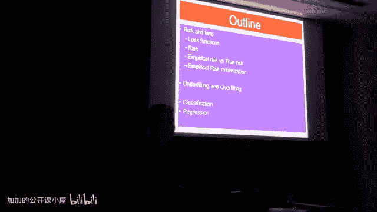

# 卡耐基梅隆【中英⚡高级机器学习｜10-715 2015 Advanced Introduction to Machine Learning】 p18 P18 Learning Theory _18_ - Machine Learning 10-715 Fall 2015 -BV1hiWnzQERQ_p18-

How good。These machine learning algorithms are on unknown test sets。

 We want to analyze this question theoretically。 We are interested in this question。

 how many feing samples we need to achieve small error on test problems。

And another important question is， what's the smallest possible error that we can achieve with these algorithms。

M fish， can you figure out how to turn that or。You find the big。Okay， and these are those kind of。这个。

Learning theory studies。Hey。Is it better？Yep， good。

AndIt's very dark， so I cannot see yoga。 just， you can sleep。

哦。So to answer these questions， we have to discuss some definitions of risk and loss。

 We already did that in the first lecture， but now we will be more formal。And。

So we will define loss and risk functions， and then we will discuss the concept of empirical risk minimization。

嗯。We will discuss underfitting and overfitting and see how empirical dis can be used in classification and regression。

 we will focus on classification mostly。All right， so in this learning theory section we will discuss supervised learning setup。

啊。Which is this we have a data set， the training data， which are pairs， x 1， y 1， x and y， N。

 So x is your input Y is the output。 And we have some test data set as well。 For example。

 in this data set， the first endpoint is the training data。 and the next endpoint is my test data。

And we assume that the inputs are coming from a D dimensionsional feature space and the labels are real numbers。

And we assume that there's a joint distribution of the features x and labors y。

So there's a joint distribution of。X and Y， And we assume that the feature vectors X。

 They are samples from some distribution Px， which I just。They know what with the。Me。

And the cross labels are sampled from a conditional distribution。Given x。In regression problem。

 of course， the labels are， say intervals， AB in classificationification。

 they could be like just 0 and1。If we want to study how well our algorithms works。

 then we will need a loss function L。啊。Which is defined on。X ypers and。

The algorithm given features x， the algorithm predicts f of x， and we want to compare f of x with y。

And our goal is that we want these loss to be as small as possible on the test dataset set。Okay。

 in classification， we are interested。In this loss。That's called classification loss or 01 loss。

 that which has。Value1， if y， the true class label is not the predicted class label and 0 if they are the same。

In regression， we might use the L2 loss or the L1 loss， right。

 So we all know these kind of things so far。And， we already studied the。Squared loss， the L2 loss。

 we know the l1 loss in when we discuss super vector regression。

 we discuss the epsilon insensitive loss and in robust regression sometimes people use the reverses robust loss。

So everything is on so far， right there was nothing new。Okay， so this was the loss。

 we will need the definition of so called risk function。

And the risk is defined as the expected value of the loss。On your data。So as you discuss the X pairs。

Have a joint distribution P X Y， and we take the expected value of your loss。

With respect to this distribution， your data is coming from。So the risk is just the expected loss。

Okay， so why do we care about this risk？So my goal is to do well on the test set。

How is it related to that？Has the same expected。No， I have a test set。Right。X。

N plus  one volume plus  one x and by。 That's what I care about。 I want。 see the test right， so。

I it's because you're doing expectation and not end of year。Account for any。

It'sLike you trying to predict。Right， so I care about the performance on a test set。

But what happens is that。The loss on the test the average loss is converging to the risk。

Are you given the test that not。So， you had。So in。So let's discuss this。 So， for example。

 what happens if the test that is given。But you。So you have the test instances， but not the features。

 right？You have M of those。X n plus 1， x， n plus 2 x， n plus M。

I want my algorithm to work well on these instances。

So that will be really the average loss that I really care about。Yeah。

 but that's when you don't have。 I mean， if you have， they probably can do something better。

If you you would be， I agree that you could probably do something better。

 but I'm just saying that if you have these features。

My point is that this guy will be close to this point。 if the features are not。

 if the features are not known， then。Indeed， I cannot do much anything as just studying the expected。

Wells because that's what I care about。 Okay but the point is that we will focus on analyzing the risk。

Does it make sense， so I understand you indeed， if I have the features or the features。

 then I might somehow explore the structure in that that's called semi supervised learning。嗯。

But to keep our life simple。 So this is what I care about。

And the point is that the expected risk will be close to this empirical loss。

If the test set is large enough。Okay， so notation that。The risk。Belonging to the laws。

And the joint distribution of x and y。Is defined as the expected。Lo。X， y and。So we assume F。

 so you can define the risk for any function F。And I give you a function。 This is its risk。 Yeah。

 for any function， any deterministic function， I can calculate this risk。And of course。

 what we are going to do that you have a training set。And from the training set。

 you learn a function F。And you can calculate what be be the expected value of this loss where you learn this function from your training。

Data so youre giving。The I don't assume。 I'm just saying that。This is a theoretical thing。

 right This is what I care about， but of course， the algorithm doesn't have access to this distribution。

 The algorithm has access only to the training data。

