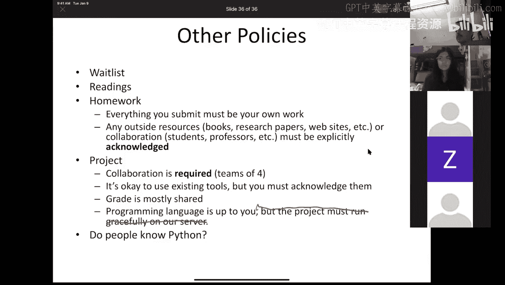
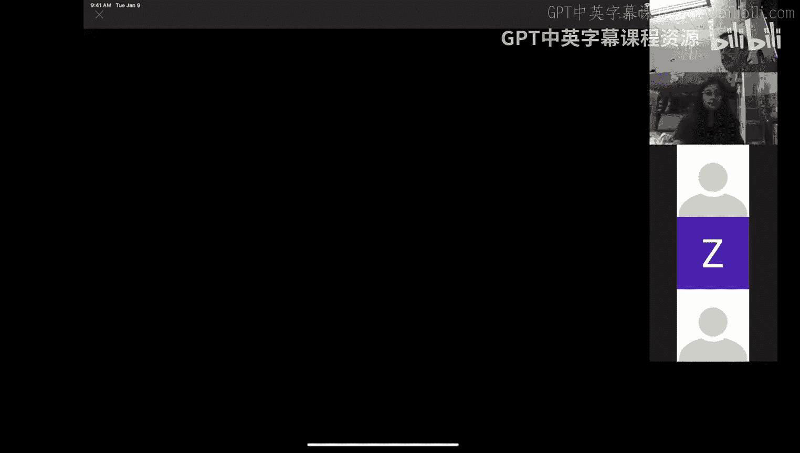
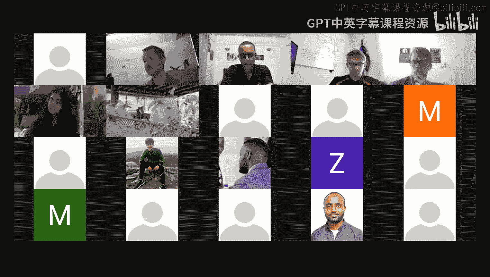
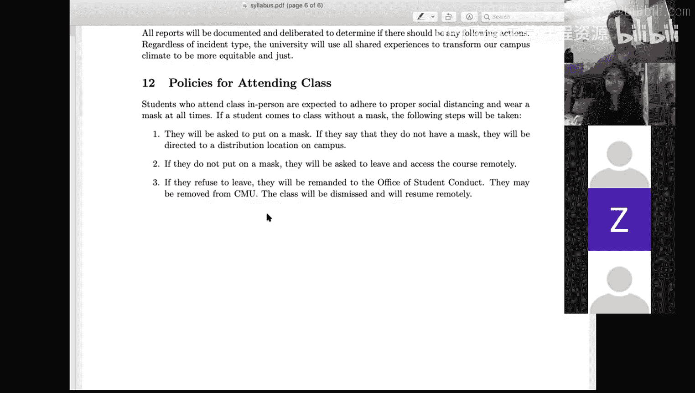

# CMU《自然语言处理｜11-411 11-611 Natural Language Processing 2020 Fall》中英字幕（Claude-4-S） p01 -01-2020-09-01 Introduction.zh_en -BV1RaWpzAE7E_p1-

Welcome everybody to Natural languagenguage Proing 1141111611。

 I'm David Mortonson and I'm one of the instructors for this course。

 the other instructor will be Alan Black who should now introduce himself。Hello everybody。

 I'm Alan Black and the one with a long beard， I'll be teaching some of the courses some of the lectures as well。

 but David's teaching for the first few lectures。Yeah， so you can easily differentiate us。

 long beard， small mustache。嗯。呃。Mine is not as distinctive or as permanent， I think。

 but and I don't get to look like Galf or Dumbledo or any other like figure from fiction。But。

I am enthusiastic and passionate about natural language processing and excited to be introducing you to the foundations of this discipline。

So in this lecture we'll go over to some extent what natural language processing is and what kinds of things we'll be talking about during this course。

 and then we'll also talk a bit about the syllabus and the practical requirements of the course and give you a chance to ask questions about this and to。

Feel more comfortable。With how you'll be evaluated in this course。So what is NLP。

 you must have some idea of what NLP is or you wouldn't have signed up for this course。

 but this is what we say NLP is。Automating the analysis， the generation。

 and the acquisition of human that is to say natural language。So there are three parts to this。

 There's analysis， which is the understanding or processing part of NLP， there's generation。

Which is making natural language， given some kind of representation of what it's supposed to mean or do。

 And then there's acquisition。Now， some people。Use NOP to mean all of language technologies。

They use NLP to mean all three of these things。Some people use it only to refer to analysis。

Confusingly also， some people use NLP in a way that excludes speech technologies。

 so they think of language as just being written language and speech as being something different speech technologies。

 but we are going to take an inclusive approach in this course。

 so for us NLP will refer to all three of these categories， analysis， generation and acquisition。

As well as to。Speech， in addition to written language， we're going to include all of those things。

Abitious， you say， yes， but it makes sense to us。So why is NLP important？

Why would you want to study NLP， Well， one reason is web search。

 So there's a certain large company called Alphabet。That many of you are familiar with。

That owns Google and a bunch of other companies。And they chose the name Alphabet。To some degree。

 because NLP is at the center of what they do。We liked the name Alphabet， Larry Page said。

 because it means a collection of letters that represent language。

 one of humanity's most important innovations and is the core of how we index with Google search。

It's not just Google that thinks that NLP is important。

Lots of big companies and small companies are hiring NLP teams and paying them lots of money to do various kinds of natural language processing tasks。

So all of the big tech companies have some NLP。People， well。

 I shouldn't say all of the big internet oriented tech companies do some NLP。

And so it's worthwhile to be aware of it， and even if you're not going to get a job in NLP。

 which we suggest you do， it's a good idea to know what it's about so that you can interact with people who are doing NLP and you can understand the issues and the benefits that can come from it。

So why NLP， what can you do with NLP？😡，Any ideas， what are some examples of tasks？

That require or involve NLP。Some real world applications of NLP。

So we've got some things in chat here， let's see。So automatic novel generation， right。

 text generation of a fiction or creative text。Machine translation。Alexa。

 so personal digital assistance。Or and Siri。And Google Home， these all rely heavily on NLP。

 And as its defined in this course， N LP broadly。 So they include speech， but also text processing。

So information extraction， somebody said this is very important too。

 something I'm very interested in。Then there are chatbots and other kinds of dialogue systems。

Sentiment analysis， what is sentiment analysis does anybody can anybody tell us what sentiment analysis is？

Maybe。M whole Agraal。Yeah， so I guess in a very layman language sentimental analysis is looking at a piece of text and identifying the sentiment behind it。

 whether it was written with an angry intention， whether it was kind heartarted， something like that。

Yeah， yeah。Thats sentiment analysis， so we've also got question answering Q&A summarization。

Managing messages is an important application like text messages， email messages， phone messages。嗯。

Understanding search queries。Very important。transranslating books。

 things like auto correct and autocomplete， sometimes you don't think about this。

 but this is an application of natural language processing and this is something we'll learn about in this course。

 you know how these technologies work and how you can implement them。Bts。Grammarly automatic or。

Tools to help you write better。Creative writing， so creative text generation。

Somebody mentions robo calls now most robo calls are not very sophisticated in terms of their of their NLP。

 but some are and they can carry on a conversation and try to convince you that they're real people。

 even though they're obviously not。呃。And then a couple of other people mentioned sentiment analysis。

呃。So here are some other things， so question answering。Translating documents was mentioned。

 doing library research， text summarization。Managing messages。

Helping you to make informed decisions by being able to extract a lot of information from text。

🎼Following directions given by a user fixing your spelling a grammar like graammarly。

Grading exams now we're not going to grade your exams using natural language processing。

 but you should know that a lot of。Standardized tests do use natural language processing in the grading process。

So if you take the SAT， for example， which I think many of you probably did。

 at least those of you who entered an undergraduate institution in the United States， you know。

 the writing portion of this is graded in part with natural language processing。

Creative text generation， like writing poems and novels was mentioned to listen and give advice。

To estimate public opinion， so how can NLP help us to estimate public opinion？

So somebody says crawling through online forums and this is exactly right， scanning Twitter。

 reading Twitter。Detecting propaganda。All of these things are。um。

Ways that you can use information extraction， sentiment analysis to estimate public opinion and to do things that are hopefully more accurate than polling which is as of late not shown as good a track record as it did in the past。

 so natural language processing has a lot to say about that。

So somebody mentions listening to private phone conversations。And that's。

The actual listening part doesn't require a lot of natural language processing。

 but understanding those phone calls and extracting information from them that can be used in an incminating fashion。

That's natural language processing。Reading everything and making predictions。

Interactively helping people learn， helping disabled people， helping refugees and disaster victims。

And documenting or reinvigorating indigenous languages。

 which is something that both I and Professor Black Allen are interested in。

So how can you get a job in NLP， where will you work？Well， a lot of most NOP people work in industry。

You know， for lots of different companies， as I mentioned earlier。

There are also a lot of NLP people who work in government and academia。

And they're a smaller number who work for humanitarian organizations。So how do you choose。

 let's say you got a degree， you did some NLP， you want to work in NLP。

 how do you choose who you work with well it's not just about money。

So you have to ask yourself questions like， is what you are doing bad for humanity？

Or is it good enough？For humanity， could you be doing something better？

This is not just about government careers or government funding but。Work for the government。

So in a way， I mean， I work on government funding for the Defense Department。

 in part they pay a large part of my salary。And so some people think。That working for a government。

 be it the government of the US or the government of China or the government of India or the government of some other country。

Is like this。But we like to think that it's like this。And。That's a very self serving。

Way of looking at things， but it's more or less the case that people can make different ethical arguments for the same choice。

But we still think you should consider ethics and consider what is ethical when you make these kinds of decisions。

So if we get back to the question of what NLP is in some more detail。诶。

Then we can think of it as automating language analysis， generation and acquisition。So by analysis。

 we mean the understanding or processing part so you take。Language as an input。And as an output。

 you get some representation that you can do something with， that you can act upon。Generation。

Is the process where you take。A representation like that is an input。And you output language。

 so it's doing the same thing in reverse。And then acquisition is about obtaining representation and necessary algorithms and knowledge from data。

 so what do we mean by representation， what is a representation in NLP？Well。

 let's look at this diagram。So these are some levels of linguistic representation。

So at the bottom here you have。Text and speech。Change this to be read。You have text and speech。

That's kind of the thing that you're analyzing in analysis。So in analysis， you're going this way。

And it's the thing that you're generating in generation。Language is richly structured。And。

It has lots of different levels of representation we call them， which are all of these things。

So speech can be represented phonetically or phonologically。

Text pretty much always gets represented orthographically， which is in terms of a writing system。嗯。

OrWhether you're looking at ph or orthography， you always have a morphological representation。

 which is about the internal structure of words。Alexical representation。

 which is about words in terms of the。Lxicon， the set of words in language。

 so it's like words in terms of a kind of internal dictionary。Syntax。

 which is about the structure of sentences。Semantics。Which is about meaning。

Pragmatics which is about language use in context and discourse。

 which is about the structure of language above the level of a sentence。So the same。Sentence。

Whether written。Or spoken。Can be represented in all of these different levels。

 you can look at it from all of these different perspectives。

And we'll talk a little bit more about that。But this is very hard。

Because the mappings between levels are really complicated。And。

Whether a particular representation is appropriate to a task depends on what you're doing with it。

Depends on what the application is。And there are other problems， too。So the input。

It's likely to be noisy。Also linguistic representations are theorized constructs。

 we can't go and observe them directly。We can't observe them in the physical world。

 We can't go inside of people's brains and observe them。they're theorized constructs。

And there's also the problem of ambiguity。 So each string。

Can have many possible interpretations at every level at each of those levels of representation that we talked about back here。

So it's not just that。String has one representation。At the syntactic level or the semantic level。

 you can have multiple different representations。So people are really good at resolving linguistic ambiguity。

 It's very rare that you come across an ambiguous sentence。

And even notice that it's ambiguous because you've used all of this contextual information to disambiguate it。

But the question is。How do we represent that context？

And how do we represent the set of possible alternatives？Another problem is richness。

There are many ways to express the same meaning。And immeasurably many meanings to express。

So we have lots of words， lots of phrases， but we can also combine those in an almost unlimited number of different ways。

To get different meanings， to get different sentences， to get different discourses。

And each of these levels interacts with the others。There's an interface， as a linguist would say。

 between each of these levels of representation。Finally。

 there's a lot of diversity in human languages。So languages use。In a way。

 we're all expressing the same kinds of meanings， for the most part。

But the mechanism that languages use to express the same meaning can be very different。

 they can employ very different strategies。And some languages。

Like to talk about some meanings more than others。诶。

or are much better suited for talking about some kinds of meanings。

 so there are certain categories that are sort of hard to express certain grammatical categories that are hard to express in English that are easier to express in some other languages and vice versa。

So in this course， we will study models。What is a model？So it's an abstract， theoretical。

 predictive construct。It includes three parts。So you have to have a partial representation of the world。

And then a method for creating or recognizing worlds and a system for reasoning about worlds。

We use a lot of different tools for modeling in NLP。Sometimes。Really shallow models， actually。

 that are not that sophisticated。Work very well。Sometimes you need a more sophisticated model。

 it depends very much on what application you're targeting。So this course。

It's meant to introduce you to some formal tools that will help you navigate the field of NLP it's not about introducing you to NLP as it's practiced right now or to try to make you a state of the art NLP practitioner。

It's designed to give you the foundation in terms of formal tools that you need in order to adapt to NLP practice in the future。

Or to understand what people have done at NLP in the past。So we focus on two things。

 on formalisms and algorithms。It's not a comprehensive overview。

 we have a deep introduction to certain key topics。

And we focus mostly on analysis and mostly on English text。

 although we do have a couple of lectures on speech and we do have a couple of lectures that relate to non English NLP。

The skills you will develop， however will apply to any subfield of NLP。

 and we have found through experience that is a very good introduction for people who are going on to do NLP in industry or elsewhere。

So。What about applications？Well， here are some challenges。Application tests evolve。

And are often hard to define formally。 so so you might say， wait a minute。

 you're telling us you're going to teach us formal tools。

 but applications are always evolving and are not subject to ready formalization。

 How do we bridge that divide。Well。It's actually quite natural。If applications are always changing。

To。Build a foundation instead instead of teaching you the applications per se。嗯。

Note also that objective evaluations of system performance are always up to for debate。

 so evaluation is very important。But there very rarely it's a single metric for evaluating how well you're doing on a particular application。

 there are a lot of competing metrics。A lot of competing criteria for evaluation。

And this holds for analysis itself and for application tasks。

And different kinds of applications finally may require different kinds of representations at different levels。

 so you have to be flexible， but if you understand the different levels of representation and the different formalisms that have been used。

 the different，😊，Approaches to these different levels of representation。

 then it's easier to see what to do for a particular application。

So here are some applications in 2020， so computational linguistics， something I'm very into。

 which is modeling the human capacity for language computationally。

This information extraction like open Ie。Also something I'm interested in。Question answering。

 something you'll be doing in your project for this class。Machine translation。

 something that is very important right now and getting very good。Summarization。

 something that's always getting better。This opinion and sentiment analysis， again。

 very vital right now to a lot of applications in industry as well as academic and government applications。

There's social media analysis。诶。Which relates to opinion and sentiment analysis in a lot of ways。

 and there are things like fake news recognition。嗯。

Now you might say it's easy to recognize fake news。

 you just find news that disagrees with what I already think and that's fake news。

 but there are techniques that can be used to find news that。

To find items of news or information that are not factual。And this is。

An important application of NLP。So what about brains？

This brings us to the distinction between NLP and computational linguistics。

So in another course related to this one， somebody said of linguistic analysis。

 you have taken a beautiful living thing， killed it and chopped it up into pieces。

And that's what we do。In NLP and in computational linguistics。

NLP is focused on the technology of processing language。

And computational linguistics is focused on using technology to support or to implement linguistics。

So it's like in a way the distinction between AI， which is more engineering focused。

 technology focused and cognitive science， which is relate， you know。

 trying to study brains and what is going on inside of a brain when we do cognition。

 not necessarily what kind of。Marvel is best。Model， what kind of。

Intelligent model is best for a particular engineering application。

So let's look in greater detail at some of the levels of representation。嗯。

Let's start with morphology。One of my favorites。Morology is about the analysis of words into meaningful components。

And different languages have different degrees of morphological complexity。

 there are languages that are called analytic or isolating languages like Chinese and to a lesser degree English。

Where words don't have a lot of internal structure。Most words just have one meaningful unit。

Then there are synthetic languages like Finnish or Turkish or Hebrew。

Where words have a lot of internal structure。So a favorite example of this of mine is this word from Turkish。

Which means， in one word， behaving as if you are among those， we could not syphiize。One word。

All of that is packed into one unit。Oh， we've got another Turkish example。

What does this one mean now？Oh， it means like。The people whom we unsuccessfully tried to make resemble the citizens of Paiancaa。

 it's like a common joke。😀ははは。😊，嗯。But there's nothing funny about morphology。Just kidding。

So then we've got lexs。The lexicon。So here is。A short text。I think it breaks off mids。

 but it seems to be something about ticketing for Special Olympics。嗯。So one question is。

 how do we divide this up into words？And。You know， one。What answer is， you know， this is Chinese。

 you know， kind of conventional answer is you just take。

You just assume each character represents one word。 This is not actually quite the case。

 So words are often words。Asther。As a thing that is stored in the mental lexicon in human use of language and things that units that need to be stored as units in a lexicon for natural language processing are often larger than one character。

 so doing this kind of analysis involves knowing about a lexicon， a store of words。

So there are other things you have to do， so normalize and disambiguate words， for example。

So you have words that have multiple meanings like bank or mean。

And you also have words with a lot of domain specific meaning。

 which you'll note anytime you study a new discipline or work in a new field。

There are words that mean different things。In that field， than they would outside it。

You also have multi word expressions， so there are things that you would separate with white space and that in fact。

 you have to treat as multiple words that。Have a single lexical entry。

So one kind of lexical analysis for English is part of speech taging where you take a word。

Or a sequence of words。And you assign labels to each of those words based on whether they're nouns or verbs or adjectives and so on。

Then there's syntax。In syntax。You take in syntactic analysis。

 you take a sequence of symbols and you give it a hierarchical or compositional structure。嗯。

So this is closely related to linguistic theories about what makes some sentences well formed and others not。

 So I want a flight to Tokyo is good。 I want to flight to fly to Tokyo is good。

 I found a flight to Tokyo is good， but I found a fly to Tokyo is bad。

So there's something that explains how this difference arises。

And so there's a relationship between this linguistic study of syntax and syntax as it exists。

In natural language processing。Syntax is also ambiguous and the ambiguities explode combinatorily。

So here are some examples。Students hate annoying professors。嗯。Or students like annoying professors。

John saw the woman with the telescope。John saw the woman with the telescope wrapped in paper。

 how are these ambiguous？I guess second one。You're not sure if the woman had the telescope or whether you're looking at her with the telescope。

Yeah， yeah。The first one。You know， the difference is whether annoying is an adjective or annoying is a verb。

So are there annoying professors that are annoying。

 do students hate professors that are annoying or do students hate to be annoying to professors？So。嗯。

Here are some examples of the possible readings of John saw the woman with a telescope wrapped in paper in terms of dependencies among the components。

 among the items， the words。Then there's semantics， semantics。

This is the mapping of natural language sentences into domain representations。That are meaningful。

So a robot command language， a database query or an expression in a formal logic， all of them have。呃。

Its。I。Representation， all of them are representations that are specific to a particular domain。

Scope ambiguities are an example where semantics kind of breaks down。

 So if I say a seat is available to every customer。Then it could mean that。There is one seat。

 and it could mean that there is a seat for each customer。And this is what's called acoal ambiguity。

 and this is something that arises when you're going from syntax to semantics。

So going beyond a specific domain。Beyond specific domains is one of the goals of artificial intelligence。

 to be able to do this in a non domain specific way。Then there's discourse in pragmatics。

Pragmatics is language use in context， so if you say something like， can you pass the salt？You know。

 we write it。Here， as if it's a question。Can you pass the salt。

 but what does can you pass the salt actually mean？What does it do？In context。

So it's actually a request， yeah， as Benjamin said。

 it's a request or an order even telling somebody to pass a assault。So how do you know this， well。

 you have the knowledge of pragmatics。How do we get computers to know this。

 We give them a knowledge of pragmatics。So there are other kinds of pragmatic inferences that are made。

 So if you say something like in the US。If you say something like， is he 21？呃。

What do you probably mean？😡，You mean  age is this age 21， but you really mean is he above 21？

Is he at least 21？So you can say yes， he's 25， which seems contradictory。嗯。But yeah， can he drink。

 is he drinking it？嗯。Yeah。嗯。So discourse is about what happens above the level of a sentence。

And text， dialogues， multiparty conversations all involve discourse。And they're all difficult。

I said the black shoes。 Oh， black。So oh， black seems not like a sentence。

 but you put it in discourse and it makes sense。So here is some administrative information。

The web page for this course。Is at。This address， right here。It's also if you go to Canvas。

Then you can get to the webage from there。 You should also be able to get there from Piazza。

We have multiple different platforms going on in order to confuse you and make it more difficult for you to know where you should go for a particular piece of information。

But each of them plays a role。The book is speech and language Pro。嗯。I didn't tell you this。

And I hope。Dan youraski doesn't have like。嗯。Information extraction from speech bots monitoring YouTube。

 but it's possible to get。APirrated copy。Of speech and language processing online。

 so if you can't I encourage you not to do that。Unless you have to。

But if you can't get a hard copy of the book delivered to your location， then it's an option。

We are the instructors， Alan Black and David Mortonson， David R。 Mortonson。

And the teaching assistants are Kinja， are you here still Kinja？Hi， yeah， yeah。Milan， theaies。

Sbi Mohanti Yuuhao and Michael Huang。And kit is also there hi David。😊，Ah great。Hello。So。

Anybody who wants to be in this course can get into it basically， we have plenty of room。

 we welcome all comers。嗯。You should do the readings， they're very useful。

 some people from a computer science background object to them because they have lots of words in them。

And。It seems very verbose， but the words are there to do something which is to communicate natural language processing to you。

And if you read the textbook， you'll be a lot better off。嗯。

When you use anything other than the textbook。😀Yeah。😊，嗯。

If you use anything other than a textbook in homework or otherwise， you need to acknowledge it。

It's a project。Oh， for homework， you must submit your own work。

This doesn't include quizzes I should have added that。

 so there will be quizzes10 of them I think approximately every week on Friday they'll be released and you have to have them done by Monday。

These were trying very hard to make them harder and better and a better。

Gage of how well you're learning the material so you can have a sense of。How things are going。嗯。

There's a project also， this is one of the most important parts of this course。And the one， you know。

 when people。When we asked people what they remember about the course。

 what they liked about the course， this is the number one positive response they learned a lot from this group project。

 which we'll talk about。More not next lecture， but the following lecture。

You have to do collaboration， we want you to be in teams of four so you should start immediately looking for team members and you should know that the project is about question generation and question answering。

 so pick your team accordingly a good way of getting team members。Is by using piazza。

If you don't already know people in the class from your program or elsewhere。

Advert yourself on Piazza， everybody is looking for team members。

 so you don't look desperate and you look like you're on the market。嗯。

The grade is mostly shared unless somebody。Really doesn't do their job and then we reallocate。Points。

Programming language is up to you， this says the project must run gracefully on our server。

This is not true。Now we have you do everything in a Docker container。

 so as long as it will run like in an AWS instance。U。In your docker container。

 you can do whatever you want， it just has to follow a particular structure so we can run it。

Does everybody know Python？I think。My mother actually knows Python now。嗯。So I assume。Everybody does。

Does anybody not know Python？So， the。There's a question， do we have homework this week？

And if you'll look at the schedule。Which is。OnOn the website。Then you'll note that the first。

The first homework is assigned。On the third。Which is Thursday and is due。On the 10th。

It's a very easy assignment。呃。But it's just to make sure that you can do basic programming and text processing。

And can read documentation and things like that。嗯。And it's fairly fun or half of it is fun。

 The other half is boring。But。Yeah， there will be homework。Starting this week。

Any questions？

Let's look at the syllabus really quick to make sure to see if there are any questions about that。

Oh the question came up， do I recommend reading before lecture definitely， Yeah。

 you'll get a lot more out of the lecture if you read before。诶。So I highly recommend that。

The deadline to form a group。Usually we say at the end of the second week。嗯。

So definitely get working on that right away。Sometimes we have to do some rearranging of things。

 because the。嗯。You know， somebody will drop or die or something like that。嗯。

So we have to merge groups or rearrange groups， but that we want to have things pretty well。In。

Pretty well。Naied down by the end of next week。嗯。And so you can get started。And you might ask。

 what can we do to get started， we don't know anything about natural language processing。

 we just started learning about it， that's why we're taking this class。U。

But it turns out there's a lot that you can do and there's a lot that you will learn by。

Getting started。Let's。Share。Yeah， there it is。The syllabus。

So。Let's go to the part you care about， just kidding。I know you care mostly about the content。

 but here's grading evaluation。So there'll be two sort of midterm exams。

 each worth 15% of your grade， and each they will cover the first half and then the second half of the course。

嗯。The project。Will be equally weighted， this will be 30% of your grade。

It's semester long four person team project。嗯。And it's competitive， we'll talk about this later。

 so part of the grade， not a large part， but part of the grade comes from how you do in a competition in generating and answering questions with the other systems。

Then there'll be homework assignments， there'll be seven homework assignments。

 mostly small programming assignments。Given most weeks during the semester。

That will be 25% of your grade。And then there'll be quizzes which will be 15% of your grade。

 and there'll be 10 canvas quizzes given at the end of most weeks。

 there'll be probably about between five and 10 questions long。And。

These are designed to help you evaluate yourself as much as they are to help us evaluate you。

 but it's to make sure you're doing the reading and viewing the lectures and。呃。

Doing your what you need to be doing in order to succeed in the course。

We dropped the two lowest homework grades and the lowest three quiz grades。But we don't allow。

Late work。Except in exceptional circumstances。So the idea is that you can use the。The dropped。Hwork。

Assignments and the dropped quizzes when you need。Breathing room when you have when you're not able。

 you're sick or your're。Traveling and you're not able to do this， then you can take one of the drops。

But we don't have grace days or late days。嗯。Unless you know， under exceptional circumstances。

 like a family member dies or is extremely ill。Your。You're extremely ill。Something like that。嗯。So。

Some of what it says here on hybrid instruction。呃。May not apply because we。We。

We probably will have enough time to complete the lectures during the allotted time now that the schedule changed a little bit。

So we won't do pre recorded lectures， but we will record all of the lectures and post them online if you're not able to be there synchronously。

After a Thanksgiving holiday， everything will be remote。

The change may come earlier depending on circumstances。嗯。呃。But we'll have in person。Instruction。

At least for a while。嗯。That will be synchronous with remote instruction。

 and we have a special room that's supposed to have special features to allow us to do this effectively。

Any student may go remote at any time during the semester without informing or obtaining permission from the teaching staff。

嗯。If。However， you want to go in person。You can't。Do that without permission。

We're using different technologies for different things， Zoom for conducting live recitations。

 YouTube for distributing recorded lectures， piazza for disseminating course information and answering student questions。

 grade scope。For grading student homework and administering exams and canvass for providing access to a grade book。

 handing in group work and collecting private links。诶。Now。

 I understand that this may be annoying to a lot of people to have to deal with five different things。

But it's the formula that we've worked out that seems to work for this course。

And none of these tools provides。All of the functionality that we need by itself。

If you have a disability， you should。We encourage you to talk to us so we can get started making。

Accommodations， but you should also talk to the Office of Disability Resources as soon as possible this week。

so that everything， we can make all of the arrangements and take care of you in that regard。嗯。

With regard to student wellness。We're going through a very difficult year。And。You know。

Coronavirus has left a lot of people feeling isolated and alone and really screwed everything up。And。

We want， you know， we're going to take this into account。

We want you to take care of yourselves to do your best to maintain a healthy lifestyle， eat well。

 exercise， avoid drugs and alcohol， get enough sleep and try to take some time to relax。

 I know you are CMU students， but it's still possible for you to relax。And not work all of the time。

You know， that will help you。But all of us benefit from support when we're struggling。

And if any of you。Need accommodation for。These kinds of struggles。Or need extra help。

Please let us know and if you know anyone who is experiencing significant stress from life events or feelings like anxiety or depression。

 then please seek support there's counseling and psychological services who can help you and。嗯。Also。

Along with that， try to reach out to a friend or a faculty member or somebody you trust for help getting connected to support。

Also， there's a statement here on diversity， we want to make everybody feel treated with respect regardless of the ways in which they are diverse。

 of which there are many。If you feel like。You're having a bad experience and you're being mistreated because of some way in which you're different from。

An instructor or a teaching assistant or anyone， then please don't hesitate to contact the Center for Student Diverity and Inclusion。

Or if you see somebody else being mistreated in this way。

 or you can also do online reporting using report it。嗯。If you're in person。

 then there are certain policies for attending class。

We encourage everybody to attend the synchronous classes。And to， you know， it will help you。

 but attendance is not taken， not required， whether you're in person or。Remote。

 but if you're in person， you must put on a mask。And if you don't wear a mask at all times。

 then the following steps will be taken， you'll be asked to put on a mask。

 and if you say you don't have a mask， you'll be directed to a distribution location on campus。

If you do not put on a mask， then you'll be asked to leave and access the course remotely and if you refuse to leave。

 you'll be remanded to the Office of Student Conduct。嗯。

You may be removed from CMU and the class will be dismissed and will resume remotely。Okay。

 so any questions about the syllabus？I haven't been following chat， so I have to look back here。🎼Oh。

 so the other midterm is listed as final。But it's not a comprehensive final。

 it's like a second midterm exam。嗯。So the quizzes will be。Mostly multiple choice。

 although there'll be some that are formulas or short answers。

 so you should expect a variety of different things。嗯。Let's see what else quizzes are。

Any other questions about the？About the syllabus or the course。

Is there a window of time for taking the exams， usually we have a window。

 but we have multiple windows。So for people who are not。

In North America at the time they're taking the exam and they can take the exam we have another window that's available。

 maybe in the morning。嗯。Pittsburgh time。When people in Asia or Europe could take the exam or Africa。

Any other questions？Okay， well I'm really excited to have you in the class this semester I think it's going to be a great semester and I'm happy that we have such a large number of students and I think we'll have some really good projects and really good experiences so。

😊，If you do have any questions please post on Piazza。

 also take an opportunity to look at Canvas and make sure everything there is familiar to you。

 but if you have any questions post on Piazza， the TAs will get to you if they know the answer and if they don't。

 they'll forward the questions to me or to Professor Black and we will get you an answer as soon as possible。

Take care。And have a。I'm sorry， I'm distracted by the chat， have a good afternoon。

