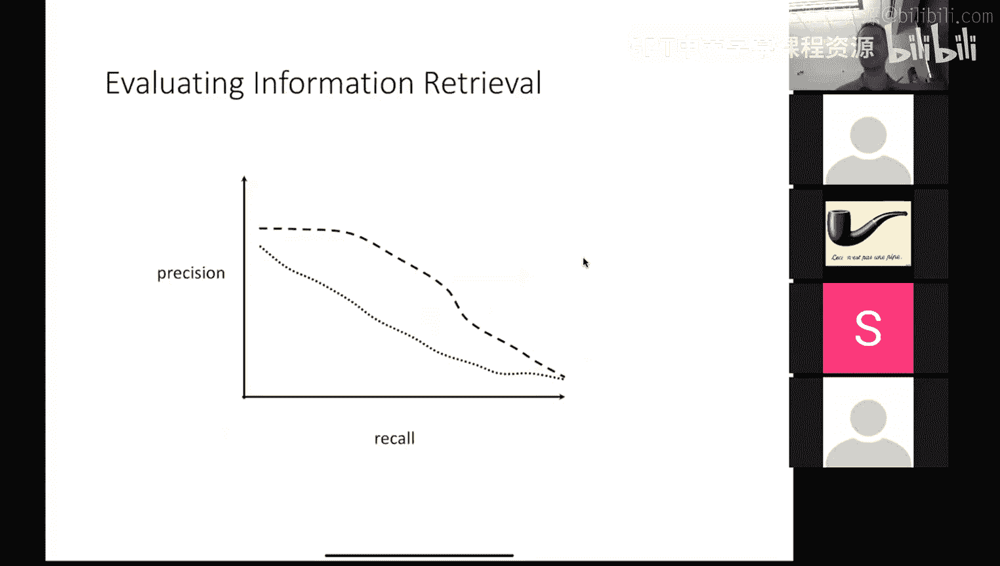
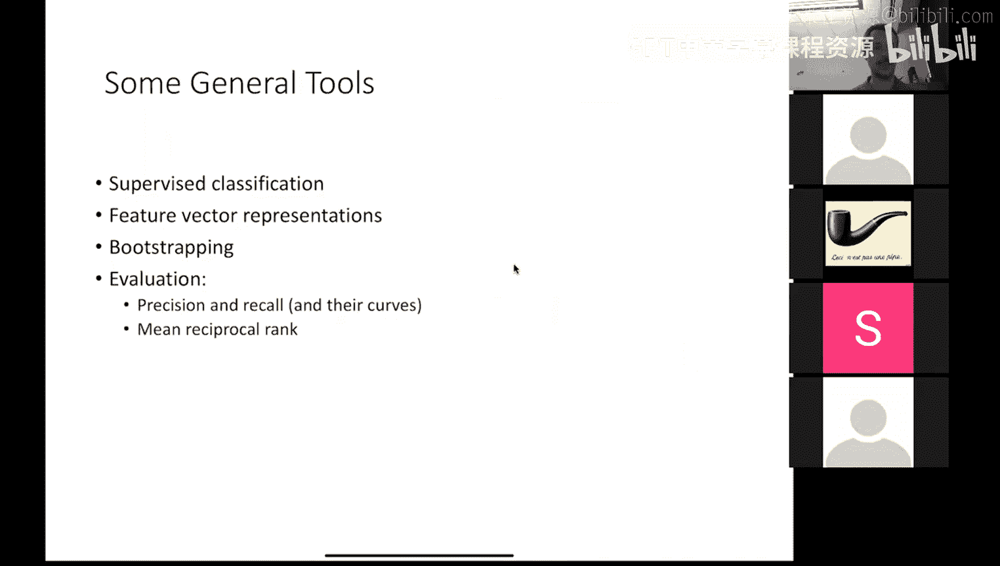

# CMU《自然语言处理｜11-411 11-611 Natural Language Processing 2020 Fall》中英字幕（Claude-4-S） p02 -02-2020-09-03 Applications of NLP.zh_en -BV1RaWpzAE7E_p2-

那。Hello everybody， to start off， I'd like to ask if there are any questions from last time about the course or about what we're doing here。

About homework。Hello。😊，嗯。So the first homework will be released this evening。

 the autograder is already up， the handout will be made available very soon if it isn't already available and it will be on grade scope。

So you all should have been added if you're enrolled in Canvas， you should be in great scope as well。

And so if you go to www。gradeadescope。com and log in。

 you may have to create a login if you have not used gradeScope before and you can access the homework and the auto grader there。

So there's a raised hand by what is your name？Now it won't let me see your name。Yeah。

 I'll just go ahead and。What was your question？Yeah。

 I can hear you so when I was going through the syllabus。For each sort of， you know， heading。

 there was。Some， there were some numbers attached to it。 So introduction， you had one。嗯h。

The next one he had like 22。0 something and I thought that corresponded to like sections in the textbook。

 but when I did't refer to the textbook， I didn't really find the corresponding headings。

So the reading's Friday so in the schedule that's on the website and also in the syllabus。

 these are for the readings。And the first so it's chapter in section so for this and it's and these are for the second edition of the textbook。

 so not the third edition that's currently that they're currently working on that's available online and not the first edition but the second edition。

 and so if you go for today to chapter 22 section 0 through2， and chapter 23 for section 0 through2。

 you find the relevant material in the textbook that you should read before。Today。

 so use your time machine。Go back。And read those sections。

 they may not be called exactly the same thing as the title as the topic。

 but they're relevant to the topic of the lecture。嗯。Soir。The assignment。呃。

So the assignment will be on grade scope， but we may post the write up on Canvas。

So you can access it there it the I've just been in conversation with one of the TAs who's adding the autograder or setting up the autograder on grade scopepe for the first homework and it should be in place but maybe it's not been made public yet。

 so I will talk to them after this class。And we should have it in place by this evening。嗯。

So don't worry too much， it's not too hard an assignment if you know how to program in Python and have ever used Rex before or done anything that involved。

Compiling frequency lists of things。So， you know， don't worry too much。We will。

There'll be a piazza announcement that will go out making everything clear。Before the end of the day。

Any other questions about that？By the way， would you rather have the assignments posted on Canvas？

So we'll use grade scopepe to do the auto grading so that's where you'll submit them。

 but would you rather have the write ups posted on Canvas？🎼Or on piazza， or using great scope。

Any preferences？🎼Lots of people like canvas， not piazza， canvas， canvas， canvas。Okay。

 we'll post them on Canvas， they'll be available on Canvas。And if that doesn't work。

 we can modify things partway through the semester if you find that。Inconvenient。

But it's not on canvas yet。Okay。Today we're going to be talking the title of the lecture is applications of NLP or that's what the slides say。

 but really this is mostly about information extraction， question answering。

 and information retrieval as it relates to NLP。嗯。I like some of these topics better than others。

 I'm a big fan of information extraction and I've worked a fair amount on this topic。

 I like question answering because it's what we're doing in the for the project and so it's very important it's fun to talk about because you're going to learn a lot about it information and retrieval or IR is something that I know less about。

And so I'll talk less about it。But that's part of what you should learn through the readings and so on at this stage。

So information extraction is in a way a lot what it sounds like， it's extraction of information。But。

Yeah。Has a specific meaning， so basically in information extraction NLP。Your given text。As an input。

 lots of text。And you're given an empty。Data structure， like a relational database。

 basically you're given a table， so you've got documents， is text and you've got a table。

And your goal is to fill in this table based on what is in that text。

So the input is text in an empty relational database and the output is a populated relational database。

So we're going to use some examples。 These are examples that I borrowed from。

Somebody else's slides who is also writing in a presidential election year in the United States。

A long time ago， when most of you were very small or okay， maybe not very small。

 but you were young and naive。And probably didn't care much about US politics。

But there was a time when only three people were running to be the Democratic candidate for president in the US。

 These three people were。John Edwards。Hillary Clinton。And Barack Obama。And。In information extraction。

 you might be given。Document like this。And you want to fill in a database that has state party。

 state of a primary election。Party， candidate， and fraction of the vote。

And so a good information extraction algorithm or system can take。This text。And give you this table。

It can see and it can extract the fact that Edwards。Got only 14% of the vote。And the Clinton。Cut 50%。

But still lost to Obama。Who in the Florida primary got 33%。

So this is at a high level what information extraction is about。

But it has a number of different components， you can't just do this。Well。

 you could do it as one step， but that's not how it's been done historically。

 It's been done as a series of related tasks。And my favorite of these it what is called named entity recognition。

 which we'll talk about in a moment in greater detail。

Basically named entity recognition is going through a document。Or a corpus。

And looking for all of the proper names， basically， that fall into some set of categories。

Common among these categories are persons， organizations， geopolitical entities， locations。

 facilities。Natural phenomena and so on。 So here we've gone through and basically underlined all of the named entitiesities in this document。

Like Senator John Edwards， Democratic Party and so on。

So reference resolution takes this one step further。

We don't just identify that Senator John Edwards is a named Edward entity and that Edwards is a named entity。

We identify that they both that Senator John Edwards refers to this guy。And that， Edwards。

Also refers to this guy。Now this the task of just identifying what real world entity？What。Typically。

 what entity in a knowledge base， which is sort of a database of。Of entities and relations and so on。

A named entity refers to。So this is reference resolution。

Finding that Senator John Edwards refers to this guy。

So what you might do is you might use Wikipedia as your knowledge base。And you might associate。

 you might associate a link to a particular Wikipedia article about Senator John Edwards。With。

With this named entity mention。So co reference resolution。Picks a little bit different tack on this。

Instead of saying。That instead of trying to figure out。What。Entity。Senator John Edwards。Refers to。

What。Article in Wikipedia。Refer is Senator John Edwards。Associated with。Instead。

 you're trying to link named entity mentions。To each other and say that Edwards。

Has the same reference as Senator John Edwards， in other words， they are coreent。

And that's co reference resolution。So we have reference resolution。Co reference resolution。

Any questions about how those two are different？Okay。Additionally， we have relation detection。

 This is another step。In this kind of process。So in relation detection。

You're trying to find all of the。Tups。Within a document or corpus。That satisfy some relation。

Or to which some relation applies。So one example of a relation is the member of relation。

And you reading through this document。Can tell that John Edwards。Hillary Clinton。And Barack Obama。

All members of the Democratic Party。So there's。So there's a relation。

Of which John Edward's Democratic Party is a member。

 of which Hillary Clinton Democratic Party is a member。

 and of which Barack Obama Democratic Party is a member， and we'll call it member of。

That's relation detection。That's a little bit harder。Then these other tasks。

 why do you think it might be harder？It's at least different。There are simple ways of doing it。

 but they are very noisy。Ma whole。The whole agar wall。嗯有。

One thing that I noticed is only John Edwards is directly linked to the Democratic Party whereas Hillaryary Clinton or Barack Obama isn't。

 so that could be a potential problem in terms of linking them to the same party。Right， exactly。

 So there's you're having to make kind of multi step inference。 You don't have a literal。呃。

Linguistic link。Between Hillary Clinton and the Democratic Party or Barack Obama and the Democratic Party。

 you have to kind of understand。The whole document。Which is harder than just saying this is a name。

 this is a name， this is a name， or this name refers to this person in this Wikipedia article。

 you it's a more complicated task。But as's well learned， there are some。

Simple ways of extracting relations。That。Work in。Some cases。That work in a lot of cases。

 but produce a lot of noise and also miss a lot of things。So let's go back to talking about NER。

 which I。Love， anyway， I really like this task。 I think I like it in part because it's so well defined。

😊，And。It's also useful for a lot of as an input to a lot of other kinds of downstream tasks。

 it's not very interesting by itself。But it can be applied to a lot of other things。

Like reference resolution or entity linking sometimes called。嗯。So here's how NER works in practice。

So we take a text。And we divide it into tokens， each token is roughly one word。

So we have the all of the tokens。Here。So one token is president， one is Donald， one is Trump。

One is met。And associated with each of these tokens。Our goal is to give a tag。

That says whether that's a named entity or not or part of a named entity。And if it is。

 what kind of named entity is it？So here we go through so it's what is called a sequence labeling task。

We have a sequence。And we're going to label each item in this sequence。

So we go through and we see president。Well， president is part of President Donald Trump。So we label。

 so this is the beginning of a name entity， so we put B。For beginning。And because it's a person。

 these persons have titles。Then we say。🎼PR for a person because that's one of the types in the named entity recognition scheme that we're using these differ。

From。嗯。From scheme to scheme， depending on your what downstream task。

 what ultimate purpose you're putting the name identity recognition to。So。

So Matt Donald is inside of a named entity。So it gets an eye。And Trump is inside of a named entity。

 so it gets an eye， but met。Is outside of any named entity， so it gets an O。

Now you might ask why we need separate B and I tags。For named entity， what is the reason for that。

 why would you need both B and I？Why not just have I for all of them？

Maybe like later on if they just refer to them as like Trump。To see that the same thing。Well。

 if you refer to them later on as Trump， you would have B again。

 but there are some people in chat who have the right idea。For example。

 Joyce Wu says multiple named entities consecutively。

 so if you have two named entities next to each other。

 you have no way of knowing that there were two if you didn't have like the begin tag。嗯。

So if you have multiple named entities with no space in between。

You need some way of disambiguating it， and this provides that。So it's very simple， right？

Very simple， very nice。呃。It's not an easy task， but it's easy to see whether you're doing a good job。

So it's relatively easy for someone to go and create training data or test data。For this task。

Because you can have a well defined set of rules that a human can use to go on。

And annotate a large quantity of data。At the same time。嗯。It presents some real challenges。

 what do you think？What approach would you take if you were doing named entity recognition？

Named entity recognition。How would you do it， what are some ideas that you might have？

So somebody says sick to sick， how would you use sick to sick？

So one way is to basically have a database of all possible proper names， Zachary Nowak says this。

What are some problems with this？Somebody says storage base or a size of database。

But this is not a big problem， you know， there are only， you know storage is now cheap。

But the problem， as Valerie Chung says， is that new proper names can be made。

 people are actually always making new proper names。

And you're getting new proper names from other languages。

 so you know getting new names borrowed in from other languages。

 so keeping all of this up to date is not easy。So Quadvo Agipon Intra says that。

Their name wouldn't show。Which is probably true thatre just not enough quadros。Around。

So Yushin Li brings up an interesting point。Which is capitalization。So for English。

What if you look at all the words that are capitalized in the middle of sentences？That are。

That are not capitalized because they're at the beginning of the sentence。

 but are capitalized for some other reason。Now， this works for English。诶。

What languages won it work for this is helpful for English it's not 100%。呃。

It doesn't give you 100% of what you want because it doesn't tell you anything about the types of the words and there are some words that get capitalized that are not named entitiesities。

So this won't work for Chinese， as USin mentions。诶。And it's not going to work for Japanese。

 no capitalization， in fact， only languages with alphabets。Have capitalization。And so it only works。

There。嗯。But for English， this can be a useful feature。

 doesn't work for all languages with alphabets either。 So if you think about German。

 does anybody here or know German。So how does capitalization work in German nowbi？

I don't know where to put the stress on your name， so Nabi， Nabi。Yeah， so in German。

 you capitalize all nouns。And then you have social media， as Sammy mentions。

 where barely anybody capitalized。Or people write in all caps。So you can't just use capitalization。

So what are some other things you could use， oh， Chris Fan has a good idea， which is titles。诶。So。

 people。Human people's names are often associated with a title like President Donald Trump in this example。

嗯。So Valerie Chung also has an interesting idea that words that occur together， I think she means。

Colocations or repeated engrams。We'll talk about what that means later。

Are and are used as nouns and aren't in a common dictionary tend to be proper nouns。

 And this is the case that 1，1。Thing about proper nouns is their words often that are likely not to occur in a dictionary of ordinary words。

So all of these can be used as features。So you can use what comes before。

 what comes after capitalization。Presence in a gazeter， which is a list of proper names。

Absence from Alexxicon。嗯。Words in particular， syntactic positions， like after verbs or prepositions。

嗯。So all of those can be used as features and you can train a classifier that does this sequence labeling task and we'll talk more about classifiers later and also about sequence labeling。

Any more questions about that？NER is a lot of fun。 I encourage you all to。Do anyR。Um。

So there are different schemes for annotating named entities and one of the common some of the common types are。

Per for person org for organization， look for location， GPE for a geopolitical entity。

 fact for facility that's like a human constructed。Building or like a hospital or a park or a bridge。

Or a natural phenomenon。So this would be like hurricane， Laura or what is the current？Hurane。

The one that just devastated Louisiana and。Texas。Anyway。

 they have names and they get capitalized and sometimes it's useful to treat them as。Name energies。

But。You'll note that this doesn't include all kinds of proper names。

Not all proper nouns fit into one of these categories。So in name the end of your recognition。

 you're not just identifying proper nouns。You're identifying。

Proper nouns that fall into a specific set of categories。

And you only tag things that fall into these categories when they are proper names。

So if I say Profesor black。This is a pur。But if I say the professor told me。

Then professor is not a proper name， therefore it wouldn't get tagged as a named entity。

So how do you tell？Let's hide that。You didn't see that。

 how would you tell whether your NEI system is doing a good job or not？How would you evaluate it？

So this is let's say this is your output right here。So you've got two answers。

 both of which are correct。So。While Al Saed says precision and recall。Which is correct。

And Roytao Lee says。Testing against a person， that's also correct。嗯。嗯。So you need。

Gold annotated data， human annotated data。And you're going to test how close。Your output。

Here gets to that gold data。Let gold standard。And you're going to measure this using precision and recall。

Who here has used precision and recall as metrics before？

These are standard metrics for classification tasks， so Daniel Whitetaampamp。呃。

Says he has anybody else。Abishek。Yeah， so how does this work， who can explain precision and recall？

In the intuitive sense。Because this is going to be very important， not just for NER。

But for a lot of different tasks。So Zachary Novak has a good summary， I think。He saysOf the ones。

Guess how many are right and how many out of the correct entities did we guess。

I guess the ones we guess， how many are right？So which is which？So if we're。

So the way I like to think of this is in terms。Of false positives and false negatives。

And as your false negatives go up。What goes down？If you get watts。Of false negatives。

If you get lots of false negatives。So there are a lot of things。So false negatives up。

 Ethan Cho got it， false negatives up， recall down， so there are a lot of things you're missing。

 there are a lot of things that were supposed to be named entities that you're not recognizing。

So that means you get low recall。And if you get high recall。

 you label all of the named denities that our named denities。So a false negative。嗯。Eric G asked。

 what is a false negative？诶。AFalse negative。 is's when you。Don't label something。

As a named entity to use our example when it actually is a named entity。That's a false negative。

 so a false positive is where you label as a named entity。

 something that's really not a named entity。So as false positives go up。What goes down？Precision。

 yeah， precision。So this is very important and remember these formulas here too， that is likely。

To be on a test。So write them down， you know， I like to talk about them rather than terms of correct and hypothesized。

 I like the form of the formula that's stated in terms of false negatives and false positives and true negatives and true positives。

 but it's all equivalent。So but know the formula。For recall and the one for precision。

So Crystal Jane asks。If false positives goes up。Then precision goes up， right？嗯。

If false positives go up。Then precision goes。down。So there's an。🎼Inverse relationship between。Yeah。

 so Neil Tommala says H。And it here。Is the one our programs named and that's right。

 that's the hypothesized name named entity tokens are your system output。And。See here。

Is what is correct， that's the gold standard。Your ground truth。

And so you're trying to maximize this intersection between the ground truth and your system output。

And there are different ways that you can fail， and these will give you different results for precision and recall。

So。嗯。Stepping back a little bit。Why？Do we need to evaluate。Systems that we've produce。

This is something that is going to be very important to you when you're doing your project and that a lot of people。

 you can say now， oh that's important， but a lot of people kind of forget about it when they're doing actual work。

 but if you're actually building something， why is it important to be able to do these kinds of measurement？

So Raymond Jang Yang， says you need a way to compare models and explain why it is useful or more useful。

 which is correct。And Sammy Gssana has， I think， an even better answer， which is without evaluation。

 you can't know how good or better than another one yours is。嗯。So。

 so this is one thing you're going to want to think about when you're doing your project is how can you evaluate it and how can you know whether you're getting better as you make changes to the project。

We'll talk more about that。Next time when we talk about the project。

But it's something really to think about， but I have another question with regard to precision and recall。

 which is， why don't we just evaluate our system in terms of accuracy？Why don't we just say？

My system is right 95% of the time， therefore my system is great。Or my system is right。

5% of the time， therefore my system is terrible。Why don't we use accuracy so much？

Why would we use precision and recall instead？So I like。呃。I like Quadwas。Answer。

 which is that data can be skewed。诶。Oliia says this as well。

So Raymond says accuracy is biased because you will get high accuracy due to the low number of actual named entities versus other words。

 so you could get a pretty good accuracy just by guessing that everything was not a named entity。

And in reality， your NER system would be terrible。But you would get a good accuracy score because youre right most of the time。

So it doesn't really capture what you're looking for or what you're asking about when you're trying to evaluate an MEER system。

So here's the process for building an NER system。So you start off with a representative document collection。

And then comes the expensive part。Human annotation。Which gives you a bunch of annotated documents。

Then。You go and encode it using IOB。That's what we this notation。

Where you have eyes for inside bees for beginning。Os for outside。So you take your training data。

This representative document collection and encode it in this way and also extract the features to things like capitalization or the presence of titles and so on。

And this gives you training data。And then you train classifiers。

To perform multiway sequence labeling and you can use all sorts of different models to do this you know。

嗯。One that was until recently State of the art used conditional random fieldss and biLSTMs。

But you know， different people， they're now transformer based models too。

 that I think outperform those。So。😊，This gives you an NER system。And that's great。But until you。Test。

The NR system。Using test data that's drawn from here。

Then you don't know whether your NR system is any good。

So this is an important step that your textbook kind of leaves out。

Let's talk now about relation extraction。Oh， by the way， going back a little bit。

 I just saw the chat。So Abishek says， will we use F1 score？Now。

 F1 is the harmonic mean of precision and recall。And it it's。

Such that if you have perfect precision and perfect recall call， your F1 will be one and if you have。

Z precision in zero recall， your F1 will be zero。And。

Recall matters as much as precision and precision matters as much as recall。

 and this is what people often use in practice when they're talking about classification tasks as you'll report precision recall and F1。

 and we'll talk about F measures， F1 and other F measures later on。So relations。嗯。Are typically。

Stets of。Tups， sets of binary tus。Where the members of the two tus are in some relationship to one another。

So there are lots of kinds of relations， there are affiliations， there are geospatial relations。

 they are part of relations。And。So a married to relation， for example。

 is a person to person relation。Whereas。An organizational relation like a parent of。

As in alphabet is a parent of Google。Would be org to org， so this would be alphabet。

 and this would be Google。So suppose you want to find relations。In a document， in a corpus。

 let's say you have a big corpus。All of the gossip magazines that have ever been written。

You want to find。All of the instances of the married to relation。

All of the members of the married two relation。In this huge corpus。

 this huge collection of gossip magazines。How would you go about doing this？

ta Li also says a parent can be also a person to person relation， that is true。

 it's a different kind of relation， it just happens to be have the same name。Yeah。Yeah， so。

So Justine Zhang has the idea that we could search for a pattern like marry to two。

 like x is married to Y。Would we want to use just one pattern？One template。Okay。

 Abushek has the idea of bootstropping a set of patterns， so maybe you have a bunch of patterns。

Where the pattern implies， you have a pattern with an x and a y。

 and it implies that x is married to y if the pattern matches。Okay。So we can start there。

Off of a set of patterns， we can find all of the。Oh， Olivia has a。Good question。

Which we'll get to in a moment。Oh， Jaine， yeah， so says we can use patterns to find couples and then use couple's names to find new patterns。

So that the。So we have。Two poles。We have seed patterns。Like X is married to Y。 X is the wife of y。

And these will match in cases like Brad is married to Angelina。

 you could tell this is these slides are not mine and there or this slide is not mine and that it's old because Brad was married to Angelina and this leads to。

Olivia's question。So you find all of the XY's where the templates exist， then you extract the XY's。

Then you find all of the other patterns。Where X and Y are occurring together。

You add them to your store of templates。Of patterns。You use those to find all of the couples。

 you add them to your set of tus。You just keep doing this like this。So you start off。

With either seed tuples。Or seed patterns。Or both。So these go into a tuple set。

 the C tus go into a tuple set， you search for those tuples。And you use them to extract patterns。

These go into your pattern set。As do your seed patterns， if you have some to start off with。

Then you search for patterns。And you get。Triuples that you can then extract and you can put in your database。

So Olivia raises one question about this。Which is what happens when people get。

Divorced or get married， or get remarried。This is a problem。

not really a problem that our model can resolve because it's really a problem with how we're framing the relational table。

The relational database， so we're treating this as a static relation rather than a dynamic one。

So we don't have a good way of。Working around this。

 even if we limit the range of time that the corpus is， you know。

 the corpus is from then we're going to have some change and there's not really a good way of。

Of fixing that。So Laura Joe says， what if there is some other pattern between X and Y that isn't about marriage？

Then that wouldn't be something you'd want to put in the pattern set。Right。Exactly。

And so what is going to happen in practice with this kind of approach？

How clean is the output going to be？So Yusin says not very clean， I would say。

So what is it going to look like in terms of precision and recall？

So Duns says we should stop seatding from time to time and check， right。

 so it's going to need some manual supervision。So Kevin says it's going to be high recall low precision。

And that's typically the case。 So precision recall won't be perfect， but precision will be bad。Yeah。

 that seems to be what people are saying and that is correct。

So let's talk a little bit about information retrieval。So one of the core concepts。In。

Information retrieval。In retrieving relevant documents from a corpus of documents。Oh， Bo Yitn asks。

 what is the relational table？Back here， basically that's just a table of tuples， so it's Brad。

 Angelina， you know on each row。So it's one relation。And for that relation。

 all of the tus that are members of that relation。And Sun Zu says。

 can we do active learning to constantly update the relational table and yes， that is true。

 we could use active learning to constantly update the relational table。So let's get to IR。

This is going to actually be quite important for you for your projects。The vector space model。

So the intuition。Is that we can treat a document as a vector。嗯。Where for each。嗯。Dmansion。

 it's a vector。That。Niveively will say， has as many dimensions as there are。

Unique words in the corpus。And at each dimension。The value of the vector is or at that dimension is the number of words。

U。A numberumber of instances of the corresponding word。In that document。

So this is what is called a bag of words approach。To documents， to information retrieval and so on。

So it's like。rather than having just a set of words。Or rather than having all the words。

 you have this。A multi set of words。So give a query queue。

You can take it and you can represent it in the same way， so it becomes a vector of the same size。

 the same number of dimensions。Rather。Where the counts。At each dimension are the same as the。Oops。

We don't want the New York Times。We on PowerPoint。At each dimension are the same as the frequencies of the words in the query。

Then you can take and calculate the similarity。Between the two vectors。

And the way that this is typically done is with cosine similarity。

What does cosine similarity measure？If。So if two vectors have a cosine similarity of one。So。

While Al saided， while has a good answer， he says。Or she， I don't know。

They say that the cosine of the angle between the value of cosine similarity is the cosine of the angle between two vectors。

So。If啊。If the angle。If the value of the cosine similarity is one。

 then the two vectors have the same angle。So it means for our purposes that the two documents are very similar。

The query and the document。Had very similar representations as vectors。

Why wouldn't you just use the dot product？Instead of cosine similarity。I mean。

 the dot product also tells you how similar two vectors are， right？

So Zgxing Dang says because vector size would affect the dot product， right？

So if you have a document。That has。A lot of words。嗯。

This can affect the longer documents would have a higher would end up。

Having bigger vectors and higher dot product。Which is not what we're trying to measure。

 we're not trying to measure the size of the document， we're trying to measure the similarity。

 you know in terms of what words are in the document。

 so it makes sense that we use cosine similarity looking at the angle instead。Now。

 we don't use cosine similarity just raw。We often will wait it using what's called TF IDF。

Which we'll talk a little bit more about later， which stands for term frequency。

 inverse document frequency。Basically this。Favors。嗯。It favors words that。

Occur less frequently in the corpus， but more frequently in the relevant documents。

So information retrieval is a classic example of a kind of task。

That you would evaluate using precision and recall。

Let's move on and finish up with question answering。

 which is very important because your project will be about question and answering。This is a basic。

Flow chart for question answering using a kind of information retrieval paradigm。

 that's why we talk about information retrieval first。So you're start off with a question。

And then you process the question。And you might do two things with it， one。

 you might convert the question into a query。That is， give it this kind of vector representation。嗯。

You might also want to classify the question。As， for example， a W H question or a yes， no question。

Sometimes called a binary question。And so on， because this could help you later on when you're trying to process the answer。

Somebody ask， what is a W H question， And this is a question that has a word like。

Where or why or who。In English we call them WH questions because a lot of。

 these question words have WH。So。Then we have a bunch of documents。Our corpus of documents。

 and we index them to make them easy to search。And we use the query to retrieve documents。

And that gives us a set of relevant documents。 This is not going to this part here。

It's not going to be so relevant to your systems because you're going to be working with just one document。

Rather than a whole corpus of documents。So you retrieve a document。

 then you use the query to retrieve a passage。It's like a sentence or paragraph for some smaller unit。

诶。That the from the document that can be used。To。Formulate the answer。And often。

Your system will actually find a whole bunch of passages ranked。Then you're givening these passages。

And you have to change， you have to go from like a sentence。To an answer。So you have to process。This。

This。Passages into answers。So if you had。A question which is。

 what is the largest city in West Virginia？And you retrieve a passage that says。

The largest city in West Virginia is Pittsburgh， Pennsylvania。

Then you don't want to return as an answer， the largest city in West Virginia is Pittsburgh。

 Pennsylvania， you want to return Pittsburgh， Pennsylvania。嗯。

And whether that's right or not is a matter of debate。But that would be the right answer。

And so you have to do this processing step。Any questions about that？So pay close attention to this。

 read about it again in the textbook， make sure you understand this because it will serve as the baseline。

For your project or for the question answering part of your project。

So your project will look more like this。So you have a question。There are two parts， one is。

 in any case you have a known document。And for the first part。

 you'll take that known document and you'll generate a question。Actually。

 you'll generate lots of questions。For each document。For the second part。

 so that's the question generation part， the question answering part。Well look like the following。

 so you have a question。You'll formulate a query and you'll do question classification。

 almost everybody does these two steps in some form or another。

You use the query that you've formulated。To retrieve passages。

You'll rank those passages and from them you'll the best you'll。Process。And get an answer。

So that's basically how this works。That's basically what you'll need to do。诶。And。

So when we talk about query formation， what are we saying？

And what are we doing to the document in the default version of a question answering system that you might use that you might build？

Let's go back。So according to the vector space model， each document is a sigma dimensional vector。Di。

And each query。It's represented in the same way， it's a sigma dimensional where sigma is the number of words in the vocabulary。

 or it's the words in the vocabulary and cardinality of sigma is the number of words in the vocabulary。

So you have a query cu that is of the same dimension and formulated it in the same way。

So we're taking this known document。And you， we're converting it。To a vector。

We're also taking the question。And we're converting it into a vector。🎼嗯。

Rtali says in this way the order of words are ignored， right， and that's correct。

We're only counting number of words。And then so we have these two vectors。

 and we're going to take the cosine similarity between those two vectors。Or more accurately。

 we're going to take the known document and we're going to divide it。Into passages。

And we're going to convert each of those passages into a vector。

Then we're going to compare the cosine similarity between those vectors。

 between the query vector and the passage vectors。And get the passages。

 which we rank according to the similarity。Between the vectors。Then we choose the best。

To process into the answer。So Sean Huff asks， what is a common way to split the documents into passages and the most common way is probably to use a sentence segmenter。

 so there are a number of these available open source segment sentence segmenters。

 including one in NLTK which is a。嗯。Simple Python toolkit for doing some NLP tasks。

People often just used something like that。Any questions about this？So question answering。

Is typically evaluated with mean reciprocal rank actually。

 there are other things you can use to evaluate it like。Mean average precision。

But mean reciprocal rank is a common metric。It's very simple。So it's the product of the reciprocal。嗯。

Now I lost my train of thought here。The reciprocal of the。Questions， the number of questions。

Over the sum of the reciprocals。Of the。The ranks of the first correct answer。To the question。

Excuse me， I explained this one， so T here。啊。嗯。Tea， in this case。There's a number of answers。

 so number of queries。A number of queries。And。The rank refers to so the idea is that you're producing multiple different answers。

Like back here where you get multiple different passages and you're processing them。

You know if you processed all of them。Then you get multiple different answers， but they're ranked。

According to。Some metric or some the。So it's thought an all or nothing kind of metric。

Like precision and recall， instead said you look down the list。

And see how far you down the list you have to go， the list of answers you have to go until you find a correct one。

So。Yeah， so priority。So you're trying to put the best answers higher in the list and the better you do at ranking the good answers is high。

Then。The worse the better you do。嗯。So。What happens if none of the answers are correct？Well。

Then the denominator is infinitely large。But but how do you know where their answers are correct。

 well， it's based on your gold standard。And that's in this class we'll use。

 we won't use mean reciprocal rank。嗯。But we will use you as gold standard annotators。And you know。

 if an answer is correct， as Tao Tao says as by its approximation， you don't。It's。It's kind of。

Fuzzy sort of match usually， but with question answering。

 it's not as fuzzy as you might think if you define the。Parameter is tightly enough。

So just to sum up。Here are some generalized general tools that we've talked about that are。诶。

Relevant。to NLP generally， but that have come up in this lecture specifically。

 one of these is the idea of supervised classification that you can take data as in the NAER case that is annotated and you can use this to train a classifier that you can then use to label other data。

In IR and indeed in question answering， we talked about feature vector representations。

 and these will be very important。In relation extraction， we talked about bootstrapping。

And in terms of evaluation， we talked about precision and recall。And about mean reciprocal rank。

Any questions before we go？Okay， one question is， is there a heuristic for answering questions。

 not in the text you have？Like the way a human can deduce using logic。

So this is a big open research area and there's a lot of research on it on multihop reasoning in question answering。

 and there are all sorts of data sets that people have come up with to test whether systems can do multihop reasoning and make logical deductions。

And there's not a simple heuristic for this。Sometimes people do well in those data sets。

 but what people have come back。And sad is that the data sets actually aren't testing what they mean to test。

 You can do well on these data sets without。Having actual anything like human like deductive capacity。

Any other questions？Okay， thank you very much， have a great rest of your day or night。And take care。

 let us know if you have any questions on Piazza or otherwise and have a good weekend。

 enjoy your holiday。

