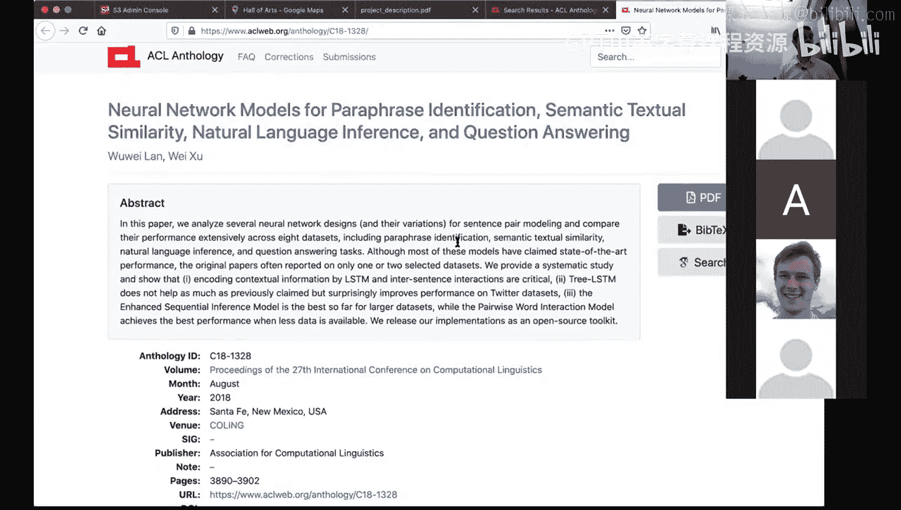
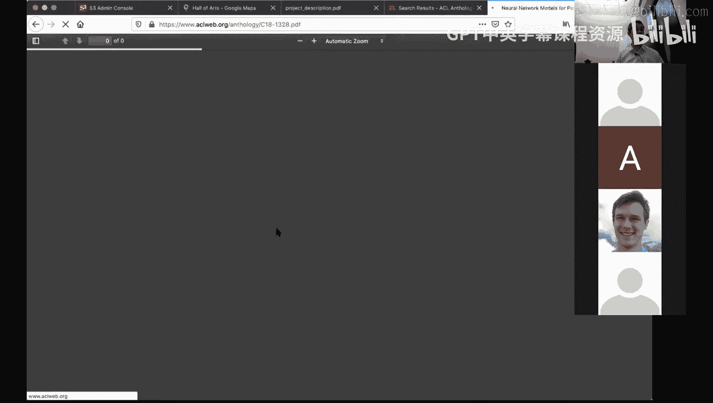
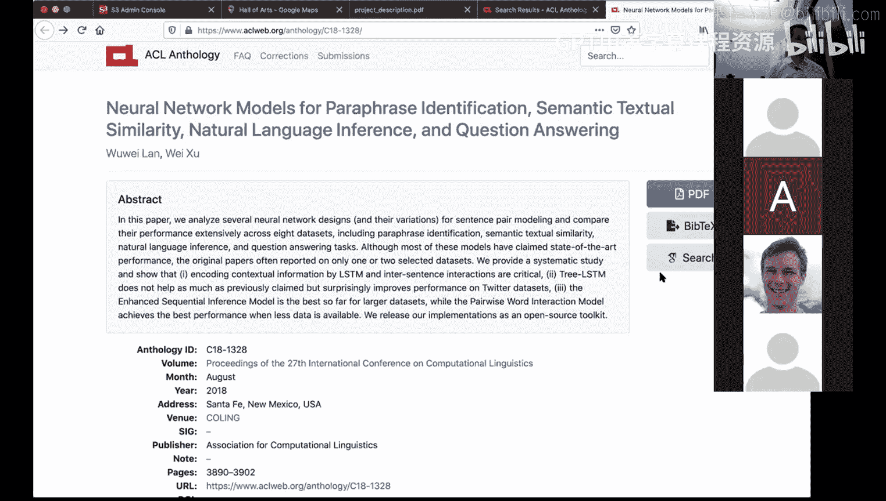

# CMU《自然语言处理｜11-411 11-611 Natural Language Processing 2020 Fall》中英字幕（Claude-4-S） p03 -03-2020-09-08 Project.zh_en -BV1RaWpzAE7E_p3-

Thank you， Sheila， for the reminder。So let's let's go back a little bit。

 so we're talking about the project the goal is given a Wikipedia article to generate N good questions or given and given a Wikipedia article to generate N good answers from the article and we're talking here because I started lecturing without recording about what makes a good question so let's look at this passage here and let's ask ourselves what。

What good questions we could generate from this passage？

What are some good questions you can come up with that would？Okay。

 so one question from Mahull is what is known as the city of Bridges， yes？Pittsburgh。What else。

 what can you see？So you've got who what， where questions， those are called WH questions。

 and you've got yes， no questions。So one is how many skyscrapers does Pittsburgh have。

 what state is Pittsburgh in？U。What are the demographics of Pittsburgh might be a little bit too vague？

Because you know it's hard to know what exactly the right answer to that question is。

What is notable about Pittsburgh is also pretty vague。

 we would not consider that to be a good question。Where is Carnegie Mellon University located would be a good question except that it's not one that is in this passage。

So how many people in Pittsburgh again， that's a good question。So here are some other examples， yeah。

 how many bridges are in Pittsburgh？Where is Pittsburgh， what is the population of Pittsburgh。

 what is Pittsburgh's nickname， how many steel related businesses are there in Pittsburgh。

 and what does the city feature？Because there's。A sentence that says Pittsburgh's features。X and Y。

So what would be a bad question given the same passage， There's some questions that are answerable。

And there are some questions that are unanswerable based on a passage。Let's think about these。

 what is the capital of France？We can't answer。That from the passage。

What is the 57th letter of the article， so we could answer that from the passage。

But it's not the kind of question that we're trying to answer， this is sort of me question。

And we're trying to answer factoid questions。So that would be considered to be a bad question。

What are Pittsburgh's three rivers？Oh yeah， so Mahowell says an example of a bad question would be why does the city of Pittsburgh have 30 skyscrapers。

 you can't answer that based on the passage。What are Pittsburgh's three rivers。

 so this is information that actually is in that passage。

But it is there in a very convoluted sort of way。So this would be a bad question。

 It's not one that can be directly answered from。From the question without a lot of inferences。

The passage just says that。Pittsburgh is at the confluence of these three rivers， not that。

These are Pittsburgh's rivers。So how do you find questions？Well， one way is kind of with templates。

 so x is y， then you can make a question what is y？What whyaihu when。Or the x verbs y。

You might have a question， what is the X verb？You have number based questions。诶。So a lot of your。

Code for question generation。Will be sort of tempemplaatic。

 you'll sort of be classifying sentences in according to their structure and then using templates to figure out what questions can be made from these sentences。

So how do you answer them？While we talked some about this last time， there's a very naive approach。

 which is also template back based。Which is when you get a question that says what is x。

 you look for x is y。And you answer X。What many of you are probably going to want to do is to use a more extractive technique。

So you're going to want to use a vector document model。

And find subsets of the text that might have answers to the questions in them。

And then process these passages into answers。Does that make sense？So probably。For the starting point。

For your question answering system。You're going to want something like we talked about last time。です。

Information retrieval based kind of question answering system。Any questions about that。

 any questions so far？So how does all of this get evaluated？Well。Humans look at them。S you。Asks。

 iss there any restriction on using deep learning？And the answer is no。

 there is no formal restriction on using deep learning， you can use any technique that you want。

 however， you should know that we don't provide you with any training data。So。Supervised methods。

Are going to be difficult unless you can find your own training data。

So that's something to take into account， So there are various approaches based that use deep learning。

Where this， you could still do it。Using this kind of approach。But。You know it's。You can't just take。

ADeep learning approach to question answering out of the literature。

 probably and apply it to this project。You're going to have to think more carefully。So。

So the squad data set might be useful， yeah， as Ceru says。诶。

The exact nature of the questions might be somewhat different and the evaluation criteria might be somewhat different。

Because Sd is testing slightly different。Kind of question answering。

 but you might be able to work based on that and build some kind of system。

So we are going to evaluate your questions and answers。

 or more accurately you're going to evaluate your questions and answers。So what will happen？

At the end of the semester， when the projects are done。

You will have all packaged your projects up in Docker containers。

You'll send us the Docker files and we'll build and run everything on articles that you haven't seen。

And generate a bunch of questions and then these will be divided up in a random fashion among people in the class so they will have the opportunity to evaluate them and say。

 are these fluent， are these reasonable questions？And the same thing roughly will happen with。

Answers。So。We'll take the best of those questions。And we'll submit them to the question answering parts of your projects。

And your projects will spit out answers， your code will spit out answers。

And then we'll evaluate those answers。Are they。Correct。Intelligent， fluident。So Muholl asks。

 have any previous project submissions led to a research paper somewhere？And。To my knowledge。

 not directly， however， people who took this class and did this project have gone on to do work in question answering that led to research papers。

 so you know it it served as an entryway to this， but not necessarily to not directly to my knowledge。

 I could be wrong， but to my knowledge not to。U up。Directly to a paper。So in evaluation。

 there are things that you will want to do， you will want to rank answer quality。

And do this as a human。But also you want some kind of automatic metric for this。

 and you want some kind of automatic metric for ranking the fluency of text。But in grading。

It will be humans。That are your friend and your enemy。And those humans are your peers。

So in question asking， question generation。The input will be the text of a Wikipedia article and this will be different each time each year。

 so you can't we're not going to give you what Wikipedia article it is， of course。

And you'll get an integer N。And your output should be and distinct questions about the article that should be fluent and reasonable。

So basically， this is what it looks like in the command line。So you're running。

 you have some program ask。That takes us an argument。An article。And then a number。

And then it returns to standard out。A list of questions， distinct questions。So Zachary Novak askeds。

 is there a max n we can expect， typically n is not greater than 30？Per article。

We vary this somewhat。Depending on the semester and the needs， you know。

 the articles themselves like the length of the articles， usually it's somewhere between 10 and 30。嗯。

So we'll give you some Wikipedia articles in various different domains and some sample questions。嗯。

Your team will generate some sample questions。Then in question asking。We choose N。

You don't know in advance how many questions？诶呃。We'll want you to ask。

And you'll use your program to generate questions。On some of the articles you had access to on similar articles。

 on some of the same kinds of topics， a completely different type of topics still in Wikipedia。

And we'll evaluate questions based on how fluent they are and also how difficult they are。

And whether they're answerable， whether they're good questions。As we mentioned before。

So the input to the question answering system。Will be the text of a Wikipedia article。

And a list of questions。About the article。And the output。1。Answer to to a line should be。

There should be answers that are fluent， correct。And intelligent。Meaning， basically they're correct。

But there but。So we kind of conflate these two。But that makes sense as answers。So Shi knew Xiao asks。

 what do you mean how difficult is a question？And。This is a subjective rating of how hard it would be for a question answering。

Program to get this。Solution right， to get the answer to the question correct。Valeerrie Chung askeds。

 does the program need to be deterministic and no， the program does not need to be deterministic？"。

So in question answering， we'll give you Wikipedia articles in five domains to help you get started。

So these will be formatted in the same way as the articles that you will。Be generating answers for。

We'll give you you'll also generate sample questions and sample answers。So we'll feed your system。

Questions from the other systems， basically。嗯。The same kinds of things that you're getting generating。

Questions for。But not。And the same articles。But nothing that you've seen before in the development data。

And each answer is going to be evaluated on fluency， correctness， and so on。

So what do you need to do？Well， the first thing you need to do is to form teams。

Is everybody here in a team？So Muhuul asks， does fluency include a lack of grammatical errors。

 is that prioritized？And yes， by fluency， we mean two different things together。 Ner one。

 it doesn't have any grammatical errors in the sense of， you know。

 it grammatical errors in the sense that it's。Gramatically well formed English。

 and second that it is idiomatic， so grammatical and idiomatic。嗯。Alex says。He or she。

It's not in a team。Sobi F Nabi asks， what does idiomatic mean。

 and idiomatic means that it sounds like it comes from a native speaker。Of the language， you know。

 it uses， in a way， the idioms of the language。 So you can imagine a non native speakers。

A non native speaker。Spea。English or some other language that was grammatically correct。

But didn't sound like it was coming from a native speaker of language。This would not be idiomatic。

And that is we want questions that are both grammatical and idiomatic。

 so that's what we are talking about when we say fluent。So Valerie asks。

 are we aiming to make difficult questions or not？And the answer is yes。

 we're trying to make difficult questions that you want to make the most difficult questions you can that your own system can answer。

And the reason for this is that everybody else is going to try to answer。Your questions。

And the harder you can make them， the harder the task you make the harder you make the task for everyone else。

So you do want to make difficult questions。And。You want to be in groups。

So everybody needs to be in a group by the end of this week。And。So Ra cells。So a question like。

 how old are you is idiomatic？But how many years have you lived is not correct。

 and that's basically right。嗯。How many years if you lived。

 it not an idiomatic way of saying how old are you？

Even though it's grammatically correct and it technically means the same thing。Fsty hearty。

That's not grammatical。嗯。😊，Yeah， so。Be sure。To get into a group。Actually。

 raise your hand right now if you're already in a group。Okay， it looks like。Lots of people。

Let me see。Participants。There we go。looks like most people。Are in groups。Okay， if you're not。

Go on Piazza。Tell people you're looking for a group。You。Tell a little bit about yourself。

 tell them a little bit about why they should have you in their group。And。嗯。

Because members of groups are in demand just as groups are in demand。

And try to find people that you can work with。Might help define find people that are in similar time zones。

诶。So you might want to mention that。Because it will be easier to get together and have meetings。

So there are a few different。Landmarks。A few different。嗯。Like way points。嗯。In the process。呃 for。

Like in the project process。And the first thing that you need to worry about。Mi share。This with you。

So the first thing you need to worry about is on September 24th， and that's the project initial plan。

So that。Doesn't need to be hugely detailed。 It's basically a page。

 but it describes what you're going to do， what your general strategy is。Relating to the project。And。

So it's very important and it's important that you form your group and immediately start talking about this。

This is kind of scary for some students because they think I don't know anything about。

Question answering， I just started taking this course and now they're expecting me to come up with an idea about how to do this task。

嗯。But the best way of。Learning about。This subject is to jump right in。And to do something。

 and we're not going to criticize you if your're。Plan。

Is naive or doesn't take into account all of the factors that could be involved or it's going to be difficult to carry out what we want to see as that you've thought about how you might do this。

 how you might generate questions and answers。So， that's the。The initial plant。Then。On October 22。

There's a progress report that's due。And this is。We're going to be looking at this much more seriously。

Because by this time you'll have done a certain amount of NLP。

 you'll have a clear idea about how a lot of things work。

 about what will and won't work in this kind of project and this kind of a task。

And so we're going to evaluate this。More strictly， but this will be a short video。

So you have to pick what is most important and you make a short video report。And then based on this。

Then， in the。诶。Two weeks following the midterm， then the instructors and the TAs will meet with each of the groups。

And we will talk about your project progress reports and we'll talk about a few things。

Like how you're working together as a group。How you communicate， how you share code。嗯。How your。

Plans integrate。 Is there a shared code between the two components or is everything separate。

What have you I found this on the web for shared codes between the two components。

Have you innovated in any respects， and very importantly， how are you evaluating。Your project。

So based on that。You go and work hard and。You write your code and there's a project dry run on November 17th。

Where you submit your code thus far， and we just want to see if it behaves properly。

We're not going to evaluate the performance of the code。

 We just want to know that you've got code that runs。And that you've got a program， ask and answer。

 and when you give them a Wikipedia article and a number， then they do the right thing。嗯。

So the final code is due on December 3rd。At 1159 pm。And。In both of these cases。

 what you'll be submitting is Docker。Docker file or Docker container essentially。

 although obviously you don't。Give us the full container， you give us the formula。

That allows us to reconstruct it。嗯。So。If you haven't had any experience with Docker。

 then we will help you to get up to speed， but it wouldn't hurt to look into it right now and to familiarize yourself with Docker and how it works。

Because it'll probably help you in other areas as well， not just in this class。

So the final project report， which is a longer video， but still a short video。

 is due on December 10th。And here under competitiveitive project。

 you can see the project description。And the resources。The development data。Data， development data。

Here is the project description。I encourage you to read it。

It will answer many questions that you have as you're doing the project。And。嗯。Help you to you know。嗯。

To feel oriented and to feel like you have an authoritative source to appeal to。

When you're in the process of doing the project。嗯。You should know that for the project。

You can use any kind of。Library。Or toolkit that you want。With one exception。So， you're not allowed。

To use。嗯。Well， there are two kind of exceptions， one for tools。

 you're not allowed to use a black box grammar checker。

You can use grammar checking if you implement it yourself。

 but you're not just allowed to borrow somebody else's grammar checker。

Which you probably don't know how works。And use it to in an overgenerated prune approach。嗯。It's。

You know， you should know how the tools that you。Use work。And that's not something that。

We're going to talk about in this course， so this is not allowed。

The other thing is in terms of resources， you can't use any resource that might have the answers to the questions in it。

 so like data knowledge bases。That have the answers already in them are forbidden。Okay。

 any questions I haven't been watching the comments。So Zgxin Zhang asks。

 do we have a template or something to fill in the project initial plan， No。

 it's just a one page paper。Structure it like a one page technical paper。嗯。

The project progress report Mehu will ask has to be a video， yes。

 the progress report has to be a video。You' are allowed optionally to include a one page write up。

If you're not able to fit everything in the video。嗯。Other than the videos。

 there will be no written report。Only the video reports。So Chris Fan asked。

 is the code also not allowed to access the internet？That is correct。

 the code is not allowed to access the internet。嗯。Otherwise。

 you could do terrible things like just outsource your question answering to Google。

And so we just have a blanket。呃。Requirement that the code not access the Internet。

 that not access anything outside of the。Docker container。Valalerie asks。

 is there a practical limit to the size of our project submission？嗯。Yes。So。

If it's too large for us to download onto our machines。Then that's not okay。嗯。You know。

 if you're including a huge model， for example， that。嗯。takes up many gigabytes。OfStorage。嗯。

ThatThat would be too big。Mhull asks， can we take inspiration from certain papers if we cite the authors。

 yes， definitely， but you do need to cite the authors？

But but you're very much encouraged to read papers about this subject and try to take ideas from them。

Definitely。So any other questions？So I really hope you enjoy this process， enjoy this project。

 I hope you find group members that you can work with well and that will not flake out on you。

Actually， that's always a complaint that's something I should have mentioned。

 so at the end of the semester we also sent out a Google survey to our Google form survey to everybody in the course asking them to rank how what percentage of the work each of the members of their group did。

And usually people pretty much agree。But when there's a disagreement， we will investigate further。

And sometimes this results in a shifting credit around。So Boy Chan says。

 can we implement papers ideas directly with citation with citations， yes。

 you may implement papers ideas directly， but we encourage you to try to go beyond what you read in the papers。

Okay， anything else？2。🤢，Zhhan Xin asks， where can we access papers？And。嗯。The best way place to find。

NOP papers。Is it ACL anthology。So this is a collection of all of the papers that are published at the。

Star ACL conferences as ACL。EACL， EMNLP， NAACL， and then a number of other conferences and journals。

So if we go here and we type in。Question。不。And sorry。Then we get a list of papers。You know。

 a long list。Now， you'll always want to search for something more specific than that。

But this is just an example of。You know， the fact that。

There are a lot of different question answering papers。In atheal anthology。

And you go through and you find papers that are relevant。诶。

Then you go to their bibliographies。

You read the papers。Go to the bibbliographies。And find what papers they cite。Track down those papers。

And so on。And you can find lots of papers that are relevant to what you're trying to do and lots of ideas to work with。

Occasionally you'll need papers that don that aren't available for free online through ACL Anthology or some other source。

 a lot of these you can access if you're using the VPN。The CMU VPN。嗯。So。You may want to install that。

If you don't have it already on your computer， the VPN client。嗯。

So that you can access those library resources。Like from ACM， for example。

 Association for Computing Machinery， we don't。A lot of their papers are not。嗯。

Available for free online， but the university has a license for all of them。

 so you have to use the VPN。Any other questions？Okay thank you very much for your attention and for your great questions I really look forward to seeing your project reports and seeing what great ideas you come up with I know that you know from our discussion here that you'll have lots of good ones and so it's very exciting if you have any other questions email me and Alan or ask on Piazza and we'll do our best to get back to you。

😊。

All right， thank you very much and goodbye。