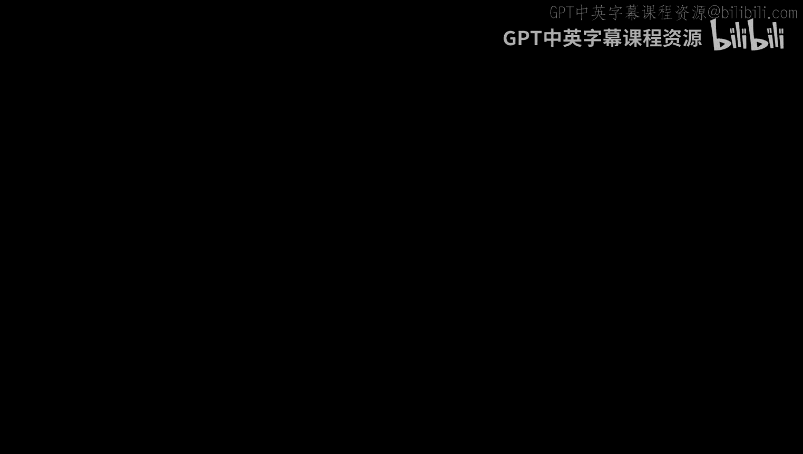
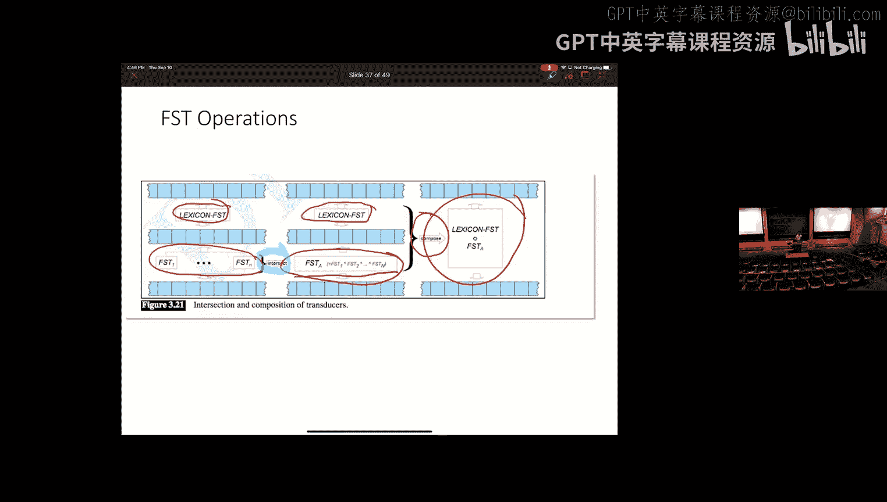

# CMU《自然语言处理｜11-411 11-611 Natural Language Processing 2020 Fall》中英字幕（Claude-4-S） p04 -04-2020-09-10 Words and Morphology.zh_en -BV1RaWpzAE7E_p4-

Again。

We're going to talk about words and morphology。One of the levels of representation that we talked about in the introductory lecture。

We're going to talk about this in fairly good detail and about a number of different aspects of this part of language that are relevant to natural language processing。

U。Before that though， I'd just like to put on a reminder that homework one is due at  lesson 59 tonight and we'll be releasing homework two at the same time。

 sometime tonight， basically， and homework two is hard。And you should start working on it soon。

 but you have two weeks to do it， you have two weeks， not because we're nice because we're not nice。

 we're awful people， but we don't think you can do it in one week， and so we're giving you two weeks。

 one week to install Open SST on one week to actually do the work。So get started on it soon。

 it's something you'll learn a lot from because it's very different from what you're probably used to doing and stretches different mental muscles and exercises different mental muscles than you're used to exercising。

So it's a good exercise and we encourage you to do it and not to say。

 I'll drop this one because you'll need to drop homeworks later in the semester and then it would be everlastingly too late。

嗯。So let's talk about linguistic morphology。What is morphology？

What is morphology if you ask a biologist what morphology is， what will they tell you？😡，我不。

So it's a study of the structure of organisms， the shapes of things。You know the。呃。

The structure of things in terms of their physical form。Now。

 when we're talking about the morphology of words， we're not so much talking about the physical form。

 as we are about the linguistics form， the internal structure that words have。嗯。By the way。

 there's a complaint that a lot of students to this course or courses like it will make。

 which is roughly the following， I'll say。I'm not a linguist， I'm a computer scientist。

 Why do you keep talking to me about linguistics？😡，Well。

 the answer to this is that NLP is not just P。😡，It's also NL。

 it's also about natural language and just as you would need to know something about biology in order to do computational biology。

 you need to know something about natural language in order to be good at NLP in order to be really good at NLP。

😡，So you know， if you were linguists already。We wouldn't have to talk to you about these things because you would already know them。

 we' just trying to give you enough background that you can understand issues that relates to NLP and to these linguistic concepts。

😡，So what is morphology？Well。It's about the internal structure of words。

 so that's the first thing to know that words are not atoms in the sense of Debacrs right they're not indivisible units。

 you can divide them into smaller pieces and if you grow up as a speaker of English or Chinese or a few other languages。

 this might seem weird to you。😡，Because for the most part， English words and Chinese words are units。

😡，They don't have a lot of internal structure。And so you can forget， oh。

 language words and languages are not just。Atomic units。

 you can divide them up and talk about what is going on inside of them。

But even in Chinese and English you have examples of morphology。

 so in English there's actually quite a bit of morphology compared to Chinese so you can have words like。

Miss。Understanding。Where this word consists of four meaningful units。Maybe five。

 if you consider under。I drew that in the wrong place。To see if you're watching。

 if you consider under to be separate meaningful units。

 then there are actually five meaningful units， but there are at least four。

Even in Chinese which has remarkably little morphology other than what are called compounds where you take two words and put them together to make a bigger word。

 there's some morphology， so for example， there is this pluralizing suffix Mu that occurs mostly in pronouns like Taman they or womanman us we us but can also occur with some nouns。

 so you can say things like Tongzhumun from Tongz which means comrade and Mu， which means plural。

 although as some of you know who speak Chinese and are up on modern lingo Tongz and Tongzman have come to mean something other than just。

Comrade。So these little units of meaning。These things like Mu。Or understand or in or F。The minimal。

 meaningful units in words are called morphs。😡，And morphines come in really two types。

There are roots which carry the central meaning of a word。😡。

And then there are affixes that you add to words to modify that meaning or to add additional information。

 and affixes come in four types， there are prefixes like in pre nuptial or irregular。

There are suffixes like eyes and or and determinize an iterator。😡，There are in fixes。

 This is not something that you have a lot in， in English。But it occurs a lot in some languages。

 but in English there are some marginal ines， so for example you can take the word Pennsylvania and if you want to refer to it in a deprecatory fashion。

 you can say I went all the way to Pennsylvania fucking and all I got was this in-person experience。

😡，嗯。So that's in fixation。 And in a lot of languages， it's not just fun。

 It's actually really important to the grammar。Then there are circumfixes which come where you add a piece to either side of a root or a stem。

嗯。But not all morphology is about concatenating things， about adding units together。

 there's also what is called nonconcatenative morphology and we have some of this in English a general class of nonconcatenative morphology that's called apony that counts in two flavors in English calledumlout and oblout。

 so Ulaut is like changing foot into feet or tooth into teeth to make a plural。😡。

And oblo is where you change the vowel in a verb in order to change the tense and aspect of the verb。

Or the tense in the form of the verb。But this is small potatoes compared to what happens in Hebrew or Arabic where they have roots and pattern or  tempemplaatic morphology and in these languages。

 roots are kind of like just a sequence of two or three or four consonants。😡。

And then you shove vowels into the middle between these consonants and lengthen the consonants and do other things to them in order to make new words or new forms of the same word。

😡，Then there's in fixation， which we've already talked about which is non concateogniative。

 so in Tagaa， the national language or the Philippines， then you have an insect boom。

 you stick into words and it changes the tense。But this is probably， you know。

 so all of this is important， roots， ses， non concatetative morphology。

But what is more important for NLP is understanding the difference in function between different kinds of morphology。

😡，So there is inflectional morphology and there is derivational morphology。

An inflectal morphology adds information to a word that is consistent with its context in a sentence。

So things like number。Singular versus plural or case nominative versus accussative。

Are examples of infleional morphology or tense for a verb。Agreement。In number， gender。

 these are all examples of infleexional morphology。

 they're all about where a word occurs and not about what a word means or what it's part of speeches。

Their areal morphology， instead of just adding information to words， it derives completely new words。

😡，Creates new words with new meanings and often new parts of speech， so she take parse。

And add an ER to get parser that derivation。And if you take repulse and add IVE to it to get repulsive。

That's also a derivation。Okay， I just want to stop here and ask if there are any questions so far。

Professor， even though you say in derivational morphology， you create new words with new meanings。

 I mean， wouldn't you say parse and parser and repuls and repulsive has some sort of connection？Oh。

 of course， of course， there is a function。From。The input to a derivational process and the output。

And that's what morphology is all about， so there's a relationship between parse and parser that's similar to the relationship between eat and eater or between ride and writer。

Or between。Well， any number of other things。But future it's not as direct as inal morphology。

That's correct， That's correct， So's it's less predictable。You know，With inal morphology。

 you're just adding pieces of information。And with derivational morphology。

 you're transforming a word in some way。All rightThank you， it's four minutes meaning。Yeah。

 thank you so much welcome。Any other questions？So one of the nasty things about morphology as compared to syntax。

Is that it's sometimes quite irregular。So you can have formal irregularity。

That means that the way you mark something， the way you do morphology varies depending on what word you're doing it to。

 so if you compare walk， walk to walked，With Singseng song。

What you're doing to that verb to inflect it is very different in one case than the other。

 so this is formal irregularity。There's also the semantic irregularity or unpredictability。

 and this gets to some extent back to the last question。

So the same derivational morphine may have different meanings or functions depending on the base it attaches to。

So by the way， this we have this star here， which I should explain。

 that means that that's something you can't say that's a bad piece of language。

So you can say you can say a kind old man and you can say a kindly old man。

And you can say a slow old man。But you can't say a slowly old man。So kindly。

 kind can take Lee and become an adjective。But slow。When you add Lee can only be an adverb。

 it can't be an adjective， so there's some unpredictability in how Lee will affect the part of speech of a base that it attaches to。

So why do we care about morphology？Well， on the one hand， morphology is a problem。

 particularly inflectal morphology。So it makes words that are the same word look like different words。

It disguises underlying unity in the vest of difference。

And so this is a problem for information extraction and information retrieval and various other kinds of NLP tasks。

Because you are。You end up with some sparsity often in the data。

Because you're dividing up a single category into a bunch of other categories based on the surface form。

 and you can't see that those really should be the same category and should have the same label。

So one thing that you need to know about morphology for is getting rid of the surface difference so you can access the underlying unity。

But morphology also encodes a lot of useful information that can be useful or in some cases even essential in NLP tasks。

 this is true in machine translation in natural language understanding in semantic role labeling for many languages。

😊，Probably not true for English where you have massive amounts of data and relatively little morphology。

Probably not true for Chinese， where you have massive amounts of data and even less morphology。

But it is true for a lot of other languages， in fact。

 most of the languages with the world are morphologically rich languages。

 and you have to deal with this kind of problem。And you also have access to this kind of information。

That can help you to solve problems you wouldn't otherwise be able to solve because there's this information that's being encoded in the morphology。

So in NLP there are actually pretty good solutions to morphology。

 there's an old rule-based solution which we'll talk about today in which you will talk about on your homework2 which is using finite state methods to do morphology。

 this is still widely used so if you go to Google actually employ an army of computational linguists to write FSTs to process morphology of every conceivable language and other companies do a similar thing because this is a very well understand and very robust technique for handling morphology。

 but there are other solutions that are now gaining currency for example supervised sequence to sequence models for morphological transduction for generation and analysis of morphology and。

Supervised models for morphological segmentation that is dividing words up into their constituent morphems。

Let's。Move。To the subject of finite state morphology。

By way of an introduction to different levels of analysis。

That you can have of a morphological of a word， of the morphology of a word。

So the form that we're most familiar with is the orthographic form。

So things like hugging or panicked or foxes。Often what we want。😡，Or what we start with。In NLP。

It's something like a lexical form。Yes。So we have what's called dilemma。

Which is sort of like the dictionary form of a word。

And then a set of properties of inflectional properties。So here， as part of speech information。

 we wanted to know that it's a verb and we want it to be progressive。For the case of foxes。

 we get two different lexical forms corresponding to one orthographic form。

 it could either be a plural noun。Or a singular verb。So the problem is， how do we map back and forth？

Between the lexical form and the orthographic form。

And one thing that you'll learn is that one way of doing this is having an intermediate form。

An intermediate form where all of the morphines have just one representation each。So in hugging。

 if we divide it into morphs， we've got hug。The two gs plus。IN G。What we want in a morph femic form。

Is the rule for women to get rid or add？This G， this to double the letter。

So we have all kinds of rules。That correspond to the spelling rules of English。Or all kinds of。

Knowledge。That corresponds to those rules。That allows us to map。Between an orthographic form。

To a morph feic form。And then that makes it easier to go。To electricalxical form。And vice Thrtha。

So we do this。Or we can't one way of doing this， this is not the only way。

 but one way of doing this is with finite state transducers。These define regular relations。

 also called rational relations between strings。Oh。I didn't see some questions in the chat。

Let's go back here just a minute。So。你。Carrot here means a morphine boundary。

 a boundary between morphs。And the hash mark means word boundary， so that means end of word。嗯。

So the difference between Fox noun plural and Fox verb singular。

The verb is the one that occurs in sentences like。He out foxes。The hounds。And the noun one。

 Fox noun plural is one where I found a dent of foxes。So they are spelled the same way。

 pronounced the same way， but they have different， they occur different places in different sentences。

Good questions。So back to SSTs， so they they define regular relations。

And they're used for a lot of different things in NLP。They have a great property。

 which is if they're deterministic and we'll talk a little bit about what that means。

Then once you compile them， they execute in linear time。😡。

So this is much faster than a lot of competing models for doing morph qualityology。

 This is pretty good。 You might think， oh， linear your time。Why not logarithmic time。

 but this is actually better than the alternatives。嗯。But to understand them。

 we have to go to something simpler because this can be hard to get your head around first。

 so we have to start with their simpler relative， the finite state automaton or finite state machine。

Who here raise your hand if you have encountered。Finite state machines or finite state automata before raise your hand on on。

嗯，那。la not slacklack on Zoom。So。A lot of you， but not everybody。So by the end of this class。

 all of you will have accounted them。So finite state Atmata are formalisms。

There are formalism that has in the following。5 components。They have Q。

Which is a finite set of states。Nce here， these circles are states。

Then they have a special start state， Q0。And a set of final states。没呀。Which is a subset of Q。

Then there's a finite alphabet。This brings me to a pet peeve of wine。

And that is regarding the word alphabet。So many people， many students nowadays。

 you young folks think that a letter is an alphabet。As then。You know， that was an alphabet。

 A is an alphabet or B is an alphabet as opposed to nine or eight， which are not alphabets。嗯。

For our purposes， an alphabet is not a letter。 An alphabet is a set of symbols， a set of letters。嗯。

And that's what we mean by Sigma is a set of symbols， they could be any kind of symbols。

 they don't have to be letters of any language， they could be emojis。

 they could be completely abstract， they just have to be symbols。And。

The final thing is you have transitions。Between these states。That have a label S。Drawn from Sigma。

And what these do is encode the set of strings that can be recognized by following paths from Q0 to some state in F。

So let's look at a concrete example， because that's not very clear。 This is a very simple。

 concrete example， so。This is a finite state automaton that generates a sheep language。

And as you may know， so I grew up around sheep， sheep are very dumb。

 they're probably the dumbest creatures that are multicellular。哎。

And so they have very simple vocabularies。What are some of the things that this that are in this sheep language。

 what are some of the words？That could be recognized by this automaton。Could。What about B A。

Is that recognized by this automaton？Well， you start here at Q0 and you go B。诶。

That seems fine so far。What's the problem？Hello。It's not an accepting state。

 right Q2 is not an accepting state and we can tell what is an accepting state because it has a double circle。

So it has to Q2 is an end state or an accepting state or an acceptor state， all the same thing。嗯。

So this。です。FSA will not recognize B， this is out。What about？BA爱。So， you're seeing。Has the right idea。

From。The chat。 And that is， you can rewrite this SA as a regular expression。 In fact。

 you can rewrite any FA as a regular expression。 What is the regular expression that corresponds。

There are two different ways of doing it， but what is the regular expression that corresponds to this FSA？

So Yoosshin says。嗯。B a。诶。A star。Exlammation point。That's right。

So another way of saying this is BAA plus。If you're using like Python style regular expressions and you have a separate plus quantifier。

嗯。But this is the。The proper way。So any。String that is matched by that regular expression will also be accepted by this FSA。

So， this。Would be accepted。嗯。This would not。This would not。If you can read that then。

You're getting an A for sure。嗯，Yeah。So here's something to keep in mind。

 So people often get confused about this。 They get the wrong idea。They get led astray by pedagogy。

We tell you to think about FSAs by sort of tracing your way from state to state。

 consuming symbols from the input state until we reach the final state or accepting state。

Then people get confused when you could take more than one transition。Away from。A state。

They think which way does it go， which way do you go， I don't know， I'm paralyzed by indecision。

But that's not the right way to think about it。It's rather better to think about these things in terms of something like depth first search。

😡，So you're going through the whole network。Trying to find a path。Through the network。

That allows you to start at the initial state， consume the whole string by going across transitions that consume each of the symbols and that arrive at the final state coincident with the end of the tape。

That is the tape is what the word is written on and you're moving。嗯。A pointer across the tape。走。

Don't get confused and don't think， oh， which way does it go for finite state automata or finite state transducers。

 they can be non deterministic。And even when they're deterministic， they can look on it they can。

Have what appeared to be non determinisms locally。😡。

So something we're going to come back to is the study of formal language。Formal languages。

So a formal language is a set of strings。Typically。

 wonder that can be generated or recognized by an automaton。

So this is pretty different from a natural language， but one thing that NLP people have。

Traditionally done is kind of pretend the natural languages are formal languages。

 This is less true now than it was at a point in the past。But it's nevertheless true。嗯。

So there's a set of languages that can be recognized by FSAs。

And these are called the regular languages。The same languages that can be described with regular expressions。

And it's very convenient。That most natural language morphologies。

Belong to the set of regular languages。There are some exceptions， but for the most part。

 this is true。One thing that you should note is that about regular expressions。

 is that regular expressions in Python or in other modern programming languages are often not regular expressions。

They're more powerful than regular expressions， and they can describe languages that are not regular。

So can you think of any examples of？Features that Python regular expressions have that would make them。

That would go beyond what you could do with a finite state automaton。So I've got look behind。

 look ahead， look back， back references。You know is not something you could do with a finite state automaton。

嗯。So match groups， also some uses of match groups。You， you couldn't do。嗯。You couldn't look。Ahead。

 you can't look behind。So here's an FSA for derivational morphology in English。And。

All this can do is tell you whether a word is a good word or not。And it's very simplified， you know。

 they used when this is from your textbook and when they did this。

 they took a bunch of transitions for nouns。And indicated them as one transition。And in fact。

 they took。All of the transitions that should consist of multiple transitions， one for each symbol。

And join them together and treat the。Ahole string is a label rather than treating the individual symbols as labels。

 which is what you'll have to do on your homework。So。SSAs are good at recognizing。

 but they're not very good at parsing or generating。

They're not very good at analysis and they're not very good at generation。

So let's say your input is a word。And your output is a stem or lemma。

And the features that are expressed by the morph themes。Ultimately。

 we don't care about the order that these occur in。We can think of these as a set。But。Typically。

 we treat them。As a sequence， basically in the order in which they appear。

So for let's say we want to map from geese to goose， gooses to goose。As a verb。

 dog to dog is an out of verb， leaves to leaf or leaves。Leaf as a noun or leave， the singular verb。嗯。

How could we do this， how could we establish this mapping？

But we have at least three different options。 One option is。嗯。🤢，A table， a try。

And a finance state transducer。Yeah， what would the advantages of using a table to do this be to establish this mapping between orthographic forms and lexical forms？

So it would be fast， as Johnsonsine says。嗯。You can have constant time。Looker。

What would disadvantages be？So there's space。You'd have to have a huge table。

So there's also the issue of new words。So what happens when you come across a word you haven't seen before？

What do you do then？Do you have any recourse？No。There's no handling for what are called out of vocabulary items。

What about tries？What would the advantage of a tribe be？Actually。Depending on your implementation。

 try might be。Worse in every way than a table。But what would a potential advantage of a tribe be？

Depending on implementation。A prefixed tree。So depending on how you implemented it。

 it could save some space。 You could have a smaller。嗯。嗯。嗯。The database could be smaller in size。

The table。嗯。What disadvantages does it have？不。Similar to a table。

 you have no way of handling out of vocabulary words。

You have no way of dealing with words that are not。And the lexicon。

Finance say transducers give you ways of dealing gracefully without of vocabulary items。

And using general rules to predict forms to guess forms rather than having to。

Rely on knowing the exact mapping all of the time。And you'll learn about this in homework too。

Just had to check when we're ending。Since I'm not used to this schedule。

So finite state transduucers are a lot like finite state automaton， automata。

 they have most of the same components， so in fact they have all of the same components。

 you just add something。So they have Q， a finite set of states， Q0， special start state。F。

A of final states。But instead of having one alphabet。They have two alphabets。Two finite an alphabet。

One for the input side and one for the output side。😡，And then the transitions。Look like this。

 we often write them as symbol colon symbol。So there's the input symbol drawn from sigma。

And the output symbol。Drawn from Delta。So basically， when you go across the transition。

Then you read the input symbol from the input tape。

 and you write the output symbol to the output tape。Any questions？So going back a little bit。嗯。

Maholl asks，Could you not update a table with new vocabulary？Imagining a dictionary here。

And the answer is yes， but youd have to do it manually。

There's nothing algorithmic that would predict what the forms would be。So。I also grew up with cows。

They're slightly moreThey're more intelligent than cheap。嗯。But meananer， actually。

 the cow is a dangerous beast。And。It's possible to translate。

 as this example shows between a sheep language to a more sophisticated but equivalent cow language。

嗯。So if I give this FST。嗯。The。Shehiep。Word bar with three A's。B。What does this translate to in Cal？😡。

Spell it up。空调。So Acrozi's got it， yes。嗯。It translates to this。Because go we have B to M。8 o。A so。诶。

An exclamation point to question mark。What？😮，If the input is。把。With one air， what is the output？

Rul says no output。Your sh says reject。Those are correct。There's no output， it's just rejected。

Because you don't reach an acceptor state。嗯。So this is basically how finite state transdduucers work。

 this is the basic idea。嗯。They can， as I mentioned before， be non deterministic so you could have。呃。

Another transition here with the label B goes to N。And then。A goes to I。Given such a network。

Call this。Q 5。嗯。Given such transducer。What would the input， What would the output then be for。

B A A A Flamation point。12。Let's say lets do that。 Let's do be A A。哎。Exlamation point。

So justin has the right idea。And while Al saided has it even better。

 so basically the output of a finance state transducer is not really a singleton， it's a set。

And in this case， both。Of these。Outputs。Would be valid。So why do we care？Well。

 we care because a lot of languages are sort of like Turkish。 We have a Turkish speaker。

Somewhere in this class， right？Yeah。Yeah， so could you read this word for us？So。

And how would you translate that？Is this a good translation？Yeah， as if you're among those。

I guess it would like be more appropriate to be like those people because I mean， I guess not。

 those whom we were not able to civilize， yeah。So。Most Turkish words are not thisl。

 don't have this many morphine。Here you see each of the morphmes here。

But some Turkish words have lots of more refines。And if you look across corpus of Turkish。

A lot of the words are words that you wouldn't find in a dictionary。

Because there are new words that people made it up using this machinery， using these morphs。

So you run across these words that would be out of vocabulary pretty often。With an FST。

 you can encode all of these generalizations， all of these patterns that allow you to build words like this。

 these massive monster words。And in a relatively compact way。So there are very good FSTs。

 for example， that exist for Turkish。 But this is not a problem just for Turkish。 Turkish is。

Has a lot of morphology。could have big words， but it's not the only language that has significant morphology。

In fact， most languages， when you move beyond the big five。

 most languages do have significant morphology。So we can use SSTs to deal with this。

Here are some examples from English， which are a little bit contrived because it's English。

And they're highly simplified。But at the top here in figure 3，3， you have an FSA。For English。

 nowun and inflection。Very simple， you just have pluralization when it's a regular noun。

 if it's in irregular plural， you have a transition for the irregular plural that's built in to the SSST。

And for regularular singulars， it's also built in。嗯。Hard coded， basically。

We can translate this into an FST。In figure 3。13。That。Actually does analysis。

I don't like that slide so much， so I'm going to move past it。嗯。

So often when you're writing a morphological analyzer for a particular language。

 you'll divide it into two sections， implementing separate SSTs for morph tactics。

 this is how you put the morphs together， and allammorphic or orthographic rules。

 how the letters or sounds change when you put them next to each other。So。

Morephotactic rules would tell you that you put ING after a root。

To make a progressive form of a verb or a present participle。But the orthographic rules。

 the allomorphic rules would tell you that you double the consonant in bagG， for example。

 that you double consonants before certain consonants before these suffixes， this is a general rule。

嗯。And it would be encoded。In this other FST。So more for tactics are like。Mapping between Zach。

 this is a made up word。Zuch， zach。Noun plural becomesch pural zch morphine boundary S。So， this。

Corresponds to that。To the S at the word boundary。So it concatenateates the basic forms of morphines together。

 concatenates lemmas with ethices， and lemmas in this case can be guessed so you can have alemma that you don't know。

 this is something that will be important to you when you're doing homework too。And that you。

The system guesses。It looks at the word essentially and thinks。

We could make a full word if dilemma had this form。Then you have the allomorphic words。

 rules that map between the output of morph tactics。And surface representation。So。

These are the rules that map between something like Zch morphine boundary S。And Zches with。

This E here。That didn't occur。And the morphemic representation。So that's what this is。

What is adding to E？So the two different kinds of information they're being coded in two different FTs。

 and then as we see we can put them together。So here's an example of how you might generate inflected forms of English verbs fromblemmas。

So this is a guesser。So。Epsilon here， by the way。Is the empty string。And this is。

Confusing to a lot of people。What is the empty string， where is the empty string？So Sean Hoff。

If that's how you pronounce your name。嗯。And youshin basically。

 so Sean Hf and Maho Agaal say basically two quotes next to each other， right？

But yourshin says something important， which is that it's anywhere between symbols。So that's crucial。

The anti string is everywhere。So what this FST does。嗯。

Is given any input and this any here means any symbol to the same symbol， so this is the same as。诶诶。

B这个鳖。so on。So don'll take any sequence of symbols。And map them to either morphine boundary followed by I and G。

Or S or E D。Okay。So if we give it as an input， the word the made up word sig。

What would the output be？The air tongue。从。Says。In。Brackets sig。Your skin says a very long set。

It's actually not very long， so Kevin Robinson has it right。So it's squig morphine boundary， I N G。

 Sig morphine boundary S， Squiig morphine boundary， E D。So it would be。嗯。So Maho says。So here。

 epsilon is just the end of the string。And you can think of it that way。

It's at the end of the string。嗯。So there's an empty string at the end of any string。

And that's the one that you're rewriting as this succession of symbols。So this is more for tactics。

Here is orthographic spelling rules。Orthographic rules or spelling rules。

 which are kind of aammorphic rule。 They change the shape of morphines。Based on their context。

So examples are constant doubling， like in be and begging。E deletion， like in make and making。

E insertion， like watch and watches。Wire replacement like in try and tries and k insertion。

 like in panic and panicked。So all of these are very systematic。😡，Very systematic rules。

And you can easily write a rule on SST to encode these。

 then you can combine those together to make a big SST。That。Implementments all of the rules。

Here's an example of an FST for one of these rules。嗯。

You'll actually implement a version of this for homework two， so this is the e insertion rule。嗯。

Linguists have a different notation for indicating the same thing。

 and that is this kind of string rewrite rule。So what this says basically is that the empty string is rewritten as an E。

In the context。Where。X and Z precede a morphine boundary proceeding。The locust。Followed by an S。

And a。Word boundary。So this underscore here。It's where the thing that gets replaced is located。

In the context。This is the left context over here。And this is the right context。

So it means the same thing yes， you just know that is based on the working？按毕。嗯。

Based on the morphing down in the word boundary， you know that it's your final S。没有。

So there are a bunch of different FST toolkits。And big companies tend to have their own toolkit。

But there are open source ones and free ones like FFST， HFST。

 FOMma and so on that they let you write。😊，Rewrite rules， kind of like this。

And compile them into FSTs。So this is easier than manually constructing。FSTs。嗯。And you can。

Take cascades of them， compile them into FST， compose them with other SSSTs。

 and it's very convenient， but that's not what we are having you do for your homework because as I mentioned before。

 we are bad people and。We。1。You to learn through suffering， no。Just kidding。

We want you to learn and we want you to learn the foundations。So here's the interesting thing。

If you have a lexicon FST， this is the morphphotactic FST。And the aammorphic S FST。

 the orthographic rules。You can join them together。You can feed the input， the you can feed。嗯。

The orthographic form into the orthographic rules， then feed the output of that to the morph tactic FST。

嗯。And you can go the other way too， and this is true because FSTs are invertible。

This is something that you'll learn about in more detail in your homework。

 but basically you can take an SST and switch。The symbols on each transition around。

And you get an FST that goes in the opposite direction。

So we can take the same FST that we used to take morph feic forms and convert them to orthographic forms and invert it and we have an FST that will go in the opposite direction。

So we can use the same pair of SSSTs both to parse。And to generate。Which is very cool， I think。Well。

 you can do a lot of things with SSTs， there are a lot of operations that you can perform on them。嗯。

Composition， concatenation， clean closure， union。And kind of intersection。

So composition is the most important of these。this is equivalent， you create a new transducer。

That's equivalent to taking the output of the first transducer and feeding it as input to the second transducer。

That's composition。So you get a completely new FST。A big FST from combining two smaller FSTs。And the。

 the。Big FST does the combination of the things that the two smaller FSTs do in sequence。

It's also concatenation。So this is like your your taking。One FST and on it making its final state。

 the initial state of another FST。So that it transduces。嗯。Well。

So if you had a transducer that went from B。To a and a transdcer that went from。C to D。

And you concatenated them， then you could have a transducer that went from BC。2 a。ri道利。Holly says。

 can competition work？If T only provides a subset of the input set of s。It still works。嗯。

It just might reject。Some cases， you might not。 There's some inputs that would be acceptable to。呃。

That would be acceptable to T， but not to S， and it just rejects them all together。

And then there's cleaningy closure， basically it's like the Cly star on operating on transducers。

Union， which is important。For you， so given transders T and S。

 there exists to transducer T union S such that。X is in a T union S relation with y if then only if x is in a T relation with y or x is in a an S relation with y so it's the。

The set， if you imagine。Relation to sets。And each transducer defines a relation。

And union takes the union of those relations so that if it's okay with either of the transduucers。

 it's okay with the union transducer。Finally， there's intersection， which is very nice。

 it's like the reverse of union， as you might guess。But FSTs are not closed under intersection。😡。

Therefore， open FST， which you use in your homework will not allow you to do intersection on FSTs。So。

Some things that would be nice to do with intersection you can't do in Open FST directly。

 you have to think of another way to do them。This is just the algorithm for composition。呃。Oh。

 Yoshen asks， what does it mean by closed？And what does it mean by close， who can tell us？If， if。

FSTs are not closed under。Yeah， under intersection， than it means， as Olivia said。

 that they're not well defined under all inputs。So there are some FSTs。

 some pairs of FSTs that if you try to intersect them， you get something else other than an FST。

So it's not well defined。Yeah， Ksy Jane has it right。

One SST intersected with another won't necessarily be an SST anymore。So people always ask me。

 by the way， how you do composition。Of FSTs。 And I think it's like some simple thing like explain to me on the board。

 Well， actually， there's a fairly complicated algorithm for doing this， Not that complicated。

 but it's here。In case you want to refer to it， this is for weighted FSTs。

 So it's a little more complicated than。For the kind of FSTs we're talking about。

But just for your reference。So， let's say。We have lexicon FST。This morph tactic SST and then。第s a。

Pammorphic FSTs。We want to combine everything together into one big FST。So one option。

 if we're not using Open FST。Is to take and intersect all of these orthographic rules。😡。

All of the different spelling rules。And get one FST that。Recognizes only Paris。

Only input output pairs that follow all of the selling rules。So that's this here。

Then we can take the。嗯。です。Alammorphic FST。And are。More for tactic FT。And we can compose them。

And then we get one big SSST that does all of this stuff。

So why might we want to have one big FST instead of passing information back and forth among a bunch of smaller FSTs？

So Rahul says encapsulation。And that's basically right， that's one reason。嗯。We， we。Want to。

We don't want to mix things up too much， it's better engineering to encapsulate the whole morphology in one unit that can be treated as a unit rather than be fiddling around with what is inside。

嗯。To have everything dealt with in a consistent fashion internally。What else？

So Sean says you don't have to store intermediate state， and that's also correct。

So there's also an efficiency thing。Which is that the for a deterministic SST then。The啊。嗯。

Performance， the time complexity is proportional to the length of the input string only。嗯。

So if you're running the input string through a whole bunch of different FSTs。嗯。

YouIt's actually less efficient than just doing it through one FST。嗯。But even more than that， like。

For this example， where we assume that you can do intersection。嗯。

You can't do the equivalent of intersection。Just by feeding input passing inputs and outputs around。

Oh， we're over。Okay。Let's stop there。嗯。We'll post all of the slides。

We've gone through the most important part。So look at the slides and make sure you're familiar with them。

 but we won't hold you too accountable for what is left。Anyway。

 thank you very much and sorry for going over， goodbye。

