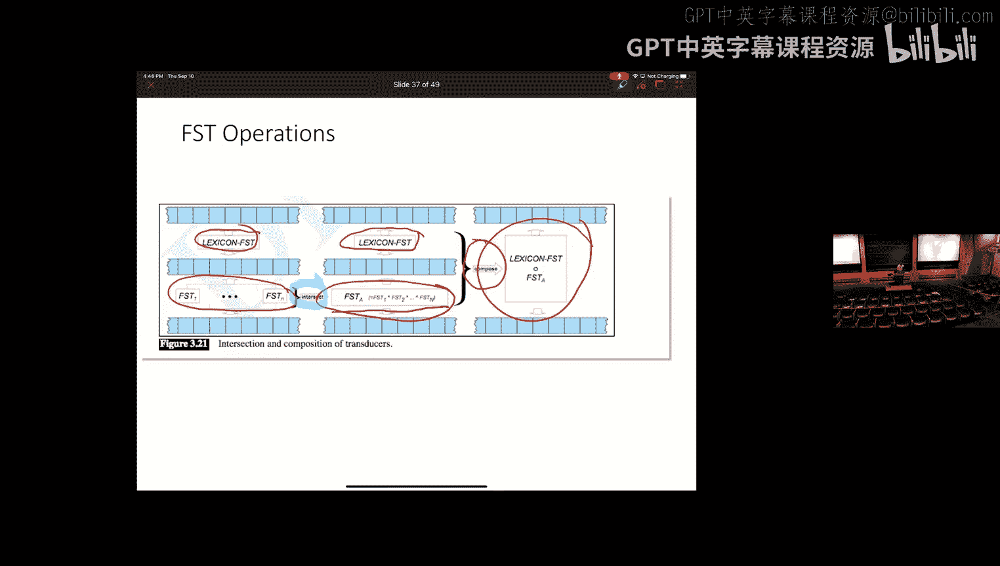

# 自然语言处理：词法和形态学

## 概述

在本节课中，我们将学习词法和形态学，这是自然语言处理中重要的概念。我们将探讨词的内部结构以及如何通过形态学分析来理解语言。

## 词法和形态学

**什么是形态学**？

形态学是研究词的内部结构，即词的组成成分和它们之间的关系。它不同于生物学中的形态学，后者研究生物体的结构和形状。

**词的组成**

词可以分解为更小的单位，称为词素（morph）。词素可以是词根（root），承载词的核心意义，或者词缀（affix），用于修饰词义或添加额外信息。

**词缀的类型**

* **前缀（prefix）**：添加到词的开头，例如“pre-”（在...之前）。
* **后缀（suffix）**：添加到词的末尾，例如“-ing”（进行时）。
* **中缀（infix）**：插入到词的中间，例如“-ize”（使...化）。
* **环绕缀（circumfix）**：同时添加到词的开头和末尾，例如“-un-”（非...）。

**非连接形态学**

非连接形态学是指不通过连接词素来形成新词的形态学。例如，德语和阿拉伯语中的词根和词缀模式。

## 形态学在自然语言处理中的应用

形态学在自然语言处理中有很多应用，包括：

* **词性标注**：识别词的词性，例如名词、动词、形容词等。
* **词形还原**：将词的不同形式还原为其基本形式，例如将“running”还原为“run”。
* **词义消歧**：确定词在不同上下文中的含义。
* **机器翻译**：将一种语言的文本翻译成另一种语言。

## 形态学分析工具

* **有限状态转换器（FST）**：用于识别和生成符合特定规则的字符串。
* **词形还原器**：将词的不同形式还原为其基本形式。
* **词性标注器**：识别词的词性。

## 总结

在本节课中，我们一起学习了词法和形态学的基本概念，以及它们在自然语言处理中的应用。通过理解词的内部结构和形态学分析工具，我们可以更好地理解和处理自然语言。