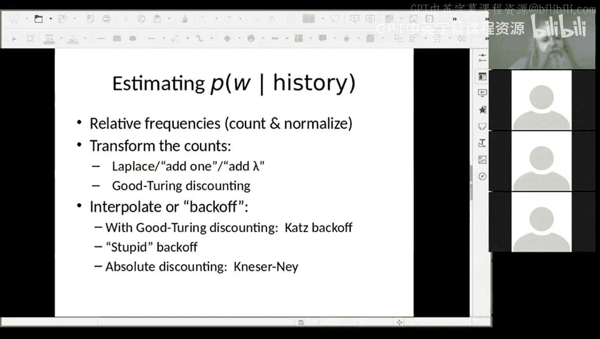
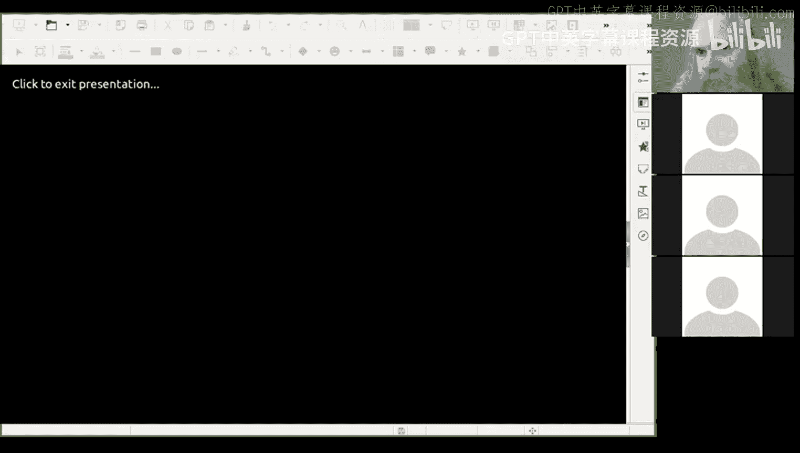

# CMU《自然语言处理｜11-411 11-611 Natural Language Processing 2020 Fall》中英字幕（Claude-4-S） p05 -05-2020-09-15 Language Models and Smoothing.zh_en -BV1RaWpzAE7E_p5-

Hello everyone， welcome to Natural languagen processingces and this is my first lecture on the other half of the lecturing team with David。

 my name is Alan W Black if you don't know that already。

what we're going to talk about today is language models and well you might have thought that's what we're always doing。

 we're always doing language models， but language model is a very particular thing within natural language processing。

It's some representation that allows us to。Predict what the next word is or score how English like or。

😡，Appropriate to the model a given sentence actually is and so we're going to talk about relatively simple models。

 but we're also going to talk about how to score them and how to be able to make them better and some aspects of training etc okay。

So we would like to get a measure of which sentences are。

Good okay now we're going to try to find with a function that's going to tell us which things are good and wed like it to be a probability we can。

 but definitely some score confidence number which good things have a big number and bad things have a small number so if we look here on the slides what we have is the first two sentences of our sentence this is a pen and that's a good sentence it's got a verb is it's got a subject this it's got an object a pen and so that's pretty good but English and all languages are not just a bundle of words they've actually got structure within them and that structure is often very。

 very very important about you know who show who because we have to know who the subject and the object is and there's something to do with ordering and there's something to do with how agreement works so just a bunch of words pen this is a it's not a good sentence okay。

You could probably work out maybe a good sentence from those words， but you if you had to score。

 you'd like to be able to score this is a pen with a much better number than pen。

 this is R and so that's what we'd like to be able to do。😡，No。

This is CMU so we're all fluent in Chinese by now well if youre know I'm sure you will soon and so we have a Chinese sentence here and it's okay if you can't read it。

 don't worry about it， I can't really read it either。

 but the four sentences afterwards are attempts at translating that sentence into English okay now what I'd like you to do is to read these sentences to yourself and make a decision about which one of these is a better sentence because I'm going to ask you about that So number one he briefed two reporters on the chief contents of the statement number two。

He briefed reporters on the chief contents of the statement number three。

 he briefed two reporters on the main contents of the statement and number four he briefed reporters on the main contents of the statement okay so i'm going to number those one。

 two， three four from the top down okay and i'm going to ask you。

Let's actually start on asking which of these is the worst one okay the least acceptable English okay。

 so we're effectively going to use the whole class as a big language model and you are going to make a vote about which one is the worst okay so I'm because you know it's not that easy to do this I'm going to ask you to click the yes button okay as I go through the all so if you think number one is the worst click yes。

😡，If you think number。Two is the worst， like yes。😡，嗯。If you think number three is the worst。

 click yes。If you think number four is worst， click yes。So people seem to think something like。😡。

One and three are not as good as the others would somebody like to either explicitly say or type in the chat why？

😡，Why do you think that number one and number three is not as good？Yeah。

 so you know the two reporters， he briefed two reporters is a little weird。

 doesn't seem completely wrong， it just seems not as good as he briefed reporters in fact arguably the brief two reporters sounds sort of nonnative or something like not my dialect but somebody else's dialect and this is exactly the thing that we'd like to be able to do with language models so if we had an automatic system that was doing translation of the Chinese sentence that's there we'd like to choose between which of these possible translations is the best English because they've all got the content there's no real problem with the the meaning you can work it out yet chief contents and main contents so I think chief contents is slightly better than main contents but definitely the。

cepts are all still there and so we'd like an automatic measure that would actually be able to tell us which one is the best because then we could use it in the search algorithm and then we could actually get the better translation I'm going to ask someone in the audience who speak Chinese。

😡，Can you translate that sentence， Would you translate that sentence to one of these four sentences？

So wait for somebody to type and nobody's typing at all。So a number of people say no。

 so what do you think is a better translation， so somebody would like to type in a better translation of that sentence into English。

My Chinese is just about good enough to actually know that these are approximate translations。

 but it's not good enough to actually know whether it's absolutely correct as many of you know I think I speak Japanese I've been at seeing you for a long time so I can sort of read Hany but not really so he introduced the main content of the statement or speech to reporters okay thank you crystalrystal so you know these translations these automatic translations have the content。

 but they don't quite make it the same way that a human actually might make it but that's what we're trying to do we're trying to get a way to actually measure it and give ourselves a number now we're going to depend on probability theory here we're not a stats course but we do depend on stats and so I'm going to just give a little bit of refresher under the。

オ。The way I'm going to write things for the rest of the lecture okay we're going to appeal to the idea of random variables random variables means there's a variable and it's got some distributional property okay and if you ask it for value it'll give you a value and it'll give you a random value and if you ask it 100 million times you should get some distributional property for that particular variable we're going to have the notation that P of capital x equals small x that means the probability of the variable x takes the value x okay which we're just going to write as a shorthand of the probability of lowercase X。

Which in our case is going to be what's the probability of？Being a word or maybe being a sentence。

 while the probability of capital x will mean that it's a variable so we're talking about the distribution。

😡，We can talk about joint probability， so what's the probability of some variable having the value small x and some other variable y。

😡，Having the value small y okay these are independent okay and they refer to the chain rule but they're independent and therefore there's no dependency between a choice of x given the choice of y or the choice of y given the choice of x okay which is actually not true in lots of cases and sentences when we've got words because usually some words give influence and we are more likely to see some pairs of words together and they're not completely independent。

 the second one and the conditional probability， what's the probability of some variable capital x has got some value small x given that some other variable y has got a value so what's the probability of the next word is off of F given the probability given that the previous word is president okay and the answer is quite high。

As opposed to what's the probability of X being off when the previous word is off okay。

 now some people will mistype things and say off off and sometimes you could have off off in a row。

 but in general， that's going to be relatively low。

So let's first talk about the idea of a unigram so we're going to talk about gram as being some sort of representation and we're going to go start off with unigrams with unigrams what we're saying is every single words there's a its probability okay so given that we've got all of these words what we have as well what's the probability of particular words and some words are going to be more probable than others okay so can some of you give me in English some words that are high probability。

😡，The a have the the in general is the most probable word in English。 Okay， and it's a point。

 it's about0 point。Then4%， Im sorry get that all right， yes， and 4%， which is surprisingly high。

 okay， and can somebody give me a word that's got a low probability？

Zoo yep that's an excellent one Carnegie Okay yeah that's that's low melon is relatively low inconspicuous actually the first time you wrote it with the spelling errors is even lower probability Okay。

 so there's two interesting ones there， Carnegie Mellon Okay。

 let's just spend a little time on there so which word do you think is more probable in English Okay。

 that's not just at CMu。Do you think the word Carnegie is more common or do you think the word melon is more common。

 so hands up if you think Carnegie is more common。A bunch your hands go up。Why。Yeah。I mean。

 because like the Carnegie steel industries and also there's basically a Carnegie Center or like a Carnegie Hall in every school slash city in America。

Yeah， I think that's exactly it。 You know， Carnegie gets used in a lot more places than Mellon did。

And Mellon there's still Mellon Bank and melon does appear， Mellon is in other things。

 but nowhere near as common is what Carnegie Hall or Carnegie Library actually appears in many U and UK cities so it's fairly common So yeah Carnegie is higher I maybe melon be misspelled because watermelon and other melon so that could reduce the number of acurs people just misspelling melon so I agree but be aware thatLL is not the same as the fruit Yeah rights it may be misspelled but it may be misspelled because people are never sure in the number ofs and lots of people misspell them for those of you again who speak Chinese and think about what the Chinese were goodnegie melon is in the Chinese word for melon you actually use a fruit which I always wonder if that was a。

Stake in somebody who did the translation or not or just thought it was funny it is funny but one wonders about that but we could calculate for some alphabet of English we can actually list all of the words of English because there's too many of them and there's new ones that get created all the time okay in fact let's actually talk a little bit about that can somebody give me a word that's common today that was extremely uncommon or maybe didn't even exist a year ago。

Tesla Tesla is certainly much more common nowadays than what it was but it did exist before。

 but COVID is really interesting because COVID is certainly a new word。Actually did exist before。

 but it's now incredibly common， I find it interesting that the word coronavirus actually had a Wikipedia entry last year。

 but I bet you nobody ever went to it while now everybody goes to it can somebody give me a word that has been common in the last？

Five years， but wasn't common 20 years ago。Cryptocurrency is a good one Google might have been around。

 but definitely it' different smartphone yeah， 2007 it really came in TikTok didn't exist machine learning was around blockchain there sent Bitcoin all of these are very good examples of things which have come into being so。

😊，Actually it's really hard to know the probability of every word。

 but we'll come back to that in a minute， but imagine we take Wikipedia and some extremely large amount of words that we all agree are mostly part of English even if they're relatively rare in English and we try to work out the probability of each word what we could say is let's actually try to look at the probability of a sentence by looking at the multiplying a probabilities of all of the individual words and so words like the boy in the parks or the girl are going to be relatively high while things like。

😡，A sense of psychological certainty is no proof in itself of epistemological validity that's probably going to be much lower because many of these words like epistemological are relatively rare okay and but this is still a measure and we can calculate it and we could give measures to different things。

😡，There's going to be very high， okay， and things like that off and to this is actually I think somebody's thesis。

 but I'm not sure where this calculation came from but。

A relatively long document if we go down to rank1000 the most00 frequent word we end up with joint we end up with relatively plot and then we end up with this really weird word Dell1 subsseek which looks like some special case of formatting something that appears or a piece of code that actually appeared in the document rule and then we get 62。

0 which I think is a slightly more fame for 62。0 than one would find in general but it's definitely there notice that the probability number is all the same okay which probably means that that word appeared the same number of times within that document I don't know if it was once I don't know if it was 10 times but it's relatively low in fact when you look at a distribution of standard English written English what you discover is about 43% of the words appear one。

😡，So almost half of the words appear once， and then they gradually increase and then you end up with。

😡，4our% of them being this so depending on the distribution。

 you end up with something that's very high at the other end， okay。

If we take that model and generate text from it so what we do is we throw a dice。

 but our dice is got many， many many many many sites。

 there same number of sides is what the number of words in our vocabulary are and what we do is we try to find out what the most probable word is and we throw our probabilistic farm and we find out where that probably ability is for that particular word we can get generated from this particular data set first from less this different 2004 B comma that's the whole word out which goal 19。

2 model there。😡，L or it tillil the open par eye question mark one close par comma it doesn't seem very likely。

 but given 0。62 theses now it's pretty much nonsense it's pretty got no flow to it but when you look at it it's got some aspect of yeah that's probably from the same document it's probably a relatively technical document it talks about things like function in models。

 it talks about goal， it's got numbers in it it's got some abbreviations like CFfg which I assume is context3 grammar it's got numbers in it so it's probably some aspect of a technical document and you can sort of get that from the document even though none of it makes any sense okay so the ungram has some information in it but it doesn't really have everything and that's because。

We're ignoring aspects of context so we're not caring about any conditional model about giving this word do I get another word after it and that's something that wed quite like to be able to do so alternatively what we could do is instead of looking at words we could actually look at the string of words all of the words that appear in an actual sentence and so what we could actually do is calculate the absolute probability of sentences like this is a pen and a sense of psychological certainty is no proof in itself of epistemological validity and so what we'd need from that is we would need。

😡，A whole bunch of sentences and a whole bunch of words and we'd have to try to work out。

What's the likelihood of the sentence this is a pen and what's the likelihood of sense of psychological certainly is no proof of epistemological validity and so we'd need quite a lot of data for that I am not sure that either of these sentences appear in Wikipedia okay so we wouldn't be able to give actually this is a pen might actually be in Wikipedia because it might actually appear in the linguistic example in Wikipedia because it's very common example sentences sentence I would actually suspect John Love's Mary somewhere in one of the semantic entries in Wikipedia so we could get probabilities but imagine that we did this over all of the Wall Street Journal over the last 25 years we get probabilities for many sentences we'd also not get them for some sentence we'd never see。

Before and that's a bit of a problem， but supposing we did this。

 what we could then do is we could then say we now have a probability for actual sentences and then we could generate from it okay。

 so we could generate it for it and get something like this。😡。

Bill Clinton's unusual direct comment Wednesday on the possible rule of race in the election。

hi was in keeping with the Clinton's bid to portray Obama。

 who is aiming to become the first black US president。

 you can now get some idea of which year this might have come from。As the clear favorite。

 thereby listening to the potential fallout if Hillary Clinton does not win in South Carolina okay。

So somebody has discovered that this is a pen actually appears in the popular linguistic entry thank you for doing that that's actually quite useful because I didn't know that I should have looked at what about the epistemological one which actually does come from a text corpus I didn't make it up but I think it's pretty obscure and I'm pretty sure it doesn't actually appear but this sentence is really good it's actually wellform well of course it's wellformed because it appeared in the Wall Street Journal probably round about 2008 given what it's talking about but it's never going to give us anything it's never seen before and much as we like to think that used repeats itself all the time and has always appeared before although that seems unlikely these days we want't be able to deal with unseen sentences we won't be able to assign。

😊，The probability of what's the probability of how much is the dog in the window versus window the in dog that is much out now I actually think how much of this dog in the window is actually in Wikipedia but window the in dog that is much how that sentence backwards probably doesn't appear in it and then we'd have to assign an zero probability to it and that's not good because then we can't really judge all these marginal things and lots of things will never have appeared。

So instead of doing one and instead of doing the whole sentence。

 what we can actually do is we could say， well let's actually make it a few words in the context and then we can actually share some context and we can actually talk about new things so what we could actually do is we could have some fixed length of words in the past and so given one word what's the probability of the next or given two words。

 what's the probability next or' given three words。

 what's the probability of the next okay and these are what called ngrams and a bygram is not actually two in the probability。

 it's actually what context of one and given the probability of the next word okay so one is the context and one is the actual word we're given but it's called a bygram and if we build a bygram model out of our document that we had before we're doing is we're actually predicting the next word given the probability。

Of the previous word so here we have somewhat nonsense and then we get more less are also being completely surpassed in performance on drafts of online algorithms can achieve far more so while substantially improved using it so it's not。

Fluid， but it's better than the unigram model。 it's got a better measure better idea of something to do with flow Okay。

 and that's something that we like to care about。 Now we could go to two context words in the third one a trigram and now things get a little better。

 I mean here we got a bunch of nonsense things that happened have started random and then we get these equations were presented in both cases。

 these scores， something into a probability distribution is even smaller are equals 0。05。

 This is exactly FM during D Now I've read papers that are as badly written as that and it's actually got some connectivity to it。

 It's not really。Giving us sensible things， but it is better so the longer we make that context。

 the the more sensible the things are actually going to come out of it。😡。

That's now actually what we're trying to do here we're not trying to generate good clear things what we're actually trying to do is we want to be able to measure given a sentence how good it is and although looking at trigram generators bygram generators and ungram generators are sort of fun okay or looking at the biggest best language model generator on the planet at the moment GT3 and if you go online line and search for that you'll be able to type in a sentence and it will give you a following sentence and I can pretty much guarantee the sentence is going to be pretty sensible if the first sentence is sensible and it will follow and it will be semantically coherent but it will have nothing really to do with truth or it may have nothing to do with truth on what it's actually generating but it will generate something sensible because this is a really really really really big model okay and here we've only got trigrams so we'd like things to be bigger but。

TheMore context we put in， the more。The more data that we're going to need to actually build one of these models。

 so I'm going to ask you， how many words do you know？

Anybody like to guess at the number of words that you know？

I apologize to those of you who know zero words because you can't answer that without saying0。

So we've got 100，530，0010，0010，000 we could take an average of that 150。

00 15 to 18 Ethan has got an answer that is at least true one because you know the word one so Max is quite good so the answer is although I'm going to give some caveats that add on to this。

 the answer is probably somewhere between about 15 and 20。

000 so you Shiin Li gets the prize for being closest to that but it varies it depends on who you are if you're a native English speaker it's probably going to be a bit bigger if you're a nonnative English speaker but fluent like all of you are it's probably about 10000 if you're a native speaker it's probably about 15 to 20 if you're a native speaker。

who is doing an English degree or something that involves much more to do with literature actually it's probably about 25000 so it's actually a little bigger now I ask how many words do you know okay now I'm now going to ask a different question and say in English how many words are there？

So imagine what we do is we take everybody in the class and everybody on the internet and ask them to write down all of the words they know。

 we get them sent to an email address and then we get shouted at by the system administrator we're getting so much email but we ignore that and we count up all the individual words the words that are different。

 how many words are there in English。😡，So we're getting numbers in the 100 to 200，000 a 300。

000 this is actually an interesting question that doesn't have a good answer you're in the right ballpark of talking about 100 to 200。

000。But there's some pretty obscure words in English that sort of only really appear in。😡。

Very specific context that everybody in that context completely knows it and everybody else does not so。

If you think about all the drug names， most people don't know what the drug names are。

 but of course the companies probably do know what all their drug names are and if you think about all the place names North America。

😡，Even just in all the Englishlishs speakingaking places and you North America's got a whole bunch of Native American names that are actually in there too and Canada's got all these French names the UK has got all these picish and Gaelic names and so there's lots of pretty obscure ones that most people who speak the language don't know so it's quite hard to really define what that is but if you had a vocabulary of about a few hundred thousand you'd covered a lot if you look at Wikipedia which has got a lot of information in it although it's pretty easy to come up with words that are not in Wikipedia for example I can come up the word sleeket。

 sleet as a Scottish word for thin I don't think it's in Wikipedia actually it's almost certainly in Wikipedia because it'll be in Burns poem to a Moose because it's a word in there。

Egypt might not be in there either， which is just Scottots pronunciation of the idiot。

 but it might be in there as well but。It won't have everything。

 but there's actually several million different words in Wikipedia。

 but remember it's a definitional things， so sometimes a word will appear once and only once because somebody defines what it means in Wikipedia okay so we have a lot of words and often when we're processing words we actually want to say no no no no no let's not take them all let's actually only take the ones that are frequent enough or actually at least only take the ones that are in our data set that we're looking at because unless we're looking at everything on the net which takes a long time to download you won't get everything on the net okay so you won't just won't get them so any set of data you have is going to be finite So if you count the words on it you're gonna have a finite number okay。

But let's actually talk about this notion of what a word is and it's punctuation a word。

 so is a period full stop is a word。Is a comma a word。诶。Is a space a word？Okay。

 so as most of you know， in Chinese and a number of other languages。

 we don't put spaces between words。But if you ask a Chinese speaker to take a Chinese sentence and split it into words。

 they mostly agree with each other， they don't always。

 but I like to point out that English speakers don't always agree either。

 thank you that slicet is there in the Tuus they spellel mouse wrong but anyway the correct but they translate it into English。

 people would agree but in English people don't agree what the mouse says。

 what the number of words are of whether so let's take a rather famous city name New York is that a word that two words。

😡，Sort of a trick question。Because in some sense it depends what you're doing okay somebody said one term which actually I think is a better way of doing it depends on what you're doing now actually linguistically phonologically about how you speak New York really is one word because phonologically you don't think about it as being separate I'll give you a better example it's almost the same thing where there's a phonological difference in the pronunciation so Southern California's biggest city is Los Angeles and it's Loss Angeles it's not Los Angeles even though actually other places that are very similar like Los Alths is actually probably two words I mean yes I know in Spanish there are two words okay but Los Angeles in most English speakers have now being merge into one word with a space in。

But maybe you just take white space separated things。

 but then you also have to care about punctuation and maybe separate that off and most of the processing we want to do because we're NLP digs we're not doing things where we're doing things with literature but we are doing things with literature。

 but we actually want to care about punctuation so we want to separate off。😡，Pheses。

 commas mean maybe we don't want to separate smile into its component parts because it's sort of together。

 but in general we're wanting to split that now。Let's have a look a little bit about speech， okay。

 in speech， I could say something like I do our main mainly business processing。

And so I've got some strange words in there like， a， and actually if you listen to me。

 I deliberately put in a whole bunch of A and M in my speech， I don't deliberately do it。

 but I know I do it all the time and you hear me doing it all the time。

Is that a word is A an M a word It's what's technically called a filler and different languages have got different fillers when they're speaking Japanese has echo and which are used really well you're thinking about what comes next and of course if you're a non- native speaker you need these fillers very quickly because you can't think about what the word is but you don't want to break the conversation。

 you want to hold the conversation so you want to be able to use these words some people do it a lot。

 some people don't but you want to treat those as words well again。

 it probably depends what you're doing if you're doing speech processing。

 you probably do want to care about them because they're markers they influence what comes next if you're going to build a language model you're going to care about the existence of those they can only appear in some places and when they do appear they give you some information about what's actually going to come next so you probably do want to deal with them but you want to make sure that they're reliably。

And consistent which actually can be quite hard because a lot of the filler words are partial words and they can be hard to actually write down because they don't have a consistent spelling and somebody's brought up the interesting word like in English like is often used almost as verbal comma so like you can like use it when you're speaking like to just fill in like you know like and。

It often gets used as it's almost just filler but it's a real word and it can be used as a real word。

 I like chocolate ice cream then it's a real word but I could also say I like chocolate like ice cream like and I could say that too but one of those likes is really the other ones are just fillers and we'd have to actually care about it and that's an interesting form actually things like well and so also get used as fillers and the' real words they almost always get used at the beginning of sentences in fact。

 computer scientists always start their sentences with so watch that for the rest of the day all the other computer scientists that you see and see what they say first at the beginning of the sentence。

So do you think the Ngram models know English， do they understand English？😡，Yeah。

I think no is a good answer。That's a different no of course that's not K and OW it's N but that's confusion no it doesn't it doesn't understand it doesn't know what's going on it's just looking at some probability distribution now that very quickly gets into deep philosophical question about what does it mean to know then almost everybody is going to agree that a trigram model doesn't know anything at all well it knows the probabilities of words but it doesn't know about the language that it's modeling and so once we make a longer one why we make a more complex model why we use GP3 which。

Sports out these perfectly sensible sentences that are really bad。Does it understand English。

 most people still think the answer to that no， because everybody believes understanding is something harder than that。

😡，But nobody can define what a test would be of when something is understanding。

 but let's not care about this because we can give these negative cases even if we can't give a positive case or even define what a positive case is and for computer scientists that's perfectly fine so there'st no thing what about unknown words so we talked about this problem of unknown words and unfortunately every single word I come up with that I think is unknown happens to be in in Wikipedia and so I'm going to ask you guys give me a word which isn't in Wikipedia。

So I don't have immediate access so you can type a word in there suppose somebody is going follow up and go oh yes it is it's sort of a little hard but we're fairly sure that there are words that aren't in Wikipedia I think I think that many of you are coming up with novel words and oh my god you've just typed in my password and I actually think that Nokia in Catakana even though we do seem to have Janan Laun in the class is probably in Wikipedia somewhere because it's probably and of you go and look up the Japanese Wikipedia Hanto so there are definitely words that are not in Wikipedia so how do we deal with them and actually you can guarantee if you're doing anything interesting。

Words that you're dealing with you're always come across novel words okay here's a way that I think I could get words that are not in Wikipedia I take all of the names of the people in this class okay I sort unique the names and I'm pretty sure there are some names of people in the class that are not in Wikipedia okay many and even obscure names that you think are obscure that are in Wikipedia that are in the class will be in Wikipedia but I'm pretty sure we could find some that are not in Wikipedia okay。

And that's just the family or given name， not the two together。嗯。

Another thing I'd like to point out these mgram models that I talked about where I talked about diagrams trigrams and there are four grams。

5 gras， six grams sometimes called chograms， pentaograms and heograms but we don't do that we mostly go to numbers after that are actually finite state automata they can be modeled as finite state automata and that's pretty useful and sometimes we really want to do this we actually model them as finite state transds sometimes but basically what we have is the state represents the context and the arcs going out of that or all the potential words that can come next and each of these words go to a new state where that word is now in the context and we have the probabilities in all of the arcs and sometimes that's a really efficient way of representing them and sometimes it's a really efficient way of being able to do manipulation you could do minimization you could do determinization you could take a whole bunch of sentences make them into finite state machines and you could use finite state。

To be able to reduce them and minimize them into finite a state machine that represents our language model for all of the sentences in that data set and that's quite useful and so that's something that you should be aware of we're not going to go into much detail about that。

There are a couple of things which we actually mentioned on the previous slides but I deliberately didn't focus on and this is something that's actually quite important and it seems not important when you first think about it。

 but as soon as you try to implement any of these things it becomes really important。😡。

You have to have a bunch of special symbols in addition to the words you're talking about a string of sentences and you're talking about a beginning and an end and we really need a symbol to represent start and end and it can't be the word start because that's a word and it has its own probability it has to be。

😡，A unique word。That doesn't appear in your vocabulary Okay and you know。

 you can generate one of those that's guaranteed not to be in your vocabulary。

 You could concatenate all of your words together and that。

Concatenated all of your words together is guaranteed to be a new word that doesn't appear in your in your lexicon at all。

 but that's not a long word， so often we end up using things like underscore start underscore and hope that we've removed the underscore from everything else and so we can guarantee that it's not there Likewise we can have an underscore star or an underscore actually we often do these as tags in XmL so they're often greater than s S sorry's less than s S greater than sign or less than s slash S greater than sign so we often use those symbols they must be symbols that do not appear anywhere else in your vocabulary that's the requirement it's an easy thing to check but it is a requirement and you can get really confused if you accidentally get that wrong if you let and say here's all my sentences and they've all got marked with start and end forms。

U and you build a language model from them and you accidentally get an extra start symbol。

 then things get really confused you want you want to be careful about this。

And there's also another thing as we increase the context。

 so if we end up with not just what the previous， but we care about the previous previous。

 we need a start symbol before the start symbol。😡，And the longer the context。

 we sort of need yet another start symbol that's before that。 Now， given the start symbol。

 we've got a probability of what the most likely words are that come after it and words like the are much more common than。

A period a full stop okay， because that usually doesn't appear at the beginning of a sentence and it can。

 but it's the is much more common。AndBy convention。

 we almost always just pretend there's an infinite number of start symbols at the beginning of a sentence okay that might not be completely correct。

 but it works and the error it makes is so small compared to all the other errors you make in language modeling that we don't actually care about it so we will always have an alphabet of words that we've decided what they are we're probably going to separate out punctuation we're probably going to actually represent the unknown word maybe is a symbol is being the unknown word again a symbol it doesn't appear elsewhere and we're going to have a start symbol and stop symbol okay。

嗯。So you do this and we buildigrams diagramgrams， ngrams。

 we do things with different representations， should we care about upper and lower case。

 should we care about numbers or should we just replace all of the strings of digits with a special word number with underscored before it's its unique and doesn't appear elsewhere do we care about abbrediations do we expand them。

 do we get rid of all foreign words， do we care only about a through Z or do we care about other letters remember there's other letters that are completely valid in English all of the accented characters do appear in English words。

 but they're pretty rare， do we care about Hgana and Catatea do we care about Chinese symbols which may appear in English Wikipedia they almost certainly do somewhere so do we get rid of them or not and there's all these choices that we're going to make within our language model and wed like to evaluate whether a model is better worse different doesn't matter and so we need a way of given a model。

Bground triground with some bunch of choices。To measure it， to get a number。

 to tell us how good it actually is， okay？😡，AndBecause I'm going to try all these different things and I'm going to try and I want to know whether they're better and if the answer is well I take all this data and build a GPT3 and it took six months to actually build and now I'm using on my speech recognizer and I said oh wait a minute I've got a better idea I could actually do something else to make it better and I train that model in our six months how do I know that new model is better than the last model I want to be able to evaluate it what we really want is given a particular model so an Ngram model in the simplest possible way and the test set it's going to be a bunch of sentences what I'd like to know is what's the probability that I could predict that test set。

😡，Okay， given that model okay， so in other words， if I train a model in the Wall Street Journal。

 okay， it's going to be better at recognizing Wall Street journal sentences than it is at recognizing nursery rhmes。

Likewise， if I train。😡，A model on Gutenberg books， it's going to be better at nursery rhymes than it is for Wall Street Journal。

Probably also the Guberg books are typically 70 years old and so they haven't got all of this modern vocabulary it's likely to appear in the Wall Street Journal。

 at least the Wall Street Journal in the last 25 years。

We have a measure and it's called perplexity okay and you actually thought perplexity was what you had at the end of a lecture but no perplexity is actually a standard measure that we have for probabilistic language models and actually a little bit more than that we often use it in machine learning and judging how good models are low perplexity is viewed to be good high perplexity is viewed to be bad okay so when you have a perplexity model you'd like it to be low now that's not true we talked about the probability the test we like to get a higher number but for a number of reasons perplexity is quite a nice number to deal with but do remember we want we want to have a way to calculate this and actually perplexity is actually like entropy and here's the algorithm for it。

Okay this is the formula okay and for those of you who understand probabilities it really is entrypy power entrytropy okay but if you ever have to implement perplexity okay I want you to remember these things off by heart no I don't want you to remember well it's okay for you to remember them off by heart if you have to implement perplexity okay make sure you look up the Wikipedia entry and copy a formula and implement it properly okay just remember that because you could easily make errors though almost all tools that you're ever going to use in this space will already include perplexity and in fact any summary of any model will almost certainly include perplexity okay。

Better models have lower perplexity okay so for the Wall Street Journal Journal the Uniigram perplexity is about 962 the diagram is 170 and the tri is 109 okay so as we get longer context we get better at prediction okay and the perplexity goes down okay now you've got to be a little careful about this after a while because you have to be careful about training and test and if your test set and your training set are different because they should be if you overtrain on your training set and make a five gra or a 10 gra model what you end up with it's really good on the test set and it begins to get bad on on the test set and so actually maybe that's one of the ways you could find out how much context you could use because you could do four 5 gras 600 set and you keep doing that until it starts getting worse on the test set。

Different tasks have different perplexities， so some tasks are just generally harder。

 they've got more choice of words than what other tasks have。😡。

So Wall Street Journal with the Trigram has a perplexity of 109 while our bus information query system which ran for 10 years telling you the time of the next bus in Pittsburgh has got a perplexity of about 25 this is what humans say to it okay collected over 700。

000 600，000 calls okay it's only got a perplexity 25 it's easier in fact most of what people do when they're asking for the bus okay fall into a relatively small number of sentences Wednesday next bus to I want a bus to Wednesdaynes 61 C yes。

 there's a whole bunch of different places in Pittsburgh but they only appear in the slot where you're giving the place and actually you know downtown Sirrel Hill For to Murray appear way more often than some relatively rare place like Aes Street which is a different story that I might tell you later which is somewhere near the waterfront。

So it's smaller， okay？Higher conditional probability is lower perplexity。Okay， so in other words。

 the more probable some conditional probability is okay， and the lower so in other words， given x。

 if you can get a higher probability for the next thing， additional probability。

 that's going to give you a lower perities， so in other words。

 the more connection that we have between these words， okay， the lower the perplexity。

And here's a little weird thing and it's actually true。

 although I've always taken years of being very careful in taking it with a grain of salt and perplexity is the average branching rate so imagine that you take a finance state machine to represent the the trigram if you go to each node and count the number of arcs that go out of there and take into the probability of each of them and do this for every single node okay and get the average you actually get the perplexity and it's like wait what really and the answer is yes so in other words when we say Wall Street Journal is 109 that is on average there is about 109 words that can follow anywhere in the context on average okay and some contexts there's going to be way bigger。

umm a choice of what can come next while others， there's going to be much， much。

 much more constraint Okay，um so for example， if I'm going to say most people have never met this trader。

Their name is。The thing that comes after there has got a huge possibility you've no idea what the words could be。

 I mean yeah might be John， but actually because you're saying nobody's met this person it's probably not a common name it's probably a error name okay while Ill give you a context like today in the White House on September 152000 sorry 2020 President Donald J and what's the next word okay we can be fairly sure it's going to be Trump okay yeah it might not be it wasn't when I spoke it because I stopped and I gave a different word but we can be fairly sure it's Trump because we have all this context and that's very much the most likely so the choice of things that comes after that is much。

 much much much smaller but in general text is the average branch rate so that's actually a good way of remembering that smaller is better so the smaller the branch。

Read the better model that you actually have。😡，What about that open class what about that unknown word okay so really what is the probability of frenzy thank you Ernest and the answer is zero we've never seen it before it would never appear in a CMU lecture anywhere because the word frenzy doesn't appear anywhere else it would never appear in a chat log in an NLP class oh wait it has okay my favorite word which is on this slide that I use for a low frequency word is Nebuchadnezzar okay whos a king in Babylon ancient Babylon and I like to use that word because it's got a pretty low probability yet most people have heard of it but they're not very sure what it is okay and yes it appears in Wikipedia because it's an article on but you know it maybe didn't appear in the Wall Street Journal in the last 20 years possibly it's rather interesting about things that don't appear in the。

Wall Street Journal in the last 20 years the green table doesn't actually appear in the Wall Street Journal in the last 20 years actually I don't know that because I checked that in about 2010 and then it hadn't appeared in the Wall Street Journal for 15 years so it might sense have appeared so you have to be careful about that。

And so this is where you people are going to make it your task to ensure that the Green Table appears in the Wall Street Journal sometime in the next five years so I can't use that example in future lectures thank you for doing that that's cool somebody just pointed out that it appears the Green T appears in the Bible so there it is。

 but there's lots of things that appear in the Bible that don't appear in the Wall Street Journal。

 there are lots of things appear in the Wall Street Journal that don't appear in the Bible。And。😊。

So the naive answer is what's the probability of an unknown word well if it's unknown it must be zero and in fact all unknown words okay must be the same and that's not true okay if you all look at the chat and Rahul Singh has got a big long word which looks like the name of character from futurraama urrcus Perseian 9 and Franzy I think Franzy is much more likely than the one that appears above it because I just think it is once pronounceable and the other one isn't really pronounceable and that difference of the unknown word is something you'd actually like to model in some sense so what we'd really like to do is we'd actually like to have a probability of the unknown word so we'd like to know how often do we see words that we've never seen before now actually you could calculate that。

So we start on day one of the Wall Street Journal and what we do is we try to work out you know unseen words and the first word we find when looking through the Wall Street Journal is。

W， so that's now we're sure but you know after a few days or maybe a week we start looking at we get novel words and we got novel words every day。

 but maybe after a year the number of novel words will go down but it probably remain approximately constant there might be certain times when we get more words than others so we might get more unknown words when there's a sports season running because there's maybe more sports names happening that wouldn't happen otherwise there might be more names when an actual disaster happens in the place that isn't normally talked about and now we start talking about people names in place names that haven't appeared before but overall there's sort of going to be a probability of an unknown word so we could actually have a little token that is unknown words and we can calculate its probability and that's pretty useful so we'd like to be able to do that we'd like to be able to have that value now we can actually go further than that because as we。

Say sometimes unknown words are more。😡，Probabilically likely than others， so if I say， you know。

 some of you never met their name is。Then you're quite likely to find unusual names there。

 but that one with the President Donald J you're actually less likely to find things so the chance of unknown word after President Donald J is much much much lower than my name is and then it's going to be much more likely to have an unknown word and so we want to be able to model that so we want to care about the condition of when we get unknown word so unknown word becomes a token and we're going to calculate in our model。

But we'll still have unknown things and we'll sometimes have well we now have this no word and it's an unknown word and we've never seen that sequence before what do we do Can somebody give me a sequence of three words that has never happened before。

😡，People are thinking。So I can't do that I have I have cafefi is good turtles hate bombs I think turtles hate bombs just go and type it in Google and see how many get I have an example of a string of phonemes that almost never exists I work in speech and when we're building speech synthesizers we like to capture all phoneme concept defestration interb daytime Okay unfortunately although I think that's pretty rare that has never exist it actually exists in my chat window now results thank you I appreciate that I was looking for some form of strings of phonemes that were relatively rare one of the rarest phonemes in。

English is O okay it's actually what's called the dipths it goes from a to E and in speech synthesis we like to be able to have data sets that have all possible sequences of formes in them and so we tried to get sentences that have got all of the different distributions and so I was actually trying to find a bi where you get O O together okay now it doesn't really exist in a single word but the idea is oh maybe exists on some a word boundary so you end of a word an I and a new word coming out and it' trying to come up with an example of that okay。

诶。诶。I yeah but you just made it up and it's very it's relatively rare is' an O O it can be used as an explanation O O but what I decided was I wanted to have a slightly more natural one than that so what I did was I searched the Wall Street Journal for phonemes Oi Oi having projected them into phonemes and I couldn't find it and I thought well I'll search my email because I have all my email and i'll search all my email to find and I found one in my email I thought yes that's exactly it and I went through it and it was an email from a friend of mine who works in speech synthesis and he said he was designing a database for English and he wanted again an example of the rare iPhonephos that are don't happen very often and he failed to find some so he had to put in some that he made up so he put toy oyster in so in other words the example of O Oi that I found naturally was somebody deliberately putting。

Oy oil together in order to get an example now in one of these lectures that I did in the last couple of semesters。

 somebody actually got a much better example of one which you've heard all the time and it's probably in the Wall Street Journal somewhere but just not in the data that I got soy oyster is a good one but soy oil almost certainly appears in the Wall Street Journal and that's got oil in it so these things can be very rare but the point is that there always be something you've never seen okay it doesn't matter how quickly you update things that always be something that you've not seen and therefore you have to deal with the case that you've never seen it okay and so you would like to be able to know what happens when I've never seen this trigram before what do I give for the probability and one of the things that we do in that case is what we can actually do is say actually there's no zeros what I'm going to do is' gonna。

Add one onto all of the probabilities and all of the words that I actually have。

 I'm always going to have at least one accordance， even though it never happened。😡。

Okay and once we do that we get no division by zero and we actually get real examples and real numbers for everything at first this add one smoothing seems like a hack it seems like the personal looks for the code and goes oh shit this isn't going to work why don't we just add one to all of the count and then then do that then we can divide and we' won't get any zeros and we'll never multiply by zero and then everything will be fine but actually it's got a partial name then add one smoothing it's called la Plaian smoothing and that makes it much much better and much more theoretical based on some French mathematician but it's just add one smoothing and it works incredibly well it's not ideal okay you can do better than that but add one smoothing is a very simple thing to do when you're building models and it's something to consider actually you don't really want to add one you want to add a partial one you want to add it smaller than one so you could add you know1 thousand to everything and add one。

To the ones that only appear zero that it can be a little better you can actually go even further than that and there's a thing called good tuuring smoothing。

Now tuuring is Aen Turing， the Aen Turing that you've all heard of， hopefully。

 and here's a paper from the 1950s after he did his tuuring machine stuff。

And good tuuring smoothing immediately sounds like his better algorithm called Good tuuring smoothing as opposed to the one that he tried the day before that didn't work。

Or bad chewing smoothing but actually no it's not that type of good there was in fact a Dr。

 Good but really was Dr。 Good and when I discovered that I thought oh my god actually desperately try to have a paper with them so that I could have you know a good paper at last rather than all the other ones I have sorry my papers or something good but it'd be nice to actually have a good one if you look very closely in my papers I actually have a joke paper but that's because I actually have paper with a Dutch person called yoga and yoga is spellt J O E okay so it word joke but anyway good chewing smoothing is from Dr。

 Goodot but it is good as well in the sense of being not bad and what they do is instead of just adding one what they actually do is when they're looking at the。

Tgram probability what they actually do is look at all the bygram probabilities and they look at the occurrence of the bygram probabilities and use that the occurrence of those to be able to help to give that plus one and they basically weight the one based on the distribution of the bygram occurrences and this gets a slightly better occurrence it gives a better distribution it's sort of smoothing that。

Nothingness do not just being one valued but being distributed with respect to the frequency of the work okay and so good tuuring smoothing is a good thing to do and actually smoothing in general is a really good thing to do and we usually try to do it as much as possible okay because zeros are things that never work in mathematics you don't ever want to multiply a probability by zero because it becomes nothing too quickly and that's not really what we and we just mean it's very small。

😡，And going。是。There's also technical backup you know and we actually do this in general with Ngram models but we do in general with multiple models so we could use GPT3 and we get some number and we might want to get another number that's a little bit more in domain and another number that's really in domain and what we can do is if we get a zero where we get a unknown word case for our in domain what we can do is let's just fall back in GT2 or GPT3 and we'll get a number for that and yeah it's not quite as good but it's going to be better than dealing with everything at zero so we can actually just look at less of a context or a much bigger model that's less appropriate for the particular domain that we're doing but that's really what a diagram is is the less appropriate model it's a model with a higher perplex。

And。There's a couple of other things that we have to care about we can do relative frequencies on counts and we have to care about normalization include the thing that I wanted to talk about here the other thing is when you're calculating probabilities in dealing with them the probabilities are really really really really small you're getting a probability of the sentence if you think about the number of possible sentences that there could be there's an awful lot of sentences so almost everything that's done in this is not done in probabilities but they're done in negative log probabilities they're done in negative log probabilities because then bigger is still better you could just do log probabilities and then smaller is better but somebody was too lazy to change their code back in the 1970s and so they set it up to always get the max instead of the men and they were too lazy to change that but they were perfectly happy to change the。

Probabilities to logs it also means you add them rather than multiply them but you can deal with much much。

 much， much， much， much， much， much smaller numbers when you're dealing with the logs and you don't disappear into nothing and I know you can use doubles I know you can use infinite precision but realistically everything ends up being in the log probability domain and you end up just reading everything like that and so you'll get used to that as soon as you see these things we talked about transforming the count the plaian idea of just adding one or adding some very small number we talked about actually doing good tuuring discounting so actually we look at the distribution of other ngrams to be able to guess what they're adding actually is and that workshe better computationally more expensive to do and sometimes it's worth it and sometimes it isn't in fact there's been lots of people who look at these things and try to work out how many bits of information you need given that these models can be very very very large DP。

Three is too large for anybody to download and you can also interpolate between different models and you can actually do battle off。

So these are the things that we talk about in language modelss， okay。

 and that's the lecture for today， do we have any questions？

Okay， so that's it for today's lecture。

