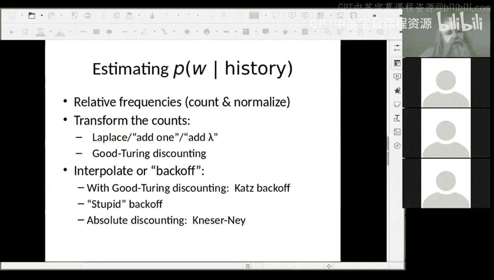
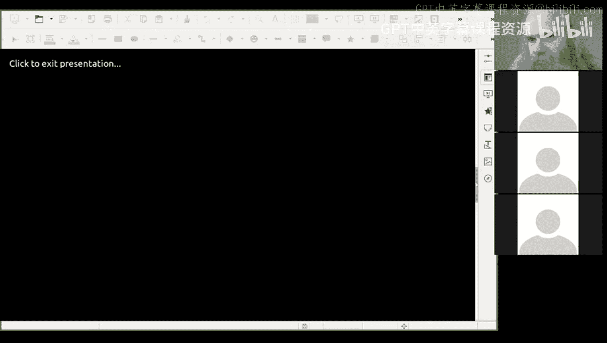

# 自然语言处理：语言模型与平滑化

## 1. 语言模型概述

在本节课中，我们将学习语言模型和平滑化技术。语言模型是自然语言处理中一个非常重要的概念，它可以帮助我们预测下一个词或评估句子是否通顺。

## 2. 语言模型的目标

语言模型的目标是：

* **预测下一个词**：根据当前上下文，预测下一个最有可能出现的词。
* **评估句子通顺度**：评估句子是否通顺，是否符合语法规则。

## 3. 单词模型（Unigram）

单词模型是最简单的语言模型，它假设每个词的出现是独立的，只考虑单个词的概率。

**公式**：

P(w_n) = 频率(w_n) / 总词数

其中，P(w_n) 表示词 w_n 出现的概率，频率(w_n) 表示词 w_n 出现的次数，总词数表示语料库中所有词的总数。

**局限性**：

* 忽略了上下文信息，无法捕捉词与词之间的关系。
* 无法处理未知的词。

## 4. n-gram 模型

n-gram 模型考虑了 n 个连续词的概率，其中 n 可以是 2、3、4 等。

**公式**：

P(w_n | w_{n-1}, ..., w_{n-n+1}) = 频率(w_{n-1}, ..., w_{n-n+1}, w_n) / 频率(w_{n-1}, ..., w_{n-n+1})

其中，P(w_n | w_{n-1}, ..., w_{n-n+1}) 表示在给定前 n-1 个词的情况下，词 w_n 出现的概率，频率(w_{n-1}, ..., w_{n-n+1}, w_n) 表示词 w_{n-1}, ..., w_{n-n+1}, w_n} 出现的次数，频率(w_{n-1}, ..., w_{n-n+1}) 表示词 w_{n-1}, ..., w_{n-n+1} 出现的次数。

**局限性**：

* 随着 n 的增加，模型复杂度增加，计算量增大。
* 无法处理未知的词。

## 5. 平滑化技术

平滑化技术用于解决 n-gram 模型中未知的词和低频词的问题。

* **加一平滑（Add-One Smoothing）**：在所有词的计数上加一，避免除以零。
* **Good-Turing 平滑化**：根据其他 n-gram 的频率来估计未知的 n-gram 的频率。

## 6. 混合模型

混合模型结合了不同类型的模型，例如 n-gram 模型和神经网络模型，以获得更好的性能。

## 7. 总结

本节课介绍了语言模型和平滑化技术。语言模型可以帮助我们预测下一个词或评估句子通顺度，而平滑化技术可以解决 n-gram 模型中未知的词和低频词的问题。