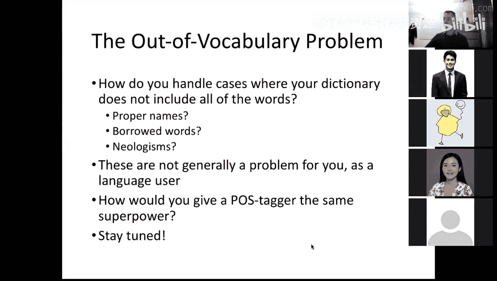
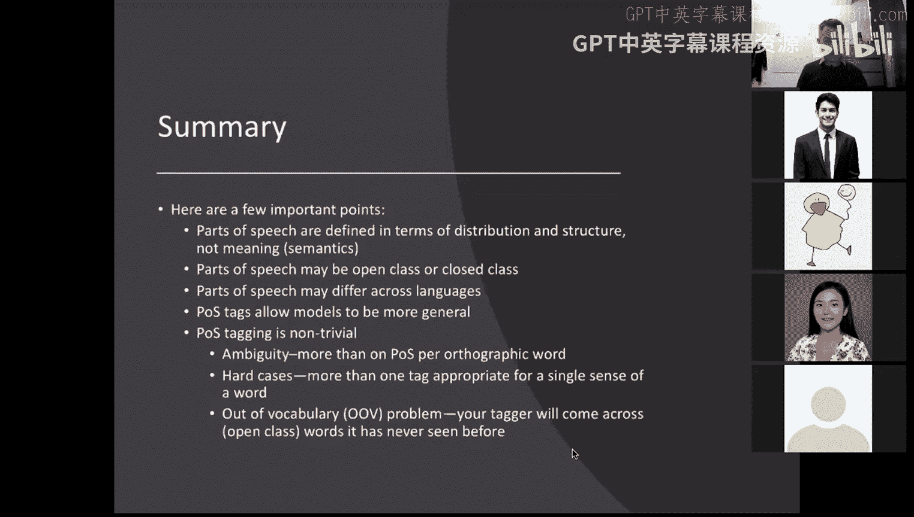

# CMU《自然语言处理｜11-411 11-611 Natural Language Processing 2020 Fall》中英字幕（Claude-4-S） p06 -06-2020-09-22 Parts of Speech.zh_en -BV1RaWpzAE7E_p6-

オッケー。Cn。Okay。So I'd like to start off by asking if there are any questions about the homework。

How is that going？I think it's pretty hard， right？Eric G thinks it's hard。Melissa。So yeah。

Crystal Jane thinks it's very interesting。Benjamin Quabido is also agrees with a frownie face。诶。

So Zang Xin Zhang says this is bad。 He's very confused about how to convert flow chart to text。

And I assume by flow chart， you mean。And。The diagram of the FST， the graph。Melissa asks。

 are there any extensions in this class？And as the syllabus states， there are no extensions。

So on this particular assignment。Because it's more difficult than some of the others than we gave you two weeks rather than one week to do it。

 so everybody sort of got an extension。An extra week as opposed to the。Conventional one week。嗯。

But there are no extensions， but you you can drop to homeworks， so if you really can't do it。

 I don't recommend dropping it just lightly， but you can drop and then then you have to do all but one of the rest of the homeworks but it you know。

You you don't have to worry。About everything writing on this particular homework。So。Zhen Xin。

 you say you mean the diagram with the circles and the arrows， right， the FST diagram。Like。

 like the example you gave like the bar for the sheep。 right diagram。 Yeah。

 once we need to convert it to text， like like the E insertion example in our homework。

I really don't know like how can we do it it's like I don't know if there's a grammar or it's like there's a there's a routine to how we convert something from that diagram to the text I didn't see anything in the right up。

There there is so the example is intended to help you to do this， the e insertion rule。

 but basically it's deterministic so each。Each line。In the open FST file corresponds to a transition。

 one of the arrows。嗯。And so you have the input state， the output state， the input symbol。

 and the output symbol。And when。For designating a state as a final state。Then you just have。One item。

On the line。But yeah， so as Benjamin points out， Millon posted a tutorial for Open FST on Piazza。

And so if you'll refer to that tutorial， I think it'll answer a lot of your questions。嗯。

So Eric Gan asks， for the out of vocabulary FST text files。

 are we allowed to manually input our FSTs into that text file？Yes。Yes。If。

If I understand you correctly， you， you're allowed to do anything manually that you want to do。

professoror。Yeah， yeah， we had some questions about like editing the FSD text files because the Redup says not sell hard code the FSDs for for verbs。

 but like just hard coding in the states， that's fine， right？Hard coding the states is fine， so the。

We don't want you to hard code things because it's not。Feaible。I just mean like mapping letters too。

Mapping letters to states right right， right now that that's fine okay。Like， are we。

Yeah am I talking oh are we love to go like directly into the text file like type out0，01。

 like other other，0， zero， other other and like indirectly in the text file or do we need to do like FST or compiler dot right string compiler do right compilert right？

That makes sense。嗯。I'm trying to think about how the setup is in the。For the homework， Mellon。

 can you help with that， I don't remember。Whether they。Use compiler。

right or whether they're able to write the FST in the text file。

 I would assume that you could write the FST into the text file。

 that's how I had originally set it up。嗯。So I think Amy posted a good response if you're talking about the in。

The in vocabulary FST， then。I mean， essentially， yes， you could write it to a text file。

 but you can also just write it directly to the compiler。

Right the idea is that you're generating the strings instead of writing the strings manually like for the other FST files。

Right， right。So。When they say don't hardcode the FST， you。

 that's not the approach that you should take， it doesn't make any sense actually to do that。Yeahや。

You for the。For the in vocabulary FST doesn it's just not feasible and for the out of vocabulary FST。

 it's sort of cheating to try to hard code for particular examples and you're not allowed。

To do that because the idea is to capture the generalization。

 this doesn't mean that you can't edit the files directly。

It just means that you shouldn't hard code for specific examples。Does that make sense？New messages。

 let's see。Yeah， Thomas Lyn is right， you just write into a text file for out of vocabulary items。

 but you programmatically generate for invoocabulary。And。

When you're writing the text files for out of vocabulary。

 they should be general rather than hard coding specific cases， you know should be the general rules。

Yes， just like the E insertertion text file and GitHub。Thomas Lynn asks。

 can we expect future homeworks to be of similar difficulty？Mostly not。呃。I would say。

 so the next homework is not difficult at all， this is one of the harder homeworks。

The homeworks are challenging， they're not easy， but they're not as complicated as this homework usually。

So don't， don't lose。I hope that you did this homework and I hope that you' learned a lot from it。

But don't lose hope if it seems。Very difficult because the whole course is not going to be like this。

Yeah。Maia。Says thank God。And。Yeah。So let's get started talking about parts of speech or we're not going to have enough time to get through the lecture。

If you have other questions， I've been a little bit remiss about answering questions on Piazza。

 but the Ts have done a good job I think， one thing though that we did want to bring up is with office hours so a lot of people think office hours are just for homework and if you don't have a homework question。

 you shouldn't go to office hours。Or you shouldn't bring it up with the Ts because they're there to help with homework。

 this is not true， they're there to help with homework。

But they're also there to help with conceptual issues。嗯。

So if you have questions about things in the lectures that came up。

 you didn't quite understand or questions about the quiz。

 something that seemed to defy your expectations on the quiz。Bring it up with the TAs。

 bring up questions about ideas， not just questions about homework。

And you'll have a richer educational experience。Because we want to educate you。

 we don't just want to test whether you can do。Absurdly difficult FST homeworks。

We want you to learn things。So let's look at this sentence， my cat who lives dangerously。

 no longer has nine lives。What do you notice about this sentence that is？Potentially。是。

Not so much ambiguous， but a little bit weird。Now， the cat did not die。It has eight b。

ThereThere are two missing commentss， actually。And I thought one more thing that was kind of weird that I think machines won't be able to understand is the concept of a cat having nine lives。

 the whole lower behind it？Yeah， yeah。 what about this lies and lives thing？啊。These are two words。

 they're related。W skis。But and they're spelled the same。But they have different parts of speech。

So lives。Is a noun。And lives is a verb。U。Why is this interesting？What problem does this raise？

So same word， same spelling， different meaning。Thomas Lyn says， you need to identify parts of speech。

In fact， as Olivia D says。It's hard to tag parts of speech。

So making a machine able to do this is non trivial。

 be able to tell which one is lies and which one is lives。

Because they have different parts of speech。嗯。And yet they're spelled the same。

 so there must be something about the context that let you get this context lets you get the disambiguate the part of speech。

So here's another example。Mr。 Black used to have a black beard。

 but it is less black now than it used to be。 he might black out if he realizes this fact。Oh。

 Jensine says hopefully this is not the next homework task， it's not in fact the next homework task。

 but it is a later homework task。So Mahal。呵。So Emily Fong says that there are three different meanings of。

Of black， I assume you mean。 And I think they're actually。E。Therere， there are。

Three different parts of speech， and there are two different kinds of use of one part of speech。诶。

So you've got Mr。 Black。That's proper noun。Black in， blackbeard。 blackbeard。

So that's an attributive adjective。It is less black， that's a predicative adjective。And black out。

Is a particle verb is a verb。So you've got multiple different parts of speech for black。

Just like for lives。And making a machine able to recognize this， well。

 we know very well how to do this， but it requires some thought and it's taken a while for people to learn how to do what is called part of speech tagging and this is what the task and part of speech tagging is so the input is a sequence of word tokens。

The output is the sequence of part of speech tags one per word。

So you're just mapping one to one words to tokens。Words to tags。嗯。Now。

If you ask a linguist about this， linguists are。Funny creatures and you ask， you tell them， okay。

 I'm going to go through and tag。A part of speech for each word in this corpus and they'll get sort of personsnicity and say things like。

You can't always just assign one part of speech to a word。

 how fine grained are your part of speech tags going to be。

 what kinds of what are you going to do with multiword expressions like expressions that are more than one word long are you going to treat those as one part of speech with as having one part of speech or as having multiple parts of speech。

 you know there are all sorts of questions。And we're going to ignore that。We'll keep it simple。

So here's an example。Charlie Brown received a Valentine。So we can go word by word。

And assign a part of speech。To each。A tag。 So Charlie proper noun， brown， proper noun， received verb。

 a the determiner will learn what that means in a moment。Valentine noun。Period。

 punctuation or full stop。If you're not an American。嗯。You could have。

Things that are finer grain than that。自行。This is usually what we're interested in when we're doing part of speech tagging。

s this level of granularity， but you could have tags。That are like this。You could have name。

 first name， person， name， name， last name， person name。You could have。The tens。Features and。

Transitivity features for the verbs。numberumber and。Definiteness on determiners。

 number and count versus mass on nouns。The kind of punctuation。You know。

 you could go really fine grained。Like this。But what we're going to do。It's keep it more like this。

Okay。So there's this guy named Ron Kaplan。And he was important in the early days of computational linguistics and NLP。

 he bounced around from various positions at Stanford and in various companies quite recently he was the vice president of search at Amazon。

And he was known for asking difficult interview questions。

One time he was interviewing a guy or a woman， I'm not sure which anyway who。

Had done work in the past on part of speech tagging。On the part of speech tagging task。

And Kaplan asked。So you work on part of speech tagging。What's a part of speech？And the。

Job applicant kind of hemmed and ho and was not really sure what to say。

That's a weird question' not really。One that I've thought about while I was doing my work。

So in this lecture， we're actually going to give you a special power。

And that is the power if you're ever interviewed by Ron Kaplan。To tell him what a part of speech is。

What are parts of speech？Well。The lexicon， that is the collection of words that makes up a language。

 it's not just some kind of amorphous soup。It's not just。Perfectly continuous kind of mush。Rather。

 it's crunchy or at least chunky。It's like。It's not so much like tomato soup as it is like a curry。

You know。There are a small number of finite categories and there are structured subcategories within these categories。

Though the categories are sometimes soft they。Definitely chunks， they're definitely there。

So if you miss the fact that the lexicon has this structure and you're just treated as some continuous space。

Then you make life hard for yourself。So。Who here has learned about parts of speech in a language class？

Like a。And English。Class， English is a second language。So Val raises her hand。K。So you know。

 you hear things like nouns or person places or things， verbs。

 what are verbs according to English teachers。Like something you can do。Okay， you know。

 so action words， something you can do， people will say， what about adjectives？

So say adjectives describe downs。No， that's。Kind of true。Describe things， they're descriptive words。

 right？嗯。So。They define attributes， so it turns out that if you look at things closely。

These are all lies。So what do English teachers do？They tell well intentioned lies。

Probably they don't even know that theyre lies。But if you think about it。嗯。

Talking about nouns as persons， places and things。응。Doesn't make any sense at all。I mean， persons。

 places and things often are nouns。But what about longing？As then。

His longing for in person instruction。嗯。Filled his heart with pain。Longing is a noun。It's a Jarant。

 it's a kind of noun。Is it a thing？Only in the most you have to be really imaginative。

 it's a concept， so sometimes people will say person place thing abstract concept but。

There are a lot of things， everything is a concept。You know， actions are concepts。

What about with verbs， what about B？And。I want to be an astronaut。Is being something you can do？

Is it an action？Kinda。It's not an action you're not。It's only an action。

 you would only say it was an action because it's a verb and you think verbs are actions。

knowSeparate from that detail of grammar， you would never think that。It's a state of being。

But it's certainly not an action。Well， adjectives also express states of being。

In the same way that be like be an astronaut。You know， if I want to be red。Or be smart。

It's describing a state。AndAdjectives sometimes specify attributes， but sometimes they specify dates。

And it's the same set of words， but they're performing two different kinds of functions。

Chroramatically。Although it all blends together semantically。So Valal， I think has the right idea。So。

So English teachers often tell you to categorize， they give you semantic criterion。

 meaning based criterion for dividing up parts of speech。

 but if you examine the parts of speech closely， you see that it's not about meaning it's about grammatical structure。

 it's about where words can occur and what morphology words can take。

This is what defines parts of speech。So parts of speech are a limited number of tags for word class。

And there are。There are two criterion， two kinds of crion。

 a criteria that we will use for defining parts of speech。There are distributional criteria。

So things like having the same contexts。Having the same syntactic functions like subject object modifier of nouns。

Ocurring in the same positions in syntactic structure， so if you draw a tree of a sentence。

Then the kind of place in that tree where the word appears is going to be roughly the same。

 in some sense for words that are of the same part of speech。Then there are morphological criteria。

So words that are of the same part of speech allow the same prefixes and suffixes roughly。You know。

So everything that takes the plural ass in English。Is a noun。

And everything that takes the singular S in English is a verb。So this is not about meaning。

It's not about the kinds of criteria that your English teacher。🎼Told you to use。

 Those are just confusing， and they lead you down the wrong road。It's about structure。

So you should get used by the way， to the idea that your English teacher lied to you。嗯。Because。

As I said， English teachers lie all the time。So let's talk about some parts of speech。

And this is going to。This is going to be very English centric。

 but there'll be a few mentions of other languages as we go along。So Mahuul。

 we're getting just to your question， what is the concrete definition of an noun？So nouns。

Are words that satisfy the following criteria。Criteria。They can be the subjects and objects of verbs。

So this is in terms of grammatical relations。Nouns can occupy either of these positions and every noun can be both a subject and an object。

So as in this book is about geography， or I read a good book。In this book is about geography。

 book is the head of the subject。And I read a good book， it's the head of the object。

Nouns can also always be objects of prepositions。So you can put a preposition before it。

They can be plural or singular if they are count nouns。

 there are two different kinds of nouns in English， there are count and mass nouns。

 so information is an example of a mass noun。And there's no plural word informations。嗯。

You can't say he told me several informations。嗯。But books is a countdown。

 so you can have a plural and a singular。Importantly， though， all allows can have determiners。

 those are words like the or a。 We'll talk more about them in a minute or that or this。U。

So you can use the determiner with basically with any common noun， not necessarily with proper nouns。

A。So you wouldn't normally say。The David。Although you might say the Donald。

If you're a particularly obnoxious person。A。Its possible。Nouns can also be modified by adjectives。嗯。

Like blue。And finally， they can have possessors。I'm like my book， John's book。

So some of these apply to all nouns。All nouns can be subjects and objects。

 all can be objects of prepositions。All can be modified by adjectives。嗯。Well， I'll but proper nouns。

 I'll common ounce。And all common nouns can have possessors。Aestless。Oa。嗯。

So you can't actually say my David， well， you probably can if you have like if you're talking about multiple different Davids。

And you want to distinguish my David from another David。Ywei。

Can't say things probably like Blue David。Maybe you can't。If you can alpha better。

 because it just means that this is a better test for nowunhood。So nouns have these properties。

And that's the concrete definition of a noun。Nouns are the easiest of the part of speech parts of speech。

To。Deefine。Furbs are a little harder。So verbs can be defined in terms of their syntax。

 mostly and their morphology。So verbs take noun phrases as arguments。

All of them take at least a subject argument。It's in Dr。 Mortenson parsed aggressively。

But sometimes they can take two objects， one or two objects， so you can say。Dr。

 Mortenson parsed the data or Professor Black passed the function and argument。

So only verbs can take these arguments structurally in this way。

They're also unique in that they can take tense morphology。Like past and non past morphology。

 not all languages have tenses。嗯。And not all languages market with。Verbal morphology。But。In English。

 this is true。It's also true that in English verbs， of verbs can be modified by adverbs。

So you can have。呃。An adverb that structurally。It's the modifier of a verb。For anyver。Adjectives。

Semantically restrict the reference of nouns。Structurally， they're in a modifier position。By nouns。

Or are in a predicative position after a copular verb。That means to be a verb。

So if you have the adjective pitiful。Then you can use it atly and talk about his pitiful code。

Or you can use it predicatively and talk about and say his code is pitiful。Now。

 the important thing about adjectives is if you're an adjective， you can be used both ways。

All adjectives can be both attributive and predicative。In English。

 they can also take the comparative and superlative suffixes if they're short enough。

WhenWhen prosoy allows， so you can say big， bigger， biggest， fat， fatter， fattest， smart， smarter。

 smartest。But with pitiful， it has too many syllables to allow。You to attach these。Suffixes。So。

But pitiful， more pitiful， most pitiful。Not pitiful， pitiful or pitifulist。So this test。

 this criterion only applies to short words。Now， not all languages have adjectives。

Some languages use verbs to do the sorts of semantic work that are done by adjectives in English。

 So does anybody here speak Korean？A Korean speakers。You always have a Korean speaker。Good。

 so I can say whatever I want about Korean。So in Korean。

 you just have a special class of verbs that modifies nouns。

But they have all of the morphological and syntactic properties of verbs。Of verbs generally。

 and there's no way of distinguishing them exactly in rigorous terms。

So adverbs modify verbs and adjectives and other adverbs。So any word that can。

Fit in the structure of the grammatical structure of a sentence。As a modifier for a verb。

 an adjective， or another adverb has to be an adverb。

So a funny thing about them is in order the ordering can kind of switch around。

So you can say he erroneously concluded that PhHP is a real programming language simply because it is turned complete。

 or he concluded erroneously that PhHP is a real programming language。So the order here is different。

 but the syntactic relationship is basically the same。So in this case， it's concluded as a verb。

 of course。But it can also modify adjectives as in the design of PhP is exceptionally poor。

We're exceptionally。Is modifying。Poor。What about my code runs very slowly？What are the adverbs？Okay。

 so slowly。Describes runs。And what does and V describes slowly。

Or very modifies slowly and slowly modifies runs。So here we have an adverb modifying an adverb。

 modifying a verb。So these nouns， verbs， adjectives。

 adverbs are what are called open class parts of speech。

Has anybody had like a linguistic class or another class where you talked about open class versus closed class parts of speech？

So Emily has， what is an open class part of speech？It's like you can add more words into this class。

 right？Right， so like nouns， people make up new nouns all the time， it's very easy to add new nouns。

Ferbs， too， so people。Are constantly coining new verbs and adjectives as well， even adverbs。嗯。

But not all classes of words are like that。 We also have close class parts of speech that are。

Things like prepositions。Or auxiliary verbs， or determineers。So prepositions are funny little words。

 they occur before noun phrases。And they relate the noun phrase to some higher level constituent。嗯。

So if you say I scattered the data from hell to breakfast。嗯。The prepositions are。From and to。

What is from？Connecting hell to。So if I scattered the data from hell to breakfast。This is a figure。

 a speech that my mother colorfully used to use describing。What we did with our toys。

They're scattered from hell to breakfast。嗯。But。So both from hell and to breakfast you like the are。

Taking us back to scattering the data right， So syntactically， there's a relationship。

That's similar between these two what are called prepositional phrases。And this larger phrase。

On the other hand， if you say， he lingered in the depths of despair。

What's happening within and of here？Yeah， so Kevin。Has it。 So n goes with lingered。And of despair。

Goes with depths。So case in this first case。Then the two are in parallel， you know。

 at the same level sort of， they're both connected to the same thing。And in the second sentence。

 then one prepositional phrase is kind of inside of the other prepositional phrase。

 or in other words， one preposition is connecting。A noun two。A noun in a prepositional phrase。

 which is connecting it to。Verb in a clause。So it's actually not that hard to characterize。

 this should say， prepositions。嗯。Formerally， like in terms of their syntax。

 it's actually pretty easy， but theyre very difficult to characterize semantically。

So this is actually a good reason not to introduce semantic considerations into part of speech categories because if you think if you say the city was destroyed by the Huns。

What does the preposition by mean？Or if you say his destruction of the Han's destruction of the city。

What does the preposition of mean？So they're playing in those cases purely grammatical roles。

 they don't have any meaning at all， so if you say his destruction of the city。

 does it mean the destruction of the city belongs to him？It means hiss destroying the city。

It's not really possession， it means who is doing what？It's expressing。Semantic ws。

 as we'll talk about later。So it's。It's very difficult to do semantically。

 but it's possible to do grammatically。So many years ago， there was this talking Barbie doll。And。

She would say various things， one of the things she would say was math is hard。

And one of the things she would say also is let's go at shopping。

 And so there's this meme that ties together these two things。 math is hard。Let's go shopping。

But what does NLP Barbie say？Prepositions are hard。Let's go shopping。

I suggest going shopping at any point。Whether or not。Prepositions are on the table。So。

Determinators are another very important close class part of speech。

These are words that come at the beginning of noun phrases in English and you。

Articles are probably the most recognizable determiners。 So articles like the or A or N。

As in the interpreter choked on an unknown identifier。

But there are other determineminrs like the demonstr is this and that。

Not every time you use this and that are they determiners， however。

 so if you say that version of Python really chas my hide。Then that is a determiner。

 but if you say that really chas my hide。Then that is a pronoun。A demonstrative pronoun。

Because it's occupying a different role。So which version of Python really chas my hide？2。7 close。

So 2。7。Is annoying because it's not three， but at least a lot of stuff was backported to 2。7。

So it's 2。5。 that's the version of Python that really chs my hide because you feel like it should be vaguely modern。

 but in fact。It's not。So English pronouns。Pronouns are another close class part of speech。

They replace noun phrases， acting as a sort of shorthand for them， so if you have a word。

That can stand in that you can replace a noun phrase with。That it's not a noun。

Then it's likely to be a pronoun。So some examples of pronouns are the personal pronouns like you。

 you code like a boy。Or you're a possessive pronoun， like your type system is not well founded。

Or an interrogative pronoun， like who knows Haskell， really。

Interrogative pronouns would be important to you in your question answering or question generation and question answering project。

 so a lot of English Interrogative pronouns begin with WH。So we talk sometimes about WH questions。

These are who， where。And so on， questions。Finally， there are conjunctions， conjunctions join phrases。

 clauses， or sentences， and typically they join two things that are of the same type。Should say type。

Why didn't I。Proofread is better。So you've got coordinating conjunctions。Like and or and but。

And you've got subordinating conjunctions like if because though， and while。

 which have different syntactic distributions。So my first introduction to grammar in a lot of ways。嗯。

The thing to which I can。Trace back my interest in language and linguistics and ultimately NOP。Was a。

Series of advertisements that were played during Saturday morning cartoons when I was growing up。

 they were called Schoolhouse Rock。And there were these little。

Songs that would like with cartoons that would come on to try to teach you various things。

And the best of these was conjunction junction。Which is a song about conjunctions。

And ever since then。I've been hooked。I think that this is probably。

Now it's it's old enough that it's sort of vintage so you can have T shirts。

 it's say conjunctionnction junction and show how。Im a bill on Capitol Hill was not better。

That second rate。Neil Tamala。Political science can never beat。Linguistics。

Oh I didn't mean to hurt your feelings， Neil。嗯。But。I am a bill in Capitol Hill was also good。Finally。

 we have， not quite finally， we have English auxiliary verbs。Kifvin says we should have a vote。

 democracy and all that。It's true， that would be very much in the spirit of a bill on Capitol Hill。嗯。

ay。Okay， there's a poll now。If you've never watched either。

 just speculate based on the presentation that I've given here。🤢，Or you can。Abstain。

So it looks like conjunction Junction is a slight favorite。嗯。But you should watch both of them。

 you can learn about political science and about language。So English auxiliary verbs， oh。

 Sesame Street。T of Mr。 Wharton， I don't know the tale of Mr。 Wharton。

I don't know that I did watch a lot of Sesame Street in my day。诶。But I'll have to research that。So。

Helping verbs or auxiliary verbs occur before main verbs in English。Or after main verbs in say。

 Hindi。嗯。And some also can be main verbs too。The best examples of that are B and have so if you say。

I am the type system， then B operates as the main verb。

 but if you say I am working on my project you in sensitiveitive clod， and am is an auxiliary verb。

For have， if you say I have no qualms about criticizing your choice of languages。

Then have is a main verb。But if you say， I have written a brilliant function that will accomplish just that。

 then have is an auxiliary verb。So these two can occur。As main verbs or as auxiliary verbs。

 But there are others， the so called modals that can occur only as auxiliary verbs。

 So Willwood could can might must。 These are modals。And they occur with verbs。Only。

 only with a main verb， a finite verb。Particles are weird parts of speech。

It's sometimes used just as a or grab bag category for closed class items that don't fit into another category。

But most often in English， these resemble prepositions or adverbs and they're used in combination with a verb。

 so if you say he tore his shirt off， you can also say he tore off his shirt。

 you can also say he tore his shirt off。So嗯。Particles have this funny thing about them。

 which is that they can occupy two different positions。

 so you can always tell a particle because you can move it in that way。Numermerals are fun。

 so numerals have properties of both nouns and adjectives。So they can， for example。

 be the subject and object of verbs， so you can say things like to relen， but only one will leave。

Or I bought 20。And in those cases， this's a kind of。Ellipsis。But。Essentially， the。

Number is serving like the subject of the object， they can also be used both atly and predicatively。

So you can say two variables were undeclared in which case two modifies variables。

 but if you go into your you're making reservations at a restaurant and they ask。Table for how many。

 you can say we are three。嗯。So。Three is modifying we in a predicative way。

 because there's a2 B verb here R。When numerals are used attributablely。

 they come before any other adjectives， so if you say you can say the two undeclared variables were the cause of much consternation。

 but you can't say that's what the star means the undeclared two variables or the cause of much consternation。

 so this allows us to distinguish numerals from other adjectives。A from adjectives。

So why worry about parts of speech？What do you think？What do we get from all of this？So。

There are a number of different things， but I think part of it is Kti says。

 I guess it's a structure to handle context。So you can view the context of a word just in terms of the words that it comes around。

That's not very general。嗯。So if you because you may only have a word appearing with a few other words。

 a very small number of times in a corpus or in data。

So you sometimes want to have coarse grained categories。That you're going to see more often。

And parts of speech provide that。 they provide a kind of structure。嗯。That。It's more general。

Then the specific words。So if you know that this word occurs after determiners。嗯。And you know。

 if a word has two senses and one of them occurs after determines and one of them occurs after to be verbs。

 auxiliary verbs。Then。You know， it can help you to disambiguate that stuff in general。

 it can allow you to make models that are more。General。

That are less tied to individual words and more tied to。The broader patterns。In grammar and so on。

 so you're able to use that contextual information。So how do we know the class of a word？心效。I'm not。

二网。How do we nail the class。That a word belongs to， this is review。

Probably something like this will be on the quiz。How do you tell what the part of speech of word is？

So Maho says relative placement， that's correct。 so what it occurs around。So Kvin says morphology。

 like what ethics is and context。So from the words that around it， Rahul says so this is。

Basically right， so the distribution。Like where it occurs， when it occurs around。

And the morphology are the two important things and once you and you can identify any part of speech that's worthy of being called a part of speech with reference to those two kinds of evidence。

嗯。So。嗯。These are the broad part of speech categories。 We've got open class。And close class。

 we talked about each of these。But there are more fine grained categories。

 and we mentioned this as well， so nouns can be divided into proper nouns and common nouns。

And common ouns。Can be either count nouns or mass nouns。And these have different distributions。

And in some cases， take different morphology。 so for example。

 proper nouns don't take plurals usually。So you don't usually talk about New York's。嗯。

And mass soundss don't take plurals。That's just countdownuns。So they。

You can identify these broader categories。And then the subcategories of those broader categories。

And using these same kinds of criteria。Sometimes when you're doing part of speech tagging。

 you care only about the broad classes and sometimes you care about the narrow classes。

So adverbs too have different types， we didn't talk about these， but there are directional adverbs。

 degree adverbs， manner adverbs and temporal adverbs。And they all behave differently。Well。

There are some cases， some difficult cases with regard to parts of speech。So one is。With。

Prepositions and particles。 so you can say I will call up my friend fine， I will call my friend up。

So up must be a particle， but if you say I will call my friend up in the tree house。

Then up is a preposition。Because it's relating。In the tree house。嗯。To call。Then there are jarins。

 These are a little bit confusing。 Weve brought these up before。 So I like walking。 I like apples。

 His walking kept him fit。 His apples kept him fit。His walking slowly kept him fit。

 His apples slowly kept him fit。So what is funny about his walking slowly kept him fit？

It seemss to me to be a fine sentence。Let's focus on walking。Yeah。

So why do we think walking is a noun？Yeah， so it's possessed， as Kevin said。So。His。walkking。

So I think walking is the noun， good， but then we have slowly an adverb。Modifying it。

So if an adverb is modifying it， it must be a。Verb， adjective or adverb。Right。Not an noun。

So what is this crazy thing that is simultaneously noun and a verb？Well， it's a Jaed。

And so we might have a separate category of nouns called dverbal noun。

That has sort of verby properties and naunni properties。But。It's complicated。But from the。

Standpoint of NLP。Usually it doesn't really matter because usually these are there are so few of them in text。

That you don't have to worry about them very much。嗯。So I guess that's the good news。

 So while linguists like to agonize over these things， NLP people， you know。😊。

Have it made in the shade。So there are other kinds of parts of speech you might want to。

To include as well。In。The Google universalveral part of speech tags that are used in the Google Universal dependency treeings。

Then there are exactly these parts of speech。It seems like a lot。Or not very many。

 depending on where you're coming from。But in the Penn Tree Bank。

 which is another data resource that is widely used for English。

 then there are almost 60 parts of speech。So they have very fine grained parts of speech。

 Here are some data from the Ptry bank， these things in capital。诶。Letters are parts of speech。

When you do your part of speech tagging homework。Oops。Then it will be using data from Ptrybank。

So it's good to。Have some idea what it looks like。It's set up so that the first letter。

 the first two letters。Our first letter。嗯。A coursese part of speech。

And then the next one is a fine grain part of speech。

 so you can change the granularity by getting rid of the final letter in the tag。Well。

 why is tagging hard？If every word by spelling was a candidate for just one tag。

 then it would be really easy to do it。But as we've seen， this won't always work。

 so lies and lives can be both fan nowun in a verb。Black can be an adjective verb， proper noun。

 common noun， and so on。But how bad is the problem？Well， this is from Pan Ttrye Bank again。

POS tags for orthographic words。And some words like down。Down has as many as seven parts of speech。

Number of words have6。Lots of words have five。嗯。Here we just have a breakdown of the parts of speech that down has and the number of occurrences。

Let's get that so down occurs in a lot of different contexts with different parts of speech。

 but then again， so does Japanese， so it can be an adjective， a noun， a proper noun。嗯呃。嗯。

A singular noun。So how do we go about this？ Well， one thing that we could do is just pick the most frequent tag for each word。

 and that actually will give you about 90%90% accuracy。嗯。

Another thing you could do is to look at the context， right？

Look at the proceedceding and succeeding words or proceeding and succeeding tags。

Look for whether there's for example， determiner or preposition。Or a。Possessor。

And we'll understand how we might look at local contexts better after next time when you'll talk about HMs or hidden Markov models。

So there's another problem。Where。HMMs are a little bit less helpful。

 which is how do you handle cases or your dictionary does not include all the words？

Like proper names or bar words or neologisms， that means new words。

These are not generally a problem for you as a。Language user。

So I want you to think about how you would give a POS tagger the same superpower。

How you would enable a POS tagger。2。Figure out from context the part of speech。Of。

Out of vocabulary words。

So here are a few important points from what we've talked about。

So parts of speech are defined in terms of distribution and structure， not meaning。

You can have either open class or close class parts of speech。

There are some differences in part of speech across languages。

 like some languages don't have adjectives。Part of speech tags allow models to be more general。

The tagging task is not a trivial task。There's ambiguity， there are hard cases。

 and there are out of vocabulary problems， or there is an out of vocabulary problem。

 So your tiger will come across a lot of open class words it's never seen before。

 And you've got to have a way of dealing with that elegantly and robustly。

So any questions before we go？Are you good？Mhole says if to answer Kaplan's question and we have to display all these slides。

 then it's a very hard question now how would you answer Kaplan's question at this point？😊。

So I would say parts of speech。2。Categories of words based on their distributional and morphological properties。

So you don't have to display all the slides， you just say that。嗯。Caaplan is happy。Parts of speech。

Are categories。Of words。Based on their distributional and morphological properties。Okay。Take care。

 good luck on the homework， keep the Ts busy and I'll talk to you not。Thursday。

 but I think next Tuesday。

