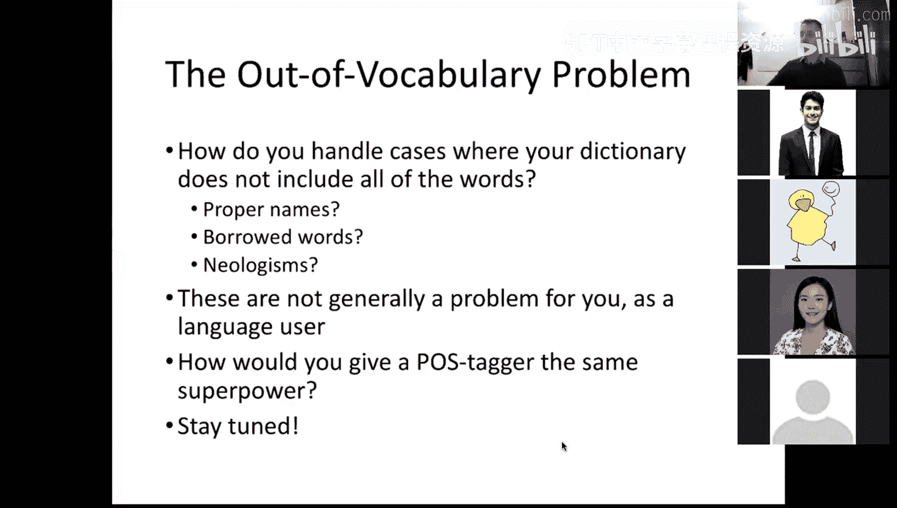
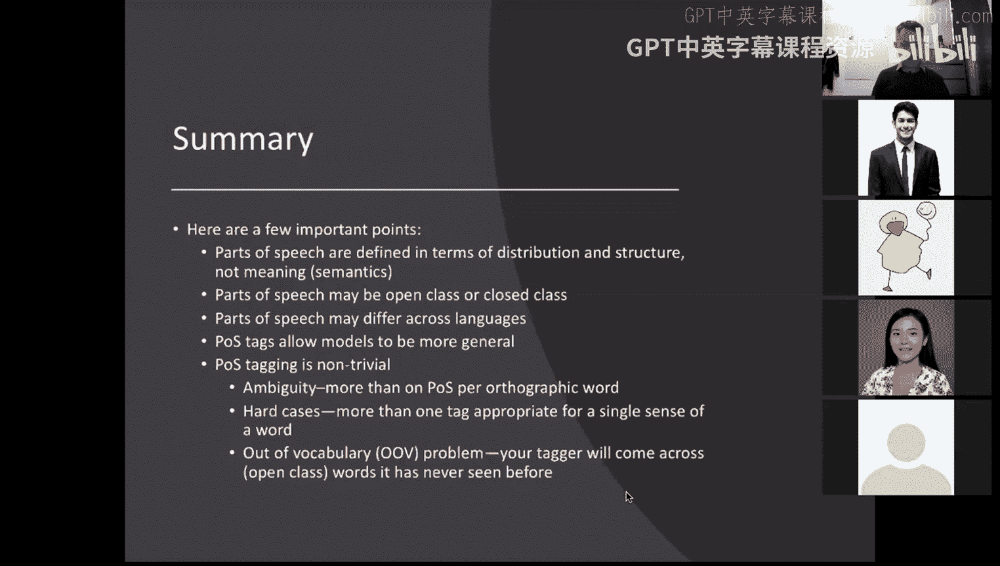

# 自然语言处理：词性标注

## 1. 引言

在本节课中，我们将学习词性标注（Part of Speech Tagging），这是自然语言处理（NLP）中的一个重要任务。词性标注旨在为文本中的每个单词分配一个词性标签，例如名词、动词、形容词等。

## 2. 词性标注的挑战

词性标注面临以下挑战：

* **歧义性**：一些单词具有多种词性，例如“bank”可以是名词（银行）或动词（把…存入银行）。
* **难以处理新词**：词典中可能没有新词或专有名词，例如人名、地名等。
* **复杂句法结构**：复杂句法结构可能导致词性标注困难。

## 3. 词性标注方法

以下是几种常见的词性标注方法：

* **基于规则的方法**：使用语法规则和模式进行标注。
* **基于统计的方法**：使用统计模型和语料库进行标注。
* **基于深度学习的方法**：使用神经网络进行标注。

## 4. 词性标注的步骤

以下是词性标注的一般步骤：

1. **预处理**：对文本进行分词、去除停用词等操作。
2. **特征提取**：提取单词的语法特征，例如词形、词性、上下文等。
3. **模型训练**：使用训练数据训练词性标注模型。
4. **标注**：使用训练好的模型对文本进行标注。

## 5. 词性标注的应用

词性标注在NLP中有许多应用，例如：

* **文本分类**：将文本分类为不同的类别，例如新闻、评论等。
* **命名实体识别**：识别文本中的命名实体，例如人名、地名等。
* **机器翻译**：提高机器翻译的准确性。

## 6. 总结

本节课介绍了词性标注的概念、挑战、方法和应用。词性标注是NLP中的一个重要任务，对于许多NLP应用都具有重要意义。