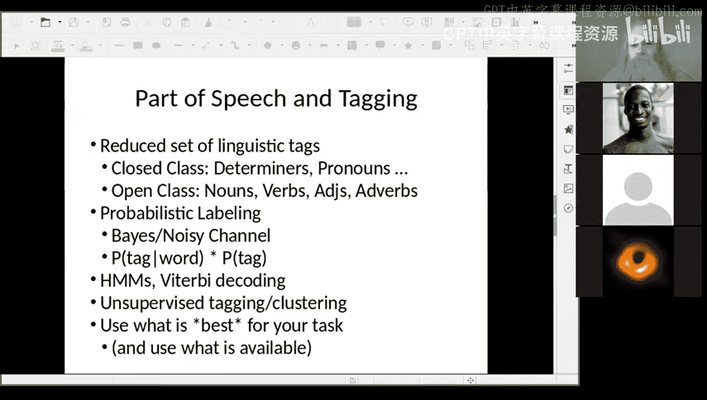

# CMU《自然语言处理｜11-411 11-611 Natural Language Processing 2020 Fall》中英字幕（Claude-4-S） p07 -07-2020-09-24 Hidden Markov Models.zh_en -BV1RaWpzAE7E_p7-

Hello everyone and welcome to natural language processing today we're going to talk about hidden Markov models as general representation when trying to model sequencing and labeling of sequencing this is。

Somewhat specific to looking at part of speech tagging a particular task that we're going to talk about today。

 David talked about on Tuesday what part of speech were。

 why we actually care about it allows us to be able to reduce the number of symbols。

 it allows us to capture generalizations with the language without looking at the actual words but looking at something about the grammatical function of the words。

 it can be very useful for reducing the amount of data that you need while training machine learning tasks but also it reduces the amount of data in the sense that you don't have lots more variance 100000 different words and you're going to collapse it to。

Depending how you do it 10 to 50 speech tags and head mark models is only one way of doing it There are multiple ways of doing this。

 but importantly。What we're trying to talk about to you explain to you is how to be able to use the two sources of information that are available one is。

The probability that given a word is going to have some particular part of speech tag so it's more likely to be a noun in the verb or more likely to be adjective than a noun and we'd like to be able to have that information but also take into account the contextualized information from a pretrained language model in this case of part of speech tags that we're going to have to train so that we can look at the sequence of the context the word is actually in to try to work out what their tags are my running example today is going to be this somewhat artificially constructed sentence build directed plays about English kings。

And maybe my zoom is just can somebody confirm that they can still hear me because everything grayed out for a minute so just give me a yes if you can hear me in the chat thank you thanks I'll try and not get cut off this time like I did the last time and so Bill directed plays about English Kings okay now we mostly will interpret this sentence as somebody called William who has a shortened form of Bill and he's a director and the task that Bill did was the direction of plays about English Kings okay and that's a perfectly reasonable interpretation of that sentence there are other ones that might be more complex but that's the one that we sort of want so Bill is proper noun directed as a plays is a plural noun about is。

Our proposition English is let's call it an adjective。

 although arguably it's a type of noun and kings is a plural noun Okay so imagine that that's the case。

But there could be other interpretations Bill， okay can be a proper noun short for William。

 but it can also be a verb okay and that is bill me that next week so it means send me a bill。

 a paper bill I don't think we have paper bills anymore but send me a bill next week so it means a piece of paper with an invoice and it there asking for a money that the act of doing that okay but of course it can also be that paper invoice is a bill okay I've received my bill yesterday and that bill is a noun it could also be something to do with a duck okay a ducks snout is called a bill but we're not going to care about these alternative meanings of a bill of a piece of paper or a bill that belongs to a duck okay so if decaying electricity sent me a bill that doesn't actually mean something about they're threatening something about。

It doc I hope okay a directed can be an adjective okay because direct can be basically the plays that were directed okay。

 the directed rather than the plays that were completely undirected。And it can be a verb。

 plays itself can be a verb， okay he plays Othello in the Shakespeare play。

 so plays then becomes a verb or it can be a plural noun more than one play about could be a preposition。

 it could be an adverb or it could be what's called the partative English can be an adjective of a noun and kings can be a plural noun or it can be a verb。

Can it be a verb， How can kings be a verb。诶。Anybody how kings can be of Arab？

Oh yes thank you chess yes I think I ask that question almost every year and I always forget kings can be a move in chess where youve change the king and the rook around so yes yes kings can be about Thank you so it can be any one of these and I know you know which one it is but our task is to try to use。

😊，Probabilities that we've collected to try to do that fully automatically and of course have a generalized process that actually allows us yeah you're probably right this is cancelling rather than kings but yes kings can be is it changing something into a king when the pond gets to the end somebody can look that up but we like some process that allows us to be able to do that from learn data so that we can actually get the part speech and you might think yeah this is an artificial example because you know you would take the most probable one well actually no just taking the most probable one is often not correct because it really does depend on the context to choose between these and so there is local ambiguity between these things there's not utterly complex ambiguity but there is local ambiguity for these forms so what we can get is given some data we could try to work out the problem。

of the tag given bill so we have Bill we have the probability in some data set of it being a proper noun 41 times verb being twice and being noun 303 times so clearly the being a noun is much more common but we have some distribution of that and we think this is actually going to be a proper noun so it's not even the most frequent we can get probabilities out of that given if we know the distribution is we can actually work out what the probabilities are and let's have a look at the word directed actually in our corpus it never appeared as an adjective and only appeared as a verb and only period 10 times so it's 100% as a verb and likewise looking at the word plays it's a verb actually more often than it's a plural noun。

Okay， so we've got a distribution of 75% to 25% and for about we have this distributions about appears a lot as a preposition。

 occasionally it an nond verb and occasionally as a partative。

 that would be it's actually a particle in the verb and so this would be talk about where you have a verb before it。

 it's little rare but actually can happen and it's not actually a preposition in that case。

For English it's sometimes an adjective and sometimes as noun as in the English and I'm not allowed to complete that sentence because I'm Scottish and I can't think of anything polite to come to the end of that sentence apologies to the English people who are in the audience which there are probably a few and then the last one is kings where it's pural noun and it veron doesn't actually appear so in this data set we had nobody cared about chess and that can happen okay and remember what we talked about before with respect to low frequencies actually we maybe want to add an epsilon to them so that we always make sure there's at least something that isn't zero but let's ignore that problem in the meantime。

Now let's sort of step back a little bit and talk about hidden Markov models。

 hidden Markov models are a bit like finite state machines。

 the ones that we'll be talking about have've got a start state in an end state remember that we introduced in our language models that are notion that sentences always have a start always have an explicit end。

 these are not the words start and end， they're not actually words they wouldn't appear in the text but when we're processing them it's very。

 very useful。To have an explicit token to talk about start and an explicit token to talk about end Okay。

 there's going to be a set of normal states we can think of these states as by actually being。

M state that's actually maybe immediately after the word and we have a vocabulary so and it's going to be a predefined finite vocabulary。

These are going to be observable symbols， the words and so we're going to have to make some decision about the words that are going to appear in the vocabulary we also talked about that before and you know depending what you're doing that's going to be1 thousand。

10，00100000 a million might be too many though there is actually a million different symbols that could easily appear once you start looking at things on the net okay there's also going to be a probabilitybabilities of transitioning between one state to the next okay and there's also going to be a probability of emitting the particular word in that state okay so we're going to have this formal definition of basically a finite state machine and you can think about it as a finite state machine but it's going to have probabilities on it that's really the important distinction between。

The second thing I want to remind you about is our noisy channel so we come back and look at a liquidizer again okay and really what we're going to have is we're going to see the words。

 the observations of the words so this is the bill directed plays about kings and what the underlying farmers that we do not see that we'd like to actually discover is the tags gave rise to those words so what were the part of speech tags that are behind these words okay we've got information about what these tags might be given the words we've got also so this is the probability of the words given the tag so if we have a noun we have some distribution of tags we have an adjective with some distribution of adjectives if we have determiners we have fairly limited set of determiners and prepositions but in addition to this we also have the probability of the tags so we the probability of the sequence of the tags okay we do not get sequences like determine。

deter or determiner in English because we sort of don't and before you give me the example of the the that second the is actually a noun okay。

 is' actually a band called the the the which presumably they couldn't think of a good name for the band so they decided to call themselves the the and so they came up with a name and I like to appreciate that that band actually exists because it's good for linguistic examples。

I'll deal with a question later and so we have the probability of the tags and the distribution of tags and tags in context and we also can deal with the words and there's something I want to actually distinguish between here which sometimes gets talked about is。

We are doing part speech tagging for a particular sentence okay once we see the sentence。

 we can start dealing with this site So once we've seen the words the observations we can start talking about it and so that's sort of at the end of the word after we've seen the words and this is often called posteriors okay because they're after we've seen the words well the probability of the tags are often referred as priors because you can calculate those and precalc them nowadays we use often use the term pretrain them before you've ever seen any sentence okay and so these。

Probabilities are often called priors and these probabilities are often called posteriors and so you'll see them when people are talking about and there are these two components okay that we're having to actually deal deal with okay so let's actually talk about these probabilities of the tags okay let's go back to an example of build directed plays about English kings and。

We can see that for each of these words， there's two or three tags that can go with each of them。

 and we could actually talk about the probability of any path through there so we could talk about the probabilities of。

Proper noun adjective verb preposition adjective plural noun。

 or we could talk about proper noun adjective verb preposition adjective verb okay or we could talk about proper noun adjective verb prep noun plural noun and so we could pick any possible path through there and we could。

Calculate the probability of when these paths are are likely to appear okay。

 and so we would have to have a big table to have trained data from with the correct tags in it and not just any combination of those but correct to tag sequences that are likely to happen in in actual examples and so what we could do is we could calculate。

 remember we talk about our start symbol。 we're always going to have a start symbol and there's always going to be an infinite number of start symbols before the beginning of the sentence。

 So if we were dealing with trigrams， we sort of have two start symbols before the beginning of the sentence。

 and this is basically really saying what's the probability of proper noun appearing at the beginning of the sentence and we might get a probability that it's 0。

202 what's the probability of a ver it's 。023， The probability of noun is 0。04 actually。

 proper nouns seem to appear at beginning。Much more often that's probably because this was Wall Street Journal or something like that where people put proper nouns at the beginning of sentences more so but we could calculate that from data and we could have that information so we now know the probability of that first one and given that if we knew the probability of start sentence noun adjective we could actually then get a probability for the best sequence and we could multiply these things together okay so here what we could do is could say well imagine that we are going to take proper noun。

We can then talk about what's the probability of the start of sentence followed by the proper noun followed by the adjective and it would be。

0。04 okay and we could well these are probabilities you're going have to multiply these together as you're moving along the sentence and so we end up with this number of 0。

00081 what's the probability of a verb following a proper noun well it's actually a little higher than having a proper noun followed by an adjective so we get higher probability for that and then for each of these well we've got three here and we've got two here so we're going to multiply these out for six we're going to get all of these probabilities and we multiply them out we're going to get all of these probabilities okay and so we can keep doing this as we move along okay so at the next stage we're going to take all of the six things that happen after that second state we've got two and we're going to multiply things out so that we end up with 12 okay and if we do that we have the probabilities of the sequence verb given。

Proper noun adjective verb or proper noun adjective plural noun and we get the probabilities of each of these sequences we multiply these things out and if we look at everything after the second word the third word the most likely sequence out of all of that ends up being this sequence which is start sentence proper noun verb followed by a verb we know that's actually not right proper noun verb okay followed by a verb yes that's actually the sequence which is highest which is not correct okay because this is actually a plural noun okay in in a normal interpretation of this okay so。

But so be it， we'll take what that is actually I think that might be an error because I'm utterly convinced that one should be more。

 but maybe it doesn't。so as we move along okay we can actually calculate this so let's actually talk about this a little bit so here we've been talking about the priors which is basically the sequence of particular tags as likely that we've calculated from some data set but we actually want to constrain that with the probabilitybabilities of the actual words that we're dealing with okay so we really want to know know is the probability of the tag given bill but actually we have to change it around the other way and we want to know the probability of the word bill given the tag so if it's a proper noun。

 what's the probability and William only appears this probability given the proper noun what is a verb it's actually lower because it's for all the possible verbs。

Is relatively uncommon and for a noun it's a little bit more of what these probabilities are。

 so these are the probabilities。Of given the tag properun verb noun。

 what's the likelihood of us getting that particular word？

These are what are called the posterior probabilities and so we have that information for each of those part of speech tags。

 given this particular word okay so although what we were doing is we were calculating the probability of the tag sequence。

 we were doing that independent of the likelihood of given the actual word what's the probability of the tag actually we're doing there and given the tag what's the probability of the word and we really want to use both bits of information。

 both bits of information they arere useful okay if the sequence of determiner adjective noun is incredibly common。

 we want to take that into account but if the particular word that's in the adjectival point even it can be adjectival is much more likely to be a noun then we want to make sure that that's not。

C in our actual selection okay and likewise when we move on to directed。

 what we actually want to have is the probability of directed given the tag so adjective。

 what's the probability of its being an adjective it's zero what's probability being a verb remember given the tag of that it's a verb。

 what's the probability being directed is this an incredibly small number。

is is probably the most common verb， even though the probability of directed to being that verb is 100%。

 when we look at the probability the other way we get a much smaller number。AndLikewise with plays。

 we're doing the same thing， so we're really changing these probabilities round to get the probabil as plays given the M tag。

 which is not the same as the tag given the work okay。We now want to combine these two components。

 so the prior the probability of the tags， the y is the language model。

 what's the likelihood of the tag sequence well the posterior。

 the probability of x given y is the observation which is the likelihood of the word given the tag。

And what we would like to find is the maximum path through all of that okay and remember the basees rule that we talked about before that the probability of tags given words can be calculated the probability of the tags and the probability of the word given the tag with that all divided by the probability of the words because we're looking for the max of this this will always be a constant and when we're dealing with any sentence because it will just be the probability of the whole sentence so we actually can ignore this term and we' now we've just got two terms we've got the probability of the tag sequence and the probability of the words now what we could do is we could calculate that。

Big tree of looking at all possible。All possible sequences of the tags through all possible sequences of all of these with all possible selections of those and we could actually calculate altogether together and work out as we go along for each of the paths what the value actually is at the end and then choose the one that's got the highest value Okay now。

We can do that but that could be computationally quite expensive。

 let's say there's three or four tags on average for each word and the number of words in the sentence is actually 27 then we're probably going to end up with 27 to the part of four。

Yes， 27 to the power four， which gets a big number。And so we actually。

Don't really want to do that and we want to see if we can find a more efficient algorithm。

For carrying that out without having to calculate every single power。那。

There's an observation that isn't immediately obvious and that is that after each step okay。

 when we're looking at the probabilities imagine that we're at this step after about and we've got calculated all possible things to prep add and in part and we're now looking at which of those continues on edge or which of those continues on to noun。

 we could calculate each of these two for each of these three okay but actually we can make it a little simpler than that because the best two or three from here joining onto those can never get better afterwards。

 so if something is not the best when you combine them it doesn't matter because it's never going to recover and that path can effectively be pruned away。

And that actually makes your life a lot easier， and it is making an assumption that we're going left or right and that there's no probability information in the future that could change the probabilities of the sequences in the path。

 which is absolutely true if we're doing an Ngram if we were looking into the future and conditioning our Ngrams not just on the previous but also on the next we wouldn't be able to cut that thing out。

 there's still tricks that you can actually do but there are harder to actually do。

 but if we're only looking at past selections we actually can。

Prune off all of the things in the tree that have got worst probabilities because they're never going to get better depending on the things that actually get about So you know once they've lost the path is lost it's lost and it actually doesn't come back okay and one of the reasons that we do build language models that only look in the past and don't look in the future is so we can do that so actually the optimization of only ever looking at language models with previous information rather than future information means you don't have to calculate everything in the future to then actually prune it at the end and so that's why we often do things left or right now。

I have to admit that there are some tasks that are better to do right to left and not just talking about Hebrew and Arabic。

 which go from right to left， but actually addresses rather interestingly have got very。

 very strong conditions from the right to left， at least the way American addresses are written because the zip code。

Fundamentally restricts the number of cities well it restricts the state that come before it and can restrict the name of the city that comes before it and then can restrict the street address which then restricts the number which then restricts the people while if you go the other way it's like I've got to consider everybody in the US if we're restricting to the US and then I've got to consider all of the John Smiths and where they might live and what street number they're in and so it's actually much harder to go left or right and right left but most things go one direction rather than the other because looking at the next choice is always just that little bit harder in doing things you can do looking into the future if you're post processing so if you're precalculating something and finding the best tag sequence and then doing something afterwards then actually you can look both directions and things like that does bidirectional work。

Because it's typically not used as a language model， while if you look at something like Elmo。

 which we came out six months before Bt， which is quite similar。

 but it restricted itself to go from left to right because it wanted to be used as a language model instead。

And that's a sort of a site。So let's go back to the noisy channel again and remind you that we have the works we have we want to un find the hidden tags that we have。

 we have the probability of the tag sequence and we have the probability of the word given the tag and we're going to do that combination to be able to do that so our。

Programming task this is not homework a programming task is we're going to have an input sequence of tokens words okay and the output is going to be the part of speech tag one per word okay and there's going to be one and only one okay the HM solution would be find the most likely tag sequence given that word sequence and this is incredibly common task that we do almost everything that you're going to do in language processing you're going to get the tag sequences out you're pretty lucky in this particular class although we talk about how to do this when you're actually doing this in your project you're going to just use some existing part of speech tagger to be able to do this for you and can use tags actually that's a good question NlTK and the Stanford stuff probably is no longer doing HMM。

Probably doing a neural sequence to sequence， but that might not be true it might actually be doing H andM1 TM1s are typically much smaller and therefore they can be more efficient and sometimes when you're doing parsing because you really。

 really， really care about the part of speech sequences you care being the same as the ones that you trained your grammar on that people will often provide a part of speech tagger to go with their own PAsar because they don't want to have not just a different part of speech tags but different distributional properties or the part of speech tags because you would get that or different errors and so they'll often provide you with a part of speech tagger with their grammar parsar and usually nowadays that's almost always going to be neural sequence generator actually it might not be。

 but I would expect it。Because it's。Almost certainly。And。😊。

There's a cool algorithm which actually does this that actually does this efficient algorithm of finding that all possible paths。

 but finding the most efficient path， this algorithm is called the Vitabi algorithm named for Andrew Viarbi who's still a professor of his emeritus at USC though he devised it way back in the 1960s。

 and actually it's quite simple。But I never understood it until I'd implemented it about three times and then I completely understood it and I could probably open an editor now and type it in and see without actually thinking about it but how you understand algorithms depends on who you are okay I have in the past actually drawn things on the blackboard but if I drew it on the blackboard now you wouldn't be able to see it because a blackboard somewhere on CMU campus and so we can't actually see it and so I'm going to have a couple of slides here for you to look at afterwards to see if you can understand them okay and some people are very content with the math。

 some people are very content with the pseudo cord。

 some people are not content until they've actually implemented it and because I'm one of these people whos not content until I've actually implemented it unless well I read the map and understand what's going on。

Because that's important because sometimes there's very subtle things that are going on but basically you're looking for the maximum sequence given where you are looking for the previous form and at that point you don't care about any things that are not the maximum because you want the maximum at this point that you're going to pass on to the next one and that's where you can prune that graph and ignore everything else you can also write it as recursive farm where you can basically say I'm at the end。

 what could I do at the end and you can go down to the beginning and you can actually reconstruct that tree and continue forward pruning as you're going and we're all comfortable with recursive algorithms and that works pretty well and that could be pretty efficient sometimes you want to worry about that recursiveness depending on the length of the problem that you're actually doing。

And sometimes you have to do slightly different things because you're not always looking for the most probable。

 you're looking for the five most probable。Or the 50 most probable and things get a little bit complex for that this is often called beam searcharch and it's sort of a modified version of the vi algorithm。

 but often you what you would like is not the most probable。

But you want to have a bunch of examples because some later filtering is going to choose between them you're maybe going to parse the result and the most probable pars are the one that's going to do because that cares about forward and backness information and maybe even more information than just the word but some cooccurrence information about the word where you're only really caring about cocurrence information about the tags when you're doing the par speech tagging so there's sometimes reasons to actually do more than。

Okay here's a procedure that I would do and basically you've got a little matrix that you're actually going to try and fill in you're going to go from left to right if there is a left or right in the matrix it doesn't really matter from zero up to the end of the matrix and what you're going to do is you're going to try and fill in each path looking at the previous ones and choose the。

Best one when I saw a diagram like this I actually found that a lot easier so these are sort of all the paths that are possible at the particular say word directed and what you want to do is find out what's the most probable in that one and that's the only one that you're going to continue onto to the next form and remember it's a little bit more complex than just looking at directed because each of these states are basically states in your language model so actually if you've got a trigram model this is going to be the square number of your vocabulary because it's the state in the finite state machine that represents your language model not just the information for that particular word so this can get quite big that you actually have to care about it but basically you're just looking for the maximum one that you're going to continue because it doesn't matter what happens after this if it's not the highest one at this it's never going to get better。

Than what your current one is， because effectively everything is。Additive。

 even though you're multiplying， but if the number smaller it's never going to get boosted afterward。

 we're always going to be multiplying by the same following sequence numbers and therefore a lower number before that's never going to get bigger。

嗯。Okay， so we talked about unknown words I'm sort of naively assuming that we did you get to the unknown words or did you get where were on the previous slide that when it all got cut off。

😡，Unknown words。Okay good thank you so un unknown words actually at this stage we're not really going to have unknown words we'll already have made our decisions about or unknown words so we already have not got any unknown words any unknown words will already have been treated as the unknown word tag so this is the words is not the part speech forms and we'll already have calculated you know what's the probability of an unknown word underscore OV underscore or whatever we're going to have that's guaranteed not to actually appear in the text for given an noun or a verb or a determiner or a conjunction actually unknown words for conjunctions are pretty rare that's probably pretty close to zero but unknown words are much more likely to be nouns they could be adjectives and verbs as well。

we actually could do slightly better okay and actually most part of speech tigers do don't just treat it as a single unknown word and they actually do something a little bit more interesting because given a word you might actually know something more about its potential to be you know an acronym or a proper name or if it contains a number it's probably a part number or maybe a project name or a URL or something if it ends in ED it might be a verb if it ends an IG。

 it might be either a verb or it might be a noun and so there is information that actually could help you there okay and actually lots of things do that okay they look to see if it starts with the capital letter and they think well that's more much more likely to be a proper noun。

They might even do letter sequence analysis internally to try to work out whether it's oh it's an acronym。

 I don't know or it's an abbreviation or it's a misspelling。

 okay which also if it's got unusual sequences of letters。

 so typically in the real world out of vocabulary isn't just one special token。

 it's a few special tokens and they are actually calculated with respect to that。Okay。诶。

All of this that I'm talking about requires a data that's labeled with part of speech tags and for all of the work in English。

 the thing that we almost always use is the Penn tree Bank。

 which was developed in the early 1990s where they took a bunch of sentences at the Wall Street Journal。

 they labeled the part of speech tags in them and they corrected them all by hand and that data is what pretty much everybody in the planet trains from。

Now that is a number of problems One is it assumes that the whole world of text is Wall Street journal like and it's not。

😡，It assumes that it's Wall Street journal like from 1989 to 1992 the world is not like that the world is moved on we've actually changed the language in the last 30 years and there's actually this isn't just new words that have come in the language but there's certain things there are more grammatical forms that are more acceptable now and they would be considered ungrammatical they only one I can immediately think of now is because internet which probably wasn't acceptable back 30 years ago it's not just the word internet but you'd have to say because of the internet or because of the。

Information you can just say it because information and we've actually moved since then and language changes not quickly。

 but it does change， but much more importantly over the last 30 years。

People are writing more actually this is always a little strange when you think about it back in the 1990s when most people were not online yeah the geeks and computer scientists were all online by 1990 but the rest of you the world was not and so people mostly didn't write I mean yes they'd write letters and something called they this special screen stuff called paper you might have seen it in old movies and the user thing called the pen or a pencil and actually it's quite good it doesn't need to be powered and doesn't run out a battery but most people went writing but over the last 20 years so from about 2000 onwards most people are now online most people are sending emails or short messages or tweets or whatever chat that people are actually doing and they now write a lot more which。

That means there's an awful lot more text available for analysis。

 but also what we discover is that people don't actually speak in the same way as what the Wall Street Journal journalists write when you're writing you actually do something a little different in your grammar definitely there's a different distribution than than what you do when you're actually writing short messages so for example。

The word I is pretty uncommon in the Wall Street Journal and the third person pronouns he and she they are much much。

 much more common than I because most of the time it's reporting in the third person rather than quoting people and giving I however okay in chat nowadays I is much。

 much much more common so there's a different distribution and actually there's a bug in my speech synthesizer that gets the part of speech wrong for I the letter I because it's trained on Wall Street journal data instead of chat data and actually treats the letter I is being the number one okay as in the first more likely than being first person singular because of the data that was actually trained on so there's actually real error in there and you can make my synthesizer do funny things with poies with when the letter when。

First person is that。嗯。😊，When we move to a new language。

 we need to get the part of speech tags in order to be able to build this part part of speech tager okay and everybody goes。

 yeah that's cool， we'd like to be able to do that。

 but it's pretty tedious to do that okay and nobody wants to do it and actually it's relatively easy to do it badly but it's really quite skilled to do it well so you have to go and find a bunch of linguists who understand the sentence structure and can decide a bunch a bunch of linguists。

Exactly what the standardized way of reading these are。😊，You're saying the tax。

And that can take time and that can take effort and that can take money we now actually have tree banks as they're often called where you get both parties and speech tags for at least the major。

wenty languages and they are quite good， but again they're mostly sort of copies of the Wall Street Journal in the sense that they went and got a major newspaper and they tagged it and that means it's very much written form than spoken form and some languages have an even bigger distinction between the written spoken form than what English does。

Next you have to care about morphology， English has almost no morphology。

 Chinese arguably has no morphology at all， but it depends on your definition well many other languages have got very rich morphologies so that means that any particular words let's pretend that they're white space separated actually could have many standard forms and so now you have to worry about having enough data to be able to do the part of speech tags often the morphology information actually tells you a lot about the part of speech。

 the grammatical information and so if you can do morphological decomposition you actually can get a lot further with the part of speech tags okay and typically what happens in new languages is they do some sort of morphological decomposition they write a bunch of handwritten rules they label the data they try to work out where they know that's likely to be wrong and they go in and fix it。

So this is quite a lot of effort we've identified that at least 7000 languages on the planet and we've done 20 yeah it's 20 that are probably the most spoken oh no wait it's not the 20 that's the most spoken it's the 20 with the most money that's be absolutely clear about that we don't do this for languages like Benngalli which is actually one of the major spoken languages on the planet Hindi is better but actually it's the ones that have got more money so in other words we are much better at doing Dutchch with 1616 million speakers than we are at doing Tagu that has something like about 80 million so it' really to do with economic forest but we knew that that was the case so from our research point of view the question actually comes up and saying well this is quite expensive to do and I don't know all of the languages so can I do this automatically to really have to。

All of this with linguists and hand labeling， or at least I can make it shorter and quicker so that the linguists don't have to do all the boring form。

 they can just do the hard tasks of actually trying to stylistically decide how to actually label thoseols。

So there's quite a substantial amount of research on what's called unsupervised bar speech tagging so that means that what you'd like to be able to do is find a tag that identifies a particular word now if you don't care about the grammatical name for the tag。

You can actually do this automatically quite well and it usually is a grammatical tag that you've discover。

 but you don't know what one it is okay it's just called G0006 okay and you don't know what G0006 is however if you show it a linguist they can go determiners okay oh but that one isn't but they're all determiners and it does it pretty well and what you do is you basically find all context for some word and you look at the words maybe before or after or two words before or after and what you do is you say I'll look for all possible context and they look at all words that appear in that same context okay and then you look at what are the most frequent words that are appearing in the same context。

And when you look at these words you'll find they're often the same grammatical tag they're the same part of speech so if you look at the context and look at all these things you start seeing the most frequent ones not all of them but the most frequent ones are often things like terms conjunctions forms now for example here I've got an example that if you do this actually 20 times and so each time you more find the most frequent thing in the context you actually take that and what you do is you just join them together and give them a tag it's probably called G0006 or some you don't know the name of them but you end up with a list of words that have been joined together so if you do this 20 times so you do 20 sequences of finding 20 effectively new tags for English what you get is be and have go together they're both auxiliaries Mr and thiss go together that's okay。

And but at as their sort of conjunctions， although at maybe is or maybe isn't too far off in they're all propositions very so they're adjective that actually intensifiers and she he it I knew oh pronouns altogether okay so this actually works pretty well。

 although it doesn't really do anything with nouns。

 verbs and adjectives okay in fact the data that I did this on was the European parliament and if you run this for longer it starts finding things that wouldn't really grammatically go together but it starts finding titles so it discovers that president and minister should probably go together。

which are titles maybe they're likenesses but within that data theyre pretty consistently used in such a way that you get very similar words in the context so this works quite well and it will definitely give you an initial breakdown and although it's not guaranteed to get actual part of speech tags the linguist is going to go yep these are right when you show them to a linguist they actually are usually pretty happy about them because they usually are something about it and we've done this for 20 different languages we actually do this in a speech synthesizer when we don't have a part of speech dagger because we discover that doing this clustering when we know nothing about the language actually makes the synthesizer quite a bit better and we end up getting phrasing much better out of it if we just know what these classes are even though we don't know what the classes mean because it just gets used downstream and that's actually quite useful。

You can actually go even further and so what you can do even further is you can say I'd like to classify all the words like this。

 so I'd really like to classify all the words given the context and I'm going to do it to find which words are。

Got the most similar word context and tried to join them together。😡。

And this is usually unsupervised word clustering， and this is often called brown clustering。

It doesn't care about syntax， it doesn't care part of speech。

 it's actually pretty good sort of semantically classifying things together。

And it will give you basically clusters of words。 So what it actually gives is far the vocabulary of the data set you use。

It will give you a tree。😡，And things that are close to each other in that tree so if they're siblings in the tree。

 they can be considered close to each other and if the subtre is a sibling of another subt。

 you can consider them to be close together and again it won't tell you what anything is but it'll just tell you these things are close together and if you do it in a big enough carpus you'll discover things like place names go together yes you'll get all of the function board going together but you'll get colors going together and things like that although you'll get not just colors going together you'll get things like other being grouped with the colors because。

Other is a color too it's not really a color， but when people say what colors do you have you can say Ive good red。

 blue or other so it's sort of a generic color in some sense brown clustering is quite computationally expensive to do because you've actually you can't parallelze it as well as you would like to do it you can parallellyze each pass but you've really got to have a sequence and so it's logarithmic on the size of your data so it takes a while people nowadays might say hey why don't you just use a word embedding and actually do a distance between it and the answer is actually brown clustering is often a little better than that especially is it really gets classes that are。

Better and actually people then also do brown clustering on word embeddings rather than on the words and you actually get something that's even better and you get benefit of both so there's a whole bunch of different things they can be done on this but brown clusters actually help they can help in language models。

 they can help in doing translation tasks they can help in finding slots in out of arbitrary sentences when you want to know I want to find all of the destinations of this bus information system。

 if you do brown clustering you can find all your examples and that allows you to that anybody's ever said that fall into sort of the same class and then you can actually use that for classes。

So brown clustering is a pretty good way of doing it and we often do that although usually you have to remember to do it at the start because it's going to take three days to give you the answer and then once you get it you actually use it to lots of other parts of things and it will work on any language and that's what's really nice about it so if I give you uighgur a language you probably don't know you can do brown clustering and we can actually get it without any knowledge about the language so that's actually something that's quite。

Okay， that's almost it for today， so what we've been talking about over Tuesday and Thursday。

 we've been talking about part of speech and we've been talking about how to be able to label the data。

诶诶诶。So I assume Ho is talking about using the pro clustering to help to get a part of speech tag and the answer is yes。

 you can actually use that as a seat for your part of speech again you don't know what the grammatical groups are but you can actually get useful groups out of it which you know actually that's what we want to do in natural language processing we don't always have to actually name the class and get it right probably we just want to know that all of these words are very similar。

So we talked about part speech tags because they are useful and they're a meaningful way to reduce the number of words。

 which makes things like training machine learning models often much faster， much more reliable。

 much more robust。😡，We identified that there are these close class formss apart of speech。

 things like determineminers pronouns conjunctions where it is extremely unusual to get new ones okay。

 to the extent you can almost ignore them and in fact you can almost just hand them in fact even people in who are non-expert linguists to speak a language that if you give them two or three of those。

 they can usually give you the rest， they might forget some for some reason people forget that notwithstanding and moreover are perfectly reasonable conjunctions。

If you were brought up in the UK with a proper education 50 years ago。

 but they're pretty unusual words nowadays， but there's also these open class which are almost。

That's the class nouns verbs adjectives and adverbs and we get new words in there almost all the time and you can move words between there and sometimes they move and stay in the other class and cease to be the other and that actually just changes over time in language but these are basically open classes and。

It's useful to know which ones they are and sometimes you actually want the subclass it's useful to know if things are proper down。

 it's actually useful to know if the thing is a capital city name or it's just a city name because depending on what you want to do you'd like to be able to do that。

And in other languages， sometimes that's easier to do because there's explicit tags in the constructed language Esperanto。

 all nouns are easily identified because the all end in the same letter so for the language Esperanto。

 what's that letter does anybody know？Even if you don't know Esperanto。

 you can work out what the answer is because Esperano is a noun and the answer is oh and all nouns in Esperanto and in an O now in Spanish many words that are male gendered end in an O and those that are female gendered n and an A except for the ones that don't but sometimes there's lots of information that are in the word that allow you to actually identify something about it with a few confusible cases okay some languages might not have a noun verb distinction it's relatively rare but it's sort of happens sometimes particularly in rich morphology languages that can be a little hard to actually identify but for many languages these are the major parts we can do probabilistic labeling of that and we can do this with using the noisy channel where we've got the probably the tag of the word times probably。

I the tag， we use HMms and particularly for TB decoding to be able to work that out if we have data to train okay。

We can do yeah， there was one other thing that I was going to mention that isn't on the slides about the Var decoding in the example that I was doing I was doing everything with probabilities and as you're going along that graph you're multiplying probabilities together and all the probabilities are less than one。

Well， it could be one， but most of them are less than one。

And so the number you get gets smaller and smaller and smaller and smaller and smaller as you go along。

 And so most long sentences end up with the most probable sequence has got a probability of。

too small。So we can't represent it anymore， so we go back and change a code and we change our floats to doubles and we do it again and then short sentences get really small numbers and really long sentences still get zero。

So actually we typically don't do it in the probability domain。

 we do it in the log probability domain， and this actually allows us to get much more accuracy for much。

 much， much， much， much smaller numbers。😡，For reasons that are really quite bad。

 we actually usually do it as negative log probabilities rather than log probabilities。 Now。

 if you think about the log probability， the smaller the number。The more probable it is。

 so the smaller the probability the bigger the log will be and so somebody wrote a piece of code where they were looking for the max。

And if you do log probabilities， you're actually looking for the min rather than the max。

 but rather than change the formula， they just multiplied minus1 and they ended up with negative log probabilities then you add them up rather than multiplied which used to be important but it really isn't important anymore multiplications much faster than machines in what addition is now but that wasn't true even in the 80s and maybe even the 90s so we actually usually get things in negative log probability and people will just call them probabilities and they forget so just be aware of that when you're looking at this funny little number that's got a negative in front of it and then somebody's saying a probability it's actually a negative log probability。

And okay， unsupervised tagging， what we can do is we can actually do this and we can try to work out given a big data set。

 a bigger the better and also in the right domain with the right distribution。

 you can actually work out what these。Classes might be and you can get the closed class ones pretty well and maybe even you give these classes de linguist and they'll tell you what they are and actually it might even be a good idea to give them to native speaker and say what words are missing because often you find accidentally there's some really common ones like I didn't appear in your garbage but you really wanted to be a pronoun and so you want to include it and so you can add things to there for the relatively low probabilistic ones and you can also use things like brown clustering and similar to get a clustering and then you can care about sequences of these clusterings and of course for the brown clustering thing you can choose how many clusters you are depending where you s the tree and you could try to optimize and find the best clustering to give the best probabilistic sequence but I bet you that's computationally really expensive。

So what do you do， what do you do okay， when you're actually caring about power of speech tagging？😡。

And the answer is it really depends on your task。Okay part of speech should there maybe you should try it and see whether you get a better result if you don't or there isn't a part of speech tagger then you then have to think about do I want a part of speech tagger will that help do I have so much data that I don't have to care about it don't have a small amount of data and maybe I should like convert the words are include the words and the part of speech tag in my training because it might actually be better than what I'm doing part of speech tags as things go is relatively accurate and the errors are things that actually often people don't really know what the right part of speech tag is so it's going to help in most of the major cases and where it doesn't help and gives errors it's probably already messed up and you it could easily help and it's quite cheap to do if you have a part part of speech tagger so it's something to consider but if it doesn't help it doesn't help and you shouldn't use it because it might just make everything slower。

And if you're in the language that is not a part of speech dagger or if you have to pay $100。

000 dollars in order to make a part of speech dagger。

 maybe some of the unsupervised techniques will be good enough or if you discover that they're really good or if you discover that the things that you're doing keeps making errors because it doesn't know the part of speech。

 maybe you should care about a part of speech dagger so you have to look at your result and make a decision about whether this is helping or not or think about whether part of speech would help them。

Okay that's it for today， I'm sorry that we seem to have zoom that seems to crash around about 4 pm every time actually it was earlier than that the last time so first are there any questions。

And somebodybody asked is negative log probability related to the Shannon entropy and the answer is most of the entropy measures do things in negative log probability actually because sort of for the same reason that we do it。

 you could do everything in probability space but it's a little bit harder and it's much harder to calculate especially if you've got a computer from 1948 because log probabilities allows you to actually just add things rather than multiply and definitely back there addition is much easier and actually the error is better because actually what you really care what you actually are doing is flattening the space a little bit better and so you're not giving so much weight to the high frequency things look their high frequency we know that we don't really care it's actually the middle frequency differences that we care about and in fact。

People have even tried to study and see if there's a better encoding than a straightforward log of the probabilities and do something that's sort of given the distribution and put them into different buckets that actually make things much more efficient and there was a PhD here from about 10 years ago Kenneth Heathfield is now a professor at Edinburgh University who actually could find a better distribution and much more importantly he could encode it in a byte which meant that he could suddenly get language models that were orders of magnitude bigger than anybody else's and he won a whole bunch of language model dependent competitions because of it and Google etc were doing that we've got bigger computers even10 years afterwards but yeah lots of people are using negative log probabilities or representation rather than probabilities because it's easier mathematically to deal with it's not technically required。

Just easier to deal with and might have some properties that make things better。Any other questions？

Okay， that's it。