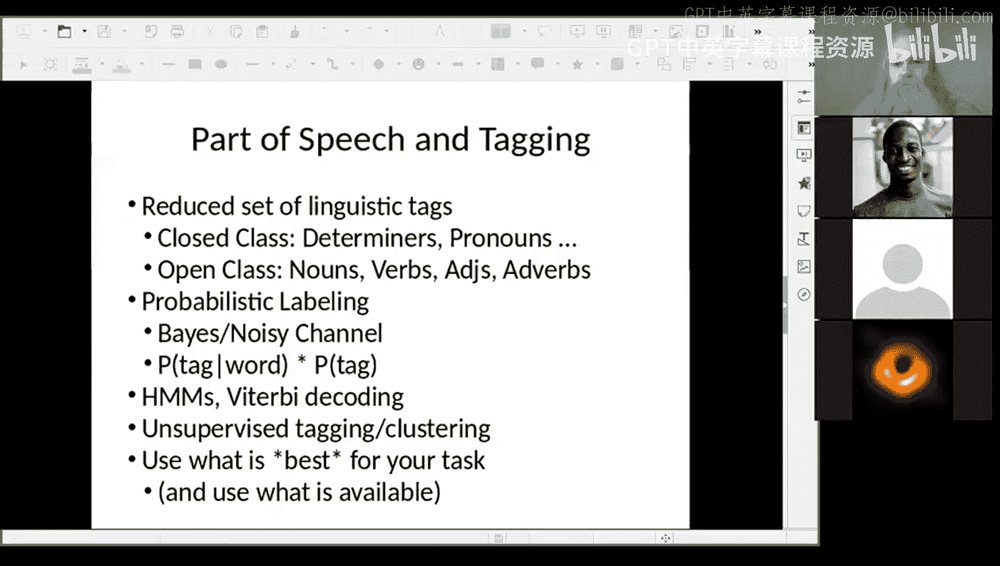

# 自然语言处理：11-411 11-611 自然语言处理 2020 秋季：隐藏马尔可夫模型

## 1. 隐藏马尔可夫模型概述

隐藏马尔可夫模型（HMM）是一种用于序列建模和标注的通用表示方法。它特别适用于词性标注等任务。在本节中，我们将介绍HMM的基本概念和原理。

### 1.1 词性标注

词性标注是一种将单词分类为名词、动词、形容词等词性的任务。它有助于减少机器学习任务中的数据量，并捕捉语言中的概括。

### 1.2 HMM的组成

HMM由以下部分组成：

* **状态序列**：表示序列中的状态，例如词性。
* **观测序列**：表示序列中的观测值，例如单词。
* **状态转移概率**：表示从当前状态转移到下一个状态的概率。
* **观测概率**：表示在给定状态下产生观测值的概率。

## 2. HMM的应用

HMM在自然语言处理中有很多应用，例如：

* **词性标注**：将单词分类为不同的词性。
* **命名实体识别**：识别文本中的命名实体，例如人名、地点等。
* **语音识别**：将语音信号转换为文本。

## 3. HMM的解码

HMM的解码任务是找到最可能的词性标注序列，使得观测序列的概率最大化。

### 3.1 维特比算法

维特比算法是一种用于HMM解码的动态规划算法。它通过构建一个动态规划表来找到最可能的路径。

### 3.2 负对数概率

由于概率值非常小，通常使用负对数概率来表示概率。

## 4. 无监督词性标注

无监督词性标注是一种不需要标注数据的词性标注方法。它通过分析文本中的单词和上下文来推断词性。

### 4.1 Brown聚类

Brown聚类是一种基于单词上下文的词性标注方法。它将具有相似上下文的单词聚为一类，并赋予它们相同的词性。

## 5. 总结

HMM是一种强大的序列建模和标注工具。它在自然语言处理中有很多应用。在本节课中，我们介绍了HMM的基本概念、原理和应用。