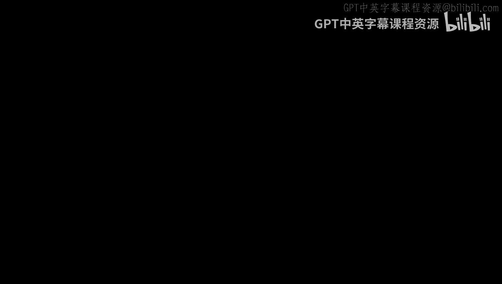
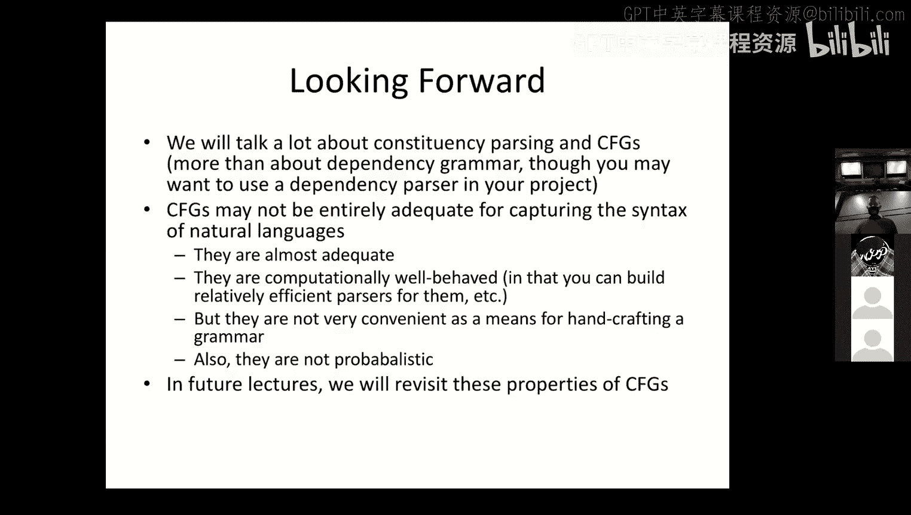

# CMU《自然语言处理｜11-411 11-611 Natural Language Processing 2020 Fall》中英字幕（Claude-4-S） p08 -08-2020-10-06 Syntax.zh_en -BV1RaWpzAE7E_p8-

And just to start off， do we have any questions from the course so far from things we've been talking about recently？

Were we good？Okay， let's talk about syntax。What is syntax？You know， sure。You're thinking about。

Programming languages， then it's one thing。If you're thinking about natural language。

Then it's something else， but it turns out。That so different。So in a programming language。

 an error if you're programming， you have an error in your syntax。😡。

What does that mean as opposed to having an error in your semantics？But it's a syntactic error。So。

 while。Sa it's a violation of language rules。What kinds of rules？How are these rules defined？

So there are different kinds of rules。That could be relevant to programming a language。

What kinds of role are specifically syntax？And how is that different from？Semantics。嗯。Syntax。

It's about how you combine units。So a syntax in a programming language is about how you combine。

Different tokens， different items。Like commands and keywords and。Values。

HowHow you can legally combine them to make larger constructs。Like statements or。The light。

So it's about putting things together。 It's the rules about how things can combine together。

Semantics is about what。Those constructs mean。That is what happens when you run the program？

What they do。And these are two separate things， right？So your compiler。

 if you're lucky enough to be using a compiled language， will catch the syntactic errors。

Even the Python interpreter will catch syntactic errors， right？

But10 compiler or an interpreter usually catch semantic errors。Well。Semantics is。About meaning。

About function。The syntax is about form。😡，And this is the same for natural language as it is。

 for programming languages。So one way of thinking about what syntax is is to talk about what it ist。

So it's not morphology。Morology deals with the internal structure of words。Syntax， on the other hand。

 deals with combinations of words。How you put words together into phrases and phrases together into sentences。

Also， morphology is often irregular， as we discussed in the morphology lecture。

Syntax has its irregularities， but it's usually quite regular。

There are mostly general rules that apply across the board。

So semantics is also not the same as syntax。Semantics is about meaning。

Syntax is just about structure， just about form。😡，So you can have sentences that are syntactically well formed。

 but semantically ill formed。Like the famous example from known Chomsky。

 colorless green ideas sleep furiously。Is this a sentence of English？Is this a sentence of English。

Colorless green ideas sleep furiously。So syntactically， this sentence is just fine。

This is a perfectly good English sentence， except what。So it's meaningless， it's anomalous。

In terms of meaning， it's anomalous， it has no。No meaning。 You can't be colorless and green。

 You can't sleep furiously。 Ideas can't sleep。 Ideas can't be green。😡。

It's just full of logical impossibilities， semantic impossibilities。

But it still just fines syntactically， So what this shows is that syntax and semantics are separate。

 they're two different things。Now， there are some well known theories。

Of what's called the syntax semantics interface。That attempt to read。

Semantic representations off of syntactic representations。In a compositional way。

 so we'll talk about these later in the semester in a later lecture。

 but basically where you can get a semantic representation from a syntactic representation。

And this is not unlike what happens with programming language， right？

So you have a syntactic structure。Your。Interpreter or compiler is。Reading off of this。

Syntactic structure。A semantic structure。And so it's doing things。

Based on what is encoded in that syntax。And so a lot of people think that natural language is very much the same way that you can read compositionally。

 deterministically， you can read semantics off of syntax。这。A couple of important notions in syntax。

That I want you to know about are the idea of constituency。

And the idea of phrases and what some types of phrases are in English syntax。

These will be a little bit different。For different languages。

 but this can give you an idea of the general range of things。That are covered。

Under the rubric of constituency。So one way of viewing the structure of a sentence is as a collection of nested constituents。

So viewing the sentence as a tree。And each of the subtrees。Within that tree。嗯。As being constituents。

Groups of words。That go together or relate more closely to one another than to other words in the sentence。

So constituents larger than a word， we call phrases。And phrases can contain other types of phrases。

Or other phrases of the same typepein。So it's a nested and potentially recursive structure。

So one type of constituent that's very important。It's the noun phrase。So noun phrases。Our。

One or more words that form a unit that behave in the way that a noun behaves。So for example。

 the elephant and the elephant arrived is a noun phrase。But if。And it arrived is also a noun phrase。

 It's a pronoun that is。Fillling the whole slott for a nouned phrase。Elephants arrived。The now trace。

The big ugly elephant and the big ugly elephant arrived is also a noun phrase。

 so it's filling that same kind of position，'s doing that same kind of thing。 it's headed， we say。

 by a noun。嗯。So it's an phrase， even though it has two adjectives and a determiner in it。

Now it gets complicated when you say things like the elephant I love to hate arrive。

Because the elephant I love to hate。Is it now phrase？But it has within it。A sentence。I love to hate。

Cluse， it's called a relative clause。And within that relative clause。Within that sentence。

There's another noun phrase， I。So you can only define。What a noun phrase is。

 What a possible noun phrase is。By making reference to the notion of a noun trace。In other words。

 noun traces and by their definition， must be recursive。Does that make sense？

So you can't define a noun phrase。Except completely， except in terms of noun phrases。

 among other things。There are also prepositional phrases。

The prepositional phrases consist of a preposition。Like on or in or under。

And a noun phrase like Tuesday or March。Or the leaking roof。So they have a structure like this。

Or peace sensor or preposition。An NPP stands for noun phrase。And PP stands for Proal phrase。

So you have something like。Under。And then under noun phrase。You have。The leaking。Rush。

So the noun phrase is a constituent。And it's inside the prepositional phrase。

 which is a larger constituent。Every preal phrase contains a noun phrase。

Some of the most important kinds of phrases。Our sentences or clauses。You might ask。

 what is the difference between a sentence and a clause？And the answer is sort of that。

A sentence is a kind of clause。That isn't part。Of another sentence。So it's a free， independent。Cause。

Not in the sense that your grammar teacher would use the word dependent or independent clause。

 but it's a clause that can stand on its own that stands on its own。The causes。

Can be full sentences as in John Low's Mary。They can also be。Relative clause that modify nouns like。

He thinks is Mary here。So he thinks this Mary。Is a clause that is telling us about women。A woman。

So together， the woman and he thinks is Mary is form what kind of constituent？Yeah。

 these are a nouned phrases。So E asks， so the clause don't have to be related in meaning to the entire sentence。

嗯。The entire sentence， the meaning of the entire sentence is a function of its parts。So invariably。

 the meaning of the whole sentence will be a function of any clauses in part of any clauses that are contained within the sentence。

So here we have a different kind of clause。We have he is Mary。As in sometimes John thinks he is Mary。

And if we were being very prosnicity。We could put a that here。Sometimes John thinks that he is Mary。

This is a different kind of clause。嗯。compliment clause， or it's called a complement clause。

Relative clause modify nouns， complement clause are things that go with verbs。嗯。走。

Sometimes John thinks that he is Mary， has a compliment clause。

You can even do things like saying it is patently false that sometimes John thinks he is married。

So here we have what is special about this sentence？What is he is Mary。What kind of clause is it？

Yeah， this is a compliment class。So what about。Sometimes John thinks he is Mary。Also。

 a compliment class。And the whole sentence。Its a clause。

And sometimes John thinks he is Mary is a clause and he is Mary as a clause。

So we have a nested structure。That is recursive。In order to model this。We need some power。

 greater power than has afforded us by finite state machines。We need context free grammar。

The context programmemars have the following components。

If a vocabulary of terminal symbols will cause sigma。A set of non terminal symbols N。

Special start symbols。A special start symbol， usually， which we usually call S。

And this is convenient because we can think of it as meaning start。But because it's the。The top node。

In a sentence。And we could think of it as meaning sentence as well。

 whichever helps you better remember what goes at the top of the tree when we're doing a parse tree you're in context for grammars。

Then we have production roles that look like this， they have some X。Goes to or is rewritten as alpha。

Where x。Has to be one of the non terminal symbolims。And alpha。嗯。Is。One or more。

Of either the non terminal symbols or the terminal symbols。So alpha is a string。

X is a single non terminal symbol。And the fact that x is a single non terminal symbol is what makes these grammars context free。

So there's no context。To where they can apply。They just can apply freely to any X and rewrite any X。

As alpha， regardless of where it occurs。There's just one symbol on the left hand side。

 and that's what makes it context tree。So a non terminal symbol is one like S， like the start symbol。

That must be rewritten as either other non terminal symbols or as terminal symbols。😡。

And until you've rewritten。All of the non terminals as terminals。Then you're not done。Now。

 you can think of。嗯。Non terminals as of two types。When you're doing syntax。

One type is non terminalmins corresponding to phrases like the names of phrases like NP for noun phrase or VP for verb phrase。

So that's one thing。The other。Is。Parts of speech。So right before they get rewritten。

A non terminal gets rewritten as a word。And for our purposes， terminal symbols are words。

So right before that， you have usually a part of speech like noun or verb or whatever。

 these kinds of terminals are called pre terminalmins， these kinds of nodes of symbols。

Are called pre terminals。So non terminals consist of phrases and pre terminals。

 and then you have terminals， which are the words。You can't rewrite words。

 you can't rewrite terminals in context free grammar。

 this is strict division between non terminals and terminals。

And you have to rewrite all of the non terminals and you can't rewrite any of the terminals。

So this is what context tree rules look like。S goes to NPVP， this is a very common kind of rule。

It says that sentence。Can be rewritten as a noun phrase， followed by a verb phrase。

Or the noun phrase is the subject。Of the sentence typically。

And the verb phrase is the verb and the object。Also noun phrase goes to determine or noun。嗯。

Noun phrasese is rewritten as a verb followed by a noun phrase。So taken with。The first rule。

 and this allows us to get。NP。S rewritten as NP and VP and then。VP rewritten as verb and NP。

So that ultimately F goes to NP V NP。And we have deterers。This should actually be two rules。

 but we separated them into one， the terminalr， noun and verb of pre terminals。嗯。So for nouns。

 we've got boys girl， hot dogs。Forverbs liked hates its。So what I want you to do right now。

Is to identify。嗯。Two good sentences。That this grammar generates two legitimate sentences of English。

And then one sentence that is ungrammatical that is syntactically not good。

Are morphos syntactically not good。So first， give me two good sentences。一 you。

The boy eats the hot dogs。The girl hates the boy。Good。😊，The boy likes the boy。Good。

The boy likes the hot dogs， excellent。What's a bad sentence？A boy eats boy。

 so that is a boy eats boy possible and under this grammar。

And also the hot dogs hate a boy is not possible because there's no entry for hate。

 it would have to be the boy hates。Or the hot dogs hates a boy。Yeah， so in this grammar。

 you can't have nouns。Unless they're preceded by a determineminr。 it's the only。The only rule。

That can get you to noun。Is。NP。Go to the determine or noun。

So you can get all sorts of bad sentences out of this too like if there a hot dogs， eats a hot dogs。

So this is not a good grammar of English。It both over and under generates。

 That means that it generates sentences。I'm now in the dark。这一样。Generate sentences that are not good。

 and it can't generate some sentences that are good。So it over and undergenerates。

So you can get better， you can do better。And this sometimes requires making a little bit more complicated grammar。

 so this is an example of some rules for noun phrases。

It will get you a noun phrase that is a little bit closer to the kind of noun phrase that we actually have in in English。

So here's some terminology you need to know。One term is grammatical。在。

This is the description we use for a sentence that is in the language。

What do you mean by the language？Well， the language。For our purposes， it's a set of strengths。

And it is either a set of strings that are generated by an automaton or grammar。Or a set of strings。

That are accepted by a human。As being part of their language。

So those are two different kinds of grammaticality。

 but this has nothing to do with whether your English teacher thinks the sentence is a good sentence。

😡，It has to do with whether the sentence is part of the compete。

That you have as a speaker of your language。On the one hand。

 or whether it is part of the whether it belongs to the set of sentences that are generated。

By a specific automaton or grammar。So ungrammatical is of a sentence， not in the language。

A derivation is a set of top down production steps， starting with S， rewriting S as， let's say NPVP。

 rewriting VP as VN， rewriting NP as Der noun， rewriting NP is determiner noun， and so on。

So that's a derivation， this process。Of going from S to a string of terminals。

A parse tree is a graphical representation of a derivation。

And a string is chrommmatical if and only if there exists a derivation for it。

So here's an example of a parse tree。And in this case， the derivation would go like this。

 you start with S。You rewrite it as。NPVP。You rewrite Vp。As the N。You rewrite both NPPs asder noun。

And then you rewrite each of these pre terminals。As a terminal。Your process consumed the memory。

One thing about context freemars is it can be ambiguous。Or they can generate ambiguous sentences。

The sentences that have the same synax that have the same。Sequence of words， the string is the same。

But the tree， the parse tree。And the derivation are different。

And these typically have different meanings。But the same surface form。

Here's the tricky thing about grammaticality。So if we're talking about grammaticality in terms of。

An automaton or grammar。Then。We can pretty much know what is grammatical and what isn't。

 and for a given automaton， the same set of sentences will always be grammatical。But for humans。

 like if we're talking about English and what is grammatical English？This varies a lot。

So Kevinvin asks， does grammatical consider only syntax？And。No， no。

 so grammatical considers all of the formal aspects of language， it excludes semantics。

It includes morphology and phronology and syntax。So， you are。Different speakers of English。

Have different grammars in their heads sort of。They have internalized a different set of rules。

That tell them when a sentence is grammatical or ungrammatical。So I'm going to make a poll， actually。

Okay， I want you to click on all of these that you find to be valid English。I'm the pole。

Let's see what people think。What your grammars are telling you？

About what is which sentences are valid and which are not valid。Okay， so。Theres some variation here。

for me， actually， all of these sentences are okay。I could say any of these sentences。And。

But there seems to be a big difference between the acceptability of all right to the company and all rights to the company。

Where everybody accepts that all write to the company is good。And。Only 37% think that all right。

 the company is okay。Sounds fine to me。嗯。So。An interesting one。Of local interest。

 if you're in Pittsburgh。Is it needs to be washed versus it needs washed。So， three people。

Said it needs washed。Is okay。Where are you three people from？Let's rat those people out， yes。

So interestingly， in Pittsburgh English， like if you talk to people in Pittsburgh who are like working class people。

Everybody will say it needs washed。In fact， since moving here in 2006。Then I've picked this up。

 and I will also say it needs washed or it needs fixed。Are babies like cuddled？呃。

And not it needs to be washed， which is how you would say it in my native dialect。

For some people also this， you know it sounds better to say it needs washing。

 that is their grammar doesn't allow it needs to be washed or it needs washed。

 you have to say it needs washing。So this is， you know， depending on。Where you're from。

And what socioeconomic class you come from？And what your race or ethnicity is。

 then what is grammatical for you can differ quite a bit。

 even though we're all speaking the same language in the English speaking world。😡，嗯。

And even though you know， one might think everybody in the Chinese speaking world is speaking。

Mandarin， at least at school。嗯。Then there are a lot of differences in terms of the。

Actual grammars that people have in their heads and the set of sentences that they accept and reject。

So this makes the task of somebody doing language technologies a little bit more difficult。

Because if you're really you really insist on one variety of language and having a rational model that only accepts。

嗯。Excepts all and only the sentences。Accepted by a particular speaker， you end up with a problem。

 you're not going to be robust。So you've got to take into account the fact that there is grammatical variation within any population。

So CFGs provide you with a set of tools。For creating grammars。

Grammars that work well for a given application or grammars that work poorly for a given application。

And there's nothing about the theory of CFGs that tells you a priority what a correct grammar for a given application looks like。

You could have all kinds of different grammars that would be legal CFGs that would be terrible grammars for any kind of NLP application。

A good grammar is one that has two properties。Doesn't overgenerate too much。

 that is to say it is high precision。And it doesn't undergenerate very much。

 which is to say it is low in recall。Are high in recall。But what those look like？

In practice varies a lot depending on your application space。Just had to check time。

So why do we care about this？Why are we building grammars？😡，Now。

 when you're a highly paid NLP practitioner， engineer， you probably won't build grammars。

If you're using grammars， somebody else will build them for you。

 but you need to know why they're a value， why they're interesting。

 why people did spend a lot of effort building them at one point in time and what the issues are that they were meant to address。

Well， consider the following。Consider the following sentences， Oswald Sha Kennedy。

Kennedy was shot by Oswald。 Oswald was shot by Ruby。Who shot Kennedy？And how would you know？

How would you make a computer。Figure out。Who shot Kennedy。Or who shot Oswald？

So Oswald Chauck Kennedy， how do you know that？呃。Mhuul says。It's Oswald， you determine the subject。😡。

But what if you didn't have the first sentence， what if you only had the second sentence？

What is the subject？In the second sentence， Kennedy was shot by Oswald。The subject。Its Kennedy。

Yet Kennedy is the one that gets shot， an Oswald who is the objective of preposition。

Ins a prepositional phrase。It's the shooter。So you have to know actually quite a bit about syntax。

In order to determine this， so basically your your。Giving this sentence a syntactic representation。

And then you're using that to figure out the semantic roles that are occupied by Kennedy and Oswald。

 so on so we want to allow computers to do the same thing。

So you've got the active passive thing where in this first sentence。Oswald is the subject。

And in the second sentence， Kennedy is subject。But。But the person who is doing the shooting。

Is Oswald。In both cases。Then you've got the problem of relative classes， so Oswald。

 who shot Kennedy was shot by Ruby or Kennedy， who Oswald shot， didn't shoot anybody。

So in order to figure out who shot whom？You have to know about syntax。

And in order to know about syntax， the syntax of the sentence。

 you have to have some idea of a grammar or parser。

So there are multiple reasons actually to build grammars。

 but an important one is knowing who did what to whom。To feed the。

Process will later learn to call semantic role labeling。So parse tree doesn't tell us this directly。

But it's sort of one step in the process of discovering grammatical relations like subject and object。

 which can help us to discover semantic roles like agent and patient。Well let's talk about subject。

You know how I said before that。English teachers are well intentioned liars。That's still true。

And one thing that。English teachers often lie to you about is what a subject is。

So here are three myths about subjects。One is the subject is the first noun phrase in a sentence？

Subject is often the first noun phrased in a sentence。

But there are many cases also where a subject is not the first not phrase in a sentence where something else is before it。

嗯。Myth2， the subject is the actor in the sentence。Well， in a prototypical sentence， yes。

 the subject is the actor。 The subject is what is called the agent。It's a semantic notion。

But when you say the subject is the actor， you're confusing semantics with syntax。

Subject is a syntactic notion。Actor。Agent is a semantic notion。And。嗯。There are a lot of cases。

 as we just saw with Oswald and Kennedy。Were the subject of a sentence。Is not the actor。

 like in past the sentences， the subject of the sentence typically is the undergoer。

 the one that undergoes the action of the verb rather than somebody who's executed again。

So third myth is that a subject is what a sentence is about。That is subject is topic。And again。

 in a prototypical sentence， the subject is the topic。But。

There are a lot of non prototypical sentences， so we can't define subject。

Strictly speaking in this way， all of these are often true， but none of them is always true。

Or tells you what a subject really is or how to use it in NLP。

So this brings us to the subject of subject， object， and dependencies。So's we said。

Subjects are syntactic， not semantic。So if you say the batter hit the ball。The batter is the subject。

The semantic agent。She saved the ball was hit by the batter。The ball is the subject。

 but it's the semantic patient， it's the thing that's undergoing the action。The event。

If we say the ball was given a whack by the batter， the subject is semantically a recipient。

And if you say George opened the door versus the key。

 opened the door versus the wind opened the door。Then the relationship here between the subject。

And the event is different。Smantically。But syntactically， it's all the same。

So subject is also not topic。😡，So if you say， for example， as for democracy。

 I think it's the best form of government。The subject of the sentence is I。嗯。Not democracy。

But this is clearly a sentence about democracy。So subject is not topic。English subjects。

What are our subjects， well English subjects have the following properties？They agree with the verb。

When pronos are when they're pronouns， they're a nominative case。

And they're oted from infinitive classes。Objects when their pronouns are an accusative case。

 so if you want to know whether it's an object， you can replace it with a pronoun if the pronoun is an accussative case。

 then it's an object。And also objects， if you change the sentence to a passive sentence。

And the object becomes the subject。So that's another test or criteria for what makes something an object。

In English。So there's this cool way of looking at syntax that's different from these context free gramars we looked at just a minute ago that really highlights the relations like subject and object。

 and this is called dependency grammar。So this is based on notion of bixical dependencies。

 so rather than having constituents。You have word two word relations。Where're one word。Is the head？

The big word in charge。And the other word is the dependent。And then you label these arc。😡。

These relations。With things like subject and object。So for example。Burs are the heads of sentences。

 they're heads relative to subjects and objects。So subject and object nouns are their dependents。So。

Let's do a comparison here。So on the left， you see a constituency tree。And you see。

It's defined in terms of constituents。 Here's a constituent。And here's a constituent。

And here's the constituent。Here's a constituent。It is a constituent so on。

Here you see depend dependency trees。 This should have。Something going down like that。

And another way of representing the same tree。So the verb。It's at the root。I was the sentence。

And it has a subject and an object as it's dependent。And they each have a modifier。

 a determiner as a modifier。So what is cool about this kind of representation？Well， let's say。

You're trying to figure out。What the subject is。And what the object is。喂。In a constituency tree。

 you can say， well， the subject is。Less most NP that's directly dominated by an S in the object。Is。

An NP that's dominated by a VP that's dominated by an S。Something like that。There's the subject。

There's the object。What about with dependency trees？喂。You just look， if you want to find the subject。

 you look for the label subject。And the whole sub beneath that is the subject。Oh。So， you know。

 you can， you can。Analyze the sentence in this way。

 you can instantly know unambiguously and in a very simple way what the grammatical relations。

 what the subject and object are。So there are disadvantages and advantages either way。

So one advantage of constituency or phrase structure grammar is we agree very strongly on what the tests are for establishing what the criteria are。

 you might say， for establishing what a constituent is。嗯。And there are some kinds of。

Syntax to semantics mappings that work very well with constituency of grammar。

So this makes constituacy useful in some kinds of natural language understanding。

But with depend penency grammars， it's much easier to identify grammatical relations like subject and object。

And。It's also true that across languages， if you have two languages with you're translating from one language to another。

Then the。The sentences that are the trees。Deency trees are going to be much more similar than the constituency trees would be。

And so right now in NLP， most people who use syntctic representations use dependency trees。嗯。

They're also typically simpler。We have。They're simpler to represent。 and they're just。

 they have fewer。They can be represented。More compactly。嗯。As data structures。

Now I going there people like to turn back on。There are approaches to grammar。

The syntax that use both dependency and constituency as parallel representations。

And there are parsers like Stanford parser that do both constituency and dependency parsing。

There are many other parcs for both kinds of syntax。That you can find out about。If you're interested。

 many of you will use syntactic representations， either dependency representations or constituency phrase structure representations in your project。

 particularly in question generation。So you should pay attention to this subject。

So we'll talk a lot about constituency parsing and CGs。More than about dependency of grammar， though。

 as I mentioned， you may want to use dependency grammars in your project。嗯。CFTs may actually not be。

Completely adequate for capturing the syntax of natural languages。

 which is something we'll talk about next time actually。

 but they're almost adequate and they're very well behaved computationally。

So you can build efficient parss from them and all sorts of things like that。

They're not very convenient as a means of handcrafting a grammar。

 but we'll see ways of learning context free grammars from data。That make them more。Ttractable。

 and they're also not。Probabilistic， which ends up being a problem for some purposes。

 but we'll find that there's a relatively simple way of making them probabilistic when we talk about PCFGs。

So in future lectures， we'll revisit。These properties of CFGs。Any questions？Did you get all of this？

Questions about the project。And how you might apply syntax to the project。Oh。

 what's the syllabus for the midterm？Okay， so here is the situation with the midterm。

The midterm will cover all of the material up to the midterm。

 including potentially the last lecture on prebank and PCF youth。There will be。

Probably five long questions on the midterm。It will be completed via great scope。

These questions will be， it will be open book， open note。嗯。

The questions will be drawn from the same kinds of topics。As the。Quizzzzes。

 the quiz questions and the homework questions， so you should expect。For example。

 it would be very likely if there was a question on。Classification。

Or and a question on at a distance。It would not be improbable that there was a question on。嗯。

A question on context free parsing。Or a question on finite state transducers。

So they're not like short answer format， they're more like essay format。

Except they'll have multiple parts。So each part you can think of as being a few sentences。

So it'll be quite long。We do this on purpose。Because we can't control。

What you're looking at or who you're talking to while you're doing this。

So we want something that will occupy your attention。嗯。

So that you don't have time to so you're not supposed to talk to others。

You're forbidden from talking to others。ThatThat would definitely be a。Intellectual integrity。

 academic integrity violation， if we found that you were to do that。

 and if there was too close an alignment between your exam answers and someone else's。

 then we would suggest suspect that that is the case。

So the time will be the same length as the lecture period。So we will be available。嗯。

We will expect you to complete the exam during that time。

There will be no programming and probably no pseudocode。

But we expect you to know algorithms in a way that you can execute them。嗯。You know， on paper。

So we're not going to test your ability to spit them out。

 we are going to test your ability because you could just look that up， right。

 we're going to test your ability to execute them。In terms of doing calculations by hand。

 you're welcome to use a calculator or use a Python interpreter or whatever you want to use to do computations。

 this is not an arithmetic class。You do need。To you will have to。Trace through。The execution of。

Of an Hr them。For example， I mean， that's a very likely question。I can't promise。

 we still haven't finalized the exam yet， but it's very likely that you have to work your way through an HMM。

By hand， but you don't have to do the calculations。不。Yeah。

 there will be stuff that's not in the lectures or stuff that's not in the lectures can be in the exam。

So things， what is fair game？Things that are in homeworks， so everything that was in homework。

Is fair game and everything that was in the readings from the book。The fair game。That being said。

 we try to focus on things that are in the lecture because those are the things we think are most important。

But sometimes there's background assumptions that we are assuming you're getting by reading the book。

Or there's further development of ideas that we are assuming you're getting by doing the homework。

怎么嗯。Mhoul says homework was mostly programming， though。Well， it's programming。To a purpose。Right。

So you should have been learning some concepts。Through that process。Like for homework， too。You know。

 we didn't just want you to program， we wanted you to learn。How an FST works。

And how leitization works and what some of the issues involved in that kind of a process are。

And so we could ask you questions about those things。

 about what you should have learned from completing that homework assignment。

I can't give you an example problem right here。呃。But we can。

So this is the first time that we've given a midterm in this format。嗯。

So we don't have one from a previous year that we can give you， but we can I can try to。

I can give you a previous。Years midterm that had questions that are somewhat similar。

To the kind that you might。See on this exam。嗯。We'll give you a midterm from last。From last semester。

嗯。And maybe one from the preceding semester。And the long answer questions on these exams are similar to what the five questions on this exam will be。

Is that fair enough？Any other questions？Okay， if there's nothing else。

 then I will go and you will go and you will study hard and be ready for next time when we will talk about the Chomsky hierarchy。

So。Take care and if you have any questions， good luck on the homework。

I hope that's gone well for everybody and if you have any questions in the meantime。

 then don't hesitate to piaz me and the TAs will let me know。All right， thank you， goodbye。

