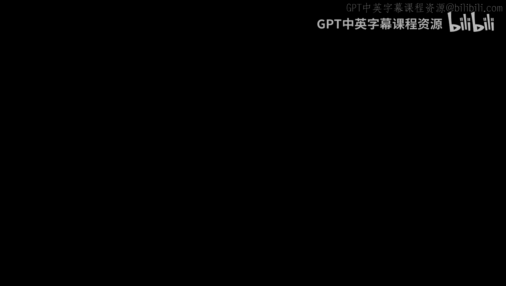
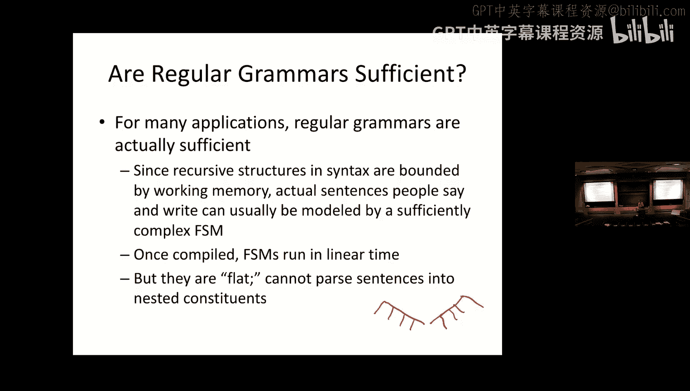
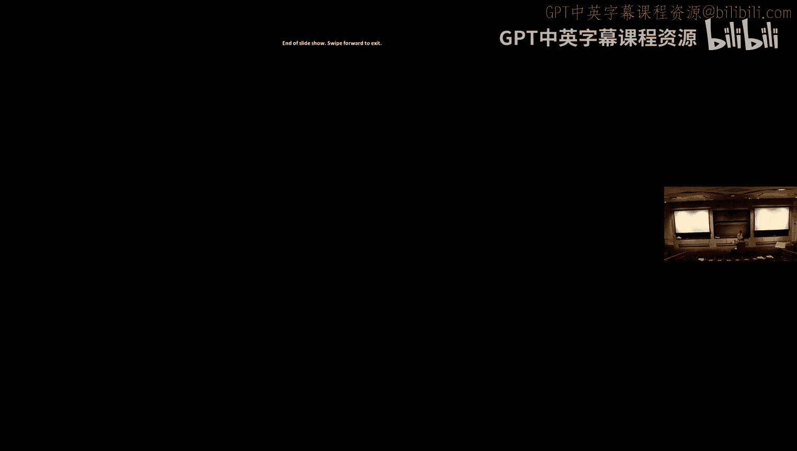
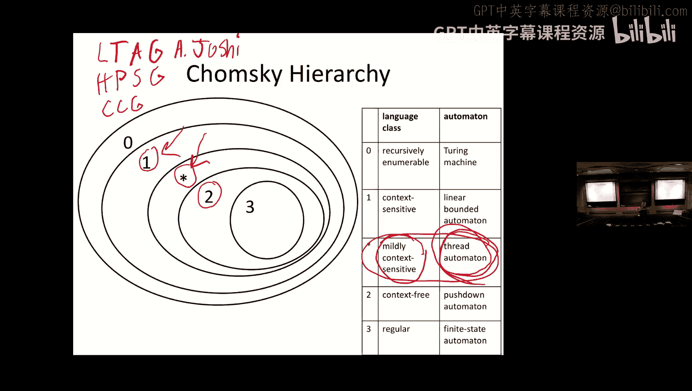
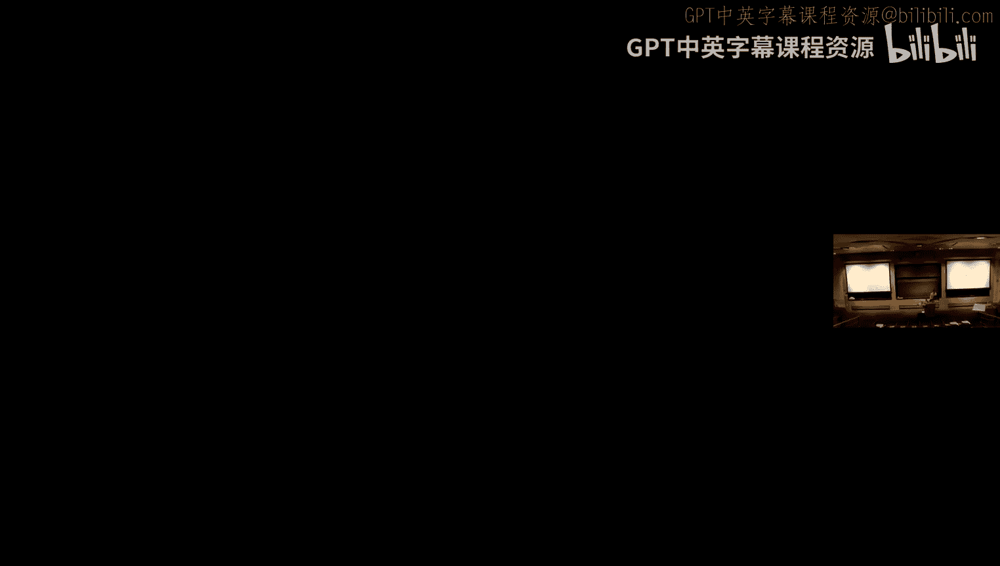

# CMU《自然语言处理｜11-411 11-611 Natural Language Processing 2020 Fall》中英字幕（Claude-4-S） p09 -09-2020-10-08 Chomsky Hierarchy.zh_en -BV1RaWpzAE7E_p9-

Thank you。 So today we're going to talk about the Chomsky hierarchy。

And in order to talk about the Choonssky hierarchy， we need to talk about formal grammars。

We've already talked about one kind of formal grammar， context three grammars。

But now we're going to talk about a generalization of context free grammars。

 formal grammars in general。And these have the following parts。😡。

You have a vocabulary of terminal symbols， which we call sigma。A of non terminal symbols。

 we'll call n。A special start symbol S。And then production rules。

And you can have different kinds of production roles depending on what kind of grammar you have。So。

 in。tex in regular grammars， you have one kind of production rule in context three grammars。

 you have a different kind of production rule， and in context sensitive grammars you have yet a different type of production rule。

On up to a kind of grammar that is equivalent to a Tring machine。

Which lets you rewrite anything as anything。So a formal grammar G。Defins a formal language。

So we usually denote that as allergy。嗯。The formal language corresponding to that you get from the Kammer G。

So the most restricted kind of formal grammar that can generate an infinite set of strings。

Are regular grammars。And regular grammars come in two flavors。

They can be right linear or they can be left linear。For any regular grammar that is right linear。

 there exists a regular grammar that generates the same strings that accepts。

The same strings as that grammar that is left linear and vice versa。嗯。

So there's always an equivalence between right linear and left linear grammars。

So this is what left right linear grammars look like。So you could have two kinds of rules。One。

 where you rewrite。A non terminal as a terminal。And one where you rewrite a non terminal。

As a terminal followed by a non terminal。So this is what gives you recursion and what allows you to have infinite。

Lelong strings generated by a finite regular grammar。周。

Rightite linear grammars have the same constraints。But this rule here。

It's reversed so that instead its non terminal is rewritten as non terminal terminal。

it's just reversing the order of those two elements。So all regular languages。

 all languages that can be described by a regular grammar。All languages。

 all sets of strings that can be generated using a regular grammar。

 have both a right linear and a left linear grammar。You might ask。

 why are they called regular grammars？😡，Is it because they eat a lot of fiber？

Is it for some other reason？And it has something to do with the regular and regular expressions。

Does anybody know what the relationship between regular grammars and regular expressions is？

So regular grammars。Recognize exactly the same languages， exactly the same set of languages。

That true regular expressions do。And as we know， going back to the morphology section when we talked about finite state machines。

Finance state machines are equivalent also to regular expressions。So these three things。Finance。

 state automata。Regular grammars and regular expressions。Are all weekly equivalent。

That is they all describe exactly the same family of languages。

So here's an example of a regular grammar。😡，One that generates。One or more A's。

Flowed by one or more bes。So first， we start with S。We have two rules for s。

 either S can be rewritten as。AAF。Or it can be rewritten as A BS。那AAS。As we see here。

Can give you another A。Or it can be rewritten as ABS。F here。And then， Bf。Can be either just a be。

In which case you might have A A A，tt B。Or it can be rewritten as BBS。

 in which case you might have a B or another B or another B。so on。

So what is the corresponding regular expression？In true regular expressions。

 none of this Python bullshit。Well， so I said in true regular expressions， so yes， yes， A has it。

 so it's AA star， BB star。The plus notation comes from。Practical regular expression notations。

It's not the original cleaningy notation。That was used in mathematically proving the properties of regular expressions。

But it's convenient。So， L G。Can be recognized， as I said， by a finite state machine。So， that means。嗯。

That it can be determinedminized， any finite state automaton can be determinedminized so that each state has at most one arc per terminal。

But in order to do that， you may make a very big FSA with two to the N states。Can also be minimized。

 so you can find a minimal set of states orrcs and arcs that accept the same language。

So regular grammars。嗯。And finite state machines。Are sometimes used in implementing regular expressions。

嗯。Sometimes they can't be。Why would an implementation of regular expressions not be possible in terms of。

Fite state machines or regular grammars。Right， so if you implement something like look ahead。

 you stop having true regular expressions， you can recognize languages that are not regular languages that are not part of。

L of RG。So you can't use finite state machines or regular grammars directly to by themselves to do that。

You have to use some other less beautiful mechanism。

Well we've already talked about context tree grammars， they're more powerful than regular grammars。

 that is they can recognize all of the languages that regular grammars can and then some。So。

Rather than having just two types of rules， you have lots of types of rules with context three grammars。

They all have in common that you could have just one non terminal on the left hand side of the rule。

But you can have whatever you want。On the right hand side of the rule。

So these are very good for expressing things like bracketing。嗯。

Did you think about like bracketing in a mathematical expression？Like。Two times。3 plus one。Plus，5。

Can you handle this expression？Intelligently。Or describe the set of expressions like this。

In a restrictive way。Using regular ground major。Hello。😊，Somebody is talking in the background。

 could youute？Or talk。Before that day。OK。So can you do this with regular grammars？

With this language of mathematical expressions。B a。A regular language。

 a language that can be recognized by regular grammars are described in terms of a regular expression。

Or a finite state automaton。What do you think？Here's a hint， no。No。

 you can't get this with a finite state automaton， you can't get this with a regular expression。

Why not？Okay， so Chris Fm says， you need some sort of memory。And in a sense that's correct。

 so you need to be able to know how many brackets。You've already crossed。

You need to be able to keep track somehow。嗯。Of how many right brackets and left brackets？

You've crossed as you go through the string。And regular expression has no way of doing that。

By the same logic， a regular grammar has no way of doing that。

 and if you think about how a regular grammar works。And what the possible rules are。

 then you can see why。That's the case。But context free gramars can handle this。

So let's see an example， so here's a context free grammar for arithmetic expressions。With A And B。

For additional subtraction。So our bracketing。Is expressed here。

By a rule that generates the opening bracket， the content and the closing bracket。

And then you could have any combination of these symbols inside it。嗯。Either bracketed or unbraed。

So CFGs are more powerful。Then regular grammar。Because any rule that you could have in a regular grammar you could have in a CFG。

 that CFG allow of these other cool things。So L of CFG can be recognized by push down automata they the they are to。

Context free grammars， what finite state atmata are to regular grammars。

And they're like finite state atmata， but with a limited kind of memory， kind of push down stack。

That allows them to deal with these kinds of bracketing situations。

Chins free gramars can also be normalized， this is going to be important to you when you learn about parsing algorithms。

So there's something called Chomsky normal form。And in Chosky you can rewrite any context free grammar as a context free grammar in Chomsky normal form。

 and in Chosky normal form， there are just three kinds of rules。You could have a non terminal。

Rewritten as。嗯。Nll were epsilon。It's an empty category。

You can have a non terminal rewritten as a terminal。Or you can have a non terminal rewritten as。

T non terminal。So this is Chosky normal form and any context free grammar。Can be。

Normalize to Chomsky normal form， sometimes it gets a lot bigger， but it's always possible。

So most programming languages actually are context free languages。

They can be described in context tree grammars， in fact， some of them are parsed。

They're using context free parsers， their formal specifications are often stated in terms of context free grammars。

 do you think of any exceptions， do you know of any languages that would not be context free or not be holy context free？

So Chris fan says C+ plus， why is C++ not fully context free， what part of the language？嗯。

Cannot be expressed in terms of context tree rules。Can you tell us， Chris。

So even parsing C++ requires solving the halting problem。

 and the problem with C++ is actually the template。Syntax。

So what something means in the template syntax is sensitive。

 and how it should be parsed is sensitive to the context in which it occurs。

So it can't be described with a context free grammar this is a depending on who you ask a major design flaw。

 but people seem to program in C++ anyway and。要不你。Has died waiting for their code to compile or anything like that。

 I think。So。That's okay， there are other examples， so Pearl。

 a terrible language from the past was famously not context free， Python would not be context free。

 it's not context free and tell you normalize out the white spacing conventions if you replace them with brackets then it becomes context free。

 so it's basically context free， but you have to take this extra step。

Or go up a level of abstraction。Then you have context sensitive grammars。

Contact sensitive grammars have rules that look like the following。

Where anti is the thing that's getting rewritten。And the thing that's on the other side is what it gets rewritten as and what is to the left。

And what is to the right the' backwards what is the yeah， to the left and the right。Is the context。

So this。And this Nt would only get rewritten as T and T。

When it occurred between these two non terminalals。So that's what makes it context sensitive。

Or this non terminal would only be rewritten as this terminal。

When it occurs between this non terminal and something。So the left hand side。

In context sensitive grammars can have more than one symbol。

But only one of those symbols gets rewritten。Does that make sense。

 others so there's one that gets through written and the others are context。Left and right context。

We could think of this as。NT T， N N。You know， put the context back in。Right hand side of the rule。这。

In phonology。The branch of linguistics that seeks to understand the sound structure and sound patterns in languages。

Has traditionally used context free rules。They write them like this。 You may have noticed that the。

 you know， we mentioned these before when we were talking about。

When we were talking about orthographic rules or spelling rules in the morphology section。

 same thing。So we can have rules that say things like a， it's rewritten as B， when it occurs。

 the slash year means in the context of so when it occurs in the context。After X and before y。

So for example， N is rewritten as M。Before P or B。So these are our context three rules， right？

Our context sensitive rules， the rewrite only occurs in a particular context。

 but you don't modify the context， you just modify the target。The source to the target。

So what is ironic about this？Well， as you might have noticed from the morphology section， you know。

 we wrote these rules as finite state machines Earth finite state transducers。And in fact。

 almost all phonological rules that have been described in languages can be implemented with ads finite。

 say transds。这。Were you know， we're skipping up。我也思啊。

Using a much more powerful formulaism than necessary in order to do this。

So context sensitive grammars， their language can be recognized by a kind of automaton called a linear bounded automaton。

They can be a lot harder to process because parsing is expensive。As you might imagine。

And there's a lot of spurious ambiguity， so you can have a lot of ambiguity that doesn't correspond to a real structural difference。

嗯。So we like to avoid these。嗯。We like to avoid using context sensitive grammars where we can。Because。

It introduces these problems。Then there are generalized rewrite rules。So in these rules。

 you can have any number of symbols on either side， rewrite anything as anything。

These are equivalent to Tring machines。And as you probably know。They can therefore be intractable。

You're very powerful。You could use them to implement a new Android Twitter client。

You could not use them to implement a new。IOS Twitter client。

 because Apple has its own proprietary set of generalized re rules。

That are not compatible with what other people use。So it turns out。So we can。

Place all of these different types of languages。And all of these different types of automata。

Into a hierarchy。嗯。Where。The top level in the hierarchy we'll call it zero， type zero languages。嗯。

Subsm all of the others。And type1 subsumes everything。Except zero。Type two subsumes， type three。

 and then type three， the regular languages。Is the most limited and most restricted。So， basically。As。

Your restrictions。the kind of rules that you can have goes up。The size of the set。

Of those languages or the magnitude of this set， these are infinite sets， but the。The the这个。

The set gets more restrained。嗯。So the number。That's not the right way of putting it。Basically。

The stricter the rules， the more restricted the languages that the family of the class of languages。

 the stricter the rules， the more restricted the language class。And in a way。

 the simpler the automaton。Also， the more restricted the languages in the class。

So this is a Chomsky hierarchy。 Now， you may be wondering。What about。Dar here。

It says mildly context sensitive and corresponding to a thread automaton。We will come back to this。

What we want to do is to。Eneavouror to prove。That particular languages are not are or not。Regular。

Or are not context free， and we do this using proof。嗯。Called the pumping lemma。 Actually。

 there are pumping lemmas for regular languages and pumping lemmas for context free languages。

 I think there's pumping lemma also for context sensitive languages。嗯。

So this is the intuition for regular languages。From Juraki and Martin page 533。

If a regular language has any long strings longer than the number of states in the automaton。

There must be some sort of loop in the automaton for that language。

We can use this fact by showing that if a language doesn't have such a loop。

Then it cannot be regular。😡，So in other words。If you're generating an infinite number of strings or very long strings。

And you don't have some kind of repeating pattern。Then you can't generate such a language if you don't have any kind of loop。

😡，You can't generate that language， those strings using。Using regular grammars。

The language has to be at least context free。So here is a visual illustration。

 so if L is an infinite regular language， then there are strings X。Why and they。Such that。

Why is not empty？And x， y D and z。It's a member of L。For all n greater than zero。So why here？

Is in our loop。So we can use this to prove that a particular language。Is not regular。

So is ins regular？Well， let's consider some examples。

 you may find this more or less confusing depending on your disposition。So what about the sentence。

 the cat likes tuna fish， how do you like that？The cat， the dog， chased， likes tuna fish。The cat。

 the dog， the rabb bit chased likes tuna fish。The cat， the dog。

 the elephant admired bit chased like tuna fish。不。When you get up to this point。

 the sentences become very hard to parse。But the argument is that there are still grammatical sentences of English。

They're just difficult to process because you run out of memory， your stack in your brain。

 the part of your brain that is parsing these sentences。呃。Rruns out of space。

And so you can't process them anymore。But the idea。Behind。The people who use these examples。

Is that English is not regular。Why is it not regular？Because these sentences。Have。

Stuc kind of like this。Sort of bracketed structure。We've got cat。对。Dog。Chase。That's not right。嗯。

Let's era this and cover my guilt。嗯。I think there's a better illustration on。The next slide， yes。So。

You could have a language。嗯。That has。The cat dog， mouse， et cetera。0 more times。Chaste bit 8。

 et cetera， zero more times。Like tunafish。嗯。But if you take the union as this。And English。You end up。

With。呃。A pattern where you have n。And minus-1 likes。So basically。

 you have a pattern that is a to the N， B to the N。Can you describe？A to the N。

 B to the N using a regular grammar。Or a regular expression。Or a finance state automaton。

So you can keep on going without looping。Right。There's no loop， there can be no loop。

So according to the pumping lelemma。This is not this language cannot be regular。

So here are some more examples。The cat likes tuna fish。 The cat the dog chase likes tuna fish。

The cat， the dog， the mouse scared chase like tuna fish。The cat， the dog， the mouse。

 the elephant squash scared taste like tuna fish。The cat， the dog， the mouse， the elephant。

 the flea bit， squashed， scared chased like tuna fish。The cat， the dog， the mouse。

 the elephant the flee， the virus infected bit， squash， scared， chased like tuna fish。

How many of those？Do you like？How many of those seem like sentences of English？Remember then。

 let's give me your highest good sentence， highest。uncha。So somebody likes six。Wow。

You have a very large stack。Mostus people。Like。Somewhere here。2 or three。嗯。

So if it's only two or three， in fact， if it stops anywhere here。Maybe three on a good day。

 Kevin says。So if it stops anywhere in this sequence。

 then you can actually describe the actual language。Could be regular。The argument that it is。

Not regular that it is at least context three is that these constraints。

That you're sensitive to that keep you from saying that it's four or five or six。Our。

Not grammatical constraints， they're not about English per se， they're cognitive constraints。

 they're about how much working memory you have。So here's the Chomsky hierarchy again。

And we have ways of proving whether our language falls into any of these circles， any of these ovals。

In the ST diagram。Well。嗯。Let's return to this。St。So we know that some languages accepting the argument that I've given you。

We know that some languages are at least context tree。To here。The question is。

 are all languages context free？Or could？Some languages be。Require a more powerful kind of。Amaton。

To recognize them。So the claim that has been made is that there's。嗯。

A level in the hierarchy in between one and two。So the numbered ones are the ones that Nome Chomsky。

 a linguist and computer scientist， and now， unfortunately， political scientist。嗯。Yeah。

 we did say that C++ is in context3， but in terms of human languages。

Are any human languages context treat？Any natural languages？

So the argument is that he missed something。And that there's actually this star here for mildly context sensitive languages。

 and there are some languages。Some natural languages that are mildly context sensitive。

Rather than context three。But that maybe no languages are completely context sensitive。Which is good。

 it would be a nightmare to have to deal with languages that were contact sensitive。

So part of the argument for this of the original argument comes from Swiss German。

This is actually my wife's native language。So I have some recordings of her reading some sentences。

 so Swiss German is a language。Closely related to standard German。

 but not mutually intelligible with it， that means that speakers of Swiss German can't necessarily understand speakers of standard German and vice versa without exposure。

You know have a few weeks。They can't understand one another， so it's similar。

Quite different in some respects from standard German。 And if any of you speak German。

 then you'll notice that this is the case。So just to give you a sense of what Swiss German sounds like and what it's used for。

 namely singing children's songs。Then I'm going to play you something if this works。

anybody here speak German。Anybody understand that？So。

Here are some examples of some sentences from Swiss German。

That work kind of like these center embedding sentences from English。

 the ones the dog the catbit chased like tunafish。嗯。But， instead of。Going inside out。Like this。

It's not like that。Instead。The relationships are。Crosswise。Or more accurately。Well， you'll see。

So this first sentence。I。Yon said themam Hans is whose health a。嗯。So。Who helped。Hands。

And who painted， what was painted？The house。And you can go even deeper than that。

So this is a problem， right， if you can keep doing this。

Because you can't do this with a context tree grammar。You could do bracketing。This is not bracketing。

 this is a step worse than that。The side， the smell trained enhance is whose Hanvea alphafa Arri。

Okay， so the children。Wanted to let。Hs。Help。Paint the house。

So these are what are called cross serial dependencies。嗯。And it's not something that you can capture。

Using context free grammars。It requires a more powerful formalism than that。On the other hand。

 it's not so。Difficult。That you need the full machinery of a context sensitive grammar。

Something in between。So let's look at the proof here。So we have this string， Yang side。

 does near kint and hos enhance as hos。Handzella La alphapha aspect。Where we've got。

Cleaning stars here and here and here and here。嗯。Will we take the union of this。嗯。And Swiss German。

And you get something like this。Where you effectively have。A to the N。B to the m。See the end。

B to the M。this is not something that we can do with context free grammars。对。😡，Here's the question。

Do we care？Now Swiss German appears not to be context free。As sequences like ABC， A prime， B， prime。

 C prime， where A is bit， just in case a prime appears and vice versa， likewise for B and B prime。

 C and C prime。These are， as I mentioned， called cross serial dependencies。

And you can't recognize them with a context tree grammar。

So I want you to explain back to me why you can't use a context through grammar to recognize this pattern。

so Abashek。Says each dependency that requires remembering something requires some form of memory。

AndThat's true， although you could argue that you need some form of memory with context free。呃。

Gmmars with bracketing and constant tree grammars， but here you actually need some kind of maybe real memory。

not just a stack。But something。A little bit more involved in that。

 So Chris says once you split an Nt an on terminal， then they're separate。Right。

So you have a non terminal and you're using a context free grammar。And you split here。Then。嗯。

Then this can't see this。They're separate。So you have no way of enforcing。嗯。So A to the N。B the M。

A to the N， B to the M。You have no way of remembering。And。When you get here。In the structure。So。

Even English might not be completely。Context free。This is， I think。

 really a semantic example rather than a syntactic one， but it kind of illustrates the idea。

 so it's good to think about。That's the respectively construction。So if you say Alice。

 Bob and Carol will have a beer， wine and a coffee respectively。

Then you are effectively setting up a dependency between。A and little A， B in little B。せの路せ。

It's hard to argue that this is syntactic， exactly。But it's clearly。

 there's clearly something going on there。 There's clearly something。Semantic。

So even English can be context sensitive in a way。So what we' have concluded。

 what linguists and computer scientists who work in this area have concluded is that natural language is mildly context sensitive。

This may not be true of English， English is largely context free。With some exceptional constructions。

 like the respectively construction。It is， however， true of Swiss German。And some other languages。

 some varieties of Dutch。For example。Probably a lot of languages。

 it's just most languages haven't been studied closely enough。For people really to know。

But even in these languages， the frequency of context sensitive constructions is relatively low。

And they tend to be bounded in depth by memory constraints。

So if we go back to the Swiss German example。My wife can get up to here。In terms of depth。

 you can get up to three。Three cross serialial dependencies， but beyond that， she can't do it。

So they tend to be bounded in depth by memory constraints in practice。So do we care？

Do we care about the fact that languages are not necessarily context tree？Who cares？

For your application。Like for your project。For many applications， CFTs may be adequate。

 even if you're working on Swiss German， I don't expect that you are， but if you are。

 CFTs may still be adequate。And they have some great advantages。

They are computationally more tractable than contact sensitive grammars。

Even weekly context sensitive grammars。They're easy to understand and reason about。

And the parcels even are easy to implement， so we'll talk about this in the next three lectures。

 we'll talk about the CYK or CKY algorithm， the early algorithm， and so on。

And how you can do context tree recognition and parsing。But backing up。For a lot of applications。

 actually regular grammars are sufficient。Since these recursive structures in syntax。

They're bounded by working memory。Then actual sentences that people say and write。

Can often be modeled by a sufficiently complex finite state machine。And once compiled。

 finance state Ma run in linear time。This is much better than any of the context free parsing algorithms。

On the other hand， they're flat， they can't parse sentences into nested constituents。

Except branching off in one direction。The parse trees always look like this。Or this。

Okay。嗯。So that's what I have for today。I wanted to ask at this point what other questions you have about the midterm。

Or if you have any questions about this lecture。The midterm data is on the syllabus。

 I would have to look it up， let' me see。It's coming up soon。嗯。It's on October 22nd。

Mter one is on October 22nd。And it's a good time to start studying。嗯。

Start thinking about what we've emphasized and what is important in the course。

And so if you have questions about what is important， what might be involved。

 now is a good time to ask。Yeah， so it's about 10 days from now。To worry about 10 days from now。No。

 it's something for you to worry about now。It's something for you to start preparing for right now。

Because you'll be so much less stressed out if you do it now than if you start now than if you try to cram everything at the very end。

I know it's funny， I was looking at the YouTube statistics for this class for past semesters。

And always at the very beginning of the course， there's a little spike where everybody is watching the videos and then it tapers off and then right before the midterm in like two days before it skyrockets and jumps up and then it settles back。

 immediately drops back down and settles down and then when it comes time for the final。

 it shoots up again。But I promise you that your attention will be much better if you don't try to watch all of the videos at once and do all of the reading at once。

If you space it up。嗯。Think about the courses。嗯。Think about the homework and。Try to。诶。

Absorb things more thoroughly and more slowly， I guess。If that makes sense。So any questions？

So I'm going to throw out some topics that might make good questions。嗯。FST question。

Might be on there that requires you to write an FST to do something。嗯。Language modeling。

Edit distance， we often have some kind of question where you have to solve an exotic form of edit distance。

Or modify。You know呃。Apply at distance to some kind of task。H your mounds so we。

It wouldn't be surprising if we have an HM part of speech tagging kind of question。嗯。

We sometimes do this after the midterm because we have a homework assignment on HMs and part of speech。

嗯。But。We could do that before。嗯。So from the programming assignments。

 the FST thing definitely would be the case， we wouldn't require you would involve a programming assignment。

 we wouldn't require you to write the FST in Open FST's language。

But we would require you to apply all of the concepts and ideas that you learned。In that assignment。

The same is true basically of the edit distance。So we would expect you to be able to not write out in the pseudocode。

 the algorithm， but。Execute the algorithms for edit distance， to fill out like a chart。Or。

ButYou know， table。Or something like that。How much concepts versus applications？So。

There will be both concept and application questions。嗯。It's usually about evenly split。

So most of the long questions will have some conceptual component。

And we'll also have an application component。So。I would say roughly 50， 50。

 but that's not a guarantee。So there's almost certainly going to be a classification question。

Of some kind。嗯。That probably involves。Both。Fundamental concepts in classification。

And also application of those concepts。To a particular kind of task。So for syntax。

There is likely to be。A paring。Problem of some kind。

Where you use CK or early or some other parsing algorithm。To parse data。

 so you have to know how the algorithm works。And then talk about the application of this。

Of this algorithm to particular tasks。Any other questions？How的嗯。For applications， Chris asks， well。

 we need to trace algorithms by hand， like at a distance of long strings。

You will need to trace distance or trace algorithms by hand。But we probably won't。嗯。

We're not here to like test your stamina。So we're not going to give you gratuitously long things to calculate。

We're not trying to make you into computers， we're trying to make you into computer scientists。

None of the。嗯。That of the calculation will require a GPU。ButYou will have to。

You will have to trace algorithms by hand， like the parsing algorithms and at a distance and maybe。

Or HMs maybe。The Terrby algorithm or forward backward。Anything else？So We asks。

 does context sensitive grammar have a formal definition？Yes。Does weak mildly context sensitive？So。嗯。

Here's the tricky thing。是。So we can talk about mildly contact sensitive languages。

And they are the set of languages。Recognized by a thread automaton。So we can define a threatatmaton。

And we could define the language with reference to that。

It's somewhat more difficult to define a grammar， a set of a formal grammar。

That corresponds to oddly context， sensitive languages。People have worked on that。

And there are actually a number of different。Gramatical formalisms。That。呃。

Formalize mildly context sensitive。So， there's。Lxiicalized tree adjoining grammar that was invented by Arvin Johi。

嗯。Who is the person who discovered mildly context sensitive languages， you know。

 so LTag is a formal language or formal grammar that corresponds to this kind of language。

There's HPG or head driven phrase structure grammar。嗯。Which also。

Corresponds basically through the same set of languages。So。And they're CCG。嗯。呃。

The kind of categorial grammar。嗯。That。Also corresponds to this， you know。

 could be used as a formal definition of this class of languages that we call modelly contact sensitive。

嗯。But it's not as simple as just saying these you can have these kinds of rules and not these kinds of rules in the way that you can for these other categories。

So that's probably why。Tmsky didn't notice this class at first and why it was left to people like Er Joshi。

是。嗯。Discover it。Does that answer your question？Okay， any other questions？

Keep the good questions coming。 I like the good question。Okay， if there's nothing else。

 then we will go。And I'll leave you a few extra minutes to。

Run to the restroom before your next class。嗯。Or to sleep， if you're in。East Asia。And I will。

Talk to you next Tuesday。Right， goodbye。

