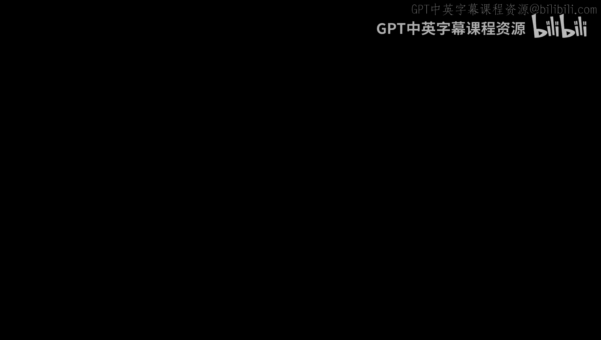
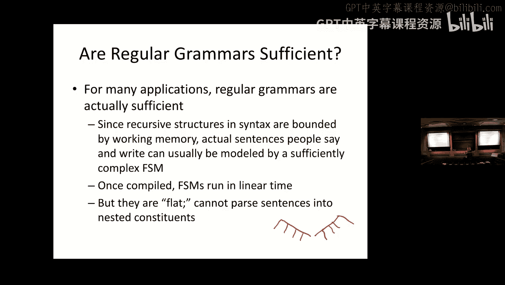
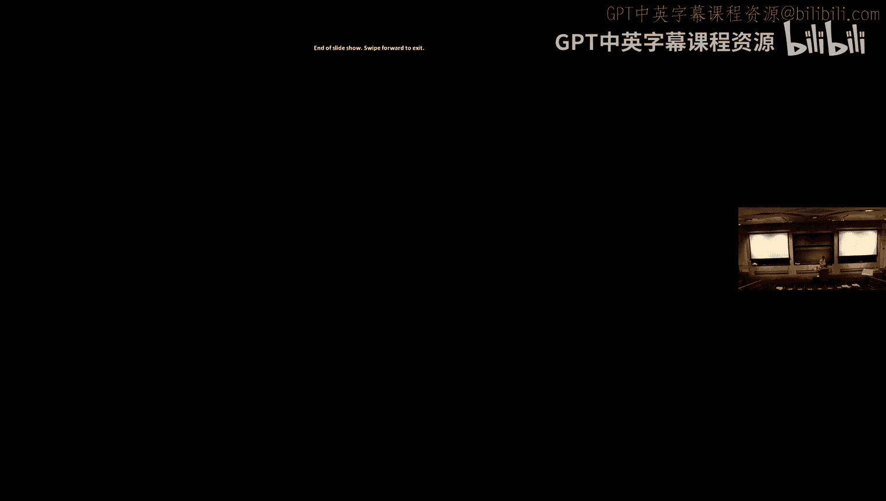
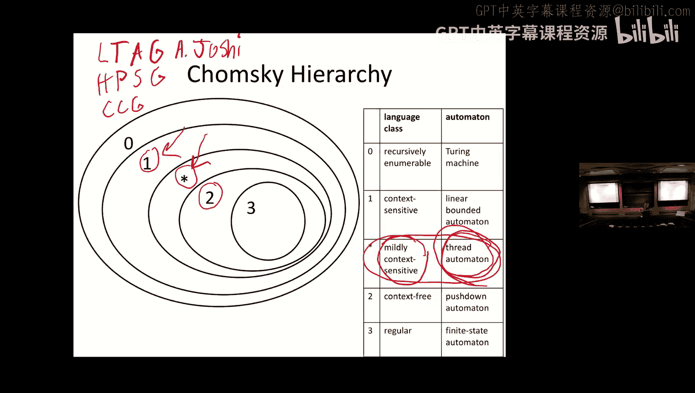
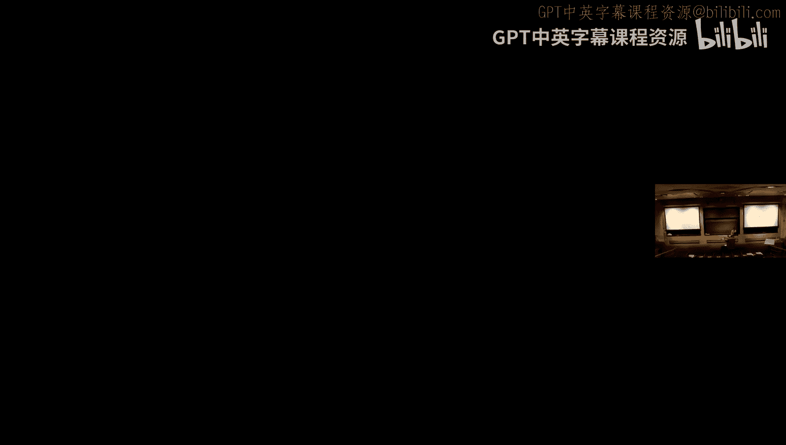

# CMU《自然语言处理｜11-411 11-611 自然语言处理 2020 秋季》中英字幕（Claude-4-S） p09 -09-2020-10-08 Chomsky Hierarchy.zh_en -BV1RaWpzAE7E_p9-

## 1. Chomsky Hierarchy 简介

在本节课中，我们将学习 Chomsky Hierarchy，它将不同的语言和自动机分类，并帮助我们理解它们的复杂性和能力。

## 2. 形式语法

为了理解 Chomsky Hierarchy，我们需要先了解形式语法。形式语法由以下部分组成：

* **终结符号集合（Sigma）**：包含所有可能的单词和字符。
* **非终结符号集合（N）**：包含所有可能的语法规则。
* **起始符号（S）**：语法规则的起点。
* **产生式规则**：定义如何将非终结符号替换为终结符号或非终结符号序列。

## 3. 正则语法

正则语法是 Chomsky Hierarchy 中最简单的形式，它可以生成无限多的字符串。正则语法有两种类型：

* **右线性语法**：产生式规则右侧只能包含终结符号。
* **左线性语法**：产生式规则右侧只能包含终结符号。

正则语法与正则表达式等价，可以由有限状态自动机识别。

## 4. 上下文无关语法

上下文无关语法比正则语法更强大，它可以识别所有正则语法可以识别的语言，以及更多。上下文无关语法可以使用产生式规则，其中左侧只有一个非终结符号，右侧可以是任何符号序列。

上下文无关语法可以由下压自动机识别，并可以转换为 Chomsky 正规形式，其中只有三种类型的规则。

## 5. 上下文相关语法

上下文相关语法比上下文无关语法更强大，它可以识别所有上下文无关语法可以识别的语言，以及更多。上下文相关语法具有以下规则：

* **A -> B**：将非终结符号 A 替换为终结符号 B。
* **A -> B C**：将非终结符号 A 替换为终结符号 B 和非终结符号 C。

上下文相关语法可以由线性界限自动机识别，但解析起来更困难。

## 6. 广义重写规则

广义重写规则可以替换任何符号为任何符号，与图灵机等价。它们可以用于实现各种应用程序，但可能难以处理。

## 7. Chomsky Hierarchy

Chomsky Hierarchy 将不同的语言和自动机分类，从最简单到最复杂：

* **类型 0 语言**：广义重写规则生成的语言。
* **类型 1 语言**：上下文相关语法生成的语言。
* **类型 2 语言**：上下文无关语法生成的语言。
* **类型 3 语言**：正则语法生成的语言。

## 8. 振荡引理

振荡引理用于证明某些语言不是正则语言或上下文无关语言。它表明，如果语言包含无限长的字符串，则该语言必须包含某种循环。

## 9. 总结

本节课中，我们学习了 Chomsky Hierarchy，它将不同的语言和自动机分类，并帮助我们理解它们的复杂性和能力。我们还学习了正则语法、上下文无关语法、上下文相关语法和广义重写规则，以及如何使用振荡引理证明某些语言不是正则语言或上下文无关语言。