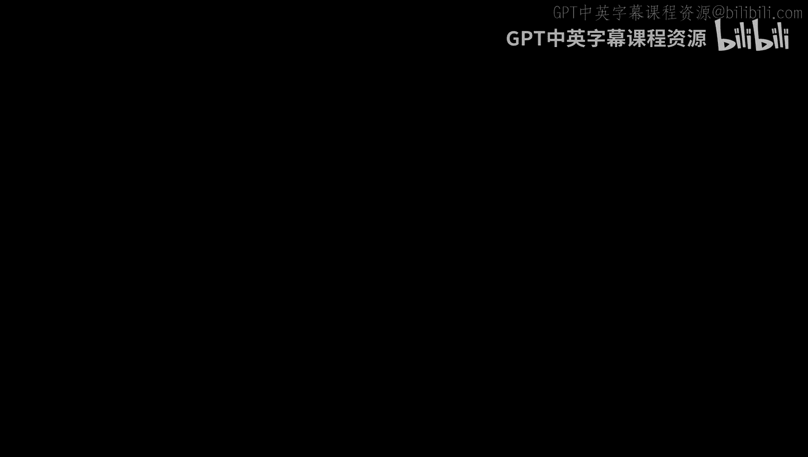
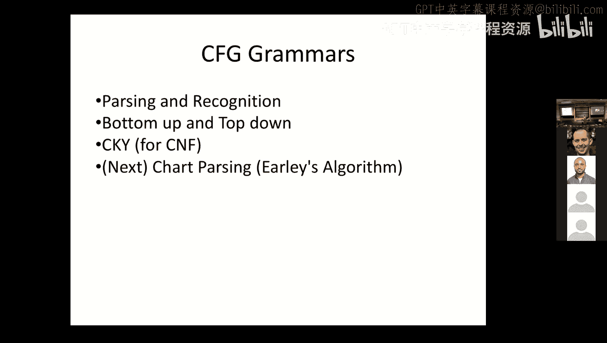

# CMU《自然语言处理｜11-411 11-611 Natural Language Processing 2020 Fall》中英字幕（Claude-4-S） p10 -10-2020-10-13 Context Free Recognition.zh_en -BV1RaWpzAE7E_p10-

So just backing up。We're going to talk about context free recognition。And。😊。

Psing is an important part of this that facilitates analysis。

So that up arrow that's in blue that I drew over with red while I was not thinking about the fact that I was not recording this lecture。

That helps us to get from syntax to semantics。So。Grammars， context free grammars are great。

They can be used for recognition， for parsing。They can be used with different kinds of parsing algorithms。

So they're in a way algorithm agnostic that can be used for bottom with bottom up algorithms。

 with top down algorithms。嗯。And we're going to be talking today about a specific algorithm called CKY。

It's also called CYK， depending on whether you think younger or Kassami is more important。

So big debate，YK or CKY， same thing though， same algorithm。And one thing that we'll talk about。

In the context of context free gramars that's important to CKY is Chomsky normal form or CNF。

 and I mentioned this last time， but we're going to talk more about this and why this is an important idea and how。

Why it's necessary to have our grammar in Chomsky normal form in order to use it with CKY。Or CYK。So。

😊，You might think。I don't need your parsing。I can just do everything by matching patterns of words。

All I need are regular expressions or maybe something even stupider than regular expressions。

 and I can I can get my semantics from that。 I'm halfway to natural language understanding without touching a single context free rule or anything like that。

😊，Well， consider this。Take the sentence the student who was taught by Alan Black won the prize。

Who won the prize。Well， if you're just doing this by surface string matching。

 you can see who won the prize and it's clear that it was Alan Black。

 Alan Black won the prize it's right there in the sentence。But there's a problem with this。

Alan Black never wins prizes。嗯。Or。Really， the problem is， you know we know that it was the student。

Who won the prize and is separated from won the prize by relative Cla。That contains。

Was taught by Alan Black。So if we do this with parsing。Then we get this。

We parse the relative class as a separate unit and we get the student。

Who was won taught by Alan Black？As a separate constituent， and then won the prize。

So that's why parsing is good。But we're not going to learn parsing today。

 we're just going to learn recognition。But here's the secret。

We're going to teach you the CKY algorithm。Which is a recognition algorithm， but with a little fix。

 we can change it into a parsing algorithm。So here again。Is our favorite definition。

 the definition of context free gramars， so they have a vocabulary of terminal symbol sigma。

A set of non terminal symbols， N。So these are like the names for syntax of natural language。

 these are the names of phrases。Or the pre terminals that look like parts of speech。

That are right above words in the tree。And you have a special start symbol S for a start。

Oror a sentence， if you prefer。And production rules that look like。嗯。X is rewritten as alpha。And x。

Can be a non terminal。Can be any non terminal。Must be one non terminal。

And alpha can be any sequence of non terminals or terminals。

That's all there is to a context free gramar， it's just a set of rules like this。嗯。

That live in this universe of terminal symbols and non terminal symbols。So there are two problems。

That we want to solve。So let's have us an input， a sentence that consists of some number of words。

And a context free grammar we'll call G。So in recognition， the problem is saying whether or not W。

 this sentence。Is a member of language G。Psing is to give actual derivations for W given and G。

So one or more derivations。Actually， it's zero or more if W is not。Part of language G。

So what way of looking at？嗯。One way of looking at。Oh， there are no slides uploaded for today。

Let me see if I can address this。I just told the TAS to upload the slides for today。Hopefully yeah。

They will get to that fairly soon。我知道。YeahPoing them。Okay。

 so one way of looking at parsing is to look at it as search。So in bottom up parsing。

You're starting with a sentence and you're searching for a path from that sentence。To ask。

And in top down parsing， you're studying with S and you're searching for a derivation from S that will get you to the census。

These are both perfectly legitimate ways of doing parsing。And ultimately。

 they get you the same place。But one can be more efficient than the other。

 depending on the particular kind of grammar and the particular problem that you're dealing with。

And your particular constraints。So here's an example of how you might implement recognizers as search。

 so you start off with an agenda and it's going to be a set that has state zero in it。

your start state。And while agenda is not empty。Then you're going to go pop a state from agenda and put it in s。

 so starting off state zero， S to state  zero。If S is a success state。Return S。

 so if you got to the end of the parse。Then you return the parse。Or the wreck。

 not not the parse exactly， if you got to the thing you were looking for。嗯。

Let's say you're doing top down parsing。Then its then you return S。Otherwise。

If S is not a failure state。Then you generate the new states from S。

And push those mistakess onto the agenda。And you keep doing this。Until。嗯。You。

Run out of states in agenda。And if you run out of states in agenda before you reached a success state。

 then you return no because there's no parts。对我。This is a generic。Version of recognition。

As a search algorithm。So this actually works either going either way， it's just very generic。

 so you have to apply it to the specific。You know。It's too generic to be an actual algorithm。

 basically。就是。嗯。Giving you the abstract idea。Of how such a recognition algorithm could work as a search algorithm。

If that makes sense。O。So。In order to。Do context free recognition or parsing。Then you need a grammar。

And here is an example of grammar。So it has two parts， as the grammar proper。

Which has a bunch of rules， and as you can see these all have on the left hand side a non terminal。

And on the right hand side， they have one or more non terminals。Then the lexicon。Over here。

It's where you get the。The pretermins， like determiner。Noun， verb， pronoun， proper noun。

 auxiliary preposition。And the terminals that can rewrite them。

The terminals that they can be rewritten as。And here we simplify by representing a group of rules as a single rule。

 so determiner goes to that， determineator goes to this， determineator goes to a。

 all written in one line。Because。That's nicer。But really it's three rules。嗯。So the rules look。

Different in a way， but really they're the same kind of thing。Now。

 this grammar can generate a lot of different sentences， actually。嗯。A very large number of sentences。

But it doesn't go anywhere near covering all of English， of course， you know。

 not only because the lexicon is not big enough， but because the grammar is not big enough。

Doesn't cover all of the possibilities。Here' was an even simpler grammar。We've got S goes to NPVP。

BP goes to VNP。MP goes to John， NP goes to Delta， V goes to flies。So this是。Generates two sentences。

 right， two distinct sentences。Which are what？2。I missed a sentence or a question， Mahoul asks。

 what does nominal mean here？And you can think of nominal as meaning a nounny thing。

A noun like thing。So two sentences， what are the two sentences？John place Delta。Delta flesh John。

Only one of them is particularly probable， but they're both possible。

 they're both sentences that belong to this language。嗯。嗯。When we use the CKY algorithm。😡。

We're going to。Normalize。Gramars like this。And this。嗯。To be something simpler。Actually。

 this one is already normalized。嗯。This is called Chomsky normal form。And in Chomsky normal form。

 everything is like a normal context free grammar， except for one thing。

There are additional constraints on what a rule can look like。What production rule can look like。So。

It can either the。The x over here is the same。But alpha is constrained。

 it can be either a non terminal。Followed by a non terminal。Or else a terminal。Or technically。

 it can also be null。对好先。嗯。哎，对。嗯。It's basically an empty， it's like the empty string。O。嗯，这 yeah个。So。

 you can have。So this。This ends up being useful sometimes when you're building context free grammars and you have。

You don't always have an even number of branches or you know。

 and so it can be difficult to express things it's actually still possible using just。N N or T。嗯。So。

没有。嗯。So you could have rules like。And。P。Goes to ther。And。We're both。

In we're both the terminalr and n are non terminals。And then you can have rules like Der goes to the。

And N goes to students。So these are all allowed。This is fine。 This is fine。 This is fine。

But you couldn't have a rule that said NP goes to。Deterine our student。

And you couldn't have a rule that said S goes to NP。N p。If you have non terminals。

 you have to have two of them。And if you have terminals， you have to have one。

That's Chomsky normal form。Now。The nice thing is。Any context free grammar？

Can be converted to a grammar in Choonssky normal form。Sometimes it gets quite a bit bigger。

But you can always do it， so for example， for a rule X goes to A，BC where A。

 B and C are non terminals。You can always rewrite this as x goes to AX2 and x2 goes to BC。

 in in other words， you can introduce a new non terminal。And through this general strategy。

 rewrite you can normalize。Any context free grammar to Chomsky normal form。

So here is an example of one of our toy grammars from the book。嗯。This L sub1。

Converted to Chomsky normal form， and it looks like this。It's bigger that if there are more rules。

But it。Nonetheless。呃。Represents the same language。So any sentence that could be recognized by the L1 grammar。

Could be recognized by the L1 in Chomsky normalmal form， grammar and vice versa。Their equivalent。

This is important because Chomsky normal form。Is how you have to represent your grammar if you're using it with CKY or CYK。

This is the CKY algorithm or one formulation of it。

 You'll see a slightly different formulation in your book。

But it comes down to basically the same thing。So first。You have this initialization step。This loop。

Or you go through- so you this is a kind of dynamic programming algorithm， so you have a table。

And you go through this table on the diagonal。And you filled in。

With each of the words from the sentence。And then， this。嗯。This step。So that's before this。😡。

Then this step takes all of the rules in lexicon。All of these rules that rewrite。A non terminal。

As a terminal。And sticks。The non terminal symbol。嗯。呃。To the。Northasst。So to speak。

Of the corresponding terminal。So that sets everything up。

 That is done with these rules that rewrite the。A non terminal as a terminal， as one terminal。Then。

You iteratively。Go through the table。😡，And you。Basically。嗯。Find。

All of the places where a rule could apply。I'm actually tempted to use a chalkboard here。

I don't think it's fair。提供辩有是。I don't think they can。See it unless I do it really large。

 Can you see the chalkboard don't have？What， you't know worry about me。嗯。I think should plan。Yeah。

 I'm just trying to， I've got the chart here。But。So if you have the words here。

We need a bigger chart。嗯。Then。I love。对。Clas。Now， that doesn't work。Sorry， I need a bigger chart。

I don't have space for it。We'll just show you with the slides。嗯。So basically。

 you're looking for places where there's a rule。That has a terminal going to two non terminals。

And the first of those non terminals is at the West。And the second one is at the south。

So this is why you have to have Choonssky normal form because you have the two different kinds of rules。

 the lexicon rules and the grammar rules performing the two different functions。

 the lexicon rules are the ones where the non terminal is rewritten as a terminal。

The grammar rules are the ones where the non terminal is rewritten as two non terminals。

And so you're filling out everything from the lexicon first。And then you're searching。

Through the remaining cells， trying to find a derivation。嗯。The fits for all of the rules。In that way。

 it's easier to see。So。It's easier to understand when you see it visualized， however。

And there are differences about how exactly you increment your way through the parse chart。

Lets let's look。If I can get this to move。嗯。So here we see book this flight through Houston。

 we start off by initializing our chart with the sentence。On a diagonal。What are we going to do next？

So。We're going to do second our initialization step from right here。Yes。So essentially。

 we're going to fill in。The pre terminals。The parts of speech。For each of these words。So。

 this is going to be。Now。Determinr。没有。What if a word could have more than one part of speech？

So actually， inside of these cells， they're not singletons， they're sets。

And you could have more than one。对。So let's look at this， so book is a noun。And it can be a verb。

The Terminr。This is a determiner， flight its a noun through as a preposition。

 Houston is a proper noun。Then what we're going to do next。It's we're going to try to find。嗯。呃。Rules。

That。Fit in these。These particular cells。So that the。So for example， for this flight。

This flight can be a noun phrase and we know that there's a rule in our grammar that says noun phrase can go to determiner noun。

So。This。We go。 We look。To the left。For our first non terminal。

And we look down for our second non terminalmin。So we're trying to。And， and because， you know。

 this is dynamic programming。Everything is memmoirized， so we don't have to recompute。

These things multiple times， we can reuse calculations we've already done。

So when I'm doing this by hand。I usually like to do it going。This way。Scanning this way。

And that gives you the right result。嗯。嗯。But that's not what our algorithm does。

 And it's not the most efficient way of doing this。 So let's see what the algorithm does。O。走。

We look at this cell。There is no rule in our grammar that has something goes to verb Der or something goes to noundeminr。

So this is null。There is， however， a rule。That says。Determinine our noun goes to noun phrase。So。嗯。

This flight。Is a nouned trace。You go here。And。We see that we don't have a rule where something goes to noun preposition。

So that's no。But we do have a rule that says。Preposition plus proper noun。Or a noun phrase。嗯。

Can go to a prepositional phrase。So we keep scanning through。嗯。This is no， this is no。不。

We do have a rule。It says。诶。Noownun phrase。对。So。This flight through Houston。嗯。Can be a noun phrase。

And a prepositional phrase。And we have a rule that says a noun phrase plus a prepositional phrase。

Could be a noun phrase。Well what about book here？It's been feeling kind of alone。

Could be either a noun or a verb。 We can't seem to do much with it as a noun。But。嗯。

We can create a verb phrase。Out of。A verb。And a nouned phrase。And， in fact。You see here。

We could have。嗯。Po sentence。That consists of。A verb。And this NP。This sound phrase。

It would be booked this flight。But that doesn't work for us， why？

Would we stop there and say we have achieved sentencehood？We have。

Recognize that this is a sentence in our language。Congratulations us。So we've not parsed。

 as Chris F says， we've not parsed the complete sentence， and as Maho says。

 we need to check the entire string， we need to have a parse。嗯。Where S is here。😡。

So it would cover the whole sequence of words。And in fact， there is such a pass。

Which is what we got to next。After we。Itcovered that was null。嗯。Then we found we could have a rule。

We have in our grammar a rule that says VP。NP。Or that S can go to VP NPP。And so。

We have achieved a derivation。We have。found a way to get from。This sentence is sequence of words。

To S。And to an ask that accounts。For all of those words。So any questions about this？

This can be a little bit confusing the first time you walk through it。Although， you know。

I think because of kind of the order。That the algorithm takes us through things。But the basic idea。

 once you're get it is pretty simple。It's just a way of implementing that idea。Who could state back？

嗯。The idea behind this algorithm。What is the insight？你是写这。王嗯哼。Yeah， yeah。So what is your name？嗯，哪个。

Gravo Ricky， okay。So Ricky。Says you're just using dynamic programming to reproduce。The。

 the derivation。And that's basically it。I mean， it's a very simple algorithm， right？嗯。Very simple。

And yet， it's surprisingly effective。It's actually。Well。It's not the most。Efficient。

Algorithm in the average case that you could use to do this。

There are more efficient algorithms in the average case that you could use to parse context free grammars。

 particularly context free grammars for natural languages。But。But it。It's really easy to implement。

And it's really。A good way of understanding how parsing works and how other parsing algorithms work because it provides a useful starting point。

So that's why we teach it to you and why we spend a whole lecture basically on it。

So why do you need to use Chomsky normal form for CYK CKY？

Whatever confusing thing you want to call it。然后盖了把就的。那就。Why do you need the rules？

Foratted as to either。嗯。And non terminal goes to。terminaleral。Or non terminal。Goes to non terminal。

 non terminal。Why do you need the rules to be in that form？

Why couldn't we have rules like non terminal goes to non terminal， non terminal non？这是来不来。Well。

 there's a simpler reason than that。Yeah， so Arbek says we use the non terminal to terminal rules to generate the diagonal and then build each cell by combining exactly two other non terminal cells。

 one from the left and one from the bottom。That's right， that's right。

So you need exactly those types of rules。So it's very convenient that you can represent any context free grammar using those kinds of rules。

So now we've walked through the algorithm。Here's pseudocode again。Does anything stand out to you？

Does anything make sense that didn't make sense before？So， here。For the two rules。

The two kinds of rules。B goes to。W subJ， non terminalal。A terminal。

And V goes to Y z to non terminals。And Mahull says the rent stands out。Yeah。

And most of the rest of this。It's just looking through the table。And looking to the left。嗯。

Looking below。To try to find something that could。That would satisfy the rule。

So that's basically what we're doing in this algorithm。So here's the question。Let's see， Dwight。

This is an algorithm for recognition。Just as recognition。What would we have to do？

To make this into an algorithm。For parsing。What would we have to add？到面然才个。We're going good。

I think they have my mind， but I't want say it。So it's not too hard。Basically。

 you just add back pointers。So you don't just。被。This cell here with an s。

You add back pointers from this cell。From this S back to this V。And from this S to this NP。

And then likewise， you have a back pointer back from that VP to this V。I to this NP。And。

From this NP to this determiner and this noun。And so on。And then you have the whole structure。

 you can pick out that S and you lift it up， imagine yourself lifting it up from the parse table。

And each of the parsels comes with it。Because they're linked with these backpoint。

So another way of expressing CK is。Theres a set of equations rather than as an algorithm。

And this doesn't give you the dynamic programming aspect of it， but sometimes for some people。

 this is easier to understand。Now that CAYK is particularly difficult to understand。

 but if you're used to thinking in terms of equations rather than in terms of procedures。

 then it could be。Simimpr to get。Any comments on that， who likes the equations better？

It's kind of pretty。Who likes the algorithm better？You like the algorithm better？走。

Here's the bad news。So parsing is expensive。And CKY is expensive， the worst case。

Is and to the third times the length of the grammar， so it's proportional to the number of words。

To the third。Times the length of the grammar。 So it's。It's greater than cubic。Complexity。And。

It's always this bad。So best case is the worst case。You always know how it's going to function。

 how it's going to perform， you know， on any set of data， you always know， you know。

 this is going to terminate on any finite string。So later you'll learn about， but it's you know。

It's not so good。 So later you'll learn about other algorithms like early， the early algorithm。嗯。呃。

Which have better best case and better average case runtime。Thenhan C， K Y。

But they're more complicated， little a little bit more complicated but they。

For natural language tasks there。Somewhat better。We teach you CKY anyway because we think it's。

It gets you thinking in the right direction， and then you can understand early and other。

Parsing algorithms based on dynamic programming。Yops。So。We talked about。Ping。And recognition。

And the differences between paring and recognition。嗯。Psing。

Gives you one or more derivations of a sentence， recognition just tells you， in or out。

 does this belong to the language or not belong to the language？Also。

Talked a little bit about bottom up and top down parsing so you can get to the same place。

You can get a derivation of a sentence by either starting with S。

And working your way down to find a parse that will give you the sequence of terminals。

Or you can start with the terminals with the words。And work your way up。What is？CKY。

What kind of parsing algorithm is CKY？What。So it's kind of bottom up。好，那就。

But because of it bottom up。When we talk about early。

 it will not be so clear whether it's bottom up or top down。Because it。

It's a little more complicated and does things in a little less straightforward way。

 but we can think of CKY as being basically a bottom up parsing algorithm。

So next time we're going to talk about early。呃。I hope。

We're going to talk about whatever Alan wants to talk about。

Or you're going to talk about whatever Alan wants to talk about because I won't be here。

But do you have any questions about parsing， about context free grammars？About any of this stuff。

So it's very common for us on the midterm to have a CKY problem， so this is a real possibility。

Where you have to walk through the algorithm， basically。

Sometimes we do it on the final instead and make you do some other stuff that we learn about later in the course well。

 that you'll learn about just before the midterm， which is probabilistic context for gramars。嗯。Yes。

 the coming midterm。So， but but I often will'll do this on the midterm and we'll have a context free grammar。

 you'll be given maybe a grammar and a sentence or multiple sentences and you'll have to fill out charts for those sentences based on。

Based on CKY。And then give a parse tree， maybe one of the sentences will be ambiguous。

And so you'll have to give multiple different parsse trees and have that ambiguity reflected in your chart。

嗯。And and so on。Do you have any questions about the coming midterm。

 has anything come up that you would like addressed since we have a little bit of time？明天。

Nothing on the chat。I mean， is it just going to be like product design sort questions is it going to be what is going to be like design sort of questions like how you're approach？

嗯。So probably most of the questions will have a part that's about how you would approach the task。

They'll also have questions。嗯。嗯。Questions about。啊。They'll have like calculation questions or questions where you have to use an algorithm to solve a particular problem。

 but there'll also be questions about how you know given this task like you have to。

You have to analyze how people feel about。嗯。A particular set of products in which kind of product they prefer and you're given Twitter or something like that。

 then then how would you go about。What tools would he use to analyze and to determine what the attitudes of people towards those products were based on this natural language data？

So you'll have problems like that or problems like how would you do a named to entity recognition under these circumstances？

Or。You know。How would you build？Predictive text entry。Algorithm for a smartphone。嗯。啊。一了。

So it's that sort of thing。You know。So they're walking through algorithms， solving。

 doing computations。And answering kinds of design what you call design questions。

The sortrt of engineering questions where you apply。

 I would call them application questions where you apply NLP concepts to。Particular problems。嗯。

So we will release practice questions， I thought that had been done already。

 but I'll talk to the Ts about this I gave them。So we don't have a perfect set of practice questions。

 but we do have some similar questions from past exams when it was done in pencil and paper and it was。

Uly and totally different。But。We。嗯。We will get what we have to use so you can use them to practice。

 we can't promise that they will be exactly comparable to the questions on the exam， however。So。

So there will be five questions。Five long questions with multipart。嗯 each。

Each question will probably have。Five or six subparts。So you could view it as being。Like。

30 questions。30 little essay questions or。Computation question。I mean。

 any within the you had to take it at the particular times。

So we have some accommodation for people who are in other time zones。

If you have a really compelling reason why you can't take it at the time。That it's scheduled？Then。

You know， let us know and if we。If it falls so。So here are some of legitimate reasons why't why you couldn't take it during。

That time。嗯。So suppose there is a religious or national holiday that's relevant to you that means you can't。

Be free at that time。Suppose you have two other midterms the same day。

AndWe would consider that to be excessive。And so you。嗯。Would。Not。

We would allow you to take it at an alternative time。If you have an interview。A job interview。

Or interview for it。An internship or something like that。That。Would be。That's during that time。

 then that would be a reason。嗯。But like generally， being really busy is not。呃。

An excuse because everybody here is really busy。嗯。The solution to that is to do fewer things。

Its like。Delaying a day or putting it earlier day is not going to solve that。So Chris Fan asks。

 is the exam over a Zoom？嗯。That's an interesting question。So we will be available。

 We will not be watching you。We don't have the resources to do that anyway。

But we don't actually have the interest in like seeing inside of your。嗯。Rooms or your lives。

 but we'll be available on Zoom during the exam times to answer questions because invariably questions come up。

 you know things that need to be clarified。And Zoom is a convenient way of。

Of answering these zoom chat， and if we have a big announcement。Like something is completely wrong。

Then we can make it over。阿里o。But the exam will probably be offered using grade scopepe。

 which has a exam function。嗯。There's some possibility we'll choose to use Can instead。

Because there's more flexibility about assigning the exam at different times on Canva。

And for you know， so some people have。Disability related accommodations where they need to be able to take it for a longer period of time。

Take the test for a longer period of time。Because of a disability。 And that's easier to manage。

In Can than in grade scope， but gradecope is generally nicer and you can enter formulas。嗯。And。

It's nicer for us grading。And you can upload pictures。

 like if you want to sketch something out really quick to draw something up。

 then you can take picture with your phone and upload it。What you can't do in Canvas。

So' we're weighing weighing the strengths and weaknesses of those things before we start actually entering the problems that we're creating into。

嗯。Platform， but if you have any specific， any preferences。嗯。Then let us know， maybe I'll make a poll。

Last one again。Okay。Pall is launched。So you want canvas。人哋需要啊佢。哪谢 show。你 up上人。更标准。

Great great scope is missing some important features so if those features were added。

 then it would be。😊，You know， an easy。I mean， somebody who is grading。

Like gradeade scopepe is a ton better and you can have explicit rubrics for each question and that are very easy to construct and students can see why they got points off and they can make regrade requests and you can go through and grade all of one question at a time。

And so， it's。I think analyst is just disappointing for the because we just have to like answer follow up questions。

当才他才在。对。So it looks like people prefer grade scope by a fairly large margin， 77 to 23。Well。

See if they win in the Electoral college。嗯。Okay， any other questions about。The exam about the course。

Oh yes， Chris says long questions are not fun on canvas。 That's true。

 they're not actually super fun on great scope think。😊，Oh。Oh yes， the project progress report。So。

For the Project Pro report， what we want is a short video， I don't remember the link。Two minutes。

Where you say。You should have probably a diagram for each of the question generation and question answerings。

 sentences systems， like a flow chart。That shows what the parts of your system are and how they work together。

And so you should。Make that explicit， say what you've done， talk about what progress you've made。

Like if you are able to generate some kinds of questions。

 tell us what kinds of questions and give us some examples。

 if you're able to answer some kinds of questions， give us examples of that。But。

It's a good idea to let us know。Just what the general architecture of your system is。

Or of your systems。And who is working on what？And how far along in the process you've come。好事是给我们的。

Yeah。A picture is worth a thousand words。And is this public so we can see others this here。嗯。No。

 I mean， people usually share them on YouTube， but I think they usually do them as private unlisted videos。

Some don't， I know， because I sometimes。嗯。Looking at something else and suddenly somebody's project。

Report comes up。哦，O。😀。Because they thought I would also be interested in。Doing more grading， I guess。

 I don't know。Oh， any more information about the project to be released？

I know there was a piazza question， Abby asked。About specs of the machine that said info would be released in due time。

 but I haven't seen anything new about that， Okay， so the machines that will be used。

We'll actually give you AWUS credit。And so， you can。And the same。呃。We'll use AWS compute。

To to grade them。 So what E instances， E two instances， yeah。那还是说 do say呢。Yeah， yeah， EC2 instances。

So you should target that oh， another question that often comes up is。

 can we use pre traineded models？Yes， you can use pre trade bottles。You can't use a pre traineded。

Something that is specifically question answering。唔妈不。And so Bert is fine。嗯。

While Bt is trained on Wikipedia among other things and the questions you'll be answering and the documents you'll be answering questions from are from Wikipedia。

 I don't believe it's generally possible with Bt to answer。The questions without the document。嗯。

YeahSo so that's one thing we want to avoid if you're。

If your system is using resources that would allow it to answer the questions。Without the document。

Then this is not in the spirit of of the project but you you are allowed to use Bt。嗯。

You can use other pre traineded language models。嗯。And that's fine。嗯。

So there are some questions about like squad。嗯。And that's more of a gray area。

Because we want you to build。嗯。Build up from。More from the ground up from basic。NlP。Data and tools。

And。嗯。That's a little bit too question answering。嗯。Perhaps。I could。Sa it both ways。

With you're training on。Squad data。嗯。You know， I could see it both ways， but。哦，那。

Do you give us any information of what the D well D is coming from？

We tell you that the documents are all from Wikipedia。ThereWe choose a different topic every year。

Or every semester。嗯。And。If you just the plain text， you don't get the。

The HTML or any markup of any kind， just plain text。And。But that's what we can say about the domain。

So I can't so Chris asks， what's the EC2 instance type and how long do we have to run the program？

I can't speak to that exactly， I'm not sure what werere provided。What what。嗯。

So I can't answer the instance type， but to run the program， as long as it runs。

Within a couple of hours。Then it's。Fine， if it。If it takes like five hours or six hours， that's。

Too much。Most people's systems run。嗯。In a couple of hours， and that's fine。

Is that a criteria of grading， I mean， so I think time out I just have like one Oh yeah， it's time。嗯。

So。My question was if the timing is your？No， although if it doesn't halt， then。Effects grading。呵。

Yeah， okay， have a great。Day or night or whatever it is where you are。And I will see you。Not。

Next time and not the next time， but the following time。

