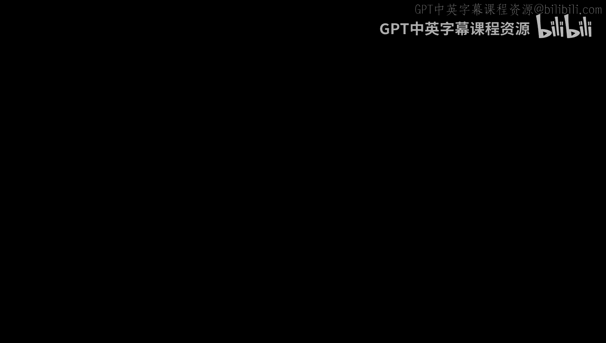
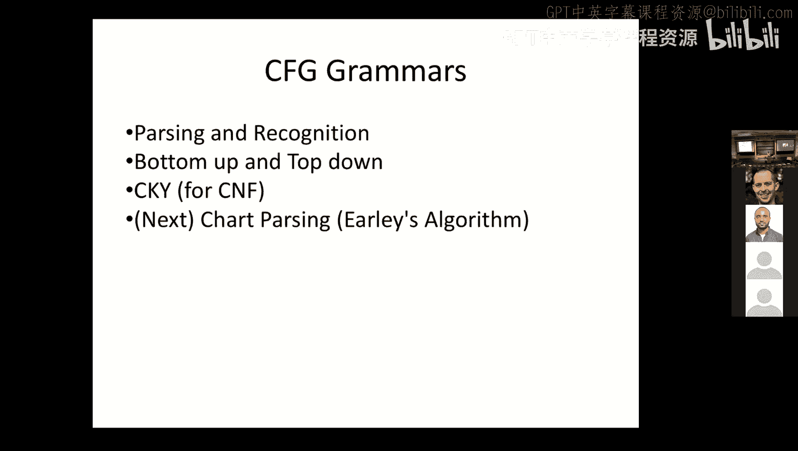

# 自然语言处理：11-411 11-611 自然语言处理 2020 秋季：上下文无关识别

## 上下文无关识别

上下文无关识别是自然语言处理中的一个重要概念，它涉及到语法分析、句法解析等。

### 语法分析

语法分析是上下文无关识别的重要组成部分，它可以帮助我们分析句子结构，理解语义。

### 上下文无关文法

上下文无关文法（CFG）是一种描述语言结构的规则集合，它由终结符、非终结符、起始符号和产生式规则组成。

**公式**：

* 终结符集合：Σ
* 非终结符集合：N
* 起始符号：S
* 产生式规则：A → α，其中 A ∈ N，α 是由终结符和非终结符组成的序列

### 识别与解析

* **识别**：判断一个句子是否属于某个语言。
* **解析**：给出句子的所有可能的推导过程。

### CKY 算法

CKY 算法是一种上下文无关文法的识别算法，它通过动态规划的方式，在表格中填充规则，从而判断句子是否属于某个语言。

**核心概念**：

* **动态规划**：将复杂问题分解为子问题，并存储子问题的解，避免重复计算。
* **表格**：用于存储规则和句子结构信息。

### Chomsky 正规形式

Chomsky 正规形式（CNF）是上下文无关文法的一种规范形式，它要求产生式规则的形式为：

* A → B，其中 A 和 B 都是非终结符
* A → a，其中 A 是非终结符，a 是终结符

### 总结

本节课介绍了上下文无关识别的概念、语法分析、上下文无关文法、识别与解析、CKY 算法和 Chomsky 正规形式等知识点。

**本节课中我们一起学习了**：

* 上下文无关识别的概念
* 语法分析
* 上下文无关文法
* 识别与解析
* CKY 算法
* Chomsky 正规形式