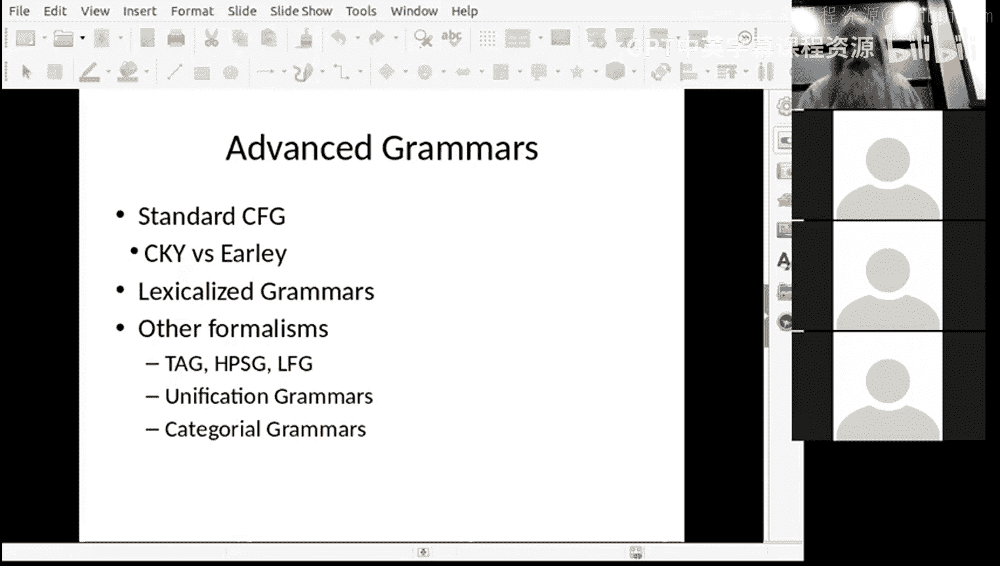
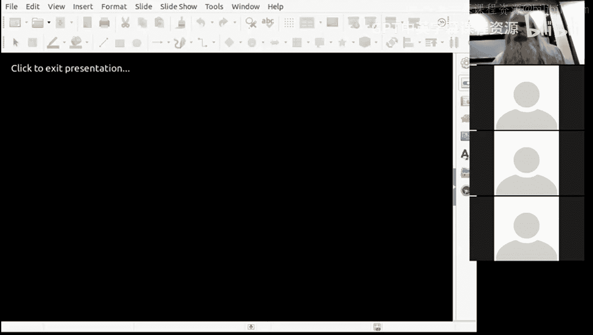

# CMU《自然语言处理｜11-411 11-611 Natural Language Processing 2020 Fall》中英字幕（Claude-4-S） p11 -11-2020-10-15 Parsing Algorithms.zh_en -BV1RaWpzAE7E_p11-

Let me wait another minute or so。Okay， we're going to start so we're going to continue talking about contextory grammar parsing。

 we're going to introduce some new algorithms and we're going to introduce some new types of parsing today。

 including dependency parsing， which are alternatives and some briefly mentioned some historical different ways of doing parsing。

诶。So first thing I'm going to do is I'm going to make the context free grammars that we were talking about be probabilistic in the last lecture David talked about the CQY algorithm and how to be able to do parsing with it and what we would like to be able to do is consider the following okay where we have book the dinner flight versus book the dinner flight and so they have a different meaning。

 can anybody tell me the two meanings of these two sentences one of them a bit weird。

So the second one is talking to somebody called flightlight。And it's telling them to book the dinner。

 so it's book the dinner。😡，George， okay， but in fact。

 the person's name is flight rather than the flight that has dinner on it。 Okay。

 now the first one is much more likely， but the second one is possible。 Okay。

 and so we would like to be able to have a mechanistic way to choose between the two。

 given our parties because we'd like to be able to do that。 And how could we go about doing that。

 Well， we could add probabilities to each of the rules that we've been dealing with before。

And let's worry later about where we get these probabilities from。

 but we could add probabilities of the likelihood of that particular rule over other particular rules and also care about the likelihood of particular words appearing in particular forms and then what we could actually do is we could then calculate the probability of each of those partiesies by multiplying up the probabilities of each of the partiesies and in this case we happen to get the answer which we think is right。

 which is about the flight that has dinner on it so it's some sort of nominal adjective on flight rather than telling somebody called flight that they've to book the dinner and so if we get these probabilities right。

 we can just run these probabilities on a rules and we can modify the CY algorithm a little bit and we end up with something that actually works so what do we have to do well we have to add proba。

For each of the rules and when we're dealing with this we've got a particular nonter like Nun and we're looking at all of the rules that expand nowun and we would like to find a probability for each of those and we can have a probability for expanding N to something so that some of the probabilities of all of the nontermins should add up to one okay so we just add that additional probability to the to the rules okay。

Where would we get them well we could parse things。

 choose parties between them and then actually calculate the probabilities David's going to talk about that next week and trying to get information like that from tree banks。

 that's usually what we do to do it so we're actually parsing data and counting out which rules end up being used。

How do we modify the algorithm actually it's pretty easy so basically we choose between we basically do the same algorithm with the CKY that we' were doing before。

 but now we're going to have this additional part of a probability and what we would like to be able to do is score each rule okay now we can either score every rule and keep every rule that matches and then care about the probabilities the end or we can do something super efficientic which may or may not be right of making local choice of what the most probable rule is at the time that we are applying it and there are advantages and disadvantages for each of those and that comes in the whole probabilistic parsing of optimization。

 you may actually miss the best pars but you can get a good parrs out of it and you can also probably say a lot of time by going rid of some of the X rules and not miss stupid things that are locally meaningful but globally not meaningful。

Okay so we just add probabilities to that， so now we just basically do the same thing that we were doing before but we now have probabilities same again depending on the weighted rules and the algorithm where we're just going to add up we're sorry not going to add we're going to accumulate those probabilities by multiplying them together so that we can find out getting a score at the end and the best score is the one that we're actually going to use now remember probabilities are small when you multiply them together you get an even smaller number so these numbers get very very very very small and as I'd mentioned before what usually happens is we don't do them as probabilities we do them as negative log probabilities so actually we convert them into the log probability and put minus on them for bad reasons but we just do that and that means that we can add them but that means we get enough a lot more precision becausere effectively we're now representing。

Po of it rather than the actual value， but because we're caring about the most probable。

 we just actually caring about and ordering of it， we actually don't really care about the actual probability。

 we just want the highest number in this case if it's negative that works actually quite well。

We can also look at parsing as deduction， we mentioned this before where we actually have some rule where we've got two rules that expand as something and if they join together right point we can derive from that or have a consequence of that that we have an NP and we have a VP and we have an N goes to VP we can actually join those together as a sentence and again with the weighted forms we can just take the probabilities around there we can multiply these together and we can get the probability of weight at the end。

 we often talk about probabilities and we usually mean probabilities at least in the sense of they're going to be between zero and1 but we often step back from actually claiming that they're fundamentally probabilities because there is some at least theoretical and sometimes practical issue on saying whether it genuinely is a probability it can be expensive to make sure that it always adds up to one but。

So we also sometimes discover them weights and that's just a way to stop some statistician from saying this is not a probability and they're right but because we're not actually interested in getting the pro of the parRS what we're actually interested in finding the best parRS we only really need to worry about whether probabilities are bigger or less than other probabilities and so often we just use the term weighted and then we can actually do other things like oh just like to weight this rule a little bit more and there might be good reason for doing it even though you don't have the data and remember you estimated the probabilities from particular examples and they may not be the best training examples and those so sometimes。

People fall back and just use numbers they're still often between zero and one。

 but sometimes they'll just multiply it by a bigger number to to。Get the right result。

 no to actually work through all of the examples and get a better result。

 but there's something in that。The CY algorithm only deals with chunkky normal form。

 so it must be binary branching， and that's a bit of a restriction。

 even though there is a way of rewriting all context free grammar into binary branching rules。

And there is also ways of converting the pars back again into the how many however many daughters you want the rules to have。

 but there is a more general algorithm called Eley's algorithm written by Jay Eley and I particularly identify him because he did PhD at somewhere called Carnegie Mellon University and he finished it in 1971 if I remember correctly。

 which was a long time ago even for me， I don't know him and I don't know anybody who knows him because it is a long time ago he no longer works in anything to do with computational linguistics or natural language processing。

 but hes still right so what do we do for this well remember we had rules before where we said that they had to be a binary branching and so for example we had to convert rules like VP goes to verb NPPP into two separate。

which there's a well definedfined way， a well definedfined algorithm for doing that but we can leave them as is for the early algorithm okay allows arbitrary contextfr grammar top down our bottom up actually and it fills a table which is often called chart early parsing is often called chart parsing as well actually sometimes it's called tableau parsing and it's a super efficient algorithm for being able to find all possible pars not necessarily just the best pars all possible parsies it is particularly efficient and it gets used in lots of forms remember that in programming languages we also have contextfr grammar rules for most of our programming languages which very few special cases that are not context free but let's not worry about those but most of the programming languages are actually much more restricted than natural language and most of the time there are what's called one simple look ahead actually allows。

You do be able to find out which rule you should apply and they don't have the complexity and for the most part you're looking for one parties you're not looking for multiple parties while in actual language processing you really want all the parties some later process might choose between the different ambiguities so it's good to have more which is something you would not really want when you're having programming languages like the dangling else problem theres can be multiple parties or there but there's usually a definition of what it's going to be it's usually in early bound in that case so the fundamental thing that we have early partiesing these things that called states there's sometimes callededs as well and the idea is it's basically fundamentally one of the rules from the grammar and what we do is we introduce this dot formation in it okay and they're often called dotted rules and what these dotted rules do is the dot tells you。

Where you are in the role， So when you start off of S goes to VP。

 So we've got S goes to Vp here and what that is saying is。😡。

We're looking for an S and we're actually looking for a Vp， we haven't found anything yet。

 So we're at the beginning of the rule。 Okay， well， the second one。

 we have NP and it's going to determine our and a nominal。 And here we've already found。

The determiner and we're still looking for the nominal that says I don't know telescope okay and here we have a rule where we've got completely found a VP and there's a V and an NP in the dots at the end so the dots telling you where it is in the rule when you introduce that first into the chart the table what you end up doing is starting with the dot at the beginning and as you combine things and find things you're going to create new states which have thatt and it's going to move left or right as it's actually recognizing things。

The states have locations， so they've got start points and endpoints。

 you can think about it as dots that appear between the words in the actual sentence and so in the same way here we have instead of having an explicit dot we can actually talk about from zero to zero so that means it's starting at the very beginning of the sentence。

 the dotted pair is a little bit ambiguous about where actually but here we're starting at the very beginning。

 here we've recognized one word from one to two that's a determiner。

 but not at the beginning of the sentence， it was a second word。

 and here we've recognized from zero at the beginning to three which may or may not be the end。

 but it's after the third word okay。嗯。It's a dynamic programming algorithm and the answer is fine by looking in the table at the right place。

 so you're going to collect all these things together as you're processing things at the beginning you put them on probably an agenda you're going to choose to take these things off the agenda。

 you're going to insert it in the chart which will cause more eds to be created by a bunch of simple rules initially you'll usually push onto the agenda。

 something that starts at the very beginning and goes to the very end or will go to the very end and is looking for a sentence and from that it's going to find the appropriate rules。

 put them on the agenda and actually go through them okay。When to skip that。

 I'm not going to go into all the details of the algorithm， I'll show you some examples。

 but you can look it up and again， as I've said before with algorithms。

The best way I find to do algorithms is to implement it I never understand an algorithm until I've actually written the code to do it actually for a long time when I learned new programming languages I always wrote a chart parer because it was complex enough to be interesting and it would exercise my knowledge of the particular programming language that I'm dealing with probably written chart parers in more languages than most but I have an example where I'm going to show what happens when we're actually doing this and I'll talk about the three main functions so there's three main things although maybe actually arguably it's four but it's really three what you can do is you can predict which basically means I'm going to insert a new rule into my chart at this point and it's now going to start looking for a VP an NP whatever that rule actually is I can scan and that is I have a rule and what。

Trying to do is whatever that dot is where that rule sort of is going to end what I'd like to know is do I have a thing that comes after it that completes what it's looking for so if I have goes S goes to NPVP I do have an N at the place that I'm actually looking for and if I have a completed NP what I can actually do is I can join these two things together and actually and then create a new rule and put it on the NQ I can put it on the stack and that leaves until later and I can look at the next thing that I'm actually dealing with okay so for example imagine we're going to do something is book that flight it's deliberately chosen to be very simple it's very small it's only got three words in it what we would actually end up doing is while were programming we are going to while we're running this algorithm we're going to add these S1 to I don't know how many we end up having but quite a lot and we're going to insert these things at the beginning so for example。

At the very， very， very beginning， we've got an S zero。

 we're going to find whatever our completer is， we're going to have a dot at the beginning and we're looking for an S。

So we ought to be able to expand what that S is and there's maybe three rules that allow us to do that so what we're going to do is we're going to insert S1 S2 and S3 and all of those are going to be inserted with dots at the beginning they haven't found anything they're going to go from position zero to zero they haven't found anything yet and then what we're going to do is well each of those are going to get processed we're looking for an NP or an auxiliary or a VP and so we're going to expand with all of the NP rules again inserting what the NP rules are this is from the book and also previous slides this grammar and likewise we have this one which is VP the auxiliary doesn't actually introduce anything it's only a terminal symbol and for the VP we're going to introduce all the VP rules okay。

Then next in the next stage that's going around where remember it's book this flight what we discover is that well we're looking for a verb in S7 and we have a verb we have book book can be a verb and it also can be a noun but it is a verb in this case and so what we can do is then put the new state on that's discovered book dot goes to the end so this is a completed verb okay now we have a completed verb okay is anybody looking for a completed verb and oh look there's a VP that's looking for a completed verb and so what we can do is we can also introduce S13 where VP recognizes that verb and gives it a dot at the end and notice that we're now going from zero to1。

Okay and does anybody else want a verb， yes， the other rules want verbs。

 they aren't complete that Vp， but they begin to recognize it。

 So we've got three other additions 1415 and 16 which recognize the verb insert the dot and they're still looking for other things like NP or NP or or a PP now we also notice that because we've got a complete VP okay what we can actually do is recognize that Vp get the dot at the end and we recognize a sentence we've recognized the sentence we've recognized the whole thing no we haven't recognized all thing we've got book this flight and book on its own is a sentence but it hasn't got everything in the sentence so it's a sort of fake sentence It's a false positive it's not something that's found a sentence that begins at the beginning of the sentence doesn't use all the words so it's actually not what we're actually looking for because we really wanted to go all the way to。

Three， number three rather than to number one okay。

etca so as we're going through we're adding more to the agenda。

 the queue and then we're taking things off and we're basically finding if anything matches either matching it to the right hand side of its not complete or to the left hand side of it is complete and we incrementally go through that and what's going to happen in the end it is going to terminate apart from one special case if you have a recursive rule now if you have actual a real fundamental recursive rule S goes to S which technically is still context3 although it's a little weird it will go into infinite loop so you have to make sure that you only insert a rule if it's not in your chart already at all I suspect that was a bug in the original code and was only discovered later on because it's actually and I've seen people implement it and miss that aspect but it's。

Apart from that， this will guarantee to terminate and give you a par if there is a parRS at the end and it will give you all parsies okay which is actually what you'd like to be able to do you might want to super optim this to be able to find the best par so you could do things with probabilities with rules and add those to all of the rules as well that you're doing completion all of that would be reasonable as well and people do that fact that's actually the usual way most parsing is done probabilistically actually so with rules sometimes the rules are handwritten or hand derived but the probabilities are almost always there so almost all parsing nowadays really are going to be done probabilistically there's a few special cases maybe in dialogue where you can actually write specific rules or maybe even derive specific rules and you must follow them and there's no probabilities but for the most part you're interested in getting a pro。

I'm going to skip the sp as well， and you can follow it doing basically the same thing and showing how these different parts of the algorithm are working。

A coupleup of questions on Parsang what's the runtime complexity in its order N cubed done n being the number of words。

 what's the memory it's in squared， that's probably okay， can' we make it faster。

 we can't make it faster and guarantee to get all of the parsies but we can make it faster and make it at least most of the time acceptable and there's been buckets of PhDs over the last 20。

 25 years to be able to do that。How do we recover the trees because really we just showed a recognizer there and not a pauseer well answered that's pretty simple what you basically do is when you're actually introducing these states sorry i'm pointing at the screen and you can't see me do that so what we just do is we actually add which rule was actually used for the point and we just take information to point which one it is and then it's pretty easy to actually traverse the table afterwards and print it out as a。

Bracked farm or as a tree or whatever you're wanting to do to pass it on to the next process。😡，Okay。

That's another algorithm helps you to be able to do a generalized contextfr grammar and now're going to talk about something else is another way to try to make grammar rules I've already hinted at the fact that writing these grammar rules is particularly hard you don't really want to do it by hand。

 people have done it by hand， but you don't really want to do it by hand you want to make it as easy as possible for the people writing it and you want to make sure that the right information is that what typically happens even when you write them。

 you end up with an awful lot of rules and more than what you really want okay and so often what you'd like to be able to do is actually constrain the rules because actually often the rules are more general than you want them to be。

Especially when we're looking at say verbs， verbs often take these certain arguments and certain types of arguments。

 and although we talk about transitive and intransitive。Ditetransive。

 which basically is identifying the number of objects that it takes。

 So a word like runs is intransive so Alan runs while a word like like is transitive so it's got one argument so Alan likes Star Trek okay while dietransive is got two or direct objects So that is Alan gave David the book okay now sometimes you can have more complex arguments which are attached with particular prepositions and that's really based on the particular verb。

 So if you take a verb like increases it can have other indirect objects like the stock market increased from 500 to600 so from in two are actually。

F and you might even have other objects like how it did it， you know。

 suddenly or unexpectedly and you can add in other particular objects that may not be appropriate in other verbs it's often called subcatetheization and so you end up with these complex rules and you can allow everything and it finds too many parties you would like to restrict some of these rules to particular words。

Okay， so I'm going to introduce this linguistic term of heads in context free grammar。 Okay。

 so here's a context free example its。The luxury automakerr last year sold 1，214 cars in the US。

And what I'm actually interested in seeing is like for each of these subtes。

 the ones that I've got at the bottom that I've not actually written the full tree。

 what I'd like to say is within those groups of things like the luxury automaker okay what I'd like to sort of know is what's the most important word what's the word that tells us most about that noun phrase okay。

 and the answer is really maker okay， likewise in the second one we're looking at last year。

 I think year is more important than last。In the verb case it's sold and we have some number of cars and cars is probably more important than the number and in the US US is more important than the in the you know。

 so if you were trying to summarize if you're trying to write one word that you were going to describe for that it's going to be。

Actually what's linguistically called the head now in some languages you can actually identify that the head is in a particular place within the rule。

 in fact in English it's often near the end apart from in thes in Japanese it's always at the end well it's actually the one before the end because it's usually a particle immediately afterwards but。

😡，It can be in a particular position This definition isn't always obvious well。

 actually is completely obvious in you can describe it and I'm going to give you some rules very quickly to do that。

 but it's actually a little bit harder than the generalized rule to actually do it when you want to do it fully computationally。

Yeah oh， right， thank you。And all right， I have to move this be bit。To see it。

A P is a prepositional phrase like in the park Okay， so it's a phrasal form。

 Oh our tree banks kept constantly updated。 I would like to point out that almost all of this stuff is is derived from usually prepars theres example and the answer really is no。

 we don't update them by hand we may pars new data and somebody may go yeah that's going be in there。

 but actually one of the issues is often that the tree bank becomes fixed and it might get corrections but it doesn't get new text very often and therefore we end up with a little bit to。

Old fashionashed examples， often tree banks are actually done on things like news text so relatively proper text and that actually doesn't change very quickly。

 In fact， it may change for some people but not everybody in the who speak the language you've got to wait for the old people to die before it really goes away and even still it still stays for maybe 100 years afterwards。

 it depends sometimes things change a little quicker than that。

 but definitely they get a little bit out to date and there're going to be new grammatical forms that happen that are not in tree banks and therefore pars trees typically fail。

 So for example， most of the parers are not very good at doing tweets because tweets are written speech and they're not really always they're not the same grammaticality that the Wall Street Journals and therefore often they're not very good unless it's specific。

Unless it's a specific tree bank that's doing Twitter or social media。 Okay。

 so here what I've done from the previous one， Okay。

 is I have taken the tree bank tree and I've basically。Given the。The the constituent above it。Okay。

 above it。 so in other words here I've added a new thing saying S。

 so this is an NP that's within an S。 this is an NP that's also in an S。

 There's an NP that's in a VP。 So it's sort of a different type of NP and the distribution of the rules or even the probability of the rules of NP that are within VP is probably。

😡，They are different than the NPs that are in Ess。And therefore。

 this might allow us to be able to get more accurate paing or to be able to get better probabilities by differentiating the NPs that we get that appear in Es and the NPs that appear in VPs。

😡，Okay and this is relatively easy things to do in fact once you've pared you can automatically do this。

 you then get a whole bunch of new rules that come out of this。

 but when you're collecting probabilities you've now got a distinction between different types of NPs that you didn't have before and this might allow you to get more accurate stats and of course you're going to test it and find out whether it actually is accurate or not but realistically it often does。

 you might want to put some conditions on this and the number of examples you have and maybe if you only end up with some specific NP that only happens in a really special case then maybe you want to merge it with other ones but you can make some decisions about that based on the distribution of data that you actually have。

Alternatively we can do a headed tree so rather than look up。

 we can look down and what we can do is look at the head that's below and the head remember is the most important word okay I'll give you a better definition of that in a minute so what we then have this is an NP that can deal with the word maker there's an NP that deals with the word a year there' is an NP that deal with the word cars and there's an NP that deals with the word US now obviously once you get words in there you're going to get many。

 many many many more and that might not be the best thing to do and you maybe want to constrain things but if you've got hundreds of thousands or millions of parsies you can actually get pretty good stats in this and actually lexxiized trees as are sometimes called actually get pretty good fixed forms of parsing out of them and they can be pretty constraint。

In fact， here is a random generation from a popularistic context free grammar that's got lexicalized trees with ancestors in it。

 and most of the sentences are pretty sensible。Okay。

 so remember we looked at generation from trigrams and things before。

 but these things are not actually pretty constrained and they're pretty good now this means that when you get a novel sentence you might not be able to parse it so you've got always a trade off on how you actually do that。

So you can now get probabilities for rules， you can look at these relatively complex rules and you can look once you parse a whole tree bank to be able to get some farm out of them and calculate what they actually are。

 remember that sum of the probabilities are expected to come up to one although those of you who are good at math are probably going to tell me that one divided by this number is a particular number and that's probably the number of rules。

 so it's probably slightly bigger than 400 so it's the number of times that rule probably appeared because that's probably the smallest occurrence。

And notice that we have all these rules， what we can actually do is we can put them together in the finance state machine rather than actually have them as separate rules and we could put probabilities on each of those as well。

 so that can actually make things a little bit more efficient because you know all of these rules actually end up with NNP at the beginning and therefore we could actually save time and instead of having separate rules。

 we could actually say when we get to the start it's going to be more likely to be an NNP and we only have to do that once。

And there's ways we taking these and doing minimization and determinization on them and still maintaining the probabilities or you can do the minimization and collect the probabilities afterwards。

And you can then actually then have lexicalized rules。

 so I send you good lexicalized with the heads and so you could end up with rules and actually put the verb or put the noun and maybe put the normalized noun so that。

The stemmed version of the nines， the singular version of the nine so you could share that and also maybe。

Do the root form of the verb that might that might be a reasonable thing to do。

 also depends on the language if you've got。A rich morphology language that is a good thing to do in English it's a little bit arbitrary because we don't really have very complex morphology。

 but it can make things you know a little bit better to be able to share information。

 it gives you more rules。But reduces the ambiguity of them okay and therefore it's some trade off to find out whether that's better and remember everything we've said in this class is is this a good thing to do。

 the answer is well it depends on how you're actually going to use it in the end so depending in your application you can test that。

We can actually try to build if you're still following us。

 you can actually build instead of finance state machines。

 you could actually build sort of some sort of lexicalized rules that actually get probabilities that given the probability of given the occurrence of something else。

 what's the likelihood of the following farm and so you could actually build。

Predicctorors about where to follow that finance team or where to actually build that across some limited form of Ngram and we sometimes do that。

This is actually getting a little bit closer to what happens in neuralparsing because what neuroparsing is trying to do is trying to maximize the parRS at the end and it's trying to backproagate the choices that could actually happen and therefore it's sort of learning the Markovion or at least the dependency between these things about how predictable they are。

 although neuralnes are usually non-probabilistic， at least they do not need to be probabilistic。

 and therefore they can do somewhat arbitrary rules and that sometimes can be very efficient。

 you have to be careful about overtraining， but you always have to be careful about overtraining。嗯。

Given lexicalized tree， we can actually look at that lexical lexicalized tree in a slightly different way。

 we can actually say， well instead of caring about the S and the NP and the PP even though theyre underlyingly still there what we can actually do is look at the links between the core works this is often called dependencies okay and dependency parsing is actually a very important way of trying to represent the complex form of meaning in a parse tree and will come to ways of doing that in a minute。

So the dependency okay is actually looking at the links between the words it the surface words okay and it's a way of actually saying which words depend on others and so we usually define or we can define the main verb of the sentence as being the root okay so the main verb of this one is sold and so what we get is the main noun maker which point to sold okay and then within the NP we would look at internal parts that we then point to maker and these dependencies are pretty useful because it's sort of telling you the main paths in the tree okay？

But projected down onto the individual words and no longer as an explicit tree。

 but it can be written as a tree。 Okay， these dependencies， Okay， are basically links between。

The headward and the less headward of the things beneath it so when we have the luxury auto maker maker is the head of that sentence and it points to the points to luxury it points to auto sold points to maker which was the subject but sold year points to last sold also points to year which is in that modifier phrase okay root dollar points to sold okay cars point to 1214 sold also points to car because it's an object so sold is pointing to major forms of cars maker and in the pre to the end to in that's a question why doesn't it point to the US I'll come to that in a minute so there's a choice that can happen at that point。

But what you have in a dependency tree is the main word pointing to other words and those words pointing to the subordinate words of those words。

 and this can be a useful representation for doing lots of other things okay。

 because we always like to come up with other ways of representing data。

 but other ways of representing data， especially in things like machine learning can be critical into how efficiently something can learn。

 actually maybe not even how efficiently it is whether it can learn or not。

So here is the dependency tree versus the constituent tree so the constituent tree is the thing that's got the NPVP and PPPs in it well the dependency tree is this thing that's actually much simpler okay and only got links between words okay each word only points to one other word but one word may have multiple things pointing to it so it's a tree okay and the thing at the root of the tree is the main verb okay and the things immediately below that are the main nouns in the various subject object and indirect objects okay。

诶。Depenent trees links between heads and their dependence or the important word in their dependence。

Head is this linguistic notion。 It has a linguistic definition。

 okay but it's sort of the most important part。 you can think about it like that。

 There's only one head。 These trees are acyclic so you can have loops in them okay why would you care about this。

 Well they're slightly simpler to pars and they're much， much。

 much much simpler to give to later downstream machine learning processes and the reason is that it's very easy to say。

 well， I could give the word okay to my machine learning algorithm I could give the previous word in the next word to my machine learning algorithm so I can have trigram information but I can also have its head so I can point up and find out what actually the thing is above it and give that so that might be a not immediately next but tell us more information about that word in a way that can be added trivially as a feature。

 remember when I was talking about features a couple of weeks ago I was saying that。

It has to be the same size when you actually give things and it's sort of hard to give a parse tree to most of the machine learning algorithms even giving a graph。

 you have to find out a way to encode it such that it captures what the graph has in such a way that the machine learning is going to benefit from it and that's surprisingly hard dependency trees sort of been designed to be able to do that there are ways to be able to minimize the amount of information you want to give but maximize what the information and the contribution of the information is so in other words if you're looking at a particular word the main noun in the subject and you find out what it's dependency up is it's going to get probably the verb okay and that tells you a lot of information the verb could be six or seven words away and you in fact you don't know how far it is away so you can't just say well I'll include more context this is actually。

ingThis is the word it's related to。Okay， because you've got that part and that's a single feature that gets added for each word and that actually just makes your life a lot easier。

 okay， and your machine learning will probably get more information out of that。😊，Okay。

And if you have constituency tree， an NPVP going to dependency tree is relatively well definedfin so a little algorithm will'll do it。

 you have to do a certain definition of what the head is and I'm going to come to some examples of that in a minute but it's pretty easily done usually no historically that's what we always did。

 we got a constituent tree and then we got the dependency tree directly from it so when you say I have a dependency parts are typically what you were doing was doing full constituent and then extracting that information and using for some downstream task。

The reverse is actually not fully defined， there can be multiple different constituent trees that represent the same dependency tree so you actually lose information when you project it to the dependency tree therefore going from a dependency tree to a constituent tree is a little harder it's not impossible though and you can come up with fairly good probabilistic ones and it's not over it's much easier than parsing。

 for example， to be able to do that it's telling you a lot of constraints。

Let's go back to this notion of what the head is and there can be a choice。 Okay。

 and you often have to make that choice。 And in fact。

 many of the dependency parties that are implemented give you this choice。

 So imagine we have a sentence like I have written a letter。 Now we said that。The。

 the head of of the word is the main verb。 Now， the main verb could be have in the sentence or it could be written。

 I think we'd want it to be。 I like， I'd like it to be written。 And depends what you're doing。

But linguistically written is subordinate to have and if you had a past you have would be higher up than written and so you have a choice。

 is it the main ver or is it that auxiliary？And likewise。

 we also have a preposition so PP as somebody asked before。

 is prepositional phrase and so if you have something like a picture of my son do you want the off or do you want sun now sometimes you want the off or you want the in or you want the above because you want the position you want the information that is telling you about it and of course you want the information about what it's picture off。

And so there's sort of a conflict of the piece of information you want。

 so you could have the function word off or you could have the word sun and it really depends on what you're doing。

 which when you actually want， it really depends on the complexity of the grammar that you need in your downstream task if you're just doing simple dialogue for the most part。

 you can probably get away with just taking the main noun almost。

 or you do something else to be able to get these prepositions。🤧诶。

So you can also care about complements， which are particular phrases that can appear in addition to。

In。Well， they can appear in verb phraseses and they can appear in noun phraseses。

 So relative clauses like the student who yawned， you want the student probably or do you want the yawn thing。

 Do you want the who or do you want the ya because you want to actually care about that And actually。

 there's a。Other complex things so like if I have a sentence saying I drank a cup of tea。

 is it the tea that's important or is it the cup that's important It sort of depends okay on what you're actually doing so it could be one or the other okay and there isn't a good answer。

 but you sometimes have to choose between it and actually many dependency pars give you that option and say which one do you want often the name of it is not obvious but you can see and sometimes maybe you just want both you just want both okay and then you have multiple bits of information one that's based on more on the content words and one that's based more on actually the grammatical end。

Which word is the head those little rules allow you to be able to try to work that out。

It's usually lexical words。 It's usually not the function words。 actually。

 I have a better example coming up。Yes。And in nus。If you have a complex no phrase， okay。

 it's the one that you pluralize。 So if I have the teacher， the plural is teachers， the teachers。

 and so that's the head。Now if I say the short teacher okay， and the short teachers。

 it's not short that gets plural， it's teachers that get plural and if you think about agreement in the verb so the short teachers is and the short teachers are okay。

 and it's the teachers is the one that's defining what the plural form of the verb actually is。

In the same way that if I say because it's not something to do with localization。

 if I say the teacher of the class versus the teachers of the class so the teacher of the class is and the teachers of the class are so again nonlocal but are really depends on that plural form of teacher and that's the head and that's why we want that because that's the one that is defined to be able to constrain what's going on in the in the next phrase so it's defining whether it's singular or plural okay likewise the teacher of the classes even though classes is plural the teacher of the classes is a singular or no phrase so the teacher of the classes is very nice versus the teachers of the class。

Are very nice， even though classes are here go and classes。Likewise。

 when we start doing a possessive so the children's teacher， even though children is plural。

 the children's teacher singular Okay， so teacher is still actually the the head Okay。

 the child's teacher as well and the child teachers okay， so in other words。

 the bit and the noun phrase that affects what the agreement is going to be is going to be the head。

Okay。and that's the underlying thing that we're trying to get with this i've i've trying to get you to realize it's more complex than what it is。

Initially stated but often it's not as bad as this and you can get away with doing it and maybe we'll miss some information sometime but for the most part this is better than just giving contextualized words because it's actually the head is telling you information about in these bunch of random words which of those is the most interesting that probably is the most relevant to information extraction question answering summarization etc so it's useful to know that and that's one of the things that partiesies give you it gives you that information and being able to identify the head makes that easier to ever downstream task you're actually doing。

Okay。So dependency parsing it's available in the Stanford toolkit and in NLTK actually traditionally it was always doing full con free grammar parsing and then extracting from it but that's quite computationally expensive I mean maybe you don't care or maybe you do well if you're going to parse a million utters you actually care about it there's a bunch of things that trying to do it more directly and there were some number of things from a long time ago that would do this probabilistically from examples you can also do things using constraint satisfaction techniques about given what the structure is you can work out what it is but in 2014 there was PhD student Danie Cheen at Stanford who said she said that we want to do this directly so they got a bunch of training data and they basically tried to build a neural dependency pars out of it。

What it actually does is it goes from left to right looking words and it makes a decision at each word。

 whether to do a link or whether to keep that current word effectively on a stack to be chosen later of whether it's going to actually have a link on it this actually ends up working pretty well。

 it still gets confused for some things but there are things that maybe some of the grammar parts or more standard grammar par of things would also get confused on so in other words the error is a thing that's maybe already going to be an error even you do more computationally。

😡，But one of the things that's actually quite interesting and one of the things I really like about this particular piece of work。

 often the neural stuff is much slower than the other stuff。

 and therefore the ssical stuff still gets used because it's computationally more efficient with the neural depend par。

 it's much， much， much more efficient。Than the full par and then extraction。

 So this parse is really good and so not only do you get a good dependency pars I mean you get as good as you're going to get I mean。

 you could probably get better if you tried harder。

 but you know the amount of error is just absolutely fine。

But you can stuff through millions of sentences through this stuff in very efficient ways and that actually makes it much more practical to say。

 okay I'm going to get dependency parsies for everything in Wikipedia and oh I screwed up I have to do it again which you wouldn't do before you would do once and if you screwed up。

 you'd change your whole project to take whatever came out of it because it was too hard to go back and do it again now that doesn't mean you actually want to do all the Wikipedia Wikipedia is really。

 really big but it is the case that it's perfectly reasonable to do thousands of these things and maybe even tens of thousands per second to be able to get good results and so that's a double thing about dependency parsing and Danci she's now faculty at somewhere in the Northeast and I can't remember which place it is somebody will probably look it up and find out but recent faculty a few years ago。

But that's distributed with the Stanford corere NLP stuff and it's pretty good。

Most of Ben partiess try to do parsing from left to right that's not always the best way of doing it。

 but there are advantages in doing it particularly if you're doing something like speech recognition and maybe even the sh translation where you're getting information coming in a stream and you'd like to be able to parse it but most of it does this and it does tries not to look far ahead not to look at the end of the sentence also that's what humans do when they interpret sentences you get told word by word and you can't say I have no idea what's going to happen I'm going to wait until you finish your sentence and then I'm going to put it all together okay because life would be pretty bad now those of you who speak languages with verbs at the end。

 you sort of do that and probably half of you do because actually subject object verb is actually very common on the planet but two major languages English and Chinese do not do that hence it's probably not more than half of you。

エビ？So what you can do is and you can have machine learning classifier decide what to do when you're looking left or right。

 do so you've got some context and you make decisions about whether you're going to move on to the next word or whether you're going to combine things。

dependspenency trees are often drawn like this， but of course， this makes it hard for a。

Now English typically doesn't have verbs at the end， but you can say things but other languages。

 the most common word order in languages in the world is subject object， verb， okay， Hindi Arabic。

 Japanese German I'll do that by default， okay， but English is subject verb object。

 and so is Mandar in Chinese， in fact， all the Chinese dialects。I think。All the Chinese。

 I think all the major Chinese dialects， I don't know about I could be wrong about some of them。

 but I think they're all the same。Here's a dependency tree is drawn as graph and you get these little arrows in it and remember I said that one of the advantages of dependency trees is you can then dump it into your machine learning form but we're still not very good at taking graphs with little arrows on them and putting them into a feature list that we use for machine learning so we've got to come up with a standard way of being able to write this in such a way that it looks like a bunch of features so we can do that okay and so often dependency trees end up being written like this and of course if you're used to computer science things you don't think this is weird at all if you're used to linguistic things it might be a little weird because why aren't we drawing it in graphs but basically here we have a sentence that sentence we number all the words okay and basically we number all the relations and so we get where from where to where and that has all the information in it and so for each word we can list who。

Poins to it and what that word actually is and so that's a good feature representation to be able to give to whatever machine learning be it statistical。

SVN， niive bease or neural， whatever you're doing， this is a perfectly reasonable way to do it。And。

Over the past。longong time 40， 50 years， one of the major things that's happened in linguistics and computational linguistics and NLP because they've sort of related to each other in quite a serious way is people who design formalisms for representing grammar。

It used to be because humans were writing these grammars。

 they wanted to make it as easy as possible to write these grammars and not have to repeat and write buckets of rules and just write one rule that's sort of you know rules them all and so people would come up in designing different grammar formalisms and this happened at MIT and importantly not at MIT because you weren't allowed to look at other ones when you were at MIT and。

😡，I have to put the lights on it in。I know that all of you are out there playing with a button about how interesting I am and when I'm not interesting enough you switched lights off the gong show but nobody will remember what the gong show actually is so there was lots of people developing these different forms of formalisms and people trying to generalize them and say hey look at these different theoretical linguistic formalisms are not different at all。

 look they can be encoded in the same way and so I want to mention some of them actually even five years ago we used to talk about these a little bit more but they sort of disappear but actually a few of them are coming back because they're actually really good and they're coming back because they're pretty efficient ways of doing representation that end up getting used in euroforms first one I'm going to talk about is called unificationbased grammars it's a very generic term for it and I'm trying to deliberately give a generic term because it covers a bunch of different things including what was called。

Generalize phrase structure grammar at some level a head phrase structure grammar and LFG lexical functional grammar。

 but unificationbased grammars instead of having simple symbols for everything in your rules。

 what you could have is attribute value lists in there so you could have a feature in a value rather than a single symbolic form it would actually be a list of features and values and you could add variables to that so for example I could have instead of S goeses to NPVP where it could be some encoding that allows me to say NP has some variable called number and the VP has some variable called number so it can be singular pro and instead of having to write the NP singular rule to the VP singular rule and then carry the word singular all the way through it's just a variable that bubbles up from the words。

Okay， and this becomes very efficient and there was a whole bunch of different ways of representing these and i've actually seen them come back recently people have begun to look at it especially for knowledge graphs and sort of not actualgile NLP but this was one way that lots of people would do。

Collapse the number of rules and have a more efficient representation of the number of rules， okay。

Second one I'm going to talk about is categorial grammar。 Catial grammar， actually。

 I did this in my own PhD back when we had hand cranked computers， No， we didn't。

Because we had real computers and this stuff that question oh we have notebooks yes yes。

 yeah but you mean notebooks with keyboards and screens categorial grammar is actually interesting in the fact that for English and actually for almost for many languages。

😊，There are only five rules。😡，The following five rules that appear that on the screen here are the only rules that are necessary to be able to parse everything in English okay now everything else I showed had you know at least tens maybe even hundreds of rules and they pars a tiny part of English but here's everything okay so that's cool isn't it and the answer is oh yes it's way cool however there's a cost so what we've done is we've simplified the rules at the cost of making the lexical entries more complex so now the lexical entries contain not just nonun verb determiner they actually have a structured representation about how that word fits into the syntax now actually that turns out to be not as bad as work it first sounds because depending on the class of the word they have。

the same representation so all determines are the same all nouns are the same and so you can get surprisingly far with just the small number of rules I'm going to show you an example because it's sort of cool that you can actually do this so imagine we're going to look at a very simple sentence like John likes Mary and what we have is a representation for John is NP the representation for Mary is NP and the representation from likes looks like something out of list manual and so the representation is open pray S backslash NP closepre forward slash NP the back slash and the forward slash are not being used as escape characters they're not being used as directory names they're actually being used to point the direction of joy。

I'll come to that in a minute。So we've got two rules and we say if we have an x slash forward slash y followed by a y。

 we can get an X out of it and the backwards application is arguably the same rule but it's just the reverse of it where we've got that backward slash okay and that backslash over an x with the backslash y and there's a y before it he gives us an x so there that slash forward or backwards is telling us about something that's missing so likes is missing an NP to the right。

😡，And then it's missing an NP to the left。Okay， so here we have John likes Mary and we have the representation if we use forward application。

 what we can do is we can combine these two formss and basically cancel out that NP。Okay。

 and get rid of the parenthesesis to get S back slash N。

And the backslash then can be used with backward application to join to that previous NP。

 that's the other direction， Okay， and we can end up with an S at the end。Okay。

 now of course I'm showing you a really simple one Okay， of course。

 what I'm actually trying to do is once you accept that this is a really good way to represent grammar。

 I'm going to bring out this big bucket of really horrible consequences of you thinking it's really good but I'm actually not because it is really good Well。

 I mean， I think it's really good and so do a number of other people and not just people with Gray beards Okay。

 actually a number of younger people， rather interesting。

 one of our new faculties Jonathan and Bisque did some of this in his PhD。

 which he did relatively recently。😊，There's a more complex example and actually later on I'll be giving a lecture about computational semantics and I'll come back to categorial grammar notice that categorial grammar is sometimes called CCG rather than CG it stands for combinatorial categorial grammar and people just arbitrarily change that and don't tell you anything about it doesn't matter they're all the same and here's a more complex example I won't go through it but basically well I'll mention some of it so we've got in the park and N has got this representation of a bunch of brackets and things and basically we'll make an NP if it gets a simple N and so we put park and in part together we get an NP yeah we do and then we can get in the park and we get an NP backslash NP so that makes an NP if there's one before it and so we can combine with a ball to be able to get an NP for a ball in the park okay。

Maybe the kick happened in the part， but that would be a different par kicked as the same as likes and so it's got an NP to the right and NP to the left old is。

Gives you an end if there's an end to the left so adjectives have a standardized form。

You can define what these values actually are and you can define the space of these values and you can automatically try to derive them from text and there's three banks for categorial grammar and there's parers and there's neuroparers for categorial grammar。

 so it's sort of pretty cool as a way to parse grammar。Okay， so today I've talked about。😡。

Advanced parsing and grammars I talked about first。

 I talked about probabilistic making your rules probabilistic， fairly easy， you get probabilities。

 you stick them on， you modify your algorithm to be able to deal with the probabilities and you can choose the best pars you often want a bunch of the best parties because you're going to have some downstream task that chooses it and you don't want to make the decision just on syntax alone。

We then talked about A's algorithm chart parsing， which allows you to generalized context free grammar parsing。

It's pretty efficient， it's not as efficient as MCKG so you can convert your rules and in fact。

 if you're learning rules from data， you maybe want them to be binary rules。😊。

But also it's usually much easier to learn binary rules of having one type of role than it is to have an arbitrary number of daughters。

We then talked about lexicalized grammars to be able to take grammars with a par and then adding lexical information and what lexical information do we add well we add the linguistic head because that gives us a lot of information I should have added in the slide that we also talked about dependency parsing because dependency parings pretty important it's probably the most reasonable way for first approximation to get paring into your machine learning is to try and get a dependency pars out of it if you're trying to have some information about say is this a good question or not which you might do in your projects you might want to do dependency paring for that。

But you can test it with the constituency partner as well。

And then said there are other formalisms okay these are not the only ones we've really talked about relatively simple grammar formalisms and say we're going to apply them to natural language。

 we're either going to learn from a bunch of pre-existing tree bank or we're going to parse things or derive it from the data itself in those circumstances you probably want relatively simple grammar formalisms are relatively constrained and hope that your machine learning is going to do enough to derive from it but the alternative is can we actually write grammars from a knowledge point of view to be able to cover the things that we actually need or what actually curse in language and in fact it is really interesting looking at how people write grammars。

 complex grammars and the things that they care about because that's a good way to work out how could you use them in a probabilistic or statistical way or neural way because you know what's actually important and then you also learn what's hard。

About grammars， where do grammars get confused because if grammars get confused。

 probably your downstream task will get confused as well？I only went into two of them here。

 but tree ajoining grammar， HPSG and LFG that're almost never expanded nowadays。

 but I'm old enough to remember what they are are the major ones that people I hired in the last five years and seen papers about and there was a whole bunch of others。

I think they're somewhat similar， but I did a PhD that investigated that they probably think they're so different that trying to equate the two it just not worth it one of the things that linguists care about in grammar。

 they want to parge things the same way humans do。And that's important to them。

 in fact that's what they're doing， they're not trying to find a consistent parrs that gives them the best question answering system。

 summarization system or what' they're doing what they're trying to do is do something that humans do and make the same mistakes that humans do because they're interested in the cognitive aspect of parsing。

 not the computational part of parsing that's not always the case but they do have a different goal and you should be aware of that when you're looking at the more theoretical computational linguistic in parsing techniques。

 they are trying to model how humans do it they're not trying to get parsing for parsing sake for improving the downstream task。

😡，I mentioned unification grammars， instead of using simple symbolic tags in your grammar。

 you could use some sort of feature value list with variables and there's a whole bunch of interesting math that comes out of that。

 but it can be very efficient to be able to write really complex rules or learn really complex rules or derive really complex rules and then be really efficient without having to handwrite everything。

And there talked about categorial grammars， categorial grammars are these five rule things actually all of them are pretty simple apart from the last one which is best described as complete magic okay。

 I hope my advisor doesn't see me talking about this but complete magic there's a thing called type raising for any of you who know about category theory or functional programming you're probably going。

Of course okay， because it's actually the same thing it's called categorial grammar because it's like category theory and if you do functional programming you're probably very aware of it and you know what courage functions are because that's also something that we do in categorial grammar where you basically are manipulating the representation to move internal variables out outside other ones and you can get representations to be able to do that。

Okay。That's it for today， are there any questions？

Okay。😊，Thank you。

