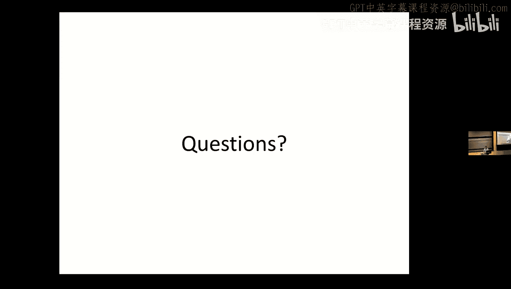

# CMU《自然语言处理｜11-411 11-611 Natural Language Processing 2020 Fall》中英字幕（Claude-4-S） p12 -12-2020-10-20 Treebanks and PCFGs.zh_en -BV1RaWpzAE7E_p12-

Thank you。So we're going to talk about tree banks。What is a tree bank？

We mentioned this a little bit before when we were talking about syntax。嗯。Earlier。So tree bank。

It's basically a big corpus of text。A bunch of text。That has been analyzed into syntactic trees。

So some Porschemo， probably a graduate student。Probably a whole army of graduate students have been employed to go and apply syntactic tests to data and for each sentence in a big corpus to。

built trees， these could be either constituency trees or dependency trees。

 and we're going to talk mostly today about constituency trees because we're going to talk about PCFGs。

 but a lot of the same principles apply to dependency trees。

So there are really two ways of encoding a grammar。One way is to do it explicitly。

 so you just sit down。And you write out all of the rules。

 let's say you're writing a context free grammar so you write out all of the context free rules。😡。

Now there are different ways that you could write these out。You could do it by hand， as I said。

Another possibility is you could have a computer that goes and learns these rules and gives you the rules as an explicit grammar。

And there are people who work on this subject， this automatic grammar induction problem。呃。

There are also people who write down grammars by hand。

And you know this might seem like a terrible idea。Particularly if you have any background in machine learning。

 you might think， oh， this is an incredible waste of time and you'll never get anywhere that way。

But a lot of， a lot of。Technologies that require a relatively high precision。Syntactic parss。

Do rely to some extent on handcrafted rules。So for example。

 the green Squiggly line or blue Squiggly line， depending on your platform in Microsoft Word。

It depends largely on a this has been changed a little bit recently。

 but historically it's been based largely on a handcrafted grammar。

So one person actually went and built this huge grammar of English。For doing grammar checking。

 basically。Because it was important that this reflect how you are supposed to write。

And not necessarily how people actually did write。So for those purposes like。

Handwritten collection of explicit context free rules makes a lot of sense。But there's another way。

So if you。Go and analyze a whole bunch of sentences。In terms of their structure。

 in terms of their syntactic structure。Then implicit in all of those analyses。It's a kind of grammar。

There are a set of rules that you can derive from that all of that work that you've done。

That isn't there explicitly。 It's not that you can go and look at a tree bank that is a collection of sentences parsed into trees。

And pull out the grammar。Trially， you have to do something to it。

And this isn't to say that this is generated automatically。It's not where tree banks come from。

 usually they're generated， there's a first step that's automatic。

And then they're corrected by linguists or by people who are training to be linguists。

So both of these ways of representing the syntax of the language， the grammar of a language。

Are quite hard。And they require a lot of thinking， a lot of brain power。

This lecture is about the second option， it's about tree banks。

And about PCFGs that you can learn from tree bankss。

Or a PCfG is a probabilistic context free grammar。So this is very distracting because I can see up behind me an image of myself kind of from below。

I don't know where the camera is。But it makes me look really fat。

And it's like there's a lag of about a second。And so it's very weird。I wish I could turn that off。

So the first big tree bank。Which is still widely used。Is the panre bank？

And what they did is they took。A few different corpora。And they annotated them syntactically。

 so they took the brown corpus， which was the first large scale。

Electronic English corpus in North America。AIS Air travel Information Service corpus。

 which is why you see a lot of sentences about air travel。In NLP papers。The switchitchboard corpus。

 which was was based on recorded phone conversations that were then transcribed and analyzed in the Pentry bank。

And most importantly， in terms of volume， a corpus drawn from the Wall Street Journal。

 a newspaper from New York。Well， a national newspaper， so it comes largely from those four sources。

And it was produced at the University of Pennsylvania， that's why it's called the Penn Tree Bank。

 It's about only about one million words。But in that one million words， there are over 17。

000 distinct rule types。So they are encoded implicitly in that grammar。In that those1 million words。

And so that's a lot of rules。And this is because the rules in Pent Tre Bank tend to be flat。You have。

 of course， one rule on the left hand side， one symbol on the left hand side。

 and then a lot of symbols on the right hand side。And many of the rules， many of the rule types。

Only occur in one tree。So that's not very general。It's a little bit， that's a lot over specific。

But that's what was arrived at through the methodology that they used。

 And it's been useful to a lot of different researchers and practical。

Engineers in the language technologies area。So PTB is just one tree bank。

 just one historically very important tree bank， a tree bank actually that you're using right now in Home  six。

The data for the English part of speech tagging it's all drawn from Penn Te Bank and the parts of speech data are also from Penn T Bank。

嗯。But there are a lot of other tree thingss。Most of them are actually smaller。

You think one million words doesn't sound like a lot？But for a true bank， it's pretty big。

 Most of the other tree banks are not as big。And many of the elder are dependency treeings。

This has become very popular right now and a lot of people are building dependency tree banks according to the。

Universal dependencies。SetOf standards。And so you can get small tree banks in a lot of different languages now。

But there are actually plenty of other constituency and phrase structure tree banks。

 in addition to penree Bank that you can find if you Google around the Internet。

So Google universals dependencies or UD。These are internally consistent。Its have。

Internally consistent， if somewhat counterintuitive。Depenency relations。

 So they have this philosophy that。Closed class words should never be heads。

So that means prepositions can't be heads。And auxiliary verbs can't be heads。

And so it makes for a rather strange analysis of some。Some languages and some sentences。嗯。That。

Some of us don't like but。It's。Consistent， and it's consistent across all of the tree banks。

So it's been used to construct a large body of tree banks in various languages。

 this universal dependencies。Basically， annotation manual。

And it's useful for cross lingual training since part of speech In dependency labels are the same across languages。

嗯。But it's not directly applicable to what we're going to talk about next。😡，Since it's。

Relatively difficult to learn constituency information from depend dependency trace。It is， however。

 very relevant to training dependency parsers， so there are now a great number of different dependency parsers like UD pipepe or stanza that you can train on UD。

And get。And get a dependency parer。But we're talking about context free grammars and about constituency parsing or phrase structure parsing。

 same thing。嗯。So just to review context free grammars。They have four parts。You've got a v。

The vocabulary of terminal symbols， sigma。Set of non terminal symbols N。A special start symbol S。

And then production rules that look like。X goes to alpha。Where x is a non terminal。

 and alpha is a string of non terminals and terminals。In Chomsky normal form， of course。

 it's a string， it's either a sequence of two non terminals or one terminal。

So here is what a tree in a tree bank looks like。 This is in pen tree bank。 This is the first。

Sentd in pentry bank so it's。So because of this， this guy， Pierre Ven， is famous among NLP people。

I think people have talked about making his birthday a holiday relating to NLP and computational syntax。

But basically。You see， it's all up by parentheses。So this is the outermost constituent。

This is the next constituent。For。NPA subge。I this， so basically you're listing off。

 so if you are to do a very simple sentence， you might have S。NP。Vp。Where。These expand。

To be what NPpss and VPs can be。So it's a very simple syntax that just reflects the tree structure。嗯。

Of the sentences。And you notice that there are some sort of funny non terminal symbols。

Some of which look familiar and some of which look a little bit strange。

We'll talk a little bit about that in a minute。But first， we should talk about。

Why you should appreciate tree banks。And why you should be skeptical about trees。In other words。

 why you should have great respect for tree banks。And why you should be cautious around them。

So making a tree bank is hard。There are at least six different steps。

All of which are a lot of work so the first step is developing an initial coding manual that will tell annotators what tests they are to apply。

figure out the constituency， the structure of sentences。

 and what tests they will apply to make decisions。About how to analyze the phrases and sentences in the treatment。

So linguists who are doing this， they define。Categories and tests， all sorts of categories and tests。

 and they try to foresee as many complications as possible。And so these are hundreds of pages long。

So before you even start。You have to have a manual of this kind。Because language is complicated。

 it turns out。There are a lot of complications。You've also got to develop annotation tools。

You need a pre parsel。To do the initial parsing that the humans can then go andrect。

You also need a UI。For doing the annotating。To make this easy to facilitate this because it's hard for。

Humans who are not necessarily computer scientists to deal with this kind of nested parenthesis notation。

They need help from a UI。Then you have to collect data。Now。

 one of the hard parts about this is that you have to have rights to the data。

You can't just go gathering data from anywhere and redistribute it。

You have to obtain rights to it and's。Complic。Rights to redistribute it。

And you have to get a good balance depending on the purpose of the tree bank。

So a general purpose tree bank needs to have text from a lot of different genres。嗯。

In order to reflect the linguistic patterns， the syntactic patterns that are found across different domains。

Because they differ。So the way that people talk when they're writing a law article it not the same as the way people talk when they're arguing with each other on Twitter。

So youve got to collect the data。Then you've got to automatically parse the data。

You've got to train annotators， this is really hard and I've worked not on tree banks。

 but on some other annotation tasks with training annotators training the people who will go and create the tree banks or create the data。

 to add the labels， and it's not easy， it requires a lot of time。And。

If they don't come to the task with some training already， it can be very difficult。

Then you have to manually correct the automatic annotations。

 you have to do what's called in the tree banking and data annotation。Circleles it's called coding。

This is generally done by non experts under the direction of linguists。So like grad students。

With linguists directing them。And when cases are encountered that are not in the coding manual。

 then you have to revise the coding manual to include them。

And go back through all of the already annotated material in the corpus。

And update them so they're consistent。With the new standard。So this is hard。

This takes a lot of time and it takes a lot of money。😡，It's expensive。And it's time consuming。

So tree banks。You should respect them。Because they require great skill。They take years to make。

And they're expensive。So if you have access to one， be happy。A lot went into it。8。You shouldn't take。

Everything。In a tree bank， as we say， gospel truth。

Tree banks have some serious weaknesses or problems。Number one， they're too big to fail。

So it's so expensive to make a tree bank that you can't easily go and make a replacement tree bank。

So once Pentry Bank came along and there was a big what million word tree bank for English。

 it was very hard to get money to do more tree banking for English。

So we're stuck with Penn Tre Bank as our English constituency T Bank。

And so they have this long lifespan。Not because they are perfect。

 but because nobody can afford to replace them。Here's another problem。

There's always a lot of pressure when you're making a tree bank in terms of time。

 in terms of funding。Just by nature of how these projects are structured。So that means the quality。

It's never perfect。There are always problems。And I。

One of the first things that I worked on when I came to CMU was converting pantry bank。

Like deriving dependency， dependency tree bank from pantry Bank。And building rules。

 head rules to do this， and so this required going in through a lot of Pentry bank in pretty close detail。

And。It's not pretty， there are a lot of really bad annotation decisions and a lot of great inconsistencies。

And this is not something that's specific just to Penn T Bank。

 this is something that's characteristic of。Of all tree banks。So another problem。

 so the coding manual and the high level decisions are made by experts。Well， usually。

 sometimes not even experts in the case of UD tree bankss， but usually by experts。

But most of the coding is done by non experts， by people without a PhD。

 people without complete training in the area， sometimes people who are not even really linguistically trained at all。

And so they make lots of mistakes， and they do lots of things in a weird way that is not consistent with how the language works。

So you can't。You can't put a tree bank up on an idol or on a pedestal and worship it as an idol。嗯。

You know， it's there。They have serious limitations， but they're useful。Why does this matter to you？😡。

Well， it's very likely。That in the course of your life， and by that。

 I mean in the course of this class。Not that you're not going to survive beyond this class， but。

When you're doing your project， it's not unlikely that you will use a parser。

And parsers are trained on tree bankss。So you should know something if you're going to use a parser。

 you should know something about trees。To create a good model。

You should understand what you're modeling。And if you're improving on the state of the art in machine learning。

 the improvement can come from one of two places。It can come from improvement in the training data。

Or it could come from improvement in the models。So to be a good NOP scientist。

You should know when the model is at fault and when the data is at fault。

So I'm going to go out in a limb and I'm going to claim that about 90% of NLP researchers do not know how to understand the data。

They don't know how to understand the tree bank。What is good or bad in a decision that's made in a tree bank？

So they often don't have a good idea of why their model is not working or where they could improve it。

They work on。mo。And just assume that the data。Will take care of itself。

I think that is not the best way of looking at things。So we talked about。Context free grammars。

 we've talked about production rules。嗯。Where would you get production rules from？In a tree bank。

 let's say a freight structure or constituency tree bank。Like Pantry Bank。

What production rules could you get？Out of this tree。

Who could give me a production rule that you could get out of this tree？Over chat。

 you don't have to like。Yes， you。Voccal apparatus。Okay， we've got NP goes to NPP NPP right here。

We've also got S。Goes to MP Sub1。嗯。Bp。Period。So this has all kinds of rules。Implicit in it。

And you can extract them， and if you do extract them， this is what you find。

Some of them are very frequent。 Like this one here， P goes to IN NPP。

For a kind of prepositional phrase。This is the most frequent rule in Ptry Bank， and it occurs。

Over 40，000 times。S goes to NP subVP。It's also very frequent。

But there are a lot of rules that occur very few times。

So all of these rules here occur only 10 times。So there are a very small number of rules that occur a lot。

And there are a very large number of rules that occur a little or very little。And there's a problem。

With this。With the fact that so many rules are so have such low type frequencies。

if you look at rules in the training section。嗯。Then there are in terms of general rules。

 not lexical rules that tell you what。Part of speech can be realized as what terminal？Then。

There are a little over 30，000 rules。In the dev section of the tree bank。There are only 4，000 rules。

Or that's not right。In the dev set， there are。3。Thous rules that are shared。

With the rules in the training set。And there are 4。

000 rules that don't ever occur in the training data that do occur in the dev data。Now。

 why does this happen？Because there are so many different rules。

Because of the way that Pan Ttry Bank was constructed。嗯。And the way that the。Guidelines worked。

Then people， then annotators created lots of different rules。

Rather than forcing data into a smaller number of rules。Well， this produces some problems。So here is。

A plot of the rule distribution。嗯。And you'll see if you look really close。At this。

 you can see there's a little curve here， know it's like this。Itll occur。

It looks almost like a right angle。So what we're seeing here is that there are a very small number of rules。

That are very high in frequency， whose frequency goes up almost to 40，000。Then the bulk of the rules。

A very low frequency。So if you look at this is。If you look at log rank of the rules。

And you see you get a better picture。You see that here。This is log frequency。Over log rank。

So that's a problem， but we can deal with it， we can still do things with this。We just have to。

Keep that in mind。So if you were。Trying to decide， so you built a parser， you got your tree bank。

 you trained your parser on your tree bank。It's phrase structure parser。Constituency parser。

We then want to know， how good is my parser？Is my parser better than Stanford's parser？

How would you know， How would you。Cha。What would you look at to evaluate？

The performance of your parser。Give me。An approach。So just to get you started。

 we assume that we have。呃。Our data， our tree bank。Divided into a training set。

A dev set and a test set。So we got three sets。We're going to train on our training set。

Test on our test set。Test set looks just like our training set， you know a set of sentences。

 they are parsed into trees。Okay， so Abashek has an idea。

So Aveshek says the number of constituents correctly identified in the test set after training。Okay。

 so why wouldn't you just？Why wouldn't you just do the number of trees that are the same between the hypothesized set？

And the。Gold set。Nbashek says a tree is too complex for larger sentences to get exactly right。

 right and you end up with a problem， you get penalized just as much for one little error。

As you would for messing the whole thing up。So， it。

You get a more accurate picture if you have some way of doing partial credit。

So this is exactly what Abushek was saying， I think。

 so you have constituents in the gold standard trees。

You have constituents in the parser output trees。And you look at the intersection between these two。

And the larger that intersection。The better your parser。嗯。

So there's a metric for doing this called parcival。And you have three parts。Labeled recall。

 labeled precision， and cross brackets。So labeled recall is the number of correct constituents in a candidate parse of s。

Over the number of correct constituents in the tree bank par of S。So how many times？嗯。

You get the parse right。Label precision is the number of correct constituents in candidate parts of S over the total constituents in candidate parts of S。

So recall， is just how how many of them did you get。

 how many of the tree bank parsels did you get and label precision is。

How many of the ones that you guessed were actually in the tree bank， basically。

So cross brackets is another thing， it's just the number of cross brackets。

So the number of constituents for which a tree bank has a bracketing like。AB C。

But the candidate par has a bracketing like a。B and C， so we're comparing these two parss。

And I can write in English sometimes。Oops。So。嗯。We're counting the number of times that B。Here。

It's attached on the wrong side。The number of times we have cross bracket。Why would we do that？

Why would we be interested in those？As something different， separate just from labeled。

Recall and labeled precision。Yes， X says， it's more partial credit and that's basically it。

So when you get something almost right。It can be a cross bracket。

So this is a good time to bring up again the F measure。I hope by the end of this class。

You will come to love the F measure as I love the F measure。

And as anybody who is interested in classification or labeling tasks loves the F measure。

So we all know what the best F measure， the best F is。And that is F1。

But the generalized formula for the F measure is given above here。So you just fill in for beta1 or。

Po5 or2。And you get a different。F measure this。Specific to your needs。As beta goes up。What changes？

Where P is precision and R is recall。So as you increase beta。Go from F1 to F2。To F3。

What gets weighted more heavily？So P does， right？So with F1。Then。The weighting is equal。

 this is the harmonic mean of precision and recall。If you have F2。

 then you're weighting precision more heavily than recall。And if you have F。5。

Then you're rating recall more heavily than precision。So this is a very important。Metric。

That is used constantly in NLP and other machine learning fields。

 so you should definitely know this formula。Memorize this formula。Be able to use this formula。

So we talked about getting rules out of context， out of a tree bank。

But the way that we would get rules out would not be very useful。

 We would just get a big list of these random rules。And。

Each of them would have the same status as all of the other rules。And it would be very useless。Well。

We have two related problems， actually， that we are dealing with context free grammars in general。

And that is。The recognition problem and the parsing problem。

 So if our input is a sentence W and a context free grammar G。

Then recognition is asking whether W is in language G。

And parsing is asking for one or more derivations for W under G。

So probabilistic context free gramars are capable of doing both of these things。

But in a slightly different way。An interesting way。So。There。Probabilistic， of course。

Rather than being categorical。So they have like context free gramars of vocabulary of terminal symbols。

 set of non terminal symbols， special start symbol。And they have production rules， x goes to alpha。

But each of these。Has a positive weight。Such that。For all X。Which and belongs。

The sum of these probabilities。It weights。Is equal to one。

 which is to say that they are probabilities right so。For。And。It's a non terminal for nouns， usually。

Then for all of the rules where N gets rewritten as something。

There is a weight and the sum of those weights is one。Always has to be exactly one。

That's a probabilistic context free grammar， and it's a very minimal addition。

To a context free grammar， right？You're not really changing anything。

 you're just adding these weights。But it allows you to do some very powerful things。

So here's a sample PCfG we have。A bunch of rules， context three rules。And here。We have the weights。

 the probabilities。So these are just made up， right these are not based on a corpus。

 these are just made up。But it's just for purposes of illustration。So here is the fun part。

So if you have。Probabilities for each of the rules。

Then you could have a probability for the whole of any parse tree。And it's just a product。

Of the probabilities of all the rules are used to expand each node n in the parse tree。😡。

So you just take the probabilities for all of the rules that you use。Multiply them。

 and you have the probability for the whole tree。So simple， so beautiful， so elegant。嗯。And yet。

 it works。So one thing that you can use this for。It's disambiguation。

 one thing that we've noted before is that the parses from a context free grammar can be ambiguous。

So if you have the two sentences。I saw the man in the park with a telescope。

I saw the man with a telescope in the park。嗯。Then there are a few different ways that you could interpret that。

 and those correspond to different ways you could parse the sentence。

And a context free gramar doesn't give us any way of distinguishing those。

 They're all of equal status。Likewise， we have two sentences here。

 can you book TWA flights and can you book TWA flights？嗯。That look exactly the same on the surface。

But have different pars。How can we decide which par we should accept？Well。

 we can consider the productions for each parse。And the probabilities。So for the two different trees。

Here is the。Here's A， and here's B。Then we just take and multiply all of these and we multiply all of these。

And we compare them， and whichever probability is higher， that's the tree that we pick。

That's the parse that we choose。So here we have probability of T left。Tre on the left。

Book flights for or on behalf of TWA。嗯。And on the tree on the right is book flights that are on TWA。

So we go back here。This is book flightlights for TWA。This one， you can't see my。

Book flightlights for TWA， and this is book flightlights on TWA。So we favor。This tree。

Because it has a higher probability。But where do these probabilities come from？Well。

 we'll get to that in just a minute。Let's talk for a moment about what you can do with a PCFG。

Just like CFGs， PCFGs can be used for both parsing and generation， but they have advantages。

In both areas。So CFTs are good for precision parsers that reject ungrammmatical sentences。

But PCFGs are good for robust parsers that provide a parse for every sentence。

 no matter how improbable but assign the highest probabilities to good sentences。So you can build。

You can use build a backup off。For a PCFG so that it will accept any sentence。

Just at a low probability if it's a bad sentence， and a higher probability if it's a good sentence。

CFGs also have no built in capacity for disambiguation， one parse， a parse is a parse is a parse。

But PCFGs assign different probabilities to good parcs and better parcels。

You can use in disambiguation。In generation， if a properly trained PCFG is allowed to generate sentences。

 it will tend to generate many plausible sentences and a few implausible sentences。

But a well conditioned CFG will generate only grammatical sentences。

 but many of them will be strange so they won't be typical sentences。

They'll be grammatical sentences， but not the kind of sentences someone would actually say。嗯。

So they have advantages going both directions。Where do the probabilities come from？Well。

 the easiest place to get the probabilities from is a tree bank。And it's really easy。To do this。

You're just for each。The probability of each production rule。X or alpha goes to B。Give an alpha。

It's just。The count。Of alpha goes to beta over the count of alpha。Very simple。

So getting this from a tree bank is easy。Any of you could go， I could give you pentry bank。

 you could go And in an hour or two， you could have a。

A context probabilistic context regrammar for me。You can also get them from a corpus。

 and this is more complicated。The first thing you have to do this is have a CFG。

And use it to parse your corpus so that's one step like where did you get the CFG from Well。

 if you wrote it by hand then。Yeah， it's。It's complicated。Then you count the rules for each par。

And you normalize。😡，But there's a problem。Most sentences are actually ambiguous。

So you have to keep a separate count for each parse of a sentence and weigh each partial count by the probability of the parse it appears in。

So you have to do this kind of inside out reasoning。There are algorithms for that。

But it's a little bit more complicated than getting the PCFGs from achieving。I always skipped this。

So one way of looking at PCFG is。Is through the metaphor of the noisy channel。

So here you have source。And we can imagine our source to be a PCHG。And it provides a derivation why。

So derivation you can imagine as the parse tree。With all of the terminals。And all of the structure。

But we don't speak in parse trees， we just use those little leaf nodes on the bottom of the tree。

You just take this part。So it's like the blender has wiped out all of the probabilities and all of the constituent structure。

And we just get x。So parsing。It's the process of decoding。X back to Y。Of decoding from。

That structure。Are from that sequence of words。Pse tree。Drivation。So there are problems with PCHGs。

 actually。So in CFT is， each rule is independent of each other rule。

And this carries over to PCfGs and can be a problem， so if we have the rules。

 S goes to NPVP and VP goes to VNP。In actual tree bankss， the first NP。

 the subject is far more likely to be rewritten as a pronoun than the second NP。

There are good reasons for this。But there's not a good way of capturing this in vanilla PCfGs what Penn Tebank did is they created a separate category for subject NP so that it would get。

Different probabilities assigned to it。With regard to being rewritten as a pronoun or as a other kind of noun phrase。

But there's not a good way of doing this in vanilla PCFGs without augmenting them in this kind of way。

There are two problems。One is this problem of structural dependencies。But there's another problem。

That is that PCFDs are not sensitive to words。So words only answer the picture when you rewrite preterminals as terminals。

Higher up the tree， PCFGs have no way of knowing what words will appear below。

But lexical information， information about what words are involved。Is actually very important in。

 for example， selecting the correct parse in ambiguous prepositional phrase attachment。

 so we've got two sentences， two pars of Moscow sent more than 100，000 soldiers into Afghanistan。One。

 where。Into。Attaachches to soldiers。So you have soldiers into Afghanistan。

And one where attaches to scent。And if you know about scent。You know that it likes。

It likes number two。But a PCG has or a PCFG playing CFG has no way of knowing this。

So how can we solve this problem？Well， one way is with probabilistic lexxiicalized context free grammars。

And in order to understand this， we need to go back to the concept of head。

This is a really important concept in syntax。For our purposes。

 it's the most important word in a constituent will' say is the head。

It's a word that determines what the type of the constituent is。

 whether it's a noun phrase or a verb phrase。嗯。And linguists like to argue over exactly which words are most important。

 leading to somewhat different schemes for headedness， but there's broad agreement about this。

In these lexiized grammars and trees， what we do is we augment the label with its head。

So we get something like this， this is workers dump sacks into a bin。嗯。And。😊，Workers。

The head of workers is workers。And the head of workers is workers。So you annotate。

Then the pre terminal。And this non terminal up here with the head， the value of the head。

But the head of S of sentence。Is actually not workers。 It's the verb dumped here。

So this gets propagated up like this。This gets propagated up like this。

This gets propagated up like this。This gets propagated up like this。What this means。

Is that the rules at any of these levels are sensitive to what the head is。

So you don't just have a rule that says S goes to NPVP。You have a rule that says S。当。Goes to NP。

Workers。Bp。😔，到。So that may alarm some of you。Who finds this alarming？If anybody finds it alarming。

 no one finds it alarming。You should find this alarming。Well。They're fancy ways of looking at rules。

In Alex Gly grammar。Including。What are called feature structures。

But we're going to look at them in a very simple way。So we say that lexical grammar。

 lexxiized grammar， is just like a vanilla PCFG only with a lot more rules。

So it's like you took your tree bank and you added a new rule for each combination of heads you observed。

So this results in a problem。Problem of sparsity， right？So really you want to do this。Ideally。

 with limited amounts of data， you want to do something smarter， but this works。

So viewed in this way， then these lexxiicalized grammars are huge。Sometimes impractically huge。

But they can be used with the same algorithms that we've already learned。

 so they can be used with a CYK or early。And they require more training data than have been old PCFGs。

 but they can capture these probabilistic patterns that could never be captured。

In vanilla PCF cheese。So in most contemporary applications where people are using。PCF cheese。

 they would use lexxiized PCF cheese。Now people are you know。

 doing a lot of different stuff right now and people have moved somewhat away from。

Context free models。嗯。For on the research side， although in practice， then this is still used。

So questions。I know you must have questions。Oh， how do I decide which is the head？

Wouldn't you like to know？Well。And any constituent。嗯。

There are a bunch of tests that can be used to establish what is the head。

There are morphological tests， and there are syntactic tests。嗯。Syntactic tests。嗯。

Differ from language to language， but they're basically they boil down to what is the essential part。

Of the， of the phrase。So a noun phrase is something that behaves a lot like a noun with some other stuff attached to it。

So it has a lot of the same selectional properties as a noun。

And so we assume that the noun is a phrase。The noun is the head of the phrase。For a verb phrase。

Then again， every verb phrase must have a verb， but everything else is optional。

So this is one piece of evidence that verb phrases are headed by verbs。

It's also a piece of evidence that sentences are headed by verbs and that the head of a whole sentence is a verb。

嗯。There are other things like whether it drives agreement。

 so in some languages you have agreement patterns。And usually you know， in a。There are。嗯。

This is complicated， I shouldn't have even introduced that because。

There are some asymmetries with ver versus nouns。In a lot of languages that display agreement。Where。

Everything agrees with the noun。嗯。And Forbs also agree with nouns。

Even though verbs are considered to be heads of sentences， rather than nouns。So anyway。

 if that's sufficiently confusing。嗯。Then。I've done my job。Does that address your question at all？典呢。

Sorry， let me just talk。 so if I'm writing a grammar that is lexical。

 does that mean when I write my rules。You annotate which of。

The production results of the production role。Is the head and that's just consistent。

Or is there some other kind of？Contextual personing。So basically， you have headedness walls。嗯。

That go with each rule that you write。You have headedness annotations。 So you。

 you always know that if you have a rule that says。呃呃。V VP goes to VNP。You know that V is the head。

 You know， the， the rule says， okay， the V， V is head of VP。And if you have S goes to NPVP。

 then you have a rule that says。Head is head of VP。

So it just it's written into the rules and it just propagates up。嗯。With each parse。

 So that's something that the the authors of the tree bank take care of。

 basically when they're writing when they're。Not in that they say there's a rule S goes to NPVP。

 but that they annotate。Heads in the rules and that in the tree bank。

 and that gets reflected in the rules and so on。Okay， that answers the question， thanks。

Chris Fn says， why is lexiized grammar alarming， is it because the heads are too specific？

It's because there's a sparsity problem， so the rules end up being very specific。

So you have limited generalization。Because you have a different rule for each different kind of sentence for each combination of subject and something。

嗯。嗯。So yeah， I mean， the heads are really specific and there are ways of doing this。

 that're less specific， but they also require additional technologies。

Additional formalism beyond context free grammars。O。

So any questions about the midterm in the last five minutes， six minutes？

So before I started recording， I told everybody that there is very likely to be a problem。

On finite state transducers。嗯。That will be easier if you did homework too。

And if you're aware of how Open FST works。So if you're not aware of that。

 if you didn't do homework too， I suggest you review that。呃。In case it does show up on the exam。

And be sure you know how an FST works。And operations on FSTs like composition union wellnut intersection。

 concatenation， and so on。So any questions about midterm？No questions about the midterm。

You've already got it all figured out。Already already prepared。Okay， if you don't have any questions。

 then oh。Can we can I ask？Yes， you can use squad。Since you says。

 can I ask a question regarding the project， can we use the squad data set？Yeah， you can use a squad。

Any other questions？Okay， thank you very much for your attention and take care good luck Thursday。

