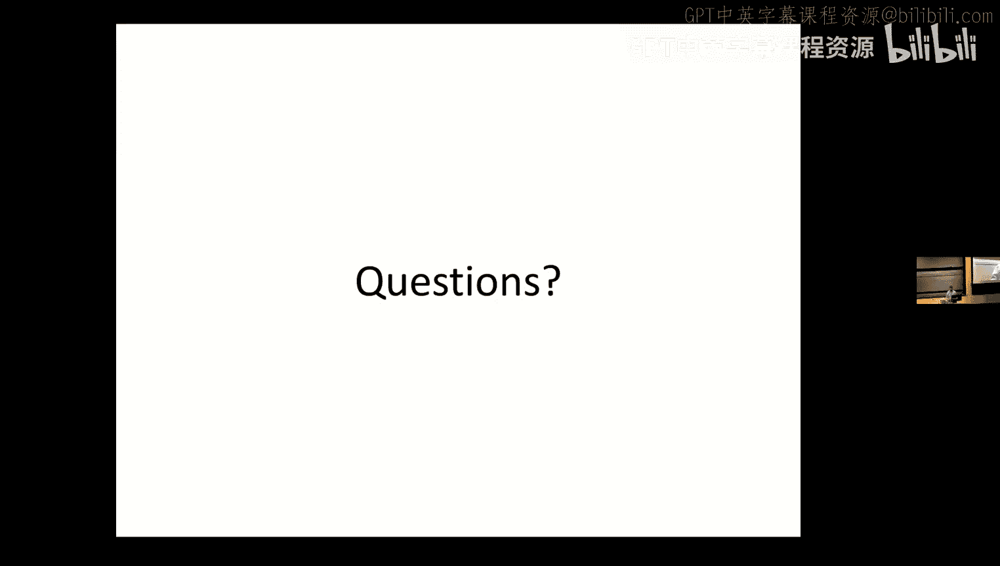

# 自然语言处理：语法树库与概率上下文无关文法

## 1. 树库概述

树库是自然语言处理中用于语法分析的重要资源。它包含大量经过语法分析处理的文本数据，通常以句法树的形式呈现。

### 1.1 树库的构成

树库主要由以下几部分组成：

* **词汇表**：包含所有终结符符号的集合。
* **非终结符集合**：包含所有非终结符符号的集合。
* **起始符号**：一个特殊的起始符号，用于构建句法树。
* **产生式规则**：定义非终结符如何通过终结符和非终结符的组合来扩展的规则。

### 1.2 树库的用途

树库可以用于以下目的：

* **语法分析**：通过句法树来分析句子的结构。
* **语法学习**：从树库中学习语法规则。
* **语言模型训练**：用于训练语言模型。

## 2. 树库的构建

构建树库是一个复杂的过程，通常需要以下步骤：

1. **开发初始编码手册**：定义语法规则和标注标准。
2. **开发标注工具**：用于自动解析和标注文本数据。
3. **收集数据**：收集用于构建树库的文本数据。
4. **自动解析数据**：使用标注工具对文本数据进行自动解析。
5. **训练标注者**：培训标注者进行手动标注。
6. **手动纠正自动标注**：对自动标注的结果进行手动纠正。
7. **更新编码手册**：根据标注结果更新编码手册。

## 3. 树库的局限性

树库虽然非常有用，但也存在一些局限性：

* **成本高昂**：构建树库需要大量时间和金钱。
* **质量参差不齐**：由于标注者的主观性，树库的质量可能参差不齐。
* **数据稀疏**：树库中的句子数量有限，导致数据稀疏。

## 4. 概率上下文无关文法

概率上下文无关文法（PCFG）是一种概率模型，用于描述语言的语法结构。它扩展了上下文无关文法（CFG），通过为产生式规则分配概率来表示语法规则的概率。

### 4.1 PCFG 的构成

PCFG 由以下几部分组成：

* **词汇表**：包含所有终结符符号的集合。
* **非终结符集合**：包含所有非终结符符号的集合。
* **起始符号**：一个特殊的起始符号，用于构建句法树。
* **产生式规则**：定义非终结符如何通过终结符和非终结符的组合来扩展的规则，每个规则都有一个概率值。

### 4.2 PCFG 的应用

PCFG 可以用于以下目的：

* **语法分析**：通过句法树来分析句子的结构，并计算每个句子的概率。
* **语法学习**：从树库中学习语法规则和概率。
* **语言模型训练**：用于训练语言模型。

## 5. 总结

本节课介绍了树库和概率上下文无关文法，并探讨了它们的构建、应用和局限性。树库和 PCFG 是自然语言处理中重要的工具，可以帮助我们更好地理解和处理自然语言。