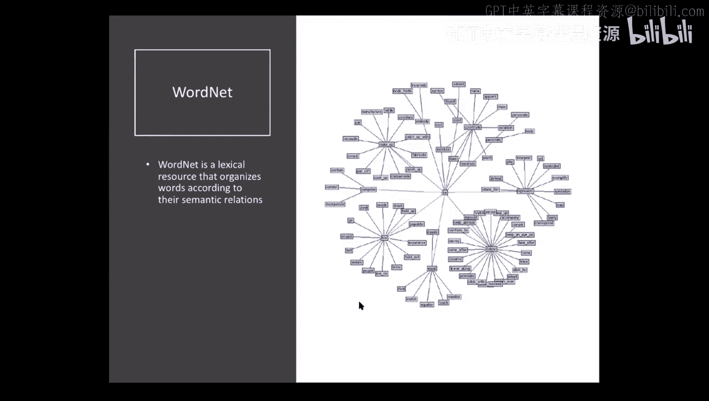
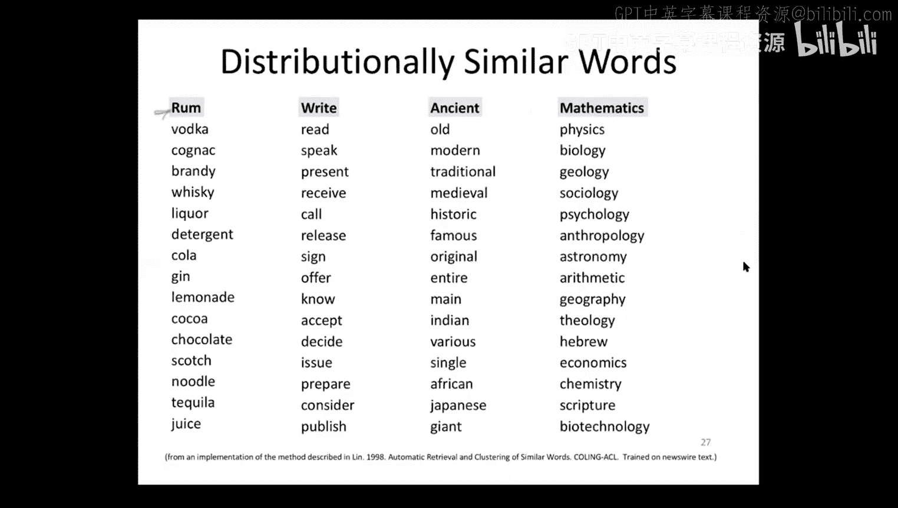

# CMU《自然语言处理｜11-411 11-611 Natural Language Processing 2020 Fall》中英字幕（Claude-4-S） p13 -13-2020-10-27 Lexical Semantics.zh_en -BV1RaWpzAE7E_p13-

So at the beginning of class today， we did a poll on the opinions of students of the exam。And。

The options were delightful， gruesome， trivial， rigorous and hateful。And。

50% of respondents that of 16 individuals said that the exam was rigorous。

 that was the plurality response followed by gruesome with 31%， hateful with 13%。

And delightful and trivial tied for 3% with one respondent each。So from this。

 I take that most people felt the exam was challenging。😊，It was either gruesome or rigorous。

 but the majority felt that it was at least somewhat。U。If not fair， fair is not the right word。

 but it。May have been challenging in a way that was not gruesome or hateful。

But if you add together the gruesome and hateful。Responses。

 then there are almost as many of them together as there are rigorous。

And I'm not surprised that only one person said the exam was trivial。

I don't think the exam was actually trivial for anyone because nobody got full points。U。And。

I would like to think that the exam was delightful， but I'm also doubting that that yes。

The case for most people， the exams are not designed to be delightful。

 but they are designed to help you show what you learned in the class so far。

 so hopefully the exam helped you do that。Are there any questions following up about exams or grading？

So there will be a final exam。A second midterm， really， that will be very similar to this exam。

And it will cover the second half of the course。Um。And it should。Be similar in difficulty。

 similar in format。 So you kind of know what to prepare for。The material。

 the kinds of material that are in the second half of the course are a little bit different。

 there's a little bit more variety in terms of topics and discussion of different NLP applications like machine translation。

 but also technologies like deep learning。😊，um。😊，And。第一。Sorry。

 I just lost my screen here that I was sharing。😔，U。So it'll be a little bit different。

But it will be similar kind of thing。So are there any questions about that？

So the second midterm will be it's the same as the final exam。Except for historical reasons。

 we started calling it the second midterm。Because it's not necessarily a comprehensive final。

It goes over material only that is covered in the second part of the course。😔，嗯。

includingncluding HMs and part of speech tagging because you do a homework。

 the homework for that is not due until the second part。

 but it is so it will be during finals period。Or alternatively。

 we could do it on the last day of class and have it be 90 minutes as opposed to longer。

In the recent past， some classes have preferred that。

Because you get it over with and you don't have another final during。Finals week。

So as it gets closer to that time， we'll do a poll and we'll find out what you would like。

And do things that way。AKsha asks， could we have a sample exam released probably on grade scope before the scheduled second midterm？

No we can't do that we just don't have the resources to put together a whole second。呃。

Midterm exam that is in the same format as the actual second midterm。So I'm sorry about that。

 but there's no way that we can do that。Any other questions？

Can we have more time to do the second midterm？No， well。

 you will have more time if it's during finals week， but the exam will also be longer。

So it's deliberately too long for you to finish and we have a reason for doing that。

 namely that we don't want you to have time to go to Google and start Googling for answers and reading papers and so on to learn things that you should have learned during。

😔，The period leading up to the exam。And we find that having a lot of spare time allows you time to collaborate with other students。

 which actually was a problem。During this exam， anyway。嗯。

So we deliberately keep the scheduling tight。But the class， because the class is grades or curved。

 then it doesn't matter。That nobody finishes the exam。 It's stressful。But it's that way by design。

Does that make sense？So today we're going to talk about a subject I find。Very fun。

Which is lexical semantics。U。What does lexical semantics mean？

What does it mean for something to be lexical？And what are semantics or what is semantics？First。

 lexical， what。What does this term mean？So if you think about like a lexicon。What is le lexicon？Well。

 it's a collection of words。And lexical semantics。So yeah， it's a dictionary。It's a。

It's somewhat more restricted than a dictionary usually， and it's a collection of words。

With some metadata。U。Lexical semantics has something to do with words， it's something of words。

 well what about semantics， what is semantics？You ever have an it's meaning， right， it's meaning。

 you ever have an argument with somebody and they say， well， you're just debating semantics。

Does that happen to anybody here？You actually have authorization now as somebody who has taken this course。

Oh， Ethan says that you have the authorization to punch anyone who says that in the nose because if you're debating something。

😊，That is meaningful。You're debating semantics， you're debating the meaning。

It's not something that is trivial， it's the core thing。And semantics plays the same role in NLP。

 actually， you know， we do all of this stuff， all of these different tasks。😊，We parse sentences。

 we do morphological analysis， we do classification， you know。

 but all of this stuff ultimately is of no value unless it's anchored to something in reality。

Unless it has something to do with meaning。You know， you're always trying to get at semantics。

 which is the interface as we'll see in a way between this computational world and the real world。

And this interface takes place at various levels， one of those levels is the lexical level。

 so lexical semantics is about the meaning of words。😊。

And about characterizing the meaning of words in ways that we can use them。In applications。So so far。

We've talked about different things like information extraction in the second lecture。Morology。

 language modeling， classification， syntax and syntactic parsing。

And now we're going to talk about something that matters。Going to talk about something important。

We're going to talk about semantics and pragmatics， which are the glue。😊。

That holds the CA language to the real world。So in a sense。

The other things we've talked about are only meaningful once we take semantics into account。😊，没。

Shrink that。U。So we'll talk about different aspects of semantics， we'll talk about lexical semantics。

😊，The meaning of words， that's what this lecture is about。

About word embeddings and about vector semantics， which is a clever way of getting at lexal semantics。

 We'll talk about that actually a little bit today。 Then you have a full lecture on it later。

 This is an important topic。😊，Model theoretic semantics for representing sentences。😊。

And semantic parsing and semantic role labeling also for representing。Sentences and clauses。

In terms of model theoretic semantics or in terms of some other kind of semantic model。

Today we're going to look at three ways of looking at word meaning。The first is decompositional。😊。

So that's it's about what the components of meaning in a word are， the idea is that a word。🤢。

Word is like a molecule。And it has different kinds of atoms that make it up that you put together to make that molecule in some configuration。

And you can predict what that molecule is， what it means。

By the meanings of those parts that you're putting together to make it。

And so you can understand the meaning of the molecule by taking it apart into atoms。

 or you can understand the meaning of a word by taking it apart into meaningful components。Features。

Then there's ontological semanmatics。😊，And so this approach to lexical semantics looks at how the meanings of words relates to the meanings of other words。

😊，In an ontology， so you imagine having a large graph。

Of words with different edges connecting them to each other with different kinds of relationships that can exist between them。

And so you don't ever say this word blue means。嗯。This range in the electromagnetic spectrum。U。😊。

You simply say that blue is what's called a hypoponnym of color。

That's maybe a hypernym of Azure or Navy or。And we'll learn what these words mean later。

 but they're about covering a subset or a superet of the semantic space that that word does。

So it's all defined in terms of relationships。😊，Nethontological approach to lexical semantics。

And then there's a distributional approach to lexical semantics。

 which characterizes words in terms of contexts the word is found in。😊，Relative to other words。U。

Excuse me， I have。Fathly duty to attend to。Yeah。I apologize for that。Apparently。Oive。

The professional world has become BBC dad。嗯。那'。We're constantly being interrupted by our children while we're trying to do work at home。

So distributional semantics is about characterizing the meanings of words based on the context that a word is found in relative to other words。

 and we'll see how that works in a minute。So first， let's look at decompositional semantics。

Here we're using a kind of notation from linguistics。We're。You have features。Attributes。

And if the attribute is active， then you have a plus by it， and if it is inactive or doesn't apply。

 then you have a minus by it。So we can take boy， girl， man and woman。

 and we can characterize them in terms of their attributes， in terms of these three attributes。

 maybe this is just an example。You know， really there would be more and different attributes。

 but just to show you how it works。So boy would be plus human minus female， minus adult。And thus。

 it would differ in one feature from girl， which would be plus human plus female minus adult。

And also for man， which would be plus human minus female plus adult。

So the idea is that making up the meaning of a word， there are a bunch of these features。

There's some universal inventory of features。And if we can decompose any word， any lexical word。

 at least into these features。嗯。So that's decompositional semantics。What advantages would this have？

What would be good parts of this approach to meaning？So you could characterize every word。

In a language。Like English in this way。What could you then do？No ideas。Okay， so。So Abey says。

It's a fairly complete characterization。And yeah。🤧So it's。

It would have a fairly complete and interpretable characterization of what each of the words meant。

And Olivia says that you could embed it in a vector space based on features， and that's also true。

 so you could talk about similarity between words， relative similarity in terms of the similarity between the vectors。

That you get， you know， basically you could treat each of these pluses and minuses as ones and zeros。

 and you have a vector and then you can do all of the fun things that you' do with binary vectors。

So so Sophie Lee asks if sorry， can someone repeat the question and the question is what could you do if you had vector representations like this。

 if you had feature representations like this of every word in a language？

And that's what Abby and Olivia responded to。So the second question is。

 what is bad about this approach？What is bad about this approach？Okay。

 so you need a lot of features right， to cover the whole lexicon， you need a whole lot of features。嗯。

And you'd have some features， some information that was not relevant。Oh。

 I think the slides are posted now。Or they will be added very soon。嗯。Yeah， so Zachary says。

 you'd need a lot of features to generalize most words and Rahuul says some information may be unnecessary or redundant。

So here's another question， so where would all of these features come from。

 who decides what these features are？And it's kind of difficult， actually。

 so it's easy for things like boy， girl， man and woman。But what would the features of？Green be。

If you're to break down green into its components in a way that distinguished it from other colors。

What would the features be。How do you divide semantic space into features like this？

And how do you settle on a final list？You knowPeople have tried to do this and they've been successful in certain domains of vocabulary。

 but never successful for the whole language。How do you figure out what the features are of a particular word in a principled fashion？

诶。And how do you link those features to the real world？Not impossible。But also not trivial。

So for these reasons。Decompositional semantics is pretty much the least computational and useful approach to semantics。

 although in a task called semantic role labeling， there is a kind of decompositionality that is sometimes used with these semantic roles and we may get to talk about that a little bit when we get to that part of the course。

嗯。But in general， for lexical semantics， decompositional semantics is not so useful。But it's。

A useful starting point for talking about some other things。

That brings us to ontological approaches to semantics。So in the decompositional approach。

 then the meanings of words are made up of little components that you stick together。

Into bigger things。And。You calculate the meaning of the whole based on the meaning of the parts。

So an ontological approaches to semantics， rather than going from the bottom up。

 you go from the top down。In a way， so you say this word has this relationship to this other word and another relationship to this other word。

And so we don't bother to define that word in and of itself。

We define it in terms of its relationship。To other words in the lexicon， other words in the language。

Does that make sense？So here， let's make it more concrete。

So a lot of you have probably encountered the words synonym or antonym when you're in school。

 when you're in grammar school or when you're studying for standardized tests。🤢。

I hope everybody knows those terms， synonym and antoym。Basic part of English literacy。

So synonyms and antonyms are relations between words。

But theyre not the only relations that you can have between words， oh no， there are more。

They include hypoomy， hypernomy， Moromy， and hoomy。Who has heard of any of these words？Like hypoomy。

I should have done a survey on this。Zachary says he has not。And Asiaia also has not。嗯。

Having trouble getting out of the poll thing。Serth me right。there we go。Okay。Ohoops。Ok。

I just want to know who has heard of these terms。So the truth comes out。

Some people have heard of hyponoomy and hyperomy。Good to know everybody has heard of synonymomy。

 Most people have heard of annomy。嗯。Many people， 12% of you have heard of hypoomy and 6% of hypernmy。

Well。What does hypoomy mean you for people？Who have heard of it？

Did you learn what it meant or did you just hear the term somewhere。So by the end of this lecture。

 you will know all of these terms。You'll be the master of all of these terms。嗯。

They will be your pupils。So synonyomy is about equivalence。

Two things are synonyms if they are equivalent to one another。

 if they occur in roughly the same context。Like small and little。On the other hand。

 so synonyomy is relatively easy to recognize Annomy is about opposition。

 things like small versus large， good versus evil。😊，CmU versus MIT。And hypoomy。

Is about a subset relation， it's what's sometimes called an isA relation。So a dog is a mammal。

 therefore dog is a hypoponnym of mammal， or the set of dogs is a hyponym of the set of mammals。

Hyperomy is the reverse of that it's the superet relationship。

Mammal is a super set mammals are a super set of dogs。And。So that's hyponomy and hypernaomy。

That's not to be confused with Moromy and hoomy。Muronomy is a part of relationship。

Like the liver is part of the body or a liver is part of a body。

And homi is the reverse of that it's the has a relationship， so a body has a liver。

So this can be a little bit confusing for people because they'll think， oh。Well。

Liivever must be a hyponym of body。Because liver is like a subset of the body。Is this true。

 is liver a subset of body？What do you think？If the set of livers， if liver was a hypoponnym of body。

Then all livers would be bodies。Liivevers are not bodies。The first are part of bodies。Yeah。

 lior would be a subset of organs because all lis are organs。

So the relationship between liver and organ。Would be one of hypoomy or hypernomy depending on which way you're going。

 so liver would be a hypoponnym of organ。But liver would not be a hypoponnym of body。

Liivever would be a marm of body。This liver is a part of。A body It's not。

 it's not the case that the set of。Liivevers is a subset of the set of bodies。Does that make sense？

Are you following me here。So that's the hardest part actually， of this whole thing to get。

And once you have that and you have hypernym hypernym separate from marinm honym。

 and you can remember which thing is which， then you've got this down。

Which is a good thing to do because it will almost certainly be on a quiz。

You know on the next quiz you'll almost certainly have a question about this so it's a good thing to。

To understand and these are terms that you'll see all the time in the NLP literature。

 like if you're reading articles that have to do with lexical semantics in any way。

 you'll see these terms。So there are good terms to know。So Sophia Lee asks。

So word X is a marandm of word Z。If word why。It that is a hypoponnym of word C？

And the answer to that is no， not necessarily。Whether two words are marins of one。

 whether a word is a mar name of another word is completely independent of any hypoomy relations between those words between。

That word and other words。嗯。So they're just different dimensions。So。

Hyponomy is about subset relationships。And meomy is about part of relationships and they're completely different things。

Does that make sense， Sophia？Okay。So here。Is a mini ontology。

 I told you that ontologies are big graphs。Where the edges are these kinds of relationships。

 these kinds of relations。And the nodes are words。Or in this case。

 and generally there are senses of words， but you might ask， what is a sense of word？

And the answer is basically that different words words can have more than one meaning can。

Do more than one thing semantically， so the classic example is the word bank。

So bank can be a verb or it can be a noun。And when it's。When it is noun。

Then it can mean a few different things。It can mean。

A financial institution or it can mean the thing on the side of a stream or a river。River Bank。

 Leny Bank。嗯。So those are different senses of the word bank。And most words， many words。

 at least can have more than one sense。Which means the language is full of ambiguity is because you have to figure out what sense is involved。

When you hear a particular word or when your NLP system encounters particular word。

But it doesn't make sense to usually to。Do an ontology in terms of。In terms of the words themselves。

 you want to talk about the relationships between the senses， the meanings of the words。嗯。😊。

So here is a relationship between。Door and building or between door and wall and wall and building。

 What relationship is that。What is the relationship between a door and a wall or a wall and a building semantically？

So this is meronomy， right？Yops。What about the relationship between offense fence？Edit enclosure。

So is this synonymomy？哦。So is a fence a part of an enclosure？I could see how this could be confusing。

But I would say this is an instance of hypoomy。So offense fence is a kind of enclosure。

So some kinds of enclosures are fences， some kinds are walls， some kinds are other things。

 you know and a fence is a kind of enclosure and so I would say that fence。

Is a hypoponnym of enclosure。Now， you could think of it with a different sense of enclosure。As。

The fenceense being part of the enclosure， it's not generally how I would think of it。嗯。

But if if a fence was part of the enclosure， then this would be an instance of what？Muronomy， right？

嗯。So what about？Build versus destroy。This is going to be autonomy。They're antonyms。

How about wall versus surround？Wall as a verb， so this is the this means。

The first verb sense of wall。In our。Auttology， and this is the second sense verb sense of surround。

So these are roughly synonymous， right？To wall something to surround wall something in。

 to surround something。This would be roughly synonymous。So。

The slide build is not working properly on。So that brings us to the subject of WordNe。

Wordnet is the best known ontology for lexical semantics。Worknet is。Basically a big graph。

Of a bunch of words related to one another， ontologically。

In terms of exactly these kinds of relationships that we've talked about， in fact。

 exactly this set of relations。We at。

It's a glorified electronic theysaurus。What's a theysaurus， who's used the thesaurus before？

The the sori or things that。You know， are used by students。

To make paper sound more pretentious right so you the purpose of a thesaurus is you come across a word in a paper that you're writing and it sounds too pedestrian too normal。

 so you look up a synonym for that word that is that you don't recognize and you put that word in your paper instead in order that you will sound smart。

 right。Except that you end up sounding silly because you don't use the word quite in the right context and your professors and teachers can tell and they are mildly amused but also frustrated so but theor I actually do have useful purposes。

And one of them is organizing the lexicon ontologically， and that's what Worddent does。So in WordNe。

 words are grouped， senses of words， I should say， are grouped into what are called syn sets。

 like synonym sets。So each of these bullet points here。Is a sunset。And the stuff in yellow。

These are the members of the Cet。So one in set for dog。Includes dog， domestic dog， Kendist familiars。

It has definition here just to help you when you're using WordNe to know what the Sset is supposed to be。

So it's a member of the genus Keninus， probably descended from the common wolf that has been domesticated by man since prehistoric times。

 occurs in many breeds， and then they have an example the dog barked long all night long。

But then you have other senses of dog in different senses。And what you'll find。Is that。

Wordnet is quite sexist。诶。In part because English is quite sexist。

 so you'll note that dog for female， we have adult， unattractive， unpleasant girl or woman。嗯。

Dog grouped with front。But for a male dog， you have， well somebody who's morally reprehensible。

 but it's a cad， a bounder， a blackcard， a dog， a hound， a heel。UBut you know。

Politics aside and gender issues aside， this is how work debt works。嗯。So you have。These senses。

 and then they're associated with one another byomy，omy， by hyponomy。

 Moromy and synonomy and annomy of relations。And basically everything falls on a big hypoomy hierarchy。

So fish。Is the hypoponnym of aquatic vertebrate， which is a hyponym of vertebrate。

 which is a hyponym of corate， hyponym of animal。Hponym of organism， Hyponym of living thing。

 Hyponnym of whole， hypoponym of object。Hyponym of entity。So that's according to wordNe。

 some of these you might find a little bit not natural or not characteristic of how people actually use language。

嗯。But that's what the word fish means according to wordnet。It sits in this hierarchy of hypoomy。

Such a hierarchy is called。A taxonomy， but Wordnet is not just a taxonomy because it has these other relations。

Between sinces。嗯。😊，So there's a cool thing that you can do with。Weor debt。

Which is that you can calculate the information content of words。So some words。

 it turns out half more information content than others。

And you can show this in terms of language modeling， actually。

 and in terms of their information theoretic properties。

But you can get this also from an ontology like Wordnet。So information content。

It's equal to the negative log of words that are equivalent to。Or hyponyms。Of C。So， this is。

The information content of C。Over the number of words in the corpus。And here below。

 we have the information content of various words calculated from WordNet。What do you see here？Well。

Entity is very vague。There's not much information content there。

It could be anything doesn't tell you much about something to say it's an entity if I go up to you and say you're such an entity。

嗯。You don't know whether to be complimented or to be insulted。If you say I saw an entity。Well。

 you could have seen anything。But if you say I saw the shore。

Then it's somewhat more concrete right there's somewhat more information content and if I say I saw the coast。

Then it's even more informative。And I saw a hill is's more informative than natural elevation。

 I saw natural elevation。So that's one thing you can do with WordNet。嗯。There are other things。

 in fact， many of you will probably use it in your projects。To do evil。Because。

You're evil people and you want to make life more difficult for your classmates。

So you're going to use it to obfucate questions and answers in ways it。

Either change in a predictable way or do not change。The meanings of questions。So Wordnet。

 luckily for the purposes of evil。Is easily available with various interfaces。

And you can find those here。At http。 wordnet。princeton。edduu related projects。

The easiest to use probably is packaged as part of NLTK or natural language toolkit for Python。

So you can just import it。Like this。And then call the Sets method。On this WN object， Wordnet object。

And it will return a list of sunset objects for Doc。And then you can manipulate those objects。

 you can find out what the synonyms or honyms or hypernyms are of those things。嗯。

And have all kinds of fun。So this is something that's interesting and useful for a lot of your projects。

😊，嗯。But there are intrinsic limits to this kind of resource。

So it requires many years of manual effort by skilled lexicographers。

 and in the case of Wordnet there was a problem which is that some of the lexicographers were not that skilled。

😊，So this resulted in a lot of inconsistencies and issues and the data in an ontology is only as good as the ontologist。

 it's not driven by data， it's driven by the lexicographer， by the human。

So let's look at an approach to lexical semantics that is data driven and does not rely on lexicographers。

And let's start by looking at beef。Let's say you don't know the meaning of beef。

Let's say you live in a country where。People don't eat beef。I've heard there are such countries。Um。

What would you learn about beef？By looking at this set of。嗯。Instances of beef。In context。

 it's from a concorddener。concordance the brown corpus。

 which is the first large scale corpus of American English。So。You have the brown corpus here。

You we have all of the instances of beef and we sorted them by the word that comes right afterwards so and we got up to H。

So what do we learn about beef？From。From this。Result。What could you tell about beef。

If you did not know that word。So first， you can tell it has something to do with cattle because it occurs。

A bunch of times。For cattle or dairy cattle。What else？So it could be maybe a hyponym of cattle。But。

It seems to be modifying cattle here right it comes next to cattle modifying it because it seems like beef is a kind of cattle。

Are our beef cattle are a kind of cattle。嗯。What else do you see。So it might be a hyponym of meat。

 how do you know that？That's what Ryan Mattab says。How would you tell that？Okay， such as。

Such as phrase， which seems to entail that it's kind of meat。A hyponym of me。嗯。Yeah。

 so organ meats such as beef and chicken liver， tongue and heart。

So you can actually learn a lot about what a word means by the context in which it occurs， in fact。

 how do you know what words mean？Do you know what words mean for the most part because you look them up in a dictionary or glossary？

How do you know what words mean？How do you learn what words mean。So Rahul says。Impiricism。

What do you mean by that？Can you be more specific。So you experience their usage。Well。

 what about their usage helps you to know what they mean？Is it just hearing them？

So you know somebody just goes and says。Hyponm， Hyponm， Hyponm。You know。

Would you learn anything about the meaning of Hyponnym？Right， as Rahuwell says， in context。

 their are usage in context。We learn the meaning of words primarily by hearing them used in context。

🤢，And that's the same thing， you know， with this beef example。

 you can learn a lot about what beef means just by seeing the context in which it occurs。

Same thing is true of chicken。By the way， we won't go through this but。

You can learn a lot about what chicken means。And a lot about what beef means just by seeing what words occur around them。

Well， we can take what words occur around a word and we can make them into vectors。

So let's say we have some cooking text or some this is from the brown corpus。嗯。

And we take these four words， apricot， pineapple， digital and information。

And every time and we move a window。Across the corpus， scanning the corpus。 Let's say the window is。

5 words wide。And every time。One of these words is in the middle of that window。

And one of these words is somewhere else in that window。Then you add one。To。呃。

That dimension in the vector and the vector for let's say。

 apricot or pineapple or digital or information。These are what are called cooccurrence vectors。

So if we look at these conce vectors for these handpicked conce vectors， for apricot， pineapple。

 digital and information， what do we learn about the meanings of these words？

What do we learn about the relative meanings of these words？So digital。Tigital and information。

Occur in the same kinds of context。As Daniel with Sego says。And as Olivia Dung says。

Apricot and pineer appleple are also similar。All of them occur next to large。

But there are certain dimensions in this vector。Where。Apricot and pineapple。Half a lot of counts。

And there's some dimensions where digital and information。

Have a lot of counts in this case it's all ones but。Brawn corpus is a small corpus。

So just from context， just from this brain dead process of scanning a window。

Across a corpus and counting every time that words cooc。

We can come across something that we can build something that gives a。

Useful characterization of the meaning of these words。😊。

So you could also do this with syntactic dependencies and people have experimented with this。

 and I'm not going to spend a lot of time with this because this doesn't feed directly into what we are doing now。

But it is a useful thing to know。I'm going to talk about a problem。With。

These cocurnce vectors that we saw。Now， what you you would do in practice when we actually use these kinds of co occurrence vectors directly is that。

You would end up with a big vector if V。I's the vocabulary。Then the the。

You' would end up with a big matrix that was v times V。嗯。

And each of the rows in that matrix would be a vector for a particular word。嗯。

So you're doing all of the words together， but some of the words are going to occur together a lot of times just because they're very frequent words。

Like the English words do is。They're likely to occur in the same window a lot of times。

 not because there's any special association between D and is just because they're frequent。

They don't have anything to do with one another other than their frequency。

 so how do we address this？How do we deal with these naughty words。

 these naughty high frequency words？That interfere with these relationships。The answer。

 the very simple answer， is point wise mutual information。Who？Who here has encountered PMI before。

Point wise， mutual information。Or just mutual information。Little different。

But point wise mutual information is astoundingly simple。U。It's just this。So it's a log。

Of the probability of W and F co occurring。Over the probability of W times the probability of F。

The joint probability of w and F over the probability of W times the probability of F。

Or in practical terms。嗯。opSome constant end。The log some constant n times the count of。

Of W co occurringcurring with F over the count of W times the count of F。

So what is the effect of using point wise mutual information？

If instead of the raw counts in our cocurrence matrix， if we use PMI instead， what is the result？

Yeah。😊，So as Ethan says， even if they are both frequent， if they don't occur often together。

 the numerator will be small。嗯。And。So they have to occur a lot together to make up for their frequency if they're very frequent。

嗯。So that ends up。Dealing with this problem of。This problem of。

Words occurring together a lot just because they're frequent。

 but there's there's a problem here still。And that is。

Let's see if we have a slide about it we'll talk about this next time or Alan will talk about this next time with you but。

These numbers can be negative。And you have a weird sort of thing where， you know。

 if PMI is measuring how colloc two words are， how much they like to be together。

What does it mean if that number is negative？It's how much they dislike being together it's not clear what exactly that means so in practice。

We啊。Often use。Positive point wise mutual information。 We just take the。嗯。Max of zero PM and PMI。

And that works a little bit better。嗯。So。Here are some。Words this is done in a very primitive way。

You just have a big corpus you have。Carinality of V times cardinality of V。Table of conce。Statistics。

Or in other words， each of your co occurrencence vectors has the same number of dimensions as the vocabulary。

And then you use cosine similarity， which we'll talk about again next time to compute how similar words are to one another and you list off the words you start with the words and you list off the words in order of how。

Hi， their cosine similarities are。嗯。This is what you get。So for rum。You get vodka， kgak， brandy。

 whiskey， liquor detergents。Bach， actually， cola， gin， lemonade， cocoa， chocolate， scotch。

Noodle okay so these are not perfect but this is pretty good you know this is completely unsupervised no human intervention it's just this blind algorithm operating on this corpus and we're getting out this list of words that have clear semantic relationships to one another and it's really pretty good so for right we get these other verbs of speaking like and language verbs like read speak present receive call release sign offer no except decide。

😊，For ancient。Some of these are a little weird， you get old modern， traditional medieval， historic。

 famous original entire mainine。Indian。I'm not sure why that one specifically。

 or African or Japanese but various single giant this may have to do with talking about civilization。

 so you get ancient civilization， Indian civilization， African civilization， Japanese civilization。

Anyway， but pretty good， so for mathematics you have physics， biology， geology， sociology。😊。

Anthropology。Astronomy， arithmetic geography。Theology， Hebrew， economics， Chetry， scriptrture。

 biotechnology， and most of those fit pretty well。But what does mathematics have in common with？

Theology or scripture。Well， the answer is simple。They all bring you closer to God。Anyway。

 are there any questions before we finish because we have a little bit of time？So Olivia asks。

 what was the actual midterm grading curve？Cd just curious。Not the midter midterm grades。So。

This is done。By Alan。And。Basically it works like this。I'll get to your question in a minute Ru。

It works like this。Rg grades are computed based on the point allocations in the syllabus。

So he computes a raw grade， then he plots kind of a histogram。Of the grades。And looks for breaks。

So effectively clustering together people so that there is maximal。Division between clusters。

The first cluster gets assigned to be A's， the second cluster B's， third cluster C's。

 and anyone blow that D's。So the。The actual curve。It's like the cutoffs。

So the clusters are generally。Top heavy， so more people get A's than get B's or C's。嗯。诶。But I can't。

 I would have to pull up the list of who got what grade in order to tell you anything about exactly how many people were in each cluster。

嗯。So I don't as far as the cutoffs， I don't know。And we're a little bit reluctant to hand that information out because the。

Computation that Alan does is not exactly the same as what shows up in grade scope in terms of dropping homeworks and quizzes。

So grade scope doesn't get some doesn't do some things that we tell it to so the numbers are not quite right so if we give the cutoffs then lots of people will be upset and they'll say well i'm you know i'm above this cut off and I didn't get。

An A and。So we would have to distribute actually those scores on Can， which we have not done。嗯。

And we。Because it's。A midterm grade and it doesn't go on your permanent record and it's important only if you're on academic probation or。

Are going up for an internship or something then we don't。

Typically spend a lot of time distributing that information。嗯。

So Rahuul asks about the project meetings with TAs and instructors and when they will be。So， I am。

We haven't scheduled those yet。Those will most likely be。嗯。Next week。嗯。

Although hopefully later in the week， because I'm going to be traveling in the middle of the week。U。

We will get back to you on that we'll have information on that。By Thursday。Any other questions？Okay。

 thank you very much for your attention and for your participation。And I will see you。Not。This week。

 not next week， but actually。Not at all in November。 I'll see you early in December。

So take care between them， between that time now and that time and。

I'll be looking forward to seeing you again。过。

Seeing your chat messages。