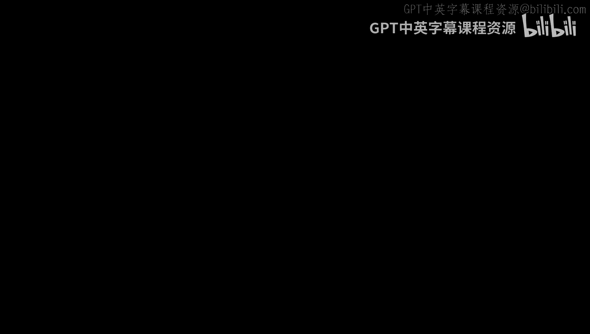
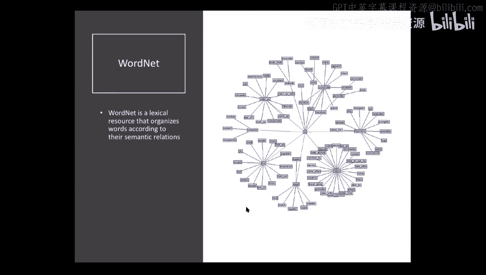
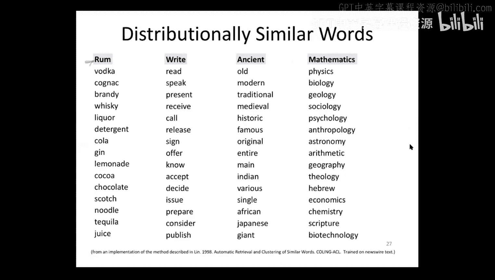

# CMU《自然语言处理｜11-411 11-611 自然语言处理 2020 秋季》中英字幕（Claude-4-S） p13 -13-2020-10-27 词汇语义学.zh_en -BV1RaWpzAE7E_p13-



## 词汇语义学：理解词义

在本节课中，我们将探讨词汇语义学，这是自然语言处理（NLP）中的一个重要领域。词汇语义学关注的是词义，以及如何描述词义以便在应用中使用。

### 词汇语义学概述

词汇语义学是研究词义及其相互关系的学科。它涉及以下几个方面：

- **词汇**：词汇是指一组单词，通常包含一些元数据。
- **语义**：语义是指单词或短语的意义。
- **词汇语义学**：词汇语义学是研究词义及其相互关系的学科。

### 分解语义学

分解语义学是一种将词义分解为更小组成部分的方法。这种方法类似于将分子分解为其组成的原子。

**公式**：

```
词义 = 特征1 + 特征2 + ... + 特征n
```

**代码**：

```python
def decompose_semantics(word):
    features = ["feature1", "feature2", ...]
    return sum(features)
```

### 概念语义学

概念语义学是一种从顶层到底层的方法，它通过单词之间的关系来定义词义。

**关系类型**：

- 同义词（Synonymy）
- 反义词（Antonymy）
- 下位词（Hyponymy）
- 上位词（Hypernymy）
- 部分关系（Meronomy）
- 属于关系（Homi）



### 分布语义学

分布语义学是一种基于单词在文本中出现的上下文来描述词义的方法。

**公式**：

```
词义 = co-occurrence_matrix
```

**代码**：

```python
def distributional_semantics(word, corpus):
    co_occurrence_matrix = calculate_co_occurrence_matrix(word, corpus)
    return co_occurrence_matrix
```

### WordNet

WordNet 是一个著名的概念语义学资源，它包含一组单词及其相互之间的关系。

**公式**：

```
信息内容 = -log(与C等价或为C的下位词的单词数量 / 语料库中的单词数量)
```

**代码**：

```python
def information_content(word, wordnet):
    equivalent_words = wordnet.get_synonyms(word)
    hyponyms = wordnet.get_hyponyms(word)
    total_words = len(equivalent_words) + len(hyponyms)
    corpus_size = len(corpus)
    return -math.log(total_words / corpus_size)
```

### 总结



在本节课中，我们学习了词汇语义学的基本概念，包括分解语义学、概念语义学和分布语义学。我们还介绍了 WordNet，这是一个著名的概念语义学资源。希望这些内容能够帮助您更好地理解词义及其在 NLP 中的应用。