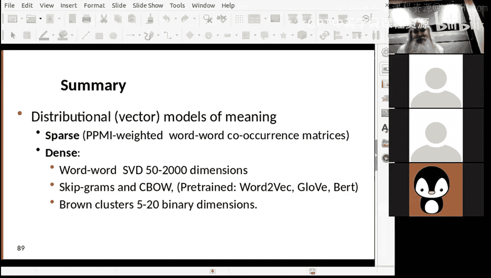

# CMU《自然语言处理｜11-411 11-611 Natural Language Processing 2020 Fall》中英字幕（Claude-4-S） p14 -14-2020-10-29 Embeddings.zh_en -BV1RaWpzAE7E_p14-

Okay， hello， everyone。We are going to do vector semantics today which are often called word embeddings so this is explicitly looking at how modern NLP processes actually trying to represent words okay now many people think this is going to be some sort of neural networkbased form and we are going to talk about that about half of the lectures about the neural network stuff but actually we're going to talk about why word embeddings work and what we're trying to do with word embeddings and actually show that you can come up with word embeddings from an analytic point of view and not just all trained from data point of view well actually all of this is training from data but there's actually principles in the training of the data and it actually shows why the neural word embeddings actually work and can be better but it shows why and what they're actually trying to capture and allow us to be able。

To evaluate how well they're actually working， okay？

The fundamental problem that we're trying to address here is that words are not in complete isolation。

 so many words have similar meaning and many words have definitely non-similar meaning and the way we naively think about words is some token in list of words in the lexicon is that if they're equal they're equal and if they're not equal。

 they're equally unequal and that's actually not right so in numbers if we think about the word like fast and rapid they're related to each other and we would like them in some sense to be more related to each other than just saying if they're equal fast to fast and if it's not fast then it's not equal well rapid should be sort of equal。

Okay， same way tall in height。 So imagine that you were building a question answering system and somebody asked the question。

 how tall is Mount Everest and your Wikipedia entry says the official height of Mount Everest is 2900 29 feet。

 Now， knowing that tall in height are in some sense。

 similar meaning would allow you to answer that question。

 But if you don't know that in your machine has no way of。

Actually looking at that and seeing that they're similar， it's going to go， well， I know the height。

 but I don't know the tallness， so I can't answer that question。

So it would be good if we could get a representation where tall and height。

Are we more similar than tall and chair， okay， or some other random word。😡。

Why would want to do this well we want to do this lots of things。

 you know question answering we'd like to do this when we're doing summarization here's an example of plagiarism detection where you actually get similarity and plagiarism detections almost the same as paraphrasing generation and being able to get similar things but different so we'd like to know that you know the forms are primarily and usually are are they got similar meaning they're used in similar circumstances that're used to mean the same thing used in similar circumstances think about that okay and that might actually be the way that we could work out that things are actually similar because if they appear in similar contexts。

Historically people have looked at the use of words in linguistics in language over time and tried to assess whether word meaning has changed over time and actually you know in spite of what you might think language changes。

 there's always language change over time， how people use language even 30 years ago was quite different to how people use language now and how people use language 500 years ago was significantly different on the left hand side here we've got three words dog deer and hound okay linguists have looked at the use of these words over time okay and actually looked at how many different types of animals they actually cover so historically if you go really far back into 1250 that was a long time ago。

 I only had a short beard then the word dog up until modern time。

's dog was actually a much more restrictive term than what we use it for nowadays。😡。

The word deer okay was actually a much more general term。

 the word deer meant any larger animal found in the forest and so it could include what we now call deer it also could include goats sheep。

 boers， dogs and wolves as well so the word deer was really a sort of large animal that's wild in the forest and if you speak German you're probably already aware of that because the word for zoozoological gardens in German is tier garden and tearer is actuallyc of the word deer in English and it really just means animal likewise the word hound especially a long time ago really meant lots of the things that we now use to mean dog and hound is now being a much more restrictive word over time。

😡，Let's look at the word gay over the last  hundred and something years。

 the word gay as most of you know nowadays means and gets used to mean homosexual。

 but as also I think most of you know the word gay100 years ago didn't mean homosexual。

 it meant happy， enjoyable and it was used in that term even in the 1920s to mean and we can know that by looking at the other words that get used around the word gay by looking at newspapers and letters and books from that time and we can see which other words appear in similar context when we go back and look at newspapers from those time and we can follow it in maybe not every week。

 but we could follow it over decades from that time to see how the word gay has actually changed over time so that it gets its modern meaning of homosexual。

 possibly male homosexual but sometimes just any。😡。

Homosexual but itss meaning has changed and that standard in language and that happens all the time and that's something that is interesting to linguists and it's interesting to us as well because if you read a book from 120 years ago you could misunderstand what's actually going on in the way that the words are actually being used notice that I said。

People are looking at how these words are used in context， okay。

So how do you find out whether a word has a similar meaning or not。

 well traditionally there's a book， a physical book， but they're online nowadays called the Theaurus。

 that's not a type of dinosaur Thesaurus is a book that shows you similar words to a particular word so you look at a word and it'll give you a list of words that have got similar meaning。

Thesaurus doesn't exist in every language and theaurus are usually relatively old。

 at least you know they're at least 20，30 years old and therefore they miss out on modern meanings and they don't always capture everything that you would like。

 they're pretty good for nouns， but they are not very good for verbs and adjectives and these actually change and so thesaurus are okay。

 but they don't exist for us every language they can often be out of date the method that they use to create these things is often some people deciding that these things are similar and trying to come up with other words rather than actually doing it from the data。

 which actually would be better if we could try to do it from the data。嗯。

The fundamental idea that we're trying to appeal to is this what's called distribution models of meaning。

 So what we're actually interested in is。Can how do we computationally define the meaning of a word。

 Now， that's incredibly hard and probably in a deep philosophical sense， we cannot do that。

But is there something else that we can do to actually represent the meaning of words so that we can use them for the NLP tasks that wed like to do。

 question answering， summarization， detecting plagiarism， etc ce？Sally Harris。

 linguist from the 1950s noticed that the wordocculist and eye doctor current almost the same environment so if you look at the currents of the wordocculist and the currents of the word eye doctor。

 I personally find the wordocculist somewhat old in the United Kingdom we would use the word optician but that doesn't get used in the United States but even that word optician gets used in the same environment as eye doctor and Oculist and because they get used in the same environment okay we can consider them to be synonyms okay if you be a little careful about this。

 they don't mean exactly the same thing if you look at a bunch of color names like blue red green you'll find they often get used in the same context as well and they don't mean the same thing。

 but they're talking about the same property of the thing that they're talking。

But they're talking about the color of it， okay？First is you're going to ask me what his first name was you're not Jay John Johan Johan。

 I think it was hes Dutch not Dutch sorry Danish 1957 said you shall know a word by the company it keeps and that's an important thing to remember because you know much as these are just quotes from some linguist from over 50 years ago actually what they're saying is very relevant to the computational techniques that we're going to talk about today so we are going to consider a word meaning built upon looking at the context that that word actually appears in and then trying to measure whether these similar contexts are similar or dissimilar okay。

And so。I'm going to give you a little story here okay and this example。

 suppose I asked you what the word Tisquino means and I'm going to give you a little passage a bottle of Tisquino is on the table everybody loves Tisquino Tisquino makes you drunk we make Dequino from corn and then the question is going to be so what toquino and I'm sort of assuming you've never heard of that word before and in fact I've never heard of that word before except on this slide I've never seen it anywhere else okay but I looking at that as an English speaker and much more importantly with the bias that I have as a Scottish English speaker means that if I don't know a word it probably at some type of alcoholic drink just from even now even looking at the context at least that's what I hope but actually there's lots of evidence here that there's some sort of alcoholic drink so you drunk it's in a bottle people like it is made from。

Cn that's the sort of thing that you might make alcoholic drinks from and that's exactly what it is is a type of beer and you can work that out because。

You could replace that word with a bunch of other things， you can think of the word beer。

 you could put the word whiskey there as well。 you could put other forms of alcoholic beverages there and that everything would be fine as long as you pretended it was made from car。

And so you can work out the meaning of a word given the context that it's actually appearing in。

 okay， without it actually saying to screen a is and I'll call like drink okay。

 and that's an important thing that you a human do when you're reading the language and that's something that we would like to get machines to be able to do that。

😡，So what we're actually going to say is two words are similar if they appear in similar word contexts。

😡，Okay。嗯。Let's there four kinds of vectors so we have already talked about some form of representation of words in what we do as a word vector so we decide on our vocabulary we add one for not explicit in the vocabulary out of vocabulary word we maybe have a start and end symbol as well。

 but maybe we got 10，000 or 100，000 vector with zeros and ones in it and we can represent our information by that in some sort of sparse vector representations most of these things are going to be zeros and some of them are going to be ones and we could say a words representation is based on the words in the context and so we could take that 10。

000 wide vector and put zeros and ones for each of the words depending on some corpus of data how often the word no what words appear around the word to screen。

Or whatever word we're actually going to look at。But that's a very wide thing。

 It's got an awful lot of zeros in it。 yeah there's good representations that we can actually do there but the alternative is try to do some sort of dense vector representation so we could take all of these and actually try to do some computational way to reduce them into a smaller form we could do some sort of computational way like single value decomposition which is a form of latent spanpanic analysis to actually try to project those into a smaller form。

 we could do some sort of neural network to try to take that wide form and predict a smaller form from which we could predict that wide form。

 that sparse one again as accurately as we can and these are things like skip crs and continuous bag of words or we could do something like brown cluster remember we talked about brown cluster when we were talking about a part speech tagging a couple of weeks ago and we could use brown clustering to actually try to get a more representation that's denser。

Then the information that we're actually doing if we just say。

 let's look at all the words in the context and have zeros and ones for everything。Again。

 the intuition is looking at the context and trying to get that representation。

 this representation is often called embeddings。And people will talk about them as word vectors or embeddings。

Often embeddings are usually dense ones rather than the sparse ones。

 but really it's the we can talk about these things in the same form。

 but much more importantly instead of just getting the word number or the word in the list so our representation of tall and height are just too distinct integer numbers in the big list we're actually trying to get a representation that would allow us to do distance metrics that's what we want to be able to do okay。

诶。So this is what's called vector semantics。 And the first thing we're going to do。

 we're going to look at core occurrence vectors。 So we're really going to look at the context that things are actually in and try to sum them up。

 So what we're really trying to say is。Given a word we could look in the document and see which words appear in the context or we could do it word to word and we could do it in some way so imagine we take plays of Shakespeare okay and we take particular words and we're going to see what there are occurrences the number of occurrence in plays in Shakespeare so we take the word battle and then we've got four plays as you like it 12th night。

 Julius Caesar and Henry don't worry if you've not read these plays or you have read these plays at school and you absolutely can't remember the content whatsoever that's not important what we're doing very quickly you'll see what we're trying to do。

So battle appears once and as you like it once in 12 night。

8 in Julius Caesar and 15 times in Henry V appears more often in the Julius Caesar and Henry V soldieroldier appears a couple of times and as you like it and 12th night and Julius Caesar appears 12 and 36 times let's take the word fool the word fool appears many more times in as you like it in 12th night than word it appears in Julius Caesar and Henry V and the word clown。

 well the word clown doesn't get used very often apart from it is really quite a favorite in 12 night because there's a can there's a clown called bottom actually in 12th night。

And。Even if you don't know what these plays are about。

 you can probably already see some pattern that the words like battlettle and soldier are more common in Julius Caesar and Henry V than they are in the other two。

 while full and cloneown are more common in the other one that's something that's actually useful。

 we're going to make use of that。😡，So that count vectorctor， okay。

 is actually telling us the number of words， that's not going to be ideal because maybe we want to get some sort of normalized probability there。

 but it's a good start。😡，We can actually say if two documents are similar。

 their distributional occurrenceencies of the words are going to be quite similar， so in other words。

 Julius Caesar and Henry V are more similar plays to each other than the arts of the other two。Okay。

 which is actually true。 Okay， Julius Caesar and Henry Le is all about kings and Caesar's emperors beating each other up and trying to take over the throne because that's what kings do。

 Well， actually， let's be fair。 ass what stories about kings do。 Kings often don't end up doing that。

 They always end up in exile。 Likewise， we could also look at each word。

And try to find out whether they're similar based on the distribution。

 Okay across these other documents。 So from that， we could say that the word full and cl are more similar to each other than to soldier or battle because they've got a similar distribution in a particular document now。

That might not be true that they're similar words， it might just be that they're closer and more likely to appear in such documents。

 okay but it tells you something about the relatedness of these words。

 okay and definitely it seems like fool and clown are more similar to each other than fool is to soldier while soldier in battle are more similar to each other or related to each other okay。

😡，And doing it a whole document， a whole play isn't always the right thing to do。

 maybe we could actually try to restrict it instead of doing it per document。

 we could do per paragraph or we could even limit to a number of words at either side and that's often what we do。

We have advantages that if we did it on the whole document。

 we'd be able to get better statistics quicker， they might not be exact。

 but we would get numbers to differentiate quicker if we're just going to do it with。

Two words at either side we'll need a lot of examples before we're going to get reliable statistics。

 So this sort of work can only really work well when we have awful lot of data and so we have to be aware of that。

 So we're not just talking about we're going to do it on 12 articles from Wikipedia we've got to do it on all the articles of Wikipedia and maybe were want to do and more than that so that we get better statistics okay。

So for example， what we can do is we can look at the context with seven words before。

 seven words after and we can start collecting them for apricot pineapple digital in information so we can look at the word apricot that appears in the first line there and we notice with our other words along the top that could appear in the context and of course that's really going to be incredibly long that's going to be our 10。

000 word wide vector so we've just highlighted a few of them here and the rest of them are off the side of the slide and so ourva computer data pinch result or just small examples but for apricot pinch and sugar appear for pineapple pinch and sugar appear for digital result appears and data appears in its context etc。

And so we have these two words that actually are in common between Africa and Pineapple and that might be telling us that these two words are similar。

 okay， likewise digital and information have got lots of zeroes。

 but we also got lots of positive numbers in areas where there's some similarity。ok。Of course。

 that matrix is actually really wide， it's got however many words we are， 50，000 words。

 most of the values in zero。😡，That are very good representations that we can have of sparse arrays。

 most programming languages provide you with a way of actually doing libraries to do that。

 but it would give you the information and we could collect that information from documents okay。

Yeah。One thing to consider is that there's what's called first order co occurrence， okay。

 and that is that the word wrote is in some sense， similar or related to the word。😡，Book or poem。

 because book or poem actually will appear in the context of rot。

 while there's another way which is a second order and that is rots。😡，Arguments。

 the things that appear in its context will be the same types of things that appear in the context of say and remark。

 So one is we're talking about the relation between a word and the words that would appear in its context。

 and the other one is we're looking at context and seeing what words can be similar between them It's just a different way of looking at the same information and we have that information okay。

So when''m going to introduce this notion of positive point wise mutual information， PMI okay。

The raw word frequency that we were talking about putting these is not actually very good。

 it's very skewed and when we start looking at words like the and off which are incredibly common。

 we're going to get really， really large numbers there and they are not the interesting ones。

 the ones that are actually interesting or like the content words which are differentiable and they make a difference in the context well almost everything will have off a lot of the time and what we'd really like is a piece of a measure of information to actually tell us whether these words that are appearing in the context are particularly informative。

So what do we mean， so we're going to actually define this positive pointwise mutual information as a thing that cares about how informative is this word given the context that is actually in？

It's quite simple when you actually think about it so it really is that you have a probability of two words you have the probability of word X and the probability of y and what you want to know is how independent or these words so we have the probability of x and the probability of y or we can look at the probability of xy okay so what's the probability that they appear together versus the probability that they appear independently now once you work out that's what you want to do we're really trying to look at this ratio between the probability of the both words appearing as opposed to the probability of each so we could multiply together the probability of each and we're trying to get that ratio we flatten it with the log and that is what we call the pointwise mutual information so it's not the positive pointwise mutual information it's just the probability it's just the pointwise mutual information okay and that actually tells you。

😡，About how likely these words are to appear together and as opposed to how likely they appear independently and that becomes quite a good measure of how。

😡，Important that they are， okay， how much information that they actually have。

PMI actually is going to range between minus infinity and infinity okay but the negative values are a little weird okay and what we'd be saying is that their co occurrence is less than we expected them to be by chance so it's almost as if it's sort of hard to describe it means that these words rarely appear together。

 but they independently have got some other form maybe they are conflicting so they might actually be opposites of each other so you know left and right might not appear together while when they actually appear together is only when people are actually contrasting things maybe but。

The things that have a value below zero are usually a little weird。😡，Because of that。

 we'd like to be able to just ignore them and actually let me give you a stronger reason why we want to ignore them。

😡，We actually care in this measure about how close things are when they're close。

 We don't really care about how close things are when they're not close。 So， for example。

 I really would like to know。How close the word green and turquoise turquoise is。

 But in my processing， I'm happy just to know that。😊，Chair and nebuchanezzar。

 my favorite word nebuchadnezzar and chair are just different and I don't actually care whether chair and nebuchadnezzar are further apart or closer than computer and fork okay I just don't care that're just different and so I just want to threshold for that and I don't care about super optimizing for the distances between things I just know are different so what we typically do with pointwise mutual information is we actually put a guard on it and we actually say we don't care about anything below zero if it's zero if it's below zero let's just call it zero okay and this is why we talk about positive pointwise mutual mutual information okay and it makes some of the math or a bit easier it also means that we can actually care about some of the other tricks that we're going to talk about where we're really going to try to optimize about the the interesting distance。

Between things rather than just the distance between everything because that often doesn't really help us in the tasks that we're actually doing。

Okay， I have quite a lot of slides in this today。And when I'm giving this lecture。

 I will typically skip over some of the math forms， but it's a good idea for you。Afterwards。

 to have a look at this and also。As David may tell you all the time。

 we actually have a book for this course and it's really。

 really good okay and you should read it okay so in addition to watching this video looking at these slides it's a good idea to actually read the Jusque Martin book as well about word embedding a lot of what's actually out of here is out of one of the particular chapters okay so we can instead of where we're going to go back to our pineapple and apricor example and so instead of just having counts where we don't the actual number of instances may actually be biasing things in directions that we don't really want it to be what we can do is we can actually replace these numbers of occurrences not just with the number of occurrence but we can putin。

Point wise mutual information， positive pointwise mutual information。Okay。

 this is the math and it's right。And as if you'll check it。

 you should give you points if you actually check it and find out what the answers are。

 but you can look at this afterwards。嗯。Again， see I told you there's always going be more story with pointwise mutual information It's actually still a little biased towards infrequent events very rare words may have higher pointwise mutual information then sort of they really should get because it might be that you have so few examples that there cooccurres can actually be wellest and therefore they're effectively getting a bigger boost than they really get and you actually might be missing some things of even rarer things that didn't appear in your data so it might be a good idea to actually see we can smooth that in some way and if you remember from the lecture from smoothing more than two weeks ago we talked about add one smoothing a classy and smoothing okay and that boosts rare words a little and give slightly higher probabilities and that actually can help us so what we can。

Actually do is give rare words slightly higher probabilities than low probabilities and that actually smooths the pointwise mutual information a little better。

 so in other words it has the effect of caring about the low end。

 the low frequency words better than the high frequency words and the high frequency words。

 it's okay if you flatten them a little bit because you have better ways of estimating with them by the low frequency words you want to get something that actually tells you a little better so things like add one smoothing to your before you calculate pointwise mutual information actually typically does a little bit better。

So again， a bunch of math。 we can do this。 It flattens the numbers a little bit。

 So let's move a little bit now on to similarity in particular cosine difference。 and you'll be。

If you've seen this stuff before， you'll know where we're going。

 if you've not seen this stuff before， you'll think I'm just actually generating random words based on a trigram model but it's more complex than a trigram model I promise。

So what we'd like to do and if you think way back to the first example that I had in one of the early slides I was trying to get can I get a distance metric between tall and height so I can know that these are similar or rapid and fast and so I would like to get a representation that allows me to compare it and get a distance metric that allows me to say whether they're similar or not now if I have two vectors I could。

😡，Multiply them together and actually try to find out whether they're similar or not okay and after have a definition the most easy way to do that。

 I do just multiply them together and where there's two numbers together I multiply them of course if they're zero it's going to be one of them zero it's going to go down to zero okay and so in other words if they do have numbers in the same position we're going to get a positive thing if they have many occurrenceencies is going to be positive positive a high positive if we're going to have zero and one okay and some number on the other that's going to move down to zero that's going to be a mismatch it's going to pull its weight down if they're both zero that means they could be zero but the number is going to be zero but that's not going to boost their similarity okay so we're mostly looking at the positive examples if they're similar and the positive examples we're going to get a higher value if they're got a zero on either side they' both sides it's going to lower similarity。

But remember， most of these vectors are going to have many， many， many， many zeros in them。

 so it's okay， so now it's most of these zeros are going to match。😡。

But there can be problems with this。So诶。The longer the dimensions of the numbers we have。

 we're going to have more numbers。 And so the the the magnitude of the distance is going to be different。

 And so that's sort of going to be hard to compare a distance metric when we've got these two words as opposed to these two words over there because depending on the number of。

greater than zero numbers that we have in these two vectors willll get a bigger distance okay compared to the other ones。

 it's going to be very hard to know that when I'm comparing these two words。

 you know and the difference is 357。5 is that a big number or a little number and that gets hard to do because each each distance between two words effectively is got sort of expected different magnitudes so it's hard to come up with an overall score of what means is similar and what means is not similar okay。

So we can actually use something else what we could do is we could divide by number of the length and divide by the number of examples there in it so what we could do is we could take the two vectors and we can multiply them together and we could divide them by the length of the two vectors as well and that sort of works and this is the bit that isn't immediately obvious unless you really think about it and if you don't understand this don't care about it just take it as fact if you do care about it it's actually obvious when you actually think about it that expression is actually the cosine of the two vectors so these vectors are actually in n dimensional space and they're pointing in some direction across different dimensions and the angle between them okay can actually be measured with cosine and therefore that expression actually give。

To the cosine okay and we call this cosine similarity okay and it's not immediately obvious why this is the case but it is and it really is talking about that dimensional aspect of which I have got so we have the do product we have the unit vectors and what you actually get is a number out of this that's going to be on the cosine curve so it's going to be between plus1 and minus1 and actually we don't really care about the things below zero。

 the things below zero are really saying they're not like each other at all they're really far away and that's very similar to this the same justification that we treat with the positive pointwise mutual information and so if we're just looking for positive pointwise mutual information in our forms actually the range of the distance is going to between zero and1 ones。

Going to be more similar and 0 is going to be less similar。

And then we get a bunch of math about how to do this。诶。嗯。

So it really is an angle and so you know if we only had two dimensions it's much easier to see angles in two dimensions so we can have these two dimensional things that we have in an X Y plot and we really are talking about that position about how close they are okay。

We could then take all of the data。We could calculate cocurnce matrices for everything and so we could calculate what the representation and positive pointwise mutual information is for everything。

 we could then try to get our cosine difference between everything and the things that are similar we could cluster together into a single cluster and build a tree that looks like something like this on the right hand side and so somebody did this in 2006 for some data set don't know what data set okay and what we end up with if you look closely at these。

Words， which I can hardly see。We discover that wrist and ankle at the very top are very close to each other yeah they're sort of similar type things。

 yes they're different parts of the body， but they're very similar。😊。

And then things like shoulder arm leg， a hand and other body parts are put into the same class they don't mean the same。

 but they're relatively close to each other okay and so we can do that over all of our data and now we have a distance metric and now we have potential clustering for all of that。

And。Cosine similarity is only one particular way of doing it and there's lots of other ways depending on what you're trying to emphasize。

 also depending on the type of data that you actually have， if you've got nice。

 clean lots of good data that are really covering the space that ultimately you're wanting to use cosine similarity is a good measure to do。

 in fact you should probably use cosine similarity first。😡。

And see how well it does before you start looking at the other ones。

 but there are other ways of trying to slightly emphasize either higher frequency， less frequency。

 caring to optimize about very close cases to boost them so that you get much more accurate numbers and when it gets further away。

 it gets less accurate， but it depends on what you actually want to do if you're trying to cluster everything to everything else。

 cosine is probably better but sometimes you want to do something that's a little bit more sensitive to the actual distance when you're close。

All of this was looking at words in context， it wasn't using syntax in any way whatsoever。😡。

But you can actually do something more than just caring about the words in the context。

 you could actually look at the syntactic structure of the words。 So remember again， some time ago。

 we talked about dependency parties and I told you about how to be able to get dependency information out of a par tree rather than just get constituent information out of a par tree。

 So the dependency with these things that had longer arrows for them rather than it was in a tree and what we could do is instead of using the context to be。

The two， three， four words and round about the word that we're actually dealing we could actually take the words with the arrows round about it the advantage of that is now we're actually going to get context that cares about maybe the verb and the head noun that we're being related to rather than just the word distance we're actually getting in some sense the syntactically local things rather than the surface context things okay and that's surprisingly easy to do so we just say instead of taking the four words before and the four words previous we get our dependency parer and what we do is we take for each words we basically follow these links and take the four closest words that are there but we always take them in the same order and many dependency pars will actually label the the arcs and so you want to make sure that you keep the same arcs when you're looking across different words。

So this works and it can work actually quite well， it does depend on you having a good dependency parer but for standard English that's not very hard and actually for you know the top 10 major languages there's pretty good dependency parts for all of them and realistically it's probably never going to be worse then the just looking at the forwards before and the forwards afterwards because often when the dependency parer sucks it almost falls back to that and has almost the same information in it so we just do the same thing okay。

So we can do the same thing with dependency relations rather than just looking at words in context。

 we have these numbers there and we build our PMI and what we end up with is instead of just having the words that are in context we might end up with in fact we usually will end up with you know what types of arguments does the verb take and that's a pretty strong indicator of the type of word so what's the most likely word that we have with drink and if we were just looking at word occurrence we might find that it is the one but it's not a very good one even though that may be much more common than getting the word like wine which would be a better example exemplar if you like of the sort of object that goes with wine。

嗯。There's another measure that we can use as an alternative to PPMI and that's TFIDF TFIDF stands for term frequency so it's the frequency of the word so it's the probability of the word in all of the document that you have sometimes we flatten this distribution by taking the log of it and then we also have the inverse document frequency IDF and what we're doing there is we're basically finding out how often does that word appear in that document compared to other documents and so what we're really interested in is does this word appear more often and this type of document compared to other type of documents is this a discriminator word and what we're really looking at is trying to take into account the overall frequency of the word versus how often it gets distributed over all of the documents okay so we have a bunch of documents that are all talking about Linux commands okay and they've got the word shell in them。

Then we've got this other bunch of documents and all they're talking about is Harry Potter things。

 okay shell probably appears much more in the Linux ones compared to the Harry Potter ones。

 yeah I know you're all immediately going to look up Harry Potter and find the occurrence of the word shell okay？

🤧So let's go back to this idea of sparse versus dense really in everything that we've been talking about so far。

 we're still expecting them to be sparse， but we're talking about how to get that information into the pointwise mutual information measure or some other measure that's what we're trying to do so we end up with these really long really wide ones you have to decide vocabulary actually always going have to decide vocabulary as opposed to the sparse ones that have got most of the elements sorry the sparse ones。

 most of the elements are zero well there's a few of the elements that have actually got nonze Can we get them to be much shorter So we've only got you know a few hundred examples so that most of the things are non-zero why do we care about this okay it's computer should be able to deal with that computer is really going to complain about the number of numbers it's going to deal with but that's its job And the answer is well yeah that's sort of all right but from a machine learning point of view。

Compplicationationally expensive to deal with 50000 numbers every time we want to multiply by an array while getting it down to 1000 is a lot faster because actually it's squared in there so often you're doing matrices and so you're doing 5000 to 50。

000 and that's a really big number while 1000 times a000 is' only a million and we know that isn't a big number so can we do something can we project that sparse matrix onto something that's a little bit more dense that tries to keep it more compact also remember we're losing a piece of information so。

Although we get these matrices for a particular word and what its context is。

 but one of the things we sort of lose from this is the words in context。

 so supporting the have word like car and automobile and I'm going to naively assume that these mean effectively the same thing。

 if you have a column in your farm for car and when for automobile。

 it sort of doesn't matter for when you're building your matrices。

 whether the context contains car or the context contains automobile。😡。

And what we really like to do is sort of maybe merge these columns because that could be a more efficient way to be able to look at it and so instead of having individual words along all of these columns。

 maybe we could have clusters of things somehow efficiently to do that， it sounds like a great idea。

 but how can we do that and how can we measure that we actually are getting what we want to get out of that。

😊，So we're going to talk about three different ways to be able to do this okay。

 the first one is mathematical technique called singular value decomposition SVD it's actually a special case of latent semantic analysis LSA。

The second class of things is word embeddings in the neural language model point of view。

 so we're actually going to try and estimate some representation that's smaller with neural nets and be able to force it to contain the information it's going to do some sort of non nonlinearar processing through its multiple layer in order to be able to do then we'll talk in some details about this sometimes they're just lookup tables for particular words and sometimes you have to give it full sentences where it cares about the contextualized form of the words and the last one is going to be brown clustering that I'm going to talk about。

So let's talk about SVD。嗯。So basically we've got this ndisional thing with very large n。

 we'd like to be able to project it into something that's fewer dimensions we can do this by rotating axes in there because remember it's really this position in n dimensional space we can try to reduce that there's a number of standard algorithms that allow us to be able to do that and that includes principal component analysis factor analysis and SVd they're all in the same space of taking larger representations and trying to project them and what they do is they tried to find the correlated coefficients in there and actually merge them remember I mentioned about car and automobile okay is actually being somewhat similar and it would effectively allow to look at the distribution of car and automobile and notice that they've almost got the same values everywhere and maybe exactly the same values but almost the same values and therefore the amount of information that we would lose by。

Coapsing those may actually allow us to contain the same amount of ultimate information and we do this just by actually looking at the numbers we don't really care what they stand for and these techniques are you know。

😡，Agnostic to the meaning of the values though sometimes you have to care about it the fact that we're dealing with counts rather than genuine continuous values can be an issue and even if we've got probabilities but remember these are estimated from counts so they're not as accurate as we would like them to be and so smoothing etc and they're noisy both the data we collected is noisy and the fact that we're going to try to reduce them will lose some information but it's trying to lose the least amount of actual information。

So dimensionality reduction basically what we're trying to do is we look at one particular dimension。

 we can calculate the that linear form and the relationship between it we can effectively remove that and flatten it and just contain the information that's got a bit left over and then we can look at the and equally do that I'm not going to go into detail because I've only got 20 minutes left but SVD is a very standard algorithm it's a special case of LSA it's been around for an awful long time often we reduce everything to 300 and I have had the question before why 300 and I have no idea and I've asked other people and they go I have no idea either and the best answer we can come up with the first。

People who started doing this had the size of their machines such the problem they were working on 300 was good for them because it allowed them to fit their data in afterwards so there's not a good answer for that okay but going from 50000 a vector of 50000 wide down to 300 is a good idea the fact that you end up with dense representation out of that seems to be a good result and also when you use it for tasks is quite good but you know you could go for 100 or you could go for 1000 and unless you actually test it or for your particular task it's not clear。

Whether 300 is actually the best or not， okay？And。Can we apply SVD to pointwise mutual information。

 of course we can。So we end up with a reduction of that。

Let's look at the second class of vector length reduction and this is looking at neural nets， okay。

 particularly we're going to look at skip grams and continuous a bag of words okay。

 and then I'll say a little bit about about but that we're actually going to talk about them in a later lecture again。

Skipgram is really appealing to the same idea and the idea which had been around not for words。

 but had been around in both vision feature reduction and in speech feature reduction where a large number of features or often continuous or being reduced into a smaller dimension that may capture the information that we actually want and usually the way that that was done was that they took a large amount of features they tried to build neural net that would predict a smaller number of features and from that smaller number of features they would try to predict the original okay so in other words they were forcing whatever the reduced farm was not losing information that could still be projected out again onto the original and you would try to minimize the unpacking and Sgrams and continuous bag of words although that slightly optimizing something else are very similar。

Okay so we want to train a neural network to predict the neighboring words or we want to train the neural network to predict this word given the neighboring words so that's really the distinction between them again we're fundamentally basing this information work。

 the information we're giving to the machine learning is let's give the context for these words and assume that the context sort of defines what the word is so the representation is being trained by looking at some contextualized information about the words so we're looking the word and we're giving it。

For wordss either side some number of words either side if we get this to work。

 it could be much faster than SVD SVD is computationally very expensive and actually much more importantly if we can do this we could precalculate it we could pretrain it which is now the standard term and we end up with a model which exists online and has been compiled with some large amounts of GPUs that Google has and you just use it in your program so you go I need the vector for nebuchadnezzar and it gives you the vector for nebuchanezzar and the vector for soldier and so you get the vector for soldier and so that is certainly an attraction okay that allows you to be able to pretrain and get some laxican of words and sometimes you'll say I want nebuchadnezzars the plural of nebuchadnezzar and it'll go I have no idea what you're talking about but here's my unknown。

Word representation， so you can get a form of that， okay？

Skipgrams can also be trained on your own data， you don't actually have to go and use the Word tove pretrained but you can train from your own and depending on the amount of data that you actually have and the different your data is to the data that the standard Word ofve data was trained on and you might still be in the same language but you might be in some different domain the Word ofve stuff was mostly trained on books and Wikipedia and news but if you're doing Twitter it's not very appropriate because that language in Twitter is not really the same as what you get in the Wall Street Journal so you have some choice but then do you have enough Twitter data to be able to build something that's better than Word tove which is not ideal and you probably have do doing an experiment to be able to work out for that so I'm going to go to the little picture here right so first what we're going to do is our input what we're going to do is we're going again have this big V。

And the input that we're going to give to the system is a big long vector that's our 10000 wide and what we're going to do is put a one for the word that we're actually dealing with so if nebuchadnezzar is word 3457 all the rest of them are zero but position 300457 or six if you're zero start will have a one in it everything else will be zero okay and that's how we represent words it's often called one hot。

And what we actually want to do is we want to build a neural net like this where what we're doing is we've got this really wide one hott layer that comes in。

 some number of fancy layers here， just fancy layer。

 I mean nothing special here and then we'll have a smaller internal form let's say our magic 300 is not to be 300 let's call it 300 something it smaller and from this we're trying to predict again。

 two outputs， one of them is the one hot of the word before nebuchadnezzar and one of them is the word after nebuchadnezzar and so our training set becomes the representation for nebuchadnezzar and the representation for the word before nebuchadnezzar in their data and the word after nebuchadnezzar in the data and what we're trying to do is we're trying to predict the previous and the next through this bottleneck of limited forms and once we've trained it all。

We're going to say that this is a representation that we know has the information of the word。

 or we assume it has enough information about the word that it can reasonably and reliably predict the previous and the next one。

😡，Okay and then what we're going to do for encoding is we're just going to say we're going to put this in。

 we're going to calculate this and we don't care about this and we're just going to say this is our representation in the middle for each of the words and so were tove speak axiagon of words but we don't have to represent them like this we can just remember as a single word we don't have to get it in the one hot form and we just look it up and we get our 300 random floating white numbers back they're not random but you won't see any pattern。

ok。诶。The continuous Bank of works。Yes， are these things different and the answer is yeah。

 that's actually quite interesting So are they capturing the same sort of information is pointwise mutual information and there was a piece of work that actually tried to see if they were correlated levy and Goberg in 2014 to see whether word to V representations had any correlation with PMmiI and it appears that they do。

 although it appears that they're actually slightly better than PMmiI because they deal with these low frequency cases quite a bit better so the smoothing that's magically happening I believe that's a good technical word for neuroforms so it looks like they are sort of trying to do the same thing So pointwise mutual information was in the right direction but it looks like that skip grams can be competitive with them if they have the right type of data this is always the case in the machine learning if you have the right W of data and you should always think about when you're ever using this I do have the same type of。

is what that person trained their pretrain model on。

 or am I far enough away that I'm not going to get the benefit and I have to do it myself？

Continuous bag of words is very similar to skip gram。

 but okay instead of trying to predict the context。

 what we do is given the context can we predict the word we just inverted it around the other way and we end up with representations that represent the context of everything rather than what the words are。

😡，嗯。If we then take these。300 wide vectors and tried to find the most similar words of phrases to those we find that it actually does things quite well again using say cosine similarity。

 it's perfectly reasonable thing to do although you maybe thought cosine similarity was good for the sparse cases actually it's pretty good for the dense forms as well。

 and so what we find is that Redmond Redmond Washington Redmond Was， Microsoft。

 okay Microsoft is only the name of a company in Redmond Washington。

 but gets used to mean Washington like Washington DC gets used to mean the US government or the White House gets used to mean US government Havo Vaslavl President Vasavvo。

 Velvet revolution Vaslav Havel was the president of Czechoslovakia actually after the the breakdown of the Soviet states and Eastern Europe。

It was called the Velvet revolution so these are similar to each other。

 ninjatss related to ninja martial arts， swordmanship， graffits related to spray prints。

 graffiti is belt differently and tags etca， so it does get things that are actually similar。

embeddings also do something else now this looks ridiculously exciting and this is the sort of thing that conspiracy theories get built upon and please don't think it's quite as good as what it appears in these examples。

😡，There have been little work to try to show that this isn't fully general and the sorts of things we get is not unexpected because of。

Word distributions and the relationships to word distributions so it was noticed that if you get the vector for the word king and you subtract as in you know minus take all the numbers away the representation for man。

And then you add the representation for women， it is close to the representation for queen。收。

That implies that within the actual representation。

 this dense representation of random floating point numbers， it has something about being male okay。

 and the representation of woman okay has something about being female such that when you move the king to Queen one。

 what you do is you get a gender change， but you still get the head of state out of it and this happens for a number of things so you relationship between Paris and France。

HeSo Franknk France add Italy， you get Rome being in there and people have noticed this that oh my God。

 it actually understands dimensions of。The semantics of the work。

 although there's been later work saying actually no。

 it's not really quite as strong as that it's just that there are certain classes of things。

 So if you look at king and look at a wider class in that particular space and end dimensional space。

 what you find is eventually if you move out far enough。

 you get male Okay and so it's not really the case that what you're doing is you're moving from one to the other。

 what you're really doing is you're moving within an already predefined。😡。

It's probably not simply hierarchical space and therefore it's not quite as general it is。

 but this is quite interesting， it does tell us that there is information that are in these vectors that is quite useful for doing interesting NLP tasks and that's certainly the case these representations suddenly allow us to do much more interesting things that were actually quite hard or we needed an infinite infinite amount of data rather than just an infinite amount of data。

😡，Can I train my vectors in all the Wikipedia and the answer is yes。

 but only if you manage to trick us to get enough new AWs credits because it's actually quite computationally expensive。

 but you do not need to do that as we all know that Google has more computing power than anybody else maybe Facebook has more they've already precalculated it So actually word tove is a Python form I mean it's not a Python form。

 but it has a Python interface that will allow you to be able to use precalculated vectors and that's a good thing to do okay if you want to actually get representation of words。

Your precalc1 instead of work to effect， there's another one called glove。

 which is actually most people don't look at this closely。

 but glove is an analytical form using pointwise mutual information with from fancyer tricks than what we talked about a and sometimes glove is better but again it really depends on the particular data that you're doing and you wanted to use it for because there's almost more。

Wor to vacuum and glove， give you a representation for each word so you ask a word。

 you give it the word apple， you get a representation back。

So it doesn't care that Apple has multiple meanings。

 it can be a fruit it can be a computer company or it can be a computer， okay。

 so it can be any of those， it doesn't care and it sort of puts all that information together。

But Bert and actually it predecessor Elmo are contextualized word embedding。

 So what they do is you have to give it a whole sentence。 So now you've got Apple in the middle。

 which might be followed by CAt or it might be followed by computer or it might be called followed by delicious okay and I don't think the computer is delicious。

 but I've never eaten it so depending on the context。

 you're going to get different vectors for each of the word and this has been shown to be much， much。

 much better much， much， much three better okay it's maybe not four better but it's three better but Bt is a model is much。

 much， much， much much， much， much bigger and you've got to get the full sentence it's computationally more expensive actually Google again has an interface to be able to do that Now when Bert happened in November 2019 almost overnight everybody changed their word vector representation to use Bert because it's always better with Bt Okay now since Bt came。

And if you read the original Bar paper， it was quickly pointed out that。The Google group who made it。

 Devin Neal said we made some choices and we didn't really investigate the whole space but we made some choices on the best way to be able to do it。

 so they really are caring about the context they're actually using transformers as the representation so they've actually got words within the context。

 any word within the context of the whole sentence can actually feed into the importance of the representation for the vector so they're not limiting just to three or four words。

 they're looking at the whole sentence they're also looking the words afterwards and not before which makes it not really a language model so you can't use it for some things you'd like to use it for and other people since B came out as looked for things which are alternatives to how you set up contextualized word embeddings with transformers as the technique and they've got better results。

Okay and actually for a while， I'd say last year， almost every week somebody would come up with something that was better than Bt I mean it was marginally better than Bt and Bt was much better than things that were happened before but it was better okay sometimes it was training on an awful lot more data sometimes it was training on noisier data so it actually meant that it dealt with the noisier cases better。

 sometimes it was training on different data social media things rather than news and Wikipedia many of these new things that came out ended up with the word Bt inside them so there's things like Roberta came out and there's actually one that's been designed as a language model that's called Bart rather than Bt so changing from Sesame Street to the Simpsons I don't think that's an important part of it but Bart does other things as well the one came out as CMU last year Excelnet from one of our PhD。

Whi was also substantially better and it basically looked at the contexts and what it did was actually flipped the context around in order to be able to get better training。

 looking at the context and contrastive training looking at the context and that made a difference as well not all of them are readily available in line with large enough models that you would actually want to use and so often people fall back under Bt or multilingual Bt or Roberta or Albert or I can't remember them all but Bt itself is often quite reasonable again all of these were Bt any of these it depends on whether your data is like their data or not whether it's really going to work if you're dealing with Twitter if you're dealing with a dialogue system that's talking about very different distributional forms of words than what in Wikipedia it's probably not going to work and maybe better to train your own embeddings but then it depends on the amount of data that you have。

Brown clustering almost finished We talked about brown clustering before as an alternative to part of speech tagging with the idea that what you can do is you can try to find put words into classes Now part of speech tagging very much is trying to get a synthetic similarity so we want to have all the ouns together all the valves together all of the propositionposition together all the pronouns together but brown clustering says I'll take all your words and I'll tell you the distance between them and put them into a tree that would allow us to be able to represent that distance metric in all the words in your carpets。

 all the words in your carpets so you have to process all the words in your carpet brown clustering is pretty expensive to actually run。

And what you can actually do I'm going to skip that way you can actually do is once you've made that tree。

 you could convert that tree into word embeddings for each of the words in it。

 so you could use it for clustering things so you look at some point in the tree and take all the words below it and say they're in the same cluster but what you could also do is start at the top because the。

😡，Bd cluster tree is a binary branching farm。 You can name the left one0 and the other one， one。

 And as you move down the tree when you get to the end， you'll have some。

Root that you took left or right， and you label them is 0，1，1，1，1，0，1，1，1，1。

 and you get something at the end。 And that root can be an embedding。 Okay。

 that route gives you a bunch of numbers。 Okay， you can then make it into a bunch of。

A big integer or a bunch of bytes doesn't really matter okay or just zeros and ones okay but you can actually collapse it into bytes because most of the techniques that we have can deal with that in a reasonable way and so you'll get this big long thing and basically as you move along it you're going to get more and more similarities so the least significant digits if you like in your you're embedding okay are going to tell you that things are closer together Now I just like to point out that the embeddings that we get from wordve are best described as randomly ordered floating point numbers they have no order to them whatsoever actually it's not true that they have no order but they have no intended order So it's really hard to be able to know if things at the right hand side of your vector are less important than things on the left hand side so you just don't do that and things could be all over the place in fact in most of these。

Algorithms they have a random start and so every time you train it you're going to get different results okay so if you use word V to be able to get things and somebody retrains word D Vc you can't use that word to V to be able to do comparisons is not going to be in the right space Brown clustering however has got this left the rightness and sometimes that's a useful thing to have。

Bund examples over some set is lumping together in this case， days of week， month， et cetera。

 so it sort of does reasonable things。Let's skip that。😔，诶。

How do we find out the similarity we talked about using cosine。

 but this is something about a downstream task， can we use that to be able to help our tasks and so we can use it for question answering。

 spell checking you know can we find the alternative for spelling can we do it for grading and people have use this also from a task that humans do if you've ever done the toughal things because you're a non-native one of the types of tests that they have is say levied is closests in meaning to and give you a bunch of other words and humans do this okay and you've got to be relatively good at the language to understand how you have to have to know these words and how they get used and using that data that gets used for toughal we could then try to externally try to measure how good word embeddings actually are word embedding are pretty good but they can get confused they're not I mean。

They don't really understand the language， and it's important to remember that。Okay。

So what we've talked about is distribution distributional vector models of meaning。

 so we're talking about a bunch of floating point numbers that is trying to represent the meaning of a word given a word we get these bunch of things we want the thing that we get out of it to have properties like distance metric in the domain actually is。

😡，Something to do with meaning but much more importantly useful for our downstream tasks we talked about sparse ways of doing this。

 either just looking at co occurrencerence but also trying to get a better representation of that and talking about positive pointwise mutual information okay then we talked about three ways of doing it in a dense form and this is like taking something like our word cocurrence or our pMI representations and trying to project it into a lower dimension so that we could also do distance metrics there and therefore it's more efficient to actually use and may even capture dimensions which we cannot get simply from the sparse form。

😡，We talked about learning these from neural nets so this is skip grams and being able to run them for you or to use offline ones that have been pretrained in order to be able to get good representations in order to be able to do I should say Bt is 768 or Big bear there's a Big bear and it's think 124 wide so they're still quite big and it talked about brown clusters which is again analytical way of doing it and realistically it gives you much smaller numbers。

 it's much more targeted to the particular data set that you have but you have to make sure that your training and test is in the right domain in order to make that useful。

Okay。That is it for today， and I now see there is a question here。

 which I have to move to be able to read， sorry， I missed this。

Back in the questions about PPI PPMI why is it good to give the rare context words higher probability。

 usually the rare context words you don't have a good estimate of their probability okay because you've only got 10 examples of them and you' really like to have several thousand of examples of them and the words that they're cooccurring with to be able to make a better idea of whether they are similar or not and so what you like to do is model those and spend more time modeling them better a high frequency ones you usually are modeling very well and you can remove some of their accuracy because it's not really going to make much difference but all these sort of low frequency but not ridiculously low frequency ones you're sort of。

got chunky frequencies that are not really giving you a good enough way to measure PPMI。

 and therefore it'd be better if you sort of gave them more space。

 more probability space to be able to make that estimate。😡。

Okay。Any other questions？

Okay， thank you。 that's it for today。

