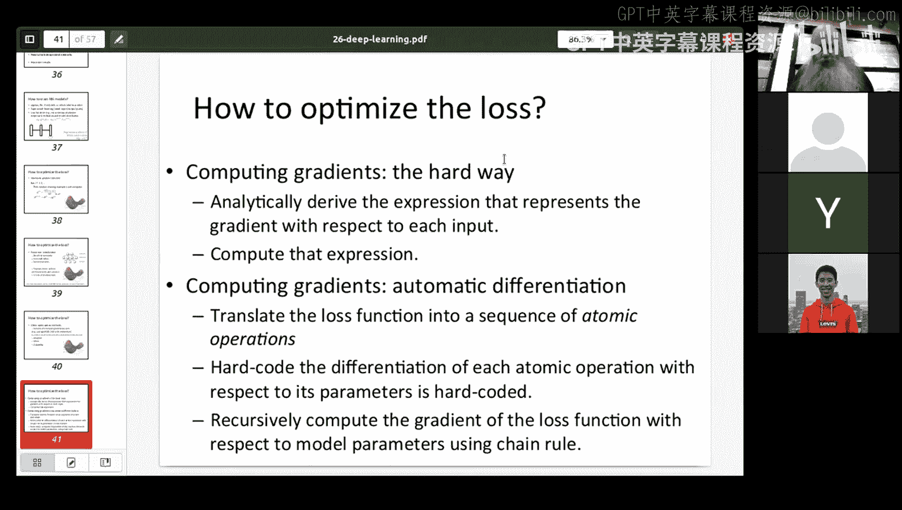
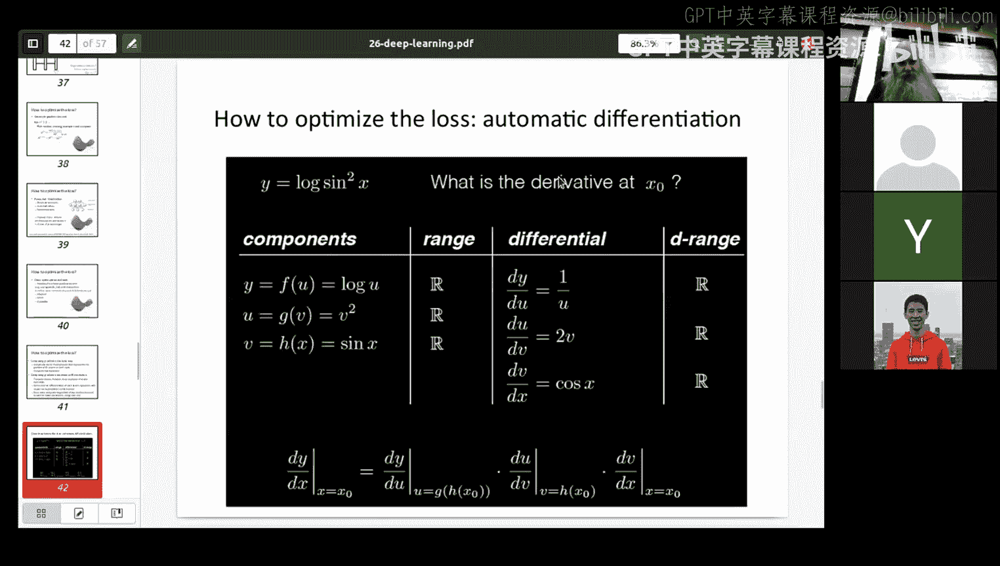
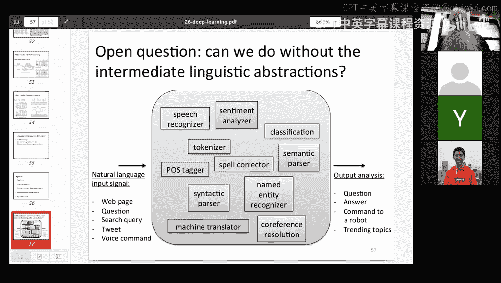

# CMU《自然语言处理｜11-411 11-611 Natural Language Processing 2020 Fall》中英字幕（Claude-4-S） p15 -15-2020 11 24 11 411 Deep Learning.zh_en -BV1RaWpzAE7E_p15-

So hello everyone today we're going to give a somewhat flying overview of everything in deep learning some of these slides have appeared in earlier lectures but not quite at the same story level of telling you the history and the reason that we often are using deep learning and the limitations of deep learning how to be able to use it for natural language I'll also be talking about some of the major milestones that people use machine learning。

 deep learning for in order to be able to improve NLP So we have for the most part this course been talking about some form of natural language analysis we're going to have some input form that has。

Human text and it may be speech we did mention speech。

 but we're mostly talking about text might be a web page， might a question， might be a tweet。

 might be a voice command， it might be a whole document might be the whole Wikipedia and we have to do something with it we have to either maybe generate a question。

 generate an answer， interpret what's actually being given so the robot carries out the instructions look at a database with the information that is actually come in find trending topics。

 etc cetera， but we're doing things with natural language in the input and we have some form of algorithm function that processes it and gives you some form of output at the end。

 which maybe be natural language or it may be some action in the world。

We touched at various levels of types of algorithms that we might actually care about。

 we talked about speech recognition， sentiment analysis， classification。

 just looking at documents and deciding what their actual topic is we talked about lower level things which we could use in order to solve these higher level tasks like tokenization spelling correction speech taggerers。

 syntax， etc， and these sort of intermedia things where we're getting some information out which probably isn't the end task in itself but feeds into something else so like named entity recognition。

 semantic parsing coreence resolution although these are interesting tasks and themselves and people often study them just for their own end they're usually feeding into some bigger use of natural language and the big picture really is given all of these。

Processes， these analysis programs。Can we replace them with deep learning and the answer is of course yes。

 should we And the answer is， well， it depends what you're actually doing because you want to get the best result。

 not necessarily use the most CPU time or GPU time Well。

 maybe that is one of our tasks but we would like to know when and where neural machine learning as opposed to statistical learning or just rules is best and what's the easiest to actually do。

In general neuroformms are pretty good but they need a lot of data okay and this can sometimes be compensated from if we don't have a lot of data we can do data augmentation techniques we can add additional information so learning becomes faster so we can add part speech or synthetic information so that the task becomes easier to learn but in general we need a lot of data and so in other words。

 if you're in a task that doesn't have a lot of data then maybe you're going to have to look at some simpler statistical technique in order to be able to do。

 but in all cases you're going to evaluate whatever is best and whatever is best is best and that's important to remember that's the task that we're doing so we're looking at these particular components and seeing if we can use some form of deep learning to be able to get the best possible result okay。

I'm going to go a little bit history of deep learning， it's sort of important。

 it's important not just because there is a long history。

 I mean there's a very long history it goes back to the 1950s I'm going to talk about what are the blocks of deep learning and how they've improved over the last 50 years' more than 50 years。

How they've improved we're going to talk about training because training is actually the critical part everybody thinks neural nets are really cool because you can use them to do things。

 but training is the skill Okay， and we in this class are not teaching you explicitly。

About how to be able to build neural networks， deep neural networks for natural language that would be a different course neural networks for NLP that's taught by Graham Newbg is an excellent example and many of the machine learning classes in MLD actually are using natural language as their example because thiss what lots of people do and then I'm actually going to talk about some really important results which caused us to change our views on how neural networks can be used in natural language processing and actually significantly move the field forward in the last 10 years。

I'm going to use for a lot of time document classification as my particular example。

 so document classification I'm going to have in a bunch of well written things。

 news articles and we're going to sort them into classes of let's say financial business， sports。

 entertainment and health so we're trying to work out which form now there are lots of ways to solve this problem including non-nural formss but it's a good example to actually give because we've got a whole bunch of random words and we're going to be able to sort it on the relatively small number of classes so we'd like to be able to do that。

We're really talking about a function that takes a label sports and a document。😡。

Something about some football team in Spain oops and Catalonia we have some function that's actually going to give this。

 And what we're trying to do is given the document and a particular sports class we'll get a probability and we're looking for what's the most probable class given that document。

 Okay， so we're trying to learn that function。 Okay， and that's what physicalical learning does。

 That's what neural learning does。 That's what rule learning does。

 we're actually trying to get an estimate of what the probability is and learn from data。

 because that's sort of the best way to actually do it doing it by。

Introspection and rule it might be able to be done， but it would be a little weird。

The most obvious way based on everything that's been around for hundreds of years rather than tens of years is to use some form of linear model。

 so what we're going to do is we're going to look at a bunch of features。

 let's say the occurrence of words and we're going to try and find appropriate weights to multiply these features and then sum everything up and find out something above some thresholds say above zero okay so a linear model might take all of the occurrence of each of the words that we have。

In the document， so zero of the word doesn't appear。

 we have a one of the word does appear the length of that vector is equal to our vocabulary and we would like to learn weight that will tell us that certain words are more likely to appear in certain particular classes so in other words well Barcelona and Madrid okay both cities in Spain but there are also the names of football teams and so just mention the cities themselves might not actually tell you much but real which is a Spanish word for royal in Real Madrid is the name of the football team in Madrid in the team in Barcelona is called Barcelona are actually it's called Bara for short but these words are very strong indicators that they might be talking about football and especially with real Madrid and Bara would be a very strong indicator。

So we can discover this。 we talked about linear regression way back I did I assume you were listening in one of the classification lectures and we couldn work out where these weights are if we have a lot of data okay we can actually do that and we can come up in an approximation but we're dealing with all of these words in isolation we're not dealing with them in context well the bygram real Madrid is a very strong indicator that we're talking about football when I say football I have Come soccer okay but they call it football they don't call it football in Spain。

And in Britain and elsewhere they call it football the we can do this if we can actually train something to do this what we're actually trying to do is we're trying to partition the data。

 draw a line through it， a linear line through it and so that we can actually find out whether things are either side of that line。

It may not be possible， in fact， with real data， it's almost impossible to get a perfect line。

 And so what you're just trying to do is minimize the error。

 If you're allowed to draw multiple lines， you actually can do a lot better。 I mean。

 if you're allowed to draw an infinite number of lines， you're definitely allowed to do it。

 But you know， if you draw a few lines， you'll be able to get better ones because you'll then be able to partition things and saying if it's above this。

 but below this line， we might actually get better results and better prediction。

 So in other words linear simple， linear models with one line are probably not powerful enough to do lots of things that we like to do。

 And so we'd like。To actually end up with things that are more complex than that in order to get better results。

 okay， and people have been doing this in machine learning for an awful long time。

Let's talk about noodle nets。So the first form of neural net is actually just linear regression。

 okay， in its simplest possible case。It's a linear model。

 You have a bunch of features that come in in the input。

 This might be the occurrence of the word Barcelona or Madrid。

 And what you're going to do is you're going to get。

We that you multiply these two and for each of those you're going to get say in our average of politics science and sports。

 we're going to multiply those and we're going to sum everything up in the politics science and sports node and then we're going to choose the one that's highest okay。

 that's all we're going to do。And so it's still a linear process。😡。

The thing that's different in neural nets， even at this level where we only have two layers in our neural net is that the way we get the weights in linear regression。

 the way we get our weights， we actually do inverse matrix multiplication or pseudo inverse matrix multiplication a little bit of correction to make sure that we don't get something stupid out of it because you can get infinity if you're not careful in neural nets。

 what we do is we use this technique called back propagation and in back propagation what we're doing is we're actually given an example we predict the output we then look to see what that error is and we take whatever that error is and we try to modify the weights to reduce that error Now we could change the weights so that the error gets absolutely collected corrected every single time but that means our weights will dance all over the place when we're actually trying to learn with every example we're going to take。

Massive changes to the weights。 So what we do is we don't change the weights all the way we change them some small percentage 10%5% each time and if we do that over a number of examples with a little care what happens is the weights themselves will gradually move to weights that will get us the best separation so in other words in neural nets perceptrons what we're actually doing is we're learning the weights through back propagation so what we're doing is signing the amount of error and then we're distributing it over all the weights and then trying to do an update of them and there's lots of choices on how to do that and I'm going to talk about some of these today but that's the basic thing so it's still a linear model we have a bunch of features that we're multiplying by bias of weights and then we're looking at some threshold at the other end but how we get the weights is actually different and that's sort of important to neural nets because we don't just have simple linear model。

In neural nets， we actually can have more complex forms。 Now。

 this form of linear weight was a linear model was around in the 1950s。

 So that's even before I was around。What you can do is you can think about what that neural network is is actually a matrix multiplication。

 the same thing that it actually is in a linear algebra， so it's the same thing。

 but it's a different way of actually looking at it。

 which has advantage later when we actually extend what the complexity of neural net actually is。

Okay。And。People realized very quickly on with neural nets that， okay。

 we know of another way of doing linear models， Isn't that cool。 yeah， maybe。

 And there might be advantages to it。 And there were advantages to it that you could argue it's faster。

 You could argue that it deals with certain aspects of complexity and data or randomness or noise in the data slightly better than the standard linear techniques。

 But people then said， well， actually， we could do something a little bit more complex than just actually having you know。

 one layer。 we could have multiple layers。 We could also do things like take these multiple layers and change the number of nodes that we have in them。

 So in the middle， we could have a smaller number。 and then we could try to predict the output So we could use neural network to try to do a form of compression。

So we could have all of our input as a bunch of zeros and ones 10000 wide vocabulary that we're actually dealing with in the middle we could have a code that was maybe only a few hundred rather than 10000 and then from there we could try to predict the same 10 thousand0 at the other end and we could use our neural network learning technology to be able to do that and that means that that middle point okay actually contains all the information I mean you're not going to get 100% correct on your expansion but you're going to get very good expansion at the other end and you get this small number of numbers in the middle and that has lots of advantages for downstream machine learning tasks this is called encoded decoder it was something that was pretty fashionable in the maybe into the 80s and 90s in the 2000s we used it a lot in speech to be able to take a large number of spec。

Features that we felt might be important， but we didn't know which ones were the most important and we'd actually project them down into a much smaller number of features often called bottleneck features and then confirm that we could expand them and then we would take that middle internal representation after stuffing through our features and then use that in our HMM recognizer or whatever recognizer we were using externally so we weren't using neural nets in the actual rundown synthesizer we were just using them to be able to encode some of the data。

so this was one way the multi layer thing okay， and we were actually getting some compression thing out of there。

 which was useful okay， arguably it's the same as what you get with matrix multiplication。

 which is completely true， but this was a useful way in a more efficient way to actually train this。

We discovered the the。feeatures that we get in these compressed forms actually it's some meaning okay they were useful。

 their distance metric in that domain meant something from compared to the distance metric in the big white domain that we had that actually comes in when we did this for words and remember we talked about word embedding a month or so ago and this was a way to actually compress bag of words representations into word embeddings and this through various forms and actually a little later I would say this is not something that we were doing in the 80s although there was some examples of it but in 2011 and I'll talk about that one later。

 people discovered that actually that distance metric that people had we discovered that similar words were similar and different words were different and words of the same class were being grouped together although the capital cities were somewhat close to each other all of the mammals were close。

Tother all of people names were close together， and therefore there were some information about that。

Some people at the time said， oh my God， neural networks are understanding the world and that's absolutely not true in any way whatsoever。

 Okay， well， it's sort of true， but not in the philosophical sense of understanding。

When you use neural nets to be able to get these compressed forms。

 what you're actually doing is your many of the techniques not just look at the words but actually look at the context that the words are actually in and so what you're getting as distance metrics of words that are likely to appear in the same context and once you start getting distance metrics which have those properties words in the same context have've got a closer distance than words that don't appear in the same context you get common words so place names appear next to other place names colors appear next to other colors because that's where those words actually appear fruit appear next to fruit so it is learning something and it is learning something about meaning but not some deep philosophical aspect that these two words mean the same thing but it really means is words in these context actually appear in the same context and therefore these words are in some sense similar to each other they might be syn。

They might be antonyms which is a bit of a problem that you might get words that are similar in this domain are actually not semantically similar and we don't really say that red and green are similar and yeah they're both properties of color but you know they're different okay and it's important of whether you take the red pill or the blue pill so we're not really going to say that red and blue are the same。

But it has these properties and that's really useful because when we're doing natural language processing。

 we'd really like to know when two words sort of mean the same or they're related in some way because that tells us lots of information not just about the word but the words that are around about it this word takes place names immediately afterwards。

 then it's actually telling us something about what that word is it might be to or from and it's telling something about directional information。

But we can define more complex functions than simple linear forms。

 And that's actually where the computational power really comes in neural networks。

 So if you look at this， we've got multiple layers。

 it's going to be a matrix multiplication times a matrix multiplication。

And two matrix multiplications well what you can do is and you got your input。

 you multiply the matrix， you multiply the other matrix and you get the result。

 but you could precalculate the multiplication of the matrix and we know by association that that means exactly the same thing so we're getting no gain。

In neural net， So we have multiple layers。 So why are we having these multiple layers， Okay。

 Are we just doing this so that we。Use up more computing power。

 Are we just using this because we think it's cool。 if mathematically， we don't get anything more。

 then。😊，Why are we doing it， And the answer is actually， if we did that。

 we certainly wouldn't be getting anything more， but that's not the only thing we do with neural nets。

 What we often do is do something in the intermediate multiplication。

 So when we're talking about that intermediate level， we sometimes have a postpro。 In fact。

 we often have a postpro function that goes there and that postpro is often a nonlinear functions。

 it might be logistic functions。 So what we might actually say is instead of saying we'll take all of the output of that。

 what we'll do is we'll have a look at that and do something like。

If things are above the threshold will make them one and if they're below a threshold they're go to zero。

 so it's a somewhat recognizable thing that it's trying to do of one in zero and we are going to apply this function that forces things to make them high when there should be high and low when they should be low when we do that it's no longer in a neural network a simple multiplication of of matrices it's actually more complex than that multiplying by one applying some function and multiplying by the other and when we do that it's no longer the case that you can precalculate。

What exactly going on because you can't make that function that's happening in the middle without knowing what the inputs are。

 so you can't carry out that function independent of the input。😡，Therefore。

 you end up with more complex functions that are actually new。 And this is a really good thing。

 There are typically non nonlinear functions that are going on here。

 And so what we can actually get is much more interesting classification going on than what we would get with simple。

 multiple linear regression because that's not really going help。 Okay， so if we have these。😊。

Functions which actually apply in intermediate formss。

 which we do in neural nets and almost all neural nets。

 We actually end up with this non linear representations of functions that allow us to be able to learn things that are much more complex than standard linear functions。

 And that's cool because linear regression can learn nonlinear regression functions。

 It cannot It's limited。 There are so of ways you can do it。 So what you can do is you can。

Build a bunch of deciders that are linear regression， take the outputs of them。

 apply some function to them， and then put those into another level of linear function。

 the weight that's actually what the neural nets are doing。

 But the advantage of the neural nets is we can actually train the weights all the way through well the thing I just said of building independent models that you then combine in some way for the next one。

 you have to train these first ones as best you can without doing some form of correction based on what happens afterwards。

 So the advantage of doing things in neural nets and joining them together is you can train all these weights together And that's really powerful。

There's a bunch of various functions that you can actually apply at each level。

 some of them are best described as magic， they're not really magic， but when they work。

 people can't really tell people have intuitions about when they work。

 but it's not always possible to work out what works and what's good there's set of ruless of thumb and in general there's a bunch of ones that you're much more likely to use than anything else and these are usually implemented in your in your toolkit and you don't have to get into much detail about them and you usually be copying these from something else。

 but there's a lot of space that it's in there there' some restrictions that can't be arbitrary functions in there because of the way that training works and being able to set your weights whatever function in there has to be differentiable。

A because you have to do that to work at the math to be able to apply what the gradients are on each of the weights and some functions you'd like to put in there are not softm being one。

 but there's pseudo techniques that almost work that allow you to actually get through this and stochically without much problem。

So why do we need more layers？Well， there's theory in nature in neural nets that you can actually train any compable function with a neural net as long as it's wide enough。

So it's got enough features in it， you can actually approximate in that function。

It's sort of interesting but it's not very useful， it's like you know signals can always be decomposed into bifurier transform。

 it's like any computer level function being represented in a tuuring machine yeah yeah okay I know that this is the case。

 but I'm not going to build a neural net and have1 billion parameters in a one layer net because I won't be able to train it because the proof requires you to have an infinite amount of data to be able to test things。

AndSo no， I'm not going to do that。So why do we have deep ones？ Well。

 deep ones actually allow us to be able to get a a。对。

More efficient representations quicker probably okay， there might be a way to do it if we were wide。

 but that's not the way that we actually went in research and we actually care about the depth form rather than the width form because the depth allows to do it there's nontrivial things that go on with training the weights and depth because the deeper they are。

 the smaller the updates to the weights， the further you are away from the output。

 or at least the less certain you are， the further way you are so you don't want to update the weights quickly。

 and therefore it's much harder to train。And that means you probably need a lot of data if you want to be able to with deep So back in the 1980s。

 you know， most neural nets were two maybe3 layers deep。

 And as we moved into the 2000s as both the math got better for training and the speed of computers got better and the amount of data that we have got better。

 we started going to be deep and so deep learning took off And then people are going to say so how deep is deep and people usually change the subject to that point because they don't actually want to answer that question of how deep is deep It's sort of。

Advertising term rather than actual requirement and you may find things that have got two layers being called deep and you may things call with1 thousand0 layers being deep the thousands is really rare though in fact。

 I think I only know one group who is actually doing that and training is really。

 really hard so actually deep is usually you know。3 or four to 10 to 15 is probably what most of the deep layers are because after that。

 it gets quite hard。 And there's other architectural things that I'm going to talk about that are actually。

Much more relevant in actually making better architectures than just say I've got a bunch of layers and I'll add another 10 and see whether it gets better okay because the more you add layers。

 the more data you're going to probably need to be able to train properly and the harder it' going to be setting some of the hyperparameter so you know putting in 50 and to see if it works is probably not worth it。

One thing that's been noticed when you have multi layer deeper networks is it seems that。

The layers nearer the input seem to care more about lower level functions。 So envision vision。

 for example， layer one might be caring about recognizing lines within the picture while layer two might be caring about features in this case we're doing face recognition it might be caring about features within faces。

 So mouth nose， eye， things like that。 while the layer 3 is actually caring about the face recognition orientation and position。

😡，So we've seen this in vision， it's quite hard to do because remember all of these weights that are in there are utterly randomized and they might you can't just like display them and go oh look oh look that's a mouth。

 it isn't it's like a bunch of random noise， but if you position it in some order it might look like a mouth and finding out how to do that actually it requires a little bit of additional machine learning in order to be able to do that。

😡，But it does seem to be that that's the case I gave this lecture recently in another group and somebody asked this question which I think is really good and worthwhile bringing up here and that is can you see that in natural language as well so can you look at lower levels in a natural language representation and higher levels and can you actually try to identify what's going on there and there has been work in that space so for example in BRT which actually has some large number of layers at least at the end of its representation about 10 what seems to be is the lower levels in that are very synta oriented so they're very much looking at localized information about words so features of words and looking at function in non-function words while the higher you go to the output layers they seem to be a little bit more on the semantic side so maybe that's the dimension that we get in natural language while in vision we actually。

Maybe get vision representations。Up to this point， I've only been talking about neuralle nets。

 which are。In some sense， simple feed forward networks they've got a bunch of inputs。

 there's a bunch of layers， maybe with interesting things in these layers and a bunch of outputs。

 they may vary the width of these they may vary how they have functions that apply to the output of each of these layers。

 but a bunch of inputs， a bunch of outputs。That's not necessarily the best way to look at many problems。

 but especially in forms of natural language because in natural language。

 what we actually have is sequence of words which might be in text or it might be in speech coming out and what we maybe like to do is get a representation that isn't just taking all of the words in the document。

 but actually taking each word in turn in the document and doing something with it can getting a representation because we know that the word context。

actually can make a big difference and sometimes just the immediate context and sometimes in the farther away context。

So people actually relatively early on way back in the 1980s。Started looking at ways of saying。

 can we actually get a representation with a word input and a word output and then take whatever the word input is and pass it to the next word and then pass that output to the next word and pass that output to the next word So on the right hand side with a recurrent network we might have three words in the row So what we have is one word comes in here and it takes gets a representation okay as the output and it feeds it in to the information of the second word and then with that combination of both whatever happened before with a second word it goes out to the third and you know it might be infinitely long。

 well maybe not infinitely long， but it's going to be arbitrarily long Okay not a fixed length And then what we're going to do is we're going to learn something from the output and maybe you this has got a number of layers in each of those have got a number of layers and maybe even here have've got a number of layers as well。

AndThis is what's called the recurrent neural network and in general in general okay because there's lots of different types of those they're usually called recurrent neural networks because what they're doing is they're passing things to the next and they're dealing with sequences they'll often hear people in in neural network processing talking about sequence to sequence modeling okay because lots of things in natural language of sequence sequence modeling so understanding language speech recognition machine translation are all often referred to as sequence sequence modeling and they're using some form of recurrent neural networks and there's lots of different types of recurrent neural networks but this is the simplest form。

Importantly， if we go back to our document classification problem。😡。

This type of model would be good at trying to recognize real Madrid appearing as a diagram somewhere in the context because that's a very strong indicator of talking about football because that only appears in football context rather than just having the English word real rather than the Spanish word real and Madrid arbitrarily in a documented the next to each other we can actually tell them。

嗯。How do we compute these hidden layers at each level well actually what we're really trying to say。

 this is like looking at one middle one where what we're doing is taking whatever came from the previous one and whatever came from this word。

 it doesn't have to be a word but this。Step， okay， but words are good examples。

 and LP werere often doing words。 And then's going to be some combinational function that's doing something that's going to pass both as an output at that point and pass on to the next one。

 We can have more complex things here， but this is the simplest way to actually look at it。

There are lots of different ways of dealing with recurrent neural networks independent of the complexity of the independent in the green part sometimes we look at all these words and then we have a single output at the end and that might be sentiment analysis or document classification like we've been talking through everything and now maybe a better representation instead of treating just a big bag of words what we're actually doing is looking each word in turn。

Sometimes we want to do many to many so maybe for each input there's going to be an output but we care about the context so things like part of speech tagging we'd be a good example of that named entity recognition would also be a good example of that where we care about the context and we're trying to decide whether this is a place name or a person name and sometimes we are going to have a bunch of things that come out and nothing happens until a particular point and then we're going to have a bunch of outputs machine translation is a good example of this because typically what happens in machine translation is we're going to look at all the words in the one language that we're translating and then we're going to get a point where we've come to the end of the sentence and that point we then start outputting the the output in the other language and the reason that we do that is when we're doing things like translation the word order can be completely different so it might be subject verb object as it is in English but the output is to be in Japanese。

So we have to go subject， object and then verb at the end。

 so we've got to swap around the whole object in the verb。Okay。

 and so typically what happens in machine translation。

 we collect up all this thing and then we actually put things out at the end language generation processes actually often work like that and things like predicting the next turn and the dialogue would often be things like this these are the words in the previous term and these are the words in the next term that we're actually outputting。

嗯。But we don't need to do this word for word。 We could do this character by character。

 and maybe in languages like English and Chinese， you might not see that there's an advantage in actually doing that depending in languages with complex morphology。

 which most languages have complex morphology， In fact。

 English and Chinese are rather unusual even though they're very popularly spoken languages。

 they don't have interesting morphology， but many other languages do。

 and if we're going to treat each words as an individual token and not be able to look inside it and see how the characters actually refer to both morphological variants and other root words and sort of misses something and you need an awful lot more data to be able to train from that So we can also say build these sequence models from characters rather than from words and we often do this and translation is often quite a good way of actually doing this and often you can deal with novel words that you've never seen before。

 because often。If you've never seen a word before you can work out something about it so for example imagine you were actually going to build a system that was going to recognize place names okay and we're looking at words and we're looking at words in the context it's suddenly come to a word that you've never seen before okay is it a place name or not well we can go and look at our prior probabilities of whether a novel word we've never seen before is a place name or not maybe it's 7% of the chance that it is maybe it's 15% it's a person name but you know something like that but if you could look inside it you might be able to work out whether it's a place name or not you think why how could I do that and the answer is in English okay there are a bunch of sort of rules of what place name sound like so in other words if you've never heard of the name before I'm going to try and make one up that I don't know a place name of and it says new NewB。

URGH okay even though you've never heard of that place before and I don't know of a place called that that's a very Angelallosaxon name like place okay it's got new in it yeah that's pretty common that people do that because they think it's new of course it ends up being really old and BRGH is well you know we already live in Pittsburgh and so it's a very common term that actually means town in German okay likewise you know when I'm in see names from India you know if it's got poor PR in it that Sa means village so that probably means a place name if it's got bad in it that actually usually means that means city in and often appears in Indian and Pakistani names place names so you learn that information。

And even though you've never seen it as a place name before you can work it as a place name。

 I mean there's other techniques with does it have a capital letter in beginning or but that's a little bit more obvious and does it appear in the place with before it says in or some other information about that could only be a place name but looking at the letters can be quite important and doing bag of letters rather than bag of words just doesn't work at all you'd have to do bag of words a bag of letter I mean it would be hard to do in our previous techniques that we've been talking about while sequence sequence modeling can sort of trying to remember that information a little bit better。

We can also use neural forms neural sequences for trying to learn language models we talked about language models before when we were looking at n grams where we're just looking at one。

 two or three grams， but we know that longer context is important。

 but we also learn that longer context means we need an awful lot more data and you know it gets exponentially bigger as we add a longer context one of the things that neural formss can do is say。

 well I don't need all of the data but if there is relevant information that's some distance away I can use that information。

And that works quite well So if you generate from a neural language model you typically get quite good stuff and in fact。

 many of you are probably also aware of things like G2 and G3， at least if you read the press。

 apparently these language models are going to take over the world they're not going to take over the world but they are really interesting language models they've been trained on well G3 has been trained on all the data on the planet。

 at least all the data that's available to people who train such models and it's really really。

 really good but it's really only about the data that it's been trained on。

 so it's really good at Wikipedia news stories， book type things and it's pretty useless for Twitter and actually it's much more useless on your particular Twitter because your dialect or the language that you use on Twitter with all those spelling errors that you make all the time maybe I'm just talking about myself you know it hasn't really been。

Train properly and therefore won't do predictions properly and therefore it might not model it very well。

 but neural forms are much better at long distance dependencies than Ngrams。

 very simple trigram models now it depends what you want to use your language model for or whether that's important or not and of course before we had neural language models we pretended that we didn't care about these longer term aspects because we couldn't model them so it's always good to say I don't need them okay but now that we have the neural ones we are starting to do much more interesting things with language models that were impossible before they don't solve everything they don't answer all our questions you can't actually type in the title of your essay and expect GP3 to actually generate the rest of your essay though thats sort of works above them you probably won't get a good Greg in your essay because it's not flowing properly when you actually do that。

Though I have done that。 And we've， we've done that for trying to get the first paragraph description of a grant proposal by typing in the title and hoping that all these words are going to get buzzwords coming out of GD3。

 And it gives interesting things。 But no， humans still has to make these decisions about what to say。

 But these language models are pretty good at scoring whether they're。Normalized or not。In addition。

 I said neural networks are one way to represent sequence。

 there are other ways to represent sequence which actually are often now more commonly used particularly a term called long short term memory okay LSTM is the standard abbreviation instead of just having weve got an input and output that we combine together through some gated form that gives an output both to the hidden layer and to the next node。

 what we can actually do is well we can continue everything through but we can gate it with something here and learn about which bits are supposed to go through。

We can then actually complicate the combined thing here and we could also take the word itself and be able to pass it through rather than sort of some high level representation。

Although theoretically this makes no difference at all。

 actually practically when you're training and the speed of training and how fast it actually captures both word level information if we're doing words and higher level information。

 LSTMs are a lot better and so many people will actually use LSTMs。

They're technically still a recurrent neural network。

 but there's a simple form of recurrent neural network that people do so if somebody says I use a recurrent neural network and you want to sound intelligent。

 ask whether it's an LSTM or not okay because that's a perfectly reasonable question to。

There's a number of different variations that you can do in the LSTM and so in the LSTM itself。

 there are options many times people don't care， but if you really look in closely。

 you probably should care about this， most of the toolkits actually allow you to play with this。

 but maybe that doesn't matter， it depends on what you're actually training for and how you're doing your training。

🤧。Recurrent neural networks be them LSTMs or not can be you need directional left or right and I suppose it can be right to left as well but they can also be both directions and actually a lot of the time in language we actually care about left to right and right to left because there's information that goes both ways and if you have the complete sentence and you're trying to do something with it then it's pretty good to do left to right and right to left to try to learn more information about what comes after is what comes before There are some cases in language modeling where you can't look into the future so when you're trying to predict what somebody is going to say next you can't actually look at what they're going to say next next in order to predict what they're doing next because that time hasn't happened。

And in spite of all the hype that's in the press about neural nets。

 we cannot yet do time travel at least as far as I know。

 maybe maybe there's some posting on archive since I started this lecture that said that no almost certainly not okay at least don't believe them。

😡，So bidirectional recurrent neural networks， bidirectional LSTMs are also a perfectly reasonable thing to do and especially during a sequence of words。

 there's lots of information that comes after that's very。

 very relevant and so when you're looking at things like BRT BRT is caring about bidirectional。

 the earlier form of ElLmo which was also contextualized only looked from left to right and that allows us to actually still use it in some cases that BRT cannot be used。

So。We had a simplification here where we said there's a bunch of words coming in。

 we get a representation that we passed and then we've got a bunch of words coming out say we're doing translation and that works pretty well but actually you know especially when we're looking at say something like translation。

 there's going to be a relationship to these words and these output words because we're sort of translating words and then we're putting them together to make sentences at the other end and so some of these output words will be much more dependent on very particular words and the input and not all of the words so it might be that you know we have Shah。

 the French word for cat and then we have the word cat and the other side and therefore the relationship between this this first from the second from the beginning and second from the end are the same word they mean the same and therefore we won't have a link between them。

So what we can actually do is in addition to having this simple。sequence to sequence model。

 We could also have another form of what we call attention where there is a matrix。

 which is actually listing all the words in the input and looking at the relationship to the words and the output。

Okay， and it can boost information when we know that things are there。

 We have to be careful about this， because， you know。

 that word cat and shah that's going to appear in the English and French could be in quite different places in the sentence。

 even though they're related to each other。 But if we have enough data。

 we are going to find that relationship。 and we're effectively going to find relationships of the。

Shape of the sentence and learn things about how they actually map and attention is actually a really good thing there have been arguments that actually you don't even need the sequence information and you just only need the attention information there's a rather famous paper called attention is all you need although there's another paper is attention is not what you need so people argue about that but there's a lot of information there and it gives an actual boost。

So we talked about sequences okay but that's not always what we want to do sometimes what we'd actually like to do is not just combine the words。

 we like to maybe combine them together there's another form of neural net called a convolutional neural net CNN nothing to do with cable news network although it can be confusing so convolutional neural nets what they're doing is they're actually taking adjacent typically adjacent items let's say words that we're doing NLP and joining them together into some other forms so we take the two words next to each other and we're combining them to get a representation of those two words together diagram but we might do the next diagram and the next diagram and the next diagram and the next diagram and then we take these diagrams and join them together into four gras okay we join those together into eight grams okay and this was originally done for lots of work。

In vision where we're trying to combine pixel information and try to get information out of them。

 but this often works in a natural language processing well so try to get a representation of a sentence by doing some form of convolutional neural network is often quite good okay we the most common way that many of my students are using convolutional ones。

 not in speech in text is in classifiers trying to recognize how words to go together and work out things like sentiment so CNNs are quite good for that。

Notice this is absolutely not parsing it's absolutely unquestionably not parsing because it doesn't care what these two words are。

 it doesn't say there's a determinant that there's a noun I'm going to put them together in an no phrase because it isn't okay it's just taking the words next to each other so it really is doing an ngrammmy type thing rather than a parsy type thing okay and you should be aware of that okay and you know the parsy type thing that I'm going to talk about in a minute is a lot harder to do because you can't predeefine what the shape of the network is going to be because youd have a different shape depending what the parts of the sentences and there's too many different potential ways of representing the sentence so it doesn't really work but convolutional CNNs are a good way of taking long sequences of words and trying to get information out of them and so if it is going to get parsing and it probably does get some information about parsing at least higher level。

😡，Information out of it， the weights within here and each of the levels have to be able to work out when things are sort of nouns and adjectives and verbs like that。

 which it probably does， but it's not the same as parsing。And。So the convolution one。

 I think this is just what we said in simple feed forward you just take a bunch of words。

 maybe and put them into them but here we're actually trying to combine them together that can work quite well and we can have multiple layers as a way of reducing the complexity of the content often what happens is you make some decisions about the maximum size and you pad things if they're shorter than that and ignore things if they're longer than that。

It doesn't have to be adjacent things。😡，You could do a convolutional neural net on a dependency pars。

 where the adjacency is defined by the。By the dependency tree。

 rather than by the actual sequence of words。And that is sort of trying to do parsing so what you would be doing is it's saying I'm going to take the verb and I'm going to take whatever link to the verb and I'm going to combine those together okay。

 maybe multiple them or say they long take the first four and have some combinations of them so it doesn't have to be linear combination it could actually be say dependency and that can work quite well and that can be quite interesting。

You still would need to define the depth that you would have to deal with。

 but you can sort of do that。How could we actually do parsing in this form and this would be that what you'd have to do is you'd have to define something where the combinations are really to do with the parsing okay and these do exist they're called recursive N andNs and recursive neural networks and that's not the same as RNNs which were recurrent neural networks and so you could then take particular words and where they are appropriately as phrased you could then do some sort of combining them you might have to parse pre-parse them to be able to get the bracketing and then allow you to be able to do that but people do that。

Here's another thing which actually makes a big difference in neural nets。

 and it's sort of completely different and independent of anything that I've said so far。

In standard statistical learning， one of the techniques that we often do is we often do deleting of features or occasionally deleting features in order to make sure that the system doesn't overtrain where it accidentally sees some combination of features allow you to identify your target form。

In neural nets they are subject to overtraining they're really good at overtraining it's actually a bit of a problem。

 especially when you give it lots of data because really what they're really good at is they're really good at recognizing patterns so imagine that discover that in all of your examples if the third word is the and the 17th word is nebuchadnezzar in all of the examples that's a bad review okay and it just happens to be true you might say that particular case won't actually happen。

 but remember there's almost an infinite number of possible cases of all those funny combinations and neural nets are really good at finding stupid absolutely stupid correlated patterns to what you're looking at and so they may discover something that's just not relevant at all that happens to be true for the five examples that you actually trained that were like that and goes yep。

 I know that that's a good review like。It's not a good review。

So one of the ways to actually address that overtrain is a thing called dropout okay and what we do with dropout is we all have all these weights with every node that go to the next one what we do is we throw a dice at every point and we ignore some of the weights sometimes okay and what we are doing is we're basically saying don't overdepend on weights。

 make sure that there's always multiple roots to predict things and not single ways to or two ways to do it。

 but sometimes it's got to be able to hold all that information and make its predictions without using the same things so it could accidentally overtrain。

Dropout is often things like 15， 20% of the weights get ignored at each update and that sort of works。

It was probably weird for the person who first did it because it's like so you're just going to randomly ignore things and see whether that works though actually if you look at the statistical machine learning stuff it's been around for a good 30 years that's a very common way to try to make things more robust so it's probably not that ridiculous to actually do that so dropout is this other thing that's sort of independent of the shape of your network or the you know whether it's currentrent whether it's LSTMs whether it's convolutional it's like dropouts to this other argument and usually this is what's called the hyperparameter。

 it's something you set at runtime and you make up some choice about the number but you know 10 to 20 is not unreasonable。

How do we train these things？ming for time。嗯。Okay have to go a little faster how do we train these things Well the fundamental thing that we do is we take an example we stuff it through the existing neural net and we look at the output and we compare the output to what that training example expected and we get a distance between it okay and it might be simply the difference between yes no or it might be some arbitrary vector and so we get some distance metric Euclidean distance between it something like that and that tells us the error and what we would like to do then is take that error and look at all the weights that came in to be able to effectively generate the output that we actually got and we would like to modify the weights in such a way that error gets smaller we don't want to cancel out the error because that's changing the weights too much minimize it get rid of 5% of that error okay at each time。

And that's called back propagation。And it is a way to actually make the weights。

 you have to be a little careful about how you update the weights。

 Often what you'd like to do is update the weights quite quickly to begin with。

But as you're training， you sort of change how quickly you change the weights because as you get your weights closer for what they should be。

They are you don't want to update them so much so that the update gets smaller and smaller as you' going on。

That space of updating is a huge possible space to try to do it and we want to have a good mathematical understanding of that space and how to be able to update it and how quickly to update it is's often called stochastic gradient descent about how do you actually change that so that your loss function for some of all the errors over all of your data is getting minimized as you're updating the weights okay and the loss should get smaller and eventually no longer get any smaller or just marginally。

😡，Some very low percentage change。嗯。There's lots of ways to try to do this。

 there's lots of nontravial math， there's lots of PhDs in here that have actually tried to do this most people to almost all people that are actually doing you know network training are just going to use a library function to decide how to do that stochastic gradient descent so there are good tools in toolkits that actually allow you to do this particularly at a grad Adam and at a deelta but they're already out to date there's already much better ones and of course much better it might not be better for you it might be better for whatever they did it for but usually take some fairly conservative thing first that's been around for a long time and then maybe later or if things are not working in your training you might update it and try to do something else。

Computute ingredients is sort of hard， you can do analytically derive the best way to do this and compute that expression。

 but most people are just using the toolkits to be able to do it the toolkit looks at the architecture is a graph that you've actually defined and then it tries to work out the best way to be able to pass these weights back at appropriate proportions and speed in order to be able to do the updates there's a bunch of things here yes。

 there's a bunch of libraries out there which are getting updated all the time they're often concentrating on particular neural network tasks。

 some are very good at vision， some are very good at language I'd say at the moment Tensorflow from Google is probably one of the main ones that people are using and the other one is Pytorrch which although is general Facebook is one of the major supporters of that。

あ。🤧And。It's really useful。To use a library that has lots of people that are using it so that you can read the forums and ask questions and get answers because it's quite important to get that because sometimes really weird things happen。

 especially when you first use these that you're not very sure what they are。

It is very common nowadays， okay， that people will release their code with their papers okay。

 it's incredibly common， in fact， it's be weird if they didn't and occasionally companies don't。

 but most people， even the big companies do as open source。😡。

So you can always use not just their code to be able to retrain something。

 but sometimes the model that's been trained from their code can be used as well。

 although that's not always available。There's a group called Hugingface which releases a lot of standardized models and it's always a good place to go to Huging F first and be able to say。

 okay I want to convolutional neural net to be able to do sentiment analysis and you'll probably find one there and you can then go in and edit the number of layers or the width or something like that but it gives you a good start to actually build neural network forms and most people start like that sometimes people write things from scratch but it's much better to modify something unlike and say programming languages where writing from scratch is usually a good thing to do what people will often do is they'll use a standardized model and then they'll change it later and they might end up changing it pretty drastically and at some point they might actually end up going now I'm just going to write this myself because I'm really doing something different than this and that can be better but they're still typically doing。

This on top of the toolkits， so you don't have to write your own matrix multiplication again。

So I also want to focus on some of the important results that actually happened over the last mostly these are 10 years in natural language processing。

 neural networks were very popular way back in the 70s and 80s and in fact when I did my masters in the middle of the 80s。

 there was still a neural network class which had been set up by Jeff Hinton who'd left Edinburgh University and gone to some small university in Western Pennsylvania called CMU at that point。

 so although I had the opportunity to take Jeff's course already left by the time that I actually went there but as computers got faster and data statistical standard statistical techniques。

 it's not very clear with the neural networks R statistical dependss basically it's almost a political question rather than an agile factual question in the 90s people were very much in the statistical form but in the 2000s Jeff Hinton and particularly everybody。

ho lived in Canada were actually pushing neural networks and getting really good success mostly in the vision space to begin with and they actually started solving problems that were thought to be too hard to do in the 80s and 90s but as that happened the natural language people started looking at neural networks again and there was a resurgence of interest One of the early examples of this was neural language modeling Mieloff did interpe 2011 I was at that talk it was in Florence not that as important that was in Florence but it was in Florence into speech that time and people had been talking about neural language models before and I was already aware and I thought oh this is an opportunity to actually learn a little bit more about them and when I saw these results I thought。

These are actually pretty good。 Okay， these are actually。Better than I expected。

 It's not just another language model。 You， these numbers are。Better okay。

 because I've been used to seeing perplexity numbers and the the fact that this actually improved things in speech recognition on a task that had been around for a long time。

This was better。A group at Microsoft around the same time started doing hardcore speech recognition with representing the acoustic model rather than the language model。

 and they were getting substantial improvements too， of these people and coauthors with only。

3 out of them。I think yeah， only three they've been around for a long time， Alex Aro， who's one， two。

 three， fourth from their got PhD from CMU， he's now head of Apple Ci Tech head。

 the others I think are all still at and Microsoft although a number of people went to Facebook in that group。

😊，嗯。This improved speech recognition we wouldn't convince that speech recognition was ever going to get a big improvement in the 2000s you'll probably see。

 well， if you go and look at some of my lectures I gave in the 2000s about speech recognition I said that nothing had improved speech recognition in the200 apart from more data fixing bugs and discriminative training which Dan Povevi did for his PhD and that was sort of true。

 that was the only thing that had got things better and then with neuralnet suddenly we got a substantial improvement and speech recognition went from being。

Sort of working for people who took care when they spoke to it to working to most people doesn't work all the time for everybody。

 but it's now most people speak for recognition works yeah you got a funny accent he says in the Scottish accent but less funny than mine it will sometimes not work but it's still if you speak nicely to it it sort of works and that changed。

All of our speech interfaces。 So Siri became possible。 Alexa became possible。

 Ci was actually around pre neural net recognition。

 but it got a big boost when that actually happened。

Image classification was a big thing in the 2000s although it went up into the 2010s where suddenly you could do object recognition at a level of maybe 3400 objects out of nice pictures of things so tell you that there was a car in that and I have one of these yes I have one of these here so then you're going to have things like this where we have some insect and it's recognizeds as a mite。

 which is the correct answer， this is recognized a container ship its a motor scooter。

 we at the confusbil go cart moped， a bumper car， golf car yeah it's not one of those but you know it's sort of not bad this gets recognized a leopard rather than a jagu or a cheetah a snow leopard or an Egyptian cat which I don't even know what it is this is wrong。

 it' recognized as a convertible away is a convertible but the actual label was grill the front of the car。

Okay， so that's wrong， but it's not really wrong here it recognizes as agar， okay。

 rather than mushroom， which is a crackgan sir。yeah。

 I have no idea whether a garlic is a type of mushroom or not， but it says it is。

 So it's probably right here it gets recognized a Dalmatian， but it got labeled as a grape。

 And I'm pretty sure that's a Dalmatian dog Okay， and then we get some random thing that is a oh it's a cherry。

 It's not a grape。 a Madagascar cat， which I have no idea what it is。

 and it got recognized as a squirrel monkey。Which is the same thing or not anyway。

 this object recognition stuff。Pretty good。 And， I mean， even if it doesn't get it right。

 it does it in interesting ways that allows you to start doing dungeuring tasks。

 So this allows us to do things like caption generation， okay。AndAlso。

This thing about lower level parts of the net are actually doing low level parts of the recognition than being combined at higher level。

 This was showing that neural nets are actually discovering structure。

 So they're not stupid dumb things that are just multiplying matrices together。

 They're actually discovering structure that people would traditionally have done in image recognition。

 know edge detection was one of the key things that people did in image detection forever。

 and then they would try to combine them into other things further up。

 But actually the neural nets are sort of doing that for us， and they're doing it more efficiently。

 So that's actually quite interesting。Speech recognition got much better in 2013 1415 Google started using speech recognition neural speech recognition on the real runtime systems and I mean they officially didn't tell us when it happened but I remember the month that it did everybody said you see that Google recognized that suddenly got a lot better and it was noticeably better translation multilingual translation actually got a lot better too it could use a lot more data much more efficiently and therefore the best translation。

 the ones where we have lots of data to train from got even better so the English Spanish English Chinese stuff got better but even the low result stuff got better was one of my other classes we had an invited talk from one of the researchers at Google who does a multilingual massively multilingual translation。

They take all of data now and don't just learn from language A to language B。

 but they take language there's about 112 different languages can't remember the number but it's all order of the magnitude and they train it all and there they've been trying to actually improve you know the best languages and the lower resource languages and have data that's basically being shared between them and they're pretty successful now I mean really Spanish English translation in a nice piece of text works pretty well I mean humans are probably better but you know does this in less than a second okay which a human could not do and it can also do it at 2 am when you desperately need to understand what the football scores are for real Madrid and Barcelona。

translationlation dependency parsing， so something that we talked about in this course。

 Danji Chen at Stanford for her PhD actually trained a neural system that would predict dependencies directly without going through the standard constituency par of first and she ended up getting something that was。

Better than anybody else's system。But sort of independently， in fact。

 it wasn't actually a goal in the work that she did， it also did it much， much， much faster。

So all of a sudden we went from being yeah we'll do parsing but I only do it I have to because I'm gonna have to parse all of my data and it's going to take weeks and all of my resources to be able to do so I won't bother doing it but now it was like something like I can't remember the number 70 something times faster so all of a sudden it became reasonable instead of taking weight it was going to take a day and now you had a better representation that would allow you to be able to train better things faster and so you know in two days you suddenly have state of the art stuff that it used to take you three months to do because you have dependency parsing this dependency parsing parser is in the Stanford core NlP so you can actually use it from that。

Wna skip that。 Yeah， some of the things， you know， neural net are great。

 but they don't do everything。 One of the things that you do not do and they're not good at is how do you get the external data in it。

 supporting you have a database with all of your employees in it how do you get that into the neural net And that's sort of hard because you could compile it in when you're doing the training。

 But that means if you update your you know employees you have to retrain your neural net and that's a bit of a ber because you probably change the number of employees in the reasonable company weekly know maybe and so now you have to retrain something that takes three weeks to train every week And so that's not good。

 And so we don't have really good ways of representing external data and getting it into now。

pre training stuff and things like that are quite good for covering information about words。

 but they're not really good for covering information about your company， very localized information。

AndAlso neural nets are very linear regression linear model oriented yes。

 they doline models because of how they actually do their output functions at each layer but that might not be the best way to do it graphical models is a much more generic way of actually looking at the dependencies between nodes in a graph and trying ways to be able to update weights with those so there's not a feet forward there's not a directional information that you're actually going in all neural nets well graphical models allow you to get better representations to do that and we don't have good ways of training graphical models yet at least generalize graphical model some specific cases we have but they're probably going to be better and they're probably going to be able to represent information better。

AndAlso， we still have problems with the softm output layer because we can't do it we can't differentiate it。

 there are now approximate ways to do it that sort of work and they're probably okay but there's still things that are not ideal so there's still lots of work that we want to do to improve that。

AndAnd sort of finally。I talked about all this neural network stuff and definitely if you follow the hype。

 it will solve everything and there's no question whatsoever neural networks are pretty wonderful they've moved forward natural language from being a sort of research thing we did in the lab to being utterly practical and natural language processing runs your life at the moment everything that you see in your phone is probably been decided by some neural network that is trained on data every single election in the world that gets fixed is probably been influenced by propaganda that's been generated by neural networks okay in any country okay so they are actually got a lot of control over what we're doing at the moment and yeah okay I'm joking a little bit of these extreme things but every ad that you ever see is probably been involved with a model that's tried to guess what's likely but you're going to buy or what is appropriate for you to see。

嗯。They've definitely changed the way we look at things so not just is there an alternative way to have a mathematical model of learning a function。

 which we've been doing forever in machine learning they also are making us learn more about models。

 there are things that are interesting in B and G2 about question answering that nobody would have thought of five years ago is even being a practical thing to consider。

嗯。One question that actually comes up is do we can we get rid of all of these linguistic extraction abstractions that we do in natural language processing and just let the neural net discover it and the answer probably is no。

 we can't do that and we can't do that not because we're trying to predict the linguists what we can't do that because most of the things that we do in natural language processing are on really small amounts of data and neural networks sort of suck for that we don't have good ways of doing pretraining and adaptation。

That allows us to do that so adding structure explicitly into our models actually makes them train better。

 so adding part of speech tags and dependency par actually helps at the moment now ultimately we'd like these dependency pars to be discovered automatically and almost certainly part of speech tagging is discovered by BRT because it is in fact。

 even more interesting than standard part of speech tagging is discovered by BRT but maybe you don't have BRT for your language or your subset of the language that you're actually dealing with So yes。

 if we have an infinite language and an infinite training algorithm and nobody goes outside that set of examples then maybe we can get away with extremely large models that are trained from data but that's not what we do in natural language I mean maybe it's what we do if we're looking at English Wikipedia but that's only one particular type of language in English let alone。

You know other languages in the world。 So we're probably not there yet， but you know。

 we've not finished and there'll be some new thing in neural networks later on。

 maybe graphical models that will make these things even more efficient and even more better or 10 years later and I'll be saying exactly the same thing about that10 years from now when we move forward Okay hopefully I've moved on then but we'll see Okay。

 that's it for today are there any questions I see that is a question。

is there any way to know the correct number of layers without trial and error was you that you the audience in here so I can even identify them the answer is not really okay you can sort of guess the rules of thumb you do whatever somebody else did before sometimes adding more helps but you know the more you add the more data you actually need so in general it's sort of hard to know the number of layers so it's a good idea to copy somebody else who's done some of the experiments and then modify from there。

Are there any other questions？Okay thank you next time remember there will be no more live presentations because we have Thanksgiving on Thursday there's there's no class on Thursday afternoon and please remember that next week David will be talking about languages other than English and then we've got two more real classes and then we've got the exam after that and the two classes in some order will be about machine translation techniques and about social media interpretation。

Okay， thank you。

