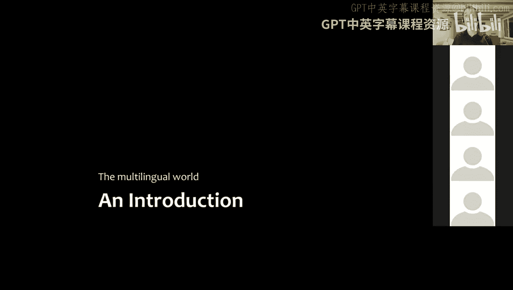
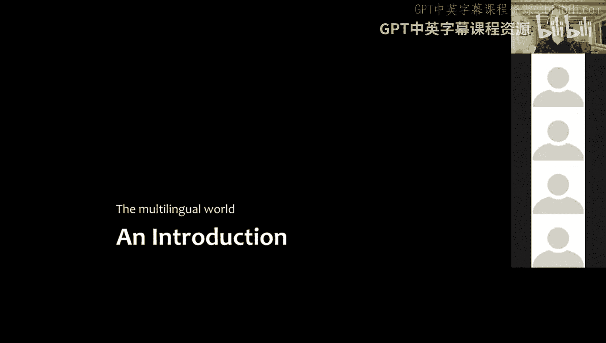
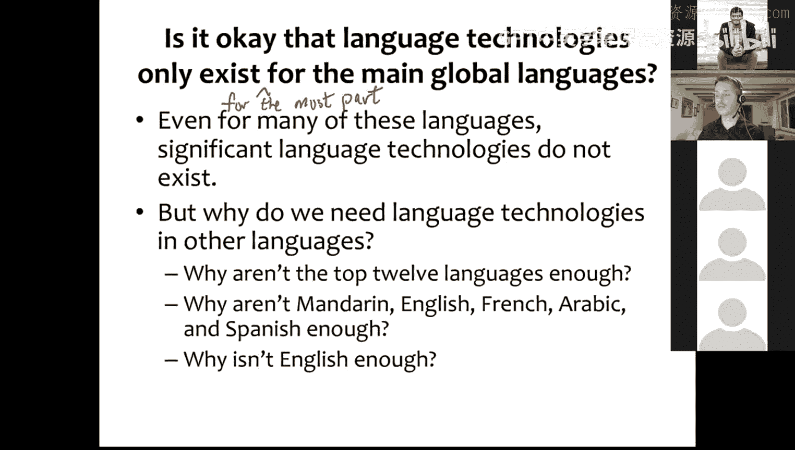
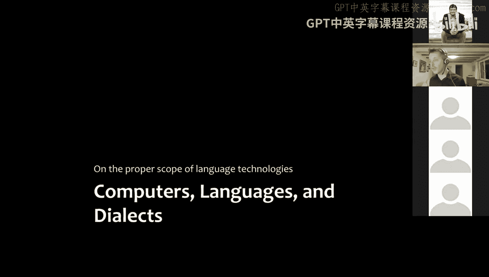
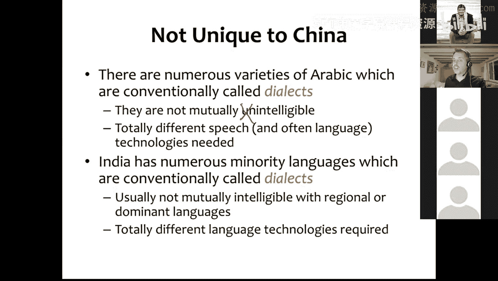
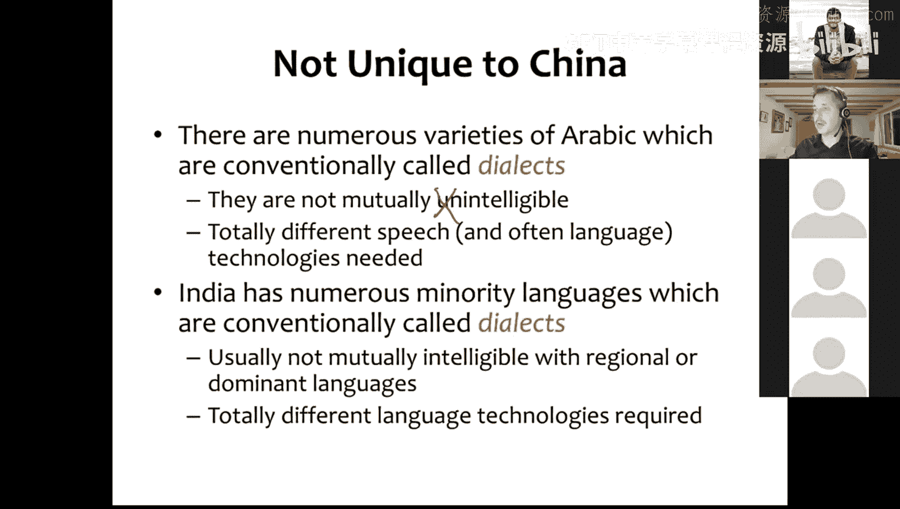
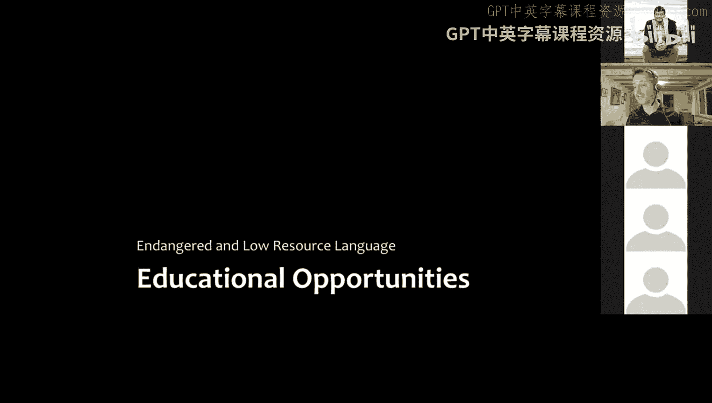
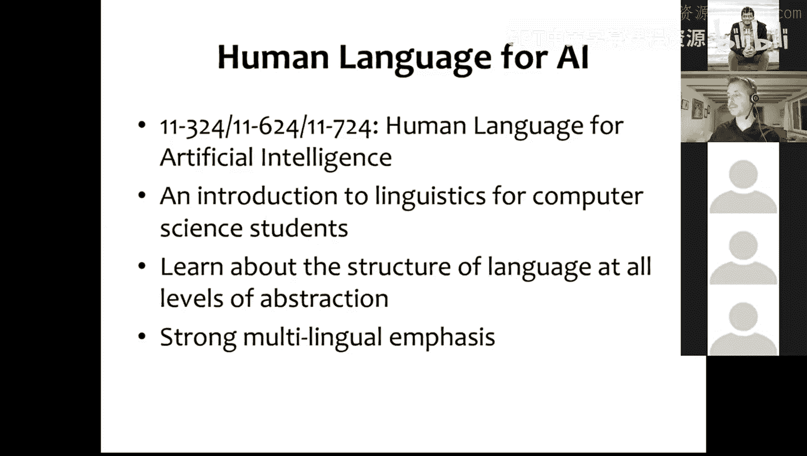
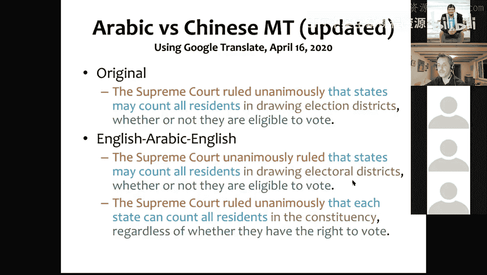
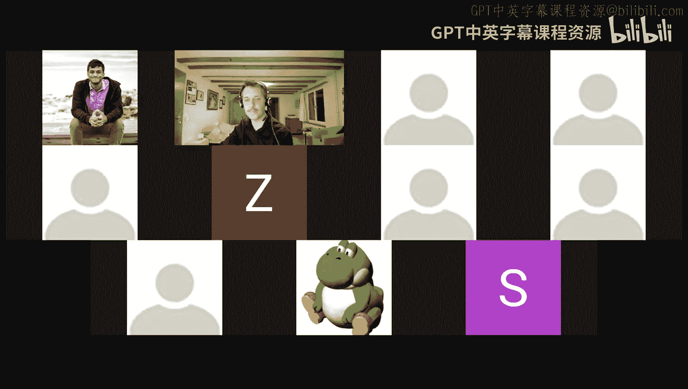

# CMU《自然语言处理｜11-411 11-611 Natural Language Processing 2020 Fall》中英字幕（Claude-4-S） p16 -16-27 - NLP for Languages Other than English.zh_en -BV1RaWpzAE7E_p16-

Questions。

So Abushek asks。How much of the multimodal guest lecture？For example。

 transformers what we have to understand for the final exam。So for。The final exam， you should know。

What。Transformers are。嗯。You should know the。Basic properties of different neural architectures。

 so you should know you should know what a CNNN is， you should know what an RNN is， an LSTM。

 you should know what a transformer is。

And this doesn't mean that you would be able to give a complete description of them。诶。

And everything about them。But you should know what these architectures are and what they're good for and some about their properties in terms of。

Where they might be used， for example。2。So does that does that address your question Abishek。

 so you do need to know the things from the multimodal guest lecture there probably will be an exam question that draws heavily on。

That lecture。So。So you will need to know that stuff。Does that answer your question？Yeah。

 so you don't need to know。You don't need to be able to draw a diagram。

Of a transformer and talk about all of the math behind it。嗯。

You should know what attention is and self attention。If you't know that。And you know the basics。

 you'll be fine。Any other questions before we get started？Okay。

 today we're going to talk about one of my favorite topics， which is multilingual NLP。

NLP for a multilingual world。So in this course， mostly we've been talking about English NLP。

 your project is on English NLP。The examples for most of the lectures were from English NLP。

And this has to do not just with the fact that we're。

Taking this class in an English speaking context and English is the common language that we all share。

But with the fact that a lot of NLP research。That's been done in English。

There are a lot of data sets， for example， that only exist in English。

 there's no equivalent data set in another language。嗯。And so。People sometimes kind of assume that。

Languages are languages and if you can do it for English。

 if you have a solution that works for English， you have a solution that works for any language。

And so you only need to worry about making sure it works for English and then the other stuff is trivial。

But it turns out to be not quite that way and that's some of what we'll talk about today。

That when you move beyond English NLP， there are some other interesting kinds of challenges and。

Also opportunities。

And so we want to talk about that。So first。I shouldn't have shown that how many how many languages are there where well according to。

This one source called enologgue， which is a catalog of languages of the world， there are over 7，400。

Is that higher or lower than you would have guessed？That is。

 would you have guessed that there are more languages than that or fewer languages than that？But。

So Abishek says depends on what consists of a dialect versus a language。

 and that's something that we're going to talk about。The dialect language distinction。

We'll find that these terms are used in different ways by different people and when linguists use them。

Then they mean one thing。And when normal people use them。

 then they mean another thing and these things do not align with one another。嗯。

We'll talk about that in a minute， Crystal says。Are we only talking about official languages？

And the answer is no， of course not， so in terms of languages that have some official status in some country。

 then it's much smaller than that， it's in the hundreds rather rather than the thousands。

So these are。How are we defining language here to get back to Abbushek's question？Well。At the log。

 when they determined what is a language， what our distinct languages。

Then they used something called lexico statisticsistics。

 so they took lists of words in each of the language varieties that they wanted to compare。

And if the number of cognates， that is the number of words that obviously have the same origin。

Between any two languages was above a certain or any two varieties， was above a certain threshold。

 then we say these are not distinct languages， these are dialects of the same language。

If it was below that threshold， then we say these are separate languages。

 these are dialects of different languages。U。😊，And。😊。

Sometimes these decisions were not made as explicitly as this。

 but this is the ideal kind of methodology。So。The crion。That is used。

The basic criterion is one of mutual intelligibility。

So if two language varieties are mutually intelligible。If speakers。

 the people who know only those varieties can talk to each other。With no prior exposure。

Then we would say that these are not separate languages， these are dialects of the same language。

So for example， American English and British English are different， in fact。

 there are many different British Englishs。😊，Different varieties of English spoken in the British house and but like。

Standard British English or received pronunciation。And American English。

 so if we have two people who've never encountered the other。And we put them in a room。

 they can talk to each other。They can carry on a conversation， so we would say that。

American English and RP。Are dialects of the same language。But。

But a speaker of English and a speaker of Dutch。U。Would not be in the same situation。

 even though Dutch and English are quite closely related。

It's still different enough that Dutch speakers and English speakers can only understand maybe5% of you know without。

Prior exposure。So we'll get back to this issue in a little bit。

 but this is an important one with regard to language technologies。Because dialects。

Require some special treatment。But when you have completely separate languages that are mutually unintelligible。

 you often have to have completely separate models， completely separate beta and so on。

So here's a map of。Languages in the world， so you can see where lots of languages are spoken。

See if this works。So each of these little green dots。It's a language。And。You'll see。

That in North America， so English is a dot。In England。Not in North America。And in North America。

 there are a lot of languages that are indigenous to North America， most of them are dying out。

 so they're very small languages。嗯。There were a lot more languages in Mesoamerica and South America。

And in Africa。There are a huge number of languages。Very high density through western Central Africa。

嗯。India has a high density of languages when compared to the Middle East and Europe and so on and Central Asia。

Southeast Asia has a lot of languages。And most the place with the highest density of languages。

 according to this epimlogue kind of definition， is New Guinea。

Which is the island north of Australia right in the center there。嗯。

Where about a quarter of the world's languages are spoken。嗯。

So there are a lot of languages in the world and a lot of languages are concentrated in places where。

The money is not concentrated。Um。So。A lot of these languages kind of get ignored。

 especially since many of them were spoken by a rather small number of people。

But some languages you may not have heard of。U。Are spoken by a very large number of people。

And most people in the world， in the history of the world。

 most people have spoken more in one language。Who here speaks two languages？Raise your hands。

At least two languages。没有。Put down your hands。Who speaks at least three languages？

Good put down your hands so so about four or five people who speaks。More than three languages。

So we' got1，1 person。 So more yeah。What languages do you speak？Yeah， I can speak English， Hindi。

 Canada and Telugu。啊哈。😊，Good。That those are all big languages。

 all of them have lots of speakers and they're all I think useful to know， right？

Especially if you're in southern India。mOr Hindi， if you're in any part of India or the Indian diaspora。

Um。So most people speak more than one language and most people in the history of the world have spoken more than one language and here's an example of a language。

Spoken a language that I worked on in the past。This is a language called Gtchi。

speakers of Gajai mostly live in a single village in northeastern India called Gajai。嗯。

In the state of Manippori or Manipur。嗯。In Urual district。And。😊。

So people who speak at Chai speak this at home， but not really outside of home or village life。

If they want to talk to people in neighboring villages。That are members of the same ethnic group。

 they speak a related language called。单孔。Um， and guitar and Donel are what are sometimes called Naga languages。

 although that's a category that doesn't make very much sense。But for historical reasons。

 they're sometimes referred to as naus。Um。But。WithinSo up to the high school level。

Then people in Aquaal district， like people in Kachii villagellage， are educated in。

Tnkquco and it's also what they speak at church。Because most of the speakers of Kijai， actually。

 I think all of the speakers of Kijai are Christians， they belong to the American Baptist。嗯。

Deenomination。For the most part。And so they have church services and these services are conducted not in Kichi but in Donl。

But they live in Manipur。And the dominant ethnic group in Manipur are called the Matees or Manipurs。

And they speak a language that is distantly related to。Don Cole and Ki Cha。called Mete。

And that is used as the official language of。Mniur state。So in official business， you know。

 at higher education， like if they went to university at University of Thematicipur。

 then instruction would be in Mayte and English。U。But。

People in Gchaya villagell are not just part of a district and part of a state。

 they're also part of India。嗯。And。Actually， a lot of them kind of wish they weren't part of India and so they had this longstand insurgency where they've tried to assert autonomy or independence and for that reason then there are a lot of Indian soldiers in that part of Manipur。

Trying to suppress this insurgency and for that reason that people come into contact with a lot of soldiers。

And they speak to these soldiers in Hindi。And that's also the connections to other parts of India。

Are maintained。In a large degree through Hindi。But。Because。

The people in Kajai villageage are American Baptists mostly。

Then they have this connection to America。And they get missionaries for America。

 they send people to get theological training in America， which is how I met。

The Kin speakers that I met。Um。And。They're also part of an international community。

And so they speak English。Or many of them speak English if they're somewhat more educated。嗯。So。

It's not uncommon。For somebody who lives in Kaicchi Village， in fact， it's the rule。

 the general case to speak all of these different languages。And use them in different contexts。

To at least be able to communicate in all of these languages。So here's the question。

 what is a global language？And I would define this as a language that you。Might learn。In school。

 like in a university， a language that you might study。嗯。Not as a special object of study。

 but as you know a general。Set of courses。嗯。So things like。Well， mostly Mandarin， English， French。

 Arabic， Spanish， Russian， Portuguese， Japanese， German， Italian， now Korean and Turkish。嗯。

We might add to this。Hindi。Since a growing number of people outside of India are studying Hindi。

Hindi， there's been less of an incentive for people outside of India to study Hindi than for people outside of China to study Chinese Mandarin。

Because of the fact that so many people in India speak English。

So you just use English if you want to go to India or communicate with people from India。But。

Hindi is another huge language。嗯。So the point of talking about all of this is to talk about language technologies。

 right？To talk about NLP。So if you want to。Have。MlP。For your language。

What are the basic things that you want， what are the technologies that you want to provide to a speaker of English？

Or speaker of Hindi， or of matete， or Tnko or even maybe of kchii。Although it's one village。

 so it's sort of hard to develop。Language technologies for a language that's spoken only one place。

By a few thousand people。嗯。What technologies would you want？

If you speak a language for which there are not really any language technologies yet。

What would you want？What NLP things？Would you want for your language？Okay。

 so Abiek says translation to or from more spoken language。

 so I think what you may be saying is speech translation。So you can do speech to speech。嗯。

Translation， what you could be saying， though， is from。

The style of language that it's more of that you want translation that works not just on formal written prose。

 but on spoken。Dialogue。Or that register that domain。Is that what you're talking about？

You went speech to speech translation。To from West spoke language， okay， you meant speech。Yeah。

 so you want speech technologies， probably so you want like ASR speech synthesis。

And you want translation， you probably want MT of some kind translation into say English or other global languages and from them。

Speech to speech translation。It would be good。Aspirational but good， what else？

What do I need to make it possible to use my。Language with a computer。Or。Smartphone。

In the way that I do with English。So you need language modeling， why do you need language modeling。

 Abshek says you need a language model。Why would you need a language model？

Im access to be able to parse the language。Well， so language model doesn't necessarily help you parse the language。

Although you may want parser as well。So language model will help you to。

Tell what a probable sequence in a language is。And this is used in a lot of language technologies。

 it enters into speech。Recognition to machine translation if you're using statistical machine translation。

嗯。It also occurs other places too。So if you are using。A smartphone。And。It does predictive。Text entry。

 predictive autocomplete basically。How does it do that？How does autocomplete work？

If you were to make autocomp。How would you make it？Yeah， so it's based on language models。

 it could be based on an N gra language model or another kind of language model。But basically you're。

Predicting the most probable word based on or the most probable n words。🤢，Based Kword based on the。

Proreceeding words。So you need a language model。To do that。So what else would you want？

What are basic things you would want？Just to use your language。In a computer。Okay。

 this is a great one， Alex campus says。A good accessible input method like speech to text。

 keyboard appropriate to the language， that's a very important one that people sometimes forget about。

The Valal says spell check。And that's。It's another important one。

 like if people are going to produce documents。And the language and they're going to be consistent in their orthography。

 then you want spell checking。嗯。Maybe grammar checking too。To some degree。What else。

 keep them coming？So it helps to have a large corpus， Alex says， and this is true。

But the corpus is not the technology， the corpus is the prerequisite。To the technology。

 and that's often one of the things that is a limitation。

A limiting factor for developing language technologies for smaller languages is that it's hard to collect。

Enough data to train a good language model or to do other things。And so。

you have to invest a lot in data in order to get things working。

So here let's let's look at some things so we need keyboard input which we mentioned autocomplete。

 which we talked about spell check， which we talked about speech recognition and speech synthesiss。

We didn't talk about information retrieval and search engines and morphology that you need to be able to do IR information retrieval。

But that's important too。Grammar check。Translation， maybe question answering， which goes。

With information retrieval in a lot of cases。嗯。So these are the things that people use these sorts of things every day。

 right？Well， underlying these， there are a number of other things that you need to develop for language in order to get everything to work。

Language detection is very important。嗯。Because you if you're putting together collections of data。

 for example。Then you want to know which data is in the language of interest and which it's not。

So it's very important。Part of speech tagging， something that we've worked on a little bit in this class。

Psing。U nowadays， this especially means dependency parsing。

 meaning you may want to produce a dependency tree bank。Seman role labeling， perhaps。

Named entity recognition， so this is something I worked on a lot it's named entity recognition for low resource languages。

 I mean languages for which there are not a lot of data resources。

So this is useful NR is useful for a lot of things， although nobody。😊。

Like ghost and downloads the latest NER app onto their iPhone。It's like something that's user facing。

 but it underlies a lot of other stuff。Summarization。Translation again。And then information。

 extraction and question answering。You know these are all things that companies， governments。

 researchers use to build。This stuff on the first page。But in order to get everything to work。

 there's a lot of infrastructure that you have to have in place。And。😊，For a long time。

 one of the most annoying things about。Creating language technologies for a new language was character encod。

Because。If you're old， you'll remember a time when every language had its own character en codingd。

Because you could only encode 128 or 256 characters in a set depending on whether you had。

Eight better 16 bit characters。And。😊，嗯。So you had to s and so there wasn't room for every writing system in the world or it may just barely be room for your writing system。

Um， so you had a different encoding for every language and different fonts to go with that encoding and crappy rendering of the fonts。

And life was terrible life really was awful， I spent much too much of my time trying to convert data between different encodings of Chinese like big five and GBb or different encodings of Vietnamese。

You know it was。A li。And then。Unicode came along。And uncode solved a lot of these issues。

 so now people when when there's a language that isn't well represented yet in uncode there's a systematic。

诶。Process by which they can be added and so Unicode now covers。Most of the scripts of the world。

So you can write most almost all of the living scripts in the world， you can write using Unicode。

Which is a great accomplishment and something you should all be grateful for。嗯。

Abushek asks the question that is very important， which is what if a language doesn't have a script？

And some languages don't have their own script。ButSome languages don't have a writing system at all using any script。

And one thing that Alan has worked on。Is developing language technologies for languages without scripts。

U。That are purely speech based。And so you can talk to him about that。

 he would love to talk to you about that。U。But basically you can， there are things that you can do。

With representations， textual representations that are not scripts。And we can have like sort of。

Phone level， phoneme level representations。U。And so it's possible， but it's actually much easier。

To make a script， to develop a script， which is also something I've worked on before。Um。Rather than。

Then just trying to work without one。And most like when you come up with a new writing system。Today。

 most times you will use。Either a Roman or a Cyyrillic writing system。

Or a writing system of a large neighboring language。If if it's compatible enough to work。So you need。

A way of representing it probably in Unicode。You need fonts。And front rendering technologies。

And then you need， as we mentioned earlier， input methods。嗯。If you only speak English。

 then you don't understand how important this is。But。We need you need a way of inputting the。

The language， text or whatever in the language， whether through a keyboard or through speech or through some other means。

And。Another thing that's really important that people sometimes don't think about。

She need a standard orthography。It's a standard spelling， basically standard writing system。

So it's part of a DARPA project that I worked on at one point。

We were developing NER and some information extraction and machine translation。

For a language called Ormo， that's the largest language in Ethiopia。But。

It's not the official language of Ethiopia and there was not an official orthography or writing system for this language until the 2000s there was an unofficial orthography that had existed since。

The 1970s， I think。But it was not standardized。And so。People。

Didn't agree on when to write double vowels and when to write double constants。

You know which words to write those in， people just wrote it as they heard it and there was dialect dialectical variation。

So。There's a lot of variation in spelling that made think so hard。Because， well。

 why would that make things hard？Why would having no standard orthography make delined technologies a challenge？

So Abishek says， you might not be able to identify different instances of the same word if the spellings differ。

Yeah， so imagine you're building a language model。An Ngram language model。嗯。Then。You have。Everything。

Getits。Thrown off。Because so the instances of what are really the same word are written differently。

So you miss like。You have under generalization。And it leads can lead to kind of sparsity。

Not just for language modeling， but for other kinds of tasks。Because sometimes a word will。

 a spelling will occur very rarely。嗯。And so it looks like there are a lot of different words。

 but actually they're just a few words and they're just spelled lots of different ways。So it。

So Zachary。Says it's harder to store the words。And that's true in a sense as well in that。

Your representations are sparse。嗯。And Alex says two completely different words have the same semantic meaning。

U。Right so。So you're missing the generalization that those words mean the same thing。

Because they were not spelled the same。And it's just this surface noise。

 it just injects noise into any model that you train。So。Standardize your orthography。

 like get some people on the ground who will teach people to spell and it will make developing language technologies much easier。

And then the hard part， the hardest part， maybe is getting enough text or speech to train models。

Which depending on what kind of models you're trying to train， can be a lot of data。

So here are some languages， these are actually the top 20 languages in the world in terms of number of native speakers。

嗯。Ordered from biggest to smallest。And。I want you to tell me which of these you think are likely to have most of these language technologies that we've listed off above。

Which should I tick off？So Abishek says the UN languages。

 I don't know which languages are the UN languages， so you have to be more。嗯。Specific than that。Okay。

 so among these are English。As Abshek says， English。French。Russian。It's pretty good。 yeah， Spanish。

Mandander Chinese。An Arabic。Any others？Do you think are likely to have lots of these technologies？

So probably Hindi， so Korean。So you think Hindi？And Korean。Anybody else have any that they think？

So German。Wite， German。Chairman。And Japanese。Whyite German？So Germany has， as Alex says， a high GDP。

 lots of resources。It's also one of the main languages in the EU。

So any of the EU languages actually because of。Subsidies from the European Union has higher language development than you might expect from the number of speakers。

There's a lot of investment of resources in developing these technologies。嗯。Any others？So Portuguese。

 white Portuguese。So it's in the EU， Portugal is in the EU。嗯。Brazil is a huge country。

There are also other countries where people speak Portuguese like Angola and Mozambique。

Although that's probably not the reason that they have。

Pretty good language that they might have good language technologies。

But the EU thing is a big part of it and Portugal and Brazil being。A large population country。嗯。

That is middle income now。嗯。S， contributed。So let's look at。嗯。Kind of。Assessment。

 you know of how much。In the way of language technologies， each of these languages has。

And you'll see that we are basically right。U。诶。Poruguese， for example。

 has a fair degree of development， though less than Spanish。嗯。Russian and Japanese。

And French and Korean， and to somewhat lesser extent extent German。

 I'll have good language technologies。But why？Well。So you'll note something interesting。

About some of the top languages。That don't have。L in the way of language technologies。

 what do Bengali， Punjabi， Telugu Muati and Tamil all have in common？

So Abushek says any other Indian language is overshadowed by Hindi as a common language that's more likely to be invested in。

And this is no doubt true that a lot more investment in technology for Hindi happens。

 stuff gets pllowed into Hindi rather than into these other languages。

Even though they have millions and millions of speakers， you know， Bennggai is according in terms of。

Native speakers is the seventh largest language in the world。嗯。😊。

But it has very poor language technologies， I've worked a little bit on Bengali NLP and there's a lot of text data。

But there's not a lot beyond that of work。So。One other factor beyond Hindi。

So there's the Hindi factor。But there's also the English factor。When。

Middle class people in India use computers。How often do they use？Theyre native language。

how often do they use English？You who are from India offer your。嗯。Your experience。

So Mariaia says almost always English。so。嗯。Some Andrew ID says。

 is it because the majority of higher education institutions that teach things like NLP are taught in English medium？

And I think that's maybe part of it。But I think a large part is that educated Indians。

A used to using technology in English and taking advantage of all of the existing English technology that exists。

Existing that exists anyway。That has been developed。And。When and。

Even when language technologies are developed in India。

Then often they're for English because that's where the market is perceived to be。嗯。Now。

Is it true that most people in India want to speak English all the time and want to use computers in English only？

嗯。I think probably not based on my。My informal survey。U。

But educated people are used to using English。And it's easier， you。

 you don't have to have complicated input methods。嗯。Yeah。

 so Abuek says another thing that could matter is that a lot of Indian languages with the internet are sometimes used with Romanizations instead of their standard written syllabberries。

 I'm not sure how much that affects things。😊，You know。

The the big issue is it's hard for people to type defenoery or the other。Indian Orthgraphies。

You have to have special input methods and they're hard to get used to you can't usually buy keyboards easily on commodity laptops or。

Desktops that support。That are made especially for those orthgraphies and people might not want them anyway because they also want to be able to use English so it's like an obstacle so people to get around this have developed Romanizations for the different orgraphies。

Ways of typing the languages in English characters in Roman characters。But this is not a problem。

 actually this is， you know。This is fine。And could be the basis of good NLP as long as people。

Adhere to standardized conventions。Because you could even automatically convert back and forth between the orthography。

 the standard。Orthography and the Romanization。The problem is lack of standardization。

And agreed to upon conventions but。嗯。But I think that as。Technologies。

Particularly things like speech， which are relevant for people who are not necessarily literate are not highly literate。

You know， as these become more pervasive。With the spread of low cost smartphones and things like this。

Then the attractiveness， then the market for。Language technologies in a lot of these other languages will really expand。

And people will get used to using technology in languages other than English or one of these big global languages。

So is it okay， the language technologies only exist for the most part， for the main global languages？

This should say exist。What do you think？So even for a lot of these languages。

 there are significant language technologies that do not exist。

But why do we need language technologies for other languages。

 why aren't just the top 12 languages good enough？Wren't Mand in English， French， Arabic。

 and Spanish enough。Why isn't English enough？Can't everybody just use language technologiesologies in English？

What do you think？Should we worry about this issue？

So one thing is there's social and cultural reasons， as Abbishik says。

Wanting to prevent the extinction of many languages and a lack of language technologies helps extinction along because of lack of convenience and use in daily life。

And not everyone is covered by the top 12 languages， especially in less developed regions。

So there are actually two arguments here。That can be made。

 one is a moral argument that we want everybody to have access to language technologies。And one is。

Cultural argument that we want to preserve languages and cultures and。

Giving them language technologies is one way of promoting them and helping them to be relevant to their users so they will stick around and not co extinct。

So I think those are both good arguments。Another argument is the economic one。

Which is that even if you reach the people。For these top。

12 languages or so there's still a huge number of people in the world who don't speak those languages as their first language。

And this is a potential market。So as technology is hardware as hardware becomes less expensive and data。

Connectivity becomes less expensive than it becomes the opportunities for。嗯。Sending。

 you know like data to sending or selling language technologies to people who speak these languages becomes greater。

So Valal says language tech in less popular language is also useful for things like identifying misinformation。

 finding planned crime， and so on。I think that this is definitely so and I think that governments are also interested often in language technologies for low resource languages in fact this is true of the US government。

 which is why they paid me and alllan to。Various times work on low resource languages。

To gather intelligence and。Be able to communicate with people。

In areas where they speak primarily these lower resource languages being able to gather information and process that information and build models of what's going on in the world。

U。So there are actually a lot of reasons for wanting。

Language technologies for low research languages。

Yeah。So we talked a little bit about dialects and languages。In China。

There are a very large number of language varieties， language variants。

 so people speak Chinese in widely divergent ways。These includes standard Mandarin， Ptonghua。

Other varieties of Mandarin？Sanghaese and other Wu varieties， Cantonese and other yue varieties。

 Hakiese and other min varieties， and then other groups of varieties like Jin G and Xianang。🤢。

So if you ask a Chinese layperson or linguist about these varieties。

 they will refer to them as Fangian。And Fangyan is conventionally translated into English as dialect。

But it means something drastically different than the English term dialect is used by linguists。

For linguists， a dialect is a language variety that belongs to a set of mutually intelligible varieties just like。

American English and RP English from Britain are mutually intelligible。

 therefore they belong to a set。Of mutual， intelligible varieties that we call a language that we call English。

So Chinese Phangyanians are written with the same script。

And they are descended from a common ancestor， but they are often not mutually intelligible。

For English speaking linguists。The best translation of Fangyan is probably。What what do you think？

Language。Why。So these varieties like Mandarin and Cantonese or Shanghaese or you know they're not necessarily mutually intelligible。

 they have different phonology， that is their sound systems are different。

 they have different morphos syntax。They have different lexicon， different lexxiical semantics。

And in some cases， in many cases， it's not even really possible to use the same language technologies for all of these language variants。

But people use them all the time every day in their day to day lives in their families。

 in their homes， in their cities。And this is true despite efforts by the Chinese state to promote Phuolhua。

So it looks like people are just going to continue using these languages for the foreseeable future。

And so for speech in particular。There's value to being able to target different Fangyan。

 different of these Chinese languages。Separately。But this is not a problem that is unique to China terminologically。

So for example， there are a lot of different varieties of Arabic of what people call Arabic。

 which people conventionally call dialects， so people will talk about Lebanese Arabic。

 or Mrebi Arabic or Iraqi Arabic。Or gopharaic。嗯。These varieties are not mutually intelligible。

I should say。嗯。And。They require completely different speech and often language technologies。

 although people when they write often will write in modern standard Arabic。

 but then they speak in one of these。Non standard dialects。These other languages。

 so India also has numerous minority languages which are conventionally called dialects。😊，And。U。

I they're usually not mutually intelligible with regional or dominant languages。

 sometimes they're not even related。To a regional language they just a completely different language。

 but because they're not an official language， people call them a dialect。

These require completely different language technologies。

So the point here is that just because people call something in dialect doesn't mean it's not worthy of language technologies。

 it doesn't mean that it's not the really language in the sense that linguists use the term。

Any questions about that？Did I offend anyone？Good I don't like to offend people。

Some people feel very strongly about。嗯。Cantonese and Shanghaese being dialects。Instead of languages。

So let's say you're interested。嗯。Yeah。Oh， Abushek has a great question。嗯。It's made。

Take us mostly to the end of the class， how can we use language technologies in one language to develop language technologies in another language？

EG dependency parsing between languages that diverged recently。

So this is an active area of research called cross lingual transfer。And。The basic idea。

 there are different things that you can do。Dending on how different two languages are or how many languages you're concerned with。

诶。But you， let's say you have a higher resource language， let's say， Turkish。

And you have a lower resource language， let's say， Uygur。

And Turkish and order are quite closely related， they diverged。Less than  a thousand0 years ago。

 but they're still fairly similar to each other。So we want to do dependency parsing。嗯。For Ugur。And。

But we have a bunch of Turkish data。Or let's say named entity recognition。

 since this is something I actually did。嗯。So。They're written with different scripts。

 but structurally they're the same and they sound a lot the same。

So one thing that you can do is you can convert both of the orthgraphies into。Penetic transcriptions。

 basically。And then it pushes everything closer together， and then you can train a model。

That can match。In some approximate way， things that are phonetically similar。

And you can train a model on Turkish。And then tune that model on lawyerer。

And you can get reasonably good performance much better than you could if you just。

Had access to a little bit of uighghur training data。嗯。You can tune a Turkish model and get。

Much better。Performance then the monolingual kind of model so this kind of cross legal transfer is an important thing and dependency parsing is an area where this has been used a lot。

 So there's a lot of research on。

On what makes a good transfer language for dependency parsing and what kinds of models transfer well。

And what transfers， does it transfer lexical information or does it transfer syntactic information？

And I can't cover all of that here， but that's something， but if you go to anthology ACL anthology。

 which is Association for Computal linguistics and is there repository of conference papers basically and search for crosslingual transfer and you'll find very many papers about this。

Including some by people here at CMU and a lot by people elsewhere。

That's kind of a cop out answer to the question that I don't have slides prepared to address。

But does that？Answer your question， I'll Abbishop。嗯。So。Just。Before we close。

 I'd like to talk a little bit about some opportunities。

 educational opportunities available to students who are interested in endangered and low resource languages。

And one of these is directed research。So we know a number of people and organizations who are interested in。

Developing these kinds of language technologies for low resource languages。

And if you're interested in working in this area。Then we have a couple of things going on something in particular where I might be able to take。

Some undergrads。U。Working on some languages of Mexico。Mist Tech and We Tech and Nahua。

If you're interested in this sort of thing， it would be dealing with morphology and ASR。

 then let me know and I'll see if we could fit you in。嗯。

Alan often has opportunities like this available as well， so let us know。

It's also an endangered languages seminar that's taught in the LTI。It's taught typically in the fall。

So it was being taught right now， it'll be taught again next fall。

 but if you're still going to be around， it might be something you might be interested in。

In the seminar， students learn about。What language endangerment is。

 they learn about how languages get documented and revitalized and how speech and language technologies can help。

Also if you're interested in learning more about。Languages generally in a way that relates to。

Han language technologies， then a course that I teach with Lori Levin in the fall is called Human Language for Artificial intelligencetel。

 this is an introduction to linguistics for computer science students。

And you learn about the structure of language at all levels of abstraction。

 and it has a strong multilingual emphasis， so you learn not about English， you learn about language。

 you know and you see examples from a lot of different languages。

Any questions about that？About these opportunities。

Okay。Let's talk really quick about。Humans versus machine learning。So humans are great。😊。

They can understand the structure of language differences between languages。

 they can write really nice precise rules。But they have some disadvantages as well， for example。

 they're slow。And they're fragile， they build systems that are fragile that don't fail gracefully。

Because they have trouble managing statistical things。

 they attempt to do things that are more categorical or symbolic。

So humans also have to know the languages that they're working on if they're building NLP models。And。

It might be hard to find humans who both know the language and know NLP。And this。

 in fact takes a lot of special talents， it's hard to find people who combine these two things。

And can do it well。So humans。Have one pro， but they have a lot of cons and machine learning。

It's also great。Nobody needs to know the language。The techniques are language independent。

 you don't need specially trained human linguists， it's fast once you tap the data you just fire up your model and it's robust。

 you gracefully handle unseen data。But it has its downsides as well。

 makes strange mistakes that a human wouldn't make， and it requires a lot of data。

Not all languages have enough data。But that's okay。

 we can get funding for low resource NLP and do crosslingual transfer and have stuff to write papers about。

Well。Here's the promise versus the reality the machine learning promise is that nobody needs to know the language。

 the techniques or language independent。It's fast， it's robust。

 the reality is the techniques do not work equally well for all languages and nobody knows why because they don't deploy specially trained humans。

😊，Um，It takes kind of a linguist working with a computer scientist to figure out why the models don't work equally well for all languages。

The first versions can count up quickly， so they are fast。But it's taken。

P and centuries and hundreds of millions of dollars to refine NOP systems to the current level of performance in Arabic in English。

 Chinese and Arabic。And they're chronically unable to handle some basic linguistic constructions resulting in wrong meanings。

 So there's there's some things that。The machine learning models just have a hard time getting right。

That a human would never get wrong。And。Here is an example of what happens when you take Google Translate。

You give it an English original sentence。Translated into Arabic。

And then back to English or into Chinese back to English。

And one thing that you'll note is that Arabic。English translation。

Our English Arabic translation consistently gets higher blue scores than English Chinese translation。

That is， you know， English Arabic translation appears to be better。In general。

But this gives us some idea of the quality of these translations。

This was from this particular set is from April 4， 2016。And you note that。Chinese。

Gets things pretty wrong。嗯。The Arabic is not quite right， but the Chinese is somewhat worse。Oh。

 the Arabic is actually terrible as well。But what's happened and this is from 2017。嗯。

Chinese actually got a little bit worse。But Arabic got better。Yes。But as time has gone on。

They've kind of converged。And。Oh。Although the Chinese is still worse than the Arabic。

It's much better than it used to be。And the big jump occurred when Google Trans shifted to neural machine translation。

 for statistical machine translation for these language pairs。

So the fluency and everything really improved。Um。The quality of the translation。

But the point of all of this is that。Machine learning algorithms like those that are responsible for Google Translate are not language independent。

They actually are influenced by aspects of linguistic structure that may not be obvious to the people who are building the technologies。

So it's nice to talk to somebody who knows about the structure of the languages when you encounter this kind of challenge。

who can compare them and talk about why it might be that they that you're making certain kinds of errors and see if there are ways that data can be augmented or。

The parameters can be tweaked so that those errors don't happen as much。Anyway。

 we're now out of time， so we will stop there， which is roughly where I wanted to stop anyway。

If you have any questions that have not answered during this lecture please feel free to post them to piazza and good luck with your projects I hope that is going well we look forward to seeing your the。

嗯。Questions and answers that you generate。And。嗯。Wish you all the best。Take care。And I will。

I guess I won't see you again。In this form。But it's been wonderful having you in this class and。

I hope to encounter you again soon。Hey， I have a general question sure。

Is there final in addition to midterm two or is adjustment no that the midterm two is the final。

 but it's it's really okay midterm two because it's not comprehensive。So just it's just midterm too。

Okay， thank you。No problem。

Okay， goodbye。拜。

