# CMU《自然语言处理｜11-411 11-611 自然语言处理 2020 秋季》中英字幕（Claude-4-S） p16 -16-27 - 非英语语言的自然语言处理.zh_en -BV1RaWpzAE7E_p16-

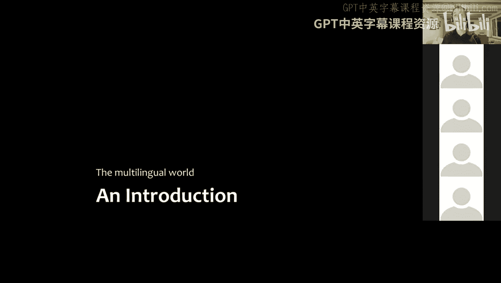

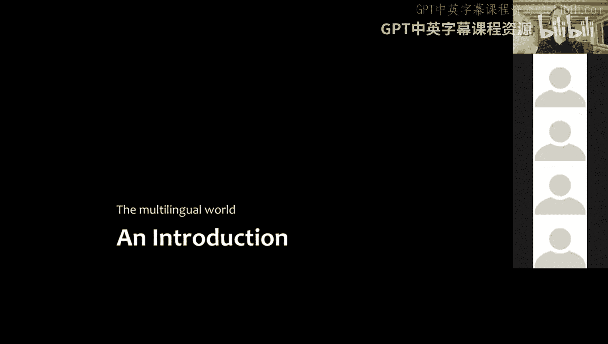

## 问题

**Abushek 询问**： 多模态讲座有多少内容？例如，transformers 我们需要理解哪些内容才能通过期末考试？所以对于期末考试，你应该知道。

**回答**： 你应该知道什么是 transformers。你应该知道不同神经架构的基本属性。你应该知道 CNN、RNN、LSTM 和 transformers 是什么。这并不意味着你能够完整地描述它们，但你应该知道这些架构是什么，它们有什么优点，以及它们可能在哪些方面使用。

## 多语言 NLP

**概述**： 在本节课中，我们将讨论多语言自然语言处理（NLP），特别是针对非英语语言。

**以下是本节课的主要内容**：

### 1. 语言和方言的区别

*   **定义**： 语言和方言的区别在于它们之间的相互可理解性。如果两种语言变体之间的人们可以相互理解，那么它们是同一种语言的方言；否则，它们是不同的语言。
*   **例子**： 美国英语和英国英语是同一种语言的方言，而英语和荷兰语是不同的语言。

### 2. 全球语言

*   **定义**： 全球语言是指在学校学习或作为一般课程学习的语言，例如普通话、英语、法语、阿拉伯语、西班牙语、俄语、葡萄牙语、日语、德语、意大利语、韩语和土耳其语。
*   **例子**： 普通话、英语、法语、阿拉伯语、西班牙语、俄语、葡萄牙语、日语、德语、意大利语、韩语和土耳其语。

### 3. 语言技术

*   **定义**： 语言技术是指用于处理和生成语言的技术，例如语音识别、语音合成、机器翻译、语言模型、拼写检查、语法检查、信息检索、搜索引擎、形态学、语义角色标注、命名实体识别、摘要、翻译、问答和信息提取。
*   **例子**： 语音识别、语音合成、机器翻译、语言模型、拼写检查、语法检查、信息检索、搜索引擎、形态学、语义角色标注、命名实体识别、摘要、翻译、问答和信息提取。

### 4. 低资源语言

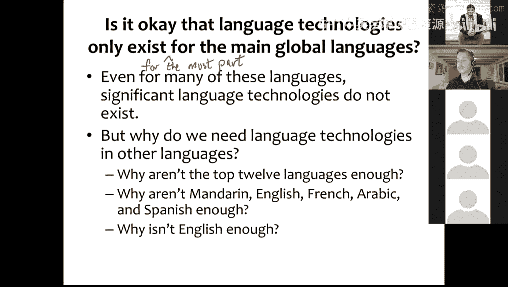

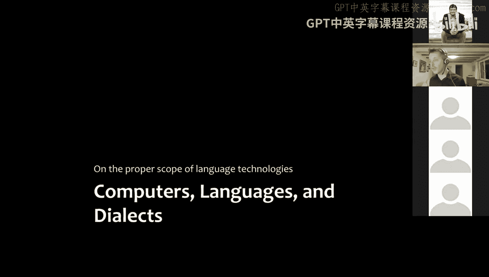

*   **定义**： 低资源语言是指没有足够数据或资源的语言，这使得开发语言技术变得困难。
*   **例子**： 孟加拉语、旁遮普语、泰卢固语、马拉地语和泰米尔语。

### 5. 跨语言迁移

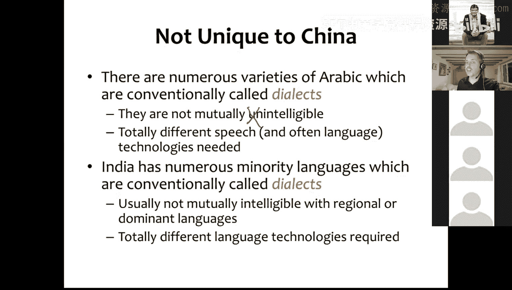

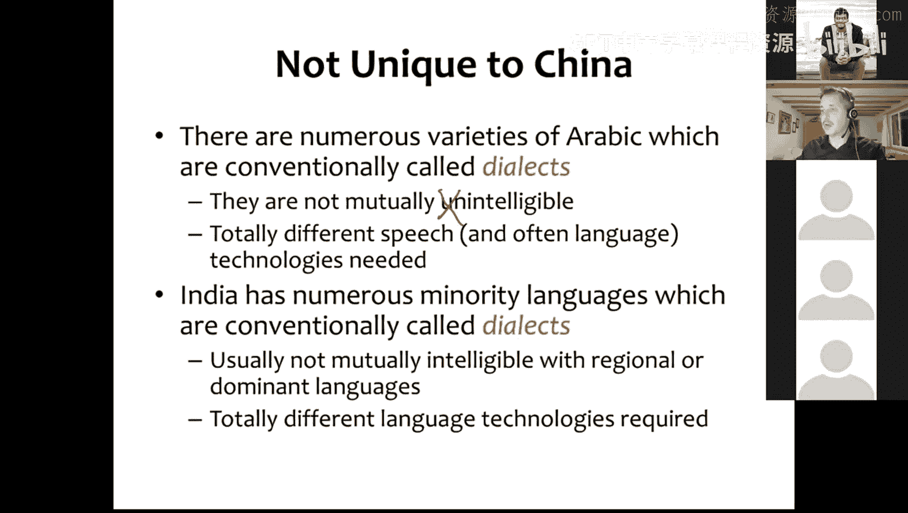

*   **定义**： 跨语言迁移是指利用一种语言的技术来开发另一种语言的技术。
*   **例子**： 使用土耳其语数据来训练乌孜别克语的依存句法分析模型。

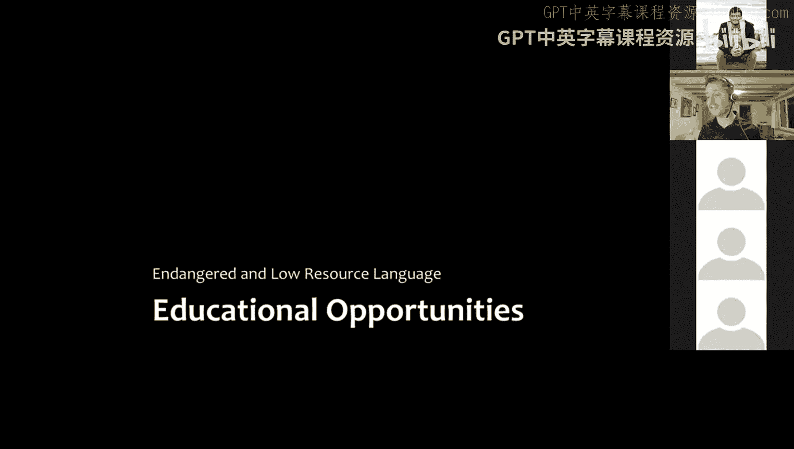

### 6. 人类与机器学习

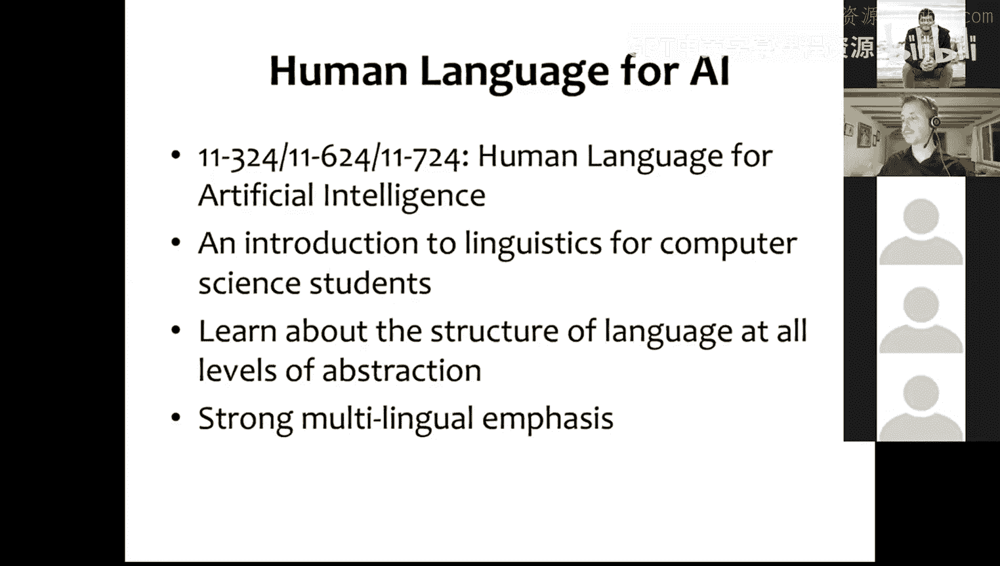

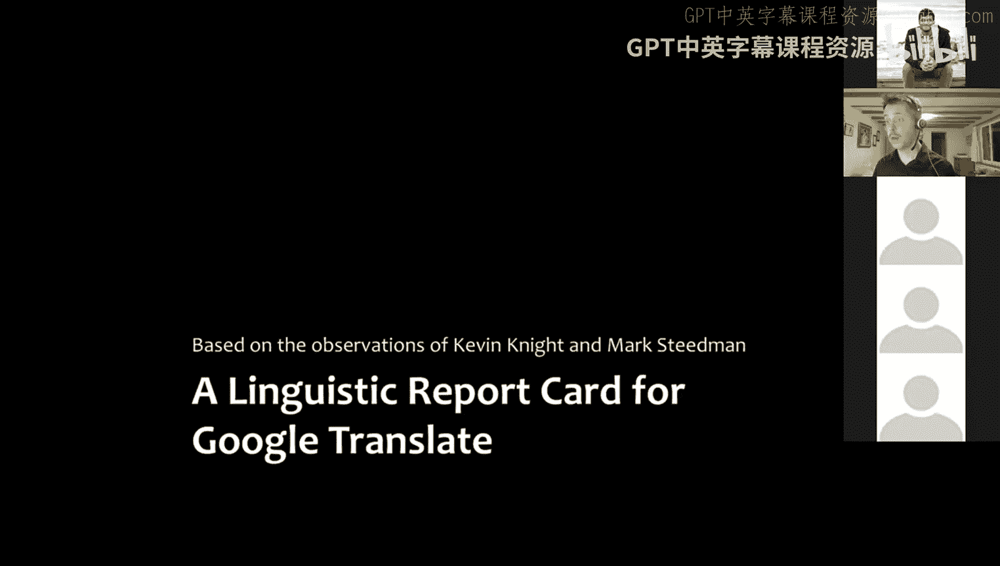

*   **人类**： 人类可以理解语言的差异，编写精确的规则，但速度慢且脆弱。
*   **机器学习**： 机器学习不需要了解语言，技术独立于语言，速度快且鲁棒，但可能做出奇怪的错误，并且需要大量数据。

## 总结

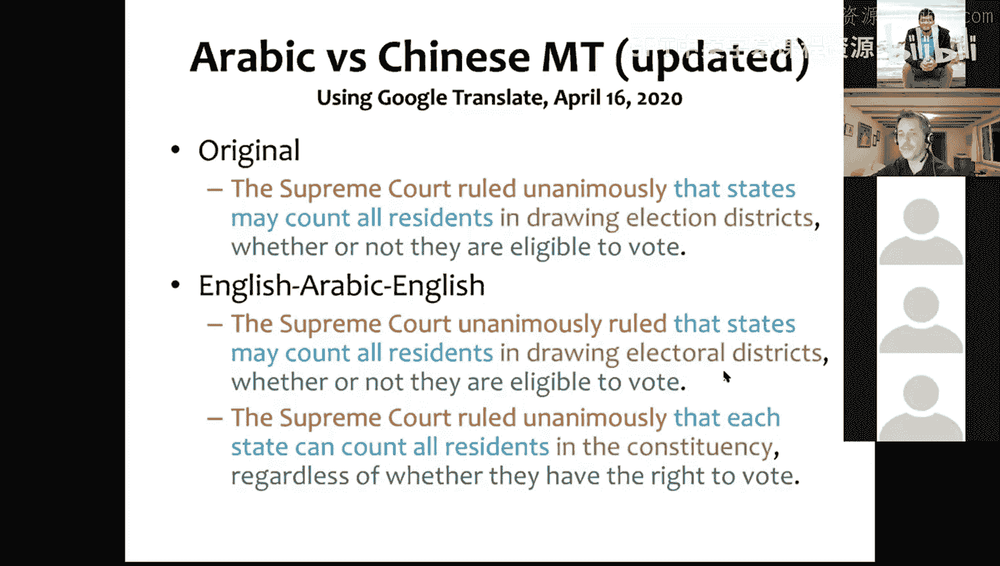

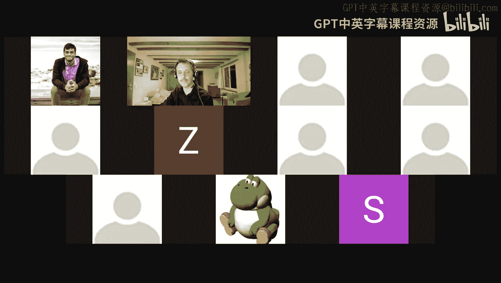

本节课介绍了多语言 NLP 的基本概念，包括语言和方言的区别、全球语言、语言技术、低资源语言、跨语言迁移和人类与机器学习。希望这节课能够帮助你更好地理解多语言 NLP。