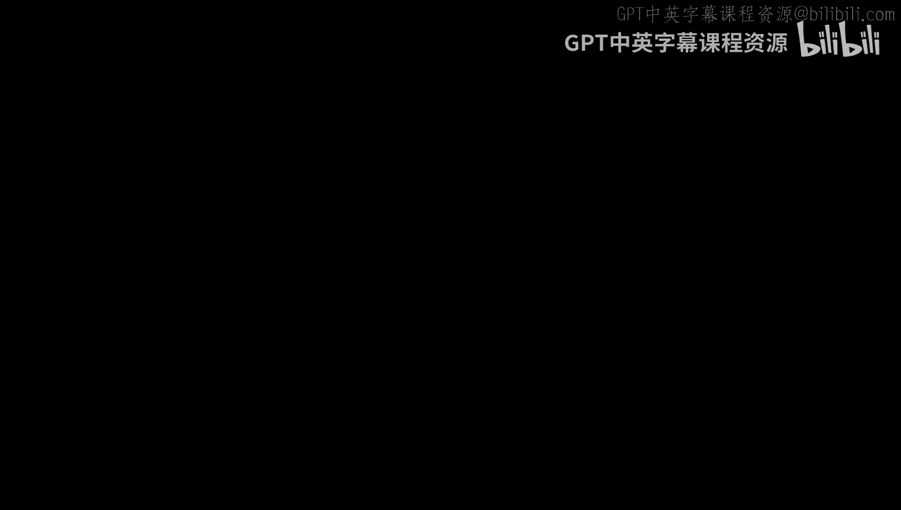
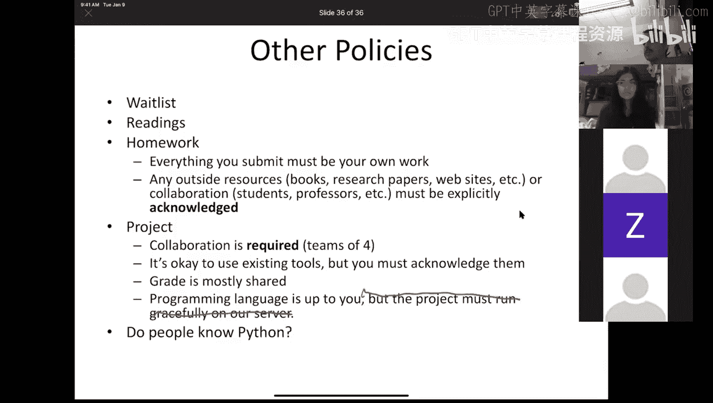
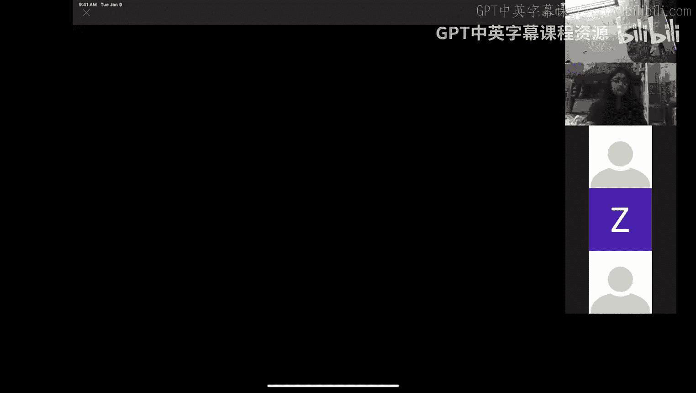
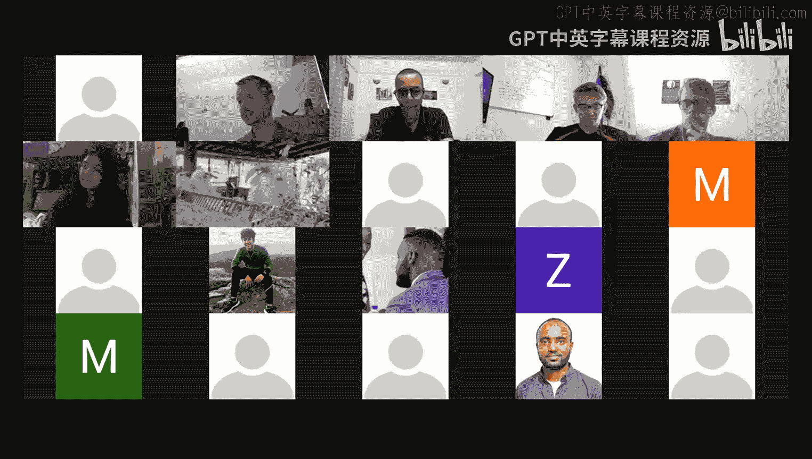
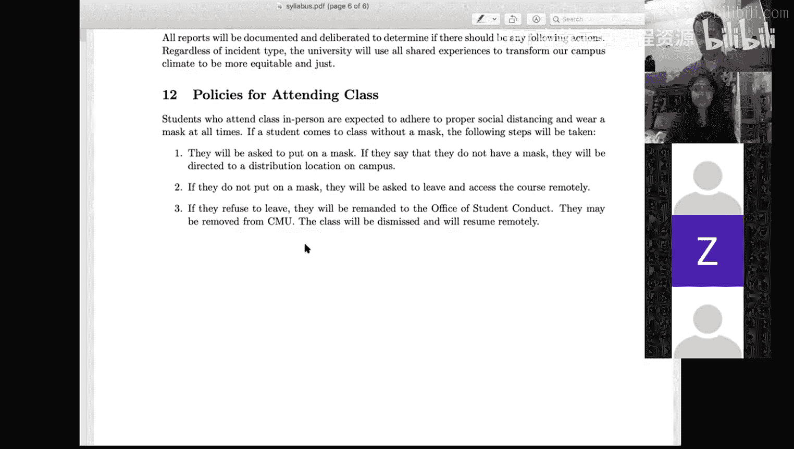

# 01：简介

欢迎各位来到自然语言处理课程。

我是David Mortonson，是这门课程的一名讲师。

另一位讲师是Alan Black，他现在将自我介绍。大家好。

我是Alan Black，长着长胡子的人，我将教授一些课程和讲座。

但David将教授前几讲。是的，所以你们可以很容易地区分我们。

长胡子，小胡子。嗯。呃。我的胡子没有这么明显，也没有这么持久，我认为。

但我不会像Gall或Dumbledo或其他虚构人物那样看起来。但是。

我对自然语言处理充满热情，并期待向大家介绍这门学科的基石。

所以在本节课中，我们将部分介绍自然语言处理是什么，以及在本课程中我们将讨论哪些内容。

然后我们还将简要介绍课程大纲和课程的实际要求，并给你一个机会提问关于这些内容，以及。

更舒适地了解你在本课程中的评估方式。那么什么是NLP。

你一定对NLP有所了解，否则你不会报名参加这门课程。

但这就是我们所说的NLP。自动化对自然语言的分析、生成和获取。

也就是说，自然语言。这里有三个部分。

分析，这是NLP的理解或处理部分，生成。

这是在给出某种表示其含义或做什么的表示的情况下制作自然语言。

然后是获取。现在，有些人。

使用NLP来表示所有语言技术。

他们使用NLP来表示这三件事。

有些人只将其用于指代分析。

令人困惑的是，有些人以排除语音技术的方式使用NLP。

他们认为语言只是书面语言，而语音是不同的语音技术。

但我们将在本课程中采取包容性方法。

因此，对我们来说，NLP将指代这三个类别：分析、生成和获取。

以及语音，除了书面语言之外，我们还将包括所有这些内容。

雄心勃勃地说，是的，但这对我们来说是有意义的。

那么NLP为什么重要呢？

为什么你想学习NLP呢？好吧，一个原因是网络搜索。

所以有一家名为Alphabet的大型公司。

你们很多人都很熟悉。

它拥有谷歌和其他一些公司。

他们选择Alphabet这个名字。

在一定程度上。

是因为NLP是他们工作的核心。我们喜欢Alphabet这个名字，拉里·佩奇说。

因为它意味着代表语言的字母集合。

人类最重要的创新之一，也是我们用谷歌搜索索引的核心。

不仅仅是谷歌认为NLP很重要。

许多大公司和中小企业都在雇佣NLP团队，并支付他们大量金钱来完成各种自然语言处理任务。

所以所有大科技公司都有一些NLP人员。

人们，嗯。

我不应该说所有大互联网导向的科技公司都在做一些NLP。

所以了解它是有价值的，即使你不想在NLP领域找工作。

我们建议你这样做，了解它是什么，这样你就可以与从事NLP的人互动，并了解它带来的问题和好处。

那么为什么NLP，你可以用NLP做什么？😡，有什么想法，有哪些需要或涉及NLP的任务？

NLP的一些实际应用。

所以我们在聊天中看到了一些东西，让我们看看。所以自动小说生成，对吧。

文本生成虚构或创意文本。机器翻译。Alexa。

所以个人数字助理。或者Siri。和谷歌Home，这些都严重依赖于NLP。

并且正如本课程所定义的，NLP广泛。

所以它们包括语音，但也包括文本处理。

所以信息提取，有人说这也很重要。

我非常感兴趣的事情。然后还有聊天机器人和其他类型的对话系统。

情感分析，什么是情感分析？有人能告诉我们情感分析是什么吗？

也许。M whole Agraal。是的，所以我想在非常通俗的语言中，情感分析是查看一段文本并确定其背后的情感。

是否是带有愤怒意图的，是否是善良的，诸如此类的东西。

是的，是的。这就是情感分析，所以我们还有问答、摘要。

管理消息是一个重要的应用，比如文本消息、电子邮件消息、电话消息。嗯。

理解搜索查询。非常重要。翻译书籍。

像自动纠正和自动完成这样的东西，有时你不会想到。

但这也是自然语言处理的应用，我们将在本课程中学习这些技术。

你知道这些技术是如何工作的，以及你如何实现它们。

Bts。Grammarly自动。

帮助您写得更好的工具。创意写作，所以创意文本生成。

有人提到机器人电话。

现在，大多数机器人电话在NLP方面并不复杂。

但有些是，它们可以进行对话并试图说服你它们是真人。

尽管很明显它们不是。呃。然后有几个人提到了情感分析。

呃。所以这里有一些其他事情，所以问答。

翻译文档被提到。

进行图书馆研究，文本摘要。

管理消息。

通过能够从文本中提取大量信息来帮助您做出明智的决定。

🎼遵循用户给出的指示，修复拼写和语法，就像Grammarly一样。

评分考试。

现在我们不会使用自然语言处理来评分你的