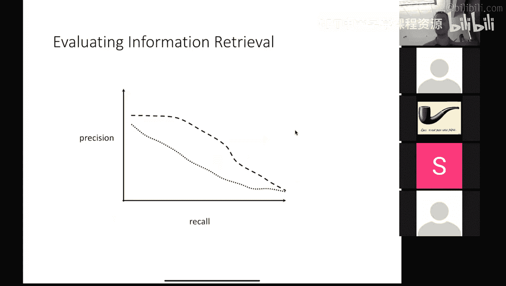
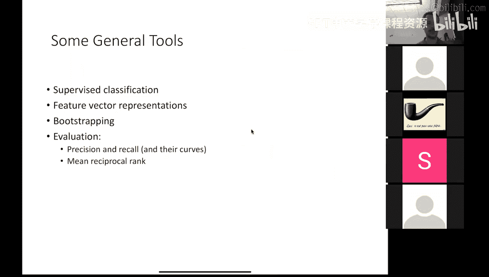

# 02：自然语言处理应用

## 1. 课程介绍

大家好，今天我们将讨论自然语言处理（NLP）的应用。NLP在信息提取、问答和信息检索等领域有着广泛的应用。

## 2. 信息提取

信息提取是指从文本中提取结构化信息的过程。它通常包括以下步骤：

* **命名实体识别（NER）**：识别文本中的命名实体，如人名、地名、组织名等。
* **关系抽取**：识别实体之间的关系，如“工作于”、“居住于”等。
* **事件抽取**：识别文本中的事件，如“选举”、“战争”等。

### 2.1 命名实体识别（NER）

NER是信息提取中最基本的步骤。它将文本中的每个词标记为实体或非实体。以下是一些常用的NER方法：

* **基于规则的方法**：使用预定义的规则来识别实体。
* **基于统计的方法**：使用机器学习模型来识别实体。
* **基于深度学习的方法**：使用深度学习模型来识别实体。

### 2.2 关系抽取

关系抽取是指识别文本中实体之间的关系。以下是一些常用的关系抽取方法：

* **基于规则的方法**：使用预定义的规则来识别关系。
* **基于统计的方法**：使用机器学习模型来识别关系。
* **基于深度学习的方法**：使用深度学习模型来识别关系。

## 3. 问答

问答是指从文本中回答用户提出的问题。以下是一些常用的问答方法：

* **基于信息检索的方法**：使用信息检索技术来找到与问题相关的文档，并从中提取答案。
* **基于知识图谱的方法**：使用知识图谱来回答问题。
* **基于深度学习的方法**：使用深度学习模型来回答问题。

## 4. 信息检索

信息检索是指从大量文档中检索与用户查询相关的文档。以下是一些常用的信息检索方法：

* **向量空间模型**：将文档和查询表示为向量，并计算它们的相似度。
* **TF-IDF**：一种用于计算词频和逆文档频率的算法。
* **余弦相似度**：一种用于计算两个向量之间相似度的算法。

## 5. 总结

本节课我们介绍了自然语言处理的应用，包括信息提取、问答和信息检索。这些应用在许多领域都有广泛的应用，例如搜索引擎、聊天机器人、智能客服等。

**本节课我们学习了以下内容**：

* 信息提取：命名实体识别、关系抽取、事件抽取
* 问答：基于信息检索的方法、基于知识图谱的方法、基于深度学习的方法
* 信息检索：向量空间模型、TF-IDF、余弦相似度