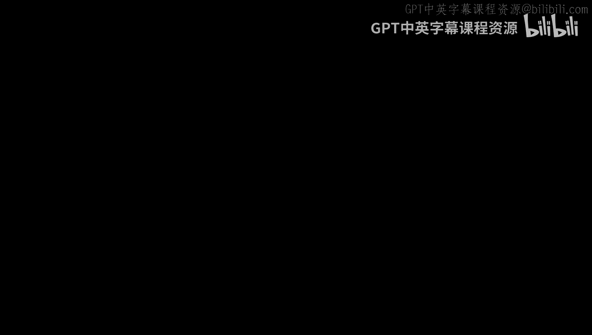
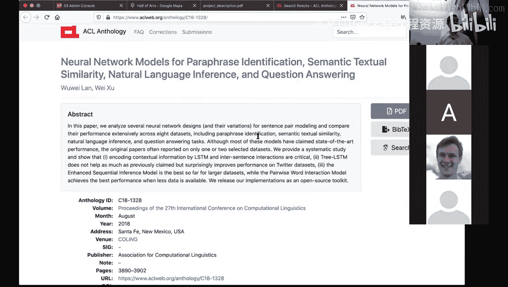
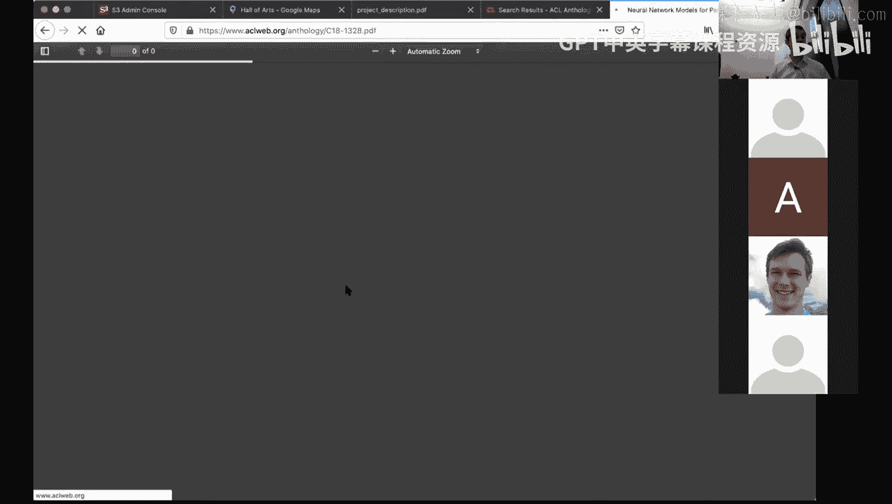
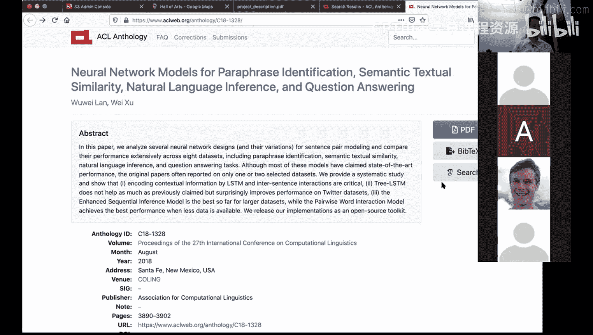

# 03：项目

## 项目概述

在本节课中，我们将学习如何构建一个基于维基百科文章的问答系统。该系统将包括两个主要部分：问题生成和答案生成。

### 问题生成

**目标**：给定一篇维基百科文章，生成 N 个高质量的问题。

**输入**：维基百科文章文本

**输出**：关于文章的 N 个流畅且合理的问题

**方法**：

*   使用模板：例如，x 是 y，然后可以提出问题“y 是什么？”
*   基于句子结构进行分类，并使用模板确定可以从中生成哪些问题。

### 答案生成

**目标**：给定一篇维基百科文章和关于文章的问题，生成一个流畅、正确且智能的答案。

**输入**：维基百科文章文本和问题列表

**输出**：针对每个问题的单个答案

**方法**：

*   使用基于信息检索的问答系统。
*   使用向量文档模型找到可能包含答案的文本子集。
*   将这些段落处理成答案。

### 评估

*   人类评估：评估问题的流畅性、合理性、难度和可答性。
*   自动评估：评估答案的流畅性、正确性和智能性。

## 项目流程

1.  **组建团队**：每个学生都需要加入一个团队。
2.  **项目初步计划**：在 9 月 24 日之前提交项目初步计划。
3.  **项目进度报告**：在 10 月 22 日之前提交项目进度报告。
4.  **中期会议**：在期中考试后的两周内，导师和助教会与每个团队会面，讨论项目进度报告。
5.  **项目预演**：在 11 月 17 日之前提交项目预演代码。
6.  **最终代码**：在 12 月 3 日之前提交最终代码。
7.  **最终项目报告**：在 12 月 10 日之前提交最终项目报告。

## 项目资源

*   维基百科文章
*   样本问题
*   样本答案
*   ACL 汇编

## 注意事项

*   不得使用黑盒语法检查器。
*   不得使用可能包含答案的数据库或知识库。
*   代码不得访问互联网。

## 总结

在本节课中，我们学习了如何构建一个基于维基百科文章的问答系统。该系统将包括问题生成和答案生成两个主要部分。我们将使用模板和信息检索技术来生成问题，并使用向量文档模型来生成答案。我们还将讨论项目的评估方法和流程。