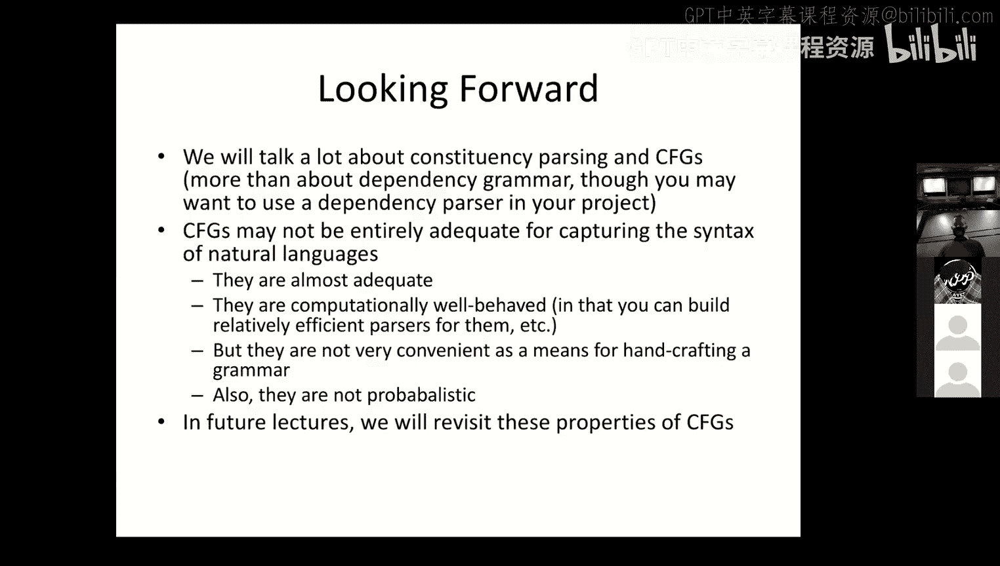

# 08：Syntax

## 1. 语法概述

在本节课中，我们将学习自然语言处理中的语法概念。语法是研究语言结构和规则的科学，它帮助我们理解句子是如何构建的以及它们的意义。

### 1.1 语法与语义的区别

*   **语法**：关于语言的结构和形式，例如句子如何组合成短语和句子。
*   **语义**：关于语言的意义，例如句子表达的内容和意图。

### 1.2 语法规则

语法规则定义了语言中合法的句子结构。例如，英语中名词短语（NP）通常由冠词、形容词和名词组成。

## 2. 语法分析

语法分析是将句子分解成其组成部分的过程。这有助于我们理解句子的结构和意义。

### 2.1 依存句法

依存句法是一种语法分析方法，它将句子分解成单词之间的关系。例如，主语和谓语之间的关系是依存关系。

### 2.2 生成句法

生成句法是一种语法分析方法，它使用规则和短语结构来构建句子。例如，句子可以由名词短语和动词短语组成。

## 3. 上下文无关文法

上下文无关文法（CFG）是一种语法规则的形式化表示。它由终结符、非终结符、起始符号和产生式组成。

### 3.1 终结符和非终结符

*   **终结符**：代表单词或符号，例如名词或动词。
*   **非终结符**：代表短语或句子，例如名词短语或句子。

### 3.2 产生式

产生式定义了如何将非终结符替换为终结符或非终结符的组合。

## 4. 语法分析器

语法分析器是一种程序，用于将句子分解成其组成部分。常见的语法分析器类型包括：

*   **LL分析器**：从左到右扫描句子，并使用左递归规则进行解析。
*   **LR分析器**：从左到右扫描句子，并使用左递归和右递归规则进行解析。

## 5. 语法在自然语言处理中的应用

语法在自然语言处理中有很多应用，例如：

*   **词性标注**：识别句子中每个单词的词性。
*   **句法分析**：将句子分解成其组成部分。
*   **语义分析**：理解句子的意义。

## 6. 总结

在本节课中，我们学习了自然语言处理中的语法概念，包括语法规则、语法分析、上下文无关文法和语法分析器。语法是理解语言结构和意义的重要工具，它在自然语言处理中有很多应用。