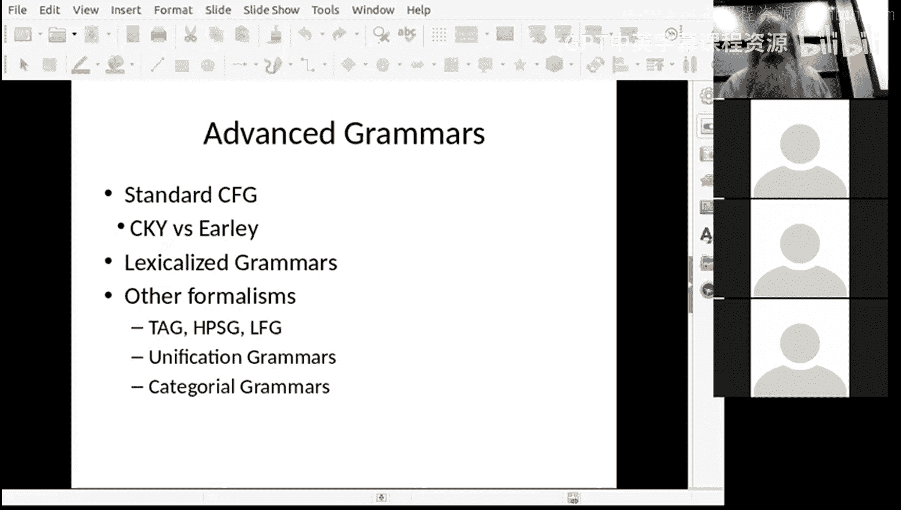
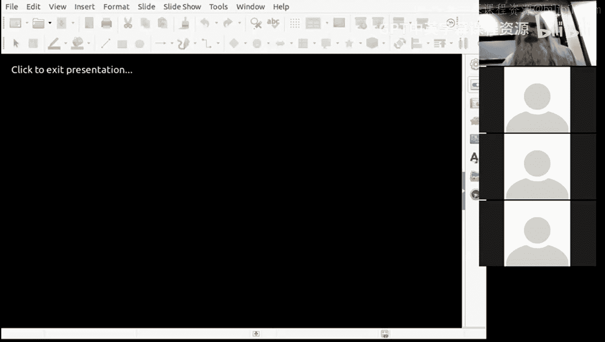

# 11：解析算法

## 解析算法

在本节课中，我们将学习自然语言处理中的解析算法。我们将介绍一些新的算法和解析类型，包括依存句法解析。

### 概率上下文文法解析

首先，我们将讨论概率上下文文法解析。在上一节课中，David介绍了CQY算法以及如何使用它进行解析。我们希望能够考虑以下情况：

**公式**：\( P(A) = \frac{P(A \cap B)}{P(B)} \)

其中，\( A \) 和 \( B \) 是两个事件。

例如，考虑以下句子：

- Book the dinner flight
- Book the dinner flight

这两个句子有不同的含义。第二个句子是在告诉某人叫做 flightlight 的人预订晚餐。因此，我们需要一种机制来在这两种可能性之间进行选择。

为了实现这一点，我们可以为之前处理过的每个规则添加概率。然后，我们可以计算每个句子的概率，并选择最有可能的句子。

### CKY 算法

CKY 算法是一种用于解析上下文无关文法的算法。它通过构建一个图表来存储所有可能的解析树，并从中选择最佳解析树。

**公式**：\( S \rightarrow NP \ VP \)

其中，\( S \) 是句子，\( NP \) 是名词短语，\( VP \) 是动词短语。

### Earley 算法

Earley 算法是一种更通用的上下文无关文法解析算法。它可以处理任意上下文无关文法，并且可以找到所有可能的解析树。

**公式**：\( S \rightarrow NP \ VP \)

其中，\( S \) 是句子，\( NP \) 是名词短语，\( VP \) 是动词短语。

### 词汇化语法

词汇化语法是一种将词汇信息添加到语法中的方法。它可以提高解析的准确性。

**公式**：\( S \rightarrow NP \ VP \)

其中，\( S \) 是句子，\( NP \) 是名词短语，\( VP \) 是动词短语。

### 依存句法解析

依存句法解析是一种分析句子中词语之间依赖关系的算法。

**公式**：\( S \rightarrow NP \ VP \)

其中，\( S \) 是句子，\( NP \) 是名词短语，\( VP \) 是动词短语。

### 总结

在本节课中，我们一起学习了自然语言处理中的解析算法。我们介绍了概率上下文文法解析、CKY 算法、Earley 算法、词汇化语法和依存句法解析。希望这些内容能够帮助您更好地理解自然语言处理中的解析算法。