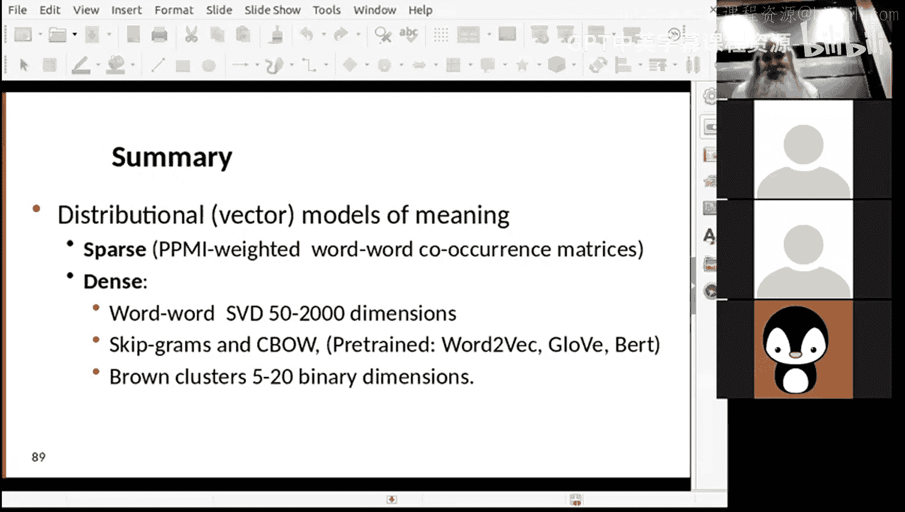

# 14：词嵌入


## 1. 引言

在本节课中，我们将学习词嵌入的概念，这是自然语言处理中一个重要的工具。词嵌入将单词表示为向量，从而可以捕捉单词之间的语义关系。

## 2. 词嵌入的必要性

传统的文本表示方法，如单词的索引，无法捕捉单词之间的语义关系。例如，"fast" 和 "rapid" 都表示速度，但它们在语义上并不相同。词嵌入可以帮助我们捕捉这些语义关系。

## 3. 分布模型

词嵌入基于分布模型，即单词的意义可以通过它们在上下文中的出现来推断。例如，如果一个单词经常与另一个单词一起出现，那么这两个单词可能在语义上相似。

## 4. 词嵌入的类型

* **稀疏向量表示**：使用零和一表示单词的上下文。
* **密集向量表示**：将稀疏向量投影到更小的空间中，从而获得更紧凑的表示。
* **神经网络**：使用神经网络学习单词的表示。
* **布朗聚类**：将单词聚类到语义相似的组中。

## 5. 核心词向量

核心词向量通过分析单词在文档中的上下文来计算。例如，我们可以计算单词 "battle" 在莎士比亚戏剧中的出现次数。

## 6. 点互信息 (PMI)

点互信息是一种衡量两个单词之间相似性的指标。它考虑了两个单词同时出现的概率与它们各自出现的概率的乘积。

## 7. 余弦相似度

余弦相似度是一种衡量两个向量之间相似性的指标。它基于两个向量的夹角。

## 8. 词嵌入的应用

词嵌入可以用于各种自然语言处理任务，例如：

* **问答系统**
* **文本摘要**
* **抄袭检测**
* **拼写检查**

## 9. 总结

在本节课中，我们学习了词嵌入的概念、类型和应用。词嵌入是一种强大的工具，可以帮助我们理解和处理自然语言。

## 10. 代码示例

以下是一个使用 Word2Vec 训练词嵌入的 Python 代码示例：

```python
from gensim.models import Word2Vec

# 加载文本数据
text = "The quick brown fox jumps over the lazy dog."

# 创建 Word2Vec 模型
model = Word2Vec([text.split()], vector_size=100, window=5, min_count=1, workers=4)

# 获取单词的向量表示
word_vector = model.wv["quick"]
```

## 11. 参考资料




* [Word2Vec](https://radimrehurek.com/gensim/models/word2vec.html)
* [GloVe](https://nlp.stanford.edu/projects/glove/)
* [BERT](https://arxiv.org/abs/1810.04805)